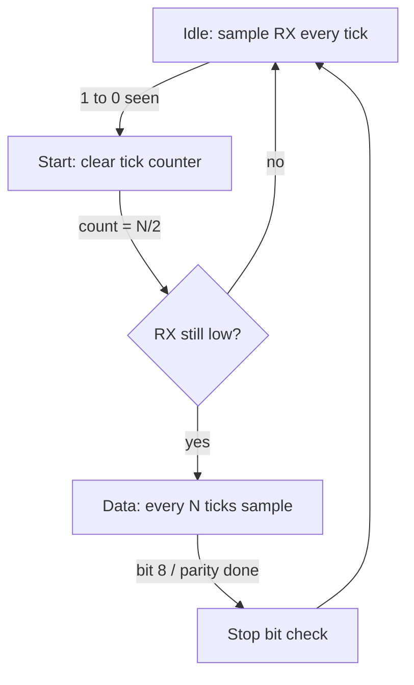

::: testing
Four linked sub-questions, and the interviewer wants all four in order: **what** oversampling is, **how** it is implemented (a counter at N times the baud, with a count-to-centre rule), **why** it is needed (locating the bit centre and rejecting noise when you have no clock), and **which rates** (16x classic, 8x common, a few others).

Hidden sub-skills: reasoning about timing quantisation, majority voting, trade-offs between oversample factor and maximum baud rate, and linking to the tolerance budget.
:::

::: why
Oversampling is the mechanism that makes asynchronous reception work in real chips. Without it, a receiver would have to guess where to sample from a single falling edge, with no way to reject noise. It is the reason the baud-rate divisor in a datasheet has a factor of 16 in it. Understanding it lets you read a reference manual, compute the achievable baud rate for your clock, pick 8x vs 16x when your clock is awkward, and reason about noise flags.
:::

::: concepts
- **Sampling the line faster than the data rate**: the receiver's internal clock runs at $N\times$ baud, giving $N$ samples per bit. See [[q0778]].
- **Bit-centre location**: count $N/2$ ticks after the start edge, then $N$ ticks per bit.
- **Majority vote**: take three adjacent samples around the centre and use the majority to reject single-sample noise.
- **Quantisation of the start edge**: edge detection is accurate only to one tick, i.e. $1/N$ of a bit.
- **Baud-rate generator**: divides the peripheral clock by $N\times D$. See [[q0775]].
- **Sampling theory**: any sampled system has a time resolution of one sample period; see [[q0777]] for what replaces the clock.
:::

::: answer
"Oversampling means the receiver samples the incoming line much faster than the bit rate, typically 16 times per bit. It uses an internal clock at 16 times the baud rate and counts ticks.

How it's implemented: the receiver watches the line on every tick. When it sees a falling edge, that's the start bit, and it starts counting. Eight ticks later it's in the middle of the start bit, and it checks it's still low to reject glitches. After that it samples once every 16 ticks, so each sample lands in the middle of a bit. Many UARTs also take three samples, around ticks 7, 8 and 9, and do a majority vote, so a single noisy sample doesn't flip the bit.

Why it's needed: there's no clock, so the receiver has to find the bit boundaries from one edge. If it only sampled once per bit time, it wouldn't know where the edge was to within a whole bit, and it couldn't centre itself or reject noise. With 16 samples per bit it knows the edge to within one sixteenth of a bit.

Common rates are 16x, which is the classic standard, and 8x, which many modern MCUs offer as an option so they can reach higher baud rates from the same clock. Some chips also use other factors, but 16 and 8 are the ones to know."
:::

::: technical
**Definition.** Oversampling by $N$: the receiver's sampling clock is $f_s = N\cdot\text{baud}$, so each bit cell contains $N$ samples. Typical $N = 16$ or $8$.

**Implementation.**
- Baud generator: $f_s = f_{clk}/D$, with $D$ the divisor; therefore $\text{baud} = f_{clk}/(N\cdot D)$ (a 16x UART at 16 MHz and $D=9$ gives 111,111 baud; see [[q0775]]).
- Idle detection: at each tick, compare to the previous sample; a 1 to 0 transition starts a frame and zeroes a tick counter.
- Centre: at count $N/2$ confirm the line is low (start valid). Then sample at counts $N/2 + kN$.
- Noise filter: take samples at counts $N/2-1,\ N/2,\ N/2+1$ (ticks 7, 8, 9 for $N=16$; ticks 3, 4, 5 for $N=8$) and output the majority; flag a noise error if they disagree.

**Why it is needed.**
1. *Alignment*: the start edge is known only to within one tick, $T_b/N$. With $N=1$ the edge position is uncertain by a whole bit, so no centred sample is possible.
2. *Glitch and noise rejection*: voting needs multiple samples within a bit.
3. *Margin*: finer resolution leaves more of the half-bit window for clock error.

**Tolerance versus $N$ (simple model).** If the start edge is detected up to one tick late, the budget is $\varepsilon < (0.5 - 1/N)/9.5$.

| $N$ | Tolerance | Max baud at 48 MHz clock |
|---|---|---|
| 4 | 2.6% | 12 Mbaud |
| 8 | 3.95% | 6 Mbaud |
| 16 | 4.6% | 3 Mbaud |
| ideal $N\to\infty$ | 5.26% | n/a |

**Trade-off.** Higher $N$ gives better alignment and noise immunity but limits the maximum baud rate to $f_{clk}/N$. 8x doubles the available baud ceiling and gives finer divisor choices for the same clock, at the cost of slightly less margin.

**Common values.** 16x is the classic (e.g., the 16550 UART and many MCUs). 8x is an optional mode on many MCUs (for instance STM32 USARTs have an OVER8 bit; AVR parts have a double-speed bit that halves the oversampling factor). Rarely, other factors appear in some designs.
:::

::: short
"Oversampling means the receiver samples the line at a multiple of the baud rate, typically 16x. A counter runs at 16 times the baud. When it sees the falling start edge it counts 8 ticks to reach the middle of the start bit, confirms it's low, then samples every 16 ticks, so each sample lands mid-bit. It often takes three samples around the centre and majority-votes. It's needed because there's no clock: finding the bit centre and rejecting noise needs finer resolution than one sample per bit. 16x is classic; 8x is common on modern MCUs to reach higher baud rates."
:::

::: long
"Oversampling means the UART's receiver samples the RX line at a multiple of the baud rate rather than once per bit. The standard is 16 times. Inside the chip the baud-rate generator makes a clock at 16 times the baud, and a little counter runs off it.

Here's how it works. The receiver samples the line on every tick. While the line is idle high, it just keeps watching. When it sees a falling edge, it zeroes the counter. Eight ticks later it's in the middle of the start bit, so it checks the line is still low. If so, it's a real start bit. From there, every 16 ticks is one bit time, so every 16 ticks it samples again, and each sample lands in the middle of a data bit. Many designs actually take three samples, at ticks 7, 8 and 9 of each bit, and use a majority vote, so a single noise spike inside the bit doesn't flip the result.

Why do we need it? Because with no clock wire, the receiver has to locate the bit centre from a single edge. If it only had one sample per bit, it would know the edge position only to within a whole bit. With 16 samples per bit, it knows it to within 1/16 of a bit, which leaves nearly all of the half-bit window available as margin for clock mismatch. It also gives enough samples to vote out noise.

On common rates: 16x is the classic, and what you'll see in most reference manuals. A lot of modern MCUs also offer 8x, which doubles the maximum baud rate you can get from a given clock, and can reduce divider error for awkward clocks. The cost is a bit less tolerance. So with a 48 MHz clock, 16x tops out at 3 megabaud and 8x at 6."
:::

::: terms
- **Oversampling factor ($N$)**: samples per bit period; 16 and 8 are common.
- **Sampling clock**: $N\times$ baud tick used by the receiver.
- **Majority vote (3-sample)**: choosing the value seen in at least two of three centre samples.
- **Noise error flag**: status bit that indicates the three samples did not all agree.
- **Quantisation**: uncertainty of $1/N$ bit in locating the start edge.
- **OVER8 / double-speed**: mode bits that switch from 16x to 8x oversampling.
- **Baud-rate divisor ($D$)**: $f_{clk}/(N\cdot\text{baud})$ rounded.
- **Bit centre**: the middle of a bit cell, the ideal sampling point.
:::

::: exceptional
**An average answer** says "it samples multiple times per bit" and "16x is common".

**An exceptional answer**:
- Describes the mechanism concretely: counter at $N\times$ baud, start edge, count $N/2$ to centre, then $N$ per bit, plus 3-sample majority at the centre.
- Explains the resolution argument: the start edge is only known to $1/N$ bit, so oversampling bounds the sampling error and consumes a known slice of the tolerance budget.
- Gives the trade-off: higher $N$ means a lower ceiling on baud ($f_{clk}/N$) but better margin; 8x is the escape for high rates or awkward clocks.
- Computes with a real clock (for example 48 MHz at 16x gives 3 Mbaud; 16 MHz at 16x and 115200 gives divisor 8.68).
- Notes that the receiver is oversampled but the transmitter is not, and that the divisor includes the factor $N$.
:::

::: mistakes
- **"Oversampling means sending each bit 16 times."** It is on the receiver only; the transmitter sends each bit once.
- **Forgetting the factor $N$ in the baud formula.** $\text{baud}=f_{clk}/(N D)$; omitting the 16 gives a rate 16x too high.
- **"More oversampling is always better."** It lowers the maximum baud rate for a given clock.
- **Thinking 16x guarantees 5% tolerance.** It leaves about 4.6% in the simple model, and jitter and noise reduce it further.
- **Confusing UART oversampling with ADC oversampling** (averaging to gain resolution). Different goal, same word.
- **Assuming all UARTs vote on three samples.** Some sample once; check the reference manual.
:::

::: deep
## What is being sampled and why one sample per bit is not enough

The receiver has a clock of its own, say 16 MHz, and wants to find the middle of each bit in a stream whose timing it only knows approximately. The only landmark is the falling edge of the start bit. If the receiver's internal sampling rate equals the baud rate ($N=1$), then each time it samples the line it gets either 0 or 1, but it does not know *where inside the bit* it landed. The falling edge could have happened anywhere in the preceding bit time, so the first "low" sample might be at the very start of the start bit or at its very end. Every later sample inherits that uncertainty of up to a full bit, which is useless: the sample may fall exactly on an edge.

Sample $N$ times per bit and the edge is localised to within one tick, $T_b/N$. Wait $N/2$ ticks after detection and the sample lands at the centre of the start bit, give or take the detection delay: the edge can only be seen at the next tick, so detection is late by 0 to 1 tick and the sample ends up up to $T_b/N$ after the exact centre. That is the quantisation error.

## The implementation as a state machine


Figure: The receive-side flow. The tick counter is the whole mechanism: count to $N/2$ for the centre of the start bit, then count $N$ for each bit. In real chips this is a small counter plus a shift register.

At 16x and 115200 baud, the tick period is $1/(16\times115200) = 0.5425\ \mu s$. With a 16 MHz peripheral clock, the divisor needed is $16\text{ MHz}/(16\times115200) = 8.68$, which rounds to 9, giving 111,111 baud and a 3.55% error ([[q0775]]). At 8x: $16\text{ MHz}/(8\times 115200) = 17.36 \to 17$, giving 117,647 baud and +2.12%, a better fit in this case.

## The vote at the centre

```timing
{"signals":[
 {"name":"clean bit (low)","wave":"0...........","color":"accent"},
 {"name":"bit with 1-tick spike","wave":"0.....10....","color":"red"},
 {"name":"vote window (3 samples)","wave":"0....1..0...","color":"orange"}
],
"hscale":1.2}
```
Figure: Each column is one oversampling tick (schematic, 12 ticks of one bit cell shown). Middle: a bit that should read 0 but has a one-tick noise spike near its centre. The orange row is high for the three ticks around the centre where the receiver takes its samples; two of the three see 0, so the majority is 0 and the spike is voted out. A receiver that samples once at tick 6 would have read 1.

The voting window is only three ticks wide, so it tolerates a spike of at most one tick, which is $1/16$ of a bit ($0.54\ \mu s$ at 115200). It does nothing about a longer disturbance; for that, parity or a higher-level checksum is needed. Noise at the *start* edge is handled by the half-bit confirmation. Together these two mechanisms give modest noise immunity at almost no hardware cost.

## Tolerance versus oversampling

If the start edge is seen up to one tick late, the sample position starts $1/N$ bit late, so the allowed drift budget shrinks from $0.5$ to $0.5 - 1/N$ bit over 9.5 bit-times (worst case, one-sided). Hence

$$\varepsilon_{\max} \approx \frac{0.5 - 1/N}{9.5}$$

```plot
{"title":"Tolerable clock mismatch vs oversampling factor (8N1)","x":{"label":"oversampling factor N","min":2,"max":32},"y":{"label":"max mismatch","unit":"%","min":0,"max":6},
 "series":[{"label":"(0.5 - 1/N)/9.5","fn":"(0.5-1/x)/9.5*100"}],
 "hlines":[{"at":5.26,"label":"ideal limit 5.26%","color":"muted"}],
 "points":[{"x":8,"y":"(0.5-1/8)/9.5*100","label":"8x: 3.95%"},{"x":16,"y":"(0.5-1/16)/9.5*100","label":"16x: 4.6%"}]}
```
Figure: The gain from raising N flattens quickly: going from 8x to 16x buys about 0.65 percentage points, and 16x to 32x only another 0.3. That is why 16x is the sweet spot and why 8x is an acceptable compromise when you need speed. The model is simple, since real jitter and rise-time effects reduce all of these, so treat it as an upper bound.

> [!UNCERTAIN]
> The one-tick-late model is a simplification. Real receivers differ in how they synchronise the RX input, how many samples they take and where they place them, so datasheets quote their own tolerance figures. Use those for design.

## Choosing 16x or 8x

Reasons to use 8x: the clock is awkward and 8x gives a smaller divider error; or you need a baud rate above $f_{clk}/16$. At 16 MHz, 16x gives a maximum of 1 Mbaud and 8x 2 Mbaud. Reasons to stay at 16x: the best tolerance and noise margin, and it is the default almost everywhere.

```sim
{"id":"uart-frame","char":"U","baud":115200,"parity":"none","stop":1,"mismatch":0}
```
Figure: The simulation shows the 16x sample ticks inside each bit. Locate the three centre samples, then raise the mismatch slider until the sample positions drift out of their bit cells. A higher mismatch moves every sample later by an amount that grows through the frame.

## Putting numbers on a real part

Take a 72 MHz MCU peripheral clock and a target of 921600 baud. At 16x the divisor is $72\text{ MHz}/(16\times 921600) = 4.883$; an integer divisor of 5 gives 900,000 baud, which is 2.34% low, and a 4-bit fractional divider ($4 + 14/16 = 4.875$) gives 923,077 baud, +0.16%. At 8x the divisor is 9.766; the fractional version (9.75) gives 923,077 baud again but with only 8 ticks per bit. So the fractional register matters more than the 8x/16x choice at this clock, and the tolerance model says 16x keeps 0.65 points more margin. The conclusion generalises: first fix the divider error with a fraction or a better clock, then use the oversampling factor to buy speed or margin.

Also note what the **transmitter** does with all this. The transmit shift register is clocked at the baud rate (the divided-down tick divided again by $N$), so there is no oversampling there and no start-edge uncertainty. Each transmitted bit is exactly $N$ ticks long, so the transmitter's timing error is only the baud divisor error. All the quantisation and noise handling we described belongs to the receiver.

## Other uses of the word

Oversampling in ADC contexts means averaging many samples to increase effective resolution (typically one extra bit for every 4x oversampling). Here it means something different: sampling the digital line faster than its symbol rate to locate edges and reject noise. High-speed serial receivers use the same idea with a phase-selecting oversampling clock and a CDR loop.
:::

::: applications
- **Every hardware UART peripheral** (16550-style, STM32 USART, AVR USART, FPGA IP cores) implements 16x or 8x oversampling.
- **FPGA UART cores** commonly use a 16x tick generator and a counter state machine exactly as described.
- **Software UARTs** approximate it with a timer at 3x or more to find the centre.
- **Logic analyser UART decoders** sample the capture at a rate much higher than the baud (at least 4x, better 10x) to locate edges accurately.
- **Auto-baud detection** counts timer ticks between known edges and then picks the divisor.
:::

::: assumptions
- 8N1 frame; start edge detected at most one tick late; no jitter.
- The sampling points (ticks 7,8,9 for 16x; 3,4,5 for 8x) are the common convention; some designs differ.
- Oversampling is described on the receive side only; transmit timing is simply the baud clock.
- 16x and 8x are the factors I am confident about for modern MCUs; other factors such as 4x or 5x exist in some specialised designs but I would check the datasheet.
- Maximum baud figures are idealised ($f_{clk}/N$); real parts have their own limits.
:::

::: followups
### What is the difference between 16x and 8x oversampling?
The factor $N$ is the ticks per bit. 8x doubles the maximum baud rate from the same clock and lets some clocks get a smaller divider error, but quantises the start edge to 1/8 bit instead of 1/16 and has fewer samples for voting, so tolerance falls from about 4.6% to 3.95% in the simple model.

### Why does the receiver sample at ticks 7, 8, 9 and not just tick 8?
To vote out single-sample noise. The three samples straddle the bit centre, and the majority decides. If they disagree, a noise flag may be set. This costs nothing in hardware, and gives limited noise immunity.

### Would you ever oversample at a higher rate, like 64x?
Only when you need extra resolution on the edge (for example, auto-baud detection or very noisy lines). It reduces the maximum baud rate a lot, and gains little in tolerance beyond 16x. Software receivers sometimes use higher oversampling for timing accuracy.

### How does oversampling relate to the baud-rate register value?
$D = f_{clk}/(N\cdot\text{baud})$. For STM32-style USARTs with 16x oversampling, $\text{USARTDIV} = f_{clk}/(16\times\text{baud})$ and a fractional part is programmed in 4 bits. At 16 MHz and 115200, USARTDIV = 8.6806 and the nearest representable value is $8 + 11/16 = 8.6875$, giving $-0.08\%$ error.

### Harder: a receiver using 16x oversampling sees a 1-tick glitch low on an idle line. What happens?
If the receiver only checks the line at the half-bit point (tick 8), the glitch has long gone, so it rejects the false start and returns to idle. Some designs also use the three-sample vote on the start bit. A glitch that lasts 8 ticks or more at the right moment (about 4.3 us at 115200) looks like a real start bit and produces garbage or a framing error.
:::

::: interpretations
The question has four parts: what oversampling is, how it is implemented, why it is needed and common rates. I answer them in that order. "Oversample rate" means the oversampling *factor* (samples per bit), not a rate in Hz. The effect on achievable baud is on [[q0775]], the receive procedure on [[q0778]].
:::

::: references
- Vendor reference manuals (STM32 USART "Receiver" and "Fractional baud rate generation" sections; AVR USART "double speed" mode): oversampling modes and sample positions.
- TL16C550-family UART datasheets: 16x clock and receiver timing description.
- Horowitz & Hill, *The Art of Electronics*, 3rd ed.: asynchronous serial and receiver sampling.
:::

::: rubric
- Defines oversampling: receiver clock at N x baud, N samples per bit :: The first sub-question.
- Describes the counter: start edge, count N/2 to centre, N per bit :: The "how implemented" sub-question.
- Mentions 3-sample majority vote around the centre :: Real-hardware noise handling.
- Explains why: no clock, edge known only to 1/N bit, noise rejection :: The "why needed" sub-question.
- Gives common factors: 16x classic, 8x common :: The "common rates" sub-question.
- States the trade-off: ceiling on baud rate vs tolerance, and computes with a real clock :: Engineering judgment.
:::

::: quiz
```json
[
 {"type":"mcq","level":"fundamental","q":"What is the most common oversampling factor for a classic UART receiver?","options":["1x","4x","16x","256x"],"answer":2,"explain":"16x is the classic factor, with 8x a common alternative on modern MCUs."},
 {"type":"numeric","level":"fundamental","q":"With 16x oversampling, after how many ticks from the start edge does the receiver check the middle of the start bit?","answer":8,"tolerance":0.01,"unit":"ticks","explain":"N/2 = 8 ticks, half a bit time."},
 {"type":"numeric","level":"intermediate","q":"A UART with 16x oversampling is clocked at 48 MHz. What is the maximum baud rate (divisor = 1) in Mbaud?","answer":3,"tolerance":0.01,"unit":"Mbaud","explain":"baud = f_clk/(N x D) = 48 MHz / 16 = 3 Mbaud."},
 {"type":"numeric","level":"intermediate","q":"A 16 MHz clock with 8x oversampling and an integer divisor targets 115200 baud. What is the actual baud rate in baud?","answer":117647,"tolerance":0.002,"unit":"baud","explain":"D = 16e6/(8 x 115200) = 17.36, rounded to 17. Actual = 16e6/(8 x 17) = 117,647 baud (+2.1%)."},
 {"type":"mcq","level":"intermediate","q":"Why does a receiver take three samples near the bit centre and majority-vote?","options":["To detect parity","To reject a single-sample noise spike inside the bit","To measure the baud rate","To lower the tolerance"],"answer":1,"explain":"A one-tick glitch can flip one of the three samples but not the majority. A single-sample receiver would be fooled."},
 {"type":"truefalse","level":"advanced","q":"Raising the oversampling factor from 8x to 16x increases the maximum baud rate achievable from a given peripheral clock.","answer":false,"explain":"Max baud is f_clk/N, so going from 8x to 16x halves the ceiling. In exchange you get finer start-edge resolution and slightly better tolerance."}
]
```
:::
