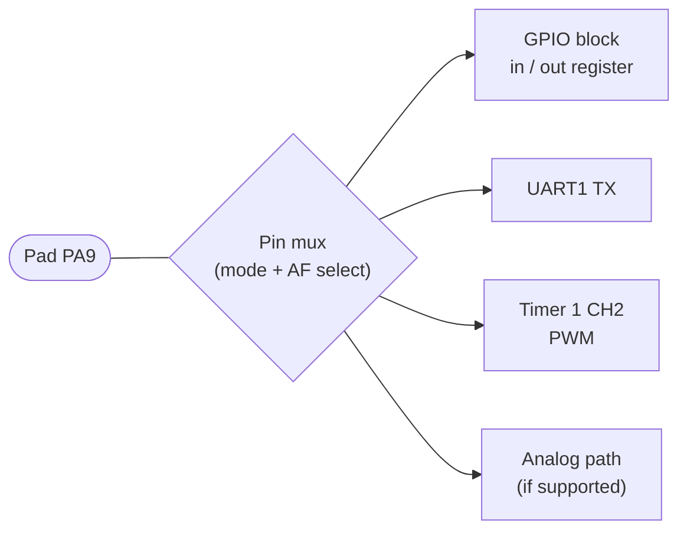

::: basics
### In plain words
"General purpose" means a pin is not tied to one fixed job. A general-purpose pin has no assigned job until software gives it one. Software picks whether it is an input or an output, and what level it drives. In practice these pins are shared with other functions, and they are not all identical.

### Picture it
Picture a hotel with a few fixed-use rooms, such as the ice machine room and the lobby, which can never be anything else. The rest are general rooms that can be booked as a bedroom or a meeting room. A booking board decides each room's use at any moment. But the rooms differ: some have a window, some are wheelchair-accessible. The booking board is the pin multiplexer, and the room features are things like 5 V tolerance.

### Words you need
- **Dedicated pin**: a pin with one fixed job, such as power, ground, reset or the clock crystal.
- **General-purpose pin**: a pin whose role is chosen in software. See [[q0780]].
- **Pin multiplexing (alternate function)**: a selector in front of the pin that connects it to the plain GPIO block or to a built-in hardware block (a peripheral), such as a serial port's transmit line.
- **High-impedance input**: the usual state right after reset. The pin neither drives nor loads the wire.
- **5 V tolerant**: able to accept 5 V on a 3.3 V chip.

### The simplest example
Say a 48-pin microcontroller uses 9 pins for power, ground, reset, crystal and dedicated USB. That leaves at most $48 - 9 = 39$ general-purpose pins. If your design needs a UART (2 pins), SPI (4 pins) and I2C (2 pins), those peripherals take 8 of them, and 31 remain for plain GPIO. Also, after reset those pins float as inputs, so any external part wired to them must be safe in that state. That is the whole idea. The rest of this page covers pin maps, per-pin differences and a planning workflow.
:::

::: testing
A short question with a precise answer: "GP" means **general-purpose**, as in *not dedicated to one function*. The interviewer is checking whether you can say what that contrasts with (dedicated pins such as power, clock, reset, analog or USB pins), what makes a pin "general" (software chooses direction and level), and the practical wrinkle: GPIO pins are usually *shared* with peripherals through pin multiplexing, and are not all identical.

Hidden sub-skills: pin planning, alternate functions, reset-state behaviour, and the limits of "general".
:::

::: why
When you pick an MCU or lay out a board, pin assignment is a puzzle. Knowing that "general-purpose" means "assignable, with constraints" is what lets you plan: which pins have the UART TX you need, which can wake the chip from sleep, which are 5 V tolerant, which are analog capable. Teams routinely lose days to a respin because two required functions landed on the same pin or a "general" pin turned out to be a boot strap. A clear answer shows you think about the part's pin map, not just the abstraction.
:::

::: concepts
- **Dedicated-function pin**: has a single fixed job (VDD, VSS, reset, crystal, USB D+/D-, analog reference). Not available as GPIO.
- **General-purpose pin**: no fixed job; software decides input or output, and the level. See [[q0780]].
- **Pin multiplexing (alternate function)**: one physical pad can connect to several internal signals; configuration selects which. See [[q0787]].
- **Reset state**: after reset most pins are high-impedance inputs, so nothing is driven until firmware says so.
- **Pin constraints**: not all GPIOs are equal: some are 5 V tolerant, analog capable, high-drive, wake-capable or boot-strap pins.
- **Pin budget**: number of GPIOs available after dedicated pins; see [[q0782]] for what to do when it runs out.
:::

::: answer
"GP stands for general-purpose, meaning the pin isn't tied to one specific function. A power pin always has to be power, a crystal pin always connects to the oscillator, and the reset pin is always reset. A general-purpose pin has no assigned job until the software gives it one. I can choose whether it's an input or an output, drive it high or low, read it, or put a pull-up on it.

The nuance is that these pins are usually shared. The same physical pin can be a plain GPIO, or it can be handed over to a peripheral, like UART TX, an SPI clock, a timer's PWM output or an ADC input. That's called pin multiplexing or alternate functions, and a mux in front of the pad chooses which internal block is connected.

And 'general' doesn't mean 'identical'. In the datasheet some pins are 5 volt tolerant and some aren't, some can be analog inputs, some can wake the chip from sleep, some have higher drive strength, and a few are boot-mode straps that need a particular level at reset. So when I plan a board I make a pin table and check each assignment against what that specific pin can do."
:::

::: technical
**Meaning.** "General-purpose" = the pad is not wired to a single fixed internal function; its function is set by configuration registers at run time.

**Dedicated vs general.**

| Pin type | Examples | Software can repurpose? |
|---|---|---|
| Power/ground | VDD, VSS, VDDA, VBAT | no |
| Clock/reset | XTAL in/out, NRST | no (some can be freed in special modes) |
| Fixed peripheral | USB D+/D-, dedicated analog reference | no |
| Debug | SWDIO, SWCLK, JTAG | can usually be reclaimed as GPIO, with consequences |
| **General-purpose** | Port A to Port H pins | yes: GPIO or alternate function |

**Per-pin selection.** A mode field typically offers: input, output, alternate function, analog. In alternate-function mode a further field (alternate-function number) picks which peripheral signal the pad connects to. For example, on many STM32 devices one pad can be GPIO, a USART TX or a timer channel, chosen by the mode and alternate-function registers (check the datasheet's alternate function table for the exact map).

**What "general" does not guarantee.** Per-pin differences in: voltage tolerance (5 V tolerant or not), analog capability, maximum drive and speed, availability of a wake-up function, state during reset, and strapping function at boot.

**Reset state.** Typically input floating or with pull, so pins are high-impedance until configured. Design external circuitry (gate pull-downs, enable pull-ups) so the system is safe in that state.

**Pin budget.** On a package with $P$ pins, usable GPIOs $\approx P - (\text{power, ground, reset, clock, dedicated})$. A hypothetical 48-pin part with 9 power/ground/reset/oscillator pins has at most 39 GPIOs, and each used peripheral signal takes one of them.
:::

::: short
"GP means general-purpose: the pin has no fixed job, so software decides whether it's an input or an output and what level it drives. That contrasts with dedicated pins like power, ground, reset or the crystal, which always do one thing. In practice GPIO pins are multiplexed with peripherals, so the same pad can be a GPIO, a UART TX, a PWM output or an ADC input depending on configuration. And general doesn't mean identical: some pins are 5 V tolerant, analog capable or boot straps, so I check the datasheet's pin table when assigning."
:::

::: long
"GP stands for general-purpose. It means the pin isn't hardwired to one function. Compare that with a dedicated pin: a VDD pin is always power, the crystal pins are always the oscillator, the reset pin is always reset. You can't repurpose those. A general-purpose pin starts out with no job, and the software decides: input or output, high or low, with or without a pull resistor.

In a real MCU, though, a lot of those pins are also shared. There's a multiplexer in front of each pad, and a configuration register chooses what the pad connects to. One option is the plain GPIO block. Others are alternate functions, so the same pin might be a UART TX, an SPI clock, a timer output for PWM, or an analog input to the ADC. That's how a small package can offer lots of peripherals without a huge pin count, as long as you don't need all the functions on the same pin at once.

The other thing to say is that 'general' doesn't mean 'identical'. The datasheet will show that some pins are 5 V tolerant and some aren't, some have analog capability, some can wake the MCU from deep sleep, some can drive more current, and a few double as boot-mode straps, which means the level on them at reset changes how the chip starts. Debug pins like SWD are usually general-purpose pins that default to the debug function, so if you reclaim them you can lock yourself out of the debugger.

So when I design a board I make a pin map early: list every signal I need, find which pins can provide it, resolve conflicts, and check electrical constraints. And after reset, pins are generally high-impedance inputs, so I make sure the external circuit is safe in that state before the firmware has configured anything."
:::

::: terms
- **General-purpose (GP)**: not dedicated to a single fixed function; assignable in software.
- **Dedicated pin**: pin with a single fixed role (power, ground, reset, crystal, USB).
- **Pin multiplexing (pinmux)**: selecting which internal signal connects to a pad.
- **Alternate function (AF)**: a peripheral signal (UART TX, SPI SCK, PWM) that can be routed to a GPIO pad.
- **5 V tolerant**: input that safely accepts voltages above $V_{DD}$ up to a stated limit, typically 5 V.
- **Boot strap pin**: pin whose level at reset selects the boot mode.
- **Pin map / pin table**: planning table of signals to pins.
- **High-Z (high impedance)**: reset state where the pin neither drives nor loads.
:::

::: exceptional
**An average answer** says "general purpose means you can use it for anything".

**An exceptional answer**:
- Contrasts with **dedicated pins** and gives examples.
- Explains **pin multiplexing**, the real-world constraint on "anything".
- Says that "general" does not mean "identical": tolerance, analog, drive, wake and boot-strap differences.
- Notes the reset state (high-Z) and its design consequence for external circuitry.
- Describes the practical workflow: build a pin map early and check each pin's allowed functions.
- Mentions the debug-pin trap (reclaiming SWD).
:::

::: mistakes
- **"Any pin can do any function."** Alternate functions are fixed per pin (or limited to a few options). Some MCUs have flexible routing matrices, but not all.
- **Treating all GPIOs as 5 V tolerant.** Only those marked as such in the datasheet.
- **Forgetting reset-state behaviour.** Pins start as inputs; external gates without pull-downs can switch things on at boot.
- **Using a boot-strap pin for an arbitrary external signal.** The level at reset can force the chip into the wrong boot mode.
- **Reclaiming debug pins** (SWD/JTAG) without a safe recovery path.
- **Assuming "GP" is a different type of hardware.** It describes the role of the pin, not its construction.
:::

::: deep
## Two kinds of pin on the same package

Open any MCU datasheet and the pin table has two very different groups. The first group has fixed roles: supplies, grounds, the reset line, the crystal oscillator pins, the dedicated USB data pins, the analog reference. These are built for their job and the silicon behind them is specialised: a crystal pin connects to an oscillator amplifier, not a digital driver. The second group is the **ports**, labelled PA0, PA1, ..., PB0, ..., and so on. Each of these pads has the generic circuit of [[q0783]]: output driver, input buffer, pulls and protection, plus a multiplexer. These are the "general-purpose" ones.


Figure: One physical pad, several possible owners. The mux selects exactly one at a time. Plain "GPIO" is just one of the choices, which is why the pin is called general-purpose: its default owner is the software-visible port.

(The labels follow what many STM32 parts do for one such pin. The exact functions of each pin are in the datasheet's alternate-function table and differ between parts.)

## Why not give every function its own pin?

Pins cost money: package size, PCB area, bonding wires, test time. A 48-pin package is cheaper and smaller than a 100-pin one. The chip may contain four UARTs, three SPI ports, six timers, an ADC with 16 channels, I2C, CAN and USB, which together need far more than 48 pins if each signal had its own. Because a real design never uses all of them simultaneously, the vendor shares pins through the mux. General-purpose pins are the flexible resource that makes this possible.

Doing the arithmetic: say a 48-pin MCU has 9 pins for power, ground, reset, crystal and dedicated USB. That leaves 39 pads for everything else. If your design needs a UART (2), SPI (4), I2C (2), 8 ADC channels, 6 PWM channels, a debug port (2), and 10 plain GPIOs, you have 34 signals: it fits, but only if the vendor's pinmux allows these particular functions to land on 34 *different* pads. A pin table check will find the conflicts early; a respin finds them late.

## "General" is not "identical"

| Property | Why it differs per pin |
|---|---|
| 5 V tolerance | Some pads have a special input structure without a diode to VDD, others clamp to VDD |
| Analog capability | Only pads routed to the ADC/comparator input have an analog path |
| Drive strength / speed | Pads on fast interfaces have stronger drivers; some "high-current" pads sink more |
| Wake-up function | A few pins are wired to the always-on domain and can wake from deep sleep |
| Reset/strap behaviour | Boot-select pins are sampled at reset; some pins have pulls enabled by default |
| Debug function | SWD/JTAG pins come up as debug at reset |

A common mistake is to choose pins by silkscreen convenience. Instead, make a table of required signals and tick off, for each, the pins that offer it and satisfy the constraints.

## The software-defined nature is the point

Because the function is chosen at run time, the same pin can change role while the system runs. A one-wire bus (a single bidirectional data line) drives a pin as an output to send a bit and then flips it to an input to listen. Some designs turn a debug pin into a GPIO after boot to save a pin. Boards can even repurpose a bus: SPI pins used as plain GPIOs for bit-banged programming of an external device, then handed back to the SPI peripheral.

```sim
{"id":"gpio-lab","view":"input"}
```
Figure: The input view shows the same pad as a floating input, as an input with a pull-up and as an input with a pull-down. This is what "general purpose" means at the electrical level: nothing about the pad forces one behaviour; the configuration does. Try each pull option and notice what a floating input reads.

## Pin-mapping workflow I would use

1. List every signal the board needs (UART TX/RX, SPI SCK/MISO/MOSI, 3 chip selects, 2 I2C lines, 6 PWM, 4 ADC, ...).
2. For each peripheral signal, find the pins that can carry it in the datasheet's alternate-function table.
3. Place the constrained ones first (ADC, USB, high-speed SPI), then the flexible ones.
4. Check each assignment against electrical constraints (5 V tolerance, drive current, boot straps).
5. Leave spare pins and plan a header for future signals.
6. Check reset-state safety: what each pin does before firmware configures it, and add pull-ups or pull-downs so external circuits are safe.
7. Route the board, and keep the table in the repo as documentation.

## Other places the phrase appears

"General-purpose" is a recurring word in computing. General-purpose registers (GPRs) in a CPU can hold any value, as opposed to special registers such as the program counter or status register. A GPU is "graphics" but GPGPU means general-purpose computing on one. The thread is the same: flexible, assignable, not tied to one job at the hardware level.
:::

::: applications
- **Dev boards** expose GPIO headers precisely because the pins are assignable; the user picks what to plug in.
- **Pin-count-limited designs**: a 20-pin MCU has perhaps 14 GPIOs shared among UART, SPI, I2C, PWM and ADC.
- **Reconfigurable boards**: the same PCB can run different firmware that assigns pins differently.
- **Bit-banged protocols** on pins where no peripheral is available.
- **Reclaiming debug pins** as GPIO in production firmware to save a pin (with care).
:::

::: assumptions
- I describe a typical 32-bit MCU port/pin structure; very small 8-bit parts have simpler pins, and FPGAs and some SoCs have fully flexible I/O routing matrices.
- Alternate-function maps are device-specific; examples are illustrative and must be checked against the datasheet of the part.
- "General-purpose" is taken as the standard expansion; some documentation says "general-purpose I/O" without distinguishing from "digital I/O".
- Pin counts are hypothetical examples to show the arithmetic.

> [!UNCERTAIN]
> The example of one pad being a GPIO, a USART TX and a timer channel follows a common pattern on STM32-family parts, but I'm not citing a specific part number. Always verify the alternate-function table of the exact device.
:::

::: followups
### Can any GPIO pin be used for any peripheral?
Not usually. Each peripheral signal can reach a limited set of pins, listed in the alternate-function table. Some devices (FPGAs, some newer MCUs with a crossbar or "peripheral pin select") are far more flexible, but even then analog and fixed-function pads are restricted.

### What state is a GPIO in right after reset, and why does it matter?
Usually a floating (high-impedance) input, sometimes with a weak pull. External circuits must be safe in that state: gate pull-downs on MOSFETs, enable pins with defined pull-ups, so nothing switches on randomly before the firmware runs.

### Are all GPIO pins 5 V tolerant?
No. Only the pins marked as such. Applying 5 V to a non-tolerant 3.3 V pin turns on the protection diode to VDD and can damage the pin or back-power the chip. Use a level shifter or divider ([[q0774]] discusses the divider arithmetic).

### What is a boot strap pin and why avoid using it as ordinary GPIO input?
A pin whose level is sampled at reset to choose the boot mode (e.g., flash vs bootloader). If an external circuit holds it at the wrong level during reset, the chip boots into the wrong mode. Use it for GPIO only if the external signal is guaranteed to be at the right level at reset.

### Harder: you need 12 GPIO-type functions but only 10 free pins remain. Before adding hardware, what do you try?
Re-examine the pin map: free pins used by unneeded peripherals, reclaim debug pins if you have another way to program, use alternate pin options to untangle conflicts, combine functions (share one pin for two never-simultaneous signals with a mux or by direction switching), or move to a larger package. If none works, see [[q0782]] for expanders and shift registers.
:::

::: interpretations
"What does 'GP' refer to?" is a one-word-answer question: **general-purpose**. I add the pin-multiplexing context because "general-purpose" is exactly what that mux is for. The overall definition and use cases are on [[q0780]].
:::

::: references
- Vendor MCU datasheets: pin-description tables and alternate-function mapping tables (for example in STM32, NXP, TI or Microchip families).
- Vendor reference manuals: GPIO and "pin control / I/O multiplexing" chapters.
- Horowitz & Hill, *The Art of Electronics*, 3rd ed.: microcontroller I/O interfacing.
:::

::: rubric
- GP = general-purpose, not dedicated to one function :: The direct answer.
- Contrasts with dedicated pins (power, reset, crystal, USB) :: Makes the meaning concrete.
- Software chooses direction, level, pull :: Defines the "purpose" as software-configurable.
- Pin multiplexing/alternate functions :: The real-world qualification of "general".
- Not all pins are identical (tolerance, analog, drive, boot straps) :: Shows practical datasheet awareness.
- Pin-map planning and reset-state safety :: Shows engineering process.
:::

::: quiz
```json
[
 {"type":"mcq","level":"fundamental","q":"What does the \"GP\" in GPIO stand for?","options":["Ground Protected","General-Purpose","Gate Pulse","Grid Power"],"answer":1,"explain":"General-purpose: the pin is not dedicated to one fixed function; software assigns its role."},
 {"type":"mcq","level":"fundamental","q":"Which pin is NOT general-purpose?","options":["A pin that can be set high or low by software","A VDD power pin","A pin that can be an input with a pull-up","A pin that can be switched to UART TX"],"answer":1,"explain":"Power pins have a fixed function and cannot be repurposed by software."},
 {"type":"truefalse","level":"intermediate","q":"Every GPIO pin on a 3.3 V MCU can safely accept a 5 V input.","answer":false,"explain":"Only pins marked 5 V tolerant can. Others clamp through a diode to VDD and may be damaged."},
 {"type":"mcq","level":"intermediate","q":"What is pin multiplexing?","options":["Using a resistor ladder to read many buttons","Selecting which internal signal (GPIO, UART, PWM, ADC, ...) connects to a physical pad","Time-sharing a pin between two chips","Doubling the drive strength"],"answer":1,"explain":"A mux in front of the pad selects the owner of the pin, controlled by mode and alternate-function registers."},
 {"type":"numeric","level":"intermediate","q":"A 48-pin MCU uses 9 pins for power, ground, reset, crystal and dedicated USB. What is the maximum number of general-purpose pins?","answer":39,"tolerance":0.01,"unit":"pins","explain":"48 - 9 = 39 pads available for GPIO and alternate functions."},
 {"type":"mcq","level":"advanced","q":"Why can a GPIO connected to a MOSFET gate with no pull-down cause trouble at power-up?","options":["The MCU draws more current","After reset the pin is typically a high-impedance input, so the gate floats and may turn the load on","GPIOs always output 1 at reset","MOSFET gates cannot be driven from GPIO"],"answer":1,"explain":"Until firmware configures the pin it is usually high-Z, so the gate floats. A pull-down (about 100 kohm) keeps the load off until the pin is driven."}
]
```
:::
