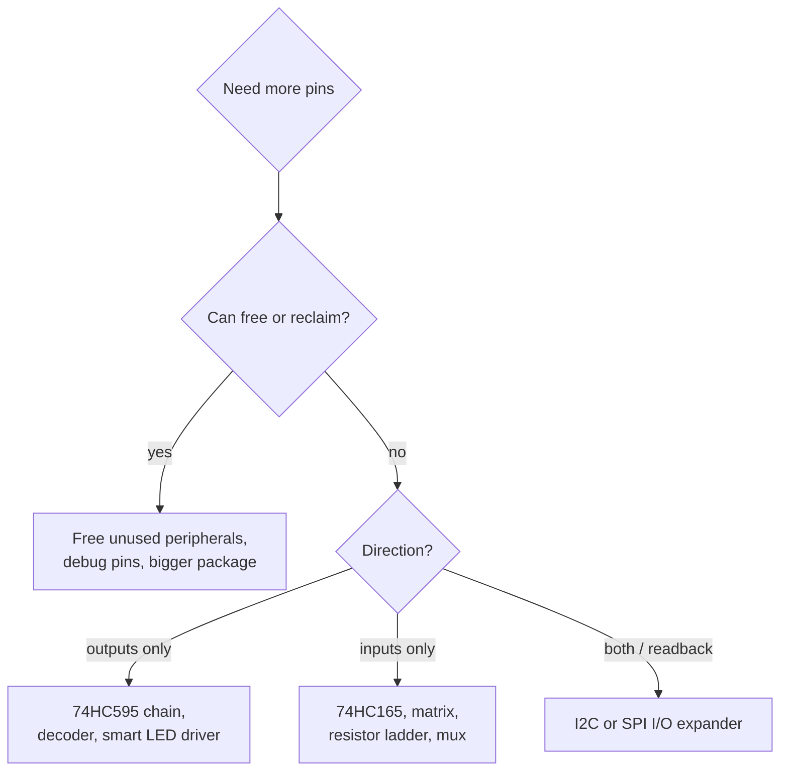

::: basics
### In plain words
When a microcontroller runs out of GPIO pins, you can often get more without changing it. The first question is whether you can free up pins, or pick a chip with a bigger package. If not, you add a small chip that turns a few pins into many. Each trick trades pins for time, extra parts, or more complex firmware.

### Picture it
Imagine one loading door feeding eight shelves through a conveyor belt. You slide items onto the belt one at a time. When all eight are in place, you press a single button, and every shelf locks at once. But it takes eight steps instead of one. That is the trade: fewer pins, more time.

### Words you need
- **Shift register**: a chip with a row of storage cells that you fill one bit at a time. It turns a few pins into 8 or more outputs, such as the 74HC595.
- **Latch**: a pulse that copies all the bits to the outputs at once, so they do not flicker while you load.
- **I/O expander**: a chip that adds 8 or 16 extra GPIO pins, controlled over a two-wire or four-wire bus.
- **Key matrix**: wiring buttons in rows and columns, so a few pins read many buttons.

### The simplest example
A 74HC595 needs three microcontroller pins: data, clock and latch. It gives 8 outputs. Chain four of them on the same three pins, and you have 32 outputs. Sending 32 bits at a 1 MHz clock takes 32 µs. For buttons, a 4 by 4 matrix reads 16 keys with only 8 pins. An I2C expander can add 16 pins on two wires, but each update takes roughly 100 µs, so it is too slow for fast signals. That is the whole idea. The rest of this page covers more tricks for LEDs and buttons, and traps such as outputs being undefined at power-up.
:::

::: testing
Whether you have a **toolbox of pin-saving techniques** and can choose between them with numbers: shift registers, I/O expanders, matrix scanning, Charlieplexing, analogue multiplexing or resistor ladders on an ADC pin, chip-select decoding, smart peripherals, and the unglamorous options (bigger package, reclaiming pins, rethinking the design).

Hidden sub-skills: trade-offs (speed, CPU load, simultaneous-drive limits, firmware complexity, BOM cost), I2C/SPI throughput arithmetic, and knowing which techniques work for outputs, inputs or both.
:::

::: why
Pin count is a hard constraint that shows up late: the last features get added when the layout is nearly done. Engineers who know the standard escapes finish the product; the rest respin the board or cut features. The question also tests whether you reach for the first hammer (add an I/O expander) without checking if the real problem is solvable by software (time-multiplex) or by a better MCU choice. Good answers rank options by cost and risk.
:::

::: concepts
- **Serial-in/parallel-out shift register (74HC595)**: turns 3 MCU pins into 8 (or 8N, chained) outputs. See [[q0765]] for SPI-style interfacing.
- **Parallel-in/serial-out shift register (74HC165)**: the same trick for inputs.
- **I/O expander over I2C or SPI**: a chip that provides 8 to 16 bits of GPIO behind a bus, with its own registers. See [[q0753]].
- **Matrix scanning**: arranging inputs or LEDs in rows and columns, with $r+c$ pins serving $r\times c$ devices.
- **Charlieplexing**: using tri-state pins so $n$ pins drive $n(n-1)$ LEDs.
- **Analogue tricks**: resistor ladder on an ADC pin, or an analogue multiplexer.
- **Decoder (74HC138)**: 3 address lines select one of 8 chip selects.
:::

::: answer
"First I'd check whether I really need more pins: could I free some, say by reclaiming debug or unused peripheral pins, or move to a bigger package or a different MCU. If that's not an option, I'd pick the technique by what the pins are doing.

For outputs, the cheapest is a shift register like a 74HC595: three pins, data, clock and latch, give me eight outputs, and I can chain them to get 16, 24, 32 outputs on the same three pins. For inputs, a 74HC165 does the reverse. If I need both directions and some flexibility, I'd use an I/O expander over I2C or SPI, like an MCP23017, which gives 16 GPIOs on two wires, and I can put up to eight on one bus.

For buttons and LEDs there are matrix tricks: a keypad matrix of 4 rows and 4 columns reads 16 keys with 8 pins, and Charlieplexing drives n times n minus 1 LEDs from n pins, for example 20 LEDs from 5 pins. Another trick for buttons is a resistor ladder into one ADC pin. And for chip selects I can use a decoder so three pins select one of eight devices.

Each trade-off costs something: speed, CPU time and firmware complexity. A shift register updates in microseconds, an I2C expander takes around 100 microseconds per transaction, and a multiplexed LED display needs a refresh loop. So I choose based on how fast and how many."
:::

::: technical
**Option table.**

| Technique | Pins used | Gives | Direction | Cost / limits |
|---|---|---|---|---|
| 74HC595 shift register | 3 (data, clock, latch), chainable | 8 outputs per chip | out | Update time $= 8N/f_{clk}$; no readback |
| 74HC165 shift register | 3 (data, clock, load) | 8 inputs per chip | in | same; poll to read |
| I2C expander (e.g. MCP23017, PCF8574) | 2 (shared bus) + optional INT | 16 or 8 GPIO per chip; several chips per bus via address pins | both | $\approx 100\ \mu s$ per transaction at 400 kHz; modest drive |
| SPI expander | 3 + CS | 16 GPIO, faster | both | more pins than I2C |
| Matrix $r\times c$ | $r+c$ | $rc$ keys or LEDs | in/out | scan loop; ghosting without diodes |
| Charlieplex | $n$ | $n(n-1)$ LEDs | out | only one or a few LEDs lit at once, reduced brightness |
| Resistor ladder on ADC | 1 | 4 to 8 buttons | in | needs ADC; one button at a time unless chosen carefully |
| Analogue mux (4051) | 3 + 1 common | 8 analogue channels | in | one channel at a time; settling time |
| 74HC138 decoder | 3 | 8 chip selects | out | only one CS active |
| Smart LED/driver (WS2812, TLC59xx-type) | 1 or 3 | many LEDs | out | timing or bus protocol |
| Bigger MCU/package | n/a | more GPIO | both | cost, layout |

**Timing arithmetic.**
- 4 chained 595s = 32 bits; at 1 MHz clock the update takes 32 us (3.2 us at 10 MHz).
- An I2C expander write (address, register, 2 data bytes = 4 bytes = 36 bit-times plus start/stop) at 400 kHz takes roughly 95 us.
- 60 WS2812-type LEDs: 24 bits each at about 1.25 us per bit is 1.8 ms.

**Resistor ladder (10 kΩ pull-up to 3.3 V, buttons to ground via R):** 1 kΩ gives 0.30 V, 2.2 kΩ gives 0.60 V, 4.7 kΩ gives 1.05 V, 10 kΩ gives 1.65 V, none pressed gives 3.30 V. On a 12-bit ADC those are codes 372, 738, 1309, 2048 and 4095, wide apart enough to threshold safely with 1% resistors.

**Matrix.** 4 rows x 4 columns = 16 keys on 8 pins. Drive one row low at a time, read the columns (pulled up). Add a diode per key to avoid ghosting when 3 or more keys are pressed.

**Charlieplex.** With $n$ pins, each LED connects between an ordered pair of pins, so $n(n-1)$ LEDs. Light one at a time: set one pin high, one low, the rest high-Z. 5 pins give 20 LEDs.
:::

::: short
"First I'd see if I can free pins or step up to a bigger package. Otherwise: for outputs a 74HC595 shift register turns three pins into eight outputs and chains for more; for inputs a 74HC165; for both, an I2C or SPI I/O expander like the MCP23017 gives 16 pins on two wires. For buttons and LEDs I'd use a matrix, so 8 pins read 16 keys, Charlieplexing for LEDs, or a resistor ladder on one ADC pin. A decoder gives chip selects. The cost is speed, CPU time and firmware complexity."
:::

::: long
"I'd start by asking whether I actually need more pins. Can I reclaim pins from unused peripherals or the debug port, or move to a bigger package, or a different MCU? That's often cheapest in engineering time. If not, I'd choose by what the pins do.

For slow outputs like LEDs, relays or an LCD's data lines, a 74HC595 shift register is the classic: three MCU pins, data, clock and latch, give eight outputs, and chaining another 595 on the same lines adds eight more. Updating four chips, 32 bits, takes about 32 microseconds at 1 MHz. The mirror image for inputs is the 74HC165, parallel load, serial out.

If I need a mix of inputs and outputs or want to read back, an I/O expander on I2C is more flexible. An MCP23017 gives 16 GPIOs, has address pins so I can put eight of them on one bus for 128 pins, and an interrupt output so I don't have to poll. The price is speed: a transaction is about a hundred microseconds at 400 kHz, and the pins have limited drive.

For user interface there are cheaper tricks. A keypad matrix, 4 by 4, reads 16 keys with 8 pins. Charlieplexing lights n times n minus 1 LEDs from n pins, say 20 from five, by using tri-state pins, though you can only light a few at once. A resistor ladder with different resistor values per button gives you four to eight buttons on a single ADC pin. And a 3-to-8 decoder like the 74HC138 gives eight chip selects from three pins.

All of these trade pins for time, CPU load, brightness or complexity, so I'd size the refresh and update rates, and verify they fit. If the design needs really fast control, I'd rather pay for a bigger MCU."
:::

::: terms
- **Shift register**: chain of flip-flops that converts between serial and parallel data (74HC595 out, 74HC165 in).
- **Latch (storage) clock**: the pulse that copies shift-register contents to the outputs at once.
- **I/O expander**: peripheral chip that provides extra GPIO controlled over I2C or SPI.
- **Matrix scanning**: reading or driving a row/column grid by activating one line at a time.
- **Ghosting**: false key readings when 3 or more keys are pressed in a matrix without diodes.
- **Charlieplexing**: LED multiplexing using tri-state pins so $n$ pins drive $n(n-1)$ LEDs.
- **Resistor ladder (analogue keypad)**: buttons selecting different resistors in a divider read by an ADC.
- **Decoder / demultiplexer**: converts $k$ address lines into $2^k$ select lines.
- **Persistence of vision refresh**: multiplexed displays must be refreshed fast enough (typically above 100 Hz) to avoid visible flicker.
:::

::: exceptional
**An average answer** says "use an I/O expander or a shift register".

**An exceptional answer**:
- Starts by questioning the constraint (free pins, reclaim debug pins, bigger package), then chooses a technique by *direction and speed needed*.
- Lists multiple techniques with the pin arithmetic (3 pins for 8N outputs; $r+c$ for $rc$; $n(n-1)$ for Charlieplex).
- Quantifies speed: shift out 32 bits in 32 us at 1 MHz, I2C transaction about 100 us, LED strings at 30 us per LED.
- Knows the gotchas: ghosting, shared current in Charlieplex, no readback on a 595, output state at power-up, expander drive limits.
- Mentions interrupt lines from expanders and the DMA/timer approach to refresh multiplexed displays.
:::

::: mistakes
- **Reaching for an I2C expander for a fast signal.** At 400 kHz it takes about 100 us per update and can't generate clean timing.
- **No pull-downs/known state on shift-register outputs at power-up.** A 595's outputs are undefined until the first load; use output-enable (OE) held high until initialised, and pull-downs where it matters.
- **Ghosting in a key matrix** without diodes: three pressed keys can create a phantom fourth.
- **Exceeding the LED current limit in a multiplexed display**: each LED is on for 1/N of the time, so peak current is N times the average, but pin limits still apply.
- **Charlieplexing with high-drive requirements.** Each LED sees tri-state pins and series resistors; brightness is low with many LEDs.
- **Forgetting package current limits** when many extra outputs are fed from one pin group.
- **Ignoring EMC/ground bounce** from fast simultaneous switching of many outputs ([[q0788]]).
:::

::: deep
## Think first: which pins am I short of, and what do they do?

"Not enough GPIOs" can mean very different things. Ten slow status LEDs and eight buttons are a relaxed problem: any technique that uses a few pins and some scanning time works. Sixteen chip selects for a bank of SPI devices need a decoder or an expander. A 64-LED matrix that must refresh without flicker needs timing discipline. Start from three numbers: how many signals, how fast each must change, and which direction.


Figure: A decision path for choosing a technique. Notice the first question is not "which chip?" but whether the constraint can be removed.

## Shift registers: three pins for 8N outputs

A 74HC595 contains an 8-bit shift register and an 8-bit output latch. The MCU shifts bits in with a clock, and then pulses the latch (RCLK) to transfer them to the outputs, so outputs don't flicker during shifting.

```circuit
{"elements":[
 {"t":"box","at":[0,0],"w":7,"h":8,"label":"MCU","pins":[{"side":"right","pos":2,"name":"MOSI / DATA"},{"side":"right","pos":4,"name":"SCK"},{"side":"right","pos":6,"name":"GPIO (latch)"}]},
 {"t":"box","at":[14,0],"w":10,"h":8,"label":"74HC595\n#1","pins":[{"side":"left","pos":2,"name":"SER"},{"side":"left","pos":4,"name":"SRCLK"},{"side":"left","pos":6,"name":"RCLK"},{"side":"right","pos":2,"name":"Q0-Q7"},{"side":"right","pos":6,"name":"QH' (serial out)"}]},
 {"t":"wire","pts":[[7,2],[14,2]]},
 {"t":"wire","pts":[[7,4],[14,4]]},
 {"t":"wire","pts":[[7,6],[14,6]]},
 {"t":"term","at":[24,2],"label":"8 outputs","side":"right"},
 {"t":"term","at":[24,6],"label":"to next 595 SER","side":"right"}
]}
```
Figure: Three MCU pins control the register: data, shift clock and latch. The QH' (serial out) pin feeds the next chip's SER input, so adding a chip adds 8 outputs but no MCU pins. All chips share the clock and latch lines.

Update time is just bits divided by clock: $t = 8N/f_{clk}$. Four chips (32 bits) at 1 MHz: 32 us. If the MCU has an SPI peripheral, data and clock come from it and DMA can stream the bytes without CPU load. The 74HC165 does the reverse: pulse a load pin to capture 8 parallel inputs, then clock them out serially. Neither device can be addressed individually; every update shifts the whole chain.

Gotchas: outputs are undefined at power-up until the first latch; hold OE (output enable, active low) high until the register has been loaded, and pull it up. Each output sources/sinks only a few mA (check the datasheet), so use a driver for loads.

## I/O expanders: when you need flexibility

An expander (for instance the MCP23017, 16 bits on I2C, or the PCF8574, 8 bits) exposes a register map: direction, output latch, input port, pull-ups, and an interrupt pin that tells the MCU "something changed". With three address pins you can put up to eight on one bus, so one I2C bus can reach 128 extra GPIOs. Throughput: a 4-byte write at 400 kHz is about 95 us, so you can refresh a bank at a few kHz, but not generate waveforms. On an unused interrupt pin, the expander can wake the MCU on any input change without polling.

The cost is that the expander is a device you must initialise, share on a bus ([[q0753]]) and keep awake. Its pins have modest drive and slow edges, and it adds a failure mode: if the bus hangs, every pin on the expander freezes.

## Matrix scanning and Charlieplexing

**Keypad matrix.** Rows are outputs, columns are inputs with pull-ups. Drive one row low, read the columns, and move to the next row. 4 x 4 = 16 keys on 8 pins, 8 x 8 = 64 keys on 16. A scan at 1 kHz per row-set gives millisecond latency. Without a diode in series with each key, pressing three keys can look like a fourth ("ghosting"); the diode blocks the sneak path.

**Charlieplexing.** Each pin can be high, low, or high-impedance. Connect LED $(i,j)$ between pin $i$ and pin $j$ in one direction and LED $(j,i)$ in the other. To light one LED, drive pin $i$ high, pin $j$ low and set every other pin to input (high-Z). With $n$ pins you get $n(n-1)$ LEDs: 3 pins give 6, 4 give 12, 5 give 20, 8 give 56. You must scan fast, with each LED lit $1/n(n-1)$ of the time at best, so brightness falls as the matrix grows, and peak current per LED is high. Good for small indicator arrays.

## One ADC pin for many buttons

```circuit
{"elements":[
 {"t":"rail","at":[4,1],"label":"3.3 V","dir":"up"},
 {"t":"R","a":[4,1],"b":[4,6],"label":"R_{pu}","value":"10 kΩ"},
 {"t":"wire","pts":[[0,6],[4,6],[23,6]]},
 {"t":"term","at":[0,6],"label":"to ADC","side":"left"},
 {"t":"dot","at":[4,6]},
 {"t":"dot","at":[9,6]},{"t":"SW","a":[9,6],"b":[9,9],"label":"S1"},{"t":"R","a":[9,9],"b":[9,13],"label":"1 kΩ"},{"t":"gnd","at":[9,13]},
 {"t":"dot","at":[14,6]},{"t":"SW","a":[14,6],"b":[14,9],"label":"S2"},{"t":"R","a":[14,9],"b":[14,13],"label":"2.2 kΩ"},{"t":"gnd","at":[14,13]},
 {"t":"dot","at":[19,6]},{"t":"SW","a":[19,6],"b":[19,9],"label":"S3"},{"t":"R","a":[19,9],"b":[19,13],"label":"4.7 kΩ"},{"t":"gnd","at":[19,13]},
 {"t":"dot","at":[23,6]},{"t":"SW","a":[23,6],"b":[23,9],"label":"S4"},{"t":"R","a":[23,9],"b":[23,13],"label":"10 kΩ"},{"t":"gnd","at":[23,13]}
]}
```
Figure: Each button connects a different resistor from the ADC node to ground, forming a divider with the 10 kΩ pull-up. Pressing S1 gives 0.30 V, S2 0.60 V, S3 1.05 V, S4 1.65 V; no button gives 3.3 V. Thresholds halfway between these levels identify the button. This reads one button at a time (two pressed together land at an unrelated voltage).

On a 12-bit ADC the codes are about 372, 738, 1309, 2048 and 4095, so with 1% resistors there is ample margin. The same idea is used for steering-wheel and remote-control buttons.

## Other pin-savers

**Chip-select decoder.** A 74HC138 turns three address pins into one of eight active-low selects: 3 pins for 8 SPI devices instead of 8. **Analogue multiplexer** (4051-type) feeds 8 sensors into one ADC pin, one at a time, allowing settling time between channels. **Smart peripherals:** WS2812-style LEDs have a single data pin for hundreds of LEDs (800 kHz, 1.25 us per bit, 30 us per LED), and LED-driver ICs on SPI/I2C hold their own PWM. **Reclaim pins:** unused crystal pins when using the internal oscillator, debug pins in production, pins of peripherals you don't use. **Change the MCU:** a bigger package is often cheaper than the engineering of a workaround; compare BOM cost against schedule.

## Worked example

A product needs 12 status LEDs, 8 buttons, 6 relay outputs and 4 SPI chip selects, and the MCU has 14 free pins. Raw need: 30 pins. Plan: the LEDs and relays together need 12 + 6 = 18 outputs, which is more than two 74HC595s (16) provide, so chain three (24 outputs: 12 LEDs, 6 relays via drivers, 6 spare) on 3 pins. Buttons on a 74HC165 (3 pins) or a 4 x 2 matrix (6 pins); choose the 165 (3 pins). Four chip selects from a 74HC138 would use 3 pins, but plain 4 pins is simpler and fits. Total: 3 + 3 + 4 = 10 pins out of 14, with 4 spare. Refresh time for 24 outputs at 1 MHz is 24 us, trivially fast.
:::

::: applications
- **LED indicator banks and 7-segment displays** driven by chained 74HC595s.
- **Keypads and keyboards**: key matrices with scanning and diodes.
- **Remote and steering-wheel buttons**: resistor ladder to a single ADC channel.
- **Industrial I/O modules**: I2C or SPI expanders such as the MCP23017 family for many digital in/outs.
- **RGB LED strips and arrays**: single-wire smart LEDs like the WS2812 family.
- **SPI chip-select expansion** with 74HC138 decoders on multi-sensor boards.
:::

::: assumptions
- 3.3 V logic, 74HC/74HC595-class parts, I2C at 400 kHz, SPI at 1 to 10 MHz.
- Part families (MCP23017, PCF8574, 74HC595, 74HC165, 74HC138, 74HC4051, WS2812) are named as examples; always check the datasheet for supply range, drive current and timing.
- The 95 us I2C figure is a rough estimate for a 4-byte write including start/stop, ignoring clock stretching and software overhead.
- Charlieplex and matrix brightness assume a refresh rate fast enough to avoid flicker (typically above about 100 Hz per LED).
- The answer changes if the issue is *speed*: expanders and shift registers do not replace hardware PWM, timers or fast parallel buses.
:::

::: followups
### How many LEDs can I drive from 5 pins with Charlieplexing?
$n(n-1) = 5\times4 = 20$ LEDs. Only one (or a few sharing a pin) is lit at a time, so you scan, and the brightness is roughly 1/20 duty unless you raise the peak current within limits.

### Shift register or I2C expander for 16 outputs?
For outputs only and speed, a chained pair of 595s: 3 pins, microsecond updates, cheap, but no readback and no per-bit access. If you need to read inputs, change direction per bit, or get interrupt-on-change, use an I2C expander (2 pins, around 100 us per transaction).

### Why do key matrices need diodes?
Without them, pressing three keys at the corners of a rectangle connects the fourth intersection through a sneak path, so the scan reports a phantom key (ghosting). A diode in series with each key blocks the reverse current path.

### Your 595-based board turns on a relay briefly at power-up. Why?
The register contents are undefined until the first shift and latch, so the outputs can come up random. Hold the OE pin high (disabling outputs) with a pull-up until the MCU has loaded zeros, and add pull-downs on relay driver inputs; also clear the register before enabling.

### Harder: you must read 24 inputs every millisecond and also drive 24 outputs, with 6 pins free. What do you build?
Three 74HC165s chained for inputs (3 pins, load, clock, data) and three 74HC595s chained for outputs, sharing the clock line (data out, latch): 3 + 2 more = 5 pins. Using SPI hardware at 4 MHz, 24 bits takes 6 us each way, so a 1 kHz loop uses under 2% of the time. If hardware SPI is free, DMA can do it with no CPU load.
:::

::: interpretations
"Not enough GPIOs" is read as: pins are the bottleneck and you need more I/O without changing the MCU. I also mention the first-resort alternatives (reclaiming pins, a bigger package) because an interviewer may be looking for that. The pin-count versus bus trade-offs are in [[q0737]] and the I2C details in [[q0753]].
:::

::: references
- Texas Instruments and Nexperia/NXP datasheets for the 74HC595, 74HC165 and 74HC138 logic families: timing, supply and drive specifications.
- Microchip MCP23017 and NXP PCF8574 datasheets: register maps, address pins and interface timing.
- Horowitz & Hill, *The Art of Electronics*, 3rd ed.: digital interfacing; shift registers and multiplexing.
- NXP UM10204, I2C-bus specification: bus timing used in the throughput estimate.
:::

::: rubric
- Considers freeing pins or a larger MCU first :: Shows judgment about the actual problem.
- Names shift registers (595/165) with the pin arithmetic :: The standard solution for slow outputs/inputs.
- Names I2C/SPI I/O expanders and their trade-offs :: The flexible, bidirectional solution.
- Matrix scanning and Charlieplexing formulas ($r+c$, $n(n-1)$) :: User-interface techniques.
- Analogue approaches (resistor ladder, mux) or decoders :: Broader toolbox.
- Quantifies speed or timing and mentions gotchas (ghosting, power-up state, flicker) :: Engineering depth.
:::

::: quiz
```json
[
 {"type":"mcq","level":"fundamental","q":"Which part turns 3 MCU pins into 8 digital outputs?","options":["74HC165","74HC595","74HC138","74HC4051"],"answer":1,"explain":"The 74HC595 is a serial-in, parallel-out shift register with a storage latch. The 74HC165 is the input equivalent, the 138 is a decoder and the 4051 is an analogue mux."},
 {"type":"numeric","level":"fundamental","q":"How many keys can a 4 x 4 key matrix read, and how many pins does it use? Give the number of pins.","answer":8,"tolerance":0.01,"unit":"pins","explain":"A matrix with 4 rows and 4 columns uses 4 + 4 = 8 pins and reads 4 x 4 = 16 keys."},
 {"type":"numeric","level":"intermediate","q":"How many LEDs can be Charlieplexed from 6 pins?","answer":30,"tolerance":0.01,"unit":"LEDs","explain":"n(n-1) = 6 x 5 = 30."},
 {"type":"numeric","level":"intermediate","q":"Four chained 74HC595s (32 bits) are updated over a 2 MHz shift clock. How long does the shift take in microseconds?","answer":16,"tolerance":0.02,"unit":"us","explain":"32 bits / 2 MHz = 16 us (plus a short latch pulse)."},
 {"type":"mcq","level":"intermediate","q":"Why do key matrices usually need a diode per key?","options":["To limit the current","To prevent ghosting when several keys are pressed","To drive LEDs","To debounce"],"answer":1,"explain":"Without diodes, three pressed keys at the corners of a rectangle create a sneak path that makes the fourth appear pressed. A series diode blocks it."},
 {"type":"numeric","level":"advanced","q":"A button reads through a divider: a 10 kΩ pull-up to 3.3 V and the pressed button connects 4.7 kΩ to ground. What ADC voltage appears at the node in V?","answer":1.05,"tolerance":0.02,"unit":"V","explain":"V = 3.3 x 4.7/(10 + 4.7) = 1.055 V."}
]
```
:::
