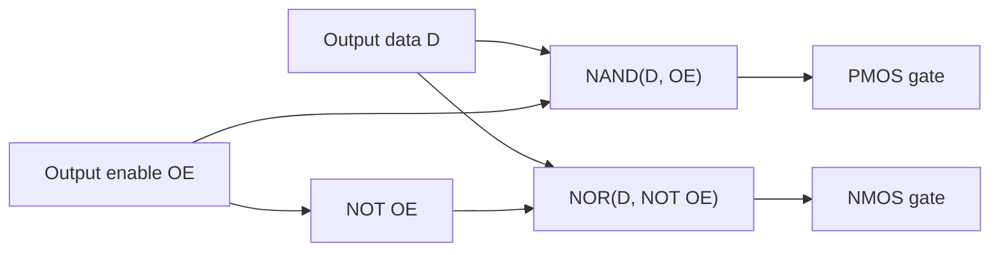

::: basics
### In plain words
Inside a GPIO pin, two switches connect to its metal contact, the pad. One switch joins it to the supply voltage. The other joins it to ground. Close the top switch and the pin is high. Close the bottom one and the pin is low. Open both and the pin is an input, because it is no longer driven. A small sensing circuit, the input buffer, reads the pad's voltage. Protective diodes complete the circuit.

### Picture it
Picture a pipe junction with two taps. The top tap connects to a tank of water at supply level. The bottom tap connects to a drain. Open the top tap and the pipe fills, which is high. Open the bottom tap and it drains, which is low. Close both and the pipe is free, so you can read its water level from outside. Relief valves on the pipe vent any dangerous overpressure.

### Words you need
- **PMOS and NMOS**: two kinds of transistor, used as electrically controlled switches. The PMOS joins the pad to the supply. The NMOS joins it to ground.
- **High impedance (high-Z)**: both switches off. The pin neither drives nor loads the wire. This is input mode.
- **Clamp diode**: a diode that conducts when the pad goes about 0.7 V beyond the supply or ground, steering the extra current away.

### The simplest example
Say each switch has about 25 Ω of resistance when on. With data 1, the top switch conducts and the pad sits near 3.3 V. With data 0, the bottom one conducts and the pad sits near 0 V. Now suppose two such pins on one wire disagree. Current flows through both switches: $3.3/(25+25) = 66$ mA, far too much. Likewise, 5 V on a 3.3 V pin not rated for it turns on the upper diode and pushes current into the supply. That is the whole idea. The rest of this page draws the full pad, shows how the switches are controlled, and gives typical values.
:::

::: testing
Whether you can **draw the inside of a pin** from memory and explain each part: the complementary output stage (PMOS up, NMOS down), the tri-state control, the input buffer, the optional pull resistors and the ESD clamp diodes. The interviewer wants the logic of how a register bit becomes a voltage and how the pin is read back.

Hidden sub-skills: CMOS inverter behaviour, high-impedance state, Schmitt-trigger hysteresis, why clamp diodes limit the input voltage, and how the same pad serves as input, output and alternate function. The section note says deeper CMOS detail lives elsewhere, so keep it surface-level but correct.
:::

::: why
Every electrical gotcha with GPIOs (5 V on a 3.3 V pin, shorted outputs, floating inputs, back-powering through a pin, weak internal pull-ups) makes sense once you can see the circuit. Embedded interviews use this drawing to tell candidates who treat a pin as a variable from those who see it as a pad with transistors, diodes and resistors. It also sets up push-pull versus open-drain ([[q0785]]), pull sizing ([[q0786]]) and contention ([[q0788]]).
:::

::: concepts
- **CMOS push-pull output stage**: a PMOS to $V_{DD}$ and an NMOS to ground, driven together; only one conducts at a time. See [[q0089]] and [[q0097]].
- **Tri-state (high-Z)**: both transistors off so the pin does not drive. This is what "input mode" means for the output stage.
- **Input buffer / Schmitt trigger**: converts the pad voltage into a clean digital bit, with hysteresis against slow or noisy edges.
- **ESD protection diodes**: clamp the pad to roughly one diode drop beyond the rails.
- **Programmable pulls**: resistors with enable switches, from the pad to $V_{DD}$ or ground. See [[q0020]].
- **Mode multiplexing**: registers select GPIO or a peripheral for output data and enable. See [[q0781]].
:::

::: answer
"I'd draw the pad in the middle. On the output side there's a CMOS pair: a PMOS from VDD to the pad, and an NMOS from the pad to ground, with their gates driven by the output data bit plus an output-enable. If the data is a 1, the PMOS conducts and pulls the pad up to VDD; if it's a 0, the NMOS conducts and pulls it to ground. If the enable is off, both transistors are off, so the pin is high impedance and that's input mode.

On the input side, the pad goes into a buffer, usually a Schmitt trigger so slow or noisy edges still give a clean digital level. Its output goes to the input data register that software reads.

Then there are two extras. Optional pull-up and pull-down resistors, each with a switch, from the pad to VDD or ground, so I can give an input a default level. And ESD protection: a diode from the pad up to VDD and a diode from ground up to the pad, which clamp the voltage so a static zap or an overvoltage gets shunted to the rails rather than blowing the gate oxide.

A configuration register decides whether the output stage is enabled, whether the pulls are on, and whether the pad is connected to this block or to a peripheral. So the same pad can be input, output, or alternate function."
:::

::: technical
**Blocks at the pad.**
1. *Output stage*: PMOS (source to $V_{DD}$, drain to pad) and NMOS (source to ground, drain to pad). Output level is $V_{DD}$ minus the PMOS drop, or the NMOS drop above ground: $V_{OH}=V_{DD}-I\,R_{on,p}$ and $V_{OL}=I\,R_{on,n}$, each of order 10 to 50 Ω.
2. *Tri-state logic*: a gate pair derives the transistor gates from data $D$ and output-enable $OE$. For example $G_P=\overline{D\cdot OE}$ (NAND) and $G_N=\overline{D+\overline{OE}}$ (NOR). With $OE=0$: $G_P=1$, $G_N=0$, both devices off (high-Z). With $OE=1$: both gates equal $\overline D$, and since the output stage inverts, the pad equals $D$.
3. *Input buffer*: Schmitt trigger with thresholds, for 3.3 V CMOS, of order $V_{IL}\approx0.3V_{DD}$ and $V_{IH}\approx0.7V_{DD}$ (datasheet values), hysteresis of order hundreds of mV (vendor-specific).
4. *Pulls*: resistors typically 20 to 100 kΩ (vendor-specific), switched in by configuration.
5. *ESD clamps*: diode to $V_{DD}$ turns on above about $V_{DD}+0.3$ to $0.7$ V and diode to ground below about $-0.3$ to $-0.7$ V. Beyond that, current flows into the rails. Pins marked 5 V tolerant use a different structure with no diode to $V_{DD}$.
6. *Mux*: alternate-function signals replace $D$ and $OE$ (e.g. UART TX) and the input buffer feeds the peripheral instead of, or as well as, the data register.

**Read/write path.** Write: software sets bit in output data register, giving $D$. Read: input buffer, usually through a two-flop synchroniser, then the input data register. Reading an output pin returns the *pad* level, not the register, so a shorted output reads the wrong value.

**Contention current.** If the pad is forced to the opposite level with low impedance, current is $\approx V_{DD}/(R_{on}+R_{ext})$; with 25 Ω on-resistance and a hard short to the opposite rail, 3.3/25 = 132 mA, far above ratings.
:::

::: short
"The pad connects to a CMOS pair: a PMOS to VDD and an NMOS to ground, driven by the output data and an enable. Data 1 turns on the PMOS and pulls high, data 0 turns on the NMOS and pulls low, and with the enable off both are off, so the pin is high impedance, which is input mode. The input goes through a Schmitt-trigger buffer into the input register. There are optional pull-up and pull-down resistors with switches, and two ESD diodes, one to VDD and one to ground, to clamp overvoltage. Configuration registers choose the mode."
:::

::: long
"I'd draw the pad as a node in the middle and build around it.

For the output driver, a CMOS pair: a PMOS between VDD and the pad, an NMOS between the pad and ground. A bit of logic in front of their gates combines the output data bit and an output-enable. When the enable is on and the data is 1, the PMOS conducts and pulls the pad up to VDD, and the NMOS is off. When the data is 0, it's the reverse, and the pad is pulled to ground. When the enable is off, both transistors are off and the pad floats from the driver's point of view, which is high impedance. That's how a pin acts as an input. The on-resistance of each transistor, tens of ohms, is what limits how much current the pin can source or sink.

For the input, the pad goes into a buffer, typically a Schmitt trigger, which has hysteresis, so a slow edge or a bit of noise doesn't make it chatter. A synchroniser then brings it into the CPU clock domain and software reads it from the input data register.

Next, the pulls: two resistors, tens of kilohms, one to VDD and one to ground, each with a switch that configuration enables, to give an input a default level.

And protection: a diode from the pad up to VDD and a diode from ground up to the pad. If the pad goes above VDD or below ground by a diode drop, the diode conducts and diverts the current into the supply or ground instead of through the gate oxide. That's why a 5 V signal on a 3.3 V pin that isn't tolerant pushes current into VDD.

Finally a multiplexer, controlled by the mode registers, decides whether the output stage and input buffer are connected to the GPIO registers or to a peripheral such as UART or SPI."
:::

::: terms
- **Push-pull output**: PMOS and NMOS that actively drive both high and low.
- **High-Z / tri-state**: both output transistors off; the pin neither sources nor sinks.
- **Output enable (OE)**: control that allows the driver to drive the pad.
- **Schmitt trigger**: input buffer with two thresholds (hysteresis) to reject slow or noisy edges.
- **ESD clamp diodes**: diodes to $V_{DD}$ and ground that limit pad voltage.
- **Weak pull-up / pull-down**: internal resistors (tens of kΩ) to set a default level.
- **Synchroniser**: flip-flops that bring an asynchronous input into the clock domain.
- **5 V tolerant pin**: pad structure with no clamp to $V_{DD}$, rated above the supply.
:::

::: exceptional
**An average answer** draws a box with "input" and "output" arrows.

**An exceptional answer**:
- Draws the PMOS/NMOS pair with the tri-state gating and explains which transistor conducts for each data/enable combination.
- Includes the Schmitt buffer, the two ESD diodes and the switched pulls, and says what each is for.
- Explains why input mode is just "output stage off", and why the pad level is what software reads.
- Gives magnitudes: on-resistance of tens of ohms, pulls of tens of kΩ, clamp at about a diode drop beyond the rails, so shorting an output costs over 100 mA.
- Relates it to real hazards: 5 V on a non-tolerant pin, back-powering through the clamp, floating inputs.
:::

::: mistakes
- **Drawing a single transistor for the output.** A push-pull pin needs both a pull-up and a pull-down device; one transistor is the open-drain case ([[q0785]]).
- **Tying PMOS and NMOS gates with no enable** and then calling it an input. Without a tri-state path the pin can never be high-Z.
- **Putting the diode polarity wrong.** The upper diode anode is on the pad and cathode on $V_{DD}$; the lower has its anode on ground and cathode on the pad.
- **Forgetting the pull resistors are weak.** 20 to 100 kΩ pulls are not enough to drive a load or fight a bus.
- **Thinking an output pin read-back returns the register.** It returns the pad voltage through the input buffer.
- **Believing the diodes are for normal operation.** They are for ESD and fault currents; sustained current is limited by the datasheet (typically a few mA).
:::

::: deep
## Start from a CMOS inverter

A GPIO output is a CMOS inverter whose two gates can be controlled separately. In an ordinary inverter, a PMOS from $V_{DD}$ and an NMOS to ground share one input: input low turns the PMOS on (it conducts when its gate is below the source by more than $|V_{tp}|$), input high turns the NMOS on. Exactly one is on, so the output is pulled to a rail with low impedance and there is no static current from $V_{DD}$ to ground. See [[q0089]] for the symbols and [[q0097]] for how the two device types complement each other.

For a GPIO, we additionally need a state where *neither* conducts, so that the pin can be an input. That means the two gates need separate drive signals.

## The tri-state control


Figure: The gating that creates three output states from two bits. When OE is 0, NAND gives 1 (PMOS off) and NOR gives 0 (NMOS off): high impedance. When OE is 1, both gates see the inverse of D.

Truth table (the NAND/NOR gating and the inverting output stage cancel, so the pad follows $D$):

| OE | D | PMOS | NMOS | Pad |
|---|---|---|---|---|
| 0 | x | off | off | high-Z (input mode) |
| 1 | 0 | off | on | driven low |
| 1 | 1 | on | off | driven high |

## The whole pad

```circuit
{"elements": [{"t": "pmos", "at": [6, 4], "label": "MP"}, {"t": "nmos", "at": [6, 12], "label": "MN"}, {"t": "wire", "pts": [[6, 4], [4, 4], [4, 12], [6, 12]]}, {"t": "dot", "at": [4, 8]}, {"t": "wire", "pts": [[0, 8], [4, 8]]}, {"t": "term", "at": [0, 8], "label": "output data\n+ enable", "side": "left"}, {"t": "wire", "pts": [[8, 2], [8, 0], [16, 0]]}, {"t": "rail", "at": [8, 0], "label": "V_{DD}", "dir": "up"}, {"t": "wire", "pts": [[8, 6], [8, 10]]}, {"t": "dot", "at": [8, 8]}, {"t": "wire", "pts": [[8, 8], [19, 8]]}, {"t": "wire", "pts": [[8, 14], [8, 16]]}, {"t": "gnd", "at": [8, 16]}, {"t": "dot", "at": [12, 0]}, {"t": "SW", "a": [12, 0], "b": [12, 3], "label": "S_pu"}, {"t": "R", "a": [12, 3], "b": [12, 8], "label": "R_{pu}"}, {"t": "dot", "at": [12, 8]}, {"t": "R", "a": [12, 8], "b": [12, 12], "label": "R_{pd}"}, {"t": "SW", "a": [12, 12], "b": [12, 15], "label": "S_pd"}, {"t": "gnd", "at": [12, 15]}, {"t": "dot", "at": [16, 0]}, {"t": "D", "a": [16, 8], "b": [16, 0], "label": "D_1"}, {"t": "D", "a": [16, 15], "b": [16, 8], "label": "D_2"}, {"t": "gnd", "at": [16, 15]}, {"t": "dot", "at": [19, 8]}, {"t": "wire", "pts": [[19, 8], [19, 5]]}, {"t": "term", "at": [19, 5], "label": "PAD", "side": "top"}, {"t": "buf", "at": [21, 8]}, {"t": "text", "at": [23, 10], "text": "Schmitt input buffer", "anchor": "middle", "muted": true}, {"t": "term", "at": [25, 8], "label": "to input data register", "side": "right"}, {"t": "wire", "pts": [[19, 8], [21, 8]]}, {"t": "dot", "at": [16, 8]}]}
```
Figure: A GPIO pad. The two output transistors (MP up, MN down) meet at the pad node. Their shared gate drive here stands for the tri-state logic above. The input buffer taps the pad. Rpu and Rpd with their enable switches are the optional weak pulls; D1 and D2 are the ESD clamps. Only one of Spu and Spd would normally be enabled.

Walk it through. *Output high*: MP on, MN off, the pad is connected through MP's on-resistance to $V_{DD}$. *Output low*: the opposite. *Input mode*: both off; the pad voltage is whatever the outside world applies (or the pull sets), and the buffer reports it. *Input with pull-up*: Spu closed, so with nothing driving the pad, $R_{pu}$ pulls it to $V_{DD}$.

## Numbers

- **On-resistance and drive.** If the datasheet guarantees $V_{OL}\le0.4$ V at 8 mA, then $R_{on,n}\lesssim 50\ \Omega$. A pad with 25 Ω devices shorted to the opposite rail at 3.3 V draws $3.3/25=132$ mA, far above ratings; the pad is protected by nothing but the supply's current limit.
- **Pull resistors.** Typically 20 to 100 kΩ, with wide spread over process and temperature. A 40 kΩ pull-up holding a pad against a 10 kΩ external pull-down gives $3.3\times10/(40+10)=0.66$ V, which is read as a low.
- **Clamp diodes.** Overvoltage of $V_{DD}+0.7$ V starts conducting. Applying 5 V to a non-tolerant pin on a 3.3 V part drives $(5-3.3-0.7)/R$ into $V_{DD}$; with a 1 kΩ series resistor that is 1 mA, but with no resistor the current is limited only by the source and can overheat the diode or back-feed the rail.
- **Hysteresis.** If thresholds are 1.1 V and 2.2 V on a 3.3 V part, a slow ramp passing through 1.1 to 2.2 V does not cause chatter, even with 0.5 V of noise on top; a noise amplitude above the hysteresis still can.

## Try it

```sim
{"id":"gpio-lab","view":"output"}
```
Figure: The output view shows which transistor conducts for each output value. Toggle the data bit and watch MP and MN swap roles; switch output type and compare with the open-drain case, where the PMOS is absent ([[q0785]]).

## Alternate functions and the input path

When a pin is an alternate function, the mux feeds the peripheral's output (UART TX, SPI MOSI) into the same data and enable gating, and routes the buffer output to the peripheral's input (UART RX) rather than to the GPIO data register. The pad is the same; the owner changes. A well-designed pad also lets the input buffer stay connected in output mode, which is why reading the input data register of an output pin returns the real pad voltage and detects shorts.

## Analog mode

In analog mode the Schmitt buffer is disconnected, so the pad does not draw crowbar current when held at a mid-rail voltage, and the pad connects to the ADC or comparator. This is the reason an unused or analog pin should not be left as a floating digital input: a mid-rail voltage keeps both buffer transistors partly on and wastes current.

## Where it is simplified

Real pads add series resistors to the diodes, a slew-rate control (several drive-strength copies of the output transistors in parallel, selectable) and a level shifter between the core voltage domain and the I/O supply, because the core may run at 1.2 V and the pad at 3.3 V. See [[q0787]] for how those appear as configuration settings.
:::

::: applications
- **Every MCU port pin**: the structure above is what a port register ultimately controls.
- **FPGA I/O blocks** (IOB): same structure with configurable standards, drive and termination.
- **Level-shifting and back-powering debugging**: explaining why 5 V on a 3.3 V pin powers the chip through the clamp.
- **Choosing drive strength and slew** for EMI on fast pins.
- **Understanding why an unconfigured pin is safe**: at reset, the output enable is off.
:::

::: assumptions
- Idealised pad with a simple tri-state gating and one pair of clamp diodes. Real I/O cells include extra series resistance, power clamps between rails and level shifters.
- Resistor values (pull 20 to 100 kΩ), on-resistances (10 to 50 Ω) and thresholds ($0.3V_{DD}$, $0.7V_{DD}$) are typical, vendor-specific ranges; check the datasheet.
- A 3.3 V CMOS part with a single supply; 5 V tolerant pads differ.
- Polarity is arranged so that writing a 1 gives a high pin; real cells may use different but equivalent gating.

> [!UNCERTAIN]
> The exact internal structure (tri-state gating, number of parallel drive devices, hysteresis amount) is vendor-specific and rarely documented in detail; the drawing here is the common textbook form that matches the behaviour in datasheets.
:::

::: followups
### Why is the input buffer a Schmitt trigger?
Slow edges and noise around the threshold would make a plain buffer chatter or draw shoot-through current while it lingers mid-rail. Hysteresis gives two thresholds, so the output switches once per transition. It makes mechanical-switch and slow RC signals readable.

### How does the pin become an input?
The output enable is turned off so both PMOS and NMOS are off. The pad is high-impedance and its voltage is set externally (or by a pull). The input buffer is always connected and reads that voltage.

### What do the two diodes do, and what happens at 5 V on a 3.3 V pin?
They clamp the pad to roughly one diode drop outside the rails by steering ESD current into $V_{DD}$ or ground. Above $V_{DD}+0.7$ V the upper diode conducts, pushing current into the 3.3 V rail: it can power the chip or damage the pin. Use a 5 V tolerant pin, a series resistor limiting the current to datasheet limits, or a level shifter.

### Why can't two push-pull pins share a wire?
One pad's PMOS and the other's NMOS would form a path from $V_{DD}$ to ground through two on-resistances: about 66 mA for 25 Ω each, and a mid-level voltage on the wire. See [[q0788]].

### Harder: where does static power go in a floating input pin?
A mid-rail voltage turns both transistors of the input buffer partially on, creating a $V_{DD}$-to-ground path that draws current (microamps to a milliamp depending on process) and the pad can oscillate with noise. The Schmitt trigger reduces but doesn't eliminate it; configure unused pins as outputs, with pulls, or analog mode.
:::

::: interpretations
"Draw a GPIO circuit" is taken as the internal pad circuit of a microcontroller pin. It could also be read as an *external* circuit using a GPIO (LED or button); that application view is on [[q0780]]. The push-pull versus open-drain variants are on [[q0784]] and [[q0785]].
:::

::: references
- Sedra & Smith, *Microelectronic Circuits*: CMOS inverter and CMOS logic chapters (complementary pull-up/pull-down networks).
- Weste & Harris, *CMOS VLSI Design*: I/O pad circuits, ESD protection and tri-state drivers.
- Vendor MCU reference manuals (STM32, AVR, NXP): GPIO block diagram, "I/O port bit structure" figures.
- Horowitz & Hill, *The Art of Electronics*, 3rd ed.: logic interfacing and input/output characteristics.
:::

::: rubric
- Draws PMOS (to VDD) and NMOS (to ground) meeting at the pad :: The core of a push-pull output.
- Explains how data and enable create driven-high, driven-low and high-Z :: Shows you understand tri-state and input mode.
- Shows the input buffer (Schmitt) to the input register :: Completes the I/O picture.
- Includes ESD diodes to VDD and ground and says why :: Explains 5 V-on-3.3 V failures.
- Includes switchable pull-up/pull-down :: Explains input defaults.
- Mentions mode mux/alternate functions and magnitudes (tens of ohms, tens of kΩ) :: Real-world detail.
:::

::: quiz
```json
[
 {"type":"mcq","level":"fundamental","q":"In a push-pull GPIO output driving a high level, which device conducts?","options":["NMOS to ground","PMOS to VDD","Both","Neither"],"answer":1,"explain":"The PMOS between VDD and the pad conducts to pull the pad high; the NMOS is off."},
 {"type":"mcq","level":"fundamental","q":"How does a GPIO pin act as an input at the output-stage level?","options":["Both output transistors are turned off (high impedance)","The NMOS is turned on","The PMOS is turned on","The ESD diodes are disabled"],"answer":0,"explain":"With the output enable off, neither transistor conducts, so the pad voltage is set externally and the input buffer reads it."},
 {"type":"numeric","level":"intermediate","q":"A pad has 25 ohm on-resistance in each output transistor and is shorted by another push-pull driver (one high, one low) at 3.3 V. What is the current in mA?","answer":66,"tolerance":0.02,"unit":"mA","explain":"I = 3.3 / (25 + 25) = 66 mA through the two on-resistances."},
 {"type":"numeric","level":"intermediate","q":"A 40 kohm internal pull-up fights a 10 kohm external pull-down to ground on a 3.3 V pin. What voltage appears at the pin in V?","answer":0.66,"tolerance":0.02,"unit":"V","explain":"Divider: 3.3 x 10/(40 + 10) = 0.66 V, read as logic low."},
 {"type":"mcq","level":"intermediate","q":"What is the purpose of the clamp diodes at the pad?","options":["Set the logic thresholds","Divert ESD and overvoltage current into the supply rails","Provide the pull-up","Increase drive strength"],"answer":1,"explain":"The diode to VDD and the diode from ground to the pad conduct when the pad goes a diode drop beyond the rails, shunting fault current away from the gate oxide."},
 {"type":"truefalse","level":"advanced","q":"Applying 5 V to a non-5V-tolerant 3.3 V GPIO input is safe because the input is high impedance.","answer":false,"explain":"The upper clamp diode conducts above about VDD + 0.7 V, pushing current into the 3.3 V rail, which can damage the pin or back-power the chip. The high-impedance input does not prevent this."}
]
```
:::
