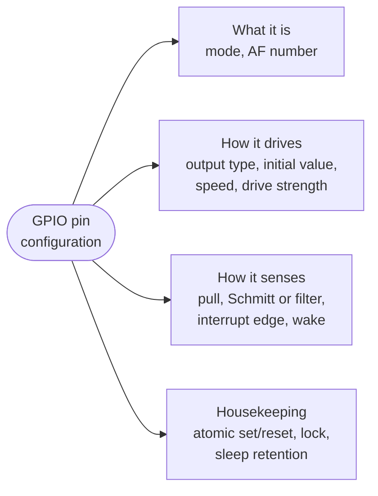

::: testing
Whether you know the **knobs** on a real GPIO and, more importantly, *why* each exists: mode, output type, pull, speed/slew, drive strength, input filtering, alternate function, interrupt trigger, initial state and locking. A strong answer groups them by purpose (what the pin is, how it drives, how it senses) and gives an engineering reason for each setting, not a register list.

Hidden sub-skills: EMI and ground-bounce trade-offs of fast edges, safe reset states, atomic access, and recognising that the names differ between vendors while the ideas do not.
:::

::: why
Most GPIO bugs are configuration bugs: an LED that is dim because the pin is in the wrong mode, an I2C bus that fails because the output type is push-pull, a board that fails EMC testing because every output is left at maximum speed, a clock that never reaches a peripheral because the alternate function was not selected. Knowing the standard set of settings makes any new MCU's reference manual readable in minutes and lets you debug from the symptom to the setting.
:::

::: concepts
- **Mode**: input, output, alternate function, analog. See [[q0781]].
- **Output type**: push-pull or open-drain. See [[q0785]].
- **Pull resistors**: none, pull-up or pull-down. See [[q0786]].
- **Speed / slew rate and drive strength**: how fast and how hard the output switches.
- **Input conditioning**: Schmitt trigger, glitch filter, synchroniser. See [[q0783]].
- **Interrupt configuration**: edge or level, enable, wake-up.
- **Atomic access and lock**: set/reset registers and configuration lock.
:::

::: answer
"I group them into what the pin is, how it drives, and how it senses.

What it is: the mode, input, output, alternate function for a peripheral like UART or SPI, or analog for the ADC. For alternate function there's also a selector for which peripheral signal.

How it drives: output type, push-pull or open-drain; the initial output value; drive strength, say 2, 4, 8 or 12 mA, and speed or slew rate. Those last two are an EMI and ground-bounce knob: I leave slow edges on anything that doesn't need speed, because a fast edge makes more high-frequency noise and more supply bounce.

How it senses: pull-up, pull-down or none; whether the input buffer is on, a Schmitt trigger or plain, sometimes a glitch filter; and for interrupts, which edge, rising, falling or both, whether the interrupt is enabled and whether the pin can wake the chip from sleep.

Then housekeeping: set and reset registers for atomic changes, a lock bit to freeze the configuration, and usually the reset state, which is normally a floating input. On STM32, for example, these show up as mode, output type, speed, pull-up/down and alternate function registers, but every vendor has the same set."
:::

::: technical
**Typical settings and what they do.**

| Setting | Options | Why it exists |
|---|---|---|
| Mode | input, output, alternate function, analog | role of the pad; analog disconnects the digital buffer |
| Alternate function select | AF number | chooses which peripheral signal reaches the pad |
| Output type | push-pull / open-drain | shared lines, level translation ([[q0785]]) |
| Pull | none / up / down | defined idle level ([[q0786]]) |
| Speed (slew) | low / medium / high / very high | edge rate vs EMI and bounce |
| Drive strength | e.g. 2 / 4 / 8 / 12 mA | current capability vs bounce |
| Output data / initial value | 0 / 1 | state when first enabled; avoid glitches |
| Input Schmitt trigger | on / off | noise immunity; some parts allow disabling |
| Input filter / debounce | none / glitch filter / synchroniser | reject narrow pulses |
| Interrupt | rising / falling / both / level; enable; wake | event detection |
| Retention in sleep | hold state / release | keep outputs in low-power modes |
| Lock | lock configuration until reset | prevent software accidents |
| Atomic set/reset | BSRR-style | race-free bit changes |
| Polarity invert | on / off | match active-low signals |

**Edge rate and EMI.** A signal's spectral content falls off beyond roughly $f\approx1/(\pi t_r)$: for $t_r=2$ ns that is about 160 MHz; for $t_r=10$ ns about 32 MHz. Slowing an edge by 5x moves the significant harmonics down by 5x and cuts radiated emissions.

**Ground bounce.** $V_{bounce}=L\,di/dt$. Eight outputs switching 8 mA each (64 mA) in 2 ns through 5 nH of supply inductance gives $5\text{ nH}\times64\text{ mA}/2\text{ ns}=0.16$ V; one output gives 0.02 V.

**Reset state.** Most pins start as floating inputs (high-Z). Some start as alternate function (debug pins) or with pulls on (boot straps).
:::

::: short
"I think of three groups. What the pin is: mode (input, output, alternate function, analog) and which alternate function. How it drives: output type, push-pull or open-drain, initial value, drive strength and slew rate, which trade edge speed against EMI and ground bounce. How it senses: pull-up, pull-down or none, Schmitt trigger or filter, and interrupt edge, enable and wake-up. Plus housekeeping: atomic set/reset registers, a lock bit, and remember most pins reset to floating inputs."
:::

::: long
"Whatever the vendor, the same set of settings shows up, and I'd group them as: what the pin is, how it drives, and how it senses.

What it is is the mode: digital input, digital output, alternate function, or analog. For alternate function there's a second field selecting which peripheral signal is connected, UART TX, SPI clock, a timer channel. Analog mode matters because it disconnects the digital input buffer, so a mid-rail voltage doesn't waste current.

How it drives: first the output type, push-pull or open-drain; open-drain for I2C or shared lines, push-pull otherwise. Then the initial output value, so the pin comes up at the right level without a glitch when I switch it to output. Then speed or slew rate and drive strength. Those are the knobs people forget. A fast edge generates more high-frequency energy and a bigger current spike on the supply, so ground bounce and EMI get worse. If a pin is a slow control line, I set it to the lowest speed. For example, a 2 nanosecond edge has energy out to around 160 MHz, while a 10 nanosecond edge stops near 30 MHz. Conversely, if I'm running SPI at 40 MHz I need the higher setting or the edges won't be clean.

How it senses: pull-up, pull-down or none; whether there's a Schmitt trigger on the input, and sometimes a glitch filter; and for interrupts, the trigger, rising, falling or both, the enable, and whether the pin can wake the MCU from sleep.

And then housekeeping: atomic set and reset registers so interrupts can't corrupt a read-modify-write, a lock bit that freezes the configuration, and the reset state, which is usually a floating input, so I must make sure the board is safe in that state."
:::

::: terms
- **Mode register**: selects input, output, alternate function or analog.
- **Alternate function (AF)**: routes a peripheral signal to the pin.
- **Output type**: push-pull or open-drain.
- **Slew rate / speed**: how fast the output edge is.
- **Drive strength**: current capability of the output stage, in mA.
- **Schmitt trigger**: input buffer with hysteresis.
- **Glitch filter**: logic that ignores pulses shorter than a set width.
- **Wake-up pin**: pin able to wake the chip from a low-power mode.
- **BSRR (bit set/reset register)**: write-only register for atomic bit changes.
- **Lock**: bit that freezes pin configuration until reset.
:::

::: exceptional
**An average answer** lists direction, pull-up and open-drain.

**An exceptional answer**:
- Groups the settings logically (role, drive, sense, housekeeping), not as a random list.
- Gives the reason for each; especially **slew rate and drive strength** as EMI and ground-bounce controls, with numbers ($f\approx1/\pi t_r$, $L\,di/dt$).
- Notes alternate-function selection and analog mode's input-buffer disconnect.
- Mentions the reset state and a safe-default design, atomic registers and the lock bit.
- Keeps it vendor-neutral and, when asked, maps to a real register set (e.g. STM32's MODER, OTYPER, OSPEEDR, PUPDR, AFR, BSRR, LCKR).
:::

::: mistakes
- **Leaving every output at maximum speed.** Extra EMI, ringing and ground bounce for no benefit on slow signals.
- **Setting push-pull on an I2C pin.** Contention with the other device ([[q0788]]).
- **Forgetting the alternate function number** so the peripheral never reaches the pin.
- **Leaving unused or analog pins as floating digital inputs**, wasting current and picking up noise.
- **Read-modify-write on the output register** while an interrupt also modifies the port.
- **Assuming the reset state is safe.** Check the reference manual for each pin: debug and boot pins differ.
- **Configuring mode before the initial value**, producing a glitch on the output when it is enabled.
:::

::: deep
## A map of the settings


Figure: The settings fall into four groups. Whenever you meet an unfamiliar MCU, find where each group's registers live; the details differ but the groups do not.

## Mode and alternate function

The mode field typically selects among four: input (the output stage is off, [[q0783]]), output (driven by the data register), alternate function (driven by a peripheral), and analog. In alternate-function mode the AF field picks which peripheral signal is connected; two peripherals cannot share a pad. Analog mode disconnects the digital input buffer so the pad can go to the ADC or comparator and, importantly, a mid-rail voltage does not make the input buffer conduct.

## Drive: output type, initial value, speed and strength

**Output type** is covered on [[q0785]]: push-pull for point-to-point signals, open-drain with a pull-up for shared lines.

**Initial value.** If the output data register is loaded *before* the mode is switched to output, the pin comes up at the right level. Doing it in the wrong order creates a glitch of whatever was in the register (often 0), which for an active-low chip select or reset can cause a spurious transaction.

**Speed and drive strength.** Edge rate and current capability are separate in some MCUs and merged in others. Higher speed settings use stronger or faster-turning output devices and are meant for fast peripherals (SPI at tens of MHz, SDRAM buses); lower settings slow the edge and limit di/dt.

```plot
{"title":"Same 3.3 V swing, two slew-rate settings","x":{"label":"time","unit":"s","min":0,"max":"3e-8"},"y":{"label":"pin voltage","unit":"V","min":-0.2,"max":3.6},
 "vars":{"v":3.3},
 "series":[{"label":"fast: 2 ns edge","fn":"v*clamp((x-5e-9)/2e-9,0,1)"},{"label":"slow: 10 ns edge","fn":"v*clamp((x-5e-9)/10e-9,0,1)","color":"red"}],
 "xspans":[{"from":"5e-9","to":"7e-9","label":"2 ns"},{"from":"5e-9","to":"15e-9","label":"10 ns"}]}
```
Figure: Both edges have the same amplitude, but the slow one is five times gentler. The spectral content of the fast edge extends to about $1/(\pi\cdot2\text{ ns})\approx160$ MHz, the slow one to about 32 MHz, and the supply current spike $C\,dv/dt$ is five times smaller. For a 10 pF load, the current is 16.5 mA for the fast edge and 3.3 mA for the slow.

The bounce numbers: with 5 nH of package and board inductance in the ground path, 8 outputs each switching 8 mA in 2 ns generate $5\text{ nH}\times64\text{ mA}/2\text{ ns}=0.16$ V of ground bounce, which erodes the noise margin and can create false edges on quiet pins. At 10 ns it is 0.032 V. This is the electrical reason for the advice "use the slowest setting that works" and for staggering simultaneous switching ([[q0788]] touches on the related contention case).

## Sense: pulls, filters, interrupts

**Pulls.** None, up or down ([[q0786]]); the internal values are weak and vendor-specific.

**Schmitt trigger and hysteresis.** Usually always on for digital inputs; some parts let you disable it to save power or for analog-like thresholds. It rejects slow or noisy edges.

**Glitch filters and synchronisers.** Inputs pass through a two-flop synchroniser before the CPU sees them, adding one or two clock cycles of latency. Some peripherals include a digital glitch filter that ignores pulses shorter than a programmed number of clocks, useful for debouncing or noisy sensor lines. For mechanical switches a software or RC debounce is still needed.

```sim
{"id":"gpio-lab","view":"debounce"}
```
Figure: The debounce view shows a mechanical switch bouncing and the effect of an RC filter with a Schmitt input versus software sampling. Compare how many edges reach the MCU in each case; a configurable glitch filter does the same job digitally.

**Interrupts.** Choose rising, falling or both edges (or a level), enable the interrupt in the peripheral and in the interrupt controller, and decide whether the pin can wake the MCU. Edge detection is latched, so a short pulse is not lost while the CPU is busy, which is the difference from polling.

## Housekeeping

**Atomic set/reset.** A BSRR-style register sets or clears individual bits with one write, safe against interrupts. Without it, `PORT |= bit` is a read-modify-write that can lose an interrupt's update.

**Lock.** Once the lock sequence is written the pin configuration cannot change until reset: a defence against a runaway program re-configuring the pin driving a motor.

**Retention.** In deep sleep, the pad can hold its last state while the core is off, or release to high-Z. This matters for outputs that must not glitch when the MCU sleeps.

**Reset state.** Document it in your design: most pins come up as floating inputs; debug pins in debug mode; boot pins sampled. Every external circuit must be safe in that state before firmware runs.

## An example: configuring an SPI pin set and an I2C pin set

| Pin | Mode | Output type | Speed | Pull | Notes |
|---|---|---|---|---|---|
| SPI SCK | AF (SPI1_SCK) | push-pull | high (for 20+ MHz) | none | fast edges needed |
| SPI MOSI | AF | push-pull | high | none | |
| SPI MISO | AF | n/a (input) | n/a | none or down | |
| SPI CS | output | push-pull | low | pull-up | idle high at boot |
| I2C SCL/SDA | AF | open-drain | medium | external pull-up | internal too weak |
| LED | output | push-pull | low | none | slowest setting |
| Button | input | n/a | n/a | pull-up | debounce |

The point of the table is the habit: each pin gets a deliberate row, rather than a default.
:::

::: applications
- **SPI/SDRAM/high-speed buses**: high speed setting and strong drive for clean edges.
- **I2C and 1-Wire pins**: open-drain with pull-ups.
- **Low-EMI products**: slowest slew rate on every slow signal to pass emissions testing.
- **Low-power designs**: analog mode on unused pins, retention of output states in sleep, wake-up pins for buttons.
- **Safety-critical outputs**: lock bits and defined reset states for pins driving motors or relays.
- **Debug-pin reclaiming**: switching SWD pins to GPIO in production.
:::

::: assumptions
- Settings are described vendor-neutrally; names such as MODER, OTYPER, OSPEEDR, PUPDR, AFR, BSRR and LCKR are STM32 examples, and other families use different names or merge several settings in one register.
- Availability of drive strength, glitch filter, input-Schmitt disable and retention differs by device; some MCUs lack them.
- Edge-rate and bounce numbers are illustrative: $1/(\pi t_r)$ is a rule-of-thumb knee, and 5 nH is a typical order of magnitude for package-plus-board inductance.
- The reset state described (floating input) is typical but not universal.

> [!UNCERTAIN]
> Whether a given MCU exposes separate speed and drive-strength fields, what the speed settings mean in nanoseconds or MHz, and what the pins do at reset all vary by vendor and part number. Take values from the reference manual and datasheet, not from this page.
:::

::: followups
### Why would you ever lower a pin's speed setting?
To reduce EMI and ground bounce. The edge's spectral content scales with $1/t_r$ and the supply current spike with $C\,dv/dt$. A slow control line (LED, enable) gains nothing from a fast edge and loses margin to bounce and ringing.

### Why does setting the initial output value before enabling the output matter?
Because the pin begins driving the moment the mode changes. If the data register holds the wrong value, the pin glitches. For an active-low reset or chip select that can trigger the connected device. Load the value first, then switch to output.

### What is the difference between a filter and a debounce?
A glitch filter rejects pulses shorter than a few clock cycles (nanoseconds to microseconds), removing noise. Contact bounce lasts about a millisecond with many edges; you need an RC filter or a software time window of several milliseconds. A glitch filter alone will not fix a bouncing button.

### How do you safely change one pin of a port from main code while an ISR changes another?
Use the atomic set/reset register (or bit-banding on Cortex-M). A read-modify-write of the output register can overwrite the ISR's change if the interrupt arrives between the read and the write.

### Harder: a pin that drove fine on the bench glitches when 8 neighbouring outputs switch. What do you adjust?
Slew/drive settings on the switching outputs (lower), stagger their transitions in firmware, add series resistors (33 to 100 Ω) at the source, and improve decoupling and grounding on the board. With a bounce of $L\,di/dt\approx0.16$ V on the shared ground, that quiet pin's threshold is effectively shifted.
:::

::: interpretations
"Typical configurable GPIO settings" is answered vendor-neutrally with STM32 register names as a concrete example, since STM32 is the most common reference in interviews. If the interviewer has a specific MCU in mind (AVR, PIC, nRF), the same groups apply with different register names. Related pages: [[q0780]], [[q0785]] and [[q0786]].
:::

::: references
- Vendor reference manuals, GPIO chapters: for example STM32 (MODER, OTYPER, OSPEEDR, PUPDR, IDR, ODR, BSRR, LCKR, AFRL/AFRH), AVR (DDRx, PORTx, PINx), NXP and TI equivalents.
- Johnson & Graham, *High-Speed Digital Design: A Handbook of Black Magic*: edge rates, simultaneous switching noise and ground bounce.
- Horowitz & Hill, *The Art of Electronics*, 3rd ed.: logic interfacing and noise.
- Ott, *Electromagnetic Compatibility Engineering*: relationship between edge rate and emissions.
:::

::: rubric
- Mode (input/output/AF/analog) and AF selection :: The most basic configuration.
- Output type and pull settings :: The core electrical choices.
- Speed/slew and drive strength with the EMI and bounce reasoning :: The reason these settings exist.
- Input conditioning (Schmitt, filter) and interrupt/wake configuration :: Sensing side.
- Initial value, atomic set/reset, lock, retention, reset state :: Housekeeping that prevents bugs.
- Maps to a real example register set but stays vendor-neutral :: Shows breadth and honesty.
:::

::: quiz
```json
[
 {"type":"mcq","level":"fundamental","q":"Which setting selects whether a pin is a UART TX or a plain GPIO?","options":["Pull-up enable","Alternate-function / mode selection","Slew rate","Lock bit"],"answer":1,"explain":"The mode field chooses alternate function, and the AF number picks which peripheral signal connects to the pad."},
 {"type":"mcq","level":"fundamental","q":"Which output type should an I2C pin use?","options":["Push-pull","Open-drain with an external pull-up","Analog","Input with Schmitt disabled"],"answer":1,"explain":"I2C is a wired-AND bus, so pins must be open-drain, with pull-ups."},
 {"type":"numeric","level":"intermediate","q":"Estimate the knee frequency 1/(pi x tr) of an edge with a 2 ns rise time. Answer in MHz.","answer":159,"tolerance":0.03,"unit":"MHz","explain":"1/(pi x 2e-9) = 159 MHz."},
 {"type":"numeric","level":"intermediate","q":"Eight outputs switch 8 mA each in 2 ns through 5 nH of shared ground inductance. What is the ground bounce in V?","answer":0.16,"tolerance":0.03,"unit":"V","explain":"V = L di/dt = 5 nH x 64 mA / 2 ns = 0.16 V."},
 {"type":"truefalse","level":"intermediate","q":"Setting every output to the highest speed is a safe default because it can only improve signal quality.","answer":false,"explain":"Faster edges raise EMI, ringing and ground bounce. Use the slowest setting that meets timing."},
 {"type":"mcq","level":"advanced","q":"Why should the output data register be loaded before switching a pin from input to output mode?","options":["The pin must be low","Otherwise the pin briefly drives whatever stale value the register holds, glitching an active-low line","The mode register is read-only","It improves the slew rate"],"answer":1,"explain":"Switching the mode enables the driver immediately. If the data register holds the wrong value, the pin glitches, which can trigger a reset or chip-select."}
]
```
:::
