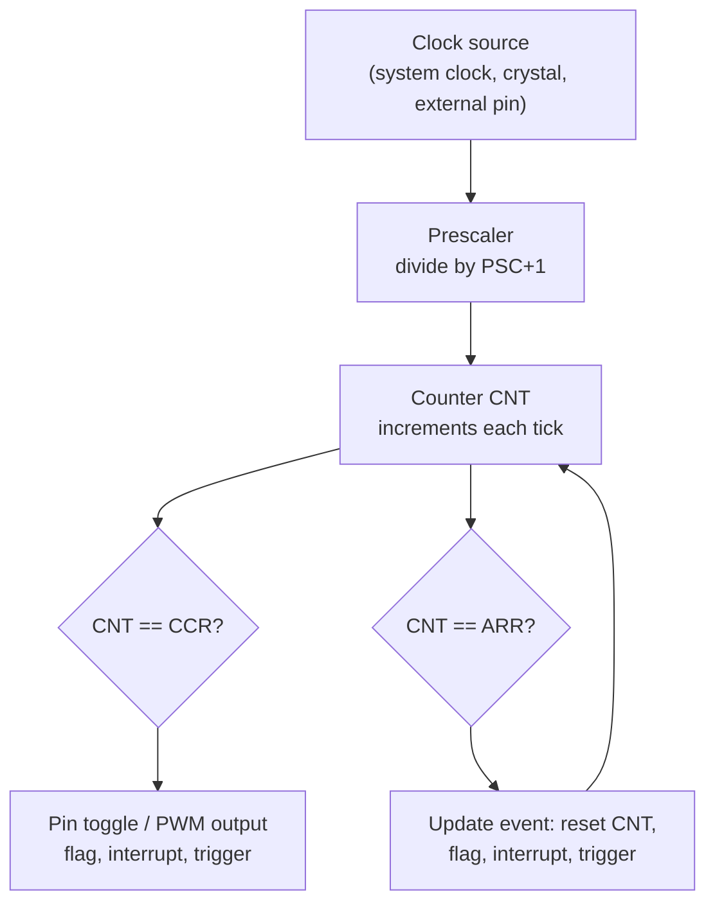

::: testing
Whether you understand a timer as **a hardware counter driven by a clock**, not as "a delay function". The interviewer wants to hear the pieces: a clock source, a prescaler, a counter register, a compare or reload value, and the fact that all of it runs in parallel with the CPU. They also want to see that you know *why* it exists: so the processor does not have to burn cycles counting, and so timing does not depend on how long your code takes to run. Bonus points for connecting it to the sibling concepts: PWM, input capture, interrupts and the watchdog.
:::

::: why
Almost every embedded product is a real-time product: sample a sensor every 1 ms, blink a status LED, generate a 50 Hz servo pulse, measure how long a button was held, time out a UART frame. All of that is a timer under the hood. If you do it with software delay loops the CPU is stuck, the timing drifts with compiler settings and interrupts, and you cannot do anything else. Knowing the timer peripheral is the line between "I got Arduino working" and "I can design firmware that meets timing." It is also the gateway to the next four questions in this section ([[q0790]], [[q0791]], [[q0792]], [[q0793]]) and to interrupts ([[q0795]]).
:::

::: concepts
- **Counter**: a register that increments (or decrements) on every tick of its input clock, in hardware, with no CPU involvement. Width is typically 8, 16 or 32 bits.
- **Clock source and prescaler**: the counter is fed from the system clock or a crystal, optionally divided by a prescaler so slow events fit in a short register. See [[q0791]] for accuracy of the source.
- **Compare / reload value**: a number the counter is compared against. A match sets a flag, toggles a pin or resets the counter, so the timer produces events at a precise period.
- **Overflow and update event**: when the counter wraps (or hits the reload value), it raises a flag that can trigger an interrupt ([[q0795]]).
- **Peripheral independence**: once configured, the timer runs without the CPU; the CPU only reads or reacts to it. GPIO behaviour for the output pins is covered in [[q0783]].
:::

::: answer
"A timer in a microcontroller is basically a hardware counter. You feed it a clock, maybe through a prescaler to slow it down, and a register just counts up every tick, completely independent of what the CPU is doing. Then you compare that count to a value you set, and when it matches, or when it overflows, the hardware sets a flag, fires an interrupt, toggles a pin, or resets itself.

That's what lets you do timing without the CPU watching the clock. For example, with a 16 MHz clock and a divide-by-16 prescaler the counter ticks at 1 MHz, so if I let it count to 1000 I get an event every millisecond, and it stays exact no matter how busy the main loop is.

The same block does a bunch of related jobs: generating PWM by comparing the counter to a duty value, measuring pulse widths by latching the counter on an edge, which is input capture, and counting external pulses. Most chips have several timers with different widths and features, plus special ones like the SysTick used by an RTOS and the watchdog. So I think of a timer as the MCU's stopwatch and metronome that runs in the background."
:::

::: technical
**Structure.** A timer is a clocked synchronous counter $CNT$ plus control logic. Its input clock is $f_{clk}$ (peripheral bus clock, a dedicated oscillator such as a 32.768 kHz crystal, or an external pin). A prescaler divides by $PSC+1$, so the counter increments at $f_{tick} = f_{clk}/(PSC+1)$.

**Period.** In up-counting mode with an auto-reload value $ARR$, the counter runs from 0 to $ARR$ and then resets, so the update event frequency is

$$f_{update} = \frac{f_{clk}}{(PSC+1)(ARR+1)}$$

For $f_{clk}=16$ MHz, $PSC=15$, $ARR=999$: $f_{tick}=1$ MHz and $f_{update}=1$ kHz (1 ms). The "+1" terms are a classic off-by-one trap: a register holding $N$ gives $N+1$ counts because the counter includes 0. Naming differs by vendor; for example AVR uses a prescaler selection and a TOP value, STM32 uses PSC and ARR.

**Capture/compare channels.** Each channel has a register $CCR$. Output compare: when $CNT = CCR$ the channel flips a pin or sets a flag. In PWM mode the pin is high while $CNT<CCR$, giving duty $D = CCR/(ARR+1)$ ([[q0790]]). Input capture: on an edge at a pin, hardware copies $CNT$ into $CCR$, so edge times are measured with a resolution of one tick and no software latency.

**Width and range.** A 16-bit counter overflows after 65,536 ticks: 4.096 ms at 16 MHz with no prescaler. To time one second you either prescale (e.g. $f_{tick}=250$ kHz) or chain overflow counts in software or a 32-bit timer.

**Outputs.** Flags and interrupt requests (update, compare, capture), pin outputs, triggers to other peripherals (start an ADC conversion, step a DMA transfer), and clocking another timer for cascading.

**Related special-purpose timers.** SysTick (a 24-bit down-counter in Arm Cortex-M cores, used as the RTOS tick), the watchdog (resets the chip if not serviced) and the RTC (a low-power, usually 32.768 kHz timer with calendar logic). All are the same idea with different wrappers.

> [!UNCERTAIN]
> Register names, counter widths and the number of timers vary a lot between families. The equation above is the common general form; always check the specific reference manual for exact reload and prescaler semantics.
:::

::: short
"A timer is a hardware counter that counts clock ticks independently of the CPU. A prescaler slows the clock, and a compare or reload register tells it when to raise a flag, fire an interrupt, or toggle a pin. So with 16 MHz and a prescaler of 16 I get a 1 MHz tick, and counting to 1000 gives me an exact 1 ms event regardless of what the code is doing. The same hardware is used for PWM, measuring pulse widths with input capture, and scheduler ticks."
:::

::: long
"A timer is a hardware counter inside the microcontroller. You give it a clock, usually derived from the system clock or a crystal, and it counts ticks in a register, 8, 16 or sometimes 32 bits wide. The important thing is that it counts on its own. The CPU doesn't have to run any instructions to keep it going.

Between the clock and the counter there's usually a prescaler, which just divides the clock so the counter ticks slower. At the other end there's a compare or reload register. When the counter matches it, or overflows, the hardware raises a flag, can fire an interrupt, can toggle or force a pin, and can reset the counter so it repeats.

The math is simple. The update rate is the input clock divided by prescaler-plus-one times reload-plus-one. At 16 MHz with a prescaler of 16 and a reload of 1000 I get exactly one event per millisecond. That's why timers beat delay loops: a delay loop blocks the CPU and its length changes with compiler settings and interrupts, but a timer keeps perfect time while the CPU does real work.

On top of the basic counter there are a few standard modes. Output compare plus PWM mode, where the pin is high while the counter is below a duty value. Input capture, where an edge on a pin copies the counter value into a register so I can measure pulse widths down to one tick. And pulse counting from an external pin.

Most MCUs have several timers, and there are special-purpose ones: SysTick for an RTOS tick, a watchdog that resets the chip if software hangs, and a low-power RTC. Underneath they're all the same thing, a clocked counter with a compare. So when someone says 'timer', I think of it as the chip's built-in stopwatch and metronome."
:::

::: terms
- **Counter (CNT)**: the register that holds the current tick count.
- **Prescaler (PSC)**: divides the input clock so the counter increments slower, extending range at the cost of resolution.
- **Auto-reload (ARR / TOP)**: the value at which the counter wraps; sets the period.
- **Capture/compare register (CCR)**: holds either a match value (output compare, PWM) or a latched count (input capture).
- **Update event / overflow**: counter wrap or reload; typically raises a flag and optional interrupt.
- **Tick**: one increment of the counter; the timer's time resolution is one tick.
- **Input capture**: hardware copies the counter on an external edge to timestamp it.
- **Watchdog timer**: a timer that resets the MCU unless software periodically clears it.
:::

::: exceptional
An average answer says "it counts time and can make delays." An exceptional answer:

- Describes the **block diagram** (clock, prescaler, counter, compare/reload, outputs) and gives the formula $f = f_{clk}/((PSC+1)(ARR+1))$ with a worked number.
- States clearly that it runs **in parallel with the CPU**, which is why it beats software delays.
- Names the three or four modes (periodic interrupt, output compare/PWM, input capture, external count) without being asked.
- Mentions the **resolution versus range** trade-off set by the prescaler and counter width, and the off-by-one ($ARR+1$) trap.
- Distinguishes the clock source quality (crystal versus internal RC) from the counter itself, since timing accuracy is only as good as the clock ([[q0791]]).
:::

::: mistakes
- **"A timer is just a delay function."** A delay loop burns CPU cycles; a timer is independent hardware. The delay *function* is only one thing you can build from it.
- **Forgetting the +1.** A reload value of 999 gives 1000 counts per period, not 999. Skipping this makes a 1 kHz tick come out at 1.001 kHz.
- **Ignoring counter width.** A 16-bit timer at 16 MHz overflows in 4.096 ms; you need a prescaler or overflow counting for longer intervals.
- **Assuming timing accuracy comes for free.** The counter is exact digital logic, but the clock feeding it is a physical oscillator with ppm or percent error.
- **Thinking all timers are identical.** General-purpose, advanced (dead-time, complementary outputs), basic (just a tick), low-power and the watchdog differ in features. Check which one has the pin or trigger you need.
:::

::: deep
## What problem a timer solves

A CPU executes instructions one after another. If you want "do X every 1 ms", the naive way is to count instructions:

```c
while (1) { do_x(); for (volatile int i = 0; i < 4000; i++); }
```

That period is a function of the compiler, optimisation level, clock, flash wait states, and whatever interrupts fire in between. It also uses 100% of the CPU. A timer fixes both problems by moving the counting into **dedicated digital hardware** that increments on every clock edge regardless of what the CPU does. The CPU is only involved when the timer says "something happened".

## The anatomy


Figure: Every timer is this pipeline. The clock goes through a divider into a counter; comparators watch for the match value and the reload value, and each can produce a pin change, a flag, an interrupt or a trigger to another peripheral.

The counter is just a synchronous binary counter: a chain of flip-flops with an incrementer in front, exactly the structure you would draw in a digital-logic course. Because it is clocked, its resolution is one clock period; it cannot see anything shorter than one tick.

## Period equations

With prescaler $PSC$ and auto-reload $ARR$ (counter counts $0\ldots ARR$):

$$f_{tick}=\frac{f_{clk}}{PSC+1},\qquad T_{update}=\frac{(PSC+1)(ARR+1)}{f_{clk}}$$

Worked example: you want a 1 kHz interrupt from a 16 MHz clock. Product $(PSC+1)(ARR+1)=16{,}000$. Choose $PSC+1=16$ so the tick is 1 MHz (1 µs) and $ARR+1=1000$. Any factor pair works, as long as both fit the register widths; larger $ARR$ gives finer resolution of the *duty* if you are making PWM, whereas a larger prescaler just wastes resolution. So the rule is: **use the smallest prescaler that makes the period fit.**

```plot
{"title":"Up-counting timer: counter value, reload ARR = 9, compare CCR = 3","x":{"label":"timer ticks","unit":"","min":0,"max":30},"y":{"label":"CNT / pin","unit":"","min":-1,"max":11},
 "vars":{"arr":9,"ccr":3},
 "series":[{"label":"CNT (sawtooth)","fn":"mod(floor(x),arr+1)","step":true},{"label":"PWM pin (x10 for scale)","fn":"10*ite(mod(floor(x),arr+1)<ccr,1,0)","step":true,"dashed":true,"color":"orange"}],
 "hlines":[{"at":"ccr","label":"CCR = 3","color":"muted"}],"vlines":[{"at":10,"label":"update event"},{"at":20,"label":""}]}
```
Figure: The counter ramps 0 to 9 and wraps every 10 ticks (ARR + 1). The orange output is high while the counter is below CCR, so duty is 3/10 = 30%. Note the counter takes 10 values even though ARR is 9.

## Try it

```sim
{"id":"timer-lab","fclk":16000000,"psc":15,"arr":999,"ccr":250}
```
Figure: Change PSC and ARR and watch the update frequency follow $f_{clk}/((PSC+1)(ARR+1))$. Try PSC = 0 with ARR = 65535 to see the 16-bit overflow period of 4.096 ms, then raise PSC until the period is about 1 s. Move CCR to see PWM duty change.

## What the CPU does and does not do

Setting up a timer is a handful of register writes: enable the peripheral clock, set PSC and ARR, enable the update interrupt, start the counter. After that, the sequence "count, compare, flag" is hardware. The CPU is involved only in the interrupt handler, if you enabled one ([[q0795]]), or when it polls the flag. Many chips go one step further: the timer can trigger an ADC conversion or a DMA transfer directly, with no interrupt at all. That is how you get jitter-free sampling.

## Resolution, range and width

A timer has two competing limits.

- **Range** = $2^{N}$ ticks for $N$ bits. 8-bit: 256 ticks; 16-bit: 65,536; 32-bit: about 4.29 billion.
- **Resolution** = one tick $=(PSC+1)/f_{clk}$.

At 16 MHz, a 16-bit counter with $PSC=0$ has 62.5 ns resolution but only 4.096 ms range. With $PSC+1=256$: 16 µs resolution, 1.05 s range. A 32-bit timer at 72 MHz gives 13.9 ns resolution and a 59.6 s range. If you need both (for example timestamps to a microsecond over days), you extend in software: count overflow interrupts as the high word. That is how Arduino's `millis()` gets to 49.7 days before its 32-bit value wraps ([[q0791]]).

## Worked example: a 1 second tick on a 16-bit timer

You want a 1 Hz event from a 16 MHz clock using a 16-bit timer, so $(PSC+1)(ARR+1)=16{,}000{,}000$ with both factors at most 65,536. Try $PSC+1=256$: then $ARR+1=16{,}000{,}000/256=62{,}500$, which fits in 16 bits. So $PSC=255$, $ARR=62{,}499$ gives exactly 1.000000 s of counts, and the tick resolution is 16 µs. Because 16,000,000 factors cleanly into integers there is zero rounding error; the only remaining error is the oscillator itself. If the clock were 12.5 MHz or the target 3 Hz, you would check the divisors and compute the residual error before trusting it.

## Kinds of timer on a typical MCU

| Kind | What it does | Typical use |
|---|---|---|
| Basic | Just counts and generates update events | Fixed-rate tick, DAC or ADC trigger |
| General-purpose | Basic plus 2-4 capture/compare channels | PWM, input capture, encoder interface |
| Advanced / motor control | Complementary outputs, dead-time, break input | H-bridges, 3-phase inverters ([[q0807]]) |
| SysTick | 24-bit down-counter in the Arm core | RTOS scheduler tick |
| Watchdog | Resets the chip if not "kicked" | Recover from software hangs |
| RTC | Low-power 32.768 kHz counter with calendar | Wake-up, timekeeping |

## Common failure modes in real hardware

- **Wrong clock assumed.** The timer clock is often a doubled or divided version of the CPU clock; read the clock tree rather than assuming $f_{CPU}$.
- **Update flag cleared too late.** If the ISR does not clear the interrupt flag, you re-enter immediately. See the interrupt pages starting at [[q0795]].
- **Preload / shadow registers.** Changing ARR or CCR mid-cycle can produce one glitchy period unless the hardware buffers the value until the next update event.
- **Timer pin conflicts.** A timer output only appears on specific pins; set the GPIO alternate function ([[q0783]]).
:::

::: applications
- **Millisecond system tick** (`millis()`, FreeRTOS tick, Cortex-M SysTick) driving schedulers and timeouts.
- **PWM** for LED dimming, motor speed and switching regulators ([[q0790]]).
- **Servo control**: 50 Hz frame with a 1-2 ms pulse, easily produced by a timer channel.
- **Input capture** to measure pulse widths and frequencies, such as an ultrasonic range-finder echo or a tachometer.
- **Quadrature encoder interface** mode counts motor shaft position directly in hardware.
- **Watchdog** and **RTC** timers for fault recovery and low-power wake-up.
:::

::: assumptions
- Assumes the timer clock is stable and known; its absolute accuracy depends on the oscillator ([[q0791]]).
- Assumes a typical **up-counting** timer; many chips also count down or up/down (center-aligned PWM), and the period formulas change slightly (up/down gives $2\cdot ARR$ ticks per period).
- Register naming and exact reload semantics differ between AVR, STM32, TI MSP430, Microchip PIC, nRF and others. The concepts transfer; the numbers in registers do not.
- A "timer" can also mean a software timer built on top of a hardware tick (RTOS timers). I treat the question as the hardware peripheral, and cover software timers in [[q0793]].
:::

::: followups
### Why not just use a delay loop or `delay_ms()`?
A busy-wait blocks the CPU, so nothing else runs, and its accuracy depends on compiler optimisation, clock speed, wait states and interrupts stealing cycles. A hardware timer is deterministic and leaves the CPU free (or asleep). `delay_ms()` is fine for init sequences, not for real-time behaviour. Many `delay` functions are actually implemented on top of a timer such as SysTick, which fixes the accuracy but still blocks.

### What happens when the counter overflows, and how do you time something longer than one overflow?
It wraps to 0 and sets an overflow/update flag, optionally interrupting. For longer intervals you either increase the prescaler (losing resolution), use a 32-bit timer, or count overflows in an ISR and extend the count in software: total ticks $= overflows\cdot 65536 + CNT$. For a 16-bit timer at 1 MHz ticks, one overflow is 65.536 ms.

### How do you generate exactly 1 kHz from a 16 MHz clock?
$16{,}000{,}000/1000 = 16{,}000 = (PSC+1)(ARR+1)$. For example $PSC=15$, $ARR=999$ or $PSC=0$, $ARR=15999$ (fits 16 bits). Both give exactly 1 kHz because 16,000 divides evenly. If the clock were 12 MHz, 12,000 divides evenly too, but with a 10 MHz crystal and a 3 kHz target you would get a fractional ratio and an error.

### What is the difference between a timer and a counter?
Same hardware, different clock source. A *timer* counts a known internal clock, so the count is time. A *counter* counts external events such as encoder pulses or a product on a conveyor. Many MCUs let you select either as the clock input.

### What if you change ARR while the timer is running?
Without preload (shadow register), the new value takes effect immediately. If the counter is already past the new ARR it keeps counting up to the 16-bit limit before wrapping, giving one very long period. With preload enabled, the new value is latched at the next update event, which is the safe way to change PWM period or duty mid-run.
:::

::: interpretations
"Timers in a microcontroller" can mean the **hardware peripheral** (counter, prescaler, compare) which is what I answer here, or a **software timer** (a timeout object in an RTOS). Software timers are built on one hardware timer, usually SysTick. If the interviewer is from a firmware team they may mean the RTOS flavour; give the hardware answer first and then say how a software layer multiplexes it ([[q0793]]).
:::

::: references
- Yiu, J., *The Definitive Guide to Arm Cortex-M3 and Cortex-M4 Processors*: SysTick timer and exception model chapters.
- Microcontroller reference manuals for the concept of prescaler/auto-reload/capture-compare (for example the general-purpose timer chapters of STMicroelectronics STM32 reference manuals, Microchip AVR timer/counter chapters). Register-level details are family specific.
- Horowitz & Hill, *The Art of Electronics*, 3rd ed.: counters and digital timing circuits.
- Valvano, J., *Embedded Systems: Real-Time Interfacing to Arm Cortex-M Microcontrollers*: periodic interrupts and input capture chapters.
:::

::: rubric
- Defines a timer as a hardware counter driven by a clock, running independently of the CPU :: This is the core answer; without "independent hardware" it sounds like a delay function.
- Mentions the prescaler and compare/reload register and what happens on a match or overflow :: Shows you know the block structure, not just the name.
- Gives the period formula with correct +1 terms and a worked number :: Proves you can configure a real timer, not only describe it.
- Names at least three uses (periodic tick, PWM, input capture, counting, watchdog) :: Connects the concept to why it exists.
- Explains the resolution versus range trade-off from the prescaler and counter width :: This is the practical design constraint on every timer setup.
- Notes accuracy depends on the clock source :: Separates exact digital counting from imperfect oscillators.
:::

::: quiz
```json
[
 {"type":"mcq","level":"fundamental","q":"What is a microcontroller timer, at its core?","options":["A software loop that wastes CPU cycles for a fixed time","A hardware counter clocked by an oscillator that runs independently of the CPU","A special instruction that pauses the program","An analog RC circuit on the chip"],"answer":1,"explain":"A timer is a clocked digital counter plus compare logic. It keeps counting while the CPU runs other code, which is exactly why it is better than busy-wait loops."},
 {"type":"numeric","level":"fundamental","q":"A timer is clocked at 16 MHz with $PSC+1 = 16$ and $ARR+1 = 1000$. What is the update-event frequency?","answer":1,"tolerance":0.01,"unit":"kHz","explain":"$f = 16\\text{ MHz}/(16\\cdot1000) = 1$ kHz, i.e. one event per millisecond."},
 {"type":"numeric","level":"intermediate","q":"How long until a 16-bit timer with no prescaler overflows if clocked at 16 MHz?","answer":4.096,"tolerance":0.01,"unit":"ms","explain":"$65536/16\\text{ MHz} = 4.096$ ms. To time longer events you add a prescaler or count overflows in software."},
 {"type":"mcq","level":"intermediate","q":"You set ARR = 99 on an up-counting timer with a 1 MHz tick. What is the period?","options":["99 µs","100 µs","101 µs","1 ms"],"answer":1,"explain":"The counter takes the values 0 to 99, which is 100 ticks, so the period is 100 µs. Forgetting the +1 is the classic off-by-one."},
 {"type":"truefalse","level":"advanced","q":"Because the counter is digital logic, a timer always produces perfectly accurate timing regardless of the clock source.","answer":false,"explain":"The count is exact, but its time scale comes from an oscillator. An internal RC oscillator can be off by about 1% (14 minutes per day) while a crystal might be 20 ppm (about 1.7 s per day)."},
 {"type":"multi","level":"intermediate","q":"Which of these can be built from one timer's capture/compare hardware? Select all that apply.","options":["PWM generation","Measuring the width of an external pulse","Counting external pulses","Increasing the CPU clock frequency"],"answer":[0,1,2],"explain":"Output compare makes PWM, input capture timestamps edges for pulse width, and external-clock mode counts pulses. A timer does not change the CPU clock."}
]
```
:::
