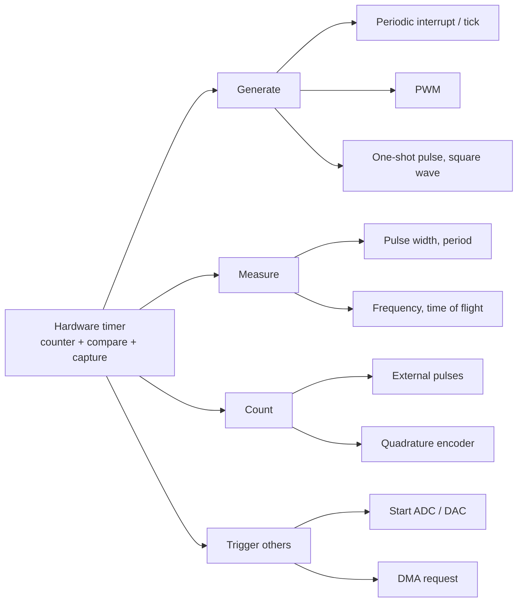

::: basics
### In plain words
A timer can do four kinds of jobs, all in hardware. It can make things happen on a schedule, such as a regular signal to the processor or a PWM signal. It can measure time, such as how long a pulse lasts. It can count pulses from outside. And it can trigger other parts, such as starting a measurement.

### Picture it
Picture a kitchen timer that has been upgraded. As an alarm, it rings every minute on schedule. As a lap timer, you press a button when a runner crosses a line, and it records the exact time, even if you were busy. As a tally clicker, it counts how many people walk past. As a switch, it turns a lamp on for part of each second.

### Words you need
- **PWM (pulse-width modulation)**: switching a pin on and off repeatedly, so the average power depends on how long it stays on.
- **Duty cycle**: the fraction of each period that the pin is on. 25% means on for a quarter of the time.
- **Input capture**: saving the counter value at the instant an input signal switches level, to timestamp it exactly.

### The simplest example
A hobby servo wants a pulse every 20 ms, which is 50 Hz, and the pulse width sets its angle. With the counter ticking once per microsecond (1 MHz), set the period to 20,000 counts. Switching the pin off at count 1500 makes the pulse 1.5 ms wide, the centered position. The duty cycle is $1500/20000 = 7.5\%$. Now the other direction: an ultrasonic sensor sends back an echo pulse. Input capture records when the pulse starts and ends, to one tick, 1 µs. A 10 ms echo means the target is $343 \times 0.010/2 \approx 1.7$ m away. That is the whole idea. The rest of this page covers PWM resolution, measuring frequency and when to avoid software delays.
:::

::: testing
Whether you can organise a timer's abilities into a few clean categories and say, for each one, **which hardware feature provides it**: periodic interrupt, output compare/PWM, input capture, external counting, and hardware triggers. Interviewers are also listening for an engineering judgement: that you pick a hardware timer when timing must be deterministic and the CPU should be free, and a software delay when it genuinely does not matter. Concrete numbers (a 20 kHz PWM, a 1-2 ms servo pulse, a microsecond-level echo measurement) show you have actually configured one.
:::

::: why
Timers are the MCU's most reusable resource. A single general-purpose timer might be your RTOS tick, a motor PWM, a servo, an ultrasonic range-finder and an ADC sampling trigger, all in the same product. Knowing the menu lets you map a requirement ("sample at exactly 8 kHz", "measure a 100 Hz-10 kHz tach signal") straight to a hardware feature instead of writing fragile polling code. It is also a typical warm-up: it tells the interviewer whether the rest of the embedded questions ([[q0793]], [[q0795]]) will go well.
:::

::: concepts
- **Periodic interrupt**: the update event fires every $T$; basis for sampling, scheduling and software timers. See [[q0789]].
- **Output compare / PWM**: the counter is compared with a register to switch a pin at exact times, giving pulses and PWM ([[q0806]]).
- **Input capture**: an edge latches the counter, so you can timestamp events and compute widths, periods and frequencies.
- **External event counting / encoder mode**: the timer's clock is a pin, so the count equals the number of pulses or the shaft position.
- **Hardware trigger outputs**: the update or compare event can start an ADC conversion or DMA transfer without CPU intervention ([[q0792]]).
- **Watchdog and RTC**: timer variants for fault recovery and low-power timekeeping.
:::

::: answer
"Timers give you basically three things: they make time events happen, they measure time, and they count events.

For making things happen, the simplest case is a periodic interrupt. I set the prescaler and reload so it fires every millisecond, and that becomes my scheduler tick or my ADC sample rate. Then there's output compare and PWM, where the pin is driven high while the counter is below a duty register. That's how I dim LEDs, set motor speed, make a servo pulse, or run a switching converter. I'd typically run motor PWM around 20 kHz so it's above hearing.

For measuring, input capture latches the counter on an edge, so I can time an ultrasonic echo or a tachometer pulse to one tick, 62.5 ns at 16 MHz, without the CPU being fast enough to react.

For counting, the timer can clock from a pin and count pulses, and many chips have a quadrature encoder mode that tracks a motor's position directly.

And there are the housekeeping ones: the watchdog that resets the chip if firmware hangs, and the RTC for low-power wake-ups. The key point is that all of this happens in hardware, so it's precise and frees up the CPU."
:::

::: technical
**1. Periodic events.** Update interrupt at $f=\frac{f_{clk}}{(PSC+1)(ARR+1)}$; used for system ticks, polling debouncers, control loops at a fixed rate and sampling. Using the update event to trigger an ADC directly removes ISR latency jitter from the sample instants.

**2. Delays and timeouts.** A free-running counter read as a timestamp. Elapsed time is $t_{now}-t_{start}$ in unsigned arithmetic, which stays correct across wrap-around (see [[q0791]]).

**3. Output compare / PWM.** Edge-aligned PWM: period $T=(ARR+1)/f_{tick}$, duty $D=CCR/(ARR+1)$. Resolution in bits is about $\log_2(ARR+1)$. At 16 MHz and 20 kHz, $ARR+1=800$, about 9.6 bits; at 72 MHz it is 3600 steps, about 11.8 bits. Frequency and resolution trade off directly. Centre-aligned (up/down) PWM halves the frequency for the same ARR and keeps edges symmetric, which is often preferred in motor drives.

**4. One-pulse mode and waveform generation.** Hardware generates a single pulse of precise width after a trigger (a fixed delay, a strobe, a trigger pulse for an ultrasonic sensor), or toggles a pin at each compare for a square wave of frequency $f_{tick}/(2\cdot N)$.

**5. Input capture.** On each edge the count is copied to CCR. Pulse width $=(CCR_2-CCR_1)/f_{tick}$ (with unsigned wrap handling). Two methods to get frequency: counting pulses in a fixed gate time (error about $\pm1$ pulse per gate, bad at low frequency) or measuring the period between edges (error $\pm1$ tick per period, bad at high frequency). Example with 16 MHz and a 1 kHz signal: period is 16,000 ticks, so the $\pm1$ tick error is about 0.006%. Counting pulses over a 100 ms gate would only give 100 counts, $\pm1\%$.

**6. External counting / encoder mode.** The counter is clocked by pins; direction comes from the quadrature phase. A 1000 PPR encoder gives 4000 counts per revolution in x4 mode.

**7. Triggers and DMA.** Timer events start ADC/DAC conversions and DMA requests so a waveform or sample stream runs with no per-sample CPU involvement.

**8. Watchdog / RTC.** Reset on a software hang; wake from deep sleep once per second from a 32.768 kHz source.
:::

::: short
"Timers let you generate, measure and count in hardware. Generate: periodic interrupts for a system tick or ADC sampling, and output compare for PWM, servo pulses or one-shot strobes. Measure: input capture timestamps an edge with one-tick resolution, so I can time an echo or tach pulse. Count: clock the timer from a pin to count pulses or run a quadrature encoder. Plus watchdog and RTC variants. It's all deterministic and runs without the CPU, which is why I prefer it over software delays."
:::

::: long
"I like to group timer uses into things that generate, things that measure, and things that count.

For generating, the basic one is a periodic interrupt: choose prescaler and reload so the update event fires at, say, 1 kHz, and that is my system tick, my control loop rate, or my ADC trigger. The update event can even start the ADC directly, so the sampling instants have no software jitter. The next one is output compare and PWM. The counter runs up to the reload value, and the pin is high while the counter is below the compare register. That gives duty equal to compare over reload-plus-one. I use it for LED brightness, motor speed, switching regulators, and servos, where I'd run 50 Hz with a pulse between 1 and 2 milliseconds. I can also use one-pulse mode to make a precise single pulse, like the trigger for an ultrasonic sensor.

For measuring, input capture copies the counter into a register on an edge. Subtract two captures and I have a pulse width or period in ticks. At 16 MHz, one tick is 62.5 nanoseconds, so measuring a 1 kHz signal by its period is accurate to about 0.006%, much better than counting pulses over a short window. That's how you read an ultrasonic echo, a tachometer, or a PWM-output sensor.

For counting, the timer can clock off an external pin to count pulses, and in encoder mode it decodes quadrature and tracks position with no CPU load.

Finally there are the special ones. A watchdog resets the chip if firmware stops kicking it, which is critical for unattended devices, and an RTC keeps time in the lowest power mode from a 32 kHz crystal. The common thread is that the timing is done by hardware, so it's deterministic and leaves the CPU free."
:::

::: terms
- **Periodic interrupt**: an interrupt generated at the update event of a free-running reload cycle.
- **Output compare (OC)**: hardware changes a pin when the counter equals a compare value.
- **PWM duty cycle**: the high-time fraction, $D = CCR/(ARR+1)$ in edge-aligned mode.
- **Input capture (IC)**: latching the counter into a register on an external edge.
- **One-pulse mode**: the timer generates a single output pulse after a trigger, then stops.
- **Encoder (quadrature) mode**: the counter counts up or down based on two phase-shifted input signals.
- **Timestamp**: a counter value used as the time of an event.
- **Gate time**: the fixed window during which pulses are counted to measure frequency.
:::

::: exceptional
An average answer lists "delays, PWM, measuring time." An exceptional answer:

- Organises uses into **generate / measure / count / trigger**, and attaches the hardware feature to each.
- Backs a few uses with real numbers: 20 kHz PWM resolution, 50 Hz servo with a 1-2 ms pulse, the $\pm1$ tick error of input capture.
- Knows the **period versus gating** trade-off for frequency measurement (period method for low frequencies, gated count for high).
- Mentions **hardware triggering** an ADC or DMA from a timer for jitter-free sampling, rather than doing it in an ISR.
- Calls out the shared-resource reality: one timer has one period, so PWM channels on the same timer share frequency.
:::

::: mistakes
- **Using software `delay()` for periodic tasks.** It blocks the CPU and its period drifts; use a timer interrupt or a timestamp comparison.
- **Measuring frequency with the wrong method.** Gate counting of a low-frequency signal gives poor resolution; period capture of a very high-frequency signal does too. Choose by frequency range.
- **Forgetting PWM channels share a period.** Channels on one timer have the same frequency; only the duty differs. Need a different frequency, use a different timer.
- **Assuming PWM resolution is free.** More resolution at a given frequency needs a faster clock, since $bits\approx\log_2(f_{clk}/f_{PWM})$.
- **Ignoring wrap-around in capture arithmetic.** Subtract in unsigned arithmetic of the counter's width; a plain subtraction in a wider signed type breaks at overflow.
:::

::: deep
## A map of timer capabilities


Figure: One counter, four families of use. Notice that the same counter register serves all of them; what differs is which event (overflow, compare match or edge) you hook to a pin, flag or trigger.

## Generating: PWM in detail

PWM is the most common timer use outside of a tick. The counter ramps 0 to $ARR$ and the pin is high while $CNT<CCR$. Average output is $V_{avg}=D\cdot V_{high}$, which a motor, LED or RC filter integrates ([[q0806]], [[q0807]]).

```plot
{"title":"Edge-aligned PWM from a counter (ARR+1 = 20 ticks)","x":{"label":"time","unit":"ticks","min":0,"max":60},"y":{"label":"pin level","unit":"","min":-0.2,"max":1.4},
 "series":[{"label":"D = 25% (CCR = 5)","fn":"ite(mod(floor(x),20)<5,1,0)","step":true,"color":"blue"},{"label":"D = 75% (CCR = 15)","fn":"ite(mod(floor(x),20)<15,1,0)","step":true,"color":"orange","dashed":true}],
 "vlines":[{"at":20,"label":"period"},{"at":40,"label":""}]}
```
Figure: Same counter and period, only CCR changes. The rising edge always sits at the update event; the falling edge moves with CCR. This is why frequency is shared across channels while duty is independent.

The resolution relation is the practical constraint: $ARR+1 = f_{tick}/f_{PWM}$.

| Clock | PWM frequency | Steps ($ARR+1$) | Resolution |
|---|---|---|---|
| 16 MHz | 1 kHz | 16,000 | about 14 bits |
| 16 MHz | 20 kHz | 800 | about 9.6 bits |
| 72 MHz | 20 kHz | 3,600 | about 11.8 bits |

Worked servo example: 50 Hz means a 20 ms frame. With a 1 MHz tick, $ARR=19{,}999$ and $CCR$ from 1000 to 2000 sweeps a 1-2 ms pulse in 1000 steps. For a servo with about 180 degrees travel that is 0.18 degrees per step, finer than the servo's own deadband.

```sim
{"id":"pwm-lab","duty":0.3,"f":1000,"amp":5,"view":"time"}
```
Figure: Change the duty and watch the average and RMS values. Switch to the spectrum view to see the harmonics at multiples of the PWM frequency; this is why we push PWM above audible range for motors.

## Measuring: input capture

On a chosen edge the hardware copies $CNT$ into $CCR$ in the same clock cycle, so the timestamp is not affected by interrupt latency. The ISR can run a few microseconds later and still read the exact edge time. Two captures on rising edges give the period; one rising and one falling give the pulse width.

Example: an ultrasonic range sensor outputs an echo pulse whose width equals the round-trip time. At 343 m/s, a 10 ms echo means $d = 343\cdot0.010/2 = 1.715$ m. With a 1 MHz tick the resolution is 1 µs, which is 0.17 mm in distance, far better than the sensor's own accuracy.

For frequency, pick the method by range:

- **Period method** (time between edges): error is $\pm1$ tick out of $N=f_{tick}/f_{in}$ ticks, i.e. $\pm f_{in}/f_{tick}$. At 1 kHz and 16 MHz it is 0.006%. At 1 MHz it is 6.25%.
- **Gate method** (count edges in a fixed window): error is $\pm1$ count out of $f_{in}\cdot T_{gate}$. At 1 MHz with a 10 ms gate it is $10^{-4}$, at 1 kHz it is 10%.

The best systems use the period method below a crossover and the gate method above it, or a reciprocal counter that measures the exact time of an integer number of input periods.

## Counting and encoders

If the timer clock is a pin, each active edge increments the count. In quadrature mode two channels A and B, 90 degrees apart, give direction as well. At 4000 counts per revolution and 6000 rpm (100 rev/s) the count rate is 400 kHz, which would overwhelm interrupt-per-edge code ([[q0800]]) but is nothing for a hardware counter. The CPU simply reads $CNT$ at its control-loop rate and differences it for speed.

## Triggering other peripherals

The update event can be routed internally to the ADC trigger input or a DMA request. The ADC then samples at exactly $f_{update}$ with jitter of a clock tick instead of an interrupt latency, which matters because jitter converts directly into noise on fast signals. DMA moves the result to memory with no ISR at all. This is how an MCU captures an 8 kHz audio stream while the CPU sleeps.

## Choosing between a hardware timer and software timing

A useful rule: if the timing requirement is tighter than your worst-case interrupt latency plus ISR jitter, the timing must be done in hardware. A 20 kHz PWM edge, an encoder at 400 kHz, or an ADC sample instant belongs to the timer. A 1 s LED blink or a 500 ms button timeout is fine in software: compare a millisecond tick counter against a deadline in the main loop, no dedicated timer needed. Software timers are cheap (one tick source, many deadlines) but their resolution is the tick period and they inherit the jitter of whatever is running. Hardware timers are scarce (a part may have only 3 to 8) so you reserve them for the signals that need them and multiplex everything slow on a single tick ([[q0793]]).

A quick budget exercise shows why. If a 1 kHz tick ISR takes 5 µs, the CPU load is $5\ \mu s\times1000 = 0.5\%$. If you instead tried to run a 20 kHz software PWM with the same ISR, the load would be 10% for one channel and would grow linearly with every extra channel. The hardware PWM channel costs nothing per cycle.

## Housekeeping timers

A watchdog is a down-counter that resets the MCU when it reaches zero unless software reloads it. If a firmware bug hangs the main loop, the watchdog times out and reboots the system. The RTC runs from a 32.768 kHz crystal ($2^{15}$ Hz, so a 15-bit divider gives exactly 1 Hz) in the lowest-power mode and wakes the system on a schedule.
:::

::: applications
- **LED dimming and display backlights** with PWM at hundreds of Hz to kHz ([[q0806]]).
- **Motor speed control** with 20 kHz PWM into an H-bridge, and encoder mode for feedback ([[q0807]]).
- **Hobby servo / ESC control**: 50 Hz frame with 1-2 ms pulses.
- **Ultrasonic distance and tachometer measurement** using input capture.
- **Fixed-rate ADC sampling** (audio, vibration, control loops) triggered by a timer.
- **Software scheduling**: SysTick-driven RTOS tick and software timers ([[q0793]]).
:::

::: assumptions
- Numbers assume a common edge-aligned, up-counting timer with a 16-bit counter; centre-aligned mode halves the PWM frequency for the same ARR.
- Capture accuracy assumes the signal's edges are clean. Noisy or slow edges give timing error larger than the tick, so a Schmitt input or filter may be needed.
- Not every timer has every feature. Basic timers may only have the update event; capture channels, encoder mode and complementary outputs are on general-purpose and advanced timers. Check the family datasheet.
- A different valid framing is "what are the use cases": delays, scheduling, PWM, measurement, communication baud-rate generation (UART baud timing is a divided clock, see [[q0775]]).
:::

::: followups
### How would you generate a 38 kHz carrier for an infrared remote?
Pick a timer with $f_{tick}$ so $(ARR+1)=f_{tick}/38{,}000$. At 16 MHz with $PSC=0$, $ARR+1=421$ gives 38.005 kHz (0.013% error). Set $CCR$ near $ARR/3$ for about 33% duty, then gate the output on and off with the data pattern, either by enabling and disabling the channel or by changing CCR between 0 and the duty value.

### How can a timer help ADC sampling be exact?
Configure the timer's update or compare event as the ADC's external trigger. Each event starts a conversion in hardware, so the sample spacing is exactly $T_{update}$ with only clock-level jitter. If you instead start the ADC in an ISR, interrupt latency varies with what else is running, which adds sampling jitter and noise at high input frequencies.

### Why do two PWM channels on the same timer have to share a frequency, and what if I need different ones?
They share the one counter and its reload value, so the period is common; only the compare values differ. For different frequencies use a second timer, or a timer with independent counters, or software PWM at low frequency. Plan pin and timer assignment early in a design.

### Can a timer measure a pulse that is longer than its overflow time?
Yes. Count overflow interrupts as the upper bits, or cascade to a 32-bit timer. The width is $(overflows\cdot(ARR+1) + CCR_2 - CCR_1)/f_{tick}$, taking care that an overflow and a capture happening nearly simultaneously are ordered correctly (read the overflow flag along with the capture).

### What if the input signal is 5 V but the MCU is 3.3 V and you need input capture?
Level-shift or divide it first, or use a 5 V-tolerant pin if the datasheet says so. A resistor divider (10 kΩ/20 kΩ gives 3.33 V) slows the edge with pin capacitance, so verify rise time and, if needed, use a level shifter or a comparator with hysteresis.
:::

::: references
- Yiu, J., *The Definitive Guide to Arm Cortex-M3 and Cortex-M4 Processors*: SysTick and peripheral timing context.
- Vendor reference manuals: general-purpose and advanced-control timer chapters (STMicroelectronics STM32, Microchip AVR/PIC, TI MSP430). Treat register details as family specific.
- Valvano, J., *Embedded Systems: Real-Time Interfacing to Arm Cortex-M Microcontrollers*: input capture, output compare and PWM chapters.
- Horowitz & Hill, *The Art of Electronics*, 3rd ed.: frequency counters and PWM.
:::

::: rubric
- Lists periodic interrupts/ticks and delays as a use :: These are the baseline uses every embedded product relies on.
- Explains PWM from the compare register, with duty $=CCR/(ARR+1)$ :: PWM is the most important output feature and the formula shows you can configure it.
- Explains input capture for measuring pulse width, period or frequency :: Measurement is the second pillar after generation.
- Mentions counting external events / quadrature encoder mode :: Shows awareness that the clock source can be an external pin.
- Mentions hardware triggering of ADC/DMA or watchdog/RTC :: Differentiates a thoughtful answer from a basic one.
- Gives at least one real number (resolution, PWM frequency, servo pulse) :: Numbers show practical configuration experience.
:::

::: quiz
```json
[
 {"type":"mcq","level":"fundamental","q":"Which timer feature timestamps an external edge in hardware with one-tick resolution?","options":["Output compare","Input capture","Watchdog","One-pulse mode"],"answer":1,"explain":"Input capture copies the counter into a register when the edge arrives, independent of interrupt latency. Output compare does the reverse: it acts on the pin when the counter matches."},
 {"type":"numeric","level":"fundamental","q":"An edge-aligned PWM has $ARR+1 = 800$ and $CCR = 200$. What is the duty cycle?","answer":25,"tolerance":0.01,"unit":"%","explain":"$D = CCR/(ARR+1) = 200/800 = 25\\%$."},
 {"type":"numeric","level":"intermediate","q":"A 16 MHz timer with no prescaler produces 20 kHz PWM. How many PWM steps ($ARR+1$) are available?","answer":800,"tolerance":0.01,"unit":"steps","explain":"$ARR+1 = f_{clk}/f_{PWM} = 16\\text{ MHz}/20\\text{ kHz} = 800$, about 9.6 bits of duty resolution."},
 {"type":"numeric","level":"intermediate","q":"An ultrasonic sensor's echo pulse is 5.8 ms wide. Using 343 m/s for the speed of sound, what is the distance to the target (round trip)?","answer":0.995,"tolerance":0.02,"unit":"m","explain":"$d = v\\,t/2 = 343\\cdot0.0058/2 = 0.995$ m. The divide by 2 accounts for the out-and-back path."},
 {"type":"mcq","level":"advanced","q":"You must measure the frequency of a 2 kHz signal and a 2 MHz signal with a 16 MHz timer. Which method is best for each?","options":["Gate count for both","Period (capture) for 2 kHz, gate count for 2 MHz","Period for both","Gate count for 2 kHz, period for 2 MHz"],"answer":1,"explain":"At 2 kHz the period is 8000 ticks, so the $\\pm1$ tick error is tiny. At 2 MHz the period is only 8 ticks (12.5% error) but a 10 ms gate counts 20,000 edges ($\\pm0.005\\%$)."},
 {"type":"truefalse","level":"intermediate","q":"Two PWM channels on the same timer can have different frequencies if you give them different CCR values.","answer":false,"explain":"They share the counter and reload value, so the frequency is common; CCR changes only the duty (and edge position). A second timer is needed for a different frequency."}
]
```
:::
