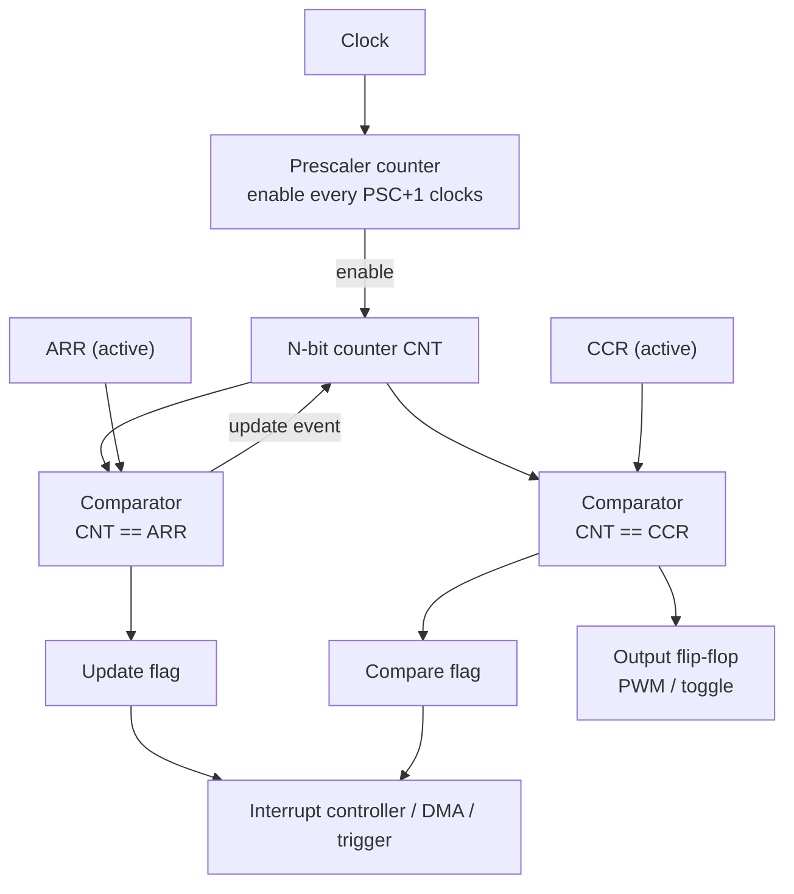

::: testing
Whether you can go below the register names to the **digital logic**: a timer is a chain of flip-flops forming a synchronous binary counter, an equality comparator, a reload mechanism and some edge-detection and flag logic. The interviewer wants to hear flip-flops, toggle behaviour, carry chains, why prescalers are counters too, how a compare match becomes a pin change or interrupt, and the clock-domain issues around capturing an asynchronous external edge. Mentioning real implementation details such as shadow registers, 16-bit access on an 8-bit bus and clock-enable prescalers shows you have read a reference manual, not only an Arduino tutorial.
:::

::: why
Chip design and embedded firmware both live on this boundary. A hardware engineer who understands a timer's implementation can predict its limits (maximum counting frequency, glitches when reloading, an uncertainty of one clock when capturing). A firmware engineer who does can explain strange behaviour such as "my PWM glitches when I update the duty" (no preload) or "my 16-bit read returns garbage sometimes" (non-atomic access). It is also a natural digital-logic interview question in disguise: "build a counter, add a comparator, add a reload" is a whiteboard exercise ([[q0789]], [[q0795]]).
:::

::: concepts
- **Flip-flop**: an edge-triggered 1-bit memory; the building block of every counter register.
- **Toggle flip-flop / binary counter**: a flip-flop that flips on each clock; a chain of them divides the clock by powers of two.
- **Synchronous counter**: all flip-flops share one clock; the next value is computed by an incrementer (half-adder chain).
- **Equality comparator**: bitwise XNOR of two registers ANDed together; asserts on a match.
- **Shadow (preload) register**: a buffer that holds the next reload or compare value until the update event.
- **Synchroniser**: two back-to-back flip-flops used to bring an asynchronous pin into the timer clock domain.
- **Interrupt flag**: a set-on-event, clear-by-software flip-flop connected to the interrupt controller ([[q0796]]).
:::

::: answer
"At the lowest level a timer is just a counter built from flip-flops, plus a comparator. The counter is a register of, say, 16 flip-flops with an incrementer in front of it. On each clock edge the register loads its own value plus one. A prescaler in front of it is also just a small counter that produces an enable pulse every N clocks, so the main counter only advances every Nth cycle.

Then there are comparators. A compare register holds a value you wrote, and a digital comparator, XNOR on each bit and an AND of the results, checks if the counter equals it. When it matches, you set a flag flip-flop. That flag can raise an interrupt, toggle an output pin through a small logic block, or reset the counter, which is how reload works.

For input capture, an external pin goes through a two-flip-flop synchroniser, an edge detector, and the edge pulse loads the counter value into a capture register in one clock.

The software side is just memory-mapped registers. The CPU writes the prescaler, reload and compare values over the bus, and reads the count back. Real designs add details like a shadow register so a new reload takes effect only at the update event, to avoid glitchy periods."
:::

::: technical
**Counter core.** An $N$-bit synchronous counter is $N$ flip-flops sharing the clock, with next-state logic $CNT_{next}=CNT+1$. Bit $i$ toggles when all lower bits are 1: $T_i=\prod_{j<i}Q_j$. The carry chain (AND tree) sets the maximum clock speed: $f_{max}\approx1/(t_{clk\to Q}+t_{carry}+t_{setup})$. Modern designs use fast carry logic or lookahead so a 16-bit or 32-bit timer easily runs at the bus clock.

**Ripple vs synchronous.** A ripple counter clocks each stage from the previous stage's output; it is simple but outputs settle one delay at a time, producing glitchy intermediate codes ($0111\to1000$ passes through $0110$, $0100$, $0000$, ...). Decoding a match from such outputs is unsafe; synchronous counters avoid this.

**Prescaler.** A free-running divider counter generating a one-cycle **enable** pulse every $PSC+1$ clocks. The main counter increments only when enable is high. This keeps everything in one clock domain, rather than using the divided signal as a new clock (which complicates timing closure).

**Auto-reload and compare.** Comparator output $eq=\bigwedge_i(CNT_i\odot ARR_i)$. In up-counting mode $eq$ asserts when $CNT=ARR$, and on the next tick the counter loads 0 instead of $CNT+1$, giving $ARR+1$ states per period. A compare channel does the same with CCR and instead sets or toggles an output flip-flop. PWM output logic is "set at update, clear at match".

**Shadow registers.** ARR and CCR have a buffered copy. Software writes the *preload* register; the *active* register used by the comparator updates only on the update event, so the period or duty never changes mid-cycle.

**Capture.** The input pin goes through a synchroniser (2 flip-flops, adds 1-2 timer clocks of delay), an optional digital filter (sample $N$ times) and an edge detector. The one-cycle edge pulse enables loading $CNT$ into the capture register, so time resolution is one tick plus a fixed, small synchroniser latency. Not all of this is identical across families.

**Bus access.** Registers are memory-mapped. A 16-bit register on an 8-bit CPU (classic AVR) is read via a temporary high-byte register so that reading low then high is atomic.

**Events.** Update, compare and capture each set a flag; flags and enable bits go to the interrupt controller and optionally to DMA or the trigger matrix.

> [!UNCERTAIN]
> The synchroniser depth, digital filter options and exact preload behaviour differ by device. Treat the structure as the common pattern and consult the reference manual for the part.
:::

::: short
"A timer is a synchronous binary counter made of flip-flops with an incrementer, a prescaler that is itself a small counter giving an enable pulse every N clocks, and comparators that check the count against a value in a register. A match sets a flag that can interrupt, toggle a pin, or reload the counter. For input capture, an external edge goes through a synchroniser and loads the count into a capture register. The CPU just accesses all of it as memory-mapped registers, often with shadow registers so changes apply cleanly at the next period."
:::

::: long
"I'll build it up from flip-flops. A flip-flop is a one-bit edge-triggered memory. If I wire a flip-flop's inverted output back to its input, it toggles each clock, which divides the clock by two. Chain them and you get a binary counter. In real chips we use a synchronous version, where every flip-flop gets the same clock and combinational logic, a chain of half-adders, computes the counter plus one for the next state. That avoids the glitches and accumulated delay of a ripple counter.

In front of the counter there's a prescaler, which is just another small counter. Instead of generating a new slower clock, which is awkward for timing, it generates a one-cycle enable pulse every N clocks, and the main counter only counts when the enable is high.

Next, comparison. There's a register you write, such as the auto-reload value. A comparator, an XNOR on each bit ANDed together, flags when the counter equals it. On a match the hardware sets an update flag, and the next clock loads zero into the counter instead of adding one. That's why the period is reload plus one. Compare channels work the same way with their own register, setting or clearing an output flip-flop, which is how PWM works: set at the update, clear at the compare.

Registers like reload and compare usually have a shadow copy, so if software writes a new value mid-cycle it only takes effect at the next update event. Otherwise you'd get a glitchy period.

For input capture, the external pin goes through a two-flip-flop synchroniser to avoid metastability, then an edge detector, and the edge pulse loads the counter into a capture register in the same clock. So I get one-tick resolution.

To the CPU, all of this is memory-mapped registers. Flags go to the interrupt controller, and can also trigger DMA or an ADC. So a timer is just flip-flops, an incrementer, comparators and some glue logic."
:::

::: terms
- **Synchronous counter**: all stages clocked together; next state from an incrementer.
- **Ripple counter**: each stage clocks the next; simple but with accumulated delay and glitches.
- **Clock enable**: a one-cycle pulse that allows a register to update, used to implement prescalers in a single clock domain.
- **Comparator**: combinational logic asserting when two values are equal.
- **Shadow / preload register**: buffer between software writes and the active register used by hardware.
- **Update event (UEV)**: the moment the counter reloads and shadow registers transfer.
- **Synchroniser**: two flip-flops that resample an asynchronous signal to reduce metastability risk.
- **Memory-mapped register**: hardware register addressed like memory by the CPU.
:::

::: exceptional
An average answer says "a counter and a comparator." An exceptional answer:

- Starts from the **toggle flip-flop** and builds a synchronous counter, noting why ripple counters glitch.
- Explains the prescaler as a **clock enable** rather than a derived clock.
- Shows **auto-reload as "compare, then load zero"** which explains the +1.
- Describes **shadow registers**, **synchronisers** and **atomic 16-bit access** as the real-world details.
- Connects the hardware to the interrupt flag and to DMA/ADC triggers, completing the path from clock to firmware.
- Mentions maximum counting frequency being limited by carry propagation or the bus clock.
:::

::: mistakes
- **"The prescaler makes a slower clock."** Functionally yes; physically it normally produces an enable pulse so the counter stays in the same clock domain.
- **Believing the counter value is always readable atomically.** On 8-bit CPUs a 16-bit read can tear if you don't follow the access order.
- **Assuming new ARR/CCR values apply immediately.** With preload enabled they apply at the next update event.
- **Ignoring synchroniser latency in capture.** The captured value has a fixed offset of 1-2 clocks, so a captured width is accurate in difference but not in absolute time.
- **Forgetting the flag must be cleared.** An uncleared interrupt flag causes immediate re-entry of the ISR ([[q0801]]).
:::

::: deep
## Starting with one flip-flop

A D flip-flop samples D on the rising clock edge and holds it. If you connect $\bar Q$ back to D, the output toggles on every clock: its frequency is half the clock. That is a divide-by-2.

```circuit
{"caption":"Toggle flip-flop as divide-by-2","elements":[
 {"t":"box","at":[6,2],"w":6,"h":6,"label":"D flip-flop","pins":[{"side":"left","pos":1,"name":"D"},{"side":"left","pos":4,"name":"CLK"},{"side":"right","pos":1,"name":"Q̄"},{"side":"right","pos":4,"name":"Q"}]},
 {"t":"wire","pts":[[12,3],[14,3],[14,0],[4,0],[4,3],[6,3]]},
 {"t":"term","at":[2,6],"label":"CLK","side":"left"},
 {"t":"wire","pts":[[2,6],[6,6]]},
 {"t":"wire","pts":[[12,6],[16,6]]},
 {"t":"term","at":[16,6],"label":"Q = f/2","side":"right"}
]}
```
Figure: Feeding Q̄ back to D makes Q flip at every rising clock edge, so Q is a square wave at half the clock frequency. Chain n of these (each clocked from the previous Q) and you divide by $2^n$.

Chained toggle flip-flops, each stage clocked by the previous output, form a **ripple counter**. Its weakness: stage $i$ changes only after $i$ propagation delays, so for a moment the output code is wrong. Example: counting from 0111 to 1000, the outputs briefly pass through 0110, 0100, 0000 before settling. If something decodes "equals 1000" from the flip-flop outputs, it can see false matches during the transient. So microcontrollers use **synchronous** counters.

## The synchronous counter

All flip-flops share the clock. The next state is $CNT+1$, computed by combinational logic. Bit $i$ must toggle exactly when all lower bits are 1:

$$T_0=1,\quad T_1=Q_0,\quad T_2=Q_0Q_1,\quad T_i=\prod_{j<i}Q_j$$

```timing
{"signals":[{"name":"CLK","wave":"p......."},{"name":"Q0","wave":"01010101"},{"name":"Q1","wave":"0.1.0.1."},{"name":"Q2","wave":"0...1..."},{"name":"CNT","wave":"========","data":["0","1","2","3","4","5","6","7"],"color":"accent"}],"hscale":1.2}
```
Figure: A 3-bit counter. Q0 toggles every clock, Q1 every second clock, Q2 every fourth. Together they read as the binary count 0 to 7 and then wrap. The counter takes all 8 values; this is why a modulus-$M$ counter has $M$ states even though its highest value is $M-1$.

The critical path is clk-to-Q of a bit, through the AND tree of lower bits, to the setup time of the top bit. That sets the maximum counting frequency. Fast adders (carry lookahead) or a pipelined carry shorten it, which is why a 32-bit timer can still run at the bus clock.

## Adding a comparator and reload

An equality comparator is bitwise XNOR followed by an AND:

$$eq=\bigwedge_{i=0}^{N-1}\overline{CNT_i\oplus REG_i}$$


Figure: Both comparators watch the same counter. The ARR match feeds back as a synchronous "load zero" and raises the update flag; the CCR match sets or toggles the output flip-flop. The flags go to the interrupt controller ([[q0796]]).

When $eq$ for ARR is true, the next clock loads 0 rather than $CNT+1$, which is why the number of states is $ARR+1$. SysTick on Cortex-M works the same way, counting down: it reloads from RVR when it reaches 0, so a period of $N$ clocks needs a reload of $N-1$ (e.g. for a 1 ms tick at 72 MHz, reload = 71,999).

```sim
{"id":"clock-divider","n":5}
```
Figure: The clock-divider simulation shows a counter dividing a clock by $N$, including odd values. A timer's update event is exactly this divider output; try N = 5 and watch the counter value and the output pulse.

## Prescaler as clock enable

Rather than generating a divided clock and feeding the counter, designers use a **clock enable**: a small counter produces a one-cycle pulse each $PSC+1$ clocks and the main counter's flip-flops update only when it is high. All flip-flops stay on the same clock, so timing analysis, reset and clock gating stay simple. Observable behaviour is the same as a divided clock.

## Shadow registers and the update event

If software writes ARR while the counter is at 500, and the hardware immediately uses a new ARR of 400, the counter has already passed it. It then counts up to its maximum (65535 for a 16-bit timer) before wrapping: one very long period. So the written value goes to a **preload** register, and the active register copies it only at the update event. For PWM this makes the duty change glitch-free: the output flips in the next period, never in the middle of one.

## Input capture implementation

An asynchronous pin can change at any moment relative to the timer clock, so it first passes through two flip-flops (synchroniser), which reduce the probability of metastability. An optional digital filter requires $N$ consecutive samples to agree, to reject glitches. The edge detector (current sample XOR previous sample, gated by polarity) produces a one-cycle pulse that enables the capture register to load $CNT$. The time offset (synchroniser and filter delay) is constant, so differences between captures (pulse widths and periods) are accurate to one tick.

```sim
{"id":"flipflop-lab","mode":"setup-hold"}
```
Figure: Change D close to the clock edge and see a violation of setup/hold produce a metastable output. This is the reason an asynchronous input gets a synchroniser before it reaches the counter logic.

## Software-visible side

The CPU sees control (enable, direction, mode), PSC, ARR, CCR, CNT, status flags and DMA/interrupt enables as memory-mapped registers on a peripheral bus. Writes cross from the bus clock domain into the timer logic. Details worth knowing:

- **Atomic read of a 16-bit counter on an 8-bit CPU:** reading the low byte latches the high byte into a temporary register, so reading low then high is consistent.
- **Read-modify-write on flag registers:** many flags are cleared by writing a 1 (or 0) to that bit; a read-modify-write with an `|=` can accidentally clear other flags.
- **Peripheral clock enable:** nothing counts until the timer's own clock gate is enabled in the clock-control block.
- **Frequency limit:** the bus clock must be fast enough to service writes; in some chips the timer clock can be twice the bus clock.

## A concrete example from numbers

16 MHz clock, $PSC+1=16$: the prescaler counter counts 0 to 15 and emits an enable on the 16th clock. The 16-bit counter increments at 1 MHz. ARR = 999. After 1000 enables the comparator matches, the next enable loads 0, the update flag sets, and the interrupt controller sees a 1 kHz request. The CPU is never involved until the ISR runs.
:::

::: applications
- **SysTick on Cortex-M cores**: a 24-bit down-counter with reload, used as an RTOS tick.
- **General-purpose and advanced timers** on STM32, AVR, MSP430, PIC and nRF parts for PWM, capture and encoder modes.
- **Microcontroller clock dividers and baud-rate generators**, which are the same counter-and-compare structure.
- **FPGA/ASIC design**: writing a timer in RTL (a counter, an equality compare and a reload mux) is a classic exercise.
- **Watchdogs**: a down-counter with a reset output and a protected reload key.
- **Real-time clocks**: a long binary divider from 32.768 kHz to 1 Hz with calendar logic.
:::

::: assumptions
- Describes the typical synchronous implementation in a modern MCU. Details such as ripple stages (still used in very low-power prescalers), asynchronous clocking or gray-code reads vary by chip.
- Assumes an up-counter; down and up/down counters differ in comparison and reload behaviour.
- Assumes the timer clock and bus clock are related. If they are asynchronous (for example a 32 kHz RTC domain read from a fast CPU), reads need extra synchronisation, and a read may be stale by a clock or two.
- Where "implemented" means "how do I implement a software timer", see [[q0793]]; this page treats the hardware answer first.
:::

::: followups
### Why does a ripple counter glitch but a synchronous counter not?
In a ripple counter each stage changes after the previous one's propagation delay, so for $n$ stages the final code appears after $n\cdot t_{pd}$ and intermediate codes show up in between (0111 to 1000 passes through 0110, 0100, 0000). A synchronous counter changes all bits on the same clock edge, so a decoder sees a single transition (though bits can still skew slightly, hence the equality check is registered).

### How would you implement a modulo-N counter in Verilog?
`always @(posedge clk) if (cnt == N-1) cnt <= 0; else cnt <= cnt + 1;`. The comparator checks equality with $N-1$, the same as the ARR behaviour. Adding a registered `tick <= (cnt == N-1)` gives a one-cycle pulse for the update event, and a second register with a compare constant gives a PWM output.

### What limits how fast a timer can count?
The path from a flip-flop through the increment/carry logic to the next flip-flop's setup, plus clock skew. In practice, MCU timers count at the bus or core clock (tens to hundreds of MHz); beyond that you use dedicated high-resolution timers (delay-line or PLL multi-phase clocks) to get picosecond-to-nanosecond edges.

### What happens if software reads a 16-bit counter on an 8-bit core while it is running?
You can tear the value: read low byte 0xFF, counter rolls to 0x0100, read high byte 0x01, giving 0x01FF (wrong). Hardware fixes this with a temporary register that latches the high byte when the low byte is read, or you disable interrupts and read twice and compare.

### How does a timer's output compare logic make PWM without glitches?
The output flip-flop is set on the update event and cleared on the compare match, both synchronous to the counter clock, and CCR changes through a shadow register at the update event. So each period starts with a clean rising edge and the new duty always applies from the next full period. If CCR were written live below the current count, the match would be missed for that whole period, causing a 100% pulse.
:::

::: interpretations
"How are they implemented?" can be asked at the **silicon level** (flip-flops, counters, comparators; the focus here) or the **software level** (configuring registers, or implementing software timers on top of a tick). I answer the hardware question first and point to [[q0793]] for software timers. The "they" in "How do they work?" refers to the timers of [[q0789]].
:::

::: references
- Harris & Harris, *Digital Design and Computer Architecture*: sequential logic, counters, and finite-state design.
- Weste & Harris, *CMOS VLSI Design*: counters and clocking.
- Yiu, J., *The Definitive Guide to Arm Cortex-M3 and Cortex-M4 Processors*: SysTick registers and reload behaviour.
- Reference manuals for specific MCU timers (STMicroelectronics STM32, Microchip AVR), for preload, capture filter and 16-bit access details.
:::

::: rubric
- Describes the counter as flip-flops with an incrementer, clocked synchronously :: This is the core hardware structure.
- Explains compare via equality logic and a match flag :: Shows how time becomes an event.
- Explains reload (match then load zero) and the resulting +1 in the period :: Connects implementation to the equation.
- Explains the prescaler as a counter or enable pulse :: Shows understanding of how division is done.
- Mentions shadow/preload registers or atomic 16-bit access :: Real-world detail that avoids glitches and bugs.
- Describes input capture with synchroniser and edge detection :: Explains how external timing is brought into the clock domain.
- Connects flags to interrupts, DMA or triggers :: Completes the path from hardware to firmware.
:::

::: quiz
```json
[
 {"type":"mcq","level":"fundamental","q":"How is a binary counter built from flip-flops?","options":["A single flip-flop with a large capacitor","Flip-flops that toggle when all lower bits are 1, sharing one clock in a synchronous design","A chain of resistors","A shift register that never changes"],"answer":1,"explain":"Bit $i$ of a synchronous counter toggles when all lower bits are 1 ($T_i=\\prod_{j<i}Q_j$), and all flip-flops share the clock."},
 {"type":"numeric","level":"fundamental","q":"A SysTick-style down-counter must produce a period of 72,000 clock cycles (1 ms at 72 MHz). What reload value should be written if it reloads when reaching 0?","answer":71999,"tolerance":0.0001,"unit":"","explain":"It counts $N-1,\\ldots,0$ which is $N$ states, so reload = $N-1 = 71{,}999$."},
 {"type":"mcq","level":"intermediate","q":"Why do MCU designs usually implement a prescaler as a clock enable instead of a derived clock?","options":["Derived clocks use more power than any other method","It keeps all flip-flops in the same clock domain, simplifying timing and reset","Counters cannot count a derived clock","It makes the timer count faster"],"answer":1,"explain":"A one-cycle enable lets the counter update every Nth edge of the same clock; there is no new clock domain to constrain, skew or cross."},
 {"type":"numeric","level":"intermediate","q":"A counter with $ARR=99$ and a 1 MHz enable rate. What is the update-event frequency?","answer":10,"tolerance":0.01,"unit":"kHz","explain":"States are $ARR+1=100$, so $f=1\\text{ MHz}/100=10$ kHz."},
 {"type":"truefalse","level":"advanced","q":"Writing a new ARR to a timer with preload enabled changes the current period immediately.","answer":false,"explain":"With preload the new value is held in a shadow register and transferred to the active ARR only at the next update event, so the current period is not disturbed."},
 {"type":"mcq","level":"advanced","q":"An 8-bit CPU reads a running 16-bit counter by reading the low byte then the high byte, with no latching mechanism. What failure can occur?","options":["The CPU stalls","A torn read: the low byte rolls over between the two reads, giving a wrong value","The counter stops","The reads always return zero"],"answer":1,"explain":"If the low byte wraps from 0xFF to 0x00 between reads, the high byte you read belongs to the next count, so the combined value is off by up to 256. Hardware latches the high byte on the low-byte read to prevent it."}
]
```
:::
