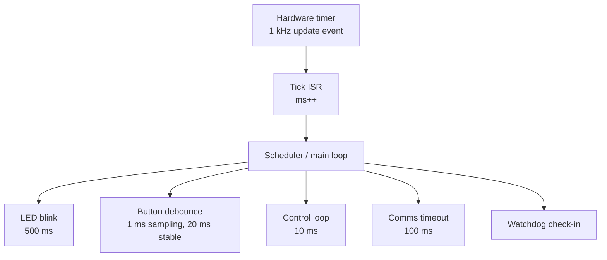

::: testing
Whether you can connect the timer features to **concrete products and design decisions**, and pick the right one for each job. An interviewer asking "what are some applications?" after the concept and implementation questions wants specifics: not just "PWM", but "20 kHz PWM so a motor doesn't whine", "capture the echo width for ultrasonic distance", "a 1 kHz tick that drives a software scheduler and debounce". They also look for sound engineering judgement: hardware timer when timing is tight, software timer when it is slow and plentiful, and awareness of the cost (ISR load, pin and timer availability).
:::

::: why
Real firmware is mostly a collection of time-based behaviours. A timer-literate engineer can read a requirements list (blink at 1 Hz, debounce in 20 ms, sample at 8 kHz, drive a servo, time out a bus after 100 ms) and map each line to hardware or a software timer without wasting the scarce resources. Timer applications also feed directly into the other peripheral questions: PWM LED and motor drive ([[q0806]], [[q0807]]), sensor timing, and interrupt-driven design ([[q0798]]).
:::

::: concepts
- **System tick**: one periodic interrupt (typically 1 ms) that everything slow hangs off; basis of RTOS and `millis()`-style APIs ([[q0791]]).
- **Software timers**: deadlines stored in memory and compared to the tick; unlimited in number, resolution of one tick.
- **PWM**: duty-controlled pulse train for power delivery and signalling ([[q0790]]).
- **Input capture**: hardware timestamps on an edge for pulse width, period and time of flight.
- **Timer-triggered peripherals**: ADC, DAC and DMA started by a timer event for jitter-free sampling.
- **Watchdog and RTC**: safety and low-power timekeeping variants.
:::

::: answer
"Timers show up in almost everything I'd build. The most common is the system tick: one timer firing every millisecond, and everything slow hangs off it, like blinking an LED, debouncing a button over 20 ms, scheduling tasks, or timing out a communication. In an RTOS that tick is what drives the scheduler.

Second is PWM. LED dimming, motor speed, servos, even the gate drive for a buck converter are all a timer comparing a counter against a duty register. For motors I'd use about 20 kHz so it's above hearing.

Third is measurement with input capture. An ultrasonic range finder gives you an echo pulse whose width is the round-trip time, and the timer latches the counter on each edge, so you get microsecond resolution without the CPU watching. The same trick reads a tachometer, a PWM-output sensor, or a remote-control receiver.

Fourth is triggering other peripherals. I'd let a timer start the ADC at exactly 8 kHz for audio or vibration, so the sampling has no software jitter.

And then there are the safety and low-power ones: a watchdog timer to reset the chip if the firmware hangs, and an RTC running from a 32 kHz crystal to wake the device once a second while it sleeps. Also things like generating a 38 kHz IR carrier, a tone for a buzzer, or step pulses for a stepper motor."
:::

::: technical
**1. System tick and scheduling.** A periodic ISR at $f_{tick}$ (1 kHz typical) increments a counter and sets flags; ISR cost $t_{ISR}\cdot f_{tick}$ is the CPU load (5 µs at 1 kHz is 0.5%). A cooperative scheduler runs tasks whose deadline $\le$ now using wrap-safe subtraction ([[q0791]]). RTOS tick: same idea with a context switch decision in the ISR.

**2. Debounce and input timing.** Sample a button at 1 kHz; accept a new state after $N$ consecutive equal samples (for example 20 ms). Long-press detection is a timestamp difference.

**3. PWM.** LED brightness (hundreds of Hz to kHz), motor speed (about 20 kHz, above audio; in a motor the current ripple is $\Delta I\approx V_{bat}D(1-D)/(L f_{PWM})$ so higher $f$ reduces ripple at the cost of switching loss), servo (50 Hz, 1-2 ms pulse), buck converter drive, DAC via an RC filter.

**4. Tone generation.** Toggle a pin every half period: for 440 Hz from 16 MHz, toggle every $16\text{ MHz}/880=18{,}182$ ticks; frequency 439.996 Hz, error 0.017 cents.

**5. Pulse measurement.** Ultrasonic distance $d=v_{sound}\,t_{echo}/2$ (about 343 m/s in air at 20 C, varying roughly 0.6 m/s per degree C). Tachometer RPM from period or gated count; capture of a servo/RC pulse.

**6. Protocol timing.** UART baud timing from a divided clock ([[q0775]]); software (bit-banged) protocols with a tick per bit; inter-frame timeouts. Example: Modbus RTU treats a silent gap of 3.5 character times as end of frame: at 9600 baud with 11 bits per character that is $3.5\cdot11/9600=4.01$ ms.

**7. Motor control.** Stepper step pulses (200 steps/rev at 1/16 microstepping and 600 rpm needs 32,000 steps/s), encoder mode for position, dead-time insertion for H-bridge or three-phase drive ([[q0807]]).

**8. Triggered sampling.** The timer's update event as ADC/DAC trigger gives jitter of a clock tick instead of ISR latency ([[q0796]]).

**9. Watchdog and RTC.** Watchdog window or timeout $T_{wdt}$ set to a few times the longest normal loop; RTC wake-up with calibration.
:::

::: short
"The big ones are the system tick, which drives scheduling, debounce and timeouts; PWM for LEDs, motors, servos and converters; and input capture for measuring things like an ultrasonic echo or a tachometer to a microsecond. Timers can also trigger the ADC at an exact rate so sampling has no software jitter. And the special timers, the watchdog for fault recovery and the RTC for low-power wake-ups. In every case I choose a hardware timer when timing is tight and a software timer on the tick when it's slow."
:::

::: long
"I'd group the applications by what the timer is doing.

First, scheduling and timeouts. A single hardware timer gives a one millisecond tick, and everything slow builds on it: blinking an LED, debouncing a button by requiring twenty consecutive stable samples, timing out a serial reply, running a control loop every 10 milliseconds. In an RTOS this tick is what the scheduler runs on. A tick ISR that takes 5 microseconds only costs 0.5% of the CPU.

Second, output generation. PWM is the big one: LED brightness, motor speed, buck converter gate drive. For a motor I'd use around 20 kHz so you can't hear it and the current ripple is low. Servos use a 50 Hz frame with a pulse between 1 and 2 milliseconds. Timers also generate tones for a buzzer by toggling a pin at twice the frequency, a 38 kHz IR carrier, or step pulses for a stepper driver.

Third, measurement. Input capture timestamps an edge in hardware, so an ultrasonic sensor's echo width, a tachometer period, or an RC receiver pulse is measured to one tick, 62.5 nanoseconds at 16 MHz, even if the CPU is busy. Distance is just speed of sound times echo time over two.

Fourth, triggering. The timer's update event can start the ADC directly, so I get a perfectly regular sample rate for audio or vibration analysis, with DMA moving the data so there's no ISR per sample.

Fifth, housekeeping. A watchdog resets the chip if firmware hangs, which is essential for anything unattended, and an RTC on a 32 kHz crystal wakes a battery device once a second.

The design rule is: use hardware timers for anything with tight timing or high rates, and software timers off one tick for the slow stuff, because hardware timers are limited in number."
:::

::: terms
- **System tick**: a periodic timer interrupt, commonly 1 ms, used as the software time base.
- **Software timer**: a deadline compared against the tick count, so many can share one hardware timer.
- **Debounce**: ignoring contact bounce by requiring a stable state for a minimum time.
- **PWM frequency**: the repetition rate of the pulse train; chosen against audibility, ripple and switching loss.
- **Time of flight**: delay between sending a signal and receiving the echo, converted to distance.
- **Watchdog**: a timer that resets the MCU if not periodically serviced.
- **Tone generation**: toggling an output at twice the audio frequency.
- **Timer trigger / TRGO**: an internal output that starts another peripheral.
:::

::: exceptional
An average answer lists "PWM, delays, measuring." An exceptional answer:

- Attaches **numbers**: a 1 kHz tick costing 0.5% CPU, 20 kHz motor PWM, 50 Hz servo with a 1-2 ms pulse, 38 kHz IR carrier.
- Frames the **hardware versus software timer** decision and the resource limit (few hardware timers, shared periods).
- Mentions **timer-triggered ADC/DMA** and jitter, not just PWM.
- Describes the **debounce** and **timeout** patterns using the tick and wrap-safe subtraction.
- Includes **safety** (watchdog) and **low-power** (RTC) applications, which signal production experience.
- Notes physical limits: PWM frequency vs switching loss, speed of sound vs temperature.
:::

::: mistakes
- **One hardware timer per task.** You run out quickly. Multiplex slow tasks with software timers on one tick.
- **Long work inside the tick ISR.** Keep it to setting flags and counters ([[q0802]]) so the tick stays regular.
- **Choosing audible PWM for motors.** Below about 20 kHz the motor and driver can whine; above it, switching losses grow, so there is a trade-off.
- **Using a blocking `delay()` in an application that must respond.** The CPU cannot handle a button press or a bus message while it spins.
- **Ignoring watchdog design.** Kicking the watchdog from an ISR defeats it: the ISR still runs even if the main loop is hung. Kick it only when the main tasks have all checked in.
:::

::: deep
## A single tick can drive a whole product

The simplest high-value pattern is one hardware timer at 1 kHz and a software layer on top. The ISR does almost nothing:

```c
volatile uint32_t ms;                 // time base, see q0791 for wrap-safe use
void SysTick_Handler(void) { ms++; }  // ~10 cycles, well under 1% load
```

The main loop (or RTOS) then asks "has my deadline passed?"

```c
if ((uint32_t)(ms - t_led) >= 500)  { t_led += 500; toggle_led(); }
if ((uint32_t)(ms - t_btn) >= 1)    { t_btn += 1;   sample_button(); }
```

Advancing `t_led += 500` rather than `t_led = ms` is the same compare-plus-interval trick from [[q0791]]: it keeps the blink period exactly 500 ms on average even if the loop is occasionally late.


Figure: One hardware timer fans out into many software timers. Each software timer is just a variable and a comparison, so you can have dozens at almost no cost; the only limit is the tick resolution.

## Debouncing with a timer

A mechanical switch bounces for roughly a few milliseconds (it varies by switch; some bounce for 10 ms or more). The timer-based fix is to sample every 1 ms and accept a new state only after it has been the same for $N$ samples, for example 20.

```timing
{"signals":[{"name":"raw switch","wave":"1.0101010.......","color":"orange"},{"name":"stable count","wave":"=.==.=.====....","data":["0","1","0","1","2","3","4","20"]},{"name":"debounced","wave":"1.............0.","color":"accent"}],"hscale":1.2}
```
Figure: The raw input chatters during the bounce window, and the debounced output only changes after the signal has stayed low for the full 20 ms hold time. The counter restarts whenever the raw level changes. A hardware RC plus Schmitt trigger does the same job ([[q0805]]).

## PWM-based applications and the frequency choice

PWM has three common frequency regimes:

| Use | Typical PWM frequency | Why |
|---|---|---|
| LED dimming (eye) | 200 Hz to a few kHz | Above visible flicker, low switching loss |
| Motor drive | about 20 kHz | Above audible hum; current ripple small |
| Servo | 50 Hz | Defined by the servo's input protocol |
| Switching regulator | 100 kHz to a few MHz | Smaller inductor; limited by switching loss ([[q0790]]) |

For a brushed motor with winding inductance $L$, the peak-to-peak current ripple at duty $D$ is about $\Delta I=\dfrac{V_{bat}D(1-D)}{L f_{PWM}}$. With 12 V, $D=0.5$, $L=1$ mH and 20 kHz that is $12\cdot0.25/(10^{-3}\cdot2\cdot10^4)=0.15$ A pk-pk; at 2 kHz it would be 1.5 A. This is why the frequency is not arbitrary ([[q0807]]).

```sim
{"id":"pwm-lab","duty":0.5,"f":20000,"amp":12,"view":"filter","rc":0.0005}
```
Figure: With the filter view, increase the PWM frequency and watch the output ripple fall for the same RC. The same effect smooths motor current or turns a PWM into a crude DAC.

## Measurement applications

**Ultrasonic distance.** A 10 µs trigger pulse (one-pulse mode) starts a burst; the sensor then outputs an echo pulse of width $t$. Distance $d=343\,t/2$ at 20 C. A 5.8 ms echo is 0.995 m. A 1 MHz tick gives 0.17 mm resolution, so the limit is the sensor, not the timer. Because the speed of sound rises about 0.6 m/s per degree C, a 20 C error gives about 3.5% distance error unless compensated.

**Tachometer.** If a fan sends 2 pulses per revolution at 3000 rpm: 100 pulses/s. Period method with 1 MHz tick: 10,000 ticks per period, so 0.01% resolution.

**Remote-control receiver.** Same as the servo in reverse: capture 1-2 ms pulses.

## Timer-triggered sampling

For an 8 kHz audio ADC at 16 MHz, a timer with $ARR+1=2000$ and no prescaler gives an update event every 125 µs, routed to the ADC trigger input. With DMA writing results to a buffer the CPU only wakes every buffer-full. If you instead started the conversion from an ISR, latency variation of even 1 µs at a 1 kHz signal gives a phase error of $2\pi\cdot1000\cdot10^{-6}=6.3$ mrad, so the worst-case sample error at a zero crossing is 0.63% of the signal amplitude (about $-44$ dB), which limits a high-resolution ADC to roughly 7 effective bits for that tone.

## Safety and low-power timers

A watchdog should be serviced from the main control flow only after the critical tasks have each reported in. A **window watchdog** also resets the chip if it is kicked too early, catching a runaway loop that kicks it constantly. An RTC from a 32.768 kHz crystal draws on the order of microamps and wakes the MCU from deep sleep at a schedule; a coin-cell sensor node may spend over 99% of its time asleep, so average current is dominated by the RTC and sleep leakage ([[q0791]]).

## Choosing hardware or software

| Requirement | Better as |
|---|---|
| Jitter below ISR latency (PWM edges, ADC trigger, encoder) | Hardware timer |
| Rates above about 10 kHz | Hardware timer |
| Seconds-scale blink, timeouts, UI | Software timer on the tick |
| Many independent delays | Software timers |
| Ultra-low-power wake-up | RTC / low-power timer |
:::

::: applications
- **Servo and ESC control** in drones and robots: 50 Hz frame with 1-2 ms pulse width.
- **Brushed and BLDC motor drives**: 20 kHz PWM, encoder-mode position feedback, dead-time insertion ([[q0807]]).
- **Ultrasonic and time-of-flight rangefinding** with input capture.
- **Digital audio and data acquisition**: timer-triggered ADC/DAC at fixed sample rates with DMA.
- **Wearables and IoT nodes**: RTC wake-up from a 32.768 kHz crystal; watchdog-protected firmware.
- **Industrial protocols** with frame-gap timeouts (Modbus RTU's 3.5 character gap).
:::

::: assumptions
- Numbers assume a typical 16 MHz 16-bit timer and ideal clock; real accuracy depends on the oscillator ([[q0791]]).
- The "applications" answer changes with the audience: for hardware roles emphasise PWM, capture and timer-triggered ADC; for firmware roles emphasise scheduling, timeouts and watchdog design.
- Bounce duration, speed of sound and PWM-ripple numbers are typical values, not guarantees. Switches vary widely; sound speed depends on temperature (and humidity slightly).
- Some applications (software timers) use the timer only indirectly through an RTOS or library; the principle is the same.
:::

::: followups
### How would you debounce a button using a timer?
Sample the pin at a fixed rate (1 kHz tick) and keep a counter that resets whenever the sample differs from the debounced state; when the counter reaches the hold time (for example 20 samples) update the debounced state. This costs a few instructions per tick and no extra hardware. An alternative is an interrupt on the edge that starts a one-shot timer and re-reads the pin when it expires ([[q0805]]).

### How do you pick the PWM frequency for a motor?
Above about 20 kHz to be inaudible, low enough that switching losses and EMI are acceptable, and high enough that current ripple ($V D(1-D)/(L f)$) is small. Also check the timer resolution: at 72 MHz and 20 kHz you get 3600 steps (11.8 bits), plenty for speed control. The driver's maximum switching frequency and dead-time can also limit it.

### How would you build 10 independent software timeouts with one hardware timer?
Keep a 1 kHz tick counter and an array of structures with `deadline` and `period`/`callback`. Each pass of the main loop (or the tick handler setting a flag) checks `(int32_t)(ms - deadline) >= 0`. Cost scales with the number of timers but is trivially small. For many timers, a sorted list or timing wheel avoids scanning all of them.

### What goes wrong if you reset the watchdog in a timer ISR?
The ISR keeps running even if the main loop is stuck in an infinite loop, so the watchdog never expires and the hang is not detected. The kick should come from the main flow after confirming each critical task ran, so that a stuck task means a missed kick and a reset.

### How would you measure a speed of 30 rpm and 30,000 rpm with the same encoder timer?
Low speed: period method (time between encoder edges) because there are few edges per sample window. High speed: gated count over a fixed window because edges are plentiful and period resolution gets coarse. Many controllers switch methods based on speed (an "M/T" method that measures an integer number of edges over a gate time).
:::

::: references
- Valvano, J., *Embedded Systems: Real-Time Interfacing to Arm Cortex-M Microcontrollers*: periodic interrupts, input capture, output compare and PWM.
- Horowitz & Hill, *The Art of Electronics*, 3rd ed.: PWM, frequency counters and motor drive.
- Yiu, J., *The Definitive Guide to Arm Cortex-M3 and Cortex-M4 Processors*: SysTick and RTOS tick usage.
- Modbus Organization, *Modbus over Serial Line Specification and Implementation Guide*: RTU framing and inter-frame timing.
:::

::: rubric
- Covers the system tick and software timers (scheduling, debounce, timeouts) :: This is the most common application in real firmware.
- Covers PWM for LED, motor, servo or converter, with a frequency rationale :: PWM is the primary output application and frequency choice shows design judgement.
- Covers input capture for pulse or time-of-flight measurement :: The measurement counterpart to generation.
- Mentions timer-triggered ADC/DMA sampling :: Shows awareness of jitter and CPU load.
- Mentions watchdog and RTC :: Safety and low-power applications show production awareness.
- Gives numbers (1 kHz tick, 20 kHz PWM, 1-2 ms servo, 62.5 ns resolution) :: Demonstrates you have actually used them.
- States the hardware-versus-software timer trade-off :: Resource and jitter management is the real engineering decision.
:::

::: quiz
```json
[
 {"type":"mcq","level":"fundamental","q":"Which application best matches input capture?","options":["Dimming an LED","Measuring the width of an ultrasonic sensor's echo pulse","Generating a 50 Hz servo frame","Resetting a hung processor"],"answer":1,"explain":"Input capture timestamps an external edge, so the difference between two captures is the pulse width. The other options are output compare/PWM or watchdog functions."},
 {"type":"numeric","level":"fundamental","q":"A 1 kHz tick ISR takes 5 µs. What fraction of CPU time does it consume?","answer":0.5,"tolerance":0.02,"unit":"%","explain":"Load $=t_{ISR}\\cdot f=5\\ \\mu s\\times1000=5\\times10^{-3}=0.5\\%$."},
 {"type":"numeric","level":"intermediate","q":"A Modbus RTU link at 9600 baud uses 11 bits per character. What is the 3.5-character inter-frame gap?","answer":4.01,"tolerance":0.02,"unit":"ms","explain":"One character is $11/9600=1.146$ ms; times 3.5 gives 4.01 ms."},
 {"type":"numeric","level":"intermediate","q":"A motor winding has $L=1$ mH. The supply is 12 V, duty is 0.5, and PWM runs at 20 kHz. Estimate the peak-to-peak current ripple $\\Delta I=V D(1-D)/(Lf)$.","answer":0.15,"tolerance":0.03,"unit":"A","explain":"$12\\cdot0.25/(10^{-3}\\cdot20{,}000)=3/20=0.15$ A. Dropping the PWM frequency to 2 kHz would raise the ripple tenfold."},
 {"type":"mcq","level":"advanced","q":"Why is kicking the watchdog from a periodic timer ISR a bad design?","options":["It makes the watchdog count faster","The ISR keeps running while the main loop is hung, so the hang is never detected","Watchdogs cannot be reset from an interrupt","It uses too much memory"],"answer":1,"explain":"A watchdog must reflect the health of the main program flow. If the ISR kicks it unconditionally, an infinite loop in main still leaves the watchdog satisfied."},
 {"type":"truefalse","level":"intermediate","q":"Software timers built on a 1 kHz tick can have a resolution finer than 1 ms.","answer":false,"explain":"A software timer can only resolve down to one tick of its time base. For finer timing use a hardware timer (compare or capture) directly."}
]
```
:::
