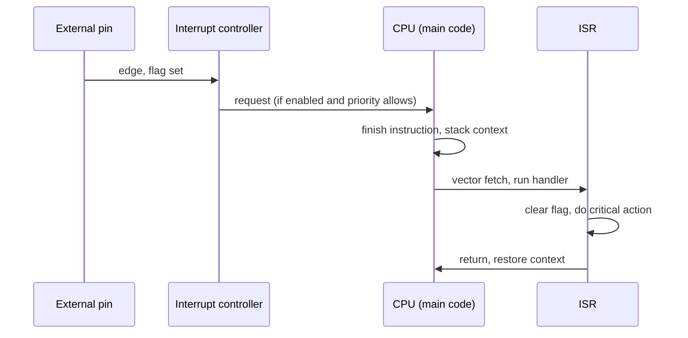

::: testing
Whether you can lay out the **options for reacting to an external event and choose between them by latency, determinism and CPU cost**. The first-line answer is "use an interrupt", but the interviewer is waiting to see if you know polling is a valid alternative, that sub-microsecond or jitter-free responses need a hardware path (timer capture or compare, comparator, DMA, event system) rather than an ISR, and that you consider wake-up from sleep, debouncing and what "right when" means numerically. It's a design question disguised as a definition: "what latency do you need?" is the right clarifying question.
:::

::: why
Real products have deadlines: a motor driver must shut off within a few microseconds of an overcurrent trip, a button press should feel instant (tens of ms is fine), a camera must be triggered within a pixel line time. Choosing polling, an interrupt or a pure-hardware path decides whether you meet the deadline, how much CPU you burn and how much battery you use. Interviewers use this question to see if you think in latency budgets instead of reflexes ([[q0795]], [[q0800]]).
:::

::: concepts
- **Polling**: the CPU repeatedly reads the input; latency is up to one loop time, and the CPU is busy.
- **Interrupt**: the event raises a request; hardware diverts the CPU to a handler ([[q0795]]). Latency is cycles to microseconds.
- **Hardware-only response**: a peripheral chain (comparator, timer capture/compare, DMA, event system) reacts with zero CPU involvement.
- **Latency vs jitter**: latency is the typical delay; jitter is its variation. Hard deadlines care about the worst case.
- **Wake from sleep**: interrupts (and some event systems) are how a sleeping MCU responds ([[q0798]]).
- **Event type**: edge or level, clean or bouncing ([[q0799]]).
:::

::: answer
"The first thing I'd ask is how quickly 'right when' needs to be, because that decides the approach.

The simplest option is polling: read the pin in the main loop. That's fine if the loop is fast and the deadline is loose, but latency is up to one full loop time and it keeps the CPU awake and busy.

The usual answer is an interrupt. I configure the pin to trigger on the edge I care about, and when it happens the hardware stops the main code, saves the context, and jumps to my ISR within a handful of cycles. On a 72 MHz Cortex-M that's roughly 12 cycles, about 170 nanoseconds before my first instruction. I'd keep the ISR tiny: do the time-critical thing, set a flag, and leave the rest to the main loop. It also lets the CPU sleep until the event.

If that's still not fast or deterministic enough, I'd take the CPU out of the loop. For example route the pin to a timer input capture, so the counter value is latched in hardware at the exact edge, or have a comparator trip directly shut down a PWM with a hardware break input. Those respond in nanoseconds with essentially no jitter.

So: polling for slow and simple, interrupts for most things, and a hardware path for hard real-time deadlines."
:::

::: technical
**Latency budget.** Total response time $t_{resp}=t_{sync}+t_{mask}+t_{entry}+t_{prologue}+t_{action}$.
- $t_{sync}$: input synchroniser and edge detection, 1-3 clocks.
- $t_{mask}$: time spent in critical sections (interrupts disabled) or higher-priority ISRs. This is the main source of jitter.
- $t_{entry}$: finish the current instruction, stack context, fetch the vector. Around 12 cycles on Cortex-M3/M4 with zero-wait-state memory; AVR is 4 cycles plus a 3-cycle vector jump (device and memory dependent).
- $t_{prologue}$: compiler-generated register saves (small on Cortex-M, larger on 8-bit cores).
- $t_{action}$: the instruction that actually does the work (e.g. writes a GPIO).

At 72 MHz: 12 cycles is 167 ns; add about 10 cycles of ISR code and the output pin changes about 300 ns after the event, plus any masking delay.

**Polling.** Worst-case latency equals the longest loop iteration $T_{loop}$, average $T_{loop}/2$. For a 20 µs loop that is 20 µs worst case. CPU load is 100% of the loop. It is deterministic if the loop is.

**Interrupt.** Latency of a few hundred ns up to tens of µs depending on masking and priority; CPU free between events; works with sleep. Jitter equals the maximum masked time.

**Hardware path.** Examples:
- Input capture: the timer latches CNT at the edge, so the *timestamp* is exact even if the ISR runs later ([[q0790]]).
- Output compare with a trigger: the pin change is generated by a timer, not code.
- Comparator or break input: an overcurrent comparator output feeds the PWM timer's break/fault input, forcing outputs off within a clock or two plus gate-driver delay.
- DMA request: the pin edge triggers a transfer with no ISR.
- Event system/peripheral interconnect (names vary: PPI, DMAMUX, event routing): connects any peripheral event to another's trigger.

**Level vs edge.** An edge interrupt latches an event even if the pulse is short; a level interrupt is re-asserted as long as the condition persists, so the ISR must remove the cause or mask it.

**Debounce.** Mechanical inputs bounce; trigger once on the first edge and ignore the pin for about 10-20 ms (timer-based) rather than reacting to every transition ([[q0805]]).
:::

::: short
"It depends on how fast 'right when' has to be. Polling the pin in the main loop is simplest but the latency is a full loop time and the CPU stays busy. The standard answer is an interrupt on the pin: the hardware jumps to an ISR in about a dozen cycles, around 170 ns on a 72 MHz Cortex-M, and the CPU can sleep in between. For hard deadlines I'd skip the CPU entirely: use timer input capture, a comparator tied to a PWM break input, or DMA, which react in nanoseconds with no jitter."
:::

::: long
"My first move is to ask how soon it needs to happen and how bad a miss is, because that picks the mechanism.

If the deadline is loose, say a button that should feel instant, polling is perfectly fine. I read the pin each time around the main loop, or from a 1 kHz tick, and the latency is at most one loop period. The downside is the CPU can never sleep deeply, and everything else in the loop adds to the latency.

The standard approach is an interrupt. I configure the pin as an external interrupt on the right edge. When it fires, the interrupt controller stops the main code at the next instruction boundary, hardware stacks the registers, and the vector table sends me into the ISR. On a Cortex-M that's about 12 cycles, so 167 nanoseconds at 72 MHz, and the first instruction of my handler can already be writing an output. The CPU can sleep until the event, which also saves power. The things to watch are latency jitter from sections where interrupts are masked or from other ISRs, so I keep every ISR short, and debouncing for mechanical inputs.

When even that is too slow or too variable, I move the response into hardware. If I need an exact timestamp of the event, I wire the pin to a timer's input capture, and the counter is latched at the edge itself, so even if my ISR runs late the time is exact. If I need to protect something, like switching off a power stage on overcurrent, I route a comparator output to the PWM timer's break input so the outputs are forced off in a couple of clock cycles with no software. For data, a pin edge can trigger DMA directly.

So my ranking is: polling for slow and simple, interrupt for general responsiveness and low power, hardware path for hard real-time and microsecond-class guarantees."
:::

::: terms
- **Polling**: repeatedly reading a status or pin in software.
- **Interrupt request (IRQ)**: a hardware signal asking the CPU to run a handler ([[q0795]]).
- **Latency**: time from the event to the first useful action.
- **Jitter**: variation in latency from event to event.
- **Input capture**: hardware latching of a timer value at an edge.
- **Break / fault input**: a timer input that forces outputs to a safe state in hardware.
- **Event system / PPI**: routing of one peripheral's event to another's trigger without the CPU.
- **Critical section**: code that runs with interrupts disabled, adding to latency.
:::

::: exceptional
An average answer says "use an interrupt." An exceptional answer:

- **Asks for the required latency and the consequence of a miss** before choosing.
- Offers three levels: **polling, interrupt, hardware-only**, and says when each fits.
- Quantifies interrupt latency in **cycles and nanoseconds**, and names the **jitter** sources (masked sections, higher-priority ISRs, flash wait states).
- Knows that **input capture** separates measurement accuracy from ISR latency.
- Mentions **protection use cases** (comparator to PWM break) and **sleep wake-up**.
- Handles real-world inputs: **debounce**, edge vs level, and shared lines.
:::

::: mistakes
- **"Interrupts are always faster than polling."** For a tight loop on a fast core, polling latency can be shorter than interrupt entry plus context save, and it avoids jitter from other interrupts. Interrupts win on CPU efficiency and power.
- **Doing the whole job in the ISR.** Long ISRs raise latency for every other event; do the critical action and defer the rest ([[q0802]]).
- **Ignoring the worst case.** Average latency is irrelevant for a hard deadline; the worst-case masked section is what counts.
- **Using an edge interrupt on a bouncing contact without debounce**, getting dozens of interrupts per press ([[q0805]]).
- **Using a software ISR where hardware would do.** A 400 kHz encoder or an overcurrent shutdown belongs to a timer or comparator, not an interrupt-per-edge handler.
:::

::: deep
## Define "right when" as a number

Before picking a mechanism, put a number on the requirement:

| Requirement | Example | Tolerable latency |
|---|---|---|
| Human perception | Button, UI | 10-50 ms |
| Protocol timing | UART byte, SPI chip-select edge | tens of µs |
| Control loop | Motor current loop at 20 kHz | a few µs |
| Safety shutdown | Overcurrent, E-stop | hundreds of ns to a few µs |
| Measurement | Pulse timestamp | ns, but *exact* |

The right mechanism is the cheapest one that meets the worst-case figure with margin.

## Option 1: Polling

```c
while (1) {
    if (pin_is_high()) { handle_event(); }
    do_other_work();          // takes up to T_loop
}
```
Worst-case latency is $T_{loop}$ (including `handle_event` on the previous pass). If the loop must also run a 50 µs task, the response can slip by that long. Polling is deterministic, easy to reason about and works on the smallest chips, but it keeps the CPU running at full clock. Many safety-critical designs still poll deliberately because the timing is analysable.

A hybrid is **timer-driven polling**: sample at 1 kHz from the tick ISR ([[q0793]]) for slow, bouncy inputs like buttons. That gives a bounded 1 ms latency, a built-in debounce and a trivial ISR.

## Option 2: Interrupt


Figure: The CPU is diverted at an instruction boundary. Latency is the time from "Pin" to the first ISR instruction; resume latency adds the unstack on exit. Each arrow is a few clock cycles, so the whole round trip on a Cortex-M is roughly 25-35 cycles for a trivial handler.

Timing for a trivial handler on a 72 MHz Cortex-M3/M4 (zero wait state, no masking):

$$t\approx\frac{12\ \text{(entry)}+\sim10\ \text{(code)}}{72\ \text{MHz}}\approx0.3\ \mu s$$

and the return costs about another 12 cycles (170 ns). Jitter comes from three places:

1. **Instruction completion.** A long instruction (division, load-multiple) can delay entry by several cycles; Cortex-M can abandon some multi-cycle loads and restart them.
2. **Masked sections.** If main code disables interrupts for $t_{cs}$, the worst-case extra delay is $t_{cs}$.
3. **Higher-priority interrupts** already running or arriving first.

So $t_{worst}\approx t_{entry}+\max(t_{cs})+\sum t_{ISR,higher}$. Controlling those is the design job ([[q0800]]).

```sim
{"id":"interrupt-lab","nesting":false}
```
Figure: Look at the gap between an event arriving and its ISR starting: that is latency. With nesting off, a long low-priority ISR makes a more urgent event wait; turn nesting on to see preemption reduce that wait, at the cost of stack depth and complexity.

## Option 3: Take the CPU out of the loop

Some of the best answers don't run code at all.

**Timestamp it in hardware.** Route the pin to a timer input capture channel. The counter is copied into CCR on the edge. The ISR may run 5 µs later, but $t_{event}=CCR/f_{tick}$ is exact. With a 72 MHz timer the resolution is 13.9 ns.

**React in hardware.** For overcurrent protection, send the comparator output into the PWM timer's break input. The timer forces the outputs to their safe level within about a clock or two (plus the gate driver delay) and latches until software clears it. The ISR then merely *logs* what happened. This is the design pattern for motor drives and power stages ([[q0807]]).

**Move data in hardware.** A pin or timer event can raise a DMA request: each edge triggers a transfer of a port register to memory, creating a logic-analyser-like capture with no interrupt per sample.

**Chain peripherals.** Event systems (called different things per vendor) route a comparator, GPIO or timer event into another peripheral's trigger, for example start an ADC on a zero-crossing.

## Don't forget power

A sleeping MCU can wake from a pin interrupt in microseconds in a light sleep or tens of µs to ms from deep sleep (device dependent), and at microamp-level sleep current. Polling means the CPU can't sleep deeply. For a battery product with an infrequent button press, interrupt wake-up can reduce average current by orders of magnitude compared with an active polling loop. Check the datasheet's wake-up time; deep-sleep wake-up with oscillator start-up can be far slower than the 170 ns interrupt entry.

## Putting it together: example decision

Task: a safety light curtain output must turn a relay off within 20 µs of a beam break, and log the time.
- Loop is 100 µs: polling is out.
- ISR latency of 0.3 µs plus a worst-case masked section of 5 µs plus relay-driver output satisfies 20 µs: an interrupt works, with ISR priority set highest.
- Timestamping: use input capture to record the exact time.
- If the standard demanded sub-microsecond shutdown independent of firmware, use a hardware path: comparator to the driver's enable pin.

> [!INTERVIEW]
> Say the requirement first: "I'd confirm the deadline. If it's tens of microseconds I'd use an interrupt; if it's a safety shut-off in a few hundred nanoseconds I'd route it in hardware." That one sentence shows engineering judgement.
:::

::: applications
- **Overcurrent trip** from a comparator into a PWM break input, with an ISR only for logging ([[q0807]]).
- **Button wake from deep sleep**: an external pin interrupt wakes the MCU from a microamp sleep.
- **Shaft-encoder or tachometer timestamping** with timer input capture.
- **Triggering a camera or ADC** from an external sync pulse via an event system.
- **Zero-cross detection** on mains to time a triac, using an interrupt or capture.
- **Bus line-state detection** (UART start bit wake-up, SPI chip-select) via a pin interrupt ([[q0798]]).
:::

::: assumptions
- Latency numbers assume a Cortex-M3/M4 core at 72 MHz with zero-wait-state memory; real devices with flash wait states, caches or slower buses have longer and more variable latency. Treat them as ballpark.
- "External event" means a signal on a pin (an edge or level). Internal events (timer, ADC) work the same way but start inside the chip.
- Assumes the system has an interrupt controller. Very small MCUs without interrupts (or with one shared vector) must poll, or poll a flag.
- If a multi-core or RTOS system is involved, the response may be a task wake-up with an extra scheduling latency.
:::

::: followups
### When would you choose polling over an interrupt?
When the signal is slow and the loop is deterministic and fast: no benefit from interrupts, and polling avoids shared-data hazards, latency jitter from other ISRs and the stack cost. Also for safety-critical code that must be statically analysable, and on tiny MCUs. The cost is CPU time and power, since the CPU can't sleep.

### An overcurrent fault must disable the PWM within 2 µs. How do you design it?
Use a hardware path: the current-sense comparator output goes to the PWM timer's break input, which forces the gate-drive outputs off within a couple of clocks (tens of ns at 72 MHz), well inside 2 µs, then add the gate-driver propagation delay and MOSFET turn-off time. An ISR would add 0.3 µs best case but up to several µs worst case with masking, so use it only to record the fault and manage restart.

### How do you stop one button press causing 20 interrupts?
Debounce: on the first edge, disable that pin's interrupt (or ignore edges) and start a timer for 10-20 ms; when it expires, re-read the pin and re-enable the interrupt. Or poll from a 1 kHz tick with a counter. Alternatively an RC plus Schmitt input removes the chatter in hardware ([[q0805]]).

### What's the difference between level-triggered and edge-triggered for this?
Edge-triggered latches a transition into a pending flag even if the pulse is short, but a second edge before service is lost. Level-triggered stays asserted until the source is cleared, so no event is lost but the ISR will re-enter forever if you don't clear or mask the source. Shared open-drain interrupt lines from several chips are level-triggered for that reason ([[q0799]]).

### The CPU is in deep sleep and the oscillator is off. What changes?
Wake-up latency now includes oscillator start-up and regulator wake time, often tens of µs to milliseconds for crystals, far larger than the 12-cycle entry. If the response must be fast, use a sleep mode that keeps the clock running or have a hardware path that doesn't need the CPU.
:::

::: interpretations
"Do something right when an external event occurs" could mean (a) *respond quickly* (latency) or (b) *respond exactly at the event time* (a timestamp). Interrupts address (a); input capture addresses (b). A strong answer separates the two and covers both. The expected headline is **interrupts**, and the siblings [[q0795]] and [[q0796]] go on to define and implement them.
:::

::: references
- Yiu, J., *The Definitive Guide to Arm Cortex-M3 and Cortex-M4 Processors*: exception entry, latency and tail-chaining chapters.
- Valvano, J., *Embedded Systems: Real-Time Interfacing to Arm Cortex-M Microcontrollers*: interrupt-driven I/O versus polling.
- Microcontroller reference manuals: external interrupt, timer break input and event-system chapters (family specific).
- Barr, M., and Massa, A., *Programming Embedded Systems*: interrupt latency and design guidelines.
:::

::: rubric
- Asks about or states the required latency and the cost of a miss :: Selecting a mechanism without a requirement is guessing.
- Names polling and describes its latency and CPU cost :: Shows you see interrupts as a trade-off, not a default.
- Describes the interrupt approach: pin interrupt, ISR, keep it short :: This is the expected core answer.
- Quantifies interrupt latency and mentions masking/priority jitter :: Differentiates a numerate engineer from a recitation.
- Offers a hardware-only path (input capture, comparator to break, DMA) for hard deadlines :: Shows you know interrupts have limits.
- Mentions debounce, edge vs level or sleep wake-up :: Practical details from real designs.
:::

::: quiz
```json
[
 {"type":"mcq","level":"fundamental","q":"Which approach lets the CPU sleep until an external event occurs?","options":["Polling the pin in the main loop","A pin interrupt (wake-up from sleep)","A software delay loop","Calling printf"],"answer":1,"explain":"A pin interrupt can wake the core from sleep, whereas polling needs the CPU awake running the loop."},
 {"type":"numeric","level":"fundamental","q":"A Cortex-M core at 72 MHz has a 12-cycle interrupt entry. How long is that in nanoseconds?","answer":166.7,"tolerance":0.02,"unit":"ns","explain":"$12/72\\times10^6=166.7$ ns."},
 {"type":"numeric","level":"intermediate","q":"The main loop takes at most 40 µs to execute. If you poll an input once per pass, what is the worst-case latency to notice an event (ignoring handler time)?","answer":40,"tolerance":0.02,"unit":"µs","explain":"The event can occur just after the pin is read, so it waits a full loop iteration: 40 µs."},
 {"type":"mcq","level":"intermediate","q":"You need to switch off a power stage within 1 µs of an overcurrent comparator trip. What is the most robust implementation?","options":["Poll the comparator in the main loop","Use a GPIO interrupt that clears the PWM registers","Wire the comparator to the PWM timer's hardware break input","Use a 1 kHz tick ISR"],"answer":2,"explain":"A hardware break path acts within a clock or two and has no software jitter. An ISR is fast on average but its worst case depends on masked sections and other interrupts."},
 {"type":"mcq","level":"advanced","q":"What is the difference between measuring an event time via an ISR (reading a free-running counter in the handler) and using input capture?","options":["There is none","Input capture latches the count at the edge, so the timestamp is exact even if the ISR runs late","The ISR approach is always more accurate","Input capture only works on falling edges"],"answer":1,"explain":"With input capture the hardware stores CNT at the edge. ISR latency and jitter only delay when you read it, not what value you get; reading CNT in the ISR includes the latency."},
 {"type":"truefalse","level":"intermediate","q":"A level-triggered interrupt will stop requesting service as soon as the CPU enters the ISR, even if the ISR does nothing about the source.","answer":false,"explain":"Level-triggered requests remain active while the condition persists. If the ISR does not clear or mask the source, the interrupt re-fires as soon as the ISR returns."}
]
```
:::
