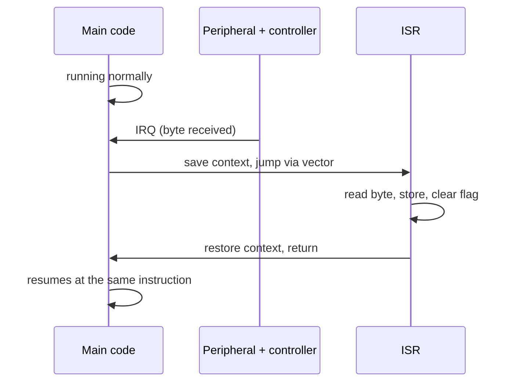

::: testing
Whether you can define an interrupt cleanly and say **why it exists**: a hardware mechanism that makes the CPU pause its current work, run a short handler for an event, and then resume exactly where it left off, so the processor does not have to poll. The interviewer listens for the key ideas: asynchronous event, saved context, vector to a handler (ISR), return to main code, and priorities/masking. A good answer contrasts interrupts with polling and gives a concrete example such as a UART byte or a button.
:::

::: why
Every non-trivial embedded system is interrupt driven: serial ports, timers, ADC completions, buttons, DMA, RTOS ticks. Interrupts let one small CPU appear to do many things at once and sleep when idle. They are also the source of the hardest bugs (races, priority problems, missed events), so interviewers use this basic question as the entry to the rest of the section ([[q0796]], [[q0800]], [[q0802]]).
:::

::: concepts
- **Event source**: a peripheral or pin that signals "something happened" ([[q0799]]).
- **Interrupt request and flag**: a latched bit recording the event until serviced.
- **Enable and mask**: individual and global bits that decide whether a request reaches the CPU.
- **Context save/restore**: the CPU preserves PC, flags and registers so main code resumes unaware.
- **Vector table**: memory table of handler addresses, one per source ([[q0796]]).
- **ISR**: the handler function that runs ([[q0801]]).
- **Priority**: ordering when several requests compete or when one may preempt another.
:::

::: answer
"An interrupt is a hardware signal that tells the processor 'something needs attention now'. When one arrives, the CPU finishes its current instruction, saves where it was, jumps to a small function called an interrupt service routine to deal with the event, and then returns and carries on exactly where it left off, as if nothing happened.

The reason we have them is efficiency. Without interrupts the CPU would have to poll, constantly checking whether a button was pressed or a UART byte had arrived, which wastes time and power and makes the response slow. With interrupts the CPU can run the main program, or sleep, and be pulled in only when needed.

Typical sources are a GPIO edge, a timer overflow, a UART receiving a byte, an ADC finishing a conversion, or a DMA transfer completing. Each has an enable bit, and the chip has an interrupt controller that handles priority, so urgent things can preempt less urgent ones. The key discipline is to keep ISRs short: do the minimum, like grabbing the byte and setting a flag, and let the main code do the heavy lifting."
:::

::: technical
**Mechanism.** A peripheral sets a **flag** when its event occurs. If its **enable** bit is set, the request goes to the **interrupt controller** (NVIC on Arm Cortex-M, PIC/AIC on others). The controller applies per-source enable, **priority** and the CPU's global mask. At the next instruction boundary the CPU: (1) saves context (Cortex-M hardware-stacks R0-R3, R12, LR, PC and xPSR, 8 words), (2) reads the handler address from the **vector table**, (3) runs the ISR, (4) executes a special return that restores context. Details in [[q0796]] and [[q0797]].

**Types.**
- *Maskable* versus *non-maskable* (NMI, used for critical faults).
- *Hardware* (external pin or on-chip peripheral) versus *software* (a trap/SVC/software-triggered interrupt) versus *exceptions* (faults such as an invalid memory access).
- *Edge* versus *level* triggered ([[q0799]]).

**Latency.** Typically 12 cycles on Cortex-M3/M4 (zero wait state) and 4 cycles plus a vector jump on classic 8-bit AVR; can be larger with wake-up from sleep or masked sections.

**CPU cost.** Handling $r$ events per second with ISR duration $t$ uses $r\cdot t$ of the CPU, plus entry/exit overhead. 115,200 baud UART: one byte per 86.8 µs; a 2 µs ISR is 2.3%.

**Why not always interrupts?** They add complexity and nondeterminism; at very high event rates polling or DMA is better ([[q0800]]).
:::

::: short
"An interrupt is a hardware signal that makes the CPU pause what it's doing, save its state, run a short handler called an ISR for the event, and then resume exactly where it left off. It exists so the processor doesn't have to poll for things like a button, a UART byte or a timer tick, and it can even sleep until something happens. A controller handles enables and priorities, and the main rule is to keep ISRs short."
:::

::: long
"An interrupt is a way for hardware to get the processor's attention. Instead of the CPU repeatedly checking whether something happened, which is polling, the peripheral raises a request when the event occurs, and the CPU responds.

Here's the sequence. The event, say a UART byte arriving, sets a flag in the peripheral. If that interrupt is enabled, the request goes to the interrupt controller, which checks priority and whether interrupts are globally allowed. The CPU finishes the current instruction, pushes the program counter, status flags and some registers onto the stack, looks up the address of the handler in the vector table, and runs my interrupt service routine. At the end a special return instruction restores everything, and the main code continues unaware.

This matters for efficiency and responsiveness. A polling loop wastes cycles and keeps the CPU awake. With interrupts, the CPU can sleep in a few microamps and wake in microseconds. It also lets me handle several activities at once: a timer tick, serial data, a button, all interleaved.

The common sources are GPIO edges, timers, communication peripherals, ADC and DMA completion, plus faults and software-triggered interrupts. Most chips give each source its own enable bit, a flag to clear, and a priority so an urgent interrupt can preempt a less urgent one.

The cost is complexity: ISRs interrupt the main code at arbitrary points, so shared variables need care, and a slow ISR delays everything else. So I keep ISRs very short, do the minimum like read the byte and set a flag, and process the data in the main loop."
:::

::: terms
- **Interrupt request (IRQ)**: the signal asking for service.
- **Interrupt flag / pending bit**: latched record of the request.
- **Mask / enable**: bits controlling whether the request is allowed.
- **ISR / handler**: the function run in response.
- **Vector table**: table of handler addresses.
- **Context**: CPU state (PC, flags, registers) saved and restored around the ISR.
- **NMI**: non-maskable interrupt.
- **Interrupt latency**: time from the request to the first ISR instruction.
:::

::: exceptional
An average answer says "the CPU stops and runs a function." An exceptional answer:

- Contrasts with **polling** and quantifies the benefit (CPU load, sleep power).
- Walks the path **flag, enable, controller, CPU, vector, ISR, return** without prompting.
- Mentions **context save** and that main code is unaware.
- Mentions **priorities and masking**, and gives a rule such as "keep ISRs short".
- Gives a number: 12-cycle latency, or UART ISR as 2.3% of the CPU.
- Knows the costs: shared-data hazards and jitter.
:::

::: mistakes
- **"An interrupt is a function call."** It is asynchronous and triggered by hardware at any instruction boundary, so the main code does not know it happens.
- **Forgetting to clear the flag**, so the ISR re-enters forever ([[q0801]]).
- **Confusing the three enables.** Peripheral enable, controller enable and global enable are separate; all must be set.
- **Treating interrupts as free.** Each costs cycles and adds latency to other work.
- **Assuming interrupts run in parallel.** On a single core they run in sequence, interleaved with main code.
:::

::: deep
## The problem interrupts solve

Suppose a UART may deliver a byte at any moment, while the CPU is also computing a control loop. Option A: after each loop iteration, check the UART status bit. If the loop takes 500 µs and bytes arrive every 87 µs (115,200 baud), the receive register is overwritten before you look: you lose data. Option B: check more often, but then everything else is chopped up with checks. Option C: **let the UART tell the CPU when a byte arrives**. That is an interrupt.


Figure: The main code is paused at an instruction boundary, then continues exactly where it was. From its point of view only time passed.

## What the hardware keeps track of

For each interrupt source there are typically three pieces of state:

1. **Enable bit** (set by software): is this source allowed to interrupt?
2. **Pending/flag bit** (set by hardware): has the event occurred?
3. **Active/in-service** state: is its handler currently running?

The request reaches the CPU only if enable AND pending AND priority permits AND global interrupts are on. The pending bit is *sticky*: it stays set until cleared (by the ISR or automatically at vector fetch, device dependent). That sticky bit is what ensures a short pulse isn't lost, but it is only one bit, so two events before service look like one ([[q0800]]).

## Cost accounting

Interrupt overhead per event is the entry plus exit overhead. On a Cortex-M3/M4 at 72 MHz: about 12 + 12 cycles, so 24/72 MHz is 0.33 µs, plus the ISR body.

```plot
{"title":"CPU load of an ISR vs event rate","x":{"label":"event rate","unit":"Hz","min":100,"max":1000000,"log":true},"y":{"label":"CPU load","unit":"","min":0,"max":1.2},
 "series":[{"label":"1 µs ISR","fn":"1e-6*x"},{"label":"5 µs ISR","fn":"5e-6*x","color":"orange"},{"label":"20 µs ISR","fn":"20e-6*x","color":"red"}],
 "hlines":[{"at":1,"label":"100% CPU","color":"muted"}],
 "points":[{"x":11520,"y":0.023,"label":"UART 115200: 2 µs ISR, 2.3%"}]}
```
Figure: Load is just rate times duration, so each line crosses 100% where the event rate equals 1/(ISR time): 1 MHz for 1 µs, 200 kHz for 5 µs, 50 kHz for 20 µs. A UART byte rate (about 11.5 kHz at 115,200 baud) is cheap; a 400 kHz encoder edge rate with a 1 µs ISR would take 40% of the CPU, so it belongs in a hardware timer.

## Compare with polling

| | Polling | Interrupt |
|---|---|---|
| Latency | up to one loop time | cycles to a few µs |
| CPU use | continuous | only when events occur |
| Sleep | no | yes |
| Complexity | low | higher (shared data, priorities) |
| Determinism | high | varies with masking and priority |

## Sleep and low power

With interrupts, the main loop can end in a "wait for interrupt" instruction (WFI on Arm). The core stops its clock until an enabled interrupt arrives, then runs the ISR. A typical battery sensor might wake from an RTC interrupt once per second, spend 1 ms working and sleep the other 99.9%: average current is dominated by sleep current.

```sim
{"id":"interrupt-lab","nesting":false}
```
Figure: The timeline shows a main loop with interrupt sources firing on top. Notice how the main loop is paused during each ISR and resumes afterwards, and watch what happens when an ISR is long and a second event arrives while the first is still being serviced.

## Software view

To the programmer an ISR is a function with no arguments or return value, named to match a vector (on Cortex-M, by CMSIS convention `TIM2_IRQHandler`; on AVR `ISR(TIMER1_COMPA_vect)`). Setting it up means: configure the peripheral, set its interrupt-enable bit, enable the line in the controller, set priority, and enable global interrupts. Missing any of these is the usual reason "my interrupt never fires" ([[q0796]]).

## Interrupts, exceptions, traps

Terminology varies. On Arm, "exception" includes reset, faults, SVC, SysTick and external interrupts. Faults (bus error, illegal instruction) are *synchronous* to the instruction stream; peripheral interrupts are *asynchronous*. Both use the same vector mechanism.

## A small worked example

A sensor node reads a button press and sends a message. Polling: the CPU runs at 8 MHz drawing 3 mA continuously, 3 mA average. Interrupt-driven: the CPU sleeps at 2 µA, wakes on the pin, spends 2 ms awake per press at 3 mA, and there are 100 presses per day: average current is about $2\ \mu A+3\ mA\cdot(0.2\ s/86400\ s)=2\ \mu A+0.007\ \mu A\approx2\ \mu A$, around 1,500 times less than polling. (Values illustrative.)

## Worked example: will the UART byte be lost?

Load tells you how much CPU interrupts consume. Latency tells you whether they meet their deadlines, and that is the more common cause of lost data. Take a UART with a single-byte receive register on the 72 MHz Cortex-M part from above. At 115,200 baud with 10 bits per byte (start, 8 data, stop), a byte arrives every $10/115{,}200 = 86.8\ \mu$s. The ISR must read the register before the next byte finishes arriving, otherwise the next byte overwrites it (an overrun). So the *deadline* for the interrupt is about 86.8 µs after the byte completes.

The time until the ISR actually reads the byte is the worst-case **latency**, the sum of everything that can delay it:

- Entry overhead: 12 cycles at 72 MHz, which is $12/72\text{ MHz} = 167$ ns.
- A section of main code that disables interrupts: suppose 50 µs, which is 3,600 cycles (assumed; this is a common bug with a long critical section).
- A higher-priority ISR running when the byte arrives: suppose 20 µs.
- The ISR's own work until it reads the register: say 2 µs.

The worst-case latency is about $0.17 + 50 + 20 + 2 = 72.2\ \mu$s, leaving $86.8 - 72.2 = 14.6\ \mu$s of margin at 115,200 baud. It works, but only because the long sections happen not to line up. At 230,400 baud the deadline halves to 43.4 µs and the same firmware overruns. At 921,600 baud it is 10.85 µs, and even a bare 2.3 µs ISR leaves little room for any masking. The load at 921,600 baud, $92{,}160\text{ events/s}\times2.33\ \mu\text{s} = 21\%$, still looks fine, which is the point: a design can have comfortable CPU load and still miss deadlines, so check both numbers. The fixes, in order of effort, are to shorten the critical sections, raise this ISR's priority above the long one, use the UART's FIFO if it has one (a 16-byte FIFO relaxes the deadline to as much as $16\times86.8 = 1.4$ ms at 115,200 baud, less the bytes already queued when the FIFO-threshold interrupt fires), or let DMA move bytes ([[q0800]]).

## Interrupt storms and sticky flags

A level-triggered request stays asserted until the source is cleared. If the ISR returns without clearing the flag, the pending bit is still set, so the controller immediately re-enters the ISR. With about 2.33 µs per entry (the 2 µs body plus about 0.33 µs of entry and exit), that is about 430,000 interrupts per second at 100% CPU load, and the main code never runs again. The symptom is a board that "hangs" after one event, yet a debugger shows the PC bouncing inside the ISR. This is also why you read or clear the peripheral's status register in the ISR before returning, and why a spurious level-triggered line, such as a floating input with no pull-up, can freeze a system ([[q0799]]).

The opposite bug is a lost event. A read-modify-write to a flag register that clears flags on a write of 1 clears every flag that happened to be set when it was read, including a second event that arrived just before, so that event is never serviced. Write-1-to-clear registers exist so you can clear one flag with a plain store of its mask (`REG = FLAG_X;`), never with `REG |= FLAG_X;`. Registers that clear on a write of 0 need the opposite: write ones to every other bit. The reference manual says which semantics each register uses.

## What a short pulse does to a one-bit pending flag

The pending bit is a single bit. If two events happen before the handler runs, the handler sees one. For a UART with a byte register that is data loss, as above. For a timer overflow it is one lost tick, so a software clock built on it runs slow. The remedy is the same: either guarantee the maximum latency (so the handler always runs between events), or use a counter in hardware so the count is not lost, or DMA.

## Where the simple model breaks

**Interrupt latency is not always 12 cycles.** The 12-cycle figure assumes zero wait states, an aligned vector table, and that the core is not in the middle of a multi-cycle instruction or a load-store multiple. Flash wait states at high clock rates, a vector table in slow memory, and waking from sleep (which can take microseconds for the oscillator and regulator to settle) all add. The number you need is the worst case in your system, which you measure.

**Nesting and tail-chaining change the cost.** On Cortex-M, if another interrupt is pending when one finishes, the core can skip the unstack and restack and jump directly to the next handler in about 6 cycles ($6/72\text{ MHz} = 83$ ns), so back-to-back interrupts are cheaper than the 24-cycle estimate. Priorities mean a higher-priority interrupt can preempt a lower one, which adds the preemptor's duration to the lower one's latency.

**Interrupts and shared data.** An interrupt can arrive between any two instructions, including in the middle of the main code's update of a multi-byte variable. A 32-bit write on an 8-bit CPU takes several instructions, so an ISR can read a half-updated value. The standard defenses are to disable interrupts briefly around the access (which increases latency elsewhere), to use atomic operations or a single-writer ring buffer, and to mark shared variables `volatile` so the compiler re-reads them.

> [!UNCERTAIN]
> Entry cycles, tail-chain cycles and the effect of wait states differ by core and implementation; the figures here are typical Cortex-M3/M4 numbers with zero wait states. Use the core's technical reference manual and measure on your hardware.

## Verifying latency and load on the bench

1. **Measure latency directly.** Drive an input pin from a function generator and have the ISR toggle an output pin as its first action. Show both on a scope. The delay between the input edge and the output edge is the latency for that event. Use persistence or a long capture to see the worst case, and compare against the deadline computed above.
2. **Stress it.** Run the other parts of the firmware at their heaviest (flash writes, display refresh, other interrupts) while repeating step 1. Latency under realistic load is what matters.
3. **Measure load.** Toggle a pin high at ISR entry and low at exit; the average voltage on a filtered pin, or the duty cycle on the scope, gives the fraction of time inside the ISR.
4. **Check for overruns in firmware.** Most UARTs have an overrun status flag. Count it. If it is ever nonzero at the design baud rate, the latency budget is not met, no matter how often the data looks correct.
:::

::: applications
- **UART/SPI/I2C reception** so no incoming byte is missed.
- **RTOS tick** from a timer interrupt driving the scheduler.
- **Button and sensor wake-up** from sleep on a pin change.
- **ADC end-of-conversion** and **DMA complete** notifications.
- **Fault handling**: brown-out, watchdog early warning, overcurrent comparator ([[q0798]]).
- **Motor and power control loops** triggered at a fixed rate by a timer.
:::

::: assumptions
- Assumes a typical single-core MCU with a vectored interrupt controller. Older or tiny parts may have one shared vector with software polling of flags to find the source.
- Numbers (12 cycles, 2.3% load) are typical for Cortex-M3/M4 and a simple UART ISR; they differ by core, wait states and compiler.
- "Interrupt" in desktop/OS contexts adds privilege levels and APICs; the principle matches but the question here is for microcontrollers.
- Some texts call all asynchronous requests "interrupts" and synchronous ones "exceptions/traps"; I follow the MCU convention.
:::

::: followups
### What's the difference between an interrupt and polling?
Polling: software repeatedly checks a status; latency is the loop time and the CPU is always busy. Interrupt: hardware notifies the CPU; latency is cycles, CPU is free or asleep otherwise. Polling is simpler and more deterministic; interrupts are more efficient and responsive.

### What happens to the main program when an interrupt occurs?
The current instruction completes, context (PC, status flags and some registers) is pushed to the stack, the ISR runs, and a return instruction pops the context so main resumes at the next instruction. If the ISR modified a variable the main code uses, the main code can see the change, which is why shared variables need care ([[q0802]]).

### Why do interrupts need priorities?
Several sources may request at once or during another ISR. Priority decides the service order and whether a more urgent source may preempt a running ISR. A motor over-current fault should preempt a UART ISR, not the reverse ([[q0803]]).

### An interrupt never fires. How would you debug it?
Check the chain: is the peripheral event actually occurring (scope/flag), peripheral interrupt-enable set, controller line enabled with a sensible priority, global interrupts enabled, not masked by BASEPRI/PRIMASK, vector table correct and handler name matches (a misspelt name falls to the default handler), and the pin is configured correctly ([[q0783]]).

### Why can a single flag bit lose events?
The pending bit only records "at least one". If two events happen before the ISR clears it, you service once and one event is lost. Use hardware counters, FIFOs or DMA for high-rate or must-not-miss events.
:::

::: references
- Yiu, J., *The Definitive Guide to Arm Cortex-M3 and Cortex-M4 Processors*: NVIC and exception handling chapters.
- Valvano, J., *Embedded Systems: Real-Time Interfacing to Arm Cortex-M Microcontrollers*: interrupts and the NVIC.
- Patterson & Hennessy, *Computer Organization and Design*: exceptions and interrupts.
- Microcontroller reference manuals for the interrupt controller chapters (family specific).
:::

::: rubric
- Defines an interrupt as an asynchronous hardware event that diverts the CPU to a handler and then resumes :: The essential definition.
- Contrasts with polling and gives the benefit (CPU, power, latency) :: Explains why they exist.
- Mentions context save/restore and the vector table :: Shows the mechanism is understood.
- Mentions enable/mask bits and priorities :: Practical control of interrupts.
- Gives sources (GPIO, timer, UART, ADC, DMA) :: Connects the concept to real peripherals.
- States the keep-ISRs-short rule :: Basic firmware discipline.
:::

::: quiz
```json
[
 {"type":"mcq","level":"fundamental","q":"What does the CPU do when an enabled interrupt request arrives?","options":["Resets immediately","Finishes the current instruction, saves context, runs the ISR, then resumes","Ignores it until the main loop ends","Runs the ISR in parallel on a second core"],"answer":1,"explain":"The CPU completes the current instruction, stacks its state, jumps via the vector table to the ISR and restores the state on return."},
 {"type":"numeric","level":"fundamental","q":"At 115,200 baud with 10 bits per byte, how often does a byte arrive? Give the interval in µs.","answer":86.8,"tolerance":0.02,"unit":"µs","explain":"$10/115200=86.8\\ \\mu s$ per byte."},
 {"type":"numeric","level":"intermediate","q":"An ISR takes 4 µs and runs 25,000 times per second. What is the CPU load?","answer":10,"tolerance":0.02,"unit":"%","explain":"$4\\ \\mu s\\times25000=0.1=10\\%$."},
 {"type":"multi","level":"intermediate","q":"Which must be enabled for a peripheral interrupt to reach the CPU? Select all that apply.","options":["The peripheral's own interrupt-enable bit","The line in the interrupt controller","Global interrupt enable","The prescaler"],"answer":[0,1,2],"explain":"All three levels of enable (peripheral, controller, global) must permit the request. A prescaler is unrelated."},
 {"type":"truefalse","level":"advanced","q":"If two events occur before the ISR clears a single pending flag, the ISR will run twice.","answer":false,"explain":"The pending bit stores only one request, so the two events merge into one ISR call and one event is lost unless hardware counts or buffers events."},
 {"type":"mcq","level":"intermediate","q":"Why is an interrupt-driven design better for a battery-powered button?","options":["The CPU can sleep at microamps and wake only on the pin event","Interrupts make the clock faster","Polling cannot read pins","Interrupts remove the need for debounce"],"answer":0,"explain":"Interrupt wake-up lets the MCU stay in deep sleep, so average current is dominated by sleep current instead of running a polling loop."}
]
```
:::
