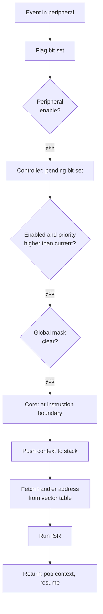

::: testing
Whether you can describe the **end-to-end implementation**: peripheral flag, enable/mask logic, interrupt controller with priority arbitration, CPU check at the instruction boundary, context save, vector table lookup, ISR, return. Then the firmware side: what you must configure (peripheral, controller, global enable, priority, vector name) and clear. Interviewers also want to know you can say *where* each piece lives (in the peripheral, in the NVIC or PIC, in the core, in the vector table in flash).
:::

::: why
"My interrupt doesn't fire" and "my ISR fires forever" are among the most common embedded problems, and both are solved quickly by someone who has the implementation picture in their head. It also connects computer architecture (the pipeline must handle precise interrupts) with firmware (linker script, startup code, vector names). The sibling [[q0797]] goes deeper into the ISR execution itself at the hardware and software levels.
:::

::: concepts
- **Interrupt flag and enable** in each peripheral ([[q0795]]).
- **Interrupt controller (NVIC/PIC)**: collects requests, holds pending/active/enable/priority per line, and presents the winner to the core.
- **Precise interrupt**: the CPU takes the interrupt between instructions so the architectural state is consistent.
- **Vector table**: array of handler addresses in memory, indexed by interrupt number.
- **Stack frame**: saved context pushed at entry, popped at exit.
- **Global mask**: a core bit (PRIMASK/I flag) that blocks maskable interrupts.
- **Startup code and linker**: place the vector table at the right address and provide weak default handlers.
:::

::: answer
"I think of it as a chain from the peripheral to the CPU.

First, the peripheral sets a flag when the event happens, say a timer overflow. If that peripheral's interrupt-enable bit is set, it sends a request line to the interrupt controller. The controller, which on a Cortex-M is the NVIC, keeps an enable bit, a pending bit and a priority for each source, and picks the highest-priority pending one that is allowed. If its priority beats whatever the CPU is currently running, and global interrupts aren't masked, it signals the core.

The core checks at the end of each instruction. It pushes the registers it must save, the program counter, status register and a few general registers, onto the stack. Then it looks up the handler address in the vector table, which is an array of function pointers in flash indexed by interrupt number, and loads it into the program counter. My ISR runs, and when it finishes, a special return value in the link register tells the core to pop the saved state and resume the interrupted code.

On the software side I have to do four things: configure the peripheral and enable its interrupt, enable the line in the controller and set a priority, enable global interrupts, and write a handler with the exact name the startup code put in the vector table, and clear the flag inside it."
:::

::: technical
**Hardware chain.**
1. *Event and flag.* Peripheral logic sets a status bit $F$.
2. *Peripheral enable.* Request $R = F \wedge E_{periph}$ goes to the controller.
3. *Controller.* For line $n$: pending $P_n$ (latched), enable $E_n$, priority $\pi_n$, active $A_n$. Selected request is the highest priority (lowest numeric value on Cortex-M) among $P_n\wedge E_n$ that is higher than the currently active priority and not blocked by BASEPRI/PRIMASK. Ties are broken by lowest interrupt number.
4. *Core.* Samples the controller output at an instruction boundary (multi-cycle instructions may be abandoned and restarted, or completed).
5. *Entry sequence (Cortex-M).* Push xPSR, PC, LR, R12, R3-R2-R1-R0 (8 words, 32 bytes; if the FPU is in use, extended frame), load LR with an EXC_RETURN code, load PC from vector table entry $16+n$ at address $VTOR+4(16+n)$, set the active bit. Takes 12 cycles with zero-wait-state memory.
6. *ISR.* Runs in handler mode, using the main stack.
7. *Exit.* Load PC with EXC_RETURN; hardware recognises it, pops the frame, clears active, and resumes.

**Vector table.** Entry 0 is the initial stack pointer, entry 1 the reset handler, then system exceptions (NMI, HardFault, SysTick), then peripheral IRQs. On AVR the vector table sits at the start of flash with one jump instruction per vector, and priority is vector-address order.

**Firmware steps.**
1. Enable the peripheral clock and configure it.
2. Set its interrupt-enable bit.
3. Set priority and enable the line (NVIC_SetPriority, NVIC_EnableIRQ).
4. Enable global interrupts (default on Cortex-M after reset; `sei()` on AVR).
5. Define `void XXX_IRQHandler(void)` (name from the startup file). A misspelt name silently binds to the weak default handler, usually an infinite loop.
6. In the ISR, clear the flag (some are cleared by reading a data register).

**Pending semantics.** The pending bit is set even while the interrupt is disabled, so enabling it later delivers an event that arrived earlier; clear it first if that is unwanted. Edge sources latch once; level sources reassert until the cause is removed.

> [!UNCERTAIN]
> Cycle counts, stack-frame sizes and the cleared-by-hardware behaviour of the pending/flag bits vary between cores and vendors. The sequence is the generic Cortex-M one.
:::

::: short
"The peripheral sets a flag, and if its enable bit is on, signals the interrupt controller, which tracks enable, pending and priority per line and picks the winner. At the next instruction boundary the core pushes its state onto the stack, reads the handler address from the vector table, and jumps to my ISR. When it returns, hardware pops the state and resumes. In firmware I enable the peripheral interrupt, the controller line and global interrupts, name the handler to match the vector, and clear the flag inside it."
:::

::: long
"I'll walk it from the pin to the code.

In hardware, an event sets a flag bit in the peripheral, for example the timer's update flag. If the peripheral's interrupt-enable bit is set, that becomes a request into the interrupt controller. On Cortex-M that's the NVIC, which keeps a pending bit, an enable bit and a priority for each interrupt line. It continuously picks the highest-priority pending enabled interrupt and compares it to the priority of whatever is running. If it's more urgent and not masked by the global mask, it asks the core to take it.

The core samples that at an instruction boundary so its state is consistent. Then it does the entry sequence automatically: it pushes eight registers, xPSR, PC, LR, R12 and R0 to R3, onto the stack, loads the link register with a special return code, and fetches the handler address from the vector table, which is an array of function pointers at the start of flash, indexed by interrupt number. That's about 12 cycles on a Cortex-M3. The program counter becomes my ISR, so it runs.

At the end of the handler, returning to that special code makes the hardware pop the saved registers and resume the interrupted instruction stream. That's why an ISR can be a plain C function on Cortex-M, with no special prologue.

The firmware side has a checklist: configure the peripheral and enable its interrupt, set the priority and enable the line in the NVIC, make sure global interrupts are on, and write the handler with exactly the name in the startup file, otherwise it lands in the default handler, which is an infinite loop. Inside the ISR I clear the flag so it doesn't re-trigger.

On smaller cores like AVR the idea is the same but the hardware only saves the program counter, the compiler saves the other registers, and the global interrupt flag is cleared on entry so nesting is off by default."
:::

::: terms
- **NVIC**: Nested Vectored Interrupt Controller in Arm Cortex-M cores.
- **Pending bit**: latched request awaiting service.
- **Active bit**: marks an interrupt currently being serviced.
- **Vector table (VTOR)**: table of handler addresses; VTOR is the register holding its base address.
- **Stacking / unstacking**: automatic push and pop of context.
- **EXC_RETURN**: special LR value that triggers exception return.
- **PRIMASK / BASEPRI**: core registers that mask all or low-priority interrupts.
- **Default handler**: weak symbol that catches unimplemented vectors.
:::

::: exceptional
An average answer says "the CPU jumps to the ISR." An exceptional answer:

- Separates the **three places** state lives: peripheral flag/enable, controller pending/enable/priority, core mask.
- Describes **entry**: instruction boundary, automatic stacking, vector fetch, and **exit** via the special return value, with 12-cycle numbers.
- Knows the vector table is an **array of function pointers** at a known address, relocatable via VTOR.
- Gives the **firmware checklist** and why a misnamed handler fails silently.
- Mentions pending-while-disabled behaviour and level vs edge.
- Notes differences between cores (AVR global flag cleared on entry; Cortex-M priority preemption).
:::

::: mistakes
- **Forgetting one of the enable levels** (peripheral, controller, global) and concluding "interrupts don't work".
- **Misspelt handler name**, so the weak default is used.
- **Not clearing the flag**, causing continuous re-entry.
- **Believing the CPU can be interrupted mid-instruction** in a way that corrupts state: interrupts are taken at instruction boundaries (or restartable) so state is consistent.
- **Moving the vector table without updating VTOR** (bootloader to application), so the wrong handlers run.
:::

::: deep
## The chain, end to end


Figure: Every diamond is a gate that can stop an interrupt. When "my interrupt never fires", walk down the diagram testing each gate in turn (flag set? peripheral enabled? line enabled? priority? global mask?).

## Hardware pieces in more detail

**Interrupt controller.** For $N$ lines it stores enable, pending and priority registers. The arbiter finds the highest-priority pending line, a combinational priority encoder (or a small search over priority bits). Cortex-M uses 8-bit priority fields, of which silicon implements the top 2-8 bits; lower number means higher priority. A **priority grouping** register splits those bits into *preempt priority* (can interrupt a running ISR) and *sub-priority* (only breaks ties among pending ones).

**Core check.** The pipeline treats an accepted interrupt like a branch: instructions not yet complete are flushed, the return address is the first instruction not yet retired (precise interrupt), and the pipeline refills from the vector. Long load/store-multiple instructions are abandoned and restarted so latency stays bounded.

**Stacking.** The hardware writes the frame:

| Offset | Register |
|---|---|
| +0 | R0 |
| +4 | R1 |
| +8 | R2 |
| +12 | R3 |
| +16 | R12 |
| +20 | LR |
| +24 | return address (PC) |
| +28 | xPSR |

The frame follows the Arm procedure-call standard, where R0-R3, R12, LR are the caller-saved registers, so the handler can be written in plain C: the compiler will save any callee-saved registers (R4-R11) that it uses.

**Vector fetch.** The table address is $VTOR + 4\cdot(16+n)$ for external interrupt $n$. The stack write and vector read happen in parallel on separate buses, which is how 12 cycles is achieved.

```timing
{"signals":[{"name":"Event flag","wave":"0.1......0..","color":"orange"},{"name":"IRQ to CPU","wave":"0.1......0.."},{"name":"CPU state","wave":"=..=.==...=.","data":["main","stacking","vector","ISR","main"],"color":"accent"}],"hscale":1.2}
```
Figure: The flag sets, the request rises, the CPU finishes its instruction and then does stacking and vector fetch (the latency), runs the ISR and returns. The shape matters: latency is before the first ISR instruction, and the ISR clears the flag (request line falls).

## Firmware side

A minimal Cortex-M example with the CMSIS style names (vendor-specific peripheral registers omitted):

```c
void TIM2_IRQHandler(void) {          // name must match the vector table
    if (TIM2->SR & TIM_SR_UIF) {      // which flag?
        TIM2->SR = ~TIM_SR_UIF;       // clear it first: write 0 to UIF, 1s elsewhere (no read-modify-write)
        tick++;
    }
}

void timer_init(void) {
    /* ...configure TIM2 as in q0789... */
    TIM2->DIER |= TIM_DIER_UIE;       // peripheral interrupt enable
    NVIC_SetPriority(TIM2_IRQn, 2);   // priority
    NVIC_EnableIRQ(TIM2_IRQn);        // controller enable
    __enable_irq();                   // global enable (on by default)
}
```
Note the plain write rather than `&=`: on STM32 the SR flags are cleared by writing 0 and writing 1 has no effect, so `SR = ~UIF` clears only UIF, whereas a read-modify-write could clear a different flag that set between the read and the write. The startup file declares `TIM2_IRQHandler` as a *weak alias* of `Default_Handler`; your definition overrides it at link time. That is why a typo compiles without error and silently does nothing.

On AVR:

```c
ISR(TIMER1_COMPA_vect) { tick++; }   // flag auto-cleared by hardware on vector fetch
TIMSK1 |= (1 << OCIE1A);             // peripheral enable
sei();                               // global enable
```
Because the AVR core only saves the PC, the ISR macro makes the compiler push SREG and every register the handler uses, so the AVR overhead is larger per register used.

## Flag clearing is part of the implementation

Peripherals clear their flags in one of three ways, and you must know which:
1. **Hardware on vector fetch** (many AVR flags).
2. **Write 1 (or 0) to clear**, as with the SR example above.
3. **Read-then-read/write sequence**, e.g. reading the status register then the data register (some UARTs).

A subtle bug: on Cortex-M, a write that clears a flag may still be in a write buffer when the ISR returns; the interrupt can be seen as still pending and the ISR runs a second time. A dummy read-back of the register before returning (or a data barrier) fixes it. Behaviour is system dependent.

## Pending while disabled

If an event happens while the line is disabled, the pending bit still sets (for most controllers). When you enable the line, the ISR fires immediately. So when initialising, clear stale flags *before* enabling, otherwise you get a spurious interrupt at start-up.

```sim
{"id":"interrupt-lab","nesting":true}
```
Figure: With nesting on, watch the higher-priority source preempt a running lower-priority ISR: the controller compares priority to the active one. With nesting off, it waits as pending until the first ISR ends.

## Size of the picture

Each interrupt costs: a vector table entry (4 bytes), a handler, and a stack frame. With 32 bytes of hardware frame plus about 16-32 bytes of compiler-saved registers and locals, a 3-deep nest needs on the order of 150 bytes of stack. For tiny RAM parts that is not negligible ([[q0803]]).

## Worked example: following one interrupt through the registers

Make the chain concrete with a representative part. Take a Cortex-M3 where the timer 2 interrupt is external interrupt number $n = 28$ and the vector table sits at the start of flash, `SCB->VTOR` = 0x0800 0000 (flash is aliased at address 0 after reset and the startup code usually points VTOR at the flash base; this matches a common STM32F1-family layout; other parts number their interrupts differently, so read your own reference manual).

- **Vector address.** The table entry that holds the handler's address (with bit 0 set for Thumb) is at $VTOR + 4(16+n) = 0x0800\,0000 + 4\times44 = 0x0800\,00B0$; the core loads that word and branches to it. The 16 in the formula counts the stack pointer, reset and the system exceptions that come before the peripheral interrupts.
- **Enable bit.** Interrupts 0-31 live in the first Set-Enable register (`NVIC->ISER[0]`), bit $n \bmod 32$. For $n = 28$ the mask is $1\ll28 = 0x1000\,0000$. An interrupt numbered 45 would be `ISER[1]`, bit 13 ($45 = 32 + 13$). `NVIC_EnableIRQ` does this arithmetic for you.
- **Priority byte.** If the part implements 4 priority bits, they occupy the top four bits of the byte. `NVIC_SetPriority(TIM2_IRQn, 2)` writes $2\ll(8-4) = 0x20$. Reading the register back and seeing 0x20 instead of 0x02 is normal and not a bug.

With these three values you can debug "my interrupt never fires" by looking at registers rather than guessing. In a debugger read `TIM2->SR` (is the flag set?), `TIM2->DIER` (is the peripheral enabled?), `NVIC->ISER[0]` bit 28 (is the line enabled?), `NVIC->ISPR[0]` bit 28 (is it pending?), `NVIC->IP[28]` (what priority?), `__get_PRIMASK()` and `__get_BASEPRI()` (is anything masking?), and `SCB->VTOR` (does it point at the table you think it does?). Each reading answers one of the diamonds in the flow chart. A pending bit that is set while the handler never runs means a mask or priority gate; a pending bit that never sets means the peripheral enable or the event is the problem; a handler that runs once and then never again means the flag was not cleared.

## Worked example: priority grouping

The grouping register splits the implemented priority bits into a preempt field and a sub-priority field. With 4 implemented bits there are 16 priority values. If you choose 2 preempt bits and 2 sub-priority bits, you get 4 preempt levels and 4 sub-levels in each.

Suppose interrupt A has preempt 1, sub 0 and interrupt B has preempt 1, sub 1. They are in the same preempt group, so neither can interrupt the other's handler. If both are pending together, A runs first because its sub-priority is lower (higher priority). If B is running and A arrives, A waits for B to finish. Now give interrupt C preempt 0. If C arrives while A or B is running, it preempts either, because a strictly lower preempt value wins. So the sub-priority only decides who goes first among simultaneous pending requests; it never produces nesting. A common mistake is to assign sub-priorities hoping for preemption, and then find that nesting does not happen.

## Worked example: stack budget for a nest

Take three levels of nesting, with the main code at the bottom. Assume the hardware frame is 32 bytes in each level, and the compiler saves some callee-saved registers and uses locals in each handler (assumed sizes for illustration):

| Level | Hardware frame | Saved registers | Locals | Total |
|---|---|---|---|---|
| Low-priority ISR | 32 | 16 | 8 | 56 |
| Middle ISR | 32 | 24 | 16 | 72 |
| High-priority ISR | 32 | 8 | 0 | 40 |

The sum is $56 + 72 + 40 = 168$ bytes beyond what the main code already uses. If the FPU is active, each level's hardware frame grows to 104 bytes (plus up to 4 bytes of alignment padding, since frames are 8-byte aligned), and three levels cost $3\times104 = 312$ bytes for the frames alone. On a part with 2 KB of RAM that is more than 15% of everything. The real worst case is found from the linker map and from the deepest chain your priorities allow, and then verified by filling the stack with a known pattern and checking how much of it is overwritten after a long stress run.

## Where the clean model breaks down

**Write buffers and late clears.** A flag clear that is still in the bus write buffer when the ISR returns can leave the request visible to the controller, so the handler runs twice. The standard fix, described above, is to read the register back or use a barrier before returning. The effect is timing dependent, which makes it show up on one clock speed and not another.

**Wait states change both latency and jitter.** The 12-cycle entry assumes zero wait states. A part running its flash at several wait states can spend more cycles on the vector fetch and on the first instructions of the handler, and a flash accelerator or cache turns a fixed number into a distribution. The worst case matters for deadlines.

**Handlers named incorrectly bind to the default.** The weak alias mechanism means a typo in the handler name produces no error. If the pending bit sets and the program then seems to hang, look at the default handler's infinite loop in the debugger and read the exception number from `IPSR`: it tells you which interrupt was taken with no handler.

> [!UNCERTAIN]
> The interrupt number, the number of implemented priority bits and the register layout differ between vendors and between parts of the same family. The example uses common Cortex-M3 conventions; confirm each value in the device reference manual and the core technical reference manual.

## Verifying on the bench

1. **Register walk.** Write the list above on a card and read each register in the debugger the first time an interrupt does not fire. It turns an hour of guessing into a few minutes.
2. **Latency measurement.** Toggle a GPIO at the top of the ISR, trigger from the event, and measure the delay on a scope with persistence on. Compare the observed worst case against the entry sequence's nominal cycle count and note any difference as wait-state or masking effects.
3. **Priority test.** Create two sources, one slow and one that you can trigger from a pin. Have the low-priority handler toggle a pin for several microseconds and trigger the high-priority one in the middle. On the scope you should see the high-priority pulse interleaved inside the low-priority one (preemption) or after it (same preempt group). This directly confirms the grouping arithmetic.
4. **Stack watermark.** Paint the stack with a pattern at start-up, run the worst-case scenario with all interrupts firing, then count how much of the pattern survives. The distance to the bottom is your measured margin.
:::

::: applications
- **Every vendor SDK's driver stack** (HAL/LL, nRF SDK, AVR-libc) is built on this chain.
- **Bootloaders** relocate the vector table (VTOR) when jumping to the application.
- **RTOS kernels** use PendSV/SysTick exceptions to context switch.
- **Fault handlers** (HardFault) read the stacked frame to find the faulting PC for post-mortem debugging.
- **Low-power designs**: WFI sleep plus wake-up interrupts.
- **Safety monitors**: NMI from a clock-failure detector or watchdog.
:::

::: assumptions
- Describes the Cortex-M model (NVIC, 8-word frame, 12-cycle latency) as the main example and AVR as a contrast. Other cores (RISC-V CLINT/PLIC, MSP430, PIC) differ in details but follow the same flag, enable, controller, vector pattern.
- Assumes the vector table is in flash/RAM and memory is zero-wait state for the 12-cycle figure.
- Assumes a bare-metal view. Under an OS or RTOS, drivers register handlers and the kernel may wrap them.
- Priority convention (lower number = higher priority) is Arm's; others differ.
:::

::: followups
### Where does the CPU find the ISR's address?
In the vector table, an array of 32-bit addresses in memory. For Cortex-M, entry $16+n$ holds the handler for external interrupt $n$, at address $VTOR+4(16+n)$. The startup file fills the table with the handler symbols; unimplemented ones point at a default handler.

### What gets saved automatically and what doesn't?
On Cortex-M the hardware pushes R0-R3, R12, LR, PC, xPSR (the registers a C function may freely clobber). The compiler-generated ISR code saves R4-R11 if it uses them. On AVR only the PC is pushed in hardware; the compiler saves SREG and used registers.

### Why does an ISR sometimes run twice for one event?
Usually the flag clear hasn't taken effect when the ISR returns (write buffering), or the flag is cleared before a second event that arrived meanwhile. Reading the register back after clearing, or double-checking flags in a loop inside the ISR, avoids a spurious re-entry.

### Can you change the vector table at run time?
On Cortex-M3/M4 and similar, yes: relocate the table to RAM and write VTOR, so handlers can be swapped. Bootloaders do this when jumping to the application. On AVR you can select the boot-section vector table via a fuse/bit.

### What if two interrupts are pending simultaneously?
The controller picks the higher priority; equal priorities go to the lower interrupt number. The other stays pending and runs next, via tail-chaining on Cortex-M (about 6 cycles instead of a full unstack/stack).
:::

::: references
- Yiu, J., *The Definitive Guide to Arm Cortex-M3 and Cortex-M4 Processors*: exception handling, NVIC, stacking, tail-chaining and vector table chapters.
- Arm, *Cortex-M3/M4 Devices Generic User Guide* and the Armv7-M Architecture Reference Manual: exception model sections.
- Microchip/Atmel AVR datasheets (for example the ATmega328P interrupt chapter): interrupt response and vector table description.
- Patterson & Hennessy, *Computer Organization and Design*: precise exceptions and interrupts.
:::

::: rubric
- Describes flag, enable, controller (priority/pending) and global mask as separate gates :: Shows a complete mental model for debugging.
- Describes the CPU entry sequence: instruction boundary, stacking, vector fetch :: The core of "how it works".
- Explains the vector table as an array of handler addresses :: Required implementation detail.
- Explains return and context restore :: Completes the sequence.
- Gives the firmware setup checklist and the handler-name pitfall :: Practical implementation.
- Mentions clearing flags and pending-while-disabled behaviour :: Where real bugs come from.
:::

::: quiz
```json
[
 {"type":"mcq","level":"fundamental","q":"Where does the CPU look up the address of the ISR?","options":["In the stack","In the vector table","In the ADC","In the program counter register"],"answer":1,"explain":"The vector table holds one handler address per interrupt source; the core loads the PC from the entry for the interrupt taken."},
 {"type":"numeric","level":"intermediate","q":"On a Cortex-M the hardware stacks 8 registers of 4 bytes each on interrupt entry. How many bytes of stack does one (basic) frame use?","answer":32,"tolerance":0.001,"unit":"bytes","explain":"$8\\times4=32$ bytes: R0-R3, R12, LR, PC, xPSR."},
 {"type":"numeric","level":"intermediate","q":"VTOR = 0x0800_0000 (in decimal 134217728). Where is the vector entry for external interrupt number 5? Give the offset from VTOR in bytes.","answer":84,"tolerance":0.001,"unit":"bytes","explain":"Entry number is $16+5=21$, each entry is 4 bytes: $21\\times4=84$ bytes."},
 {"type":"mcq","level":"intermediate","q":"You define `void TIM2_IRQHandler(void)` but spell it `TIM2_IRQHandlr`. What happens?","options":["The linker reports an error","Nothing visible: the weak default handler is used and the real ISR never runs","The ISR runs but slowly","The compiler fixes the name"],"answer":1,"explain":"The startup file provides weak aliases for every vector. A misspelt function is just an unused function, so the vector still points to the default handler."},
 {"type":"truefalse","level":"advanced","q":"If an interrupt event occurs while its line is disabled in the controller, it is always lost.","answer":false,"explain":"Typically the pending bit still sets, so when the line is later enabled the ISR fires immediately. Clear stale pending flags before enabling to avoid a spurious call."},
 {"type":"mcq","level":"advanced","q":"A flag-clearing write sits in a write buffer and the ISR returns; the ISR runs again. What is a typical fix?","options":["Increase the priority","Read back the register (or use a barrier) after clearing","Disable the clock","Use a longer ISR"],"answer":1,"explain":"Reading back forces the write to complete before the exception return, so the controller sees the flag cleared."}
]
```
:::
