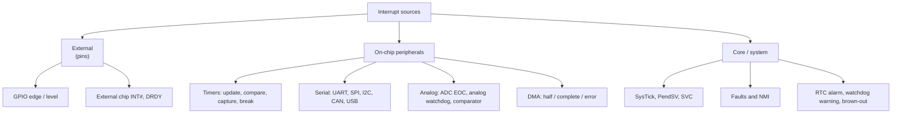

::: basics
### In plain words
Almost any event inside or outside a microcontroller can trigger an interrupt. Sources include a pin changing state, a timer reaching its count, a serial port receiving a byte, a converter finishing, a clock failing, and the processor itself reporting a fault. Often several sources share one handler, so the handler must read a status register to find out which one fired.

### Picture it
Imagine a building alarm panel with one shared bell. When the bell rings, the guard looks at the panel to see which light is on, deals with it, and resets that light. Some alarms latch: the light stays on after the door closes until the guard resets it. Others follow the sensor: the light is on only while the door is open. If the guard forgets to fix a following alarm, the bell keeps ringing.

### Words you need
- **Status flag**: a bit that records which event happened.
- **Edge-triggered**: the request comes from a change, such as low to high, and is latched until cleared.
- **Level-triggered**: the request stays active as long as the condition holds. The handler must remove the cause.
- **Shared vector**: several sources using one handler. See [[q0796]].

### The simplest example
A serial port (UART) can interrupt for a received byte, an empty transmit buffer, or an overrun error. They share one handler, which reads the status register once. For each flag that is set and enabled, it handles it: read the byte, send the next one, count the error. It clears only the flags it handled. Now picture three sensors sharing one INT# wire. The wire goes low if any sensor pulls it low. With an edge trigger, a second sensor that pulls it low while the wire is already low creates no new edge, so its event is lost. A level trigger keeps requesting until every sensor is serviced. That is the whole idea. The rest of this page covers the full catalog, noisy switches and spurious interrupts.
:::

::: testing
Whether you can **taxonomise interrupt sources** and, more importantly, know how each one is configured and cleared. Beyond the list (pins, timers, communications, ADC, DMA, comparators, watchdog, RTC, software, faults), the interviewer is looking for edge versus level triggering, internal versus external, maskable versus non-maskable, and the practical corollary: an ISR often has several possible sources behind one vector, so it must read the status register to find out which fired.
:::

::: why
A common bug is an ISR that fires for a reason you did not expect (a spurious or shared source), or never fires because the source was configured as the wrong type. Knowing the catalogue of triggers also helps you pick the cheapest way to detect an event, and understand what happens when a peripheral shares one interrupt line among several flags. It is the diagnostic checklist for "why did my ISR run?" ([[q0801]], [[q0802]]).
:::

::: concepts
- **External pin interrupts**: GPIO edge or level, with configurable polarity ([[q0783]]).
- **Timer events**: update/overflow, compare match, input capture ([[q0789]]).
- **Communication events**: byte received, transmit empty, transfer complete, errors, bus events.
- **Analog/conversion events**: ADC end of conversion, analog watchdog, comparator output.
- **System events**: DMA complete, RTC alarm, watchdog early warning, brown-out/PVD, clock failure.
- **Software and faults**: software-triggered interrupts, SVC, and exceptions such as a bus fault.
- **Edge versus level**: whether the request is a latched transition or a held condition.
:::

::: answer
"Pretty much any event inside or outside the chip can trigger one, so I group them.

External: a pin changing state, so a GPIO configured for rising, falling or both edges, or a level, like a button or a sensor's data-ready line.

Timers: overflow or update, a compare match, or an input capture when an edge arrives.

Communication peripherals: UART byte received or transmit buffer empty, SPI or I2C transfer complete, CAN message, USB events, and error flags like framing or overrun.

Conversion and analog: ADC conversion complete, an ADC window or analog watchdog when the reading goes out of range, and a comparator output.

System-level: DMA transfer complete or half complete, an RTC alarm, a watchdog early warning, brown-out detection, a clock failure.

And then software and faults: software can trigger an interrupt on purpose, like PendSV for a context switch, or SVC for a system call, and the CPU itself raises exceptions for things like a bus fault, an undefined instruction, or a divide by zero if that trap is enabled.

One thing I always remember is that many of these share a single vector, so the ISR has to read the status register to see which flag was the cause, clear that flag, and in the case of pin interrupts decide edge or level carefully."
:::

::: technical
**Taxonomy.**

| Class | Examples | Typical flag cleared by |
|---|---|---|
| External pin | GPIO/EXTI rising, falling, both; level low/high; NMI pin | write-1-to-clear pending, or remove level |
| Timer | update/overflow, compare (OC), capture (IC), break, trigger | write status register |
| Serial | UART RXNE, TXE, TC, IDLE, errors; SPI RX/TX; I2C events; CAN; USB | read data register or write status |
| Converter | ADC EOC, analog watchdog; comparator; DAC underrun | read result / write status |
| DMA | half-transfer, transfer-complete, error | write status |
| Time/system | RTC alarm/wakeup, watchdog early warning, PVD/brown-out, clock security | write status |
| Core | SysTick, SVC, PendSV, software-triggered, NMI | automatic or write |
| Faults | bus/usage/memory fault, HardFault | fix the cause; often fatal |

**Edge versus level.** Edge: the pending flag latches a transition, so a short pulse is captured; a second edge before service is lost (one pending bit). Level: the request line is the condition itself; the ISR must remove the cause (read the data, clear the device's status) or mask the source, otherwise it fires again immediately on return. Wired-OR shared interrupt lines among chips (open-drain INT# with a pull-up) are level-active-low for this reason.

**Shared vector.** A peripheral often has one vector but many flags (UART: RXNE, TXE, overrun, idle); a bank of GPIO lines may share one vector (EXTI lines 5-9). The ISR reads the status register(s) and handles each set-and-enabled flag, since several can be pending at once.

**Maskable vs non-maskable.** Maskable sources obey the global and per-source enables; NMI and faults (HardFault) cannot be masked by PRIMASK.

**Software-triggered.** Set the pending bit by software (NVIC_SetPendingIRQ, or writing ICSR PENDSV bit on Cortex-M): used by RTOSs to run code at the lowest priority after other ISRs finish.

**Spurious interrupts.** Noise on a floating pin, un-debounced switch, ESD glitch, an uncleared pending bit from before enable, or hardware race can cause an unexpected ISR; defend with input filtering, pull resistors and by checking the flag in the ISR.
:::

::: short
"Almost any event: an external pin edge or level, timer overflow, compare or input capture, UART or SPI or I2C events like byte received and transfer complete, ADC conversion complete or out-of-range, comparator output, DMA complete, RTC alarm, watchdog early warning, brown-out, plus software-triggered interrupts like PendSV and CPU faults. Sources can be edge or level triggered, and many flags share one vector, so the ISR reads the status register to see which one fired and clears it."
:::

::: long
"I find it easiest to organise the triggers by where the event originates.

Outside the chip: a pin. I can configure a GPIO interrupt for rising, falling or both edges, or a level. That's a button, a sensor's data-ready line, a zero-cross detector, an interrupt output from another chip.

Inside, from the timers: an update or overflow event, a compare match, which is how periodic interrupts work, and input capture when an edge lands on the capture pin. Also a break input for fault protection.

From communication peripherals: UART receive-not-empty, transmit-empty, transmission complete, line idle, and error flags like overrun or framing; SPI and I2C transfer events; CAN and USB messages.

From analog and conversion blocks: ADC end of conversion, an analog watchdog that fires if a reading goes outside a window, and comparator outputs. Also DMA transfer half complete and complete.

System events: an RTC alarm for wake-up, a watchdog early warning, brown-out or programmable voltage detect, and clock failure detection.

And finally the CPU itself: software-triggered interrupts, for example PendSV used by an RTOS to context switch, SVC for system calls, SysTick, and faults like a bus error or illegal instruction, with a non-maskable interrupt for the most critical cases.

Two practical points. First, edge versus level: an edge latches one event, a level keeps requesting until you remove the cause, so a level ISR must clear or mask the source. Second, many flags share a vector, so the ISR reads the status register, handles whichever flags are set, and clears only those, so I don't lose a second event that arrived meanwhile."
:::

::: terms
- **EXTI**: external interrupt/event controller linking GPIO lines to the NVIC (name is ST's).
- **Edge-triggered**: request generated on a transition, latched in a pending bit.
- **Level-triggered**: request active while the condition holds.
- **Shared vector**: several flags or lines served by one handler.
- **NMI**: non-maskable interrupt.
- **PendSV / SVC**: software-generated Arm exceptions for context switching and system calls.
- **Analog watchdog**: ADC feature that flags readings outside a programmed window.
- **Spurious interrupt**: an interrupt with no valid source (noise or race).
:::

::: exceptional
An average answer lists a few peripherals. An exceptional answer:

- Gives a **structured taxonomy** (external, timer, communication, analog, DMA/system, core/faults).
- Distinguishes **edge from level** and explains the clearing consequence of each.
- Points out **shared vectors** and the status-register-check pattern.
- Mentions **software-triggered** interrupts (PendSV) and **faults/NMI**.
- Covers **spurious** sources and how to defend against them (pull resistors, debounce, filtering).
- Notes that **wake-up** capable sources differ from normal ones in deep sleep.
:::

::: mistakes
- **Using a level interrupt on a signal the ISR does not clear**, so it re-enters forever.
- **Using an edge interrupt on a floating or bouncing input** and getting spurious or multiple interrupts ([[q0805]]).
- **Assuming one vector means one cause.** Check all flags.
- **Clearing the whole status register** (write 0xFFFF) and losing an event that arrived after you read it.
- **Forgetting that a peripheral interrupt and a pin interrupt both need their own enable bits** (peripheral, controller and global).
:::

::: deep
## A mental map of sources


Figure: Three families: pins, peripherals, and the core and system blocks. All end up as a request line into the same controller ([[q0796]]), which is why the handling is uniform even though the origins differ.

## Edge versus level, concretely

```timing
{"signals":[{"name":"Input pin","wave":"0.1.0.1.0..."},{"name":"Edge (rising) pending","wave":"0.1..01..0..","color":"orange"},{"name":"Level (high) request","wave":"0.1.0.1.0...","color":"accent"},{"name":"Open-drain INT# (level low)","wave":"1.0..1..0.1.","color":"purple"}],"hscale":1.2}
```
Figure: An edge interrupt produces a latched event per rising edge, regardless of pulse width (it stays set after the pulse ends, until the ISR clears it); a level interrupt tracks the condition, so it only drops when the cause is removed. The lower trace shows a typical shared INT# line: low while any device has something to report.

A level interrupt on a held-high pin: you enter the ISR, return, and the controller sees the request still active, so you re-enter forever, starving main. Fixes: remove the condition (read the sensor so it drops DRDY), or mask the source in the ISR and unmask after handling.

An edge interrupt on a signal that sits high for a long time and then drops: you get only one event on the falling edge and nothing while it stays low. If the ISR was masked at that moment and the edge happened, the pending bit is still set (see below), but a *second* edge before service would be merged.

## GPIO interrupt configuration

On a typical MCU the steps are:
1. Configure the pin as input with the right pull ([[q0786]]).
2. Select the trigger: rising, falling, both (a "both-edge" selection costs an extra read in the ISR to find the new level).
3. Map the pin to an interrupt line (some chips have fewer interrupt lines than pins; ST's EXTI line $n$ serves pin $n$ of one chosen port).
4. Enable the interrupt and set priority.
5. In the ISR clear the pending bit and respond.

Note how limited the "line" mapping can be: on some parts two pins with the same number on different ports cannot both generate interrupts, so plan pin assignment early.

```sim
{"id":"gpio-lab","view":"debounce"}
```
Figure: Press the switch in the simulation and see the contact bounce. An edge interrupt would fire on each bounce transition; the RC plus Schmitt or software debounce shows how to produce one clean event.

## Peripherals with several flags

A UART may generate interrupts for: receive not empty, transmit empty, transmission complete, idle line, framing error, noise, overrun, break. One vector, one handler:

```c
void USART1_IRQHandler(void) {
    uint32_t sr = USART1->SR;
    if (sr & USART_SR_RXNE) { rx_byte(USART1->DR); }        // clears RXNE
    if ((sr & USART_SR_TXE) && tx_irq_enabled) { tx_next(); }
    if (sr & USART_SR_ORE) { (void)USART1->DR; err_count++; } // overrun cleared by reading DR
}
```
Handle every set flag that is enabled: if you handle only the first one found and return, the pending request is still active (level) and you re-enter, which is correct but costs another entry. Also ensure you only service flags whose interrupt is enabled; TXE is usually set whenever the buffer is empty, so handling it when its enable bit is off wastes time.

## Software-triggered and system exceptions

- **PendSV**: set pending by software, runs at the lowest priority after everything else; an RTOS uses it for context switching.
- **SVC**: executes via an instruction (system call).
- **SysTick**: a system timer interrupt in the core.
- **NMI**: cannot be masked; used for clock-security failure or a critical external signal.
- **Faults**: bus fault, usage fault, memory-management fault escalate to HardFault. They are not "events to handle" but bugs or failures; the handler logs the stacked PC and typically resets.

## Wake-up sources

Not every interrupt can wake the part from every sleep mode. In deep sleep, only sources on an always-on domain (a designated wake-up pin, the RTC alarm, low-power UART or comparator, watchdog) can wake it. Check the datasheet table of wake-up sources versus sleep mode.

## Detecting the cause

When several sources share an ISR or a fault arises, record the cause: read and log the status registers on entry (before clearing), use a unique counter per cause for debugging, and toggle a different GPIO per case for scope visibility.

## Pending-while-disabled gotcha

If a pin edge occurs while the line is disabled, the pending bit still sets, and enabling the interrupt fires it at once. So at initialisation: configure the pin, clear its pending flag, then enable the line; otherwise you get a spurious ISR at start-up.

## Worked example: a shared open-drain INT# line with three I2C sensors

Suppose three I2C sensors (an accelerometer, a pressure sensor and a fuel gauge) share one open-drain INT# line, pulled up by 10 kΩ, connected to one MCU pin configured as a falling-edge interrupt. This is a common board-level trick for saving pins, and it hides several traps that make a good illustration of how triggers really work.

**Which devices fired?** The MCU sees only that the line went low. The ISR cannot tell who pulled it, so it must read each device's status register over I2C. At 400 kHz a register read is a start, address+write (9 bits), register pointer (9 bits), repeated start, address+read (9 bits) and a data byte (9 bits), plus the start, repeated-start and stop conditions, roughly 39 bit-times, or $39/400{,}000 \approx 100\ \mu s$ per device. Three devices cost about 300 µs, far too long for an ISR on a system with a 50 µs control loop. The standard answer is deferred processing: the ISR records a timestamp, masks the line and sets a flag, and a task or main loop does the 300 µs of bus traffic ([[q0802]]).

**Why edge triggering is dangerous here.** The line is a wired-OR of three level signals. If the accelerometer asserts INT# and the MCU reads only the accelerometer, the line stays low because the pressure sensor is still asserting. No new falling edge will ever occur while the line is low, so the pressure sensor's event is lost forever, and the system hangs silent. This is the edge-merging problem: two causes, one edge. Two fixes work:

1. Use a **low-level** interrupt. The request stays active while any device is asserting, so after servicing one device the controller re-enters until the line is released. Mask the line inside the ISR to avoid starving main, then unmask after the final status read.
2. Keep the falling-edge trigger, but after servicing, **re-read the pin**. If it is still low, service again. This closes the race between the last status read and re-arming.

**Pending-bit race.** Read the three status registers, clear them (many sensors clear on read), and only then clear the MCU's pending bit and unmask. If you clear the pending bit first and a device asserts during your reads, you can lose that event; if you clear it last, you may take one harmless spurious entry. A spurious entry that finds nothing to do is cheap. A lost event is a bug.

**Rise time of the shared line.** The pull-up and bus capacitance set how fast INT# returns high after the last device releases it: with 10 kΩ and, say, 50 pF of trace and pin capacitance, $\tau = 0.5\ \mu s$ and the line crosses 70% of the supply in about $1.2\tau = 0.6\ \mu s$. That is fine. With a 1 MΩ pull-up chosen to save power, $\tau=50\ \mu s$ and the 70% crossing takes 60 µs, so an ISR that re-reads the pin right after the sensor releases it sees a stale low. Pull-up value interacts directly with interrupt behavior.

## Worked example: how many interrupts does a bouncing button create?

A mechanical switch typically bounces for a few milliseconds when pressed. Suppose it makes 20 transitions in 5 ms. On a both-edge GPIO interrupt that is $20/0.005=4{,}000$ interrupts per second during the bounce. With a 3 µs ISR (body plus entry and exit) the CPU spends $20\times3\ \mu s=60\ \mu s$ in the ISR over the 5 ms window, a 1.2% load for a moment. That is not a CPU problem. It is a correctness problem: the software sees 20 button events instead of 1. Two clean fixes:

- **Hardware**: a pull-up of 10 kΩ with a 100 nF capacitor to ground gives $\tau=1\ \text{ms}$. The released node rises to a Schmitt threshold at 70% of the supply in $1.2\tau\approx1.2$ ms, and the Schmitt input prevents slow edges from chattering. Bounce shorter than about 1 ms is filtered, and a larger capacitor stretches it.
- **Software**: take the first edge, disable that pin's interrupt, start a 10-20 ms timer, and when it expires read the pin once and re-enable the interrupt. This uses the timer as a one-shot and costs almost nothing.

## Limiting cases and real-hardware gotchas

- **Very short pulses.** A pulse shorter than the input's synchronizer window (typically a couple of clock cycles of the peripheral) can be missed on a pin interrupt. Truly narrow pulses need a timer input-capture or a latch outside the MCU.
- **Glitch immunity.** Long wires pick up noise that looks like edges. Series resistors, a small capacitor and the Schmitt-trigger input of the pin are the first defenses; some MCUs also offer a digital glitch filter on selected pins.
- **Shared vector, different priorities.** On parts where several GPIO pins or all timer flags share one vector, they inherit the same priority. If one source needs a lower latency than another, it must be on its own vector.
- **Spurious wake-ups.** A floating wake-up pin in deep sleep can wake the part repeatedly and ruin the battery budget. Always give wake pins a defined pull level.
- **Sleep and the first edge.** In some sleep modes the pin edge wakes the core but the interrupt controller has not latched the edge yet, so the ISR flag only becomes visible after clock startup. Vendor reference manuals describe this per mode.

> [!UNCERTAIN]
> Synchronizer width, available glitch filters, EXTI line sharing and how a wake-up edge is latched all vary by vendor and part. The ST-style EXTI behavior mentioned above is one example, not a universal rule.

## How to verify on the bench

Put a scope on INT# and on a spare GPIO that the ISR toggles. Trigger on the falling edge of INT#. You should see the GPIO pulse start a few hundred nanoseconds to a few microseconds later, depending on priority and whatever else is running. Then do a deliberate collision test: force two sensors to assert within the same millisecond (for example by tapping the board while a pressure change occurs) and confirm both statuses get read. Count events with a per-cause counter, and compare against what you expect from a signal generator driving an external sensor stand-in at a known rate. A counter that is lower than the injected number points at an edge-merge or pending-clear race. Finally, inspect the INT# rising edge with a scope: if it is slow and rounded, your pull-up is too large for the capacitance.

:::

::: applications
- **Pin interrupts** for buttons, rotary encoders at low speed, data-ready from IMUs and ADCs, and wake-up from deep sleep.
- **Timer interrupts** for the RTOS tick, sampling instants and watchdog-like timeouts.
- **Serial interrupts** for UART consoles, GPS receivers, modems.
- **ADC analog-watchdog interrupts** to trigger an alarm if a battery voltage goes out of range without polling.
- **Comparator interrupts** for zero-cross detection or overcurrent notification.
- **Fault interrupts** for brown-out warning and HardFault diagnostics.
:::

::: assumptions
- Names (EXTI, PendSV, SysTick, NMI) are Arm Cortex-M/ST oriented; other families (AVR INTx/PCINT, MSP430 port interrupts, PIC IOC) offer analogous sources.
- Flag-clearing methods differ by peripheral and vendor; always check the reference manual for each flag.
- Edge versus level can differ between the pin and the controller. On Cortex-M, for example, an EXTI line may be edge-configured at the pin, while the NVIC input itself follows the peripheral's flag level and its pending bit latches the request.
- Sleep-mode wake-up capability differs per device.
:::

::: followups
### What's the difference between edge and level triggered interrupts, and when would you use each?
Edge: triggers on a transition and latches it, good for short pulses and events like a button press. Level: triggers while a condition holds, good for shared lines and "device needs service" signals, because nothing is lost if you are late, but the ISR must clear or mask the cause. Shared open-drain INT# lines require level sensitivity.

### Three flags are set on one vector. How do you service them?
Read the status register once, then test and service each set-and-enabled flag, clearing only the ones handled (write-1-to-clear on the specific bits, or the proper read sequence). Don't clear the whole register: an event that arrived after your read would be lost.

### Why might a GPIO ISR run at boot before any event?
A stale pending bit (edge during initialisation or from before the line was enabled), or a floating input producing noise. Clear pending before enabling, set pull-ups/downs ([[q0786]]) and filter if necessary.

### Can software cause an interrupt? Why would you want to?
Yes: set the pending bit of an interrupt (NVIC_SetPendingIRQ, or PendSV). An RTOS uses PendSV so the context switch runs only when all other ISRs are done; drivers use it to defer work from a high-priority ISR to a lower priority context.

### Which interrupts cannot be masked, and why?
NMI and HardFault (and reset): they report conditions where continuing is unsafe (clock failure, bus/instruction fault). Masking them could hide a catastrophic failure.
:::

::: references
- Yiu, J., *The Definitive Guide to Arm Cortex-M3 and Cortex-M4 Processors*: exceptions and interrupt types, NVIC, faults.
- STMicroelectronics STM32 reference manuals, EXTI and peripheral interrupt chapters (as an example of line mapping and flag clearing).
- Microchip AVR datasheets: external interrupt and pin-change interrupt sections (INTx versus PCINT).
- Valvano, J., *Embedded Systems: Real-Time Interfacing to Arm Cortex-M Microcontrollers*: edge-triggered and level-triggered interrupts.
:::

::: rubric
- Lists external pin, timer, communication, ADC/analog and system sources :: Breadth of the interrupt catalogue.
- Mentions software-triggered interrupts and faults/NMI :: Shows the core is also a source.
- Distinguishes edge and level triggering and the clear/mask consequence :: The most common practical pitfall.
- Notes shared vectors and checking the status register :: Real ISR structure.
- Mentions debouncing/spurious triggers :: Real-world robustness.
- Mentions wake-up sources and enable chain :: Completes the picture for low-power use.
:::

::: quiz
```json
[
 {"type":"mcq","level":"fundamental","q":"Which of these can be an interrupt source on a typical MCU?","options":["GPIO edge","UART byte received","ADC conversion complete","All of the above"],"answer":3,"explain":"Pins, serial peripherals and converters all raise interrupt flags."},
 {"type":"mcq","level":"intermediate","q":"A level-triggered interrupt input stays asserted after you return from the ISR because the cause was not cleared. What happens?","options":["Nothing","The ISR is re-entered immediately and repeatedly","The CPU resets","The interrupt is disabled automatically"],"answer":1,"explain":"The request is still active so the controller pends it again as soon as the ISR returns; this starves the main code unless the cause is cleared or masked."},
 {"type":"multi","level":"intermediate","q":"Which are valid ways a software-visible interrupt can occur without any external hardware event? Select all that apply.","options":["Setting a pending bit in software (e.g. PendSV)","An SVC instruction","A CPU fault such as an invalid memory access","A resistor value change"],"answer":[0,1,2],"explain":"Software can set pending bits, execute SVC, and cause faults. A resistor value change is not by itself an interrupt."},
 {"type":"truefalse","level":"intermediate","q":"If a UART ISR reads the status register and finds RXNE and ORE both set, it should clear all status bits with one blanket write without handling them.","answer":false,"explain":"Handle each flag (read the data, count the overrun) and clear only what you handled; a blanket clear can discard an event that arrived after your read."},
 {"type":"mcq","level":"advanced","q":"Several I2C devices share one open-drain INT# line pulled up to VDD. Which trigger configuration is appropriate?","options":["Rising-edge only","Falling-edge only, ignoring the level","Level-low, with the ISR polling each device until the line releases","No interrupt, polling only"],"answer":2,"explain":"With a wired-OR line, a second device may assert INT# while the first is being serviced, giving no new falling edge. A level-sensitive input re-triggers until every device is serviced."},
 {"type":"mcq","level":"advanced","q":"You enable a GPIO interrupt and the ISR runs once immediately even though the pin never changed. The likely cause?","options":["A stale pending bit from an edge before enabling","The pin is faster than the clock","The ISR is too short","Prescaler error"],"answer":0,"explain":"The pending flag can latch while the line is disabled. Clear it before enabling the interrupt."}
]
```
:::
