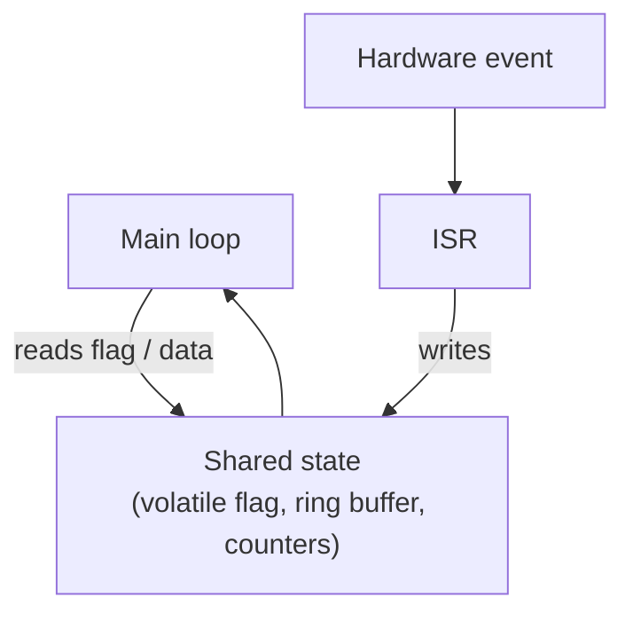

::: testing
Whether you can define an ISR precisely (a function the hardware invokes, not one your code calls) and describe **what a well-formed one looks like**: how it is bound to a vector, what it does first (identify the source, clear the flag), what it does next (the minimum work, hand data off), and what it must not do. Interviewers also want to see that you know how it differs from an ordinary function: no arguments or return value, runs asynchronously, shares data with main code, and has constraints on time and library calls.
:::

::: why
Every interrupt-driven design is a set of ISRs, and nearly every ISR bug (stuck re-entry, lost data, corrupted shared variable) comes from a misunderstanding of what an ISR is and how it differs from a normal function. This question is the "definition" anchor for the interrupt section ([[q0795]]) and leads straight to the rules of thumb in [[q0802]] and the nesting question in [[q0803]].
:::

::: concepts
- **Interrupt**: the event and mechanism that diverts the CPU ([[q0795]]).
- **Vector**: the table entry that binds an interrupt number to the handler ([[q0796]]).
- **Handler/ISR**: the code at that address, with no parameters and no return value.
- **Flag clearing**: the handler must make the request go away.
- **Context**: hardware and compiler preserve registers so the interrupted code is unaffected ([[q0797]]).
- **Shared data**: variables the ISR shares with main code; `volatile` and atomicity.
- **Deferred processing**: ISR does the minimum and signals main code.
:::

::: answer
"An interrupt service routine, or ISR, is the function that runs when an interrupt occurs. It's different from a normal function because I never call it: the hardware does, by looking up its address in the vector table when the interrupt request is accepted. It takes no arguments and returns nothing, because there's no caller to give it anything.

A typical ISR does a few things in a fixed order. It identifies the cause, if the vector is shared. It clears the interrupt flag so the request doesn't immediately fire again. It does the minimum time-critical work, like reading the received byte into a buffer, reading a sensor register, or updating a counter. And it signals the main code, usually by setting a volatile flag or posting to a queue, so the real processing happens outside the interrupt.

The rules I keep: it has to be short and fast, because other interrupts wait while it runs, it can't block or wait, and anything shared with main code has to be volatile and accessed safely. On a Cortex-M the ISR is just a plain C function with the right name; on an AVR you use a special ISR macro so the compiler saves the registers and ends with a return-from-interrupt."
:::

::: technical
**Definition.** An ISR (interrupt handler) is a routine bound to an interrupt vector and executed in response to an interrupt request, in the exception context set up by hardware ([[q0797]]).

**Properties.**
- *Signature*: `void handler(void)`. State passes through memory (volatile globals, peripheral registers, queues).
- *Binding*: by symbol name matching the vector table entry (Cortex-M CMSIS startup: `USART1_IRQHandler`; AVR: `ISR(USART_RX_vect)`; MSP430: `__attribute__((interrupt(UART_VECTOR)))`), or by runtime registration through a driver API.
- *Context*: hardware stacks caller-saved registers (Cortex-M); the compiler saves the rest. The ISR runs in handler mode with its own priority.
- *Asynchronous*: it can run between any two instructions of the main program.
- *Non-reentrant by default*: the same ISR does not preempt itself on Cortex-M (an interrupt is not re-taken while it is active unless a higher priority arrives) ([[q0803]]).

**Structure.**
```c
void UART_IRQHandler(void) {
    uint32_t st = UART->STATUS;               // 1. identify
    if (st & RX_READY) {
        uint8_t b = UART->DATA;               // 2. read clears flag (device specific)
        if (!fifo_full()) fifo_put(b);        // 3. minimal work
        rx_event = 1;                         // 4. signal main
    }
    if (st & OVERRUN) { UART->STATUS = OVERRUN; err++; }  // clear only what was handled
}
```

**Time budget.** Must satisfy $t_{ISR}+t_{overhead}<T_{event}$ and keep total load low ([[q0800]]). Typical target: microseconds.

**What it must not do.** Block, wait on a lock or a flag set by something that cannot run, call non-reentrant or slow library code (printf, malloc), or run long loops.

**Differences from a function call.**

| | Function | ISR |
|---|---|---|
| Invoked by | code | hardware event |
| Arguments / return | yes | none |
| When | at a known point | any instruction boundary |
| Context saved by | compiler | hardware plus compiler |
| Return | `ret` | special exception return |
:::

::: short
"An ISR is the function that the hardware calls when an interrupt happens: its address is in the vector table, it takes no arguments and returns nothing, and it interrupts the main code asynchronously. A good one identifies the source, clears the flag, does the minimum work, like storing a received byte, and signals the main code through a volatile flag or buffer. It must be short, can't block, and any data it shares with main must be volatile and accessed safely."
:::

::: long
"An interrupt service routine is the piece of code that runs in response to an interrupt. What makes it special is how it's called. I never call it from my program. When an interrupt is accepted, the hardware saves some context, looks up the handler's address in the vector table, and jumps there. So an ISR has no arguments and no return value, because there's no caller. Anything it needs or produces goes through memory: peripheral registers, global variables, buffers.

A well-formed ISR follows a pattern. First identify the source. If several flags share a vector, read the status register to see which is set. Second, clear the flag, in whatever way that peripheral requires, so the request goes away. Reading a data register often does it. Third, do the minimum necessary work, which is usually time critical: grab the received byte and put it in a ring buffer, read the ADC result, capture a timestamp, toggle an output. Fourth, signal the rest of the system, by setting a volatile flag the main loop checks, or by posting to an RTOS queue using the FromISR variant.

The constraints follow from the fact that the ISR interrupts something else. It has to be short, because while it runs, equal or lower priority interrupts wait and the main code is stalled. It can't block or wait for anything that needs the main code to run. It shouldn't call slow, non-reentrant functions like printf or malloc. And data shared with the main code needs to be declared volatile and accessed atomically, because the ISR can fire between any two instructions.

On a Cortex-M the ISR is just a normal C function with the right name; on an AVR you use the ISR macro so the compiler saves registers and ends with a return-from-interrupt. Either way the idea is the same: a small, fast, event-driven piece of code."
:::

::: terms
- **ISR (interrupt handler)**: code executed in response to an interrupt.
- **Vector**: table entry mapping an interrupt to its ISR.
- **Flag clearing**: removing the interrupt request in the peripheral.
- **Handler mode**: privileged execution state for exceptions on Cortex-M.
- **Deferred processing**: heavy work moved out of the ISR to main or a task.
- **`volatile`**: tells the compiler a variable can change asynchronously.
- **Reentrant**: safe to be interrupted and called again before finishing.
- **Weak symbol / default handler**: placeholder ISR replaced by your definition.
:::

::: exceptional
An average answer says "a function that runs on an interrupt." An exceptional answer:

- Emphasises that it is **called by hardware via the vector table**, hence no arguments or return.
- Gives the **four-step pattern**: identify, clear, minimal work, signal.
- Shows a **concrete example** (UART RX into a ring buffer).
- States the constraints: **short, non-blocking, volatile/atomic shared data, no printf/malloc**.
- Notes platform differences (**Cortex-M plain C versus AVR ISR macro**).
- Mentions the **time budget** $t_{ISR}<T_{event}$ and the load it creates.
:::

::: mistakes
- **Calling an ISR like a normal function** from main code. On Cortex-M it would work as a function but without the exception semantics; on AVR it would return with `ret` instead of `reti`.
- **Not clearing the flag**, leading to infinite re-entry.
- **Doing slow work** (floating-point maths, printf, delays) inside the ISR.
- **Forgetting `volatile`** on variables shared with main: the main loop spins on a cached register value forever.
- **Misspelt handler name**, so the default (empty or infinite-loop) handler is used ([[q0796]]).
:::

::: deep
## An ISR in context

Compare with a normal function:

```c
int add(int a, int b) { return a + b; }       // called by code, gets args, returns value
void EXTI0_IRQHandler(void) { /* ... */ }     // called by hardware; no args, no return
```
The only way an ISR communicates is through shared state, so the state design is the real work.


Figure: The ISR and main code never call each other; they exchange information through shared state. One side writes, the other reads. That pattern, with exactly one writer per variable, keeps the shared-data problem manageable.

## Anatomy of a good ISR

### 1. Identify the cause

If the vector is shared, read the status register once into a local, then test bits. For a GPIO bank sharing one vector (e.g. pins 5 to 9) read the pending register to find which pin fired.

### 2. Clear the flag

Peripherals differ:
- Reading the data register clears the receive flag (common for UART RX).
- Writing 1 to the flag bit clears it (write-1-to-clear), common for timers and GPIO pending bits.
- Hardware clears on vector fetch (many AVR flags).

Clear *only* the flag you handled. A blanket clear of the whole status register can discard an event that arrived after you read it.

### 3. Do the minimum

Examples: copy a byte, record `TIMx->CCR1` as a timestamp, increment a tick counter, trigger a DMA, update a PWM compare register.

### 4. Hand off

```c
volatile uint8_t data_ready;       // flag written by ISR, cleared by main
volatile uint16_t sample;          // 16-bit: atomic on Cortex-M, not on 8-bit AVR

void ADC_IRQHandler(void) {
    sample = ADC->DR;              // reading DR clears EOC
    data_ready = 1;
}

int main(void) {
    for (;;) {
        if (data_ready) {
            data_ready = 0;
            process(sample);       // heavy work lives here
        }
        __WFI();                   // sleep until the next interrupt
    }
}
```
That `data_ready` flag can drop an event if two ADC results arrive before main runs, which is why a ring buffer or counter is better when every event matters.

> [!WARNING]
> `if (data_ready) {...}` followed by `__WFI()` has a check-then-sleep race: the interrupt can fire after the check and the main loop then sleeps until the next event. A robust Cortex-M idiom is to set PRIMASK (`__disable_irq()`), re-check the flag, execute `__WFI()` (a pending interrupt still wakes the core even while PRIMASK masks it), then `__enable_irq()` so the ISR runs. Check your core's documentation.

## Why `volatile` matters

Without `volatile` the compiler may assume `data_ready` doesn't change inside the loop and hoist the read out, creating an infinite loop:

```c
int flag;                 // not volatile
while (!flag) { }         // may compile to: if (!flag) for(;;);
```
`volatile` forces a memory read each time. It does *not* make multi-step operations atomic.

## ISR vs callback vs thread

| Concept | Who runs it | Context |
|---|---|---|
| ISR | CPU on hardware event | Exception/handler mode, preempts everything of lower priority |
| Callback invoked from an ISR | Called by the ISR | Same context as the ISR: same restrictions |
| RTOS task | Scheduler | Normal thread, can block |
| Deferred handler (bottom half) | Task or low-priority interrupt | Allows long work |

Drivers often register a callback from the ISR ("HAL_UART_RxCpltCallback"). That callback runs *in interrupt context*, so the same short, non-blocking rules apply, a frequent source of confusion.

## Time budget example

A UART at 115,200 baud: a byte every 86.8 µs. The ISR reads the byte and pushes to a FIFO: 2 µs at 72 MHz (about 144 cycles including overhead). Load: 2.3%. If instead the ISR parsed a command and printed a reply with `printf` (say 500 µs), the next three bytes would arrive during the ISR and be lost if the peripheral has no FIFO. Rule: $t_{ISR}$ must be well below $T_{event}$.

```sim
{"id":"interrupt-lab","nesting":false}
```
Figure: Lengthen an ISR in the simulation until the main loop's share of the timeline shrinks and a second event arrives before the first ISR ends. The pending flag and missed-event indicators show why a long ISR hurts everything.

## Binding an ISR to a vector (how the name works)

On Cortex-M, the startup assembly declares each handler with `.weak` and an alias to `Default_Handler`:

```
.weak USART1_IRQHandler
.thumb_set USART1_IRQHandler, Default_Handler
```
When you define a function with that exact name, the linker prefers your strong definition. In C++ you also need `extern "C"` to prevent name mangling, or the symbol will not match and the default handler silently stays.

## A note on registration style

Some systems (Linux drivers, some RTOSes, Arduino's `attachInterrupt`) let you register a function pointer at run time: `attachInterrupt(digitalPinToInterrupt(2), onButton, FALLING)`. Underneath, a generic ISR looks up the user callback in a table. Convenient but adds a few cycles and hides flag-clearing.
:::

::: applications
- **UART/SPI/I2C drivers**: byte-level ISRs that fill and drain ring buffers.
- **System tick**: SysTick ISR increments a time counter ([[q0793]]).
- **GPIO events**: button and sensor ISRs that set flags or timestamps.
- **ADC/DMA completion** ISRs that swap buffers.
- **RTOS kernels**: ISRs that signal semaphores or queues to wake tasks.
- **Fault handlers**: HardFault handler that captures state before reset.
:::

::: assumptions
- Examples use Cortex-M and AVR conventions; other architectures (RISC-V, MSP430, PIC) differ in vector naming, saved registers and return instructions.
- "ISR" means a handler that runs at interrupt priority. Under an OS (Linux) the "top half" is the ISR and the "bottom half" is deferred work; the principles are the same.
- Flag-clearing rules vary per peripheral; always check the reference manual.
- 16-bit and larger shared variables are atomic only if the core can load/store them in a single instruction.
:::

::: followups
### How does an ISR differ from a normal function?
It is invoked by hardware via the vector table, not by a call instruction; has no arguments or return value; runs asynchronously between any two instructions; returns via a special exception return; and is subject to timing and library restrictions. On 8-bit cores it must save registers itself via the compiler's ISR attribute.

### What is the first thing you do in an ISR and why?
Identify the source if the vector is shared, then clear the flag. Clearing early avoids missing a later event or re-entering, but must be done in the way the peripheral requires; some flags clear on reading the data register, in which case the read is the clear.

### How can an ISR pass data to the main code safely?
Through shared state with clear ownership: a `volatile` flag written by the ISR and cleared by main, a counter, or an SPSC ring buffer where the ISR owns the head index and main owns the tail. For RTOS code, post to a queue using the ISR-safe API. Never share a multi-word value without making the read atomic.

### Why shouldn't an ISR call `printf`?
It is slow (hundreds of µs to ms), often blocks on a UART or locks a stream, is non-reentrant, and may use dynamic memory. It would stall all lower-priority work and can deadlock if main was in the middle of `printf`. Log into a buffer and print in main.

### Can you call a function from an ISR?
Yes, but it must be short, non-blocking, reentrant (or only used from the ISR), and its stack and time cost must be accounted for. Check callees as well, since a harmless-looking helper might use a mutex or call into a blocking driver.
:::

::: references
- Barr, M., and Massa, A., *Programming Embedded Systems*: writing interrupt service routines.
- Valvano, J., *Embedded Systems: Real-Time Interfacing to Arm Cortex-M Microcontrollers*: ISR structure, FIFOs and shared data.
- Yiu, J., *The Definitive Guide to Arm Cortex-M3 and Cortex-M4 Processors*: writing handlers in C and the startup code vector table.
- avr-libc documentation: the `ISR()` macro and interrupt-related notes.
:::

::: rubric
- Defines an ISR as hardware-invoked via the vector table, with no args or return value :: The core definition and the key difference from normal functions.
- Gives the pattern: identify, clear flag, minimal work, signal main :: Shows how real ISRs are written.
- Gives a concrete example (UART RX into a buffer, or tick counter) :: Demonstrates practical experience.
- States constraints: short, non-blocking, no printf/malloc :: Core rules of ISR design.
- Mentions `volatile`/atomic shared data :: Most common source of ISR bugs.
- Mentions platform differences or the handler-name binding :: Shows depth beyond one environment.
:::

::: quiz
```json
[
 {"type":"mcq","level":"fundamental","q":"What is an ISR?","options":["A function called by main() to start an interrupt","A function the hardware invokes via the vector table when an interrupt is accepted","A type of peripheral","A compiler optimisation"],"answer":1,"explain":"The CPU looks up the handler address in the vector table and jumps there; your code never calls the ISR directly."},
 {"type":"mcq","level":"fundamental","q":"Why does an ISR take no arguments and return nothing?","options":["It's a C rule","There is no caller to pass arguments or receive a return value","The compiler removes them","Arguments are stored in flash"],"answer":1,"explain":"The hardware, not a function call, triggers the ISR, so state is shared via memory and peripheral registers."},
 {"type":"truefalse","level":"intermediate","q":"If an ISR never clears the flag of a level-triggered peripheral request, the interrupt will be re-entered as soon as the ISR returns.","answer":true,"explain":"The request line is still asserted, so the controller pends the interrupt again immediately. The main code is starved until the cause is cleared or masked."},
 {"type":"numeric","level":"intermediate","q":"A UART ISR takes 3 µs and bytes arrive every 86.8 µs. What is the CPU load from this ISR?","answer":3.5,"tolerance":0.03,"unit":"%","explain":"$3/86.8=0.0346\\approx3.5\\%$."},
 {"type":"mcq","level":"advanced","q":"A main loop does `while(!done){}` where `done` is set in an ISR but declared without `volatile`. What can happen?","options":["Nothing; the compiler always rereads memory","The compiler may hoist the read and the loop spins forever","The ISR will not run","The variable becomes atomic"],"answer":1,"explain":"With optimisation the compiler can keep `done` in a register, since nothing in the loop changes it. `volatile` forces a fresh read each iteration."},
 {"type":"mcq","level":"advanced","q":"In C++ on Cortex-M you define `void USART1_IRQHandler(void)` but the ISR never runs. A likely cause is:","options":["The function needs `extern \"C\"` to avoid name mangling so it matches the vector symbol","C++ cannot be used for ISRs","The function must be a template","The CPU needs a reset"],"answer":0,"explain":"C++ mangles names, so the linker does not match the weak default symbol and the default handler remains in the vector table."}
]
```
:::
