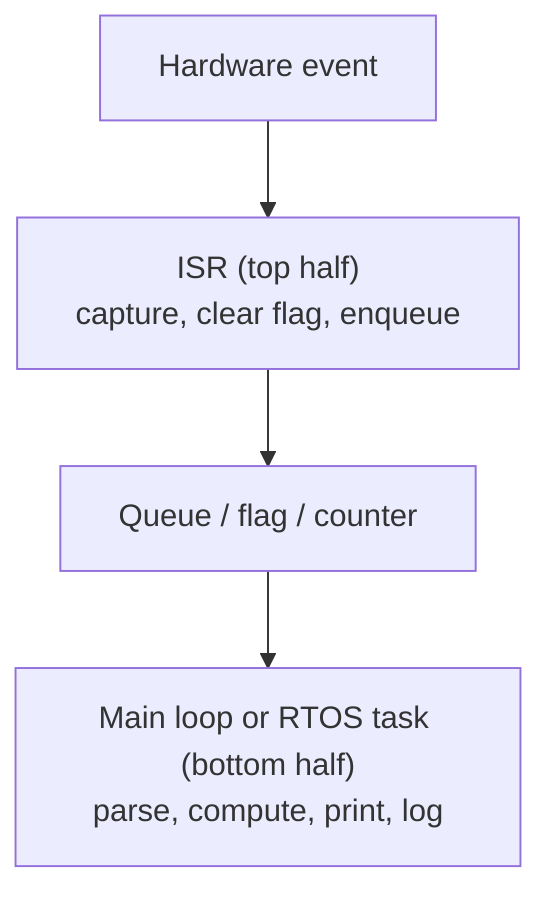

::: basics
### In plain words
An ISR is the short function the hardware runs when an interrupt happens. While it runs, it holds up other work, so a few habits keep it harmless. Keep it very short, clear the interrupt flag, never wait for anything, and hand the real work to the main code. Each rule prevents one specific failure.

### Picture it
Think of a receptionist. When a visitor arrives, the receptionist notes the name, presses the buzzer, and passes the visitor on. A long conversation at the desk would leave everyone else standing in the lobby. The picture breaks down in one place: the receptionist can write down many visitors, but a peripheral's flag only records that something happened, so a slow ISR can lose arrivals.

### Words you need
- **ISR** ([[q0801]]): the handler function that the hardware runs for an interrupt.
- **Flag**: a bit in the peripheral (the hardware block, such as the serial port) that says "I need service". Clear it, or the ISR runs again at once.
- **Blocking**: waiting for something else to happen, such as a delay or a lock.
- **Deferred work**: the ISR leaves a note (a flag or a queue) and the main code does the heavy part later.

### The simplest example
A UART (a serial port) at 115,200 bits per second delivers a byte about every 87 µs. A good ISR reads the byte, puts it in a buffer, and sets a flag. That takes about 2 µs, roughly 2.3% of the processor's time. A bad ISR parses a whole command and prints a reply, taking 500 µs. About five more bytes arrive meanwhile (500 / 87 is about 5.7), and without a hardware buffer they are lost.

That is the whole idea. The rest of this page gives each rule with its reason and a number, and shows how to measure ISR time.
:::

::: testing
Whether you have **internalised the practical rules** for interrupt code and can justify each with a failure mode. The list is short and well known: keep ISRs short, clear flags, don't block, don't call slow or non-reentrant library functions, use `volatile` and atomic access for shared data, defer heavy work, mind priorities and the stack, and measure. Strong candidates give the *reason* and a *number* for each, and describe the standard patterns (flag, ring buffer, queue, top/bottom half) that follow from them.
:::

::: why
These rules are what separate firmware that survives the field from firmware that passes a bench demo. Each one corresponds to a bug that costs days to find because ISR problems are intermittent. In an interview, a crisp list with justifications is exactly the experience signal the interviewer is after, and it connects to the limits in [[q0800]] and the nesting rules in [[q0803]].
:::

::: concepts
- **Short and fast**: ISR time directly adds latency to everything else ([[q0800]]).
- **Flag handling**: clear what you handle, in the way the peripheral needs ([[q0801]]).
- **No blocking or slow calls**: nothing that waits, allocates or prints.
- **Shared data discipline**: `volatile`, atomicity, single writer, SPSC buffers.
- **Deferred processing**: ISR captures, main or a task processes.
- **Priorities and stack**: assign by deadline; budget stack for nesting ([[q0803]]).
- **Measurement**: scope the ISR duration; test with worst-case load.
:::

::: answer
"The main rules I follow:

One, keep it short. The ISR delays everything of lower or equal priority, so do the minimum, like grab the byte, timestamp, clear the flag, and get out. A good target is a few microseconds.

Two, clear the interrupt flag correctly, and only the flags I handled, otherwise it re-fires forever or I lose an event.

Three, never block. No delays, no waiting on flags, no mutexes, no printf or malloc. They're slow, non-reentrant, or can deadlock.

Four, handle shared data carefully. Anything shared with main is volatile, updates are atomic or in a short critical section, and I prefer one writer per variable and a ring buffer for streams.

Five, defer the real work. The ISR sets a flag or posts to a queue, and main or a task does the parsing, maths and printing.

Six, think about priority and stack. The most time-critical interrupt gets the highest priority, and I budget stack for the worst nested case.

Seven, avoid floating point and big local arrays in ISRs, since they enlarge the frame and take time.

And finally, measure it. I toggle a GPIO at ISR entry and exit and look at the worst case on a scope under load, because ISR timing bugs only show up in the worst case."
:::

::: technical
**Rule set with rationale.**

| Rule | Why | Quantification |
|---|---|---|
| Keep ISR short | Adds latency to lower/equal priority sources | Budget $t_{ISR}<10\%\,T_{event}$, total load $<50\%$ |
| Clear the flag correctly | Prevents re-entry or lost events | Clear only handled bits; check clear method |
| Don't block | A blocked ISR stalls the system; may deadlock if the awaited thing needs main | No delays, no waiting loops, no mutexes |
| No printf/malloc/slow libs | Non-reentrant, long, may lock | printf can take 100 µs-ms |
| `volatile` + atomic shared data | Compiler caching, torn and lost updates | Use critical sections or single-writer SPSC buffers |
| Defer work | Keeps latency low for others | Flag, queue, or low-priority PendSV |
| Choose priorities by deadline | Rate-monotonic/deadline ordering | Control loop > high-speed comms > low-speed comms > UI |
| Budget stack | Nested frames add up | 32 B + locals per level; FPU frame 104 B |
| Avoid FPU and large locals | Larger context, longer ISR | Integer math in ISR; float in main |
| Mask minimal and briefly | Critical sections raise everyone's latency | Keep under a few µs; prefer BASEPRI over PRIMASK |
| Make ISR idempotent where possible | Spurious/extra calls harmless | Check the flag before acting |
| Measure | Intermittent bugs; worst case matters | GPIO toggle + scope, DWT cycle counter |

**Patterns.**
1. *Flag*: `volatile bool` set in ISR, cleared in main. Merges events.
2. *Counter*: ISR increments, main consumes difference. Counts events.
3. *Ring buffer (SPSC)*: head owned by ISR, tail by main. Streams.
4. *RTOS queue/semaphore* with FromISR APIs, and possible context switch on exit.
5. *Top half/bottom half*: ISR minimal; deferred handler at lower priority (PendSV).

**Critical sections.** On Cortex-M: `__disable_irq()` (PRIMASK) masks all configurable interrupts; BASEPRI masks only those at or below a priority, so the highest-priority ISRs still run. Save and restore the previous state, rather than unconditionally enabling, to support nesting.

**Entry checks.** Re-check status in the ISR (do not assume the cause), and tolerate spurious calls.
:::

::: short
"Keep ISRs short, a few microseconds, since they delay everything else. Clear the flag correctly and only what you handled. Never block or call printf, malloc or anything slow or non-reentrant. Make shared variables volatile and update them atomically, ideally one writer per variable or a ring buffer. Defer the real work to main or a task by setting a flag or posting to a queue. Assign priorities by deadline, budget stack for nesting, and measure the worst-case ISR time on a scope."
:::

::: long
"I think of ISR rules as a small checklist, each tied to a way it can go wrong.

First, short and fast. An ISR stops the main code and delays every interrupt of equal or lower priority, so it should do the minimum: read the data, clear the flag, signal. A few microseconds is the target, and I check that the total interrupt load stays well under half the CPU.

Second, flags. I clear exactly the flag I handled, the way the peripheral requires, because forgetting means the ISR fires again and again, and clearing everything can swallow a new event.

Third, no blocking or slow calls. I never wait in an ISR, never take a mutex, and never call printf or malloc, because they're slow, they aren't reentrant, and they can deadlock if the interrupted code was in the middle of them.

Fourth, shared data. The ISR can run between any two instructions, so anything shared is volatile, and anything more than a single load or store is protected: a brief critical section, or better a design with one writer per variable, like a single-producer single-consumer ring buffer.

Fifth, defer. The ISR captures the event and hands it off, using a flag, a counter, a queue or an RTOS semaphore from ISR, and the main code or a task does the parsing and the maths.

Sixth, priorities and stack. I give the tightest deadline the highest priority, and I work out the worst-case stack for the deepest nesting. I avoid floating point and big local arrays in ISRs, since they enlarge the stack frame and add time.

Last, I measure. I toggle a pin on entry and exit and look at the maximum ISR duration on a scope under a stress load, because these bugs only show up in the worst case, and a breakpoint would hide them."
:::

::: terms
- **Top half / bottom half**: minimal interrupt handler plus deferred processing.
- **Critical section**: code executed with interrupts masked.
- **PRIMASK / BASEPRI**: Cortex-M masks for all or low-priority interrupts.
- **SPSC ring buffer**: single-producer single-consumer FIFO needing no lock.
- **Reentrant**: safe to be interrupted and re-entered.
- **Idempotent**: running twice has the same effect as once.
- **Priority ceiling / inheritance**: RTOS mechanisms for avoiding priority inversion.
- **Spurious interrupt**: ISR invoked without a real event.
:::

::: exceptional
An average answer lists "keep it short, no printf." An exceptional answer:

- Gives a **reason and a number** for each rule (time budget, load, stack bytes).
- Names the **patterns** (flag, counter, SPSC ring buffer, FromISR queue, top/bottom half).
- Distinguishes **PRIMASK from BASEPRI** and saves/restores the mask for nesting.
- Notes **idempotence/spurious** tolerance and re-checking status.
- Explains the **deadlock** scenario behind "no printf/mutex".
- Describes **how to verify**: GPIO toggles, worst-case load tests, stack painting.
:::

::: mistakes
- **Parsing messages inside the UART ISR.** It stretches the ISR to hundreds of µs; parse in main.
- **Delay loops in ISRs** (e.g. a "debounce wait") that freeze the system.
- **Calling an RTOS API that is not ISR-safe** (a blocking `xQueueSend` instead of `xQueueSendFromISR`).
- **Unconditional `__enable_irq()` at the end of a critical section**, which turns interrupts on in a context that had them off.
- **Assuming the ISR runs "fast enough" without measuring.** Cache misses, flash wait states and blocked paths change it.
- **Updating a multi-byte variable with a plain assignment on an 8-bit CPU**, giving torn reads.
:::

::: deep
## Rule 1: short, and what "short" means

Budget the ISR from the system's constraints. Suppose three interrupts: a 20 kHz control ISR (50 µs period), a UART at 115,200 baud (87 µs per byte), and a 1 kHz tick.

| Source | Rate | ISR time | Load |
|---|---|---|---|
| Control | 20 kHz | 12 µs | 24% |
| UART RX | 11.52 kHz | 2 µs | 2.3% |
| Tick | 1 kHz | 3 µs | 0.3% |
| Total | | | 26.6% |

Entry/exit adds $0.33\ \mu s\times(20{,}000+11{,}520+1{,}000)=1.1\%$. Total about 27.7%, so the main code has about 72% of the CPU. Worst case the UART ISR can be delayed by the control ISR (12 µs) and tick (3 µs): the UART byte is read within about 15 µs of arriving, well inside the 87 µs before overrun. That kind of arithmetic *is* the design.

```plot
{"title":"CPU load as ISRs lengthen (control ISR at 20 kHz, UART at 11.52 kHz, tick at 1 kHz)","x":{"label":"control ISR duration","unit":"s","min":0,"max":0.00005},"y":{"label":"total ISR load","unit":"","min":0,"max":1.2},
 "series":[{"label":"total load","fn":"x*20000 + 2e-6*11520 + 3e-6*1000 + 0.33e-6*32520"}],
 "hlines":[{"at":0.5,"label":"50% guideline","color":"orange"},{"at":1,"label":"100%","color":"red"}],
 "vlines":[{"at":12e-6,"label":"12 µs: 28%"},{"at":50e-6,"label":"period limit"}]}
```
Figure: Load grows linearly with the control ISR time, reaching 100% when the ISR fills the whole 50 µs period. A 12 µs ISR gives about 28% total, which is comfortable; lengthening it to 25 µs already hits 50% total.

## Rule 2: flags, precisely

Three correct patterns:
- **Read clears**: `b = UART->DR;` (RXNE cleared by the read).
- **Write-to-clear**: `EXTI->PR = (1u<<3);` (write-1-to-clear) or `TIM2->SR = ~TIM_SR_UIF;` (STM32 timer flags are write-0-to-clear, so write 0 only to your bit and 1 elsewhere). Either way, clear only your bit with a plain write, not a read-modify-write.
- **Hardware auto-clear** (check manual).

And one subtle trap: **clear before processing** for edge events (so a new edge during processing re-pends), **clear after servicing the source** for level events (or the line re-asserts).

## Rule 3: nothing that blocks or locks

Why `printf` in an ISR can deadlock: the main code calls `printf`, which takes an internal lock on stdout; an interrupt fires; the ISR calls `printf`, which tries to take the same lock; the main code (holding it) cannot run because the ISR never returns. Deadlock. The same holds for any mutex. RTOS rules: use only APIs with the `FromISR` suffix (or equivalent), which never block.

## Rule 4: shared data patterns

**Single writer.** Each variable has exactly one writer context. Avoid `count++` from both sides.

**SPSC ring buffer** (power-of-two size, indices 8- or 32-bit on cores where single loads/stores are atomic):

```c
// ISR: producer              // main: consumer
head = (head+1) & (N-1);      tail = (tail+1) & (N-1);
```
Order matters: write the data *before* publishing the new head, read the data *before* advancing the tail. On cores with write buffers or caches add a memory barrier (`__DMB()`) between data and index.

**Critical section** (save/restore):

```c
uint32_t primask = __get_PRIMASK();
__disable_irq();
copy = shared;            // multi-word or read-modify-write
__set_PRIMASK(primask);   // restore the previous state, not unconditionally enable
```
Keep it to a few instructions: 10 cycles at 72 MHz is 139 ns of added latency, whereas a 100 µs section would break the 87 µs UART deadline.

## Rule 5: defer the work


Figure: Split every interrupt into a tiny time-critical top half and a bottom half that can take as long as it needs. The queue decouples their timing; size it for the worst burst.

```sim
{"id":"ring-buffer","size":8,"prodRate":2,"consRate":1,"burst":20}
```
Figure: The queue between the top and bottom halves, with an 8-slot buffer and a 20-item burst arriving at 2 items/ms against a drain of 1 item/ms: the backlog would reach 10 items, so the buffer overflows and items are dropped. Raise the size to 16 and the same burst fits, which is what sizing for the worst burst means.

For RTOS use: `xQueueSendFromISR(q, &item, &woken); portYIELD_FROM_ISR(woken);` The final yield makes the unblocked task run immediately on ISR exit if it has higher priority.

## Rule 6: priorities and stack

Assign priority by deadline (shortest deadline highest): hardware fault/protection, control loop, high-speed comms, low-speed comms, tick, UI. Keep the number of *distinct* preemption levels small: each extra level adds a stack frame and more interleavings. Stack worst case: $S=\sum_{levels}(32+\text{saved regs}+\text{locals})$. Measure it by filling the stack with a pattern (0xA5A5...) at boot and checking the high-water mark after a stress test.

## Rule 7: avoid expensive things

- Floating point: on Cortex-M4F it enlarges the frame (to 104 bytes) and lengthens entry; software float on an M0 can take hundreds of cycles per operation. Use fixed point in ISRs.
- Large local arrays: they sit on the main stack, consuming it during the ISR.
- Division on cores without hardware divide (hundreds of cycles).
- Calls into libraries with unknown timing.

## Rule 8: verify

1. Toggle a GPIO high at ISR entry and low at exit; scope the pulse width and its maximum with infinite persistence under worst-case load.
2. Measure latency: GPIO output from the event to the first ISR instruction.
3. Fuzz: stress test with every interrupt source at maximum rate, and with periodic long critical sections.
4. Check the stack watermark and the dropped-event counters.

```sim
{"id":"interrupt-lab","nesting":true}
```
Figure: Use the lab to see the rules in action: lengthen the low-priority ISR and watch the higher-priority event wait (nesting off) or preempt (nesting on); lengthen the high-priority ISR and watch the main loop starve.

> [!INTERVIEW]
> When asked for rules of thumb, give them as "rule, because, number": "Keep it under about 10 percent of the shortest event period, because anything longer starves lower priorities and risks overruns." That structure sounds like experience.
:::

::: applications
- **UART and USB drivers**: byte-level ISRs feeding SPSC buffers and a parser in main.
- **Motor control ISRs** at 10-40 kHz written with fixed-point maths and measured with scope toggles.
- **RTOS-based products**: ISR posts to a queue and a task processes.
- **Safety firmware** with explicit worst-case ISR time and stack budgets.
- **Code review checklists** for firmware teams.
:::

::: assumptions
- Numbers (10 µs, 50% load) are guidelines, not laws: the right target depends on the shortest event period and the deadline; hard real-time systems compute worst-case response times explicitly.
- Assumes a single-core MCU where 32-bit loads/stores are atomic (Cortex-M) and 8-bit access is atomic on AVR; multi-core and weakly ordered systems need barriers and atomics.
- "No printf in ISRs" is a rule of thumb: some debug builds route printf over a fast ITM/semihosting channel; avoid in production.
- Under Linux, ISRs have additional constraints (no sleeping, use threaded IRQs); the principles carry over.
:::

::: followups
### How long should an ISR be?
As short as the job allows, and always short relative to the shortest period of any source of equal or lower priority. A few microseconds is typical; if it needs more than about 10% of the event period, split it into top and bottom halves or use DMA.

### How do you pass data from an ISR to the main code?
Choose by the data: a single event: a volatile flag; counting events: a counter with the ISR as the only writer; a stream: an SPSC ring buffer; in an RTOS: a queue with the FromISR API. Always think about what happens if the consumer is late: overwrite, drop or block (never block in the ISR).

### How do you make a critical section safe for nesting?
Save the current mask, disable, do the work, restore the saved mask (not an unconditional enable). On Cortex-M prefer BASEPRI to leave the most urgent interrupts alive when the shared data is only touched by lower-priority ISRs.

### An ISR works at low load but fails in the field. What do you check?
Worst-case latency: long critical sections elsewhere; ISR overrun at maximum event rates; shared-data races exposed by timing; stack overflow from nested ISRs; spurious interrupts from noise; missing `volatile` that only shows up at higher optimisation levels; flag clear order. Reproduce with stress tests and instrument with GPIO toggles and counters.

### Is it ever acceptable to do significant work in an ISR?
Yes, for hard real-time control loops (such as a field-oriented control ISR at 20 kHz taking 20-30 µs), where the ISR *is* the control task. Then it is the highest priority, its worst-case time is measured and budgeted, and everything else yields to it; the "short" rule becomes "bounded and budgeted".
:::

::: references
- Barr, M., and Massa, A., *Programming Embedded Systems*: ISR design guidelines and shared-data problems.
- Simon, D., *An Embedded Software Primer*: interrupt routines in an RTOS environment, shared-data problem.
- Yiu, J., *The Definitive Guide to Arm Cortex-M3 and Cortex-M4 Processors*: PRIMASK, BASEPRI and priority grouping.
- FreeRTOS documentation on interrupt-safe APIs and deferred interrupt handling.
:::

::: rubric
- Keep ISRs short, with a time budget :: The central rule, justified by latency and load.
- Clear flags correctly :: Prevents infinite re-entry and lost events.
- No blocking, no printf/malloc/mutex, with the reason :: Avoids deadlock and latency spikes.
- `volatile`, atomicity and single-writer/ring-buffer patterns :: Prevents shared-data bugs.
- Defer work via flag, queue or task :: The standard architecture.
- Priorities by deadline and stack budgeting :: System-level thinking.
- Measure with GPIO toggles/worst-case testing :: Shows practical verification skill.
:::

::: quiz
```json
[
 {"type":"mcq","level":"fundamental","q":"Which of these should NOT normally be done in an ISR?","options":["Read a received byte into a buffer","Clear the interrupt flag","Call printf to log the event","Set a volatile flag"],"answer":2,"explain":"printf is slow, non-reentrant and may lock. Log to a buffer and print from the main loop."},
 {"type":"mcq","level":"fundamental","q":"Why should shared variables be declared volatile?","options":["To make them faster","So the compiler does not cache them in registers and re-reads memory each time","To make updates atomic","To save memory"],"answer":1,"explain":"Volatile forces actual memory accesses. It does not make read-modify-write operations atomic."},
 {"type":"numeric","level":"intermediate","q":"Three ISRs: 20 kHz x 10 µs, 11.52 kHz x 2 µs and 1 kHz x 3 µs. What is the total CPU load from ISR bodies (ignoring entry/exit)?","answer":22.6,"tolerance":0.02,"unit":"%","explain":"$0.2+0.02304+0.003=0.226$, so 22.6%."},
 {"type":"mcq","level":"intermediate","q":"At the end of a critical section you should:","options":["Always call __enable_irq()","Restore the saved previous interrupt mask","Reset the CPU","Disable interrupts permanently"],"answer":1,"explain":"Restoring the previous state keeps nested critical sections correct; unconditional enabling can turn interrupts on where the caller had them off."},
 {"type":"numeric","level":"advanced","q":"A critical section of 100 instructions at 72 MHz (1 cycle each) is added to a UART system that gets a byte every 86.8 µs. How much extra worst-case latency does it add?","answer":1.39,"tolerance":0.03,"unit":"µs","explain":"$100/72\\text{ MHz}=1.39$ µs, small compared with 86.8 µs, so acceptable. A 100 µs section would not be."},
 {"type":"truefalse","level":"advanced","q":"It is safe to call a blocking RTOS queue send from an ISR as long as the queue is usually not full.","answer":false,"explain":"Blocking APIs may try to block or take a kernel lock when the queue is full, which is illegal in an ISR. Use the FromISR variant, which returns immediately."}
]
```
:::
