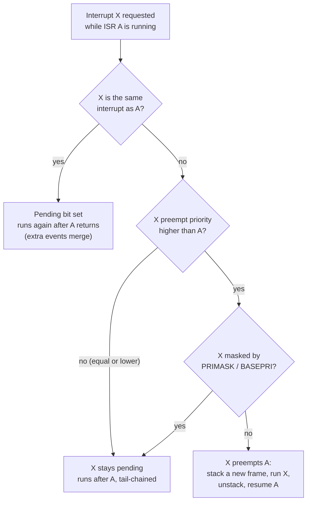

::: testing
Whether you understand **preemption and nesting**: what the hardware does when a request arrives during an ISR (it depends on priority), and how to control it. Strong answers separate the cases: same source re-triggering, equal or lower priority (waits as pending), higher priority (preempts: nested), and cores where interrupts are globally masked on entry (AVR). Then the consequences (stack growth, shared-data races, latency benefits, lost events) and how to avoid unwanted nesting: priority design, masking, short ISRs, disabling the source, and avoiding re-enabling interrupts inside handlers.
:::

::: why
A surprising number of real bugs are nesting bugs: a stack overflow from an interrupt storm, a handler that corrupts a shared buffer because a higher-priority ISR touched it mid-update, or a lost byte because a long ISR blocked a UART. Being able to predict exactly what happens when interrupts overlap is what lets you set priorities deliberately instead of by default ([[q0800]], [[q0802]]).
:::

::: concepts
- **Preemption**: a higher-priority interrupt can interrupt a running lower-priority ISR ([[q0796]]).
- **Pending**: a request that cannot run yet waits as pending and runs after the active ISR (and any higher priorities).
- **Nested vectored interrupt controller (NVIC)**: Cortex-M's built-in priority-based nesting.
- **Global mask on entry**: AVR clears the I flag on entry, so nesting is off unless software re-enables it.
- **Stack frames**: each nested level pushes a frame ([[q0797]]).
- **Critical sections**: masks that prevent preemption by chosen priorities ([[q0802]]).
- **Priority inversion / race**: hazards when ISRs share data.
:::

::: answer
"It depends on the priorities and the architecture.

On a Cortex-M, the interrupt controller compares the new request's priority with the priority of the ISR currently running. If the new one has a higher priority, the hardware preempts: it stacks another frame and runs the new ISR inside the first, and when it finishes it returns into the first ISR. That's nesting. If the new one has the same or lower priority, it just waits as pending until the current ISR returns, and then runs, often via tail-chaining. And the same interrupt can't preempt itself: if the same source fires again while its ISR runs, it gets latched as pending and runs again afterwards, though if it fired twice you only get one.

On an AVR, the hardware clears the global interrupt flag on entry, so nothing can interrupt an ISR unless I explicitly turn interrupts back on inside it, which I'd avoid.

Nesting reduces latency for urgent events but costs stack, adds shared-data hazards, and can lose events if an ISR is held up.

To control it, I'd set priorities deliberately: urgent ones high, everything else equal or in a few levels. Keep ISRs short so overlaps are rare, mask the source or use BASEPRI around shared data, never re-enable interrupts inside a handler without a plan, and size the stack for the worst-case nest."
:::

::: technical
**Cortex-M behaviour.** Each exception has a priority; the core tracks the *current execution priority* (the priority of the active handler, modified by PRIMASK/BASEPRI). A new request preempts only if its *group* priority is strictly higher (numerically lower). Same group priority does not preempt (the sub-priority only orders pending requests).

Cases when interrupt X arrives during ISR A:
1. *Same interrupt as A* (X = A): cannot preempt itself (same priority). Pending bit set (one level only); runs again after A returns. Multiple arrivals merge: events lost.
2. *Lower or equal priority*: remains pending. After A returns, the highest-priority pending runs; if immediately pending, tail-chaining (about 6 cycles).
3. *Higher priority*: preempts. Hardware stacks the next frame (8 words) on the active stack, runs X, and unstacks on return into A. A's latency to completion grows by $t_X$ + overhead.
4. *Arrives during A's stacking*: late arrival handling lets the higher-priority one run first.
5. *Arrives while A is returning (unstacking)*: pop preemption restarts entry for X.
6. *NMI and HardFault*: fixed priorities (-2 and -1) above every configurable level, so they can preempt any ISR (MemManage, BusFault and UsageFault have configurable priorities like IRQs).

**AVR (8-bit).** Hardware clears SREG.I on entry, so no interrupt can preempt an ISR. Pending interrupts are flagged and served in priority (vector address) order after `RETI`. An ISR may execute `sei()` to allow nesting, but then *any* pending interrupt can preempt, including the same one if its flag is still set (e.g. level interrupts): recursive entry and stack overflow.

**Stack.** Depth $=\sum_k(F_k)$ where $F_k=32+\text{regs}+\text{locals}$ (and 104 with FPU context). Worst case is the maximum chain of strictly increasing priorities.

**Avoiding unwanted nesting.**
- Give all non-urgent ISRs the *same* preempt priority (they cannot nest each other).
- Group priority bits: reduce preemption levels via `NVIC_SetPriorityGrouping`.
- Use BASEPRI for critical sections instead of PRIMASK.
- In the ISR, mask or clear the source flag early so it can't re-trigger.
- Keep ISRs short.
- Never `sei()`/`__enable_irq()` inside an ISR unless the design requires it.
- Protect shared data touched by multiple ISR priorities.

**Same-source re-entrancy.** Even without preemption, the *same ISR* can run back to back if its flag is set again before return. Use idempotent handlers and tolerate a spurious second call.
:::

::: short
"On a Cortex-M it depends on priority. A higher-priority interrupt preempts: the hardware stacks another frame, runs it, and returns into the first ISR, which is nesting. Equal or lower priority waits as pending and runs after, and the same interrupt can't preempt itself, so a repeat just pends. On AVR the global interrupt flag is cleared on entry, so no nesting unless you re-enable. To avoid problems, set priorities deliberately, keep ISRs short, protect shared data, and budget stack."
:::

::: long
"There are really three cases, and the first thing is the priority comparison.

On a Cortex-M the NVIC knows the priority of the handler that's running. If the new interrupt has strictly higher priority, the core preempts. It pushes another eight-register frame onto the stack, runs the new ISR inside the first one, and when that finishes it unstacks and carries on in the first ISR. That's nesting, and it's automatic. If the new interrupt has the same or lower priority, nothing happens right now: its pending bit is set, and it runs when the current ISR returns, often through tail-chaining, which skips the unstack and restack and costs only about 6 cycles. The special case is the same interrupt firing again. It has equal priority to itself so it can't preempt; the pending bit latches, and the ISR runs a second time after returning. But there's only one pending bit, so if it fired twice during the first run you only get one more call, and an event is lost.

On a smaller core like an AVR, the hardware clears the global interrupt enable on entry. So the answer is: nothing interrupts the ISR; requests pend, and are serviced in vector order after the return. You can call sei inside the ISR to allow nesting, but then even the same interrupt can come back if its flag is still set, which is how people get recursive entry and a stack overflow.

The consequences of nesting: good, because an urgent event gets served with low latency instead of waiting for a long ISR; bad, because each level uses stack, shared data can be modified in the middle of an update, and the interleavings are harder to test.

To avoid unwanted nesting: I put non-urgent interrupts at the same preempt priority so they can't nest, I keep ISRs short, I clear or mask the source early, I use BASEPRI critical sections around data shared across priorities, and I calculate the worst-case stack for the deepest chain of priorities. And I don't re-enable interrupts inside a handler unless I specifically designed for it."
:::

::: terms
- **Preemption**: interrupting a running handler for a higher-priority one.
- **Nested interrupt**: an interrupt serviced while another handler is still active.
- **Pending**: waiting for service.
- **Tail-chaining**: running the next pending ISR without unstacking/stacking in between.
- **Priority grouping**: split of priority bits into preempt and sub-priority fields.
- **BASEPRI**: mask for interrupts at or below a priority level.
- **Re-entrancy**: the same code running again before the first execution finished.
- **Interrupt storm**: continuous interrupt requests that consume all CPU time.
:::

::: exceptional
An average answer says "it gets nested or queued." An exceptional answer:

- Gives the **case analysis**: same source, equal/lower priority, higher priority, AVR-style global mask.
- Mentions **tail-chaining**, **late arrival** and that the same IRQ cannot preempt itself but loses merged events.
- Quantifies **stack** per level (32 bytes plus locals; 104 with FPU).
- Gives **avoidance techniques** (equal priorities, grouping, BASEPRI, short ISRs, mask the source) and notes the benefit of nesting too.
- Knows the **recursion/storm** failure mode and its fix.
- Frames nesting as a deliberate **design decision** needing stack and data-race analysis.
:::

::: mistakes
- **"The ISR can't be interrupted."** True only for cores/configurations with a global mask on entry. Cortex-M nests by priority by default.
- **Giving every ISR a different priority "to be safe".** It maximises nesting depth, stack and interleavings. Use few levels.
- **Calling `sei()` in an AVR ISR to "allow other interrupts"** while the source flag is still set, causing recursive entry.
- **Forgetting that a repeated same interrupt is lost when merged** (single pending bit).
- **Ignoring the stack**: nested frames can silently overflow into data.
- **Assuming equal priority means FIFO order.** Ties are resolved by lowest interrupt number, not arrival time.
:::

::: deep
## The decision tree


Figure: On Cortex-M the NVIC walks exactly this decision. A masked or lower-priority source never interrupts the running handler; it queues. Only a strictly higher-priority, unmasked source nests.

## What nesting does to timing

Consider A (low priority, 40 µs) and X (high priority, 5 µs) with X arriving 10 µs into A.

- **Nesting enabled** (X higher): X starts after about 0.17 µs (entry), runs 5 µs, A resumes. A finishes at $40+5+0.33=45.3$ µs from its start. X's latency: 0.17 µs.
- **Same priority** (no nesting): X waits for the remaining 30 µs of A plus return, then runs. X's latency $\approx30.2$ µs; A finishes at 40 µs.

So nesting buys X a 30 µs improvement and costs A 5.3 µs, plus a frame of stack and possible data hazards. If X's deadline were 20 µs, same-priority would fail.

```sim
{"id":"interrupt-lab","nesting":true}
```
Figure: With nesting on, find the high-priority source's arrival during a long low-priority ISR and see it preempt; the low-priority ISR's end time shifts right by the preemption. Switch nesting off and see the high-priority event wait, which is the extra latency in the calculation above.

## Same-source re-triggering

Peripheral flag $F$ is set; ISR A starts; during A the same event occurs again. The flag is already set. When A clears the flag (at the end or early), what happens depends on *when*:

```timing
{"signals":[{"name":"Event","wave":"0.10..10....","color":"orange"},{"name":"Pending flag","wave":"0.1.0.1..0..","color":"purple"},{"name":"ISR running","wave":"0...11110111","color":"accent"}],"hscale":1.2}
```
Figure: The first event sets the flag and starts the ISR. The second event arrives during the ISR; the flag was cleared at ISR start in this example, so the new event sets it again and a second ISR run follows. If the flag had been cleared only at the *end* of the ISR, the second event would have been swallowed. Clearing early (for edge events) preserves it; still, with a third event before service, only one more run results.

The Arm architecture does not let an exception preempt a handler of the same or higher priority, so the same IRQ never nests on itself. On AVR with `sei()` and a still-set flag, it can: recursion until the stack hits RAM.

## The nested stack picture

Worst-case depth equals the longest chain of strictly increasing preempt priorities. With NVIC priorities 0 (highest) to 7 and ISRs at levels 1, 3 and 5, the worst case is main plus three frames:

$$S=S_{main}+\sum_{k=1}^{3}(32+r_k+l_k)$$

With $r_k+l_k=60$ bytes each, $S_{ISR}=3\times92=276$ bytes. With the FPU active each frame is 104 plus the rest: $3\times164=492$. On a 2 kB RAM part those are 14% and 24% of memory. Compared with all three ISRs at the same level (no nesting), the worst case is only one frame: 92 bytes. That is the design lever: fewer preemption levels, bounded stack.

> [!TIP]
> On Cortex-M with 4 priority bits (16 levels) set the grouping so all 4 bits are preempt priority only if you truly need 16 levels. A common practical design uses 2-4 preempt levels and puts everything non-critical at the same level.

## AVR: nesting is opt-in

On entry the hardware clears I; `RETI` sets it. Pending flags are served after return in vector order. To permit nesting, `sei()` inside the ISR; it is dangerous because:
- A still-asserted *level* source immediately re-enters the same ISR: unbounded recursion.
- All other enabled interrupts, including lower-priority (higher vector number) ones, can then preempt, since AVR has no priority comparison: priority only orders *pending* interrupts.

If you must nest on AVR, first disable the specific interrupt's enable bit (or clear its flag), then `sei()`, do the long work, `cli()`, and re-enable the source before returning.

## Protecting shared data across priorities

If ISR X (high) and ISR A (low) both touch `buf`, A must protect the touching section from X. Cortex-M:

```c
uint32_t old = __get_BASEPRI();
__set_BASEPRI(X_PRIORITY_VALUE);   // mask X and anything below
update(buf);
__set_BASEPRI(old);                // restore
```
This masks only X and lower priorities. Even higher-priority interrupts (such as protection) still run, preserving their latency.

## Interrupt storms and starvation

A level-triggered source never cleared, a noisy pin without filtering, or a UART in error state raising interrupts continuously can consume all CPU in ISR and tail-chain. Defences: clear and acknowledge in the handler; disable the source after N consecutive occurrences and raise an error; use a hardware debounce/filter; ensure the watchdog is kicked only from the main thread, so a storm leads to a reset instead of a silent hang.

## Design recipe

1. List all ISRs with rate, duration and deadline.
2. Assign priorities by deadline (urgent = higher), merging non-urgent ISRs into the same level.
3. For each shared variable, list which priorities touch it; guard with BASEPRI or make single-writer.
4. Compute worst-case latency per ISR including preemption by higher priorities (response-time analysis).
5. Compute worst-case stack; verify with stack painting.
6. Stress test with all sources at max rate.

## Worked example: response-time analysis with nesting

The design recipe above says to compute worst-case latency including preemption. Here is that computation, step by step, so it is not just a slogan. Three ISRs on a 72 MHz Cortex-M, each cost including 0.33 µs entry and exit:

| ISR | Priority | Period $T$ | Cost $C$ | Deadline |
|---|---|---|---|---|
| X: control loop | 1 (highest) | 100 µs | 5.33 µs | 100 µs |
| Y: fast SPI block | 2 | 250 µs | 12.33 µs | 250 µs |
| A: logging and housekeeping | 3 (lowest) | 1,000 µs | 40.33 µs | 1,000 µs |

Total utilization is $5.33/100+12.33/250+40.33/1000=0.053+0.049+0.040=0.143$, about 14%. That number alone says nothing about whether deadlines are met, because preemption stretches each handler's finish time. The standard fixed-priority response-time recurrence for a handler $i$ is

$$R_i = C_i + \sum_{j\in hp(i)}\left\lceil \frac{R_i}{T_j}\right\rceil C_j$$

where $hp(i)$ is the set of higher-priority sources and one starts with $R_i=C_i$ and iterates until it stops changing.

- **X**: nothing outranks it, so $R_X=5.33$ µs, plus the 0.17 µs entry latency. It is blocked by nothing but the few cycles of a multi-cycle instruction.
- **Y**: start with $R=12.33$. One X occurrence can land inside it: $12.33+\lceil12.33/100\rceil\times5.33=17.66$. Re-check: $\lceil17.66/100\rceil=1$, so it is stable at **17.7 µs**.
- **A**: start with $R=40.33$. Add one X and one Y: $40.33+5.33+12.33=57.99$. Re-check: $\lceil58/100\rceil=1$ and $\lceil58/250\rceil=1$, so it is stable at **58.0 µs**, far below A's 1,000 µs deadline.

Now repeat the exercise with no nesting, putting all three at the same preempt level. The *blocking* term changes: X can wait for the longest other handler, which is A at 40.33 µs, so X's worst-case response is $40.33+5.33=45.7$ µs. That meets a 100 µs deadline here, but the margin shrank from 94% to 54%, and if A ever grows past about 94 µs the control loop misses its period. This is exactly the argument for preemption levels: nesting turns "longest handler in the system" into "longest handler of equal or higher priority" in the latency of urgent sources. Notice also what the analysis does not include: a masked section. If any code disables interrupts for 8 µs, add 8 µs to X's response time as blocking.

## Sizing the critical section

Every time code raises BASEPRI or PRIMASK it adds blocking time for the sources it masks. A short read-modify-write of a shared index costs a handful of cycles: say 8 cycles at 72 MHz is $8/72\text{ MHz}=111$ ns. That is negligible next to X's 100 µs period. A critical section that copies a 64-byte buffer byte by byte at 3 cycles per byte takes about 192 cycles, 2.7 µs, still fine for X, but not for a source with a 2 µs deadline. The rule is to measure critical sections like ISRs: toggle a GPIO inside them and watch the maximum width on a scope.

## The priority grouping arithmetic

A Cortex-M part that implements 4 priority bits has 16 priority values. The group-priority setting splits each value into a preempt part (the high bits) and a sub-priority part (the low bits). With all 4 bits as preempt priority there are 16 distinct nesting levels. With 2 preempt bits and 2 sub-priority bits there are only $2^2=4$ nesting levels, each containing 4 sub-priorities that only break ties among pending interrupts and never allow preemption. The stack formula in this page shows why fewer levels are usually better: the worst-case depth is the number of preempt levels in actual use, not the number of ISRs. Many vendor libraries set a grouping at startup; if your priority numbers seem to do nothing, check that the grouping you assumed is the one the library configured. Also, on cores that implement only the top bits of the priority field, the unimplemented low bits read as zero, so priority values must be written left-aligned (shifted) to take effect.

## Real-hardware effects that make nesting harder than it looks

- **Stack overflow in a handler.** Each nested frame is at least 32 bytes plus the ISR's locals, and the processor stacks the frame on whichever stack was active (main or process). If an ISR runs on a small task stack inside an RTOS, nesting can overflow that task's stack and corrupt a neighbor, with a symptom that shows up elsewhere. RTOS ports usually switch to the main stack for handlers precisely to avoid this.
- **Late-arriving and tail-chaining.** If a higher-priority interrupt arrives while a lower one is being stacked, the core vectors to the higher one first (late arrival) and the lower one then runs by tail-chaining without a full unstack/restack. Timing at the margins varies by a few cycles; do not trust single-run measurements.
- **Peripheral registers with read side effects.** Reading a status register that clears flags in a preempting handler can silently discard an event the preempted handler was still going to test. Share read-to-clear registers only through a single handler.
- **Debugging.** Breakpoints in nested handlers change timing so much that the failure disappears. Trace (ITM or a GPIO scheme) works where halting does not.

> [!UNCERTAIN]
> The number of implemented priority bits, the position of the group-priority split and the exact late-arrival behavior are implementation-defined or vendor-specific. The 4-bit example matches many Cortex-M3/M4 devices but not all; Cortex-M0 parts typically offer only 4 levels with 2 implemented bits.

## Verifying nesting on the bench

1. Assign each ISR its own GPIO and toggle it high at entry and low at exit. Capture all of them on a logic analyzer with the control-loop output as the trigger.
2. Force the nesting case by making the low-priority handler artificially long (a delay loop of, say, 40 µs) and fire the higher source asynchronously. The trace should show the lower handler's pulse interrupted by the higher one's pulse, then resuming. If it does not, the grouping or priority numbers are not what you think.
3. Measure the maximum width of the lowest handler's pulse over minutes of traffic and compare it with the 58 µs computed above; a measured value above the prediction means a term is missing, usually a masked section or a source you forgot.
4. Read the stack high-water mark after a long run to check the worst-case depth.

:::

::: applications
- **Motor-control firmware**: the current-loop ISR preempts a communication ISR so a UART burst cannot disturb control timing.
- **RTOS kernels**: SysTick and PendSV set to the lowest priority so they never preempt other ISRs while still preempting tasks.
- **Safety systems**: fault/protection interrupts at the highest priority, nested over everything.
- **Audio/DSP**: sample-rate ISR over background USB/UART interrupts.
- **Stack-constrained devices**: limiting preemption levels to cap RAM use.
:::

::: assumptions
- Behaviour described is for Armv7-M (Cortex-M3/M4) with the NVIC; Cortex-M0 has 4 priority levels with similar rules; RISC-V CLIC and other controllers differ in details.
- "Priority" means the preempt (group) priority. Sub-priority only orders pending interrupts.
- AVR behaviour is for classic AVR8 devices; newer AVR devices (e.g. with CPUINT) add two priority levels and optional round-robin scheduling, so nesting can be natively supported.
- The timing numbers use 0.17 µs entry and 0.17 µs exit at 72 MHz (12-cycle each).
:::

::: followups
### Can an ISR be interrupted by itself?
On Cortex-M, no: an exception cannot preempt a handler of the same priority, including itself; the new request pends and runs after return, with multiple requests merging to one. On AVR it can only if the ISR enabled interrupts and the flag is set again; that recursion is usually a bug.

### How do you design priorities for a motor controller with UART and SPI?
The current loop gets the highest (hard deadline, jitter-sensitive), then SPI sensor/encoder reads if time-critical, then UART at a lower level, and the tick lowest. The UART and SPI ISRs, if non-critical, share a level so they don't nest. Then analyse worst-case latency for the loop and the UART buffer fill.

### What is the stack cost of nesting?
One hardware frame (32 bytes, 104 with FPU) plus the compiler's saved registers and locals per active level, summed over the longest chain of increasing priorities. Estimate by analysis, then verify by painting the stack and checking the watermark under stress.

### What is tail-chaining and does it affect nesting?
If another interrupt is pending when an ISR returns, the core skips the unstack/stack and enters the next handler directly (about 6 cycles). It applies to queued equal or lower-priority interrupts, so it's the "no nesting" path done efficiently.

### An ISR on AVR calls sei() at the start and the system crashes under load. Why?
Likely recursion: the interrupt source flag is still set (or a level interrupt is still asserted), so after `sei()` the same interrupt fires again immediately, nesting repeatedly until the stack overflows. Clear or disable the source before `sei()`, or avoid `sei()` altogether.
:::

::: references
- Yiu, J., *The Definitive Guide to Arm Cortex-M3 and Cortex-M4 Processors*: nested interrupts, priority grouping, tail-chaining, late arrival and BASEPRI.
- Arm, *Armv7-M Architecture Reference Manual*: exception priorities and preemption rules.
- Microchip AVR datasheets and avr-libc documentation: global interrupt flag behaviour on entry and `sei()` in ISRs.
- Buttazzo, G., *Hard Real-Time Computing Systems*: response-time analysis with preemption.
:::

::: rubric
- States the rule: higher priority preempts, equal or lower pends :: The core answer.
- Handles the same-interrupt re-trigger case and the single pending bit :: The literal reading of the question.
- Distinguishes Cortex-M (NVIC nesting) and AVR (masked on entry) :: Shows architecture awareness.
- Lists consequences: stack, races, latency benefit :: Understands the trade-offs.
- Gives avoidance strategies (priority design, equal levels, BASEPRI, short ISRs, mask source) :: The second half of the question.
- Quantifies stack or latency with an example :: Shows engineering rigour.
:::

::: quiz
```json
[
 {"type":"mcq","level":"fundamental","q":"On a Cortex-M, an ISR is running and a request of equal priority arrives. What happens?","options":["It preempts immediately","It waits as pending and runs after the current ISR returns","It is discarded","The CPU resets"],"answer":1,"explain":"Only a strictly higher preempt priority can interrupt a running handler. Equal or lower priority requests pend."},
 {"type":"mcq","level":"fundamental","q":"What happens on a classic AVR when an interrupt fires during an ISR (no sei() was called)?","options":["It preempts the ISR","It is flagged and serviced after the ISR returns","It resets the MCU","It is lost always"],"answer":1,"explain":"The global interrupt flag is cleared on entry, so the request pends and is handled after RETI."},
 {"type":"numeric","level":"intermediate","q":"Three nested ISRs each use a 32-byte hardware frame plus 48 bytes of saved registers and locals. What is the worst-case ISR stack usage?","answer":240,"tolerance":0.01,"unit":"bytes","explain":"$3\\times(32+48)=240$ bytes."},
 {"type":"numeric","level":"intermediate","q":"ISR A runs 40 µs. A higher-priority ISR X (5 µs) preempts it with 0.17 µs entry and 0.17 µs exit overhead. By how long is A's completion delayed?","answer":5.34,"tolerance":0.02,"unit":"µs","explain":"$5+0.17+0.17=5.34$ µs added to A's completion time."},
 {"type":"truefalse","level":"advanced","q":"On Cortex-M, if the same interrupt occurs twice while its ISR is running, the ISR will run exactly twice more afterwards.","answer":false,"explain":"There is a single pending bit, so repeated occurrences merge into one pending request: the ISR runs once more and one event is lost unless hardware buffers it."},
 {"type":"mcq","level":"advanced","q":"An AVR ISR calls sei() at the start while a level-triggered source is still asserted. The likely result is:","options":["Faster response","Recursive re-entry of the same ISR until stack overflow","Nothing","Automatic prioritisation"],"answer":1,"explain":"The still-asserted source triggers the same ISR again as soon as interrupts are enabled, repeatedly, consuming stack each time."}
]
```
:::
