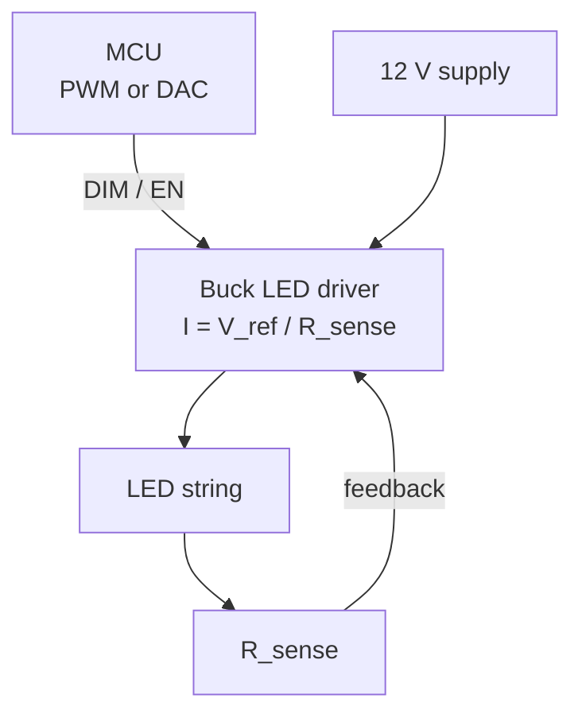

::: testing
Whether you see an LED as a **current-driven** device and size the series resistor properly from $(V_{S}-V_f)/I$, then scale the answer logically: a MCU pin can only source a few to tens of mA, so a high-power LED needs a transistor or MOSFET switch plus proper current regulation (resistor at low power, constant-current driver for real power), and dimming is done by PWM (fast enough to avoid flicker) or analog current control. Mentioning perceptual brightness (gamma), heat, and why voltage drive is dangerous shows depth.
:::

::: why
Lighting is everywhere in products: status LEDs, displays, backlights, flashlights, automotive lighting. A candidate who can produce the resistor value, the transistor stage and the PWM scheme with numbers, and explain constant current, demonstrates that they can bridge MCU pins and power loads, the same skill needed for motors ([[q0807]]), solenoids and relays.
:::

::: concepts
- **LED I-V behaviour**: exponential like any diode; forward voltage $V_f$ (about 1.8-2.2 V red, 3.0-3.4 V blue/white) with negative temperature coefficient.
- **Series resistor**: $R=(V_S-V_f)/I_F$ sets current; a diode on a voltage source needs current limiting.
- **GPIO drive limits**: pin source/sink capability is limited (device specific).
- **Low-side MOSFET switch**: logic-level NMOS with gate resistor and pull-down ([[q0783]]).
- **Constant-current driver**: regulates $I$ regardless of $V_f$ and supply changes.
- **PWM dimming**: average current set by duty; frequency high enough to avoid flicker ([[q0790]]).
- **Perceived brightness**: nonlinear (gamma) relation between duty and perceived level.
:::

::: answer
"For a basic indicator LED, I'd run it straight from a GPIO through a series resistor. Say a red LED with a forward voltage of about 2 V at 5 mA from a 3.3 V pin. The resistor is the 1.3 V that's left divided by 5 mA, so 260 Ω, and I'd use the nearest standard value, 270 Ω, for about 4.8 mA. The resistor is what sets the current; an LED on a voltage source without it would draw as much as the source allows and burn out.

For a high-power LED, say 350 mA to 1 A, the MCU pin can't supply that. I'd use the pin to drive a logic-level N-channel MOSFET as a low-side switch, with a gate resistor of about 100 Ω and a pull-down so it stays off during reset. For the current regulation, a series resistor works for a quick design, but a 1 W LED from 12 V would waste most of the power in the resistor, so a real design uses a constant-current driver, a buck-based LED driver with a dimming or enable pin that the MCU drives.

For brightness, I'd use PWM: the MCU's timer generates a signal at maybe 1 kHz, well above the flicker threshold, and duty cycle sets the average current. Because our eyes respond roughly logarithmically, I'd apply a gamma table so that 50% brightness is about 22% duty. Alternatively, for smooth analog dimming I can lower the driver's reference current, but PWM is simpler and keeps the LED color stable."
:::

::: technical
**Indicator LED.** $R=\dfrac{V_{DD}-V_f}{I_F}$. Red: $V_f\approx2.0$ V, $I_F=5$ mA, $V_{DD}=3.3$ V: $R=260\ \Omega\rightarrow270\ \Omega$ gives $I=4.81$ mA, resistor power $I^2R=6.3$ mW. Efficiency is $V_f/V_{DD}\approx61\%$. For a blue or white LED with $V_f\approx3.1$ V on 3.3 V, $R=(3.3-3.1)/5\text{ mA}=40\ \Omega$ and a $\pm0.2$ V variation in $V_f$ changes current from 0 to 10 mA, so the current is poorly controlled: use a higher supply or a current source. Check the pin's maximum source/sink current (device dependent; commonly in the range of a few mA to about 25 mA, with a total limit per port/package).

**Source or sink.** Sinking (pin low turns LED on, LED to $V_{DD}$) is often stronger on MCUs and keeps the LED off during reset when pins are high-Z; sourcing is also fine. Check the datasheet's $V_{OL}/I_{OL}$ and $V_{OH}/I_{OH}$.

**High-power LED switching.** Use a low-side logic-level NMOS: $V_{GS(th)}$ low, $R_{DS(on)}$ specified at the available gate voltage (3.3 V), e.g. 50 mΩ: conduction loss at 350 mA is $0.35^2\cdot0.05=6$ mW. Gate resistor $R_g=100\ \Omega$ limits the pin's current ($3.3/100=33$ mA peak) and damps ringing; pull-down 100 kΩ gate to ground holds it off while the MCU pin is high-Z.

**Current regulation options.**
- *Resistor*: $R=(V_S-V_f)/I$. For 350 mA and $V_f=3.2$ V on 12 V: $R=25.1\ \Omega$ and $P_R=3.08$ W with efficiency only $3.2/12=27\%$; on 5 V: $R=5.1\ \Omega$, $P_R=0.63$ W, 64%.
- *Linear current regulator*: sense resistor and error amplifier (or LED driver IC): wastes $(V_S-V_f)I$ but regulates.
- *Buck constant-current driver*: efficiency 85-95%, current set by a sense resistor $R_{sense}=V_{ref}/I$, dimming through PWM on an enable/dim pin or analog adjust.
- Voltage-drive (no regulation) is unsafe: $V_f$ decreases with temperature (negative tempco, about $-2$ mV/C), so current rises as it heats: thermal runaway.

**PWM dimming.** Average current $=D\cdot I_{peak}$; frequency above about 200 Hz to avoid visible flicker, often 1-20 kHz (higher avoids camera banding and audible coil noise at low frequencies). Resolution: $\log_2(f_{timer}/f_{PWM})$ bits ([[q0790]]). Perceived brightness approximately follows lightness $L^*\propto Y^{1/3}$; a common approximation is a gamma of 2.2: duty $=b^{2.2}$ for brightness $b\in[0,1]$. $b=0.5\rightarrow D=21.8\%$; $b=0.25\rightarrow4.7\%$; $b=0.1\rightarrow0.63\%$.

**Analog dimming.** Change the regulation current (DAC or filtered PWM into the driver's ADJ pin). Avoids PWM flicker but shifts color (LED wavelength varies with current) and has limited low-end range.
:::

::: short
"For a small LED I'd use a series resistor from a GPIO: $R=(V_{DD}-V_f)/I$, so for a 2 V red LED at 5 mA on 3.3 V that's 260 Ω, so a 270 Ω resistor. For a high-power LED the pin can't supply the current, so I'd drive a logic-level N-MOSFET low-side switch from the pin, and regulate current with a constant-current driver rather than a lossy resistor. To change brightness I'd use PWM from a timer at around 1 kHz with a gamma correction, or lower the driver's reference current for analog dimming."
:::

::: long
"I'll take the three parts in order.

First, the basic LED from a microcontroller pin. An LED is a diode, so it doesn't limit its own current. I put a series resistor from the GPIO to the LED anode, cathode to ground, and set the resistor from Ohm's law: supply minus LED forward voltage, divided by the current I want. A red LED drops about 2 volts, I want about 5 milliamps, the pin is 3.3 volts, so 1.3 volts over 5 milliamps is 260 ohms. The nearest standard value, 270, gives 4.8 milliamps. I'd also check that the pin can source that, which for most MCUs is fine at 5 milliamps. A trap here is blue or white LEDs on 3.3 V: they drop about 3.1 V, so the resistor is tiny and the current is very sensitive to the forward voltage, so I'd use a higher supply or a current source.

Second, a high-power LED, 350 milliamps to an amp. The pin can't do that, so I'd put a logic-level N-channel MOSFET as a low-side switch. The GPIO drives the gate through about 100 ohms, with a 100 k pull-down so it stays off at reset. The LED and its current limiter sit between the supply and the drain. For the current limit, a resistor is okay on a low supply, but on 12 V at 350 mA it would waste 3 watts in the resistor, 27% efficiency, and the current would drift as the LED heats up. A proper design uses a constant-current driver, usually a buck regulator with a sense resistor, whose enable or dim pin the MCU drives. The LED needs a heat sink as well.

Third, brightness. Use PWM from a hardware timer. Average current is duty times peak current. I'd choose around 1 kHz or more, comfortably above flicker, higher if cameras are involved. And because the eye is nonlinear, I'd apply a gamma curve, so 50% perceived brightness is about 22% duty. For high-power LEDs the alternative is analog dimming through the driver's reference, which avoids flicker but shifts the color a little and doesn't go as low."
:::

::: terms
- **Forward voltage ($V_f$)**: voltage across an LED at its operating current.
- **Current limiting resistor**: sets $I_F=(V_S-V_f)/R$.
- **Low-side switch**: transistor between the load and ground.
- **Logic-level MOSFET**: MOSFET fully enhanced with 2.5-4.5 V of gate drive.
- **Constant-current driver**: regulator that maintains a set LED current.
- **PWM dimming**: varying duty cycle at high frequency to control average power.
- **Gamma correction**: nonlinear mapping so equal steps look equally bright.
- **Thermal runaway**: positive feedback of temperature, lower $V_f$ and higher current.
:::

::: exceptional
An average answer gives $R=(V-V_f)/I$ and mentions a transistor. An exceptional answer:

- Computes the resistor with real numbers and picks a **standard value**, then checks the **resulting current and pin limits**.
- Explains why a **pin can't drive a power LED** and sizes the **MOSFET stage** (logic-level, $R_{DS(on)}$ at 3.3 V, gate resistor, pull-down).
- Explains **constant current vs resistor vs voltage drive**, including **thermal runaway** and the efficiency numbers.
- Treats **PWM**: frequency choice (flicker, camera, audible), resolution, **gamma**.
- Contrasts **analog dimming** and PWM (color shift, EMI, range).
- Mentions **heat sinking** and the **LED current vs temperature derating**.
:::

::: mistakes
- **No series resistor** (or driving an LED from a voltage source directly).
- **Using a MOSFET with high $V_{GS(th)}$** that is not fully on at 3.3 V (check $R_{DS(on)}$ at the actual $V_{GS}$).
- **Forgetting the gate pull-down**, so the LED flashes at power-up.
- **Using a resistor for a high-power LED on a high supply**, wasting watts and giving poor regulation.
- **PWM at 100 Hz** (visible flicker, especially in peripheral vision) and **linear PWM steps** for brightness (most of the visible change happens in the first few percent).
- **Overlooking the LED's heat**; high-power LEDs lose efficiency and life when hot.
:::

::: deep
## Part 1: the indicator LED

```circuit
{"caption":"GPIO driving a small LED through a series resistor","elements":[
 {"t":"box","at":[0,2],"w":5,"h":5,"label":"MCU","pins":[{"side":"right","pos":2,"name":"GPIO"}]},
 {"t":"wire","pts":[[5,4],[7,4]]},
 {"t":"R","a":[7,4],"b":[11,4],"label":"R","value":"270 Ω"},
 {"t":"wire","pts":[[11,4],[13,4]]},
 {"t":"LED","a":[13,4],"b":[17,4],"label":"LED","value":"red, V_f ≈ 2 V"},
 {"t":"wire","pts":[[17,4],[19,4],[19,6]]},{"t":"gnd","at":[19,6]},
 {"t":"arrow","a":[8,6],"b":[11,6],"label":"I_F ≈ 4.8 mA"}
]}
```
Figure: A GPIO output high (3.3 V) pushes current through R and the LED to ground. With 3.3 V − 2.0 V = 1.3 V across 270 Ω the current is 4.8 mA. Reversing the connection (LED to 3.3 V, pin sinks) works equally well and is often the stronger direction on MCUs.

An LED's $I$-$V$ is exponential: a small voltage change makes a large current change. That is why we drive it with a resistor (a weak current source) instead of a voltage.

```plot
{"title":"LED current vs series resistor (default 3.3 V supply, red LED, V_f = 2.0 V)","x":{"label":"R","unit":"Ω","min":100,"max":1000},"y":{"label":"I_F","unit":"A","min":0,"max":0.035},"vars":{"vs":3.3,"vf":2.0},"series":[{"label":"I = (V_S - V_f)/R","fn":"(vs-vf)/x"}],"points":[{"x":270,"y":"(vs-vf)/270","label":"270 Ω"},{"x":130,"y":"(vs-vf)/130","label":"130 Ω"}],"hlines":[{"at":0.02,"label":"typical pin limit region (check datasheet)","color":"muted"}],"params":[{"name":"vs","label":"Supply V_S","min":1.8,"max":5,"value":3.3,"unit":"V","step":0.1},{"name":"vf","label":"LED forward voltage V_f","min":1.6,"max":3.2,"value":2.0,"unit":"V","step":0.05}],"readouts":[{"label":"Current with 270 Ω","expr":"(vs-vf)/270","unit":"A"},{"label":"Current with 130 Ω","expr":"(vs-vf)/130","unit":"A"},{"label":"Resistor dissipation at 270 Ω","expr":"(vs-vf)^2/270","unit":"W"}]}
```
Figure: Current falls as 1/R. In this simple model the forward voltage is constant; in reality $V_f$ rises a little with current, so the true current is slightly lower than the plotted line, and a ±0.1 V tolerance on $V_f$ changes the current by ±8%. Drag the supply to 5 V: the 270 Ω resistor then passes about 11 mA. Drag V_f up to 3.0 V (a blue or white LED) on 3.3 V and the same resistor passes only about 1 mA.

Sensitivity: $\Delta I/I=\Delta V_f/(V_S-V_f)$. For a 1.3 V headroom, ±0.1 V of $V_f$ gives ±7.7%. For a blue LED with only 0.2 V headroom the same ±0.1 V gives ±50%: this is why LEDs with $V_f$ close to the supply need a regulated current or a higher supply.

## Part 2: a high-power LED

```circuit
{"caption":"Low-side NMOS switching a high-power LED (resistor-limited, 5 V)","elements":[
 {"t":"rail","at":[9,0],"label":"5 V","dir":"up"},
 {"t":"wire","pts":[[9,0],[9,1]]},
 {"t":"R","a":[9,1],"b":[9,5],"label":"R_{LED}","value":"5.1 Ω, 1 W"},
 {"t":"LED","a":[9,5],"b":[9,9],"label":"1 W LED","value":"V_f ≈ 3.2 V"},
 {"t":"wire","pts":[[9,9],[9,10]]},
 {"t":"nmos","at":[7,12],"label":"Q_1"},
 {"t":"wire","pts":[[9,14],[9,15]]},{"t":"gnd","at":[9,15]},
 {"t":"term","at":[0,12],"label":"PWM from MCU","side":"left"},
 {"t":"wire","pts":[[0,12],[1,12]]},
 {"t":"R","a":[1,12],"b":[4,12],"label":"R_g","value":"100 Ω"},
 {"t":"wire","pts":[[4,12],[7,12]]},{"t":"dot","at":[5.5,12]},
 {"t":"wire","pts":[[5.5,12],[5.5,13]]},
 {"t":"R","a":[5.5,13],"b":[5.5,16],"label":"R_{pd}","value":"100 kΩ"},
 {"t":"wire","pts":[[5.5,16],[5.5,17]]},{"t":"gnd","at":[5.5,17]}
]}
```
Figure: The MCU's PWM pin drives the gate through 100 Ω; the 100 kΩ pull-down keeps the MOSFET off while the pin is high-impedance (reset). The LED current is set by the 5.1 Ω resistor: (5 − 3.2)/5.1 = 0.35 A, dissipating 0.63 W in the resistor, 64% efficient.

**MOSFET selection:** logic-level (fully enhanced at $V_{GS}=3.3$ V, look at the $R_{DS(on)}$ table at 2.5 and 4.5 V), $V_{DS}$ rating comfortably above the supply (20-30 V for 5-12 V), $I_D$ above the peak (1 A or more), low gate charge so the pin can switch it quickly: switching time $\approx Q_g/I_{pin}$; with $Q_g=5$ nC and 8 mA from the pin it is about 0.6 µs, negligible at 1 kHz.

Conduction loss: $I^2R_{DS(on)}=0.35^2\times0.05=6$ mW.

**Why not a resistor at high power on a high supply?** $R=(12-3.2)/0.35=25\ \Omega$ dissipates 3.1 W; the LED gets 1.1 W; 27% efficiency. Worse, $V_f$ decreases with temperature, so the current rises as the LED warms, shifting to higher heat and degrading lifetime. A **constant-current driver** holds the current:


Figure: The driver senses the LED current with a small resistor and servo-regulates it. The MCU only sends a logic-level dim signal, so the same MCU pin can control currents of amps. Efficiency is typically 85-95% versus 27% for the resistor from 12 V.

Linear alternative: an op-amp and MOSFET servo $I=V_{ref}/R_{sense}$ where $V_{ref}$ can be a DAC: simple and quiet but dissipates $(V_S-V_f-V_{ref})\cdot I$.

## Part 3: changing brightness

### PWM

The LED is switched fully on for a fraction $D$ of each period, so the average current is $D\cdot I_{peak}$. Choose frequency:
- Above about 200 Hz to avoid visible flicker; 1-2 kHz is a common choice; higher (10-20 kHz) avoids audible noise from coils and ceramic capacitors and avoids stroboscopic effects with cameras.
- Below the driver's rise-time limit: the driver's turn-on/off time (microseconds) sets the minimum pulse.

```sim
{"id":"pwm-lab","duty":0.3,"f":1000,"amp":3.3,"view":"time"}
```
Figure: Raise the duty and note the average and RMS values: average current scales linearly with duty, while perceived brightness does not.

### Gamma

Perceived lightness is roughly the cube root of luminance. If you step duty linearly, the low end jumps visibly and the top end looks flat. A gamma 2.2 mapping gives duty $=b^{2.2}$:

```plot
{"title":"Perceptual brightness b vs required PWM duty (gamma 2.2)","x":{"label":"desired brightness b","unit":"","min":0,"max":1},"y":{"label":"PWM duty","unit":"","min":0,"max":1},
 "series":[{"label":"duty = b^2.2","fn":"pow(x,2.2)"},{"label":"linear (duty = b)","fn":"x","dashed":true,"color":"muted"}],
 "points":[{"x":0.5,"y":0.2176,"label":"50% looks like 21.8% duty"},{"x":0.25,"y":0.0474,"label":"25%: 4.7%"}]}
```
Figure: To look half as bright, the duty must drop to about 22%, not 50%. Low brightness levels need very small duty values, so resolution matters: a smooth 8-bit brightness scale at gamma 2.2 needs roughly 17 bits of PWM resolution at the lowest step, which is why LED drivers use extra bits, temporal dithering, or accept coarser low-end steps.

> [!UNCERTAIN]
> Gamma 2.2 is an approximation (sRGB, CIE lightness and the eye's adaptation all differ). Treat it as a starting point and tune by eye for the specific LED and application.

### Analog dimming

Reduce the driver's current set-point by changing a reference (DAC output or a filtered PWM into the ADJ pin). Pros: no flicker, no PWM EMI. Cons: LED colour shifts with current (peak wavelength and white-LED colour temperature), efficacy changes, and the control range at the low end is limited by the driver's minimum reference and accuracy. A hybrid is common: analog dimming for the top range and PWM at low levels.

## Heat and the safe operating area

A 1 W LED converts roughly half to heat; with a junction-to-ambient thermal resistance of 40 K/W without a heat sink, 0.6 W of heat raises the junction by 24 K (illustrative). LED lifetime and efficacy depend strongly on junction temperature, so mount on a metal-core PCB or heat sink, derate current at high ambient, and include a thermistor to reduce current for over-temperature if needed.

## Putting it together

Design for a 1 W (350 mA) LED from 12 V with MCU dimming:
1. Buck LED driver with $R_{sense}=V_{ref}/0.35$ A (using the IC's reference); DIM pin driven by MCU timer PWM at 1 kHz or more.
2. MCU PWM output through 100 Ω, with the driver's logic threshold compatible with 3.3 V.
3. Gamma table in firmware; soft-start fade by ramping the table index.
4. Thermal: heat sink, NTC feedback to an ADC input ([[q0804]]).
5. Protection: reverse-polarity, input TVS, and open-LED detection if the driver supports it.
:::

::: applications
- **Status indicators** on every board: 270 Ω-1 kΩ resistors from 3.3 V GPIOs.
- **Flashlights and torches**, 1-10 W LEDs with buck constant-current drivers and PWM/analog dimming.
- **Display backlights**: boost LED drivers with PWM dimming from a timer.
- **Automotive lighting and signs**, with LED drivers that tolerate load dump and cold-crank supply voltage.
- **RGB mood and stage lighting**, using three PWM channels with gamma tables.
- **Camera flash and IR illumination**, with brief high-current pulses controlled by a timer.
:::

::: assumptions
- Assumes a 3.3 V MCU and typical LED forward voltages: red about 2 V, blue/white about 3.1 V at their rated currents. Real parts vary, so use the datasheet $V_f$ at the chosen current and include tolerance.
- GPIO current limits (a few mA to 25 mA, plus per-port limits) differ by device; check the datasheet before driving a LED directly.
- The high-power example uses a resistor-limited 5 V supply for simplicity; this is only acceptable at modest power. For efficiency or regulation use a constant-current driver.
- PWM frequency choice depends on the application: flicker and camera banding push higher; driver switching and EMI push lower.
- For multiple LEDs, series strings share a single current (needs higher voltage) while parallel strings need balancing resistors or separate current sources.
:::

::: followups
### What resistor would you use for a red LED at 10 mA from a 5 V Arduino pin?
$R=(5-2.0)/0.010=300\ \Omega$; nearest standard value 300 Ω (1%) or 330 Ω (gives 9.1 mA). Check that 10 mA is within the pin's limit (an AVR pin is rated to a maximum of 40 mA absolute max, with 20 mA recommended) and that total port current isn't exceeded. (Typical value; check the specific device's datasheet.)

### How would you drive a 3 W LED from a 12 V supply with an MCU?
Use a buck constant-current LED driver rated for the LED current (700 to 1000 mA) with a dim or enable pin driven from a timer PWM at 1 kHz or above. The MCU supplies only a 3.3 V logic signal. Add a heat sink and, if the driver lacks it, thermal foldback via an NTC. Don't use a resistor: at 700 mA and 9 V headroom it wastes about 6 W.

### Why does PWM dimming cause the colour to stay constant but analog dimming not?
In PWM the LED is always at its rated current when on, so its spectrum and efficacy stay at the design point; only the duty varies. In analog dimming the current changes, shifting the junction temperature and carrier dynamics, so the dominant wavelength and colour temperature shift (more noticeable in white and blue LEDs).

### How can you eliminate PWM flicker visible to a camera?
Increase PWM frequency well above the camera's line-scan rates (tens of kHz), or synchronise PWM to the frame rate, or use analog (constant) dimming. Also use higher-resolution or dithered PWM to avoid low-frequency beating between the PWM and frame rate.

### Why use a gate pull-down on the MOSFET?
When the MCU is reset or in a high-impedance state the gate floats and can drift above threshold from noise or leakage, flashing the LED. A 100 kΩ pull-down holds it off. It also discharges the gate when the pin is tri-stated.
:::

::: interpretations
The question has three parts: a basic LED, "a high-power LED", and "change the brightness". I answer them in that order. "High-power" is not defined; I use 350 mA to 1 A (1 W class) as the working example and note when a resistor stops being acceptable. "Change the brightness" is answered mainly with PWM and gamma, with analog dimming as the alternative. Related MOSFET-and-inductive-load drive is in [[q0807]] and button interfacing in [[q0805]].
:::

::: references
- Horowitz & Hill, *The Art of Electronics*, 3rd ed.: LED drive circuits, MOSFET switching, and constant-current sources.
- Sedra & Smith, *Microelectronic Circuits*: diode characteristics and temperature dependence.
- LED manufacturer datasheets (for example Cree, Lumileds, Osram families): forward voltage, current derating and thermal resistance tables for the specific part.
- Texas Instruments and Analog Devices LED-driver datasheets and application notes: buck constant-current LED drivers and PWM/analog dimming.
:::

::: rubric
- Computes the series resistor from $(V_{DD}-V_f)/I$ and picks a standard value :: The fundamental LED design equation.
- Notes the pin's current limit and when direct drive is acceptable :: Shows awareness of GPIO limits.
- Uses a logic-level MOSFET low-side switch with gate resistor/pull-down for power LEDs :: Standard bridging from MCU to load.
- Explains constant-current drive versus a resistor (efficiency, thermal runaway) :: Key design judgement for high power.
- Uses PWM for brightness with an appropriate frequency :: The standard dimming method.
- Mentions gamma/perceptual brightness or analog dimming trade-offs :: Shows depth.
- Mentions heat sinking or thermal considerations :: Real-world power LED requirement.
:::

::: quiz
```json
[
 {"type":"numeric","level":"fundamental","q":"A red LED ($V_f=2.0$ V) is driven from a 3.3 V GPIO at 5 mA. What series resistor value gives that current?","answer":260,"tolerance":0.02,"unit":"Ω","explain":"$R=(3.3-2.0)/0.005=260\\ \\Omega$ (use 270 Ω)."},
 {"type":"mcq","level":"fundamental","q":"Why is a series resistor needed with an LED on a voltage source?","options":["To make it brighter","An LED's current rises exponentially with voltage, so it needs current limiting","To lower the GPIO frequency","To increase the forward voltage"],"answer":1,"explain":"The LED's I-V is steep, so a tiny voltage change gives a huge current change. The resistor sets the current."},
 {"type":"numeric","level":"intermediate","q":"A 350 mA white LED ($V_f=3.2$ V) is run from 12 V through a series resistor. How much power does the resistor dissipate?","answer":3.08,"tolerance":0.02,"unit":"W","explain":"$P=(12-3.2)\\times0.35=3.08$ W, versus 1.12 W in the LED: efficiency 27%."},
 {"type":"numeric","level":"intermediate","q":"With gamma 2.2, what PWM duty makes the LED appear 50% as bright (b = 0.5)?","answer":21.8,"tolerance":0.03,"unit":"%","explain":"$D=0.5^{2.2}=0.2176=21.8\\%$."},
 {"type":"mcq","level":"advanced","q":"Why is voltage-driving a high-power LED (a fixed voltage slightly above $V_f$) dangerous?","options":["LEDs need AC","$V_f$ falls as the LED heats, so current rises, heating it further (thermal runaway)","LEDs only work with PWM","The MOSFET would not switch"],"answer":1,"explain":"The negative temperature coefficient of $V_f$ increases the current at a fixed voltage, causing positive thermal feedback. Constant-current drive prevents it."},
 {"type":"truefalse","level":"intermediate","q":"A MOSFET used to switch a power LED from a 3.3 V logic pin only needs a low $V_{DS}$ rating; $V_{GS(th)}$ does not matter.","answer":false,"explain":"The MOSFET must be fully enhanced at 3.3 V: check $R_{DS(on)}$ at the actual $V_{GS}$ and choose a logic-level part. A high-threshold part may barely turn on."}
]
```
:::
