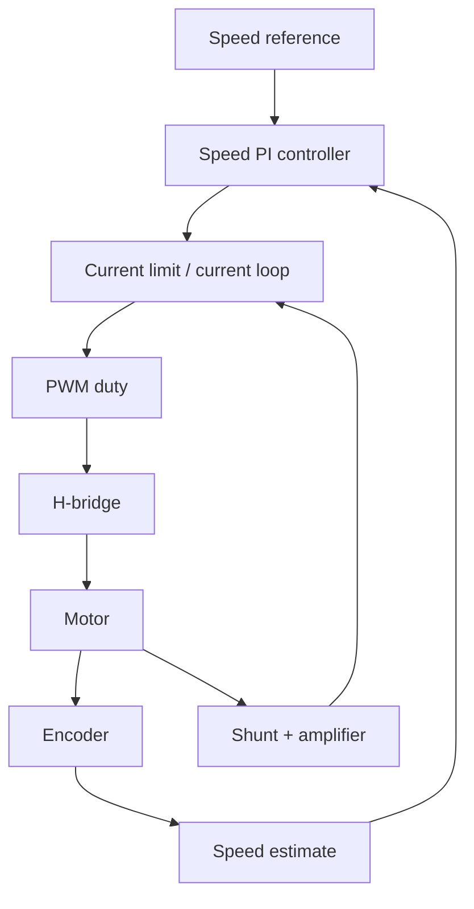

::: testing
Whether you treat a motor as what it is: an **inductive, back-EMF load that can draw many times its running current**, and so cannot be driven from a pin. The expected build-up is: logic-level low-side MOSFET with gate resistor and pull-down, **flyback diode** for the inductive kick, bulk and local decoupling, then an **H-bridge** for direction (with dead time), **PWM** for speed, and finally **isolation** (optocoupler or digital isolator plus an isolated supply and gate driver) with reasons. Quantitative reasoning (stall current, diode and MOSFET ratings, PWM ripple, back-EMF versus speed) shows engineering maturity.
:::

::: why
Motor drive is the standard example of connecting a microcontroller to power: it combines MOSFET switching, inductive protection, PWM, current limits and often safety isolation. Mistakes destroy parts (no flyback diode, shoot-through in an H-bridge, ground bounce resetting the MCU), so interviewers use it to separate people who have built real drivers from those who know only the block diagram. It also links to inductive-drive topics elsewhere on the platform (flyback and single-phase inductive drives).
:::

::: concepts
- **Motor model**: winding resistance $R$, inductance $L$, back-EMF $K_e\omega$: $V=IR+L\,dI/dt+K_e\omega$ ([[q0806]] for MOSFET switching basics).
- **Stall/inrush current**: $V/R$ at zero speed, far above running current.
- **Inductive kick and flyback diode**: current in $L$ cannot stop instantly ([[q0806]]).
- **Low-side switch vs H-bridge**: one direction vs both; dead time prevents shoot-through.
- **PWM speed control**: $V_{avg}=DV_{bat}$; frequency set by audibility, ripple and switching loss ([[q0790]]).
- **Isolation**: separating MCU ground from the power domain by optocoupler, digital isolator and isolated gate drive.
- **Current sensing and protection**: shunt resistor, current limit, thermal.
:::

::: answer
"I'd build it up in stages.

The simplest driver, one direction, is an N-channel MOSFET as a low-side switch. The motor goes between the supply and the drain, the source goes to ground, and the MCU's PWM pin drives the gate through about 100 Ω with a pull-down resistor so the motor is off during reset. The crucial part is a flyback diode across the motor, a Schottky or fast diode with the cathode at the supply. When the MOSFET turns off, the winding's current has to go somewhere, and without the diode the inductive kick would produce a voltage spike far above the supply and kill the transistor. I'd also add a bulk capacitor at the supply to handle the PWM current pulses.

For direction I'd use an H-bridge: four switches, with the motor in the middle. Turning on the diagonal pair gives one direction, the other diagonal reverses it. The big rule is never turn on both switches in the same leg, which is shoot-through, so the driver inserts dead time. In practice I'd use an integrated H-bridge or a gate driver.

For speed, PWM the drive: average voltage is duty times supply, and the motor's inductance smooths the current. About 20 kHz keeps it inaudible. For accurate speed I'd close the loop with an encoder.

If isolation is required, between a mains-side or high-voltage motor and the MCU, I'd put an optocoupler or a digital isolator on the control lines, with an isolated gate driver and an isolated supply on the power side, so no ground connection exists between the two domains."
:::

::: technical
**Motor model (brushed DC).** $V=IR+L\dfrac{dI}{dt}+K_e\omega$, torque $T=K_tI$ ($K_t=K_e$ in SI). Stall current $I_{stall}=V/R$; no-load speed $\omega_0=V/K_e$ (ignoring friction). Example: 12 V, $R=2\ \Omega$, $K_e=0.02$ V·s/rad: $I_{stall}=6$ A, $\omega_0=600$ rad/s $=5730$ rpm. At duty $D=0.5$ and a 0.5 A load: $\omega=(DV-IR)/K_e=(6-1)/0.02=250$ rad/s $=2387$ rpm. The speed is controlled by average voltage: $\omega\approx(DV-IR)/K_e$.

**Low-side MOSFET stage.** Logic-level NMOS, $V_{DS}\ge2\times V_{bat}$ margin (30 V for 12 V systems), $I_D$ rating well above $I_{stall}$ (6 A needs a part rated 15-30 A). $R_{DS(on)}$ at $V_{GS}=3.3$ V of 30 mΩ gives stall conduction loss $6^2\cdot0.03=1.08$ W. Gate resistor 100 Ω; gate pull-down 100 kΩ. **Flyback (freewheel) diode** across the motor, anode to the MOSFET drain, cathode to the supply: rated for peak current $\ge I_{stall}$ and $V_R\ge V_{bat}$; Schottky ($V_F\approx0.5$ V) at 6 A dissipates $3$ W peak but the diode conducts only during off time ($1-D$ of the period), average $\approx(1-D)\cdot3$ W. Without it, the inductor's energy $\tfrac12LI^2=\tfrac12\cdot1\text{ mH}\cdot6^2=18$ mJ has to dissipate in the MOSFET's avalanche or parasitic capacitance, with a spike of $L\,dI/dt$ (kilovolts in theory) limited by avalanche breakdown.

**H-bridge.** Four MOSFETs $Q_1$ (high-side left), $Q_2$ (low-side left), $Q_3$, $Q_4$. Forward: $Q_1+Q_4$; reverse: $Q_3+Q_2$. **Dead time** $t_{dt}$ (typ. a few hundred ns to a few µs, longer than the slowest turn-off) prevents shoot-through. Body diodes carry freewheeling current. Brake: both low sides on (motor shorted); coast: all off. High-side drive needs a gate supply above the rail: P-channel with level shifting, or N-channel with bootstrap/charge pump.

**PWM speed.** $V_{avg}=D\cdot V_{bat}$. Current ripple $\Delta I=\dfrac{V_{bat}D(1-D)}{Lf}$: for $L=1$ mH, 12 V, $D=0.5$, 20 kHz: 0.15 A pk-pk. 20 kHz is above hearing; higher frequency lowers ripple but raises switching loss and EMI. Drive modes: *sign-magnitude* (one leg PWM, other leg static for direction) or *lock-anti-phase*.

**Closed loop.** Encoder or back-EMF for speed, shunt for current: current loop inner, speed loop outer. Current limit protects against stall.

**Isolation.** Reasons: safety (hazardous voltage on the motor side), breaking ground loops, protecting the MCU from motor noise and spikes. Methods: optocoupler (LED + phototransistor; slow, 10-100 µs typical edges, CTR aging), *digital isolator* (capacitive or magnetic, ns-scale, 100 Mbps), *isolated gate driver* (integrated isolation + drive, typical working isolation ratings 2.5-5 kVrms class; check part). An isolated supply (small isolated DC-DC) powers the secondary. Creepage/clearance and reinforced vs basic isolation come from the safety standard for the application.

> [!UNCERTAIN]
> Isolation ratings, optocoupler speed and CTR, and body-diode/dead-time requirements depend on the specific parts and standards (for example IEC 60664-1 and product safety standards). Use part datasheets and the applicable standard for the actual design.
:::

::: short
"For one direction I'd use a logic-level N-MOSFET as a low-side switch, gate through about 100 Ω with a pull-down, and a flyback diode across the motor to catch the inductive kick, plus a bulk capacitor. For direction, an H-bridge with dead time to avoid shoot-through. For speed, PWM at around 20 kHz so the average voltage is duty times supply, ideally with encoder feedback. If isolation is needed, optocouplers or digital isolators on the control signals, with an isolated gate driver and isolated supply on the power side."
:::

::: long
"I'll build it in stages, the way I'd actually design it.

Stage one, one direction. A motor can draw an amp or more running and several times that at stall, so the MCU pin can't drive it. I use a logic-level N-channel MOSFET as a low-side switch: the motor sits between the battery and the drain, and the source goes to ground. The gate connects to a PWM pin through a 100 Ω resistor, with a 100 k pull-down to hold it off at reset. The motor is an inductor, so when I turn the MOSFET off the current wants to keep flowing, and the voltage across the winding would fly up. A flyback diode across the motor, cathode to the supply, gives that current a path. I'd choose a Schottky rated above the stall current. I'd also put a bulk capacitor on the supply and a ceramic capacitor close to the MOSFET.

Stage two, direction. I use an H-bridge: two half-bridges with the motor between the midpoints. Turn on the top-left and bottom-right to go forward, the other diagonal to reverse. The rule is never to turn on both transistors in one half-bridge, which is shoot-through and shorts the supply. So there's dead time of some hundreds of nanoseconds between turning one off and the other on. The high-side switches need a gate supply above the rail, which is why people use a bootstrap gate driver or an integrated H-bridge IC. Brake means both low sides on, coast means everything off.

Stage three, speed. PWM on the bridge. The average voltage is duty cycle times supply, and the motor's inductance filters it: speed is roughly proportional to that voltage minus the I-R drop. About 20 kHz is above hearing. If I want precise speed, I add an encoder and a PI loop, with a current limit on the inside to protect against stall.

Stage four, isolation. If the motor side is high voltage, or I need to break ground loops, I put an optocoupler or, better, a digital isolator on each control signal, then an isolated gate driver and an isolated DC-DC supply on the power side, so the two grounds are never connected. Optocouplers are too slow for 20 kHz PWM edges with a high pull-up, so I'd choose a high-speed isolator."
:::

::: terms
- **Back-EMF**: voltage generated by the rotating motor, proportional to speed.
- **Stall current**: current at zero speed, $V/R$.
- **Flyback (freewheel) diode**: provides a path for inductive current when the switch opens.
- **H-bridge**: four switches arranged to reverse the voltage polarity across a load.
- **Shoot-through**: both switches of one half-bridge conducting, shorting the supply.
- **Dead time**: delay between turning one switch off and the complementary one on.
- **Bootstrap driver**: circuit generating a gate supply above the rail for a high-side N-MOSFET.
- **Digital isolator / optocoupler**: devices that pass a signal across an isolation barrier.
:::

::: exceptional
An average answer says "use a transistor and a diode." An exceptional answer:

- Explains the **motor model**, stall current and back-EMF, and sizes the **MOSFET and diode** with numbers.
- Gives the **flyback energy** reason ($\tfrac12LI^2$) and the correct diode orientation.
- Describes the **H-bridge** with **dead time**, brake/coast modes and the high-side drive problem.
- Chooses the **PWM frequency** with reasoning and relates **duty to speed**; mentions closed-loop and current limit.
- Covers **isolation** methods, their speed limits, isolated supply and gate drive, and why isolation is needed.
- Mentions **layout and decoupling** (bulk capacitor, short high-current loop, separate grounds joined at one point).
:::

::: mistakes
- **No flyback diode** (or one with too small a current rating), killing the MOSFET.
- **Driving the motor from a GPIO or a small BJT** without checking stall current.
- **No dead time** in the H-bridge, causing shoot-through and destroyed FETs.
- **Driving a high-side switch directly from a 3.3 V pin without level shifting**: a P-channel gate can't be pulled up to $V_{bat}$, so it never fully turns off, and an N-channel high side never fully turns on without a gate voltage above the rail.
- **Using an optocoupler with a large pull-up for 20 kHz PWM** and getting distorted pulses (slow edges, CTR variation).
- **Connecting motor ground and logic ground through thin wires**, so motor current pulses lift the MCU's ground and reset it.
- **Assuming no-load current is the design current** instead of stall/inrush.
:::

::: deep
## Stage 1: one direction, low-side switch

```circuit
{"caption":"Low-side MOSFET motor driver with flyback diode","elements":[
 {"t":"rail","at":[8,0],"label":"V_{bat} 12 V","dir":"up"},
 {"t":"wire","pts":[[8,0],[8,2]]},{"t":"wire","pts":[[8,2],[14,2]]},{"t":"dot","at":[8,2]},
 {"t":"Cpol","a":[2,2],"b":[2,6],"label":"C_{bulk}","value":"470 µF"},
 {"t":"wire","pts":[[2,2],[8,2]]},
 {"t":"wire","pts":[[2,6],[2,7]]},{"t":"gnd","at":[2,7]},
 {"t":"M","a":[8,2],"b":[8,7]},
 {"t":"dot","at":[8,7]},
 {"t":"Schottky","a":[14,7],"b":[14,2],"label":"D_1","value":"Schottky"},
 {"t":"wire","pts":[[8,7],[14,7]]},
 {"t":"wire","pts":[[8,7],[8,9]]},
 {"t":"nmos","at":[6,11],"label":"Q_1"},
 {"t":"wire","pts":[[8,13],[8,14]]},{"t":"gnd","at":[8,14]},
 {"t":"term","at":[-3,11],"label":"PWM","side":"left"},
 {"t":"wire","pts":[[-3,11],[-2,11]]},
 {"t":"R","a":[-2,11],"b":[1,11],"label":"R_g","value":"100 Ω"},
 {"t":"wire","pts":[[1,11],[6,11]]},{"t":"dot","at":[3.5,11]},
 {"t":"wire","pts":[[3.5,11],[3.5,12]]},
 {"t":"R","a":[3.5,12],"b":[3.5,15],"label":"R_{pd}","value":"100 kΩ"},
 {"t":"wire","pts":[[3.5,15],[3.5,16]]},{"t":"gnd","at":[3.5,16]}
]}
```
Figure: The MOSFET switches the motor's ground return. The Schottky diode D₁ sits across the motor with its cathode on the supply side: when Q₁ turns off, the motor current continues through D₁ instead of forcing the drain voltage up. Without D₁ the drain would spike far above 12 V.

**The inductive kick.** The motor winding inductance $L$ stores $\tfrac12LI^2$. For $L=1$ mH and 6 A that is 18 mJ. When Q₁ opens in nanoseconds, $V_L=L\,dI/dt$ would be enormous, so the drain avalanches or rings until the energy is absorbed: that destroys the FET. With D₁ the current circulates in the small loop formed by the winding and D₁ (it does not pass through the supply) and decays with roughly the motor's $L/R$ time constant (0.5 ms for 1 mH/2 Ω). The diode must carry the full load current and have $V_R>V_{bat}$; a fast Schottky is ideal (fast, low $V_F$).

```sim
{"id":"flyback-protection","protection":"diode","l":1e-3,"i0":2,"vsupply":12}
```
Figure: Compare "none", "diode" and "zener" or "tvs". The simulation shows the switch voltage spike with no protection and how the diode clamps it near the supply plus one diode drop. Note the longer decay time with a plain diode: a Zener in series with the diode speeds the decay at the cost of a higher clamp voltage.

**Why the bulk capacitor.** PWM current pulses of several amps would otherwise have to come through the supply wiring, causing dips and noise. A bulk electrolytic (hundreds of µF) provides the pulse current and a ceramic (100 nF-10 µF) close to the FET handles fast edges.

## The motor speed equation

At steady state $\omega=(V_{avg}-I R)/K_e$ with $V_{avg}=D V_{bat}$. Using the example (12 V, 2 Ω, $K_e=0.02$):

```plot
{"title":"Motor speed vs duty at three load currents (12 V, R = 2 Ω, Ke = 0.02 V·s/rad)","x":{"label":"duty D","unit":"","min":0,"max":1},"y":{"label":"speed","unit":"rpm","min":0,"max":6000},
 "vars":{"vb":12,"r":2,"ke":0.02},
 "series":[{"label":"no load (I = 0)","fn":"max(0,(x*vb)/ke)*60/(2*PI)"},{"label":"I = 0.5 A","fn":"max(0,(x*vb-0.5*r)/ke)*60/(2*PI)","color":"orange"},{"label":"I = 2 A","fn":"max(0,(x*vb-2*r)/ke)*60/(2*PI)","color":"red"}],
 "points":[{"x":0.5,"y":2387,"label":"D = 0.5, 0.5 A: 2387 rpm"}]}
```
Figure: Speed rises linearly with duty. A loaded motor needs extra duty just to overcome the $IR$ drop (the dead band at low duty), so open-loop PWM gives load-dependent speed. A speed loop with an encoder compensates by raising duty as load rises.

```sim
{"id":"dc-motor-lab","view":"transient","v":12,"r":2,"l":1e-3,"kt":0.02,"load":0.01}
```
Figure: Apply the voltage step and watch the current spike to $V/R=6$ A then fall as back-EMF rises with speed. This is the inrush the driver and supply must tolerate, so size the MOSFET, diode and current limit for stall, not for running current.

## Stage 2: direction with an H-bridge

```circuit
{"caption":"H-bridge with four MOSFETs and body diodes","elements":[
 {"t":"rail","at":[2,0],"label":"V_{bat}","dir":"up"},
 {"t":"wire","pts":[[2,0],[18,0]]},
 {"t":"pmos","at":[4,4],"label":"Q_1","bodyDiode":true},
 {"t":"wire","pts":[[6,0],[6,2]]},{"t":"dot","at":[6,0]},
 {"t":"wire","pts":[[6,6],[6,8]]},
 {"t":"nmos","at":[4,10],"label":"Q_2","bodyDiode":true},
 {"t":"wire","pts":[[6,12],[6,13]]},{"t":"gnd","at":[6,13]},
 {"t":"pmos","at":[16,4],"label":"Q_3","bodyDiode":true},
 {"t":"wire","pts":[[18,0],[18,2]]},{"t":"dot","at":[18,0]},
 {"t":"wire","pts":[[18,6],[18,8]]},
 {"t":"nmos","at":[16,10],"label":"Q_4","bodyDiode":true},
 {"t":"wire","pts":[[18,12],[18,13]]},{"t":"gnd","at":[18,13]},
 {"t":"dot","at":[6,7]},{"t":"dot","at":[18,7]},
 {"t":"M","a":[6,7],"b":[18,7]},
 {"t":"term","at":[2,4],"label":"G1","side":"left"},{"t":"wire","pts":[[2,4],[4,4]]},
 {"t":"term","at":[2,10],"label":"G2","side":"left"},{"t":"wire","pts":[[2,10],[4,10]]},
 {"t":"term","at":[14,4],"label":"G3","side":"left"},{"t":"wire","pts":[[14,4],[16,4]]},
 {"t":"term","at":[14,10],"label":"G4","side":"left"},{"t":"wire","pts":[[14,10],[16,10]]}
]}
```
Figure: Forward: turn on Q₁ and Q₄ (current left to right through the motor). Reverse: Q₃ and Q₂. Never Q₁ with Q₂ or Q₃ with Q₄: that is shoot-through. When PWM turns a switch off, the motor current freewheels through the body diodes (or the complementary FET). G1-G4 come from a gate driver; the P-channel high-side gates must swing up to V_bat to turn off, which is why a driver IC (or N-channel with bootstrap) is used.

```sim
{"id":"h-bridge-lab","mode":"h"}
```
Figure: Click the four switches. Try closing both switches in one half-bridge to see shoot-through, then use the diagonal pairs for the two directions, and both low-sides for brake. Look at the dead-time view to see why a gap between complementary turn-on and turn-off is needed.

**Dead time sizing.** $t_{dt}>t_{off,max}-t_{on,min}+$margin, e.g. a FET with 100 ns turn-off needs at least a couple hundred ns. Too much dead time wastes duty (body diode conduction at 0.7 V, higher loss) and distorts low-speed control: with 20 kHz PWM (50 µs) and 500 ns of dead time the lost duty is 1% per edge.

**Drive modes.** *Sign-magnitude*: one leg is held (e.g. Q₄ on constantly for forward) and the other leg is PWM'd; simple. *Lock anti-phase*: both legs PWM'd complementary at 50% for stop, resulting in ripple current but smooth reversal through zero.

**Integrated H-bridge.** A driver IC integrates the four FETs, dead time, current limit, thermal shutdown and a PWM/DIR input interface; use it for small motors. For higher power, discrete FETs with a gate driver.

## Stage 3: speed control

Open-loop PWM sets approximate speed. Add feedback for precision:


Figure: The inner current loop (fast, using a shunt resistor) limits torque and protects the bridge; the outer speed loop uses the encoder. At 20 kHz PWM the current loop is typically run once per PWM period from a timer-triggered ADC ([[q0793]]).

Soft-start by ramping the duty so inrush stays below the current limit; at 12 V a 6 A stall limit could be set at 3-4 A for a gentler start.

## Stage 4: isolation

When is it required? High-voltage or mains-powered motors (shock hazard), noisy industrial environments, systems with separate grounds, and safety standards demanding it. What to isolate: the control signals (PWM, DIR, fault, sometimes encoder), and the gate drive. The supply to the power-side drivers must also be isolated.

```circuit
{"caption":"Optocoupler isolating a control signal","elements":[
 {"t":"term","at":[0,2],"label":"MCU GPIO","side":"left"},
 {"t":"wire","pts":[[0,2],[1,2]]},
 {"t":"R","a":[1,2],"b":[4,2],"label":"R_{led}","value":"330 Ω"},
 {"t":"wire","pts":[[4,2],[6,2]]},
 {"t":"opto","at":[6,2]},
 {"t":"wire","pts":[[6,5],[6,6]]},{"t":"gnd","at":[6,6]},
 {"t":"rail","at":[11,-2],"label":"V_{iso} 5 V","dir":"up"},
 {"t":"wire","pts":[[11,-2],[11,-1]]},
 {"t":"R","a":[11,-1],"b":[11,2],"label":"R_{pu}","value":"4.7 kΩ"},
 {"t":"dot","at":[11,2]},
 {"t":"wire","pts":[[11,2],[15,2]]},
 {"t":"term","at":[15,2],"label":"to gate driver (inverted)","side":"right"},
 {"t":"wire","pts":[[11,5],[11,6]]},{"t":"gnd","at":[11,6],"style":"chassis"},
 {"t":"text","at":[8.5,8],"text":"isolation barrier","muted":true,"anchor":"middle"}
]}
```
Figure: The MCU side (signal ground) and the power side (chassis/isolated ground) share no electrical connection; only light crosses the gap. With GPIO high the LED conducts (about 6.4 mA with 330 Ω and a 1.2 V LED drop), the phototransistor saturates and pulls the output low, so the signal is inverted.

Optocoupler design numbers: LED current $(3.3-1.2)/330=6.4$ mA; with a CTR of 50% the transistor can sink up to 3.2 mA, while the pull-up needs $(5-0.2)/4.7\text{ k}=1.02$ mA, so it saturates with margin. Speed: the transistor's rise time is set by $R_{pu}$ and the stray capacitance and by the phototransistor's storage time: it is tens of µs for general-purpose optos, so 20 kHz PWM (50 µs period) would be badly distorted.

```sim
{"id":"opto-isolator","vgpio":3.3,"rled":330,"ctr":0.5,"rpull":4700,"vcc":5}
```
Figure: Raise the pull-up and see the saturated low level degrade and the rise time grow; reduce CTR (ageing, temperature) to see when the output no longer reaches a valid low. This is why optocoupler designs use margin on CTR and why high-speed paths use other devices.

**Better for PWM:** digital isolators (capacitive or magnetic coupling) with propagation delays of tens of ns and data rates of 25-150 Mbps, or an **isolated gate driver** (isolation plus gate drive in one package). Power the secondary side from an isolated DC-DC converter (or a bootstrap supply for floating high-side drive when only functional isolation is needed).

**Isolation levels** (functional, basic, reinforced) and creepage/clearance requirements derive from safety standards for the end product; choose the part's isolation voltage and working voltage rating and PCB spacing accordingly.

## Layout and grounding

The high-current loop (supply, bulk cap, FET, ground) should be small, with fat traces. Join power ground and logic ground at a single point (star ground) near the supply input, keep the gate-drive loop short, and place a decoupling capacitor at each driver IC. Motor brushes arc: add a small ceramic capacitor (about 100 nF) across the motor terminals and from each terminal to the case to reduce EMI.

## Protection checklist

1. Flyback diode or integrated body diodes with proper rating.
2. Current limit (shunt with comparator) and thermal protection.
3. Reverse-battery protection.
4. TVS on the supply for load-dump or inductive spikes.
5. Under-voltage lockout on gate drivers (so FETs are not left half-on).
6. Pull-downs on gate inputs so the bridge is off at reset; hardware interlock against shoot-through.
:::

::: applications
- **Small robots, toys and fans**: brushed DC motors with an integrated H-bridge IC and 20 kHz PWM.
- **Automotive actuators** (window lifts, seat motors, throttle bodies) with H-bridge drivers and current sensing.
- **Industrial drives** where isolated gate drivers and digital isolators separate the controller from the motor supply.
- **Drone ESCs and e-bike controllers** use three-phase bridges with the same half-bridge building blocks.
- **Pumps and compressors** that need soft-start and current limiting.
- **Servo and positioning systems** with encoder feedback and cascaded current/speed/position loops.
:::

::: assumptions
- The example assumes a small brushed DC motor (12 V, 2 Ω, 6 A stall). Brushless and stepper motors need three-phase or multi-phase bridges, but the MOSFET, inductive-kick and isolation ideas are the same.
- Dead time, diode and FET ratings, and isolator specs are typical numbers; use the datasheets for real designs.
- The low-side-only circuit gives one direction and no active braking; the H-bridge adds both.
- Isolation depends on the application: functional isolation (noise) needs far less than reinforced isolation (user safety), which brings creepage/clearance and certification.
- The simple opto circuit is inverting and slow; the PWM path should use a digital isolator or isolated gate driver.
:::

::: followups
### Why do we need a flyback diode and which way does it point?
When the switch opens, the inductor's current can't change instantly, so it forces a path. The diode, with its anode at the switch node and cathode at the supply, lets that current circulate around the motor-diode loop and clamps the node at about $V_{bat}+0.5$ V. Without it, the switch node flies to the voltage at which the FET avalanches or arcs, destroying it. See the flyback and single-phase inductive drive topics for the general case.

### What is shoot-through and how do you prevent it?
Both transistors in one half-bridge conducting at once, creating a low-impedance path from supply to ground that can destroy both FETs. Prevent with dead time in the driver (hardware or timer-generated complementary PWM with dead-time insertion), interlocks that don't allow both gates high, and gate drivers with UVLO. Size dead time longer than the worst-case turn-off delay.

### How do you change the speed, and why does the speed drop when the motor is loaded?
Change the duty cycle: average voltage $=DV_{bat}$. Under load the current rises, so the $IR$ drop grows and back-EMF (hence speed) falls: $\omega=(DV-IR)/K_e$. To hold speed under load, close a speed loop with an encoder (or estimate the back-EMF) and raise the duty.

### When isolation is required, can you use an optocoupler for the PWM signal?
Only at low PWM frequencies or with a fast opto: general-purpose phototransistor optos have microsecond to tens-of-microsecond edges and CTR that varies with temperature and age, which distorts pulses at 20 kHz. Use a high-speed (logic-output) optocoupler or a digital isolator. And you still need an isolated supply for the output side, plus a gate driver.

### The MCU resets randomly when the motor starts. What do you check?
Supply sag from the inrush current (add bulk capacitance, a series inductor/ferrite for the logic supply, soft-start the PWM), ground bounce from shared ground impedance (star ground, short loops), noise from brush arcing (capacitors across the motor), and unsuppressed inductive spikes. Measure the logic supply and ground at the MCU with a scope during motor start.
:::

::: interpretations
The question has three layers: (1) "drive a motor from a microcontroller" (power stage plus protection), (2) "what if isolation is required" (control-side and power-side separation), and (3) "what if I want to change the speed" (PWM, feedback). I assume a brushed DC motor, as the common baseline; for stepper and BLDC the power-stage ideas extend, with more half-bridges and commutation logic. The author notes the overlap of these drive questions with the single-phase inductive drives section. Related: [[q0806]] for the MOSFET/PWM building block and [[q0790]] for the timers that generate it.
:::

::: references
- Horowitz & Hill, *The Art of Electronics*, 3rd ed.: MOSFET switches, H-bridges, motor drive and inductive load protection.
- Erickson & Maksimovic, *Fundamentals of Power Electronics*: switching, inductor behaviour and diode freewheeling concepts.
- Texas Instruments and Analog Devices motor-driver and isolated gate-driver datasheets and application notes (for brushed DC H-bridges, dead time, bootstrap supplies); consult the notes for your chosen part.
- IEC 60664-1 (insulation coordination) and the product safety standard for the end application, for isolation requirements.
:::

::: rubric
- Draws a logic-level MOSFET low-side switch with gate resistor/pull-down :: The basic bridge from MCU to a power load.
- Includes a flyback diode with correct orientation and explains the inductive kick :: The key protection; omitting it is a red flag.
- Mentions stall/inrush current and sizes parts for it :: Shows understanding of motor behaviour.
- Describes the H-bridge for direction, with dead time and shoot-through :: The expected direction-control answer.
- Uses PWM for speed with a frequency rationale and relates duty to speed (and closed loop) :: Answers the speed part.
- Describes isolation (optocoupler/digital isolator, isolated supply and gate driver) and why :: Answers the isolation part with practical limits.
- Mentions grounding/decoupling/protection :: Real-world robustness.
:::

::: quiz
```json
[
 {"type":"mcq","level":"fundamental","q":"What is the purpose of the flyback diode across a motor driven by a MOSFET?","options":["To increase motor speed","To provide a path for the inductor current when the switch turns off, clamping the voltage spike","To reduce the gate voltage","To isolate the MCU"],"answer":1,"explain":"The winding current cannot stop instantly; the diode conducts it, clamping the switch node near the supply instead of letting it spike."},
 {"type":"numeric","level":"fundamental","q":"A 12 V motor has winding resistance 2 Ω. What is the stall current?","answer":6,"tolerance":0.01,"unit":"A","explain":"$I=V/R=12/2=6$ A. Back-EMF is zero at stall, so size the driver for this."},
 {"type":"numeric","level":"intermediate","q":"Using $\\omega=(DV-IR)/K_e$ with $V=12$ V, $R=2\\ \\Omega$, $K_e=0.02$ V·s/rad, $D=0.5$ and $I=0.5$ A, what is the speed in rpm?","answer":2387,"tolerance":0.02,"unit":"rpm","explain":"$(6-1)/0.02=250$ rad/s $=250\\cdot60/(2\\pi)=2387$ rpm."},
 {"type":"numeric","level":"intermediate","q":"How much energy is stored in a 1 mH winding carrying 6 A?","answer":18,"tolerance":0.02,"unit":"mJ","explain":"$\\tfrac12LI^2=0.5\\cdot10^{-3}\\cdot36=18$ mJ."},
 {"type":"mcq","level":"advanced","q":"In an H-bridge, the high-side and low-side FETs of the same leg both turn on briefly. What is this called and what is the fix?","options":["Brake mode; none needed","Shoot-through; insert dead time between turning one off and the other on","Back-EMF; add a resistor","Cogging; change the motor"],"answer":1,"explain":"Shoot-through shorts the supply through the leg. Dead time (longer than the worst-case turn-off delay) prevents overlap."},
 {"type":"mcq","level":"advanced","q":"Why is a general-purpose phototransistor optocoupler a poor choice for isolating a 20 kHz motor PWM signal?","options":["It cannot pass DC","Its edges are tens of µs and CTR varies, so the pulses distort at 50 µs period","It has no LED","It draws too little current"],"answer":1,"explain":"The slow phototransistor response and variable CTR distort the narrow PWM pulses; use a high-speed opto or digital isolator."}
]
```
:::
