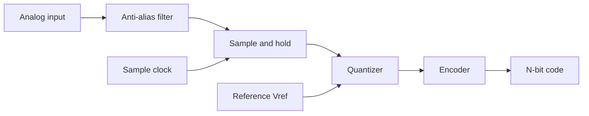

::: testing
Whether you understand an ADC as a **chain of three operations**, not a magic box: sample (freeze the signal in time), quantize (snap it to one of $2^N$ levels), encode (output a binary code). The interviewer also wants to see that you can name the main architectures and say what each is good for, that you know the code-to-voltage relationship $V = \text{code}\cdot V_{ref}/2^N$, and that you volunteer the real-world limits: quantization error, the need for an anti-alias filter, and the fact that the reference sets both range and accuracy. Per the author's note this question is asked in an *embedded* setting, so tie it to the MCU ADC peripheral on your desk, not to transistor-level analog design.
:::

::: why
Every sensor reading in an embedded system, whether it's a battery voltage, a thermistor, a current-sense amplifier or a microphone, passes through an ADC, and the quality of that conversion sets the quality of every decision the firmware makes afterwards. Engineers who understand the sample, quantize and encode chain can debug "noisy ADC readings", pick the right sampling time, size an anti-alias filter and choose between an MCU's built-in ADC and an external one. It's also the entry point for the follow-ups on flash ([[q0809]]), SAR ([[q0810]]), sample-and-hold ([[q0814]]) and precision ([[q0819]]).
:::

::: concepts
- **Quantization**: an $N$-bit ADC has $2^N$ output codes, so a continuous range is cut into $2^N$ equal steps of one LSB, $V_{LSB}=V_{FS}/2^N$. See [[q0819]].
- **Sampling**: the ADC only looks at the input at discrete instants, $f_s$ times per second. See [[q0813]] and [[q0669]].
- **Reference voltage**: the ADC measures the input as a *ratio* to $V_{ref}$. An error in $V_{ref}$ is an error in every reading. See [[q0812]].
- **Sample-and-hold**: the input must be frozen while the conversion runs. See [[q0814]].
- **Architectures**: flash ([[q0809]]), SAR ([[q0810]]), pipeline, delta-sigma and integrating converters trade speed, resolution, power and latency.
- **Voltage division**: front-end scaling is just a divider ([[q0008]]), and its source resistance matters to the ADC.
:::

::: answer
"An ADC turns an analog voltage into a number. Conceptually it does three things. First it samples: at a fixed rate it grabs the input voltage and holds it steady, usually on a small capacitor, so the signal can't move while it's being measured. Second it quantizes: it compares that held voltage against a reference and decides which of $2^N$ equal-sized bins it falls in. Third it encodes that bin as an N-bit binary code.

The relationship is $\text{code} = \lfloor V_{in}/V_{ref}\cdot 2^N \rfloor$. So a 12-bit ADC with a 3.3 V reference has 4096 codes and each LSB is about 0.8 mV, and the inherent quantization error is up to half an LSB.

How it finds the bin depends on the architecture. A flash ADC uses one comparator per level, so it's very fast but needs $2^N-1$ comparators. A SAR ADC, which is what's inside most microcontrollers, does a binary search with one comparator and a DAC, taking N steps. Delta-sigma ADCs oversample and filter to get very high resolution at low speed, which is what you'd see in a precision scale or audio codec.

The things I'd always watch are the reference, because it sets the scale, a low-pass filter ahead of the ADC so out-of-band noise doesn't alias, and the source impedance, because the sampling capacitor has to charge through it."
:::

::: technical
**Signal chain.** analog input → anti-alias filter → sample-and-hold (S/H) → quantizer → digital encoder → code (and in a SAR, the same comparator and DAC do the quantize and encode steps together).

**Transfer function (ideal, unipolar).** With full-scale range $V_{FS}=V_{ref+}-V_{ref-}$ and $N$ bits:

$$V_{LSB}=\frac{V_{FS}}{2^N},\qquad \text{code}=\left\lfloor \frac{V_{in}-V_{ref-}}{V_{LSB}}\right\rfloor \text{ clipped to } [0,\,2^N-1]$$

The reverse conversion, $V_{in}\approx V_{ref-}+(\text{code}+\tfrac12)V_{LSB}$, returns the *centre* of the bin the input fell in. Many firmware routines drop the $+\tfrac12$ and just use $\text{code}\cdot V_{LSB}$, which is a half-LSB offset on average.

**Quantization error.** The error between the true input and the bin it was assigned lies in $\pm\tfrac12 V_{LSB}$. For a full-scale sine with a uniformly distributed error, the quantization noise is $V_{LSB}/\sqrt{12}$ rms, which gives the ideal $\text{SNR}=6.02N+1.76$ dB. A 12-bit converter therefore tops out at 74 dB.

**Sampling.** The input is captured at $f_s$. To represent a signal of bandwidth $B$ you need $f_s>2B$ (Nyquist) and an anti-alias filter that removes anything above $f_s/2$ before the sample happens, because aliasing cannot be undone afterwards ([[q0670]]).

**Architecture summary.**

| Architecture | How it finds the code | Typical use |
|---|---|---|
| Flash | $2^N-1$ comparators in parallel | Very fast, low resolution (up to about 8 bits), such as oscilloscope front ends, RF |
| SAR | binary search, one comparator, $N$ cycles | General purpose, MCU peripherals, 8 to 18 bits, kS/s to a few MS/s |
| Pipeline | cascade of low-resolution stages | 10 to 16 bits at tens to hundreds of MS/s |
| Delta-sigma | 1-bit quantizer at a high rate plus a digital filter | Audio, precision sensors, 16 to 24 bits at low bandwidth |
| Integrating / dual-slope | measure the time to ramp a capacitor | Multimeters, slow and very accurate |

> [!NOTE]
> Exact speed and resolution ranges for each architecture shift as processes improve. Treat the table as the rule-of-thumb picture, not a spec.
:::

::: short
"An ADC samples the input, holds it steady, then compares it to a reference to pick one of $2^N$ levels and outputs that level as a binary code. Resolution is the reference divided by $2^N$, so a 12-bit ADC on 3.3 V has about 0.8 mV per step. How it finds the level depends on architecture: flash uses one comparator per level for speed, SAR does a binary search in N steps and is what most microcontrollers use, and delta-sigma oversamples to get very high resolution at low speed. I'd always add an anti-alias filter and a clean reference."
:::

::: long
"An ADC converts a continuous voltage into a number, and I think of it as three steps: sample, quantize, encode.

Sample: at a fixed rate the converter connects the input to a small capacitor through a switch, then opens the switch. That's the sample-and-hold. It freezes the voltage, because the conversion takes time and the input can't be allowed to move in the middle of it.

Quantize: the held voltage gets compared to the reference. If the reference is 3.3 V and the ADC is 12 bits, I've got 4096 equal bins, each about 0.8 millivolts wide. The converter works out which bin the voltage is in, and in doing so throws away anything smaller than a bin. That's the quantization error, up to half an LSB, and it's why an ideal 12-bit converter has a 74 dB signal-to-noise ceiling.

Encode: it outputs the bin number as binary. To get back to volts, I multiply the code by $V_{ref}/2^N$.

For how the bin is found, there are a few architectures. Flash uses a ladder of $2^N-1$ comparators and finds the answer in one step, so it's the fastest but the area and power double with each extra bit, so it stops around 8 bits. SAR, the one inside nearly every MCU, uses a single comparator and an internal DAC to do a binary search, N clock cycles per conversion, and it's very efficient up to a few mega-samples per second. Pipeline ADCs chain stages for fast, mid-resolution work. Delta-sigma ADCs sample very fast with a one-bit quantizer and use a digital filter to get 16 to 24 bits at low bandwidth, which is why they dominate precision measurement and audio.

In practice the things I check are: is the input within 0 to $V_{ref}$, is there a low-pass filter before the pin so noise doesn't alias, is the source impedance low enough for the sampling cap to charge, and is the reference clean, because every reading is a ratio to it."
:::

::: terms
- **Resolution (bits, $N$)**: the number of binary digits in the output code; the converter has $2^N$ codes.
- **LSB**: least significant bit; the size of one code step, $V_{FS}/2^N$ in volts.
- **Full-scale range (FSR)**: the span of input voltage the ADC can represent, normally $V_{ref+}-V_{ref-}$.
- **Quantization error**: the unavoidable difference between the true input and its quantized value; $\pm\tfrac12$ LSB for an ideal ADC.
- **Sample rate ($f_s$)**: conversions per second; sets the Nyquist frequency $f_s/2$.
- **Sample-and-hold (S/H)**: the circuit that freezes the input during conversion.
- **Anti-alias filter**: low-pass filter ahead of the ADC that removes content above $f_s/2$.
- **Reference ($V_{ref}$)**: the voltage the input is compared against; sets the scale and the accuracy.
- **Conversion time / latency**: time from the start of conversion until the code is valid.
:::

::: exceptional
**An average answer** says "it converts analog to digital" and names SAR and flash.

**An exceptional answer**:
- Breaks the job into **sample, quantize, encode** and says what each does physically.
- Writes the transfer function and gets a *number*: "12 bits, 3.3 V, so 0.8 mV per code, and ±0.4 mV of quantization error".
- Explains **why each architecture exists** (speed versus resolution versus power) instead of listing names.
- Mentions the practical failure points: reference accuracy, source impedance versus the sampling capacitor, and aliasing.
- Distinguishes **resolution** (bits) from **accuracy** (INL, offset, noise), see [[q0819]].
- Connects to an MCU: "on this part the ADC is a 12-bit SAR, with a programmable sampling time that I'd set based on my sensor's output impedance."
:::

::: mistakes
- **Treating bits as accuracy.** A 12-bit ADC with a noisy reference or poor layout may deliver 9 or 10 usable bits. Resolution is the code width; accuracy is how close the code is to the truth ([[q0819]]).
- **Forgetting the anti-alias filter.** Noise above $f_s/2$ folds into the band you care about and cannot be removed afterwards.
- **Using $2^N-1$ and $2^N$ interchangeably.** The ideal conversion divides by $2^N$ (full scale is one LSB below the reference). Some firmware divides by $2^N-1$ so that the maximum code reads exactly $V_{ref}$. See [[q0812]].
- **Ignoring the source impedance.** The sampling capacitor must charge through the source in the sampling window; a 100 kΩ sensor straight into an MCU pin usually reads wrong ([[q0817]]).
- **Assuming the ADC measures absolute volts.** It measures a ratio to $V_{ref}$. If the reference is the (noisy) supply, so is your reading.
- **Saying flash is "the best".** It's the fastest, but it grows exponentially in comparators, power and input capacitance.
:::

::: deep
## From a continuous voltage to a number

An ADC has to answer a deceptively simple question: *which of $2^N$ numbers best describes this voltage?* Two things make it hard. The voltage keeps moving while you're measuring, and "best" means you need a precise voltage yardstick to compare against.


Figure: The conversion chain. Two inputs control it: the sample clock decides *when* the voltage is measured, and the reference decides *what a code is worth*. Everything to the left of the quantizer is analog and sets noise and aliasing; everything to the right is digital and exact.

## Quantization: the staircase

If the input is anywhere inside a bin, the ADC reports the same code. With $V_{ref}=3.3$ V and $N=10$ the LSB is $3.3/1024 = 3.22$ mV. Take $V_{in}=1.234$ V:

$$\text{code}=\left\lfloor\frac{1.234}{3.3}\cdot1024\right\rfloor=\lfloor 382.9\rfloor=382,\qquad 382\cdot3.223\text{ mV}=1.2311\text{ V}$$

The code stands for any voltage between 1.2311 V and 1.2343 V. Reporting the middle of the bin (1.2327 V) leaves a worst-case error of $\pm1.6$ mV, which is half an LSB. Here is that staircase for a small 3-bit converter so the steps are visible:

```plot
{"title":"3-bit ADC: input voltage to output code","x":{"label":"V_in","unit":"V","min":0,"max":3.3},"y":{"label":"Output code","min":-0.3,"max":8},
 "vars":{"vref":3.3,"lsb":"3.3/8"},
 "series":[{"label":"Ideal (infinite resolution)","fn":"x/lsb","dashed":true,"color":"muted"},{"label":"ADC code","fn":"min(floor(x/lsb),7)","color":"accent","step":true}],
 "vlines":[{"at":"lsb","label":"1 LSB = 0.41 V"}]}
```
Figure: The straight dashed line is what an infinite-resolution converter would output; the staircase is what the real converter outputs. The gap between them is the quantization error, a sawtooth between 0 and 1 LSB (or ±½ LSB once you read back the bin centre). Adding bits makes the stairs finer but never removes them.

```plot
{"title":"Quantization error of the same converter","x":{"label":"V_in","unit":"V","min":0,"max":3.3},"y":{"label":"error in LSB","min":-1,"max":1},
 "vars":{"lsb":"3.3/8"},
 "series":[{"label":"x/LSB - (code + 0.5)","fn":"ite(x<3.3, x/lsb - (floor(x/lsb)+0.5), 0)","color":"red"}],
 "hlines":[{"at":0.5,"label":"+½ LSB","color":"muted"},{"at":-0.5,"label":"−½ LSB","color":"muted"}]}
```
Figure: With the bin centre as the reconstruction value, the error is a sawtooth bounded by ±½ LSB. It is uniformly distributed, so its rms value is $\text{LSB}/\sqrt{12}\approx0.29$ LSB. That figure is why the ideal SNR is $6.02N+1.76$ dB.

## How noise relates to bits

For a full-scale sine of amplitude $V_{FS}/2$, the signal power is $V_{FS}^2/8$ and the quantization noise power is $V_{LSB}^2/12$. Dividing:

$$\text{SNR}=\frac{V_{FS}^2/8}{V_{FS}^2/(12\cdot4^N)}=\frac{12}{8}\cdot4^N\;\Rightarrow\;10\log_{10}(1.5\cdot4^N)=6.02N+1.76\ \text{dB}$$

Each extra bit buys 6 dB (a factor of 2 in amplitude). Real ADCs fall short of this because of thermal noise, reference noise, distortion and jitter, which is why datasheets quote **ENOB** (effective number of bits, see [[q0819]]).

## How the bin gets found

All architectures solve "find the bin" and differ in how they spend time, area and power.

- **Flash** ([[q0809]]) compares the input against all $2^N-1$ thresholds at once. One clock, but $2^N-1$ comparators.
- **SAR** ([[q0810]]) asks one yes/no question per bit, starting with "is the input above half of full scale?" Then it narrows the range by half each time. $N$ steps, one comparator.
- **Pipeline** resolves a few bits per stage, subtracts the answer, amplifies the residue and passes it on. Throughput of one sample per clock with several clocks of latency.
- **Delta-sigma** does a crude 1-bit conversion at a very high rate, feeds the quantization error back through a loop filter (noise shaping) and digitally filters and decimates. It trades bandwidth for resolution.
- **Dual-slope / integrating** integrates the input for a fixed time, then times how long a reference takes to discharge it. Slow but excellent at rejecting 50/60 Hz.

## What the analog side has to deliver

The digital half of an ADC is exact. All of the real-world error is in what it is fed.

**The reference.** The code is $V_{in}/V_{ref}\cdot2^N$, so a 0.5% reference error is a 0.5% gain error on every reading. On a 12-bit, 3.3 V converter that is 16.5 mV, or about 20 LSB, many times larger than the quantization error. Using the supply as the reference is fine for ratiometric sensors, but for absolute measurements you want a dedicated reference.

**The sampling capacitor.** At each sample the S/H connects a small capacitor (a few pF) to the input. It must charge to within half an LSB before the switch opens. The source resistance $R_s$ plus the switch resistance $R_{on}$ form an RC, and settling to $N$-bit accuracy takes about $(N+1)\ln2\approx0.69(N+1)$ time constants, 9 $\tau$ for 12 bits. A 10 kΩ source driving 8 pF has $\tau\approx80$ ns, so it needs about 0.72 µs, which is why MCUs let you lengthen the sampling time ([[q0817]]).

**The anti-alias filter.** A signal at $f_{in}$ above $f_s/2$ reappears at $|f_{in}-kf_s|$. With $f_s=10$ kS/s, a 9.9 kHz interferer looks like 100 Hz, right in your band. A simple RC low-pass ahead of the pin ($R=1$ kΩ, $C=100$ nF, $f_c=1.6$ kHz) attenuates a 9.9 kHz tone only by about 16 dB, so for a real design you either oversample much faster than the signal or use a higher-order filter ([[q0670]], [[q0818]]).

**Timing.** The sample instant is set by the clock. Jitter on that instant converts directly to noise at high input frequencies, which is covered in [[q0813]].

## Experiment with it

```sim
{"id":"adc-lab","view":"quantize","bits":10,"vref":3.3,"vin":1.234}
```
Figure: Set the bits to 3, then to 8, then to 12 and watch the LSB size and the error. Move $V_{in}$ across a code boundary to see the output change by exactly one code. Switch the input above $V_{ref}$ to see clipping.

## A real example on a microcontroller

A typical MCU has a 12-bit SAR ADC and a $V_{ref}$ equal to the analog supply, 3.3 V. A temperature sensor with a 10 mV/°C slope gives $0.806\text{ mV}/10\text{ mV/°C}\approx0.08$ °C per code. That sounds precise. But a 1% supply tolerance on the reference is a 1% gain error: at 25 °C (250 mV for a sensor with 0 V at 0 °C) that's 2.5 mV, or 0.25 °C, and at full scale it would be 33 mV (about 41 LSB). Add ±2 LSB of INL (1.6 mV, 0.16 °C) and a few LSB of noise, and the *accuracy* is closer to ±0.5 °C than to 0.08 °C, before you even count the sensor's own tolerance. Whether the ADC's resolution matters therefore depends on whether the rest of the chain is as good, which is the theme of [[q0819]].
:::

::: applications
- **Battery monitoring**: a divided 4.2 V cell into a 12-bit MCU ADC, giving about 1 mV of cell resolution.
- **Thermistor and temperature sensing** with a ratiometric divider ([[q0008]]) so that $V_{ref}$ errors cancel.
- **Motor current sensing**: a shunt, a current-sense amplifier and the ADC, synchronised to the PWM ([[q0446]]).
- **Audio capture**: a delta-sigma codec at 48 kS/s with a 24-bit output.
- **Oscilloscopes**: interleaved 8-bit flash/pipeline front ends running at GS/s.
- **Digital multimeters**: dual-slope or high-resolution delta-sigma converters averaging out 50/60 Hz noise.
:::

::: assumptions
- Ideal converter: uniform quantization, no offset, gain, INL or DNL errors. Real parts add all of them ([[q0819]]).
- A **unipolar** input, 0 to $V_{ref}$. For bipolar or differential ADCs the code is two's complement or offset binary and the range is $\pm V_{ref}$.
- The quantization noise is white and uniformly distributed, which holds when the signal spans many LSBs and is not correlated with the sample clock. A tiny or DC input can give structured, non-white error (hence dither).
- The architecture speed/resolution table is a rule of thumb that moves with process technology.
- If the interviewer is from an analog IC background they may want the comparator and capacitor-array details; an embedded interviewer wants sampling time, reference and source impedance. Read the room using the author's note, which says most questions are embedded.
:::

::: followups
### What's the resolution of a 12-bit ADC with a 3.3 V reference?
$V_{LSB}=3.3/4096=0.806$ mV, so the quantization error is ±0.40 mV worst case, and 0.23 mV rms ($V_{LSB}/\sqrt{12}$). The ideal SNR is 74 dB.

### Why do most microcontrollers use a SAR ADC?
It needs only one comparator and a capacitor array, so it's small, low power and cheap, and it burns no static power between conversions. It converts in $N$ cycles, which gives 100 kS/s to a few MS/s at 10 to 16 bits, which fits typical sensing. See [[q0810]].

### If I need more resolution than my ADC provides, what can I do?
Oversample and average: averaging $4^k$ samples with uncorrelated noise (about 1 LSB of noise or dither) buys $k$ extra bits at a cost of $4^k$ in time. Or use a lower range so each LSB is smaller (gain stage or smaller $V_{ref}$), or an external delta-sigma ADC. Oversampling only helps if there's noise larger than an LSB to dither the quantizer.

### How would you convert a code of 2048 on a 12-bit, 3.3 V ADC to volts?
$2048\cdot3.3/4096=1.65$ V, half of full scale. See [[q0812]] for the $2^N$ versus $2^N-1$ convention.

### Your ADC readings flicker by ±5 codes with a steady input. Where do you look?
Five codes is 4 mV, far above the ±½ LSB quantization limit. Suspects: reference noise (supply used as reference), a missing or too-small cap on the input pin, source impedance too high for the sampling time, digital switching noise coupled into the analog ground or trace, or noise on the sensor itself. A fixed DC test input (a clean divider and cap) tells you quickly whether the noise is in the ADC or the signal.

### Harder: could an ADC output a *better* result than its LSB size?
Yes, with noise. If the input has noise of about 1 LSB rms, averaging many samples recovers information below one LSB because the noise dithers the threshold crossings. With a perfectly quiet input, averaging gives no extra information and you just keep reading the same code.
:::

::: interpretations
"How does an ADC work?" is broad on purpose. For an embedded role, give the **generic sample, quantize, encode** picture and one concrete architecture, which is the SAR in your MCU. The specific questions that follow ([[q0809]] flash, [[q0810]] SAR, [[q0814]] sample-and-hold, [[q0819]] precision) go deep. This page is the overview you give before the interviewer picks the branch.
:::

::: references
- Sedra & Smith, *Microelectronic Circuits*: data-converter sections covering ADC architectures and quantization.
- Horowitz & Hill, *The Art of Electronics*, 3rd ed.: the chapters on analog-to-digital conversion and on precision circuits.
- Analog Devices, *The Data Conversion Handbook* (Kester, ed.): quantization noise, SNR, ENOB and the ADC architectures chapters.
- Texas Instruments and STMicroelectronics MCU reference manuals: ADC chapters (sampling time, conversion time, reference). The names and numbers vary by part.
:::

::: rubric
- Describes the chain sample (and hold), quantize, encode :: Shows you see an ADC as a sequence of operations rather than a black box.
- States $V_{LSB}=V_{ref}/2^N$ and the code-to-voltage relation :: This is the number the interviewer will ask you to compute next.
- Gives quantization error as ±½ LSB and mentions ideal SNR $6.02N+1.76$ dB :: Connects resolution to a noise floor, which is what actually limits performance.
- Names at least flash, SAR and delta-sigma and says what each trades :: Understanding why architectures differ shows depth beyond definitions.
- Notes the need for sampling at more than twice the bandwidth plus an anti-alias filter :: Aliasing is the most common practical failure and cannot be fixed in software.
- Points out that the reference sets both range and accuracy :: Many real ADC errors are reference errors.
- Distinguishes resolution from accuracy :: A hallmark of someone who has used ADCs on a real board.
:::

::: quiz
```json
[
 {"type":"numeric","level":"fundamental","q":"A 10-bit ADC has $V_{ref}=3.3$ V. What is the size of one LSB, in mV?","answer":3.223,"tolerance":0.01,"unit":"mV","explain":"$V_{LSB}=3.3/2^{10}=3.3/1024=3.223$ mV."},
 {"type":"mcq","level":"fundamental","q":"Which step of an ADC conversion throws information away irreversibly?","options":["Sampling","Quantization","Encoding to binary","Anti-alias filtering"],"answer":1,"explain":"Quantization maps a continuous range onto $2^N$ levels, so anything smaller than one LSB is lost. Encoding is a lossless relabelling of the level. Sampling can be lossless if the Nyquist criterion is met."},
 {"type":"mcq","level":"intermediate","q":"Which ADC architecture is the most common inside general-purpose microcontrollers?","options":["Flash","Successive approximation (SAR)","Dual-slope","Delta-sigma only"],"answer":1,"explain":"A SAR needs one comparator and a capacitor DAC, converts in N clock cycles, and uses no static power between conversions. Flash would need 4095 comparators at 12 bits."},
 {"type":"numeric","level":"intermediate","q":"What is the ideal SNR of a 12-bit ADC for a full-scale sine wave, in dB? ($6.02N+1.76$)","answer":74,"tolerance":0.01,"unit":"dB","explain":"$6.02\\cdot12+1.76=72.24+1.76=74.0$ dB."},
 {"type":"truefalse","level":"intermediate","q":"If the analog supply is used as the ADC reference, a 1% change in supply does not change a ratiometric sensor reading (a thermistor in a divider from the same supply).","answer":true,"explain":"The sensor voltage and the reference both scale with the supply, so the ratio $V_{in}/V_{ref}$, and hence the code, is unchanged. That's why ratiometric measurements love the supply as a reference. An absolute measurement (like a fixed 1 V source) would shift."},
 {"type":"mcq","level":"advanced","q":"A 12-bit ADC (3.3 V ref) shows a steady input flickering by ±5 codes. What is the best conclusion?","options":["This is normal quantization error","The noise is about 4 mV, much bigger than quantization noise, so look for reference, source impedance or layout noise","The ADC is broken","You need more bits"],"answer":1,"explain":"Quantization alone gives at most ±½ LSB (±0.4 mV). Five codes is about 4 mV, so there is real analog noise, from the reference, coupling, a high-impedance source or missing input cap. More bits would just resolve the noise more finely."}
]
```
:::
