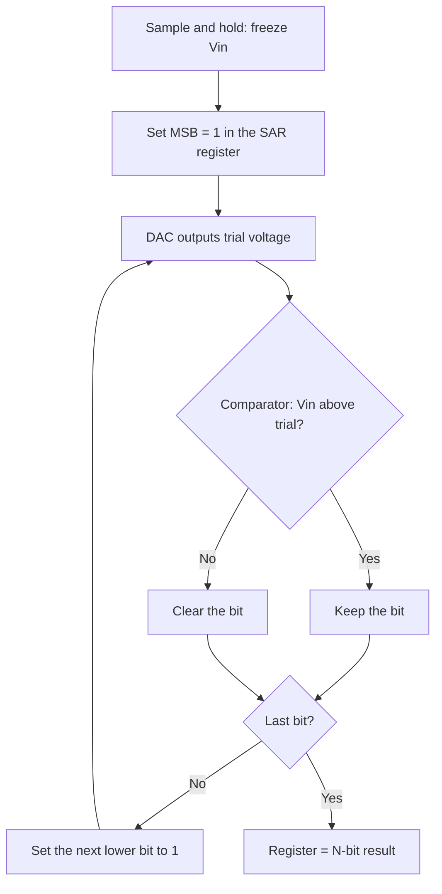

::: testing
Whether you can walk through the **binary search** step by step with real numbers, and explain the hardware that does it: a sample-and-hold, a comparator, an internal DAC and a successive-approximation register (SAR). The interviewer is also checking that you know *why* it dominates microcontrollers (one comparator, low power, $N$ clock cycles, no static current), what limits it (the DAC's matching, the comparator's noise, the reference's ability to supply charge, and the need for a stable input during conversion) and how that ties to sampling time and source impedance in the firmware you actually write.
:::

::: why
The ADC peripheral in almost every STM32, AVR, MSP430, PIC, nRF or ESP-class part is a SAR. If you have ever called `analogRead()` or `HAL_ADC_GetValue()`, a SAR ran a binary search. Knowing how it works explains the settings you tune in practice: the sampling time, the ADC clock, why a high-impedance sensor needs a bigger capacitor on the pin, why the reference pin needs decoupling, and why conversion time is proportional to the number of bits. It also sets up the comparison with flash ([[q0809]]) that interviewers love.
:::

::: concepts
- **Binary search**: each comparison halves the remaining range, so $N$ comparisons resolve $2^N$ levels.
- **Comparator**: tells whether the input is above or below the trial voltage. See [[q0127]].
- **Internal DAC (capacitor array)**: generates the trial voltages $V_{ref}\cdot\text{trial code}/2^N$.
- **SAR register and logic**: stores the trial bits and decides to keep or clear each one.
- **Sample-and-hold**: freezes the input while the search runs. See [[q0814]].
- **Quantization**: the result is a $2^N$-level code, $V_{LSB}=V_{ref}/2^N$. See [[q0808]].
:::

::: answer
"A SAR ADC does a binary search. It has a sample-and-hold that freezes the input, a comparator, a small internal DAC, and a register that holds the code under test.

It starts with the MSB. The register is set to 1000... which makes the DAC output half of the reference. The comparator asks, 'Is my input above this?' If yes, the 1 stays; if no, it's cleared to 0. Then it tries the next bit by setting it to 1, the DAC output moves by a quarter of the reference, and the comparator decides again. After N comparisons, one per bit, the register holds the result.

For example, with a 3.3 V reference and 1.234 V in, the first trial is 1.65 V, which is too high, so the MSB is 0. Next trial is 0.825 V, input is above, keep it. Then 1.2375 V, too high, drop it. And so on. Ten steps give a 10-bit code of 382.

That's why it's so popular in microcontrollers: one comparator and a capacitor array, no static power, N clock cycles per conversion, so you get 100 kS/s to a few MS/s at 10 to 16 bits. The things to watch are that the input has to be held steady during the search, that the source impedance has to be low enough for the sampling cap to charge, and that the reference needs to supply charge each step, so it needs good decoupling."
:::

::: technical
**Algorithm** (for an $N$-bit converter, unipolar, range 0 to $V_{ref}$). Let $d_{N-1}\dots d_0$ be the register bits.

1. Sample: track $V_{in}$ and then hold it on the capacitor array.
2. Set the register to $1000\dots0$ ($d_{N-1}=1$).
3. DAC output $V_{DAC}=V_{ref}\cdot\text{code}/2^N$. If $V_{in}\ge V_{DAC}$ keep $d_{N-1}=1$, else clear it.
4. Move to the next lower bit: set it to 1, compare, keep or clear.
5. After $N$ comparisons, the register is the result. Optional: report it as ready.

Decision rule at bit $k$: keep the bit if $V_{in}\ge V_{ref}\left(\text{bits resolved so far}+2^k\right)/2^N$.

**Charge-redistribution (capacitor DAC).** The DAC is usually binary-weighted capacitors $2^{N-1}C_u,\dots,C_u,C_u$ (the extra unit cap makes the total $2^NC_u$) sharing a common top plate, which goes to the comparator. In the sample phase the top plate is shorted to a bias and the bottom plates connect to $V_{in}$. The top-plate switch then opens and the bottoms switch to ground, so the top plate sits at $-V_{in}$ (that is the hold). To test the MSB, its bottom plate switches to $V_{ref}$, moving the top plate by

$$\Delta V_{top}=V_{ref}\frac{C_{MSB}}{C_{total}}=V_{ref}\frac{2^{N-1}C_u}{2^NC_u}=\frac{V_{ref}}{2}$$

so the comparator sees $-V_{in}+V_{ref}/2$ and its sign gives the MSB. The same capacitor array is both the sampling capacitor and the DAC, which is why SARs are compact and why they hold the input with no separate buffer needed.

**Timing.** One conversion needs a sampling window ($t_{samp}$) plus $N$ comparison cycles (often $N$ to $N+2$ ADC clocks, depending on the part):

$$t_{conv}\approx t_{samp}+\frac{N}{f_{ADC}}$$

For example, a 12-bit conversion with a 10 MHz ADC clock and a 2.5-cycle sampling window takes $(2.5+12)/10\text{ MHz}=1.45$ µs, so about 690 kS/s. The *input must settle in $t_{samp}$*, and the DAC and comparator must settle in each bit cycle, with the MSB step (the biggest) being the slowest.

**Error sources.**
- *Capacitor mismatch* creates DNL and INL, worst at the MSB transitions (for example, at code 0111...1 to 1000...0).
- *Comparator noise and offset* corrupt decisions near a threshold; offset appears as a fixed code offset.
- *Reference loading*: each bit step pulls charge from $V_{ref}$, so the reference needs a low impedance (a decoupling capacitor at the reference pin).
- *Droop and leakage* on the hold capacitor during the $N$ steps.
- *Input must not move*: a SAR assumes a constant input. Without a good S/H the code is garbage on a fast-moving signal.

> [!UNCERTAIN]
> The number of ADC clocks per conversion (for example $N+0.5$, $N+1$, $N+2$ cycles on top of the sampling time) and the allowed ADC clock range differ between MCU families. Read the reference manual's conversion-time formula for your part.
:::

::: short
"A SAR ADC is a binary search. After sampling and holding the input, it tests the MSB by setting the internal DAC to half of full scale and asking a comparator whether the input is above that. Yes means keep the bit, no means clear it. Then it tests the next bit at the new midpoint, and so on. N bits means N comparisons, using one comparator and a capacitor-array DAC, which is why it's small, low power, and the standard ADC in microcontrollers."
:::

::: long
"A successive-approximation ADC is a binary search on the input voltage.

The hardware has four pieces: a sample-and-hold that freezes the input, a comparator, a DAC, and a register with some control logic.

Say I've got a 10-bit ADC with a 3.3 V reference and the input is 1.234 V. The register starts with the MSB set, which makes the DAC output half the reference, 1.65 V. The comparator says the input is below, so the MSB is 0. Next I try the second bit: the DAC goes to 0.825 V, the input is above, so I keep that 1. Third bit: trial is 0.825 plus 0.4125, which is 1.2375 V. The input is just below, so it's cleared. I keep halving the step and either adding or not adding it. After ten comparisons the register holds 0101111110, which is 382. Each comparison narrows the uncertainty by a factor of two, and after $N$ of them it's down to one LSB.

In practice the DAC is a binary-weighted capacitor array, and the same capacitors that sample the input are the ones that make the trial voltages, using charge redistribution. That's why it's compact, burns almost no static power, and is the ADC you find inside nearly every microcontroller.

The conversion takes the sampling time plus roughly N ADC clock cycles, so a 12-bit converter on a 10 MHz clock does about a million conversions per second or a bit under. What I keep in mind as a firmware engineer is that the input has to settle on the sampling capacitor inside the sampling window, so a high-impedance source needs a longer sample time or a buffer cap. The reference also has to deliver charge on every bit trial, so it needs good decoupling. And the SAR assumes the input stays constant during the search, which the sample-and-hold takes care of."
:::

::: terms
- **Successive approximation**: converging on the answer one bit at a time by halving the remaining range.
- **SAR register**: the register holding the trial and final code.
- **Capacitor DAC (CDAC)**: binary-weighted capacitor array that both samples the input and generates trial voltages.
- **Charge redistribution**: shifting a bottom plate between GND and $V_{ref}$ moves the top-plate voltage by a binary fraction of $V_{ref}$.
- **Conversion time**: sampling time plus the $N$ bit-trial cycles.
- **Acquisition (sampling) time**: the window in which the input charges the sampling capacitor.
- **Missing code**: a code that can never appear because of a DAC step error (non-monotonic DNL).
- **Redundancy**: extra trial steps that tolerate early comparator or settling errors.
:::

::: exceptional
**An average answer** describes "guessing half, then half again" and names the pieces.

**An exceptional answer**:
- Does the **binary search with real numbers** (1.234 V in, 3.3 V ref, 10 bits, 382) rather than words.
- Explains that **the capacitor array is both the sampler and the DAC**, and gives the charge-redistribution relation ($V_{ref}\cdot C_{MSB}/C_{total}=V_{ref}/2$).
- Gives the **time/power trade**: one comparator, $N$ cycles, so $f_s\approx f_{ADC}/(N+\text{overhead})$.
- Names the **practical gotchas**: source impedance versus sampling time, reference decoupling, no change in input during conversion, and MSB mismatch causing missing codes.
- Contrasts with flash ([[q0809]]) and with delta-sigma on speed and resolution.
- Ties it to firmware: "I'd set the sampling time based on source impedance and check the manual's conversion-time formula."
:::

::: mistakes
- **Calling it a "counter" ADC.** A counting ADC steps up one LSB at a time; the SAR searches in $N$ steps, not $2^N$.
- **Saying it takes one clock.** It takes about $N$ comparisons, so its speed depends on $N$ and the ADC clock.
- **Starting the search from the LSB.** The MSB is tested first, because its decision halves the range.
- **Forgetting the input has to be held.** If the input changes during the search, the final code is inconsistent with any single input value ([[q0814]]).
- **Believing the reference only sets range.** The reference is also the DAC's supply, so noise or droop on it corrupts decisions mid-conversion.
- **Using a long ADC clock without checking the sampling time.** Raising the ADC clock shortens the sampling window in absolute time, which can cut off the input's settling ([[q0817]]).
:::

::: deep
## The idea: ask the questions in the right order

Guessing a number between 0 and 1023 with yes/no questions is the classic game: ask "is it above 512?", then halve the range each time. After 10 questions you've nailed it, because $2^{10}=1024$. A SAR ADC plays exactly this game against the input voltage, with a comparator as the person answering "higher" or "lower", and a DAC as the way of making each guess a real voltage.


Figure: The SAR loop. The conversion costs N trips around the B, C, D/E, F cycle. The time per trip is set by the DAC settling, the comparator's decision time and the logic, so the ADC clock sets the speed.

## A full worked conversion

Take $N=10$, $V_{ref}=3.3$ V, $V_{in}=1.234$ V, so $V_{LSB}=3.223$ mV. The trial code is the bits kept so far plus a 1 in the bit under test:

| Step | Bit tested | Trial code | DAC output (V) | $V_{in}\ge$ DAC? | Result bit |
|---|---|---|---|---|---|
| 1 | 9 | 1000000000 | 1.6500 | No | 0 |
| 2 | 8 | 0100000000 | 0.8250 | Yes | 1 |
| 3 | 7 | 0110000000 | 1.2375 | No | 0 |
| 4 | 6 | 0101000000 | 1.0313 | Yes | 1 |
| 5 | 5 | 0101100000 | 1.1344 | Yes | 1 |
| 6 | 4 | 0101110000 | 1.1859 | Yes | 1 |
| 7 | 3 | 0101111000 | 1.2117 | Yes | 1 |
| 8 | 2 | 0101111100 | 1.2246 | Yes | 1 |
| 9 | 1 | 0101111110 | 1.2311 | Yes | 1 |
| 10 | 0 | 0101111111 | 1.2343 | No | 0 |

The final code is 0101111110 = 382, which is $\lfloor1.234/3.3\cdot1024\rfloor=382$, so the algorithm and the formula agree. The trial voltage zig-zags and converges on the input:

```plot
{"title":"SAR trial voltages for V_in = 1.234 V (10-bit, V_ref = 3.3 V)","x":{"label":"Comparison step","min":0,"max":11},"y":{"label":"DAC trial voltage","unit":"V","min":0,"max":1.8},
 "series":[{"label":"DAC trial voltage","points":[[1,1.65],[2,0.825],[3,1.2375],[4,1.0313],[5,1.1344],[6,1.1859],[7,1.2117],[8,1.2246],[9,1.2311],[10,1.2343]],"color":"accent"}],
 "hlines":[{"at":1.234,"label":"V_in = 1.234 V","color":"red"}]}
```
Figure: Each trial lands closer to the input: the first guess is off by 0.4 V, the tenth is within one LSB (3.2 mV). The error window halves every step, which is why $N$ bits cost exactly $N$ comparisons.

## How the capacitor DAC makes the trial voltages

The picture below shows a 3-bit charge-redistribution array. The caps are weighted 4C, 2C, C and a dummy C (the extra unit cap makes the total $8C$). All the top plates are tied to a common node that goes to the comparator.

```circuit
{"caption":"3-bit capacitor DAC and comparator","elements":[
 {"t":"wire","pts":[[2,4],[19,4]]},
 {"t":"C","a":[2,4],"b":[2,10],"label":"4C"},
 {"t":"C","a":[5,4],"b":[5,10],"label":"2C"},
 {"t":"C","a":[8,4],"b":[8,10],"label":"C"},
 {"t":"C","a":[11,4],"b":[11,10],"label":"C_d"},
 {"t":"dot","at":[5,4]},{"t":"dot","at":[8,4]},{"t":"dot","at":[11,4]},
 {"t":"term","at":[2,10],"label":"b2","side":"bottom"},
 {"t":"term","at":[5,10],"label":"b1","side":"bottom"},
 {"t":"term","at":[8,10],"label":"b0","side":"bottom"},
 {"t":"term","at":[11,10],"label":"GND","side":"bottom"},
 {"t":"dot","at":[15,4]},
 {"t":"SW","a":[15,4],"b":[15,9],"label":"reset","labelSide":"other"},
 {"t":"gnd","at":[15,9]},
 {"t":"opamp","at":[19,5],"swap":true,"label":"CMP"},
 {"t":"wire","pts":[[19,6],[18,6],[18,8]]},{"t":"gnd","at":[18,8]},
 {"t":"term","at":[23,5],"label":"decision","side":"right"},
 {"t":"text","at":[7,13],"text":"each bottom plate switches between V_{in}, V_{ref} and GND","anchor":"middle","muted":true}
]}
```
Figure: During sampling the reset switch grounds the top plate and the bottom plates connect to $V_{in}$; the reset opens and the bottoms go to ground (hold). To test the MSB, b2 goes to $V_{ref}$ and the top node moves by $V_{ref}\cdot4C/8C=V_{ref}/2$, which the comparator checks against its threshold. The next bit moves it by $V_{ref}/4$, and so on.

The total capacitance sets two things: the kT/C noise of the sample ($\sqrt{kT/C_{tot}}$, about 20 µV for 10 pF at room temperature) and the load the input source sees while charging. That is why datasheets list an input sampling capacitance of a few pF and a maximum source impedance.

## Where the time goes

A typical MCU SAR conversion has a sampling phase followed by the $N$ bit cycles. The firmware controls only the sampling time; the conversion is fixed by $N$ and the ADC clock.

```timing
{"signals":[{"name":"ADC clk","wave":"p............."},{"name":"Phase","wave":"=.====.......","data":["sample","b9","b8","b7","...b0"]},{"name":"S/H","wave":"1...0........","color":"accent"},{"name":"EOC","wave":"0............1"}],"hscale":1}
```
Figure: The input is tracked (S/H high) during the sampling window and frozen when the switch opens. Then one bit is resolved per clock until the end-of-conversion flag. Raising the ADC clock shortens the whole thing, but also shortens the absolute length of the sampling window.

## What limits accuracy in real SARs

- **Capacitor matching.** The MSB capacitor is half the array, and a 0.1% mismatch there shifts the MSB transition by $0.001\cdot V_{ref}/2$. For 12 bits and 3.3 V that is 1.65 mV, two LSBs, enough for a missing code. Designers use calibration or split arrays.
- **Reference.** At each trial the DAC pulls charge from $V_{ref}$, so any series impedance in the reference path shows up as a code-dependent error. That's why the reference pin gets a 100 nF to 1 µF capacitor placed as close as possible.
- **Comparator noise.** The last few comparisons are within a fraction of an LSB of the threshold, so comparator noise sets the effective resolution (ENOB, [[q0819]]).
- **Settling.** Each bit cycle has to give the DAC time to settle to within about an LSB of its final value. The first trial is the worst, since a half-scale step has to settle to $V_{ref}/2^{N}$ accuracy, a 12-bit requirement from the MSB, which is why SAR clocks cannot be arbitrarily fast.

## Experiment with it

```sim
{"id":"adc-lab","view":"sar","bits":10,"vref":3.3,"vin":1.234}
```
Figure: Step through the search and watch the register bits fill in from the MSB. Try $V_{in}=0$, $V_{ref}/2$ and just below $V_{ref}$ and see which bits stay set. Notice that exactly $N$ trials are needed whatever the input.

## SAR versus the alternatives

| | SAR | Flash | Delta-sigma |
|---|---|---|---|
| Comparators | 1 | $2^N-1$ | 1 (1-bit quantizer) |
| Conversion | $N$ cycles | 1 cycle | many cycles plus digital filter |
| Resolution | 8 to 18 bits | up to ~8 bits | 16 to 24 bits |
| Speed | kS/s to a few MS/s | up to GS/s | low to moderate |
| Static power | very low | high | moderate |
| Latency | $N$ cycles | ~1 cycle | long (filter) |
:::

::: applications
- **Microcontroller ADC peripherals**: 10 to 16-bit SARs in STM32, MSP430, AVR and nRF families, as general sensor inputs.
- **Battery and supply monitoring** with a divider into the ADC ([[q0008]]).
- **Motor control**: current samples synchronised to the PWM centre, using a 12-bit SAR at about 1 MS/s.
- **Standalone SAR ADCs** (16 to 18 bits, 100 kS/s to a few MS/s) for precision data acquisition.
- **Low-power sensor nodes**: SAR ADCs use energy only per conversion, which suits duty-cycled IoT devices.
- **Touch and capacitive sensing front ends** that digitise a small voltage with a SAR.
:::

::: assumptions
- Ideal DAC (binary-weighted, perfectly matched), noiseless comparator and a perfectly steady input during the $N$ comparisons.
- The reference can supply the DAC's charge without droop.
- A **unipolar, single-ended** converter. Differential SARs use a differential CDAC and report signed codes.
- The "binary search" description is generic. Real SARs often add redundancy (an extra cycle with a correction weight) so that an early settling error can be fixed by later steps, and some designs split the capacitor array (bridge capacitors) to limit the total capacitance.
- Conversion cycles per sample ($N$, $N+1$, $N+2$) depend on the MCU family.
:::

::: followups
### How many clock cycles does a 12-bit SAR conversion take?
At least 12, one per bit, plus the sampling window and one or two overhead cycles in most MCUs. With a 14 MHz ADC clock and 1.5 cycles of sampling plus 12.5 cycles of conversion, that's about 1 µs, or roughly 1 MS/s. Check the reference manual's formula for the real figures.

### What happens if the input changes during the conversion?
The decisions in early bits are made at one input value and later bits at another, so the final code corresponds to no single input and can be wrong by many LSBs. The sample-and-hold prevents this by freezing the input during the $N$ comparisons ([[q0814]]).

### Why does a high-impedance sensor give wrong readings on an MCU ADC?
The sampling capacitor (a few pF) has to charge through the source resistance plus the switch resistance within the sampling window. A 100 kΩ source with $C=8$ pF gives $\tau=0.8$ µs, and a 12-bit settle takes 9$\tau$, 7.2 µs, longer than a typical 1 to 2 µs window. The reading is then low and depends on the previous channel. Fix: longer sampling time, a buffer, or a capacitor at the pin ([[q0817]], [[q0818]]).

### What would a non-monotonic or missing-code error look like in a SAR?
At a major carry such as 0111 1111 1111 to 1000 0000 0000, mismatch in the MSB capacitor can make the transition occur at the wrong input voltage. Sweeping a slow ramp shows a code that's skipped (missing code) or a repeat/step backward. It is a DNL error, covered in [[q0819]].

### Harder: could you make a SAR faster without increasing the clock?
Yes, in several ways: asynchronous SAR (each comparison starts as soon as the last one is done rather than waiting for a clock), redundancy so DAC settling can be relaxed (the first steps need not settle fully), time-interleaving several SARs, or resolving 2 bits per cycle with a few comparators (a hybrid with flash).
:::

::: interpretations
"How does a SAR ADC work?" follows "How does a flash ADC work?" in the source, so the interviewer expects you to **contrast** them. The answer above leads with the algorithm and then gives the comparator-count/time trade. If the interviewer pushes on the analog circuit, go to the capacitor-array charge redistribution; if they push on firmware, go to the sampling time, ADC clock and source impedance.
:::

::: references
- Sedra & Smith, *Microelectronic Circuits*: data converters, the successive-approximation ADC.
- Razavi, *Principles of Data Conversion System Design*: SAR ADC architecture and charge-redistribution DAC.
- Analog Devices, *The Data Conversion Handbook* (Kester, ed.): SAR ADC chapter (capacitor DAC, settling, reference loading).
- The ADC chapter of the reference manual for your MCU family (conversion time, sampling time, reference and input impedance requirements).
:::

::: rubric
- Describes a binary search starting from the MSB :: This is the defining algorithm of a SAR ADC.
- Names the components: S/H, comparator, DAC, SAR register :: Shows you can draw the block diagram.
- Works a numeric example (trial voltages and bit decisions) :: Demonstrates real understanding rather than recitation.
- States $N$ comparisons and about $N$ clocks per conversion :: Links the architecture to speed and to the MCU's conversion-time formula.
- Explains the capacitor DAC or at least that the same caps sample and make trial voltages :: This is why SARs are small and low-power.
- Mentions the input must be held steady and the source impedance must allow settling :: The two most common real-world SAR issues.
- Mentions reference decoupling or capacitor mismatch as an accuracy limit :: Connects the textbook picture to board-level design.
:::

::: quiz
```json
[
 {"type":"numeric","level":"fundamental","q":"How many comparisons does a 12-bit SAR ADC need to complete one conversion (not counting sampling)?","answer":12,"tolerance":0.001,"unit":"","explain":"One comparison per bit, so $N=12$."},
 {"type":"mcq","level":"fundamental","q":"In a SAR ADC, which bit is tested first?","options":["The LSB","The MSB","The middle bit","All bits at once"],"answer":1,"explain":"The MSB is tested first because it halves the range. Each lower bit then halves the remaining range."},
 {"type":"numeric","level":"intermediate","q":"A 10-bit SAR with $V_{ref}=3.3$ V has all bits cleared and tests the MSB. What is the first DAC trial voltage, in volts?","answer":1.65,"tolerance":0.01,"unit":"V","explain":"MSB set means code 1000000000 = 512, and $512/1024\\cdot3.3=1.65$ V."},
 {"type":"numeric","level":"intermediate","q":"A 12-bit SAR runs from a 10 MHz ADC clock with a 2.5-cycle sampling window and 12 conversion cycles. What is the maximum sample rate, in kS/s? (Round to the nearest kS/s)","answer":690,"tolerance":0.02,"unit":"kS/s","explain":"$t=(2.5+12)/10\\text{ MHz}=1.45$ µs, so $f_s=1/1.45\\text{ µs}\\approx690$ kS/s."},
 {"type":"mcq","level":"advanced","q":"A SAR ADC reads low on a 100 kΩ sensor but correctly on a 1 kΩ sensor, with the same sampling time. What is the most likely cause?","options":["Quantization error","The sampling capacitor does not fully charge through the high source resistance during the sampling window","The comparator has an offset","The reference is too high"],"answer":1,"explain":"The $RC$ time constant with 100 kΩ is 100 times bigger, so the sampling capacitor never reaches the input voltage. The fix is a longer sampling time, a buffer, or a capacitor at the pin."},
 {"type":"truefalse","level":"advanced","q":"In a charge-redistribution SAR, switching the MSB capacitor's bottom plate from ground to $V_{ref}$ moves the top plate by $V_{ref}/2$ (given the array totals $2^N C_u$).","answer":true,"explain":"$\\Delta V=V_{ref}\\,C_{MSB}/C_{total}=V_{ref}\\cdot2^{N-1}C_u/2^NC_u=V_{ref}/2$. Each lower bit moves it by half as much."}
]
```
:::
