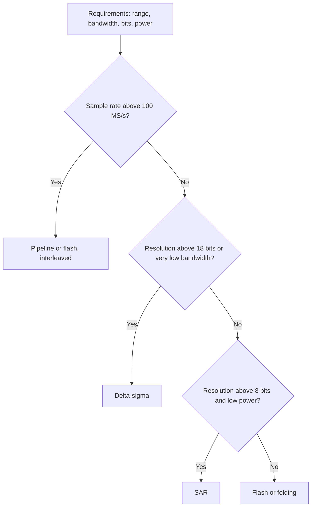
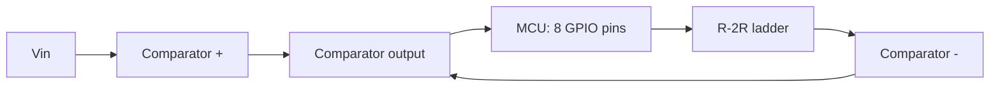

::: basics
### In plain words
Designing an ADC is a process, not a diagram. You start with what it must measure: the voltage range, how fast the signal changes, and how finely you need to read it. From those you work out the number of bits and the sample rate, then choose a type of ADC that fits. Only then do you size the details.

### Picture it
It is like picking a ruler for a job. First you ask how precisely you must read, say to the nearest millimeter. That decides how many tick marks you need. Then you ask how often you must read, which decides how quick you must be. A ruler picked before you know either answer is probably wrong.

### Words you need
- **Resolution (bits)** ([[q0808]]): how many binary digits the output code has, giving $2^N$ steps.
- **LSB**: the size of one step in volts.
- **Nyquist rate**: the sample rate must be more than twice the highest signal frequency, or the samples cannot represent it.
- **Anti-alias filter**: a low-pass filter before the ADC that removes frequencies too high to sample correctly.
- **SAR ADC** ([[q0810]]): an ADC that finds the code with a bit-by-bit binary search.

### The simplest example
Say a sensor gives 0 to 3.3 V, changes at up to 10 kHz, and you want about 1 mV resolution. 3.3 V / 1 mV is 3,300 levels. 11 bits gives only 2,048 levels, which is too coarse (1.6 mV steps), so 12 bits (4,096 levels, 0.8 mV steps) is the answer. The Nyquist rate is more than 20 kS/s (thousand samples per second). Choose 100 kS/s so the anti-alias filter can be gentle. Modest speed and resolution point to a SAR ADC.

That is the whole idea. The rest of this page sizes the sampling capacitor, the reference and the clock, and covers how to verify the result.
:::

::: testing
Whether you can run a **design process** rather than recite a block diagram. The interviewer wants to hear you ask about requirements first (signal bandwidth, resolution, accuracy, supply, power, cost), derive the sample rate and bit count from them, choose an architecture with reasons, then size the pieces that matter (sampling capacitor, reference, clocking, front-end filter) with real numbers, and finish with how you'd verify it. Per the author's note this is an *embedded* context, so a strong answer also shows you can build a working ADC out of simple parts (a comparator, a DAC and a microcontroller) and explain its limits.
:::

::: why
Real engineers rarely design an ADC from transistors, but they constantly *specify and integrate* one: choosing between an MCU's internal SAR and an external delta-sigma part, setting sampling time and reference, and writing the error budget. "Design an ADC" tests whether you can turn vague needs into numbers: bits from the resolution you need, sample rate from bandwidth, capacitor size from noise, clock from conversion time. It is also the question where candidates who only know the names of architectures get exposed. Pair it with [[q0808]] (how it works), [[q0810]] (SAR) and [[q0819]] (precision).
:::

::: concepts
- **Requirements to specs**: bandwidth $B$ gives $f_s>2B$ ([[q0669]]); required resolution gives bits via $V_{LSB}=V_{FS}/2^N$ ([[q0819]]).
- **Architecture selection**: speed versus resolution versus power ([[q0808]], [[q0809]], [[q0810]]).
- **Sample-and-hold sizing**: noise ($kT/C$), settling and droop set the sampling capacitor ([[q0814]], [[q0816]]).
- **Reference**: sets the scale; its noise and impedance set accuracy.
- **Front end**: anti-alias filter and driver ([[q0818]]).
- **Verification**: ramp for DNL/INL, sine for SINAD/ENOB ([[q0819]]).
:::

::: answer
"I'd start by asking what it has to measure: the signal range and bandwidth, how much resolution or accuracy I need, the supply voltage, and the power and cost budget. Say it's a sensor channel on a 3.3 V board, 0 to 3.3 V, up to 10 kHz, and I want about 1 mV resolution.

From that: 3.3 V over 1 mV is 3300 levels, so 12 bits gives me 0.8 mV steps. Nyquist says more than 20 kS/s, and I'd go to 100 kS/s to relax the anti-alias filter. That's low resolution and modest speed, so a SAR is the natural choice: one comparator, a capacitor DAC that also does the sampling, 12 comparisons per conversion. At 100 kS/s with about 15 clock cycles per conversion, I need a clock of about 1.5 MHz. Easy.

Then I'd size the pieces. The sampling capacitor needs kT/C noise well under an LSB, and a few picofarads gives about 20 to 30 microvolts. The input has to charge it to half an LSB within the sampling window, about nine time constants for 12 bits. The reference needs a decoupling capacitor, and I'd put an RC low-pass filter in front of the ADC.

If I had to build one from parts, I'd use the microcontroller: an R-2R DAC on eight GPIO pins, a comparator, and firmware that does the binary search. It would be slower and only about 8 bits with 0.1% resistors, but it works. Finally I'd verify it with a slow ramp for DNL and INL and a sine wave for SNR and effective bits."
:::

::: technical
**Step 1: requirements to numbers.** Example: sensor channel, $V_{FS}=3.3$ V, signal bandwidth $B=10$ kHz, resolution target about 1 mV, supply 3.3 V, power budget under 1 mW.

- Bits: $N\ge\log_2(V_{FS}/V_{target})=\log_2(3300)=11.7\Rightarrow N=12$, $V_{LSB}=0.806$ mV. Quantization noise is $V_{LSB}/\sqrt{12}=233$ µV rms; ideal SNR is 74 dB ([[q0808]]).
- Sample rate: $f_s>2B=20$ kS/s. Choose $f_s=100$ kS/s so a simple RC filter with a corner near 10 to 20 kHz is enough ([[q0818]]).
- Reality check: after non-idealities, 12 nominal bits will give about 10.5 to 11 ENOB, so decide whether that is acceptable ([[q0819]]).

**Step 2: architecture.** 12 bits at 100 kS/s with low power points to a **SAR**. Flash would need 4095 comparators ([[q0809]]). Delta-sigma would deliver more bits but with filter latency, which is fine for slow DC sensors and would be my choice for 16 to 24 bits at under about 10 kS/s. Pipeline is for tens of MS/s.

**Step 3: clock and timing.** One conversion = sampling window + 12 bit cycles + about 1 overhead cycle. With 2 cycles for sampling, that's 15 cycles, so $f_{clk}=15\cdot100\text{ kHz}=1.5$ MHz minimum. Each bit cycle is 0.67 µs, ample for DAC and comparator settling.

**Step 4: sampling capacitor.**
- Noise: $v_n=\sqrt{kT/C}$. At 300 K, $C=8$ pF gives 22.7 µV rms ($=0.03$ LSB), negligible. $C=1$ pF gives 64 µV, still under 0.1 LSB.
- Matching: a 12-bit capacitor array needs unit capacitors matched to a fraction of an LSB at the MSB, and the unit size is limited by process matching, so the total capacitance is often set by matching rather than noise. (Process-dependent.)
- Settling: switch resistance $R_{on}=1$ kΩ, $C=8$ pF: $\tau=8$ ns; settling to half an LSB takes $\tau\ln(2^{13})=9.01\tau=72$ ns for the ADC alone. With a 10 kΩ source, $\tau=88$ ns and the sampling window must be at least 0.79 µs ([[q0817]]).

**Step 5: reference.** Full-scale $=V_{ref}$. A 0.1% reference error is 3.3 mV, four LSBs. Use a precision reference or at least decouple the supply used as reference. Each bit trial can pull charge of order $C_{tot}V_{ref}/2$ from the reference, which for 8 pF is about 13 pC. If a 100 nF capacitor alone had to supply it, it would droop by $13\text{ pC}/100\text{ nF}=0.13$ mV, about 0.16 LSB, and the reference must recover before the next bit decision. That is not negligible at 12 bits, which is why reference pins typically get a microfarad or more close to the pin plus a low-impedance reference or buffer behind it. A larger capacitor array needs proportionally more.

**Step 6: front end.** RC anti-alias filter (for example, 1 kΩ and 10 nF gives $f_c=15.9$ kHz), a driver that can supply the sampling capacitor's charge spikes, input protection (series resistor and clamps). See [[q0818]].

**Step 7: verification.** Ramp test (histogram) for DNL/INL and missing codes; sine test with an FFT for SINAD, ENOB and THD; shorted-input test for noise (code standard deviation); temperature and supply sweeps for gain/offset drift.

> [!UNCERTAIN]
> Minimum capacitor size and achievable matching depend on the process node and layout (unit-cap mismatch of a fraction of a percent is typical for small MOM/MIM capacitors). Treat the capacitance numbers as illustrative, not a design rule.
:::

::: short
"I'd start with requirements: range, bandwidth, resolution, supply and power. For a 0 to 3.3 V, 10 kHz sensor with 1 mV resolution, that's 12 bits at 100 kS/s, so a SAR ADC. The sampling capacitor is sized for kT/C noise and settling, a few picofarads. The clock is about 15 cycles per conversion. I'd add a clean reference, an RC anti-alias filter, and verify it with a ramp for linearity and a sine for ENOB. If I had to build one from parts I'd do a SAR in firmware with an R-2R DAC and a comparator."
:::

::: long
"For a design question I always start with requirements, because they decide everything else. What's the signal range, how fast does it move, how many bits of real accuracy do I need, what's the supply, and what's the power and cost budget?

Say I'm digitising a 0 to 3.3 V sensor with a 10 kHz bandwidth and I want about a millivolt of resolution.

Bits first: 3.3 V over 1 mV is 3300 steps, so 12 bits, which gives 0.8 mV per step and an ideal SNR of 74 dB. Sample rate: Nyquist says above 20 kS/s, and I'd pick 100 kS/s so a simple RC filter can do the anti-aliasing instead of a steep one.

Architecture: 12 bits at 100 kS/s with a low power budget is exactly what a SAR does. It has a single comparator and a capacitor DAC that doubles as the sampling capacitor, and it takes about 12 clocks per conversion. So about 15 clock cycles per sample, a 1.5 MHz clock. Flash would need 4095 comparators, and delta-sigma would add filter latency I don't need.

Next I size the pieces. The sampling capacitor has to be big enough that kT/C noise is small compared with an LSB; 8 pF gives about 23 microvolts, which is a 30th of an LSB. It also has to settle to half an LSB, about nine time constants. With a 1 kΩ switch that's fine, but with a 10 kΩ source I need almost 0.8 microseconds. The reference sets both scale and accuracy, so it gets a proper decoupling cap, and a 0.1% error already costs four codes. At the input I'd put an RC filter with a corner around 15 kHz.

If the interviewer wants something I could build tomorrow, I'd make a firmware SAR: an R-2R ladder on eight GPIOs, a comparator, and a loop that sets each bit from the MSB down. With 0.1% resistors it's good to about 8 bits. Then I verify it with a slow ramp to check DNL and INL, and a sine wave to measure effective bits."
:::

::: terms
- **Requirement flow-down**: deriving resolution, sample rate and power from the system need.
- **ENOB**: effective number of bits, $(\text{SINAD}-1.76)/6.02$ ([[q0819]]).
- **$kT/C$ noise**: sampled thermal noise on a capacitor, $\sqrt{kT/C}$ rms, independent of switch resistance.
- **Acquisition time**: time for the sampling capacitor to settle to the required accuracy.
- **Charge kickback**: the burst of charge the sampling capacitor pulls from the driver when the switch closes.
- **DNL / INL**: differential and integral non-linearity, in LSBs.
- **Single-slope (ramp) ADC**: converts voltage to time using a linear ramp and a timer.
- **Ratiometric**: a measurement made relative to the reference so reference errors cancel.
:::

::: exceptional
**An average answer** draws a flash or SAR block diagram.

**An exceptional answer**:
- **Starts with questions** and a spec table instead of a diagram.
- Derives bits and sample rate with arithmetic (3300 levels gives 12 bits; 100 kS/s gives a relaxed filter).
- Picks the architecture by **elimination**: why not flash (comparator count), why not delta-sigma (latency), why SAR.
- Sizes at least two things with numbers: the sampling capacitor ($kT/C$, settling) and the reference or clock.
- Considers **error budget**: reference tolerance, offset/gain, INL, noise, and states ENOB, not just bits.
- Offers a **buildable embedded version** (R-2R plus comparator plus firmware, or a single-slope timer) and notes its limits.
- Ends with how to test it (ramp histogram, sine FFT, shorted-input noise).
:::

::: mistakes
- **Starting from the architecture** rather than the requirements. The interviewer is grading the process.
- **Choosing bits from the LSB alone.** A 16-bit ADC with a 12-bit-quality reference or layout gives about 12 real bits. Check the whole error budget ([[q0819]]).
- **Sampling at exactly $2B$.** Real filters aren't brick walls; sample at 5 to 10 times the bandwidth or use a steeper filter.
- **Sizing the sampling cap only from noise.** It must also settle through the source impedance within the sampling window ([[q0817]]), and match well enough for linearity.
- **Forgetting the reference** (decoupling, source impedance, tolerance, temperature drift).
- **Designing an ADC with no verification plan.** A design isn't complete until you've said how you will measure DNL, INL, noise and ENOB.
:::

::: deep
## Think like a systems engineer first

A good design answer has the same shape as a good design: requirements, specs, architecture, details, verification. Here is a requirements table for a concrete example, a 3.3 V embedded sensor channel.

| Requirement | Value | Consequence |
|---|---|---|
| Input range | 0 to 3.3 V | $V_{ref}=3.3$ V, unipolar |
| Signal bandwidth | 10 kHz | $f_s>20$ kS/s; pick 100 kS/s |
| Resolution | about 1 mV | $N=12$, $V_{LSB}=0.806$ mV |
| Accuracy | ±0.1% of reading | reference tolerance, gain error and INL matter more than bits |
| Power | under 1 mW | rules out flash, favours SAR |
| Supply | 3.3 V | single-ended, rail-to-rail input |


Figure: A rough decision tree for choosing an architecture. The thresholds are rules of thumb that move with technology, but the logic is real: speed pushes to flash and pipeline, resolution with low bandwidth pushes to delta-sigma, and the broad middle (10 to 16 bits, kS/s to a few MS/s) belongs to SAR.

## Bits, noise and the real number of bits

An ideal 12-bit converter has $V_{LSB}=0.806$ mV and 233 µV rms of quantization noise. Real noise adds in quadrature with it. Suppose the front end and reference contribute 400 µV rms of broadband noise:

$$v_{n,total}=\sqrt{233^2+400^2}=463\text{ µV}$$

The noise-limited number of bits, relative to a full-scale sine of $3.3/(2\sqrt2)=1.167$ V rms, gives

$$\text{SNR}=20\log_{10}\frac{1167\text{ mV}}{0.463\text{ mV}}=68.0\text{ dB},\quad\text{ENOB}=\frac{68.0-1.76}{6.02}=11.0$$

So 12 nominal bits yield about 11 effective bits when the analog noise is already 1.7 times the quantization noise. Spending more on bits wouldn't help unless the noise also dropped.

## The sampling capacitor: noise versus settling versus matching

Three requirements pull on $C$:

1. **Noise** wants a big $C$: $\sqrt{kT/C}$ is 64 µV at 1 pF, 20 µV at 10 pF, 14 µV at 20 pF.
2. **Settling** wants a small $C$: $t_{acq}=(R_s+R_{on})\,C\ln2^{N+1}$. For $N=12$, $R_s+R_{on}=11$ kΩ and $C=8$ pF it's 0.79 µs. At 20 pF it would be 2 µs.
3. **Matching** wants unit capacitors large enough for 12-bit linearity, which sets a floor on the array total.

```plot
{"title":"Acquisition time for 12-bit accuracy vs sampling capacitor","x":{"label":"C_sample","unit":"F","min":1e-12,"max":2e-11},"y":{"label":"t_acq","unit":"s","min":0,"max":3e-6},
 "vars":{"n":12,"k":"ln(2^(n+1))"},
 "series":[{"label":"R_total = 1 kΩ","fn":"1000*x*k","color":"green"},{"label":"R_total = 11 kΩ","fn":"11000*x*k","color":"accent"},{"label":"R_total = 50 kΩ","fn":"50000*x*k","color":"red"}],
 "hlines":[{"at":"1e-6","label":"1 µs window","color":"muted"}]}
```
Figure: Acquisition time is linear in $R\cdot C$. With a 1 µs sampling window, a 50 kΩ total resistance only supports about 2 pF, but a 1 kΩ path supports the whole range. This is why high-impedance sensors need a buffer or a longer sampling time.

## Clocking and conversion time

With a SAR, $f_s=f_{clk}/(t_{samp,cycles}+N+\text{overhead})$. For a 100 kS/s, 12-bit design with 2 sampling cycles and 1 overhead cycle, $f_{clk}\ge1.5$ MHz. If I raise $f_{clk}$ to 12 MHz I get 800 kS/s, but the sampling window then shrinks from 1.33 µs to 167 ns, which 11 kΩ and 8 pF cannot settle in (0.79 µs needed). So the input source impedance, not the clock, ultimately caps the sample rate.

## Building one from parts: the firmware SAR

If the interviewer asks "no ADC chip, just a microcontroller", the SAR algorithm still works. You need a DAC and a comparator. The cheapest DAC is an R-2R ladder on GPIO pins ([[q0821]]).


Figure: A firmware SAR. The MCU drives the ladder with a trial code, reads the comparator's output pin, and keeps or clears the bit. No ADC peripheral is needed, only an analog comparator or a spare op-amp.

The firmware is a ten-line binary search:

```c
uint8_t sar8(void) {
    uint8_t code = 0;
    for (int b = 7; b >= 0; b--) {
        code |= (1u << b);          // try this bit
        write_port(code);           // drive the R-2R ladder
        delay_us(1);                // let the DAC settle
        if (!comparator_high())     // Vin below trial voltage?
            code &= ~(1u << b);     // yes, so clear the bit
    }
    return code;
}
```

Limits of this design, with numbers:
- **Resolution**: an 8-bit, 3.3 V ladder has $V_{LSB}=12.9$ mV. With 1% resistors a Monte Carlo of the ladder shows roughly 10 to 15% of builds non-monotonic and DNL up to about 2 LSB; with 0.1% resistors DNL stays below about 0.2 LSB (see [[q0821]]). So 0.1% resistors for 8 bits, or accept 6 bits with 1%.
- **Speed**: a 10 kΩ ladder driving a 5 pF comparator input has $\tau=50$ ns (output resistance $R$), and settling to half an LSB needs $\tau\ln2^9=6.2\tau=0.31$ µs, so about 1 µs per bit and 8 µs per sample (125 kS/s) is achievable, in practice limited by firmware and GPIO speed.
- **Reference**: the "reference" is the GPIO supply, so it's noisy and shifts with load. Use a dedicated reference where possible, or use the MCU's DAC pin.

The other cheap alternative is a **single-slope ADC**: charge a capacitor from a constant current, start a timer, and capture the time when a comparator sees the ramp cross $V_{in}$.

```plot
{"title":"Single-slope ADC: time to cross V_in is the code","x":{"label":"time","unit":"s","min":0,"max":0.0105},"y":{"label":"voltage","unit":"V","min":0,"max":3.6},
 "vars":{"vr":3.3,"tr":0.01,"vin":1.234},
 "series":[{"label":"Ramp (constant current into C)","fn":"min(vr*x/tr,3.6)","color":"accent"}],
 "hlines":[{"at":"vin","label":"V_in = 1.234 V","color":"red"}],
 "vlines":[{"at":"vin/vr*tr","label":"crossing = 3.74 ms","color":"orange"}],
 "points":[{"x":"vin/vr*tr","y":"vin","label":"timer stops"}]}
```
Figure: The ramp rises 3.3 V in 10 ms. The comparator trips at 3.74 ms, and a 1 MHz timer captures 3739 counts, a resolution of about 0.33 mV per count. The accuracy depends entirely on the ramp's linearity and slope stability (current source, capacitor dielectric and temperature), not on the timer. It's cheap and slow (100 conversions per second), and its resolution is better than its accuracy.

## Experiment with it

```sim
{"id":"adc-lab","view":"quantize","bits":12,"vref":3.3,"vin":1.234}
```
Figure: Change the bits from 8 to 12 to 16 and note how $V_{LSB}$ shrinks by 16× over those 8 bits. Ask yourself what else in the system would have to be 16× better for those extra bits to be real.

## Verification plan

1. **Shorted input**: tie the input to a clean DC level, take 10,000 samples, report the code mean and standard deviation. That's the noise floor in LSB rms.
2. **Slow ramp / histogram**: apply a very slow linear ramp and histogram the codes. A code with 1.5× the average count has DNL +0.5 LSB; an empty bin is a missing code. Integrating the DNL gives INL.
3. **Sine test**: apply a clean sine (about −1 dBFS), take a few thousand samples coherently, and compute SINAD from an FFT. ENOB $=(\text{SINAD}-1.76)/6.02$.
4. **Supply and temperature sweeps**: check gain and offset drift against the 0.1% budget.
5. **Compare with a 6.5-digit meter** at several DC points to check the absolute accuracy.
:::

::: applications
- **Selecting an MCU's internal ADC versus an external ADC** for a sensor board, using exactly this flow-down.
- **Battery fuel gauges and BMS ICs** with a 12 to 16-bit SAR or delta-sigma ADC measuring cell voltages and shunt current.
- **Motor control**: 12-bit SAR at a fixed rate synchronised to PWM, with a front-end sized by this method ([[q0446]]).
- **Low-cost sensing without an ADC**: single-slope or RC-discharge timing to read a thermistor or a capacitive sensor with only a GPIO and a timer.
- **Data loggers**: delta-sigma 24-bit ADCs for slow thermocouple and bridge sensors.
- **Test and measurement**: choosing a digitiser's bits, rate and front end from a signal's bandwidth and dynamic range.
:::

::: assumptions
- The numbers assume a **single-ended, 0 to 3.3 V** input and a **12-bit, 100 kS/s** target. A different range, noise floor or bandwidth changes bits, rate and architecture.
- "Design an ADC" may mean (a) *select and integrate* an ADC for a system, (b) *design the architecture* at block level, or (c) *build* one from discrete parts. I've covered all three at different depths. Ask which the interviewer wants.
- Capacitor sizes, switch resistance and matching numbers are illustrative and process-dependent.
- Noise analysis assumes white noise adding in quadrature, and a full-scale sine for SNR. DC or small-signal measurements have their own noise-to-resolution relationship ([[q0819]]).
- The monotonicity and DNL numbers for the R-2R ladder come from a simple Monte Carlo of the ladder with uniformly distributed resistor tolerances. Real resistor errors may be correlated (same reel, same temperature), which usually improves matching.
:::

::: followups
### Why SAR and not delta-sigma for this design?
A delta-sigma ADC oversamples and digitally filters, so it has filter latency of many samples and a sample rate far below its modulator rate. It shines for slow, high-resolution DC-ish signals (16 to 24 bits). For a 10 kHz signal at 12 bits and 100 kS/s with simple multiplexed channels, a SAR is smaller, cheaper, lower latency and settles instantly after a channel switch.

### How would you choose the number of bits if the sensor is only accurate to 1%?
A 1% accurate sensor over a 3.3 V range is about 33 mV, which is 8 bits at 12.9 mV per LSB. More bits would only resolve sensor error and noise. However, 10 to 12 bits is still reasonable if you want to see changes (resolution), averaged, even though absolute accuracy is limited. Resolution and accuracy are different budgets ([[q0819]]).

### Your design misses 2 LSB at one code transition, what do you suspect?
A major carry (for example, 011...1 to 100...0) with a DNL error is usually the MSB capacitor (or MSB resistor in a ladder) being off by about 2 LSB worth of its value. Check by histogram: you'll see an empty bin or a double-height bin at that code. The fix is calibration, a trimmed or larger MSB element, or a split-capacitor array.

### How do you decide the sampling time in firmware?
Compute the source resistance seen by the pin, add the switch resistance, multiply by the sampling capacitor, and multiply by $\ln2^{N+1}$ ($=9$ for 12 bits). Pick the next available sampling-time setting above that. If the required time exceeds the budget, add a buffer or a capacitor at the pin ([[q0817]]).

### Harder: you must support 16 channels at 100 kS/s total with one ADC. What changes?
The mux adds on-resistance and capacitance and the previous channel's charge remains on the sampling capacitor, so each channel gets 6.25 kS/s of throughput but needs the full settling time on every switch, so settling, not clock, limits. Use a buffered, low-impedance source on each channel or leave dummy conversions between channels, and budget about $9\tau$ per sample with $R_s$ small. A 16-channel scan at 100 kS/s total gives 10 µs per channel.
:::

::: interpretations
"Design an ADC" is open-ended. It could mean: choose and integrate an ADC for a system (most likely for an embedded role), design the block-level architecture, or build one from simple parts with a microcontroller. The answer above handles all three. Starting with "what are the requirements?" earns credit under every interpretation. The related questions are [[q0808]] (how an ADC works), [[q0816]] (design a sample-and-hold) and [[q0821]] (design a DAC), which feed directly into this one.
:::

::: references
- Analog Devices, *The Data Conversion Handbook* (Kester, ed.): chapters on ADC architectures, sampling theory and ADC specifications.
- Razavi, *Principles of Data Conversion System Design*: architecture selection and the SAR design chapters.
- Horowitz & Hill, *The Art of Electronics*, 3rd ed.: analog-to-digital conversion chapter, including successive approximation and dual-slope converters.
- Texas Instruments and Analog Devices ADC selection guides and ADC driver application notes (look for "ADC input driver" and "SAR ADC front end"): practical front-end design for SAR converters.
:::

::: rubric
- Starts with requirements (range, bandwidth, resolution, power) :: A design is only as good as its spec; interviewers score the process first.
- Derives bits and sample rate numerically :: Shows you can turn needs into numbers.
- Selects the architecture with reasons and rejects alternatives :: Demonstrates trade-off thinking, not memorisation.
- Sizes the sampling capacitor or sampling time with $kT/C$ and settling :: The most common real design constraint on SAR ADCs.
- Addresses the reference and the analog front end (filter, driver) :: ADC performance is mostly decided outside the converter.
- Distinguishes nominal bits from ENOB and sets an error budget :: Real designs are judged on effective, not nominal, resolution.
- Describes a verification plan (ramp for DNL/INL, sine for SINAD/ENOB) :: A design without a test plan isn't finished.
- Offers a buildable embedded alternative with its limits :: Matches the embedded context stated in the source notes.
:::

::: quiz
```json
[
 {"type":"numeric","level":"fundamental","q":"A signal spans 0 to 5 V and you need 5 mV resolution. What is the minimum number of ADC bits?","answer":10,"tolerance":0.001,"unit":"bits","explain":"$5\\text{ V}/5\\text{ mV}=1000$ levels. $2^{10}=1024\\ge1000$, while $2^9=512$ is too few. So 10 bits."},
 {"type":"mcq","level":"fundamental","q":"What should you do first when asked to design an ADC?","options":["Draw a flash converter","Ask for requirements: range, bandwidth, resolution, power","Pick a 24-bit part","Choose the sampling capacitor"],"answer":1,"explain":"Everything else (bits, rate, architecture, capacitor) follows from the requirements."},
 {"type":"numeric","level":"intermediate","q":"What is the $kT/C$ noise (rms) of an 8 pF sampling capacitor at 300 K, in µV?","answer":22.7,"tolerance":0.03,"unit":"µV","explain":"$\\sqrt{kT/C}=\\sqrt{1.38\\times10^{-23}\\cdot300/8\\times10^{-12}}=22.7$ µV."},
 {"type":"numeric","level":"intermediate","q":"A 12-bit SAR sees a total resistance of 11 kΩ (source plus switch) charging an 8 pF capacitor. How long must the sampling window be to settle to half an LSB, in µs? (Use $\\tau\\ln2^{13}$.)","answer":0.793,"tolerance":0.03,"unit":"µs","explain":"$\\tau=11\\text{ k}\\cdot8\\text{ pF}=88$ ns and $\\ln2^{13}=9.01$, so $t=0.79$ µs."},
 {"type":"mcq","level":"intermediate","q":"For a 12-bit, 100 kS/s, low-power sensor ADC, which architecture is the best fit?","options":["Flash","SAR","Pipeline at 100 MS/s","Dual-slope"],"answer":1,"explain":"SAR gives 12 bits at 100 kS/s with one comparator and almost no static power. Flash would need 4095 comparators; dual-slope is too slow."},
 {"type":"truefalse","level":"advanced","q":"Raising the ADC clock of a SAR always increases the achievable sample rate, no matter how high the source impedance is.","answer":false,"explain":"A faster clock also shortens the sampling window in absolute time. With a high source impedance the sampling capacitor no longer settles, so errors rise. The source impedance and settling set a ceiling on the sample rate."}
]
```
:::
