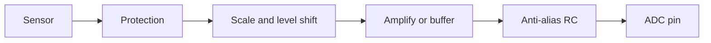

::: testing
Whether you know that **an ADC is only as good as the circuit in front of it**, and can list the standard front-end blocks and say what job each does: protection, scaling (divider or gain), level shifting, buffering or driving, anti-alias filtering, and sensor-specific conditioning (instrumentation amp, current-sense amp, transimpedance amp). A strong answer ties each block to an ADC limitation (finite input range, sampling-capacitor kickback, aliasing, limited source impedance) and gives at least one worked scaling or filter calculation. In an embedded context the "front end" is usually a handful of passives and one op-amp, so show you can choose them.
:::

::: why
Most "bad ADC" problems turn out to be front-end problems: a 12 V signal that damages the 3.3 V pin, a high-impedance divider that reads low, a sensor too small to see above the LSB, aliased PWM ripple in a current measurement, or an op-amp that oscillates driving the ADC pin. Knowing the standard front ends lets you design the signal path in minutes, and it is the practical complement to [[q0808]] (how an ADC works), [[q0817]] (sampling time) and [[q0816]] (sample and hold).
:::

::: concepts
- **Input range matching**: the signal must fit within $V_{ref-}$ to $V_{ref+}$; dividers, gain stages and level shifters do that ([[q0008]]).
- **Source impedance**: the ADC needs a low source impedance to settle ([[q0817]]).
- **Anti-alias filtering**: low-pass before the sampler ([[q0670]], [[q0813]], [[q0010]]).
- **Op-amp buffers and amplifiers** ([[q0125]]).
- **Current sensing**: sense resistor and current-sense amplifier ([[q0446]], [[q0449]]).
- **Protection**: series resistors, clamps and TVS keep the pin inside its absolute maximum ratings.
:::

::: answer
"By front end I mean everything between the sensor and the ADC pin, and it usually has five jobs.

First, protection: a series resistor and clamp diodes or a TVS so a fault or ESD can't push the pin outside its supply rails.

Second, scaling: the ADC wants 0 to 3.3 V. A big signal like a 12 V battery goes through a resistor divider; a tiny one like a 20 mV shunt voltage goes through an amplifier. I'd pick gain so the maximum signal uses most of the full-scale range, otherwise I'm throwing away bits. For bipolar signals I add a level shift so zero sits at mid-scale.

Third, driving: the ADC's sampling capacitor kicks charge back at the input every sample, and it needs a low source impedance to settle. So I either use a low-impedance source, an op-amp buffer, or a capacitor right at the pin that acts as a charge reservoir, with a small resistor in front of it so the amp stays stable.

Fourth, filtering: an RC low-pass to stop out-of-band noise from aliasing.

And fifth, sensor-specific conditioning: an instrumentation amplifier for a bridge sensor, a current-sense amplifier for a shunt, a transimpedance amplifier for a photodiode, or a divider for a thermistor. Many ADC problems turn out to be front-end problems."
:::

::: technical
**Signal chain.** sensor → protection → scaling/level shift → amplify or buffer → anti-alias RC → ADC.

**1. Protection.** A series resistor $R_{ser}$ (100 Ω to a few kΩ) limits fault current, with clamp diodes (Schottky to the rails, or the MCU's internal ESD diodes) or a TVS. The resistor adds to the source impedance for settling ([[q0817]]). Injection current limits are in the datasheet.

**2. Attenuation (divider).** For a 0 to 12 V input into a 3.3 V ADC, the ratio is $3.3/12=0.275$. With $R_2=10$ kΩ, $R_1=R_2(12/3.3-1)=26.4$ kΩ; use 27 kΩ: $V_{max}=12\cdot10/37=3.243$ V. Thevenin resistance $R_{th}=27\parallel10=7.3$ kΩ, which is too high for fast settling without a capacitor or buffer ([[q0008]]).

**3. Gain.** A non-inverting amplifier $G=1+R_f/R_g$. A 0 to 50 mV signal needs $G=3.3/0.05=66$ for full scale: $R_g=1$ kΩ, $R_f=65$ kΩ. The input-referred LSB becomes $0.806\text{ mV}/66=12.2$ µV. Check amplifier offset and noise at the new scale.

**4. Level shift (bipolar signals).** Map $\pm V_{max}$ to $0\ldots V_{ref}$ with an inverting or summing amplifier: $V_{ADC}=V_{ref}/2-V_{in}\,V_{ref}/(2V_{max})$.

**5. Driver and charge reservoir.** The sampling capacitor $C_S$ (a few pF) draws a charge spike each sample. Place $C_{ext}$ (about $2^N\times C_S$, 10 to 100 nF in practice) at the pin, with $R_{iso}$ (10 to 100 Ω) between the amplifier and the cap for stability. $C_{ext}$ supplies the sampling charge and the amplifier recharges it between conversions.

**6. Anti-alias RC.** $f_c=1/(2\pi RC)$. For $R=1$ kΩ and $C=10$ nF, $f_c=15.9$ kHz. Attenuation at frequency $f$: $-10\log_{10}[1+(f/f_c)^2]$; at 50 kHz that is only 10.4 dB, so this filter suits an ADC at $f_s\ge$ several hundred kS/s or signals of a few kHz, not a 100 kS/s ADC with arbitrary noise.

**7. Sensor-specific front ends.**

| Sensor / signal | Typical front end | Why |
|---|---|---|
| Large voltage (battery, 12/24 V) | Resistor divider + RC, clamp | Scale into range |
| Thermistor, potentiometer | Divider from the ADC reference (ratiometric) | Reference error cancels |
| Bridge (strain gauge, pressure) | Instrumentation amplifier, gain 100 to 1000 | Small differential signal on a large common mode |
| Shunt current | Current-sense amplifier ([[q0449]]) | Rejects common mode, gain to full scale |
| Photodiode | Transimpedance amplifier | Current-to-voltage |
| Microphone, AC-coupled | Bias to mid-rail, gain, band-limit | Centre signal in unipolar range |
| Differential ADC input | Fully differential amplifier or driver | Match ADC input and drive kickback |

> [!NOTE]
> The right capacitor value at the pin depends on the ADC's sampling capacitance and the sensor's bandwidth; the rule "about $2^N C_S$" is a conservative starting point. Check the datasheet's recommended RC for the part.
:::

::: short
"The ADC front end is everything between sensor and pin. It protects the input with a series resistor and clamps, scales the signal into 0 to $V_{ref}$ with a divider or amplifier (plus a level shift if it's bipolar), and drives the pin with a low impedance or a charge-reservoir capacitor so the sampling cap can settle. It adds an RC anti-alias filter, and for particular sensors uses an instrumentation amp, a current-sense amp, a transimpedance amp or a divider."
:::

::: long
"By ADC front end I mean everything between the sensor and the ADC pin. It has a handful of jobs, and I'd go through them in order.

First, protection. A series resistor and clamp diodes or a TVS, so a fault or ESD can't push the pin beyond the rails. The resistor counts toward source impedance, so I keep it modest.

Second, scaling. The ADC has a fixed range, say 0 to 3.3 V. A 12 V signal goes through a divider; I'd use something like 27 k and 10 k, which gives 3.24 V at full scale. A small signal, like a 50 mV bridge output, needs gain of about 66 to fill the range, otherwise I waste bits. If the signal is bipolar I shift it so zero sits at mid-scale.

Third, driving the ADC. The sampling capacitor charges every sample, so the source needs low impedance. I'd use an op-amp buffer, and put a capacitor of tens of nanofarads right at the pin as a charge reservoir, with a small resistor, 10 to 100 ohms, between the amp and the capacitor so the amplifier doesn't oscillate on a capacitive load.

Fourth, the anti-alias filter. An RC low-pass at the pin, with a corner well below half the sample rate. A single pole only attenuates 20 dB per decade, so if there's real out-of-band noise I either oversample or use a higher-order active filter.

And then there are sensor-specific front ends: an instrumentation amplifier for a bridge, a current-sense amplifier for a shunt, a transimpedance amplifier for a photodiode, a ratiometric divider for a thermistor, and a differential driver for a differential ADC.

Finally I'd check the whole chain's error budget: offset, gain error, noise, and settling at the ADC pin."
:::

::: terms
- **Front end / signal conditioning**: analog circuitry that prepares a signal for the ADC.
- **Level shifting**: adding a DC offset so a bipolar signal fits a unipolar range.
- **Instrumentation amplifier (INA)**: high-input-impedance differential amplifier with precise gain and high CMRR.
- **Transimpedance amplifier (TIA)**: converts an input current to a voltage, $V=-I R_f$.
- **Charge bucket / reservoir capacitor**: capacitor at the ADC pin that supplies the sampling charge.
- **Isolation resistor**: small series resistor that stabilises an amplifier driving a capacitive load.
- **Anti-alias filter**: low-pass that limits bandwidth to below $f_s/2$.
- **Ratiometric measurement**: sensor excitation and ADC reference are the same, so supply errors cancel.
- **Clamp**: diode or TVS limiting the pin voltage to safe levels.
:::

::: exceptional
**An average answer** names "an op-amp and a filter".

**An exceptional answer**:
- Organises the front end as a **chain with a purpose for each block**, and explains the ADC limitation each addresses.
- Does a **scaling calculation** (divider or gain) with component values and checks the Thevenin resistance.
- Explains **charge kickback** and the bucket capacitor with isolation resistor.
- Sizes the **anti-alias RC** and states its attenuation honestly.
- Matches **sensor type to front end** (INA, CSA, TIA, ratiometric divider).
- Mentions **ratiometric design**, **protection** and checking the **error budget** (offset, noise, settling).
:::

::: mistakes
- **Using a high-value divider (hundreds of kΩ) straight into an MCU pin** without a capacitor: the reading drops because the sampling capacitor can't settle ([[q0817]]).
- **Scaling the signal to 10% of full scale.** The ADC then uses only a few of its bits; use gain.
- **Op-amp directly on a large capacitor**: it can oscillate. Add $R_{iso}$.
- **Putting the anti-alias corner at Nyquist.** A first-order filter with its corner at $f_s/2$ attenuates only 3 dB there, so content just above Nyquist aliases almost unattenuated. Put the corner near the signal band edge and sample well above $2f_{max}$.
- **Forgetting overvoltage protection**, such as 12 V on an MCU pin through a divider with no clamp, when the divider's upper resistor fails short.
- **Ignoring input common-mode range** of the amplifier. A single-supply op-amp may not work near 0 V unless rail-to-rail.
:::

::: deep
## The chain, and why each block exists

An ADC is a small, fussy instrument with a fixed input range, a sampling capacitor that pulls current pulses, finite resolution and no immunity to out-of-band noise. The front end exists to make any real sensor look like what the ADC expects.


Figure: The generic ADC front end. Each block can be as simple as a resistor or as complex as an instrumentation amplifier, and some blocks merge (the buffer's output resistor plus the pin capacitor is the anti-alias filter).

## A complete example: buffer, filter and charge bucket

```circuit
{"caption":"Op-amp buffer, isolation resistor and pin capacitor driving an ADC","elements":[
 {"t":"term","at":[0,7],"label":"V_{sig}","side":"left"},
 {"t":"wire","pts":[[0,7],[3,7]]},
 {"t":"opamp","at":[3,6],"label":"A1"},
 {"t":"dot","at":[7,6]},
 {"t":"wire","pts":[[7,6],[7,3],[2,3],[2,5],[3,5]]},
 {"t":"R","a":[7,6],"b":[13,6],"label":"R_{iso} = 1 kΩ"},
 {"t":"dot","at":[13,6]},
 {"t":"C","a":[13,6],"b":[13,11],"label":"C_{ext} = 10 nF","labelSide":"other"},
 {"t":"gnd","at":[13,11]},
 {"t":"wire","pts":[[13,6],[17,6]]},
 {"t":"box","at":[17,3],"w":6,"h":6,"label":"ADC","pins":[{"side":"left","pos":3,"name":"IN"}]},
 {"t":"text","at":[10,4.2],"text":"f_c = 15.9 kHz","muted":true}
]}
```
Figure: The op-amp buffers the signal (low source impedance). $R_{iso}$ isolates the amplifier from the capacitive load and, together with $C_{ext}$, forms the anti-alias filter at $f_c=1/(2\pi\cdot1\text{ kΩ}\cdot10\text{ nF})=15.9$ kHz. $C_{ext}$ is the charge reservoir for the ADC's sampling capacitor. A 1 kΩ $R_{iso}$ is well above the 10 to 100 Ω that stability alone needs; it is chosen here so the same resistor sets the filter corner, at the cost of a slower recharge of $C_{ext}$ (10 µs time constant).

The RC does three jobs at once: it filters, it protects the amplifier from the kickback, and it supplies charge. That is why it is on almost every ADC input schematic.

## Scaling: use the whole range

If a signal only spans 10% of the ADC range, you're using 10% of the codes: a 12-bit ADC behaves like a 8.7-bit one. Amplify until the maximum signal is about 90% of $V_{ref}$, keeping headroom for offset and tolerance.

Examples:
- **Shunt voltage 0 to 50 mV** into 0 to 3.3 V: gain $3.3/0.05=66$. Input-referred LSB falls from 0.806 mV to 12.2 µV. The ADC now spreads its 4096 codes across 50 mV instead of 3.3 V.
- **Bridge sensor** 2 mV/V excitation 5 V: full scale 10 mV. $G=3.3/0.01=330$ with an instrumentation amplifier; input-referred LSB is 2.4 µV, so the INA's offset, drift and noise now matter more than the ADC's.
- **12 V battery**: ratio 0.275; 27 kΩ/10 kΩ divider gives 3.243 V at 12 V; $R_{th}=7.3$ kΩ, so add 100 nF at the pin and use a longer sampling time ([[q0817]]).
- **Bipolar ±10 V**: invert and attenuate by 0.165, and bias to 1.65 V: $V_{ADC}=1.65-0.165V_{in}$ (the sign flip can be undone in software).

## Anti-alias filtering, honestly

A single RC pole attenuates 20 dB/decade. Consider $R=1$ kΩ, $C=10$ nF ($f_c=15.9$ kHz) in front of a 100 kS/s ADC (Nyquist 50 kHz):

| Frequency | Attenuation |
|---|---|
| 15.9 kHz | −3.0 dB |
| 50 kHz | −10.4 dB |
| 90 kHz (aliases to 10 kHz) | −15.2 dB |

That's weak: interference at 90 kHz still appears at 10 kHz with 17% of its amplitude. To get 40 dB of rejection at 90 kHz with a single pole you'd need $f_c\approx0.9$ kHz, which kills the signal band. Practical options: **oversample** (run the ADC at 1 MS/s so the 90 kHz sits well below the new Nyquist, then average and decimate), use a **second-order active filter** (Sallen–Key), or a **two-stage RC** with an op-amp between stages ([[q0670]], [[q0813]]).

```bode
{"systems":[{"label":"1st-order RC, 15.9 kHz","num":[1],"den":["r*c",1]},{"label":"2nd-order (two buffered RC stages)","num":[1],"den":["r*r*c*c","2*r*c",1]}],"vars":{"r":1000,"c":"10e-9"},"f":{"min":100,"max":1e6},"marks":[{"f":"50e3","label":"Nyquist at 100 kS/s"}],"show":"mag","magRange":[-60,5]}
```
Figure: At the 50 kHz Nyquist frequency of a 100 kS/s ADC, one RC pole gives only about 10 dB of attenuation, and two buffered poles about 21 dB. Even then, aliasing of anything just above 50 kHz is poorly suppressed, which is why the sample rate is usually set well above $2f_{max}$ and the filter corner sits near the signal band edge, not at Nyquist. (Two cascaded buffered stages are drawn here; an unbuffered second RC would have a different response.)

## Driving the sampling capacitor

Each time the sampling switch closes, $C_S$ (a few pF) pulls a charge pulse from the input. An op-amp's bandwidth usually isn't high enough to respond within nanoseconds, so a naked amplifier output sags briefly. The bucket capacitor $C_{ext}\gg C_S$ supplies that charge: the dip is $V\,C_S/(C_{ext}+C_S)$, which for 8 pF and 10 nF is 0.08% (about 3 LSB at 12 bits), and the amplifier refills $C_{ext}$ through $R_{iso}$ with $\tau=R_{iso}C_{ext}=10$ µs, ample for sample periods of 100 µs or more. Make $C_{ext}$ bigger or $R_{iso}$ smaller if you sample faster. Keep $R_{iso}$ large enough to keep the amplifier stable with the capacitive load (a datasheet's "isolation resistor" graph tells you the minimum).

## Sensor-specific front ends in detail

- **Thermistor (ratiometric divider).** A 10 kΩ NTC ($\beta=3950$) with a 10 kΩ fixed resistor from the ADC reference: output sensitivity at 25 °C is about $V_{ref}\beta/(4T^2)=36.7$ mV/K, so one 12-bit LSB is 0.022 K. Because the ADC reference excites the divider, a reference error cancels (ratiometric).
- **Bridge/strain gauge.** The signal is a small *difference* on a large common-mode voltage. An instrumentation amplifier with CMRR above 100 dB and gain 100 to 1000 does the job; a plain op-amp difference stage would need very well-matched resistors.
- **Shunt current.** The shunt's voltage rides on the bus voltage (high-side) so a current-sense amplifier with a wide common-mode range is used ([[q0449]], [[q0446]]).
- **Photodiode.** A transimpedance amplifier turns microamps into volts with $R_f$, and a small $C_f$ across $R_f$ keeps it stable.
- **AC-coupled sources (audio).** A coupling capacitor and a mid-rail bias network (two equal resistors from the supply) centre the signal at 1.65 V; gain is chosen so the loudest signal stays within range.
- **Differential ADCs.** Use a fully differential amplifier that converts a single-ended source to a differential pair around a common-mode level, with small RC filters per leg and one capacitor across the pair.

## Experiment with it

```sim
{"id":"current-sense","imax":5,"imin":0.01,"rsense":0.01,"gain":50,"bits":12,"vref":3.3}
```
Figure: A current-sense chain is the front end in miniature: a shunt, an amplifier and an ADC. Change the gain and notice when the amplified signal clips against the ADC range (too much gain) or leaves most codes unused (too little). That is the same scaling decision you make for any front end.
:::

::: applications
- **Battery monitors**: divider plus RC into an MCU ADC, or a dedicated fuel-gauge IC with its own front end.
- **Motor current measurement**: shunt, current-sense amplifier and an RC filter timed to the PWM ([[q0446]]).
- **Thermistor and RTD thermometry**: ratiometric dividers, bridges and INAs.
- **Audio inputs**: coupling capacitor, bias, gain stage and anti-alias filter ahead of a codec.
- **Load cells and pressure sensors**: bridge and instrumentation amplifier with an ADC such as a 24-bit delta-sigma converter.
- **Light sensing**: photodiode, TIA and a filter to an ADC.
:::

::: assumptions
- A **single-ended, single-supply** MCU ADC with a 0 to 3.3 V range. Differential and bipolar converters change the level-shift and driver details.
- **Rail-to-rail op-amps** are available when the signal swings near 0 V or $V_{DD}$.
- The sampling capacitor, switch resistance and recommended source impedance vary by part; use the datasheet's values over the rules of thumb here.
- Component values (27 kΩ/10 kΩ, 1 kΩ/10 nF, gain 66) are examples that satisfy the stated ranges, not unique answers.
- Noise and offset budgets of the amplifiers are not worked in detail; in a precision design they often dominate over the ADC.
:::

::: followups
### Why put a resistor between the op-amp and the capacitor at the ADC pin?
An op-amp driving a capacitive load sees an extra phase lag from its output resistance and the load capacitance, which can reduce phase margin and cause ringing or oscillation. The resistor isolates the load and moves the pole to a safe frequency. It also forms the RC anti-alias filter with the capacitor.

### How would you scale a ±5 V signal into a 0 to 3.3 V ADC?
Attenuate to ±1.65 V (ratio 0.33) and add a 1.65 V offset: $V_{ADC}=1.65+0.33V_{in}$. A resistor network can do both: two resistors to the input and to a 3.3 V rail and then a divider down, or an op-amp summing stage. Make sure the offset reference is stable, since any error in it appears directly as an offset in the reading.

### Why use an instrumentation amplifier rather than one op-amp for a bridge?
The bridge output is a small difference on a large common-mode level. An INA has very high input impedance on both inputs and very high CMRR from an internally matched structure, where a single-op-amp difference amplifier relies on four matched resistors and loads the bridge.

### What does the bucket capacitor do to the ADC's sampling error?
It supplies the charge the sampling capacitor needs, limiting the dip to $V\,C_S/(C_{ext}+C_S)$, and lets the source be high-impedance since it only needs to recharge the capacitor slowly between samples. The cost is a lower bandwidth at the pin, $1/(2\pi R C_{ext})$.

### Harder: your ADC reads fine at DC but shows a 3 LSB error that depends on the previous channel. Where do you look?
Under-settling of the sampling capacitor: the source impedance is too high for the sampling time, or $C_{ext}$ is too small to supply the charge. Increase the sampling time, lower the source impedance with a buffer, or increase $C_{ext}$, and check with alternating 0 V / full-scale inputs ([[q0817]]).
:::

::: references
- Horowitz & Hill, *The Art of Electronics*, 3rd ed.: instrumentation amplifiers, op-amp circuits and interfacing to A/D converters.
- Analog Devices, *The Data Conversion Handbook* (Kester, ed.): driving ADC inputs, anti-aliasing and ADC front-end design.
- Texas Instruments and Analog Devices ADC datasheets and application notes on "driving SAR ADC inputs" and "RC filter at ADC input": recommended resistor and capacitor values per part.
- Sedra & Smith, *Microelectronic Circuits*: op-amp amplifiers, filters, and instrumentation amplifier circuits.
:::

::: rubric
- Lists the front-end functions: protection, scaling, level shift, buffering/drive, filtering :: This is the structure of a complete answer.
- Works a scaling example with numbers :: Shows you can design, not just list.
- Explains sampling-capacitor kickback and the charge-reservoir capacitor with isolation resistor :: The most common practical ADC-driving issue.
- Includes an anti-alias filter and states its limitation :: Aliasing is a front-end responsibility.
- Matches sensors to front ends (INA, CSA, TIA, thermistor divider) :: Shows breadth.
- Mentions protection (series R, clamps) :: Real boards fail from overvoltage.
- Mentions ratiometric design or error budget :: Hallmarks of experience.
:::

::: quiz
```json
[
 {"type":"numeric","level":"fundamental","q":"A 0 to 50 mV sensor signal must fill a 0 to 3.3 V ADC range. What amplifier gain is needed?","answer":66,"tolerance":0.01,"unit":"V/V","explain":"Full scale 3.3 V divided by the 50 mV maximum signal gives $G=3.3/0.05=66$. Using more gain would clip; less would waste codes."},
 {"type":"mcq","level":"fundamental","q":"What is the purpose of the capacitor placed right at an SAR ADC's input pin?","options":["To raise the reference voltage","To supply the sampling capacitor's charge so the source can be higher impedance","To invert the signal","To increase resolution"],"answer":1,"explain":"The pin capacitor is a local charge reservoir. It takes the sampling charge pulse and the source recharges it slowly between samples."},
 {"type":"numeric","level":"intermediate","q":"An RC anti-alias filter uses 1 kΩ and 10 nF. What is its corner frequency in kHz?","answer":15.9,"tolerance":0.02,"unit":"kHz","explain":"$f_c=1/(2\\pi\\cdot10^3\\cdot10^{-8})=15.9$ kHz."},
 {"type":"numeric","level":"intermediate","q":"A divider with $R_1=27$ kΩ (top) and $R_2=10$ kΩ (bottom) is fed 12 V. What voltage reaches the ADC, in V?","answer":3.243,"tolerance":0.01,"unit":"V","explain":"$12\\cdot10/(27+10)=3.243$ V, safely under 3.3 V."},
 {"type":"truefalse","level":"intermediate","q":"A single-pole RC filter with its corner at the Nyquist frequency prevents aliasing.","answer":false,"explain":"At the corner the attenuation is only 3 dB, and above it falls 20 dB per decade, so content just above Nyquist aliases almost unattenuated. The corner should be well below $f_s/2$, or the sample rate well above $2f_{max}$."},
 {"type":"mcq","level":"advanced","q":"A bridge sensor outputs 10 mV full scale riding on a 2.5 V common-mode level. Which front end is most appropriate?","options":["A resistor divider","A unity-gain buffer","An instrumentation amplifier with gain about 330","A passive RC filter only"],"answer":2,"explain":"The signal is a small differential voltage on a large common-mode level, which is exactly what an INA with high CMRR is for. Gain of 330 brings 10 mV to about 3.3 V."}
]
```
:::
