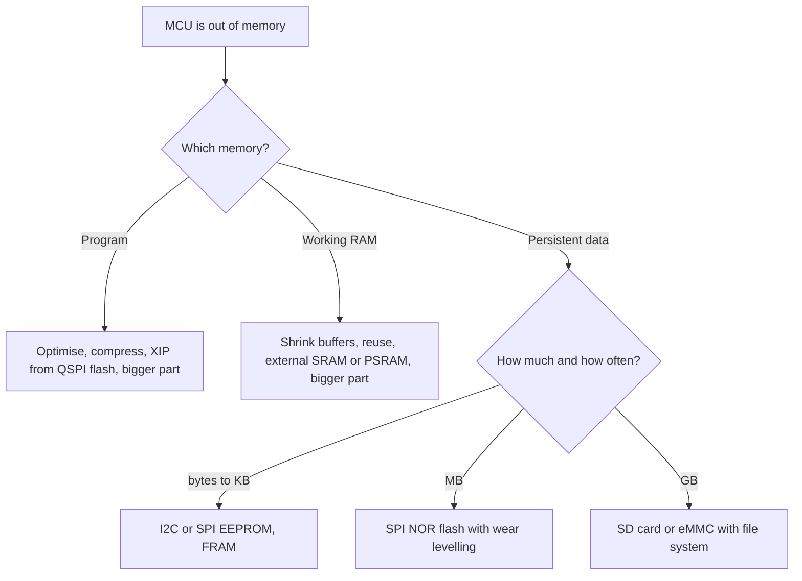

::: testing
Whether you can **reason about options and trade-offs** instead of reciting one answer. The interviewer wants to see you first ask *which* memory you are short of (program, working RAM or persistent data), *how fast* it must be accessed, and *how much* you need. Then you should offer a ladder of solutions: shrink the problem, add external memory over a suitable bus, or switch to a bigger part. They also check that you understand why external memory costs pins, speed and power, and that you can put numbers on bandwidth and capacity.
:::

::: why
Real products outgrow their first microcontroller constantly: logging, graphics frame buffers, audio buffers, firmware-update images, machine-learning weights. Picking the cheapest fix (compress, use external flash, change part) is a core design skill, and the wrong choice shows up as missed deadlines, extra BOM cost or a board respin. The question also tests whether you know the difference between memories that *look* similar but behave very differently: SRAM, PSRAM, NOR flash, SD cards and EEPROM. Related persistence topics are in [[q0825]] and [[q0828]].
:::

::: concepts
- **Memory types by role**: code (flash), working memory (SRAM), persistent data (EEPROM/flash/FRAM). See [[q0823]].
- **External memory buses**: SPI/QSPI, I2C, parallel (FSMC/FMC), SDIO. Each trades pins for bandwidth.
- **Execute-in-place (XIP)**: running code directly from memory-mapped external flash.
- **Bandwidth**: bytes per second = bus clock x data lines / 8 (minus protocol overhead).
- **Memory-mapped vs block access**: a CPU can fetch from mapped memory, but an SD card needs a driver and a file system.
- **Persistence and wear** ([[q0825]]): external flash and SD cards also wear out.
:::

::: answer
"First I'd figure out what kind of memory I'm short of, because the fix is different. If it's program space, I'd check the compiler optimisation, drop unused libraries and maybe compress data. If that's not enough, many parts can run code from external QSPI flash that's memory-mapped, or I move to the pin-compatible variant with more flash.

If it's RAM, I'd cut buffers, put big constant tables in flash, reuse buffers, and if I truly need more, add external SRAM or PSRAM, or step up to a part with more internal RAM.

If it's data storage, like logging, I'd add an external memory: an I2C or SPI EEPROM or flash for small amounts, an SD card for gigabytes, or FRAM when I need endless writes. I'd choose by capacity, speed and how many pins I can spare.

For example, a 1 kHz, 16-bit logger makes 2 kB per second, about 7 MB per hour. That fits easily on a 16 MB SPI flash for two hours, and an SD card holds days. A plain SPI bus at 10 MHz moves 1.25 MB per second, hundreds of times more than I need, so the bus isn't the constraint. Capacity and flash wear are."
:::

::: technical
**Step 1: classify the shortage.**
- *Code space* (flash full): optimise (`-Os`), remove dead code and heavy `printf`, link-time optimisation, compress assets, or move to a part with more flash.
- *Working RAM*: shrink buffers, share them, keep constants `const`, reduce stack, use fixed-point instead of float tables.
- *Persistent data*: external non-volatile storage.

**Step 2: options for more memory.**

| Option | Typical size | Interface | Speed | Notes |
|---|---|---|---|---|
| SPI/I2C EEPROM | 1 kbit to 1 Mbit | I2C / SPI | slow (ms writes) | settings, small logs |
| SPI NOR flash | 1-128 MB | SPI / QSPI | tens of MB/s read | code, assets, logs; sector erase |
| External SRAM | 64 KB to a few MB | parallel / SPI | near-CPU speed | few pins on SPI versions |
| PSRAM | 4-64 MB | QSPI/OSPI/parallel | tens of MB/s | cheap RAM; high latency |
| SD / eMMC | GB | SPI / SDIO | MB/s | needs file system |
| FRAM | KB to MB | SPI / I2C | fast, no wear | higher cost per bit |

**Bandwidth rule.** $\text{BW} = f_{clk}\cdot N_{lines}/8$ bytes/s before overhead. Example: SPI at 10 MHz is 1.25 MB/s; QSPI at 50 MHz is 25 MB/s.

**Capacity sizing.** Data rate $R$ bytes/s over time $T$: $\text{size} = R\,T$. At 2 kB/s, 24 h needs $2000\times 86400 = 173$ MB.

**Pins.** Parallel external memory needs address + data + control lines (about 30-40 pins); QSPI needs 6; SPI needs 4. Pin-limited parts favour serial memory.

**Software cost.** Mapped QSPI flash is read as normal memory; EEPROM, SD and non-mapped flash require driver code, and flash needs erase and wear management.
:::

::: short
"First I'd identify whether I'm short of code space, working RAM or persistent storage. Then I'd shrink what I can, and if that isn't enough, add external memory: QSPI flash for code or assets, PSRAM or external SRAM for working data, EEPROM or SD for logs, picking by capacity, bandwidth, pin count and wear. Or I'd move to a bigger part in the same family. The trade-off is always cost, board pins and speed against effort to change."
:::

::: long
"I'd start by asking what's actually full, since there are three different fixes.

If it's flash, the program memory, I'd first try cheap things: compile with size optimisation, strip unused library code, replace heavy printf, and compress assets. If I still need space, many modern MCUs have a QSPI interface that memory-maps an external flash, so I can run code directly from it, at the cost of speed unless there's a cache. The other fix is a bigger variant of the same chip family, which is usually the least risky.

If it's RAM, I'd reduce buffer sizes, reuse buffers across modes, make sure constants are marked const so they stay in flash, and cut the stack. If the application really needs megabytes, like a display frame buffer, I'd add PSRAM or SDRAM, or use a part with more internal memory.

If it's data that I need to keep, like a log, I'd use external non-volatile memory. For tiny amounts, an I2C EEPROM. For megabytes, an SPI flash. For gigabytes, an SD card with a file system. If it updates very frequently I'd consider FRAM, which doesn't wear out the way flash does.

I'd back the choice with numbers. A 1 kHz, 2-byte sample stream is 2 kB per second, roughly 7 MB per hour. A 10 MHz SPI link moves about 1.25 MB per second, so bandwidth is no problem, but I need to plan page-program times and wear levelling. Then I check the pin budget, the power budget, and whether the supply voltage and package are compatible with the existing board."
:::

::: terms
- **XIP (execute in place)**: CPU fetches instructions straight from memory-mapped external flash.
- **QSPI**: SPI with four data lines, giving four times the throughput per clock.
- **PSRAM**: pseudo-static RAM: DRAM cells with built-in refresh, behaving like SRAM at lower cost per bit.
- **Memory-mapped**: external memory appears at addresses in the CPU's map.
- **Overlay**: swapping code or data segments in and out of a smaller memory region.
- **Bank switching**: selecting among several memory banks through one address window.
- **Wear levelling**: spreading writes evenly across flash blocks.
- **File system**: structure (such as FAT) letting block devices like SD cards hold named files.
:::

::: exceptional
**An average answer** says "add an external EEPROM or SD card".

**An exceptional answer**:
- Asks which memory is short and how it is accessed (random vs sequential, read vs write heavy).
- Tries to **reduce demand first** (size optimisation, compression, data types) before adding hardware.
- Compares at least three options with capacity, speed, pins and wear.
- Computes data rate, capacity and bus bandwidth to show the choice works.
- Mentions memory-mapped XIP, caching, and that external memory costs power, board space and latency.
- Notes the "change the part" option and its cost in qualification and layout.
:::

::: mistakes
- **Jumping to hardware first.** Often a size-optimised build or removing a float printf frees 10-20 KB for free.
- **Using EEPROM or SD as RAM.** Writes take milliseconds and wear out; you cannot run a stack there.
- **Ignoring latency.** PSRAM and SPI flash can take hundreds of nanoseconds to start a read, so random access is far slower than internal SRAM.
- **Forgetting pins and voltage.** A parallel bus can eat 30+ pins; many cards and flash chips are 1.8 V or 3.3 V and may need level translation.
- **No file-system or power-fail plan.** Pulling power during an SD write can corrupt the FAT. Add flush strategy and checksums ([[q0825]]).
- **Underestimating flash wear** when logging constantly into a small flash.
:::

::: deep
## Start by shrinking the problem

External memory adds a chip, routing, a driver and a failure mode, so exhaust the cheap options first.

- **Compiler and library.** `-Os` instead of `-O2` can cut code size by 10-30%, depending on the code (measure it). Replace a full `printf` with a small integer formatter, which can save several KB on small parts. Enable section garbage collection (`-ffunction-sections -fdata-sections -Wl,--gc-sections`).
- **Data types.** An array of 1000 `float` samples is 4000 bytes; as `int16_t` fixed-point it is 2000.
- **Lookup tables.** Store a sine table as a quarter-wave (a quarter of the size) and use symmetry.
- **Compression.** Run-length or LZ-style compression for assets and firmware images; delta encoding for slowly changing sensor logs.
- **Reuse buffers.** If a Wi-Fi buffer and an audio buffer are never active at once, overlay them in a `union`.

## Where more memory can come from


Figure: Decide by the kind of memory you are short of first, then by size and write frequency. The leaf boxes are the typical hardware answers.

### Memory-mapped external flash (XIP)

Many MCUs include a QSPI controller that makes an external NOR flash look like a region of the address map. The CPU just reads from addresses; the controller issues the SPI read commands. With 4 data lines at 50 MHz the raw rate is $50\times 10^6 \times 4/8 = 25$ MB/s. An internal flash at 100 MHz with a 128-bit fetch width can deliver far more, so XIP code needs an instruction cache to avoid stalling the CPU. This is why a typical split is: critical ISR code and hot loops in internal flash or RAM, bulk assets and rarely used code in external flash.

### External RAM

- **Parallel SRAM** is fast and simple but needs many pins: for a 1M x 16 (2 MB) SRAM you have 20 address lines, 16 data lines and several control lines, about 40 pins.
- **SPI/QSPI PSRAM** needs 4-6 pins, but each random access costs a command and address phase. A 32-bit read in single SPI mode at 40 MHz takes roughly (8 command + 24 address bits + 32 data bits) / 40 MHz = 1.6 µs, compared with about 10 ns for internal SRAM. Quad mode and bursts help; a cache hides some of it.
- **SDRAM** is large and cheap but needs a refresh controller and careful layout (many signals, length matching).

## Worked example: a 1 kHz logger

A vibration logger samples a 12-bit ADC at 1 kHz and stores each sample as 2 bytes with a 4-byte timestamp every 100 samples.

- Data rate: $1000 \times 2 = 2000$ B/s plus $10\times 4 = 40$ B/s, about 2.04 kB/s.
- Per hour: $2040 \times 3600 = 7.34$ MB. A 16 MB flash holds $16/7.34 \approx 2.2$ hours; a 32 GB SD card holds about 4,400 hours (6 months).
- Bus load on a 10 MHz SPI: $2040/1.25\times 10^6 = 0.16\%$, trivial.
- Flash program granularity: NOR flash programs in 256-byte pages (typical), so buffer 256 B in RAM (125 ms of data), then write one page. A page program takes about 0.7 to 3 ms (vendor dependent), during which the MCU keeps sampling into a second buffer: use **double buffering**.
- Wear: NOR flash is typically rated around $10^5$ erase cycles per sector (check the datasheet). A circular log across 16 MB writes each sector once every 2.2 h, so $10^5$ cycles lasts $10^5 \times 2.2 \text{ h} \approx 25$ years. If you instead overwrote one 4 KB sector for log data every 2 s, you would burn it in $2\times 10^5$ s, about 2.3 days. Wear levelling is the whole design problem.

> [!UNCERTAIN]
> Page-program time, sector-erase time and endurance (commonly quoted from $10^4$ to $10^5$ cycles for NOR, lower for dense NAND) vary by vendor and part. Use the datasheet values for your chip.

## Execution speed vs capacity

Moving data off-chip trades speed for size. A rough picture, for a 100-MHz-class MCU (typical, not exact):

| Memory | Random read latency | Sustained read | Where it hurts |
|---|---|---|---|
| Internal SRAM | 1 cycle (10 ns) | hundreds of MB/s | none |
| Internal flash | 1-5 wait states | 100+ MB/s with prefetch | branches |
| QSPI NOR (XIP) | 0.2-1 µs miss | 25 MB/s quad at 50 MHz | cache misses |
| SD card (SPI) | ms per block | up to ~1 MB/s | latency spikes during internal housekeeping |

A tight control loop must never depend on an SD write completing: decouple them with a RAM queue and a lower-priority task ([[q0840]]).

## Bigger part vs external memory

External memory is not always cheaper. Count the real cost: the extra chip (small), 4-40 routed pins and perhaps a layer more, driver and test effort, higher power, another supplier. A pin-compatible part with twice the flash in the same package often costs only modestly more (check distributor pricing at your volume) and needs no layout change. External memory wins when you need orders of magnitude more (megabytes of assets, gigabytes of logs) or must keep the MCU family.

```sim
{"id":"spi-modes"}
```
Figure: SPI mode timing: external flash, FRAM and SD (in SPI mode) all use these clock-polarity and phase rules. Pick the mode the memory datasheet specifies, or reads will be shifted by a bit.
:::

::: applications
- **Display products**: a 480x272 16-bit frame buffer is 261 KB, more than most MCUs have internally, so they add SDRAM or PSRAM.
- **IoT firmware updates (OTA)**: a second copy of the firmware image is stored in external SPI flash, then swapped in by the bootloader.
- **Audio players**: MP3 or WAV files from an SD card, double-buffered into SRAM.
- **Industrial data loggers**: SPI NOR flash circular log with wear levelling.
- **Machine-learning at the edge**: model weights in QSPI flash (XIP), activations in internal SRAM.
- **Configuration storage**: small I2C EEPROM on the board holding calibration and serial number ([[q0828]]).
:::

::: assumptions
- I assume the MCU has **no spare internal memory** and that a **bigger pin-compatible part may or may not exist**. If the family has one, that is usually the first thing to check.
- **Cost, volume and product phase** change the answer: for a 100-unit prototype, a bigger part or SD card is fine; for 1M units, a few cents matter and compression plus a smaller memory may win.
- **Real-time constraints** may rule out external memory for time-critical code and data.
- **Security**: external flash can be read by anyone with a clip; if firmware is secret, use encrypted XIP or internal flash.
- **Interface voltage**: the memory must match the MCU's I/O voltage, or a level shifter is needed.
- Numbers (speeds, endurance) are typical and vendor-dependent.
:::

::: followups
### What is the difference between external flash and external EEPROM?
Both are non-volatile, but flash is larger and cheaper per bit, erased in sectors (4 KB typical) and programmed in pages, while EEPROM erases per byte or small page and is more convenient for tiny settings. Flash also has faster reads and often a mappable QSPI interface. EEPROM has smaller capacities (kilobits to a megabit) and simpler software. See [[q0828]].

### How do you run code from external flash?
Configure the QSPI controller in memory-mapped mode so the flash appears at an address range, set the linker script to place selected sections there, and enable the instruction cache. The CPU then fetches as if from internal flash, but every cache miss costs a QSPI read, so keep ISRs and tight loops in internal memory.

### Your product logs 4 kB/s and must run for 30 days. How much storage, and what do you pick?
$4000 \times 86400 \times 30 = 10.4$ GB. That points to an SD card or eMMC with a file system, not SPI NOR. Add a RAM buffer to absorb SD write-latency spikes (tens of ms), flush periodically, and handle power loss, for example by closing the file at brown-out detection.

### What if you can't add any chip and have no pins left?
Reduce what you store: compress, store derived features instead of raw data, lower precision or sample rate, send data to a host over the existing UART/USB instead of storing it, or use the MCU's bigger variant. You can also free pins by moving to a serial memory sharing an existing SPI bus with a separate chip select.

### Harder: PSRAM reads are 20x slower than internal SRAM but the algorithm is cache-friendly. Does it work?
Possibly. If the working set fits the cache and accesses are sequential, miss rate is low and average latency is close to cache speed. If access is random across megabytes (hash tables, FFT with large strides), performance collapses toward raw PSRAM latency. Measure with a cycle counter on real data. Mitigations: block the algorithm to fit in cache, use DMA to copy chunks into SRAM, or choose a part with more internal RAM.
:::

::: interpretations
"More memory than what the microcontroller has space for" can mean **program space**, **RAM**, or **storage for data**. The answer above treats all three and gives a decision path. If the interviewer means **data that needs to persist**, continue with [[q0825]]. For what an EEPROM actually is, see [[q0828]].
:::

::: references
- Horowitz & Hill, *The Art of Electronics*, 3rd ed.: memory chapter (EEPROM, flash, SRAM, DRAM and their interfaces).
- Yiu, J., *The Definitive Guide to ARM Cortex-M3 and Cortex-M4 Processors*: memory systems and bus interfaces.
- SD Association, *SD Specifications, Part 1: Physical Layer Simplified Specification* (SPI mode of SD cards).
- A representative SPI NOR flash datasheet (page-program, sector-erase and endurance specs): read the one for your chosen part.
:::

::: rubric
- Asks which memory (code, RAM or persistent data) is short :: The right fix depends entirely on this, and it shows structured thinking.
- Tries to reduce usage first (optimisation, compression, data types) :: Cheaper and lower-risk than adding hardware.
- Lists external options (QSPI flash, PSRAM/SRAM, EEPROM, FRAM, SD) with when to use each :: Shows breadth of practical knowledge.
- Quantifies capacity and bandwidth with real numbers :: Turns a vague answer into an engineering decision.
- Mentions trade-offs: pins, speed, latency, power, cost :: Interviewers want judgment, not just a list.
- Mentions persistence issues: wear, power loss, file systems :: Flash-based storage fails in subtle ways.
- Considers moving to a larger MCU :: Often the lowest-risk solution.
:::

::: quiz
```json
[
 {"type":"numeric","level":"fundamental","q":"An SPI bus runs at 10 MHz with one data line. What is the maximum raw throughput, in MB/s (ignoring overhead)?","answer":1.25,"tolerance":0.02,"unit":"MB/s","explain":"One bit per clock: $10\\times 10^6 / 8 = 1.25\\times 10^6$ bytes/s = 1.25 MB/s. Quad SPI at the same clock would be 4x that."},
 {"type":"mcq","level":"fundamental","q":"Your MCU runs out of program flash, and the part has a QSPI controller. What is a common solution?","options":["Store the code on an I2C EEPROM and copy it byte by byte at startup","Memory-map an external QSPI flash and execute code from it (XIP)","Increase the system clock","Move variables from RAM to registers"],"answer":1,"explain":"QSPI controllers can make external NOR flash appear in the address map so the CPU runs code from it directly, ideally with an instruction cache. I2C EEPROM is far too slow and small for this."},
 {"type":"numeric","level":"intermediate","q":"A logger records 2.04 kB/s. How many MB does it generate in 24 hours?","answer":176,"tolerance":0.03,"unit":"MB","explain":"$2040 \\times 86400 \\approx 1.76\\times 10^8$ B = 176 MB. That is far too much for an EEPROM and more than a 256 Mbit (32 MB) SPI NOR flash; it needs a ~2 Gbit (256 MB) NAND/NOR device or, most simply, an SD card."},
 {"type":"mcq","level":"intermediate","q":"Which is the best reason NOT to put a time-critical control loop's data in external SPI PSRAM?","options":["PSRAM is non-volatile","Random-access latency is much higher than internal SRAM and may be non-deterministic on cache misses","PSRAM cannot be written","PSRAM needs no pins"],"answer":1,"explain":"Each random access over SPI needs command and address phases, costing microseconds instead of ~10 ns, and cache behaviour makes timing variable. Control loops need deterministic access, so they use internal SRAM."},
 {"type":"multi","level":"advanced","q":"Select all sensible first steps before adding external memory to a nearly full MCU.","options":["Compile with size optimisation and garbage-collect unused sections","Replace large `float` buffers with fixed-point integers where accuracy allows","Make constant tables non-const so they are faster","Check whether a pin-compatible part with more memory exists"],"answer":[0,1,3],"explain":"Optimising size, shrinking data types and checking for a larger variant are low-risk fixes. Removing `const` is wrong: it copies tables into RAM, using the scarce resource."}
]
```
:::
