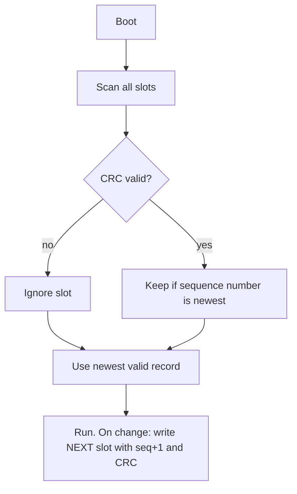

::: testing
Whether you know the **menu of persistence options** and, more importantly, the failure modes that come with them: limited write endurance, slow writes, and corruption when power dies mid-write. A weak answer is "use EEPROM". A strong one asks how much data, how often it changes and what happens on power loss, then picks among EEPROM, flash, FRAM, battery-backed SRAM or external storage, and describes wear levelling, checksums and brown-out handling.
:::

::: why
Almost every product stores something across power cycles: calibration constants, Wi-Fi credentials, an odometer, a fault log, a user setting. Done badly, it causes the worst kind of field bug: devices that lose their calibration, brick themselves after a brown-out, or wear out their flash after months. The question is also a natural bridge from "what is non-volatile memory" ([[q0826]]) to real design, and interviewers like it because the numbers (endurance, write time) force a calculation.
:::

::: concepts
- **Non-volatile memory**: retains data without power ([[q0826]]): flash, EEPROM, FRAM, MRAM.
- **Endurance**: how many write/erase cycles a cell survives (flash around $10^4$-$10^5$, EEPROM $10^5$-$10^6$, FRAM $10^{12}$ or more, vendor dependent).
- **Write time and granularity**: flash erases in sectors; EEPROM writes bytes or pages in milliseconds.
- **Wear levelling**: spread writes over many locations.
- **Atomicity / power-fail safety**: a write interrupted by a brown-out must not corrupt the whole record. Detect with CRC, use double buffering or a journal.
- **Battery-backed SRAM / backup domain**: volatile memory kept alive by a coin cell.
:::

::: answer
"I'd write it into non-volatile memory, and which kind depends on how much data and how often it changes.

For small settings that change rarely, an EEPROM, or a flash page emulating EEPROM, is perfect. Many MCUs have flash on chip, so I'd reserve a page and write to it. For data that changes constantly, like a running counter, I'd avoid flash because it only survives something like ten to a hundred thousand erase cycles; I'd use FRAM, which handles trillions of writes, or spread the writes across many slots with wear levelling. For bigger data I'd use external SPI flash or an SD card. If I only need a clock and a few bytes to survive, a coin cell on the backup domain keeps SRAM and the RTC alive, though that's not truly non-volatile.

The other half is making it robust. If power drops during a write, the record can be half-written, so I'd store a version number and CRC, write to alternate slots, and watch a brown-out detector so I can finish the write or stop starting new ones.

As a number: updating one EEPROM byte every second with a 1-million-cycle rating wears out in about 11.6 days, but rotating through 256 slots stretches that to about 8 years."
:::

::: technical
**Options.**

| Technology | Endurance (typical) | Write | Notes |
|---|---|---|---|
| On-chip flash | $10^4$-$10^5$ erase cycles | page program, sector erase (ms) | free if on the MCU; CPU may stall during erase |
| EEPROM | $10^5$-$10^6$ cycles | 3-5 ms per byte/page | byte-erasable ([[q0828]]) |
| FRAM (ferroelectric) | $10^{12}$+ | bus speed, no delay | higher cost per bit; endurance is vendor-dependent |
| MRAM | very high | fast | specialty |
| Battery-backed SRAM / backup domain | unlimited | fast | needs coin cell; not true NV |
| SD / external NOR flash | $10^3$-$10^5$ per block | ms | large capacity, wear levelling by controller or you |

**Wear arithmetic.** Lifetime = endurance / (writes per second per cell). With a single cell updated at 1 Hz and $10^6$ cycles: $10^6/86400 = 11.6$ days. Rotating through $N$ slots multiplies life by $N$: with $N=256$, $256\times 11.6 = 2963$ days, about 8.1 years.

**Robust record pattern.**
1. Record = {sequence number, payload, CRC}.
2. Write the new record to the *next* slot; never erase the only good copy first.
3. At boot, scan slots, discard ones with a bad CRC and take the valid one with the highest sequence number.

**Power-fail.** A brown-out detector (BOR/PVD) interrupt gives a warning; a bulk capacitor supplies the energy to finish a write. The energy needed is small: a flash page program might draw 10 mA for 1 ms at 3.3 V, about 33 µJ.
:::

::: short
"I'd store it in non-volatile memory: on-chip flash or EEPROM for settings, FRAM for data that changes constantly, and external flash or SD for large data. A coin-cell backup domain can keep a clock and a few bytes alive too. The important part is robustness: respect the endurance limit with wear levelling, and protect against power loss mid-write using CRCs, sequence numbers and alternating slots."
:::

::: long
"If I need data to survive power-off, I'd put it in non-volatile memory, and I'd pick by data size, update rate and cost.

For calibration and settings that change rarely, the simplest is EEPROM, or on a part without EEPROM, a flash page treated as emulated EEPROM. The thing to watch is endurance: flash is typically rated for ten to a hundred thousand erase cycles, EEPROM for a hundred thousand to a million. For something updated every second, like a counter, one location would die in days, so I'd do wear levelling, writing each new value to the next slot in a ring. Rotating through 256 slots stretches a million-cycle part from about 11 days to 8 years. Or I'd choose FRAM, which has effectively unlimited endurance and writes at bus speed.

For larger data, I'd use external SPI flash or an SD card.

If it's just a clock plus a few bytes, an RTC with a backup battery or a backup SRAM domain is enough, but it isn't true non-volatile: if the coin cell dies, the data is gone.

Then I'd design for power failure. Each record has a sequence number and a CRC, I write to a fresh slot rather than overwriting the only good copy, and at boot I choose the newest valid one. I'd use the brown-out detector to stop starting new writes when the supply droops, and a bulk capacitor to finish a write in progress. That avoids the classic bug of a half-written settings block bricking the product."
:::

::: terms
- **Non-volatile (NV)**: keeps data without power.
- **Endurance**: number of write/erase cycles a memory is guaranteed to survive.
- **Data retention**: how long stored data remains valid (often 10-20+ years, vendor dependent).
- **Wear levelling**: distributing writes so no cell is worn out early.
- **FRAM**: ferroelectric RAM; NV with very high endurance.
- **Emulated EEPROM**: software layer using flash pages to mimic byte-writable EEPROM.
- **CRC**: cyclic redundancy check detecting corrupted records.
- **Brown-out detector (BOR)**: circuit that flags or resets on low supply.
:::

::: exceptional
**An average answer**: "Use EEPROM or flash."

**An exceptional answer**:
- Asks how much data, how often it changes and how bad losing it is.
- Compares flash, EEPROM, FRAM and battery-backed memory by endurance, speed and cost.
- Quantifies wear (11.6 days vs 8 years) and wear levelling.
- Describes a power-fail-safe record format (CRC, sequence number, alternating slots).
- Mentions brown-out detection and holdup capacitance, and that flash erase can stall the CPU.
- Notes retention and temperature effects and the backup-battery caveat.
:::

::: mistakes
- **Writing a frequently changing value to the same flash/EEPROM cell.** It dies quickly. Wear-level or use FRAM.
- **No integrity check.** A power loss mid-write leaves valid-looking garbage. Use CRC plus a version.
- **Erasing the only good copy first.** If power fails after the erase, you have nothing. Write the new copy elsewhere, then retire the old one.
- **Writing on every change.** Write on a timer or on a power-fail warning instead of on every keystroke.
- **Counting battery-backed SRAM as non-volatile.** If the coin cell dies, the data goes.
- **Ignoring flash stalls.** On many MCUs, code execution from the same flash bank halts during erase; run the routine from RAM or another bank.
:::

::: deep
## Why persistence is hard

Volatile memory like SRAM holds a bit by actively powering a feedback loop. Persistence means storing the bit in a physical state that needs no power: trapped charge on a floating gate (flash, EEPROM), a ferroelectric crystal polarisation (FRAM), or a magnetic orientation (MRAM). Those mechanisms are slower to change and, for charge-based ones, wear out ([[q0826]]).

For flash and EEPROM, writing forces electrons through a thin oxide by tunnelling or hot-carrier injection. Each cycle leaves a few trapped charges in the oxide, gradually shifting the threshold voltage window until the 0 and 1 states can no longer be distinguished. That is the physical origin of the endurance rating.

## Choosing by the numbers

Define: $N_{end}$ = endurance in cycles, $f_w$ = writes per second to a given cell, $S$ = number of slots used in rotation.

$$T_{life} = \frac{N_{end}\,S}{f_w}$$

| Scenario | $N_{end}$ | $S$ | $f_w$ | Life |
|---|---|---|---|---|
| Odometer saved every 1 s, single EEPROM byte | $10^6$ | 1 | 1 Hz | 11.6 days |
| Same, 256-slot rotation | $10^6$ | 256 | 1 Hz | 8.1 years |
| Setting changed 10x per day, flash page | $10^4$ | 1 | 10/day | 1000 days = 2.7 years |
| Same with 8-page rotation | $10^4$ | 8 | 10/day | 21.9 years |
| FRAM counter every 1 ms | $10^{12}$ | 1 | 1000 Hz | $10^9$ s = 31.7 years |

Values like $10^{12}$ for FRAM are typical headline figures; some parts quote higher, and "endurance" definitions differ. Always read the datasheet. The point is the method: compute the life, not just pick a part.

## A power-fail-safe record scheme

The failure to defend against: power drops while the memory is being programmed. Flash page-programming a cell takes microseconds to milliseconds; if VDD collapses mid-way, some bits are written, some not.


Figure: Boot-time recovery. A torn write fails its CRC and is ignored, and the previous record (lower sequence number) is still intact, so you lose at most the last update.

Format (example): `[magic 2B][seq 4B][payload N B][CRC-16 2B]`. Because the new record goes into a *different* slot, the old good record is never put at risk. Only when the ring wraps do you erase the oldest sector. This pattern is what flash EEPROM-emulation libraries from MCU vendors implement.

### Worked example: holdup energy

Suppose a flash page program draws 10 mA at 3.3 V for 1.5 ms. Energy $E = V I t = 3.3\times 0.01\times 0.0015 = 49.5\ \mu J$. A 100 µF capacitor dropping from 3.3 V to 2.7 V (the minimum for flash programming, say) supplies $\tfrac12 C (V_1^2 - V_2^2) = 0.5\times 100\times10^{-6}\times(10.89-7.29) = 180\ \mu J$. That is 3.6x the requirement, so a modest bulk capacitor, plus a brown-out interrupt that fires at (say) 3.0 V, is enough to finish the write. Of course, the MCU itself and the rest of the board also draw current during that time, so budget for the whole system draw, not only the flash.

## Battery-backed memory and the backup domain

Many MCUs have a small SRAM and RTC in a separate supply domain powered by VBAT (a coin cell, a supercap). Current is typically in the sub-µA to a few µA range. A CR2032 (about 220 mAh) at 1 µA gives $220{,}000\ \mu Ah / 1\ \mu A = 220{,}000$ h = 25 years in theory; shelf life and self-discharge, not load, usually limit it. The downside is that the data is lost if the battery is removed or discharged, so it is suitable for a clock or "last-known state", not for the only copy of calibration data.

## Real hardware behaviour

- **CPU stalls during flash erase.** On single-bank flash, erase of a 2-16 KB sector can take 20-100 ms (vendor dependent), during which instruction fetches from that bank stall. A control loop has to survive that, or you run the erase from RAM with interrupts managed, or use a dual-bank part.
- **Brown-out corrupts.** Writing below the minimum program voltage gives marginal cells that read fine today and fail next month; hence a BOR threshold and not writing during low-voltage warnings.
- **Retention shortens with cycling and heat.** A cell cycled near its endurance limit and kept hot loses charge faster; datasheets give retention (such as 10-20 years) for a defined cycle count and temperature.
- **Option bytes and protection.** Write-protect or lock the settings region against runaway code overwriting it.
- **Verification.** Read back after write, or rely on the controller's verify, before declaring a save done.

```sim
{"id":"base-converter","value":"0xA5","bits":8}
```
Figure: Flash and EEPROM can only change bits in certain directions (flash programs 1 to 0 and erases to all 1s). Look at 0xA5 in binary and think about which bits you could still program without an erase.
:::

::: applications
- **Calibration data** for a sensor board stored at manufacturing test in EEPROM or a protected flash page.
- **Smart meters** storing energy totals in FRAM or EEPROM with CRC-protected records, updated periodically and on power-fail warnings.
- **Automotive ECUs** writing odometer, trip data and fault codes to EEPROM-emulation flash with wear levelling.
- **Wi-Fi/BLE devices** keeping pairing keys and credentials in a dedicated NV region.
- **Wearables** using a coin cell or supercap to keep an RTC and a few bytes through battery swaps.
- **Data loggers** with external SPI flash plus a final flush on a brown-out interrupt.
:::

::: assumptions
- I assume a **typical MCU with on-chip flash**, perhaps an external SPI memory; EEPROM may or may not be on the part.
- Endurance, retention and write-time numbers are **typical datasheet-class figures**, not guarantees; vendors and process nodes differ, and temperature changes retention.
- **Update frequency** changes the answer. Rarely-written config can go in flash; high-rate state needs FRAM or a RAM copy flushed on power-fail.
- **Safety-critical or regulated products** may need dual redundant copies and ECC.
- If **data loss is acceptable**, SRAM plus a battery or just a cloud re-sync may be sufficient.
- A **supply-hold-up** scheme only works if the board has enough capacitance and an early warning of power loss.
:::

::: followups
### What's the difference between flash and EEPROM for persistence?
Both store charge on floating gates. EEPROM can erase and write individual bytes, typically with higher endurance (up to about $10^6$ cycles), and is simple to use but small and more expensive per bit. Flash erases in large sectors but is denser, faster to read and cheaper, with lower endurance (about $10^4$-$10^5$). Flash-based "EEPROM emulation" gets byte-like behaviour with software. See [[q0828]].

### How do you protect against power loss during a write?
Never overwrite the only good copy; write to a new slot with sequence number and CRC, verify, then move on. At boot choose the newest valid record. Use a brown-out detector to stop new writes at low voltage and a bulk capacitor to finish an in-flight one. For critical data keep two copies.

### How long will a 100,000-cycle flash page last if I save a setting every 10 minutes?
$144$ writes per day, so $100{,}000/144 = 694$ days, about 1.9 years. With 16 pages in rotation, life is $16\times$ that, 30 years. This is why wear levelling or a different technology matters for logging.

### Why can't I just use SRAM with a battery?
You can for a clock and non-critical state, but if the battery dies, is replaced, or disconnects during shipping, the data is lost with no warning. Anything you cannot afford to lose, such as calibration, belongs in true NV memory, maybe with the battery SRAM as a fast cache.

### Harder: the device stores a counter every second in FRAM but loses the last few seconds on power failure. How would you fix it?
The data written before power failed is safe in FRAM (no write delay), so the loss means the *last update* never ran, e.g. the counter lived in RAM and was flushed periodically. Fix by detecting power fail early (a comparator on the input rail ahead of the regulator) and writing on that interrupt, with bulk capacitance sized for the write. Or write every change straight to FRAM, since its endurance allows that.
:::

::: interpretations
"Persist after the microcontroller powers off" is about **non-volatile data storage**. It could also mean keeping the *state of the system* (a running clock, a counter) through a power loss. The answer covers both: true NV memory for data and battery-backed domains for clock/state. The definition of NV is on [[q0826]]; larger storage choices are on [[q0824]].
:::

::: references
- Horowitz & Hill, *The Art of Electronics*, 3rd ed.: non-volatile memory section (EEPROM, flash, retention and endurance).
- JEDEC standards for non-volatile memory endurance and data retention qualification (e.g. JESD47 stress-test-driven qualification); consult the current JEDEC documents for exact procedures.
- A vendor application note on flash-based EEPROM emulation for the MCU family you use (most major MCU vendors publish one).
- Datasheets for a typical I2C EEPROM and an SPI FRAM: endurance, retention and write-time specifications.
:::

::: rubric
- Names non-volatile options (flash, EEPROM, FRAM, battery-backed, external) :: This is the core of the answer.
- Chooses by data size and update rate :: Shows design thinking instead of memorised lists.
- Mentions endurance and calculates wear :: Wear is the main reason a naive design fails in the field.
- Describes wear levelling or alternating slots :: The standard mitigation.
- Handles power loss mid-write (CRC, sequence, brown-out detection, holdup) :: Separates experienced from textbook answers.
- Notes the battery-backed SRAM is not truly non-volatile :: A common conceptual trap.
- Mentions flash erase stalls or retention caveats :: Real-hardware awareness.
:::

::: quiz
```json
[
 {"type":"mcq","level":"fundamental","q":"Which of these keeps its contents with no power at all?","options":["SRAM","Flash","The CPU's core registers","A DRAM chip"],"answer":1,"explain":"Flash stores charge on a floating gate that remains without power. SRAM, DRAM and flip-flop registers are volatile."},
 {"type":"numeric","level":"intermediate","q":"A single EEPROM location rated for 1,000,000 write cycles is updated once per second. How many days until it reaches its rated endurance?","answer":11.57,"tolerance":0.02,"unit":"days","explain":"$10^6\\ \\text{s}/86400 = 11.57$ days. This is why frequently updated values need wear levelling or FRAM."},
 {"type":"numeric","level":"intermediate","q":"You rotate that counter through 256 EEPROM slots (1,000,000 cycles each, one write per second in total). How many years does it last?","answer":8.1,"tolerance":0.03,"unit":"years","explain":"Each slot is written once every 256 s, so total life = $10^6 \\times 256$ s $= 2.56\\times10^8$ s $= 8.1$ years."},
 {"type":"mcq","level":"intermediate","q":"What is the safest way to update a settings block in flash given the risk of power loss?","options":["Erase the block, then write the new data","Write the new data with a CRC and sequence number to a different slot, then use the newest valid one at boot","Write the data twice in the same place","Disable the brown-out detector so it cannot reset during the write"],"answer":1,"explain":"Never erase the only good copy first. Writing to a new slot means a torn write leaves the old record valid, and the CRC tells you which record is complete. Disabling the brown-out detector makes things worse."},
 {"type":"truefalse","level":"advanced","q":"A coin-cell-backed SRAM is a good place to keep the only copy of factory calibration data.","answer":false,"explain":"If the battery fails, is removed or discharges, the SRAM contents are lost with no warning. Calibration must be in true non-volatile memory (flash/EEPROM/FRAM); backed SRAM is fine for clock or convenience state."},
 {"type":"numeric","level":"advanced","q":"A flash page program draws 10 mA from 3.3 V for 1.5 ms. How much energy, in µJ, must the holdup capacitor supply (flash only)?","answer":49.5,"tolerance":0.02,"unit":"µJ","explain":"$E = VIt = 3.3 \\times 0.010 \\times 0.0015 = 4.95\\times10^{-5}$ J = 49.5 µJ. A 100 µF capacitor falling from 3.3 V to 2.7 V stores about 180 µJ, which covers it."}
]
```
:::
