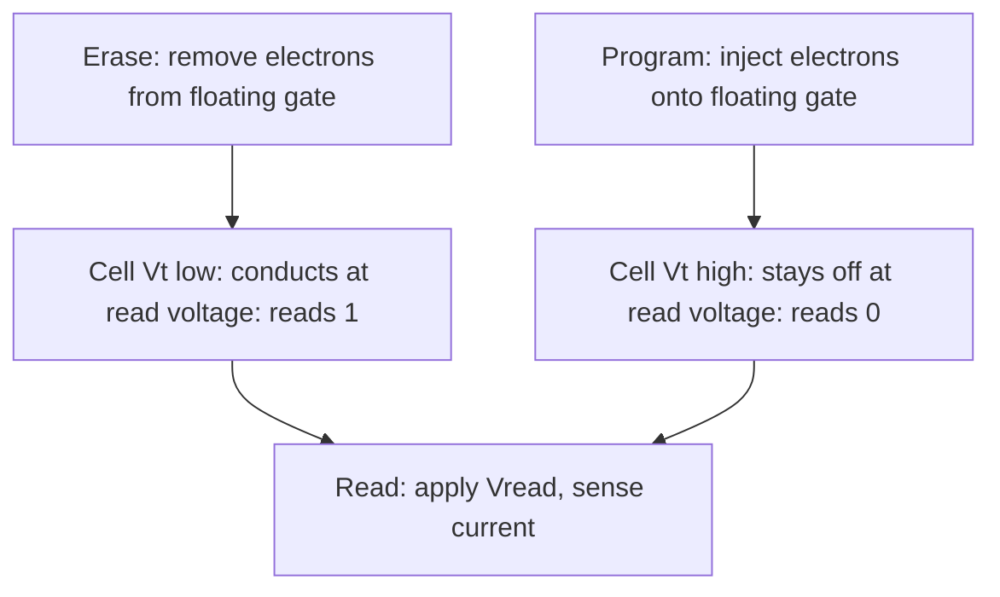

::: testing
Whether you can give a crisp definition (data persists without power), contrast it with volatile memory, and, as a differentiator, explain **how** a cell can hold a bit with no power: trapped charge on a floating gate, ferroelectric polarisation, magnetic state. The interviewer also listens for the real-world limits that come with non-volatility: finite endurance, data retention, slower writes. Naming examples (flash, EEPROM, ROM, FRAM, MRAM) and where each is used shows breadth.
:::

::: why
"Non-volatile" is one of the first words in any memory conversation, and its definition hides most of the design constraints. If you understand *why* NV storage is slow to write and wears out, the rest of the section ([[q0825]], [[q0827]], [[q0828]]) falls into place. In practice, the choice of NV technology determines boot time, firmware-update strategy, how often you can log, and product lifetime.
:::

::: concepts
- **Volatile vs non-volatile**: volatile memory (SRAM, DRAM) loses data when power is removed; NV memory keeps it.
- **Floating gate transistor**: a MOSFET with an isolated gate that stores charge; the charge shifts the threshold voltage ([[q0823]]).
- **Tunnelling**: electrons crossing a thin oxide (Fowler-Nordheim) to charge or discharge the gate.
- **Data retention**: how long the stored charge or state remains readable (years).
- **Endurance**: the number of write/erase cycles before the cell wears out ([[q0825]]).
- **Memory families**: ROM, EPROM, EEPROM, flash, FRAM, MRAM, and others.
:::

::: answer
"Non-volatile memory is memory that keeps its contents when power is removed, as opposed to volatile memory like SRAM or DRAM, which forget instantly.

The usual examples are ROM, EEPROM and flash. Flash and EEPROM work by trapping electrons on an electrically isolated 'floating' gate inside a transistor. The trapped charge shifts the transistor's threshold voltage, and the read circuit senses whether it conducts at a reference gate voltage, so that's a 1 or a 0. Because the gate is surrounded by insulating oxide, the charge stays for years without any power. There are also newer technologies like FRAM, which stores a bit in the polarisation of a ferroelectric crystal, and MRAM, which uses magnetic states.

The trade-offs are real. To change the stored charge you push electrons through the oxide with a high voltage, which is slower than flipping an SRAM latch and damages the oxide a little each time. So NV memory has limited endurance, tens of thousands to a million cycles for flash and EEPROM, and writes take microseconds to milliseconds. Data retention is typically ten to twenty years, depending on temperature.

That's why firmware lives in flash, but running variables live in SRAM."
:::

::: technical
**Definition.** A memory is non-volatile if its state is a stable physical configuration that does not require continuous power. SRAM and DRAM are volatile: SRAM needs the latch supply; DRAM needs power plus refresh every few tens of milliseconds.

**Floating-gate cell.** A MOSFET with a polysilicon floating gate between the control gate and the channel, insulated by oxide (tunnel oxide on the order of 7-10 nm in classic floating-gate EEPROM/flash; values vary by process). With charge $Q_{FG}$ stored on the floating gate, the threshold shift seen at the control gate is approximately

$$\Delta V_t \approx -\frac{Q_{FG}}{C_{CG}},$$

where $C_{CG}$ is the control-gate-to-floating-gate capacitance. A programmed (electron-rich) cell has a higher $V_t$, so at the read gate voltage it stays off; an erased cell conducts.

**Programming and erasing.**
- *Fowler-Nordheim tunnelling*: a large field (around 10 MV/cm across the oxide) lets electrons tunnel through. Used for erase and for EEPROM program.
- *Hot-carrier injection*: used by NOR flash to program (channel hot electrons).
- These high voltages (10-20 V) are made on-chip by a charge pump.

**Limits.** Each cycle damages the oxide, so endurance is finite. Retention is limited by slow charge leakage, which speeds up with temperature (Arrhenius behaviour).

**Other NV technologies.** FRAM (polarisation of a ferroelectric such as PZT), MRAM (magnetic tunnel junction resistance), and phase-change memory (amorphous vs crystalline resistance).
:::

::: short
"Non-volatile memory retains its data without power, unlike SRAM or DRAM. Flash and EEPROM do it by trapping charge on an insulated floating gate, which shifts the transistor's threshold voltage; FRAM and MRAM use ferroelectric or magnetic states. The trade-off is slower, more power-hungry writes and limited endurance, so firmware lives in flash while running variables live in SRAM."
:::

::: long
"Non-volatile memory means the data is still there after you remove power. Volatile memory like SRAM stores a bit in a feedback loop that needs supply, and DRAM stores charge on a capacitor that leaks within milliseconds. NV memory stores the bit in something physically stable.

The most common mechanism is the floating-gate transistor, used in EEPROM and flash. There's an extra polysilicon gate buried in oxide between the control gate and the channel. If I inject electrons onto it, that negative charge raises the threshold voltage, so at the read voltage the transistor stays off, and that reads as a 0. If I remove the electrons, the transistor conducts, which reads as 1. The oxide is such a good insulator that the charge stays for ten or twenty years.

To change the charge, I need a strong field across the oxide. EEPROM and flash use Fowler-Nordheim tunnelling or hot-carrier injection, and a charge pump on the chip makes the 10 to 20 volts needed. That's why writes are slow, in the microseconds to milliseconds range, and why each write slightly damages the oxide, so endurance is limited, typically 10 thousand to 1 million cycles.

There are alternatives: FRAM stores the bit in the polarisation of a ferroelectric crystal, so it writes quickly with very high endurance, and MRAM uses magnetic tunnel junctions.

In a microcontroller, I put firmware and constants in flash, small persistent settings in EEPROM, and fast working data in SRAM, which is volatile but fast and has no wear-out."
:::

::: terms
- **Volatile**: loses data when power is removed.
- **Non-volatile (NV)**: retains data without power.
- **Floating gate**: electrically isolated gate that stores charge.
- **Threshold voltage ($V_t$)**: gate voltage at which the transistor starts conducting; the cell's stored value shifts it.
- **Fowler-Nordheim tunnelling**: quantum tunnelling of electrons through a thin oxide under a strong field.
- **Retention**: how long data survives unpowered.
- **Endurance**: number of program/erase cycles a cell survives.
- **Charge pump**: on-chip circuit generating the high programming voltage.
:::

::: exceptional
**An average answer**: "It keeps data when power is off, like flash."

**An exceptional answer**:
- Contrasts SRAM, DRAM and NV memory by *how* each stores a bit.
- Explains the floating-gate mechanism with the threshold-voltage shift and the read sensing.
- Gives the cost side: slower writes, high-voltage charge pump, finite endurance, retention that shrinks with temperature.
- Names alternatives (FRAM, MRAM) and what they improve.
- Connects to firmware: code in flash, variables in SRAM, wear-aware writes.
:::

::: mistakes
- **"Non-volatile means it never wears out."** Charge-based NV memory has finite endurance.
- **"Non-volatile means unlimited retention."** Retention is years, shorter at high temperature or after many cycles.
- **Calling ROM, flash and EEPROM the same.** They differ in how (and whether) they can be rewritten ([[q0827]], [[q0828]]).
- **Thinking NV memory is as fast to write as RAM.** Only FRAM and MRAM come close.
- **Confusing 'volatile' with 'unreliable'.** SRAM is perfectly reliable while powered; volatile only describes behaviour without power.
- **Assuming battery-backed SRAM is NV.** It keeps data only while the battery is alive.
:::

::: deep
## Why a bit can survive without power

A bit needs two distinguishable physical states and a barrier that keeps the system from drifting between them. In SRAM the "barrier" is active: the cross-coupled inverters keep pushing the node to the rail. Remove the supply and that restoring force disappears. In NV memory, the barrier is passive: an energy hill that charge or polarisation cannot cross without an applied field.

For a floating gate, the barrier is the oxide band gap. The conduction-band offset between silicon and SiO2 is about 3.2 eV. At room temperature, thermal energy is only about 0.026 eV, so electrons essentially cannot be thermally excited over the barrier; they leak by slow direct tunnelling through defects and thermal emission, which is why retention is measured in years.

## How much charge is that?

A rough sense of scale: the floating gate has a capacitance of order 1 fF to the control gate in older processes (modern cells are smaller; this is an illustration, not a datasheet value). To shift $V_t$ by 3 V:

$$Q = C\,\Delta V = 1\times10^{-15}\ \text{F}\times 3\ \text{V} = 3\times10^{-15}\ \text{C}$$

$$N = \frac{Q}{q} = \frac{3\times10^{-15}}{1.602\times10^{-19}} \approx 18{,}700\ \text{electrons}.$$

Each stored bit is only about 19 thousand electrons, and in modern processes just hundreds to a few thousand. That is the reason endurance and retention shrink as cells scale down: losing 20% of the charge over 10 years means leaking about 3,700 electrons in $3.16\times10^8$ s, about $1.2\times10^{-5}$ electrons per second. Tiny leakage paths matter enormously, and a damaged oxide (after many cycles) can raise this by orders of magnitude.

## Program, erase, read


Figure: The two stored states are just a low-$V_t$ and a high-$V_t$ transistor. The read circuit applies a gate voltage between the two thresholds and senses whether current flows.

A read is non-destructive and fast (tens of ns for on-chip flash). A **program** adds electrons; an **erase** removes them. In flash, erase works on a whole sector at once; programming can only add charge (change 1 to 0) so changing a 0 back to 1 needs an erase. That asymmetry explains why you cannot rewrite flash like RAM ([[q0825]]).

## Retention vs temperature

Charge loss is thermally activated, roughly following an Arrhenius law with activation energy $E_a$:

$$\text{lifetime} \propto \exp\left(\frac{E_a}{k T}\right).$$

For $E_a = 1.1$ eV (a value sometimes used in qualification models, but it varies), going from 55 °C to 85 °C (328 K to 358 K) shortens the charge-loss lifetime by the factor $\exp\left(\frac{1.1}{8.617\times10^{-5}}\left(\frac{1}{328}-\frac{1}{358}\right)\right) \approx 26$. So a part qualified for some years of retention at 85 C should keep data roughly 26 times longer at 55 C (on this simple model). The plot shows the acceleration relative to 300 K:

```plot
{"title":"Illustrative Arrhenius acceleration of charge loss vs temperature (Ea = 1.1 eV)","x":{"label":"Temperature","unit":"K","min":300,"max":400},"y":{"label":"Relative loss rate (300 K = 1)","min":1,"max":100000,"log":true},
 "vars":{"ea":1.1,"k":8.617e-5},
 "series":[{"label":"acceleration","fn":"exp(ea/k*(1/300-1/x))"}],
 "points":[{"x":328,"y":"exp(ea/k*(1/300-1/328))","label":"55 C"},{"x":358,"y":"exp(ea/k*(1/300-1/358))","label":"85 C"}]}
```
Figure: Each step up in temperature multiplies the charge-loss rate. This is why retention specs list a temperature (for example 10 years at 85 C), and why datasheets quote shorter retention for cycled cells.

> [!UNCERTAIN]
> The activation energy and exact retention numbers depend on the cell design and the qualification method. The 1.1 eV figure is illustrative; real retention is specified by the manufacturer.

## Threshold distributions and the read window

A single cell is never exactly at one threshold. Thousands of cells programmed "identically" form a statistical distribution of $V_t$, because oxide thickness, coupling and trapped charge vary from cell to cell. Say erased cells have $V_t$ spread between 0.5 V and 2.0 V and programmed cells between 4.5 V and 6.5 V. The read voltage must lie in the gap, for instance 3.3 V, leaving about 1.3 V of margin on the erased side and 1.2 V on the programmed side.

Over time and cycling, two things eat that margin:
- **Charge loss** drags the programmed distribution down toward the read voltage.
- **Cycling damage** broadens both distributions (trapped charge in the oxide) and makes the window close from both sides.

When the distributions touch the read voltage, bits read wrong. A worked margin check: a programmed cell at 4.5 V that loses 25% of its programmed-minus-erased shift (taking the erased level at 1.25 V, so the shift is 3.25 V and 25% is 0.81 V) falls to 3.69 V, still above 3.3 V by only 0.39 V. Another 12% loss and it reads as erased. This is why retention is specified at end of life, after the maximum rated cycles, at the maximum temperature, and why vendors verify after programming (program-verify with a stricter read level than normal reads).

## NOR versus NAND, briefly

NOR flash wires each cell between a bitline and ground in parallel, like a NOR gate, so any single cell can be read at random in tens of nanoseconds. That is why MCU firmware lives in NOR-type embedded flash: the CPU can fetch instructions directly (execute in place). NAND flash chains many cells in series to save area, so it reads and programs in pages (2-16 KB) and erases in blocks, is much denser and cheaper per bit, but has slower random access and needs error correction (ECC). SD cards, eMMC and SSDs are NAND with a controller handling ECC and wear levelling.

## Other non-volatile technologies

| Technology | State stored as | Write speed | Endurance (typical headline) | Notes |
|---|---|---|---|---|
| Mask ROM | transistor present/absent | not writable | n/a | cheapest; fixed at fab ([[q0827]]) |
| EEPROM | floating-gate charge | ms per byte | $10^5$-$10^6$ | byte erase ([[q0828]]) |
| NOR/NAND flash | floating-gate or charge-trap | µs program, ms erase | $10^3$-$10^5$ | dense |
| FRAM | ferroelectric polarisation | ~SRAM speed | $10^{12}$ and up | low write energy |
| MRAM | magnetic tunnel junction | ~SRAM speed | very high | emerging |
| Battery-backed SRAM | latch + battery | SRAM | unlimited | not truly NV |

## What it means in a microcontroller

The core fact: **firmware has to be in NV memory** (otherwise the chip would boot into nothing), so every MCU has flash, mask ROM or OTP. On reset the CPU fetches from this NV memory. Everything that is changing quickly lives in SRAM. Persistent but changing data (settings, counters) is the grey zone: that's where EEPROM, emulated EEPROM or FRAM come in.

```sim
{"id":"mosfet-lab"}
```
Figure: Drag the gate voltage to see the MOSFET's threshold. A floating-gate cell is this same transistor with a movable threshold: trapped charge simply shifts the gate voltage at which it turns on.
:::

::: applications
- **Firmware storage** in every microcontroller (on-chip flash).
- **USB flash drives, SD cards and SSDs** (NAND flash).
- **Boot ROM** in processors that hold the first-stage bootloader ([[q0827]]).
- **Configuration EEPROMs** on SFP optics, DIMM SPD chips and displays.
- **FRAM in smart meters and automotive event recorders** where frequent writes would exhaust flash.
- **Key storage / OTP fuses** for secure boot and chip IDs.
:::

::: assumptions
- I assume NV memory in the **semiconductor** sense; magnetic tape or disks are also non-volatile but are usually not meant.
- Numbers (thickness, charge, endurance, retention) are **typical orders of magnitude** and differ by process node and vendor.
- Floating-gate flash is the default model; newer 3D NAND and many embedded flashes use **charge-trap** layers, which store charge in a dielectric instead of a conductive gate, with the same overall behaviour.
- "Non-volatile" says nothing about **speed**: some NV memories write as fast as RAM, others are 1000x slower.
- Ferroelectric and magnetic memories are covered at an overview level.
:::

::: followups
### How does flash differ from DRAM?
DRAM stores a bit as charge on a capacitor that leaks away in milliseconds, so it needs constant refresh and loses data without power. Flash stores charge on an insulated floating gate that stays for years. DRAM is faster, has near-unlimited endurance and is cheap per bit at large sizes; flash is non-volatile but has slow writes and limited endurance.

### Why does flash need a high voltage for programming?
To move electrons through the oxide barrier you need a field of roughly 10 MV/cm, which across a ~8 nm oxide is on the order of 8 V in the oxide alone, so the cell sees 10-20 V at the control gate. The chip generates that with a charge pump from the 1.8-3.3 V supply, which is also why programming draws more current than reading and why flash writes fail below a minimum supply.

### What limits how long NV data lasts?
Charge slowly leaks through the oxide by tunnelling and thermal emission; the leak rate rises sharply with temperature (Arrhenius) and with oxide damage from cycling. Datasheets specify retention (such as 10 years at 85 C after the rated cycles). Beyond that, bits can flip, which is why some systems refresh or use ECC on important data.

### Is ROM non-volatile? Is EEPROM ROM?
Yes, ROM is non-volatile by nature, and EEPROM is, historically, a kind of "programmable ROM" that can be electrically erased. In practice we call a memory ROM when it is read-only in normal operation. See [[q0827]] and [[q0828]].

### Harder: your product sits on a shelf for 15 years at 40 C and then must boot. What can go wrong with the flash?
Retention: charge in the cells may have leaked enough that the programmed and erased threshold distributions overlap, flipping bits. At 40 C the loss is much slower than at 85 C (a fraction of the rated stress), so 15 years is usually within spec for lightly cycled parts. Mitigation: check the datasheet retention at your temperature and cycle count, use ECC or CRC on the image, and have a recovery bootloader.
:::

::: interpretations
"Non-volatile (NV)" could invite either a plain definition or a mechanism-level answer. I give both: definition first, mechanism for depth. Some interviewers expect you to list types; the table above covers that, and [[q0827]] and [[q0828]] go deeper on ROM and EEPROM.
:::

::: references
- Sedra & Smith, *Microelectronic Circuits*: memory circuits chapter (read-only and flash memory cells).
- Horowitz & Hill, *The Art of Electronics*, 3rd ed.: digital memory chapter, covering EPROM/EEPROM/flash and how they store charge.
- Brewer & Gill (eds.), *Nonvolatile Memory Technologies with Emphasis on Flash* (IEEE Press): the standard reference on flash cell physics, retention and endurance.
- JEDEC solid-state memory qualification standards (endurance and data-retention testing).
:::

::: rubric
- Defines NV: data persists without power, contrasted with SRAM/DRAM :: This is the core definition and the baseline expectation.
- Gives examples (ROM, EEPROM, flash, FRAM, MRAM) :: Shows breadth.
- Explains a mechanism (floating gate, trapped charge shifting $V_t$) :: Separates understanding from vocabulary.
- States the cost: slower writes, high voltage, finite endurance :: Non-volatility is never free.
- Mentions retention and temperature :: Real engineering concern.
- Connects to MCU usage: code in flash, variables in SRAM :: Shows practical context.
:::

::: quiz
```json
[
 {"type":"mcq","level":"fundamental","q":"Which of these is volatile?","options":["Flash","EEPROM","SRAM","Mask ROM"],"answer":2,"explain":"SRAM holds a bit in a powered latch, so it loses its state when power is removed. The others retain data without power."},
 {"type":"mcq","level":"fundamental","q":"In a floating-gate memory cell, what physically stores the bit?","options":["The state of a latch","Charge trapped on an electrically isolated gate","A capacitor that is refreshed","A mechanical switch"],"answer":1,"explain":"Electrons trapped on the insulated floating gate shift the transistor's threshold voltage, and the read circuit senses it. A refreshed capacitor is DRAM."},
 {"type":"numeric","level":"intermediate","q":"A floating gate has 1 fF of coupling capacitance. About how many electrons are needed to shift the threshold by 3 V?","answer":18700,"tolerance":0.03,"unit":"electrons","explain":"$Q = C\\Delta V = 10^{-15}\\times 3 = 3\\times10^{-15}$ C; $N = Q/q = 3\\times10^{-15}/1.602\\times10^{-19} \\approx 18{,}700$."},
 {"type":"truefalse","level":"intermediate","q":"Non-volatile memory has unlimited write endurance.","answer":false,"explain":"Floating-gate memories degrade with each program/erase cycle, typically 10^4 to 10^6 cycles. Only some technologies (FRAM, MRAM) have extremely high endurance."},
 {"type":"mcq","level":"advanced","q":"Why does data retention in flash get worse at high temperature?","options":["The supply voltage rises","Thermally activated leakage of stored charge accelerates (Arrhenius behaviour)","Flash is erased automatically by heat","The charge pump overheats"],"answer":1,"explain":"Charge leaks over the oxide barrier or through defects at a rate that grows exponentially with temperature, which is why retention specs state a temperature."}
]
```
:::
