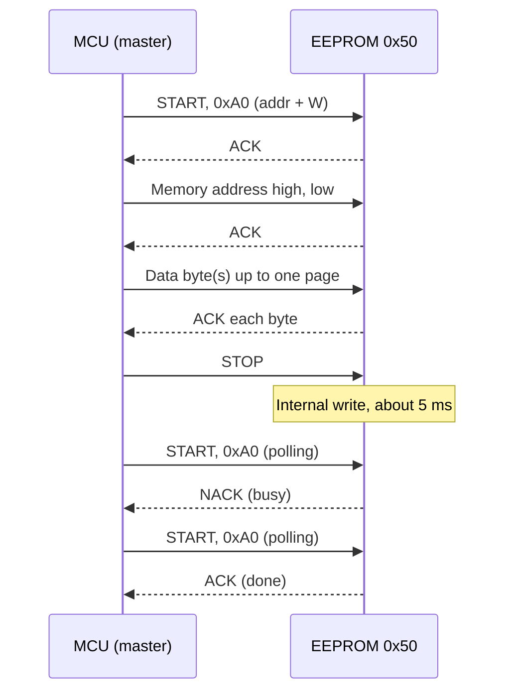

::: testing
Whether you can unpack the acronym (electrically erasable programmable read-only memory), explain what makes it different from ROM, EPROM and flash (byte-level electrical erase and rewrite), and describe how you actually use one on a board: a small serial chip on I2C or SPI, with page writes, write-cycle time, ACK polling and endurance limits. Strong candidates also connect it to the use case (calibration, settings) and the limits (small, slow, wears out).
:::

::: why
EEPROMs are the standard place to keep a few bytes that must survive power-off and occasionally change: serial numbers, calibration, MAC addresses, user settings. Many boards carry one, and many MCUs include one or emulate one. Interviewers like this question because the details (write time, page boundaries, endurance) reveal who has actually used one. It also links directly to I2C ([[q0825]] covers how to use it robustly).
:::

::: concepts
- **Non-volatile memory** ([[q0826]]) and the **ROM family** ([[q0827]]).
- **Floating-gate cell with tunnel oxide**: charge added or removed by Fowler-Nordheim tunnelling.
- **Byte-erasable**: unlike flash, a byte or small page can be erased and rewritten on its own.
- **Serial interfaces**: I2C (24xx family) and SPI (25xx family) are the common ones.
- **Write cycle time ($t_{WC}$)**: internal time, typically a few ms, during which the chip does not respond.
- **Endurance and retention**: around $10^5$-$10^6$ cycles, decades of retention.
:::

::: answer
"EEPROM is electrically erasable programmable read-only memory. It's non-volatile, like ROM, but you can rewrite it electrically, one byte or one small page at a time, without any special erase equipment.

Each cell is a transistor with a floating gate. To write, a higher voltage that the chip generates internally pushes electrons through a thin oxide onto the gate by tunnelling; to erase, it pulls them off. The stored charge shifts the transistor's threshold, which is what the read circuit senses. It stays for decades without power, but every write wears the oxide a bit, so endurance is limited, typically a hundred thousand to a million write cycles per byte.

In practice it's a small chip, from 1 kbit up to maybe 1 Mbit, on I2C or SPI, like the common 24-series parts. Reading is fast, but a write takes a few milliseconds, during which the chip ignores the bus, so you either wait or poll for an acknowledge. You also have to respect page boundaries, because a page write wraps around inside the page.

I'd use it for things like calibration constants, a serial number or user settings, small amounts of data that change rarely. For large data, I'd use flash; for data that changes constantly, FRAM or wear levelling."
:::

::: technical
**Cell.** A floating-gate MOSFET (often with a select transistor, the "FLOTOX" cell) in which Fowler-Nordheim tunnelling through a ~10 nm-class oxide (process-dependent) both writes and erases. The stored charge shifts $V_t$ ([[q0826]]). The chip generates 12-20 V internally with a charge pump, so a single 1.8-5.5 V supply is enough.

**Organisation.** Memory is arranged in bytes with pages (e.g. 64 bytes per page for a 256-kbit I2C part; sizes vary). A byte write erases-then-programs automatically (self-timed).

**Serial I2C EEPROM (24xx family).** 7-bit address `1010 A2 A1 A0`, so the base address is 0x50 with three hardware address pins selecting up to 8 chips (some larger parts use pins differently). A write: START, device address + W, memory address (1 or 2 bytes), data bytes (up to a page), STOP. The chip then performs the internal write for $t_{WC}$ (typically 3-5 ms; read the datasheet) and does not ACK its address during that time. **ACK polling**: repeat START + address until it ACKs.

**Timing example.** At 400 kHz I2C, a 64-byte page write sends $1+2+64 = 67$ bytes at 9 clocks each: $67\times9/400\,\text{kHz} = 1.5$ ms, followed by $t_{WC}\approx 5$ ms. Reads are sequential and fast.

**Endurance and retention.** About $10^6$ cycles per byte and ~40-200 years retention are typical headline figures for I2C EEPROMs; vendor- and temperature-dependent.

**Comparison with flash.** EEPROM: byte erase, higher endurance, smaller, more expensive per bit. Flash: block erase, denser, cheaper, lower endurance.
:::

::: short
"An EEPROM is non-volatile memory you can erase and rewrite electrically, one byte or small page at a time. Cells are floating-gate transistors written by tunnelling, so data lasts decades without power but wears out after roughly 10^5 to 10^6 writes. Typically it's a small I2C or SPI chip for calibration or settings. Writes take a few milliseconds, and you poll for completion. For big or frequently changing data, use flash or FRAM instead."
:::

::: long
"EEPROM stands for electrically erasable programmable read-only memory. It sits between ROM and RAM in the way it behaves: it keeps data when power is off, but you can rewrite it from firmware, byte by byte.

The cell is a floating-gate transistor. To program it, a charge pump inside the chip makes a high voltage, around 12 to 20 volts, which drives electrons through a very thin oxide by Fowler-Nordheim tunnelling onto the floating gate. That shifts the threshold voltage. Erasing reverses it. The read circuit applies a reference voltage and senses whether the cell conducts. The charge is trapped by oxide, so it's retained for decades, but each write damages the oxide slightly, so the endurance is typically 100,000 to 1,000,000 writes per byte.

The most common form on a board is a little serial chip, like a 24-series part on I2C. The address is 0x50 plus three pins, so up to eight on a bus. For a write I send the device address, the memory address, then up to a page of data, and stop. The chip then writes internally, which takes about 5 milliseconds, and it won't acknowledge during that time, so I either wait or poll for the ACK. If a page write runs past the page boundary, the address wraps around inside the page and overwrites earlier bytes, which is a classic bug.

I'd use EEPROM for calibration constants, serial numbers or settings. It's small and slow to write, so for megabytes I'd use flash, and for data that changes every second I'd use FRAM or spread writes out."
:::

::: terms
- **EEPROM**: electrically erasable programmable read-only memory.
- **Floating gate**: insulated gate that stores charge.
- **Fowler-Nordheim tunnelling**: electron tunnelling through thin oxide under a strong field.
- **Page write**: writing several bytes in a single internal write cycle; limited by page size.
- **Write cycle time ($t_{WC}$)**: internal self-timed write duration, a few ms.
- **ACK polling**: sending the device address repeatedly until the chip ACKs, meaning the write is done.
- **Endurance**: guaranteed program/erase cycles.
- **Retention**: how long data remains valid unpowered.
:::

::: exceptional
**An average answer**: "Memory that keeps data when power is off and can be rewritten."

**An exceptional answer**:
- Expands the acronym and positions it versus ROM, EPROM and flash by erase granularity.
- Explains the floating-gate / tunnelling mechanism and why writes wear it out.
- Describes real usage: I2C address 0x50, pages, write cycle time, ACK polling, page wrap-around.
- Computes a write time and an endurance lifetime.
- Chooses sensible applications (calibration, settings) and alternatives (flash, FRAM) for others.
- Mentions MCUs with on-chip EEPROM or emulated EEPROM in flash.
:::

::: mistakes
- **Calling it the same as flash.** EEPROM is byte-erasable and has higher endurance; flash erases by large blocks.
- **Ignoring the write cycle time.** Reading back immediately after a write returns NACK or stale data.
- **Writing across a page boundary** in one command, so the address wraps and old bytes in the same page are overwritten.
- **Writing every loop iteration.** Uses up endurance; write only on change.
- **Skipping the write-protect and brown-out considerations.** A power loss mid-write can corrupt a byte; use CRC and keep WP asserted when not writing.
- **Forgetting the pull-ups on I2C**, then blaming the EEPROM ([[q0825]] covers robust usage).
:::

::: deep
## What an EEPROM cell does

The classic EEPROM cell (floating-gate tunnel-oxide, "FLOTOX") has two transistors: a floating-gate transistor that stores the bit, and a select transistor that isolates it, so one byte can be rewritten without disturbing its neighbours. That second transistor makes the cell bigger than a flash cell, which explains cost and density: an EEPROM bit costs several times more silicon than a flash bit, but the byte-granular erase is why it is nice to use.

**Charging the floating gate.** (Whether this state is called "programmed" or "erased", and whether it reads as 0 or 1, differs between vendors and cell designs.) The control gate is raised to a high voltage $V_{pp}$ (about 12-20 V from the charge pump) while the drain is grounded; the oxide field becomes high enough (order 10 MV/cm) for Fowler-Nordheim tunnelling, and electrons move onto the floating gate. The current density follows

$$J \propto E^2 \exp\left(-\frac{B}{E}\right),$$

so a modest voltage change gives a huge change in tunnelling current. That steepness is why writing needs high voltage while retention at normal fields is excellent.

**Discharging the floating gate.** Reverse the field (high voltage on the drain, control gate grounded) and electrons tunnel off the floating gate.

**Read.** A reference gate voltage between the erased and programmed thresholds is applied; a sense amplifier detects current or none.

The programmed and erased threshold states are separated by a window; each cycle traps a few charges in the oxide and the window narrows until a 0 can't be told from a 1: that is the end of endurance.

## Using a 24-series I2C EEPROM


Figure: A page write has two phases. The bus transaction is short, then the chip goes busy for $t_{WC}$ and NACKs its address. Polling until the first ACK finishes the write as early as possible, instead of waiting a fixed worst-case delay.

**Numbers (400 kHz I2C, 64-byte page).**
- Bus time: $(1+2+64)\times 9 / 400{,}000 = 1.51$ ms.
- Internal write: assume 5 ms.
- Total: about 6.5 ms for 64 bytes, i.e. $64/6.5\text{ ms} \approx 9.8$ kB/s effective.
- Writing the same 64 bytes one byte at a time: each single-byte write costs $(1+2+1)\times9/400\,\text{kHz} = 0.09$ ms of bus time plus 5 ms of internal write, so $64\times5.09 = 326$ ms. Page writes are 50x faster, and they use up only one cycle for the page instead of 64.

**Page wrap-around.** With a 64-byte page, an address of 0x003E and 4 data bytes writes 0x3E, 0x3F, then wraps to 0x00 and 0x01 (it wraps within the page, not to 0x0040). Always split writes at page boundaries:

```c
// Write len bytes starting at addr, never crossing a 64-byte page
while (len) {
    uint16_t room = 64 - (addr % 64);
    uint16_t n = len < room ? len : room;
    eeprom_page_write(addr, data, n);   // then ACK-poll
    addr += n; data += n; len -= n;
}
```

> [!UNCERTAIN]
> Page size, $t_{WC}$ and endurance differ by manufacturer and by density (for example 8, 16, 32, 64 or 128 bytes per page across the 24xx family). Use the datasheet of your exact part.

## The SPI flavour (25-series)

SPI EEPROMs are faster on the bus and use a command set rather than an address byte. The common (Microchip 25xx-style) commands are WREN 0x06 (write enable), WRITE 0x02, READ 0x03 and RDSR 0x05 (read status register). Writes are gated by a **write-enable latch**: you must send WREN before every write, and the latch clears itself when the write finishes. That is a deliberate safety feature, because a glitching SPI line is unlikely to produce a valid WREN followed by a valid WRITE. Instead of ACK polling, you poll the **WIP** (write in progress) bit in the status register until it reads 0. The status register also holds block-protect bits that lock quarter, half or all of the array.

Bus time comparison for the same 64-byte page at 10 MHz SPI: 1 command + 2 address + 64 data bytes = 67 bytes x 8 bits = 536 clocks = 53.6 µs, versus 1.5 ms on 400 kHz I2C. Either way, the 3-5 ms internal write dominates, so the faster bus barely changes total write time, but it matters a lot for reads: reading all 32 KB of a 256-kbit part takes about $32768\times8/10\,\text{MHz} = 26$ ms over SPI versus about $32768\times9/400\,\text{kHz} = 737$ ms over I2C. If you load a configuration table at boot, the interface choice changes boot time by most of a second.

## Endurance: what the numbers really mean

A rated endurance of $10^6$ cycles is usually "per byte (or page), at a stated temperature, with a minimum number of cells surviving". Interpreting it:

- Storing a 32-bit counter that increments once per minute in the same 4 bytes: with a page write, the whole page cycles once per update, so $10^6$ minutes = 1.9 years. Using a ring of 16 pages gives 30 years.
- Note that cycling a byte in a page often cycles the neighbouring bytes too if the chip erases the page; some chips are truly byte-erasable internally, some are page-erase. Check.

Compare that with microcontroller-integrated "data flash" at $10^5$ cycles or flash-emulated EEPROM, where wear levelling across pages provides the same effective endurance ([[q0825]]).

## EEPROM on the MCU vs on the board

- **On-chip EEPROM** (AVR, many PIC parts, STM32L0/L1): accessed through registers, no bus; you write a byte via an EEPROM control register, wait for a ready flag.
- **Flash emulation**: MCUs without EEPROM use vendor libraries to emulate it with two flash pages.
- **External EEPROM**: independent of MCU, can hold the board serial number and survive a firmware reflash or MCU replacement. It is also common in modules: SFP optics, DIMM SPD (serial presence detect), monitor EDID, and cables (e.g. USB-C e-marker).

```sim
{"id":"i2c-bus"}
```
Figure: Step through an I2C write transaction. Spot the START, the 7-bit address plus the R/W bit (0xA0 is address 0x50 shifted left with W=0), and each ACK. An EEPROM that is busy leaves the ACK slot high, which the master sees as a NACK.

## Real hardware behaviours to know

- **Write protect (WP) pin.** Tie high to block writes (or low to allow), commonly used in production to lock calibration.
- **Brown-out**: if VCC falls below the minimum while writing, the chip may abort or corrupt. Hold the MCU in reset under low voltage ([[q0825]]).
- **Address pins** A0-A2 tied to ground/VCC set the I2C address; leave none floating.
- **Bus speed**: many are rated 100 kHz at 1.8 V and 400 kHz-1 MHz at higher VCC.
- **Pull-ups** on SDA/SCL are required; typical 2.2-10 kΩ depending on speed and capacitance.
:::

::: applications
- **Board serial number and MAC address** programmed at production test.
- **Calibration data** for sensors and ADC gain/offset trims.
- **DIMM SPD, EDID and SFP modules** use I2C EEPROMs to describe themselves to the host.
- **Settings and last-state storage** in consumer devices (volume, brightness).
- **On-chip EEPROM in 8-bit MCUs** (such as AVR parts) for counters and configuration.
- **Automotive modules** storing mileage and configuration.
:::

::: assumptions
- I assume the **common serial EEPROM** (I2C/SPI, kilobit to megabit sizes). Parallel EEPROMs (28-series) exist but are rare now.
- **Endurance, page size, write time** are typical figures; they change by vendor, density and temperature.
- Some parts say "EEPROM" but internally use **flash with a page-buffer wrapper**; behaviour at the pin matches EEPROM.
- Modern **FRAM** or MRAM can replace EEPROM with no write delay and much higher endurance, at higher cost per bit.
- Interface voltage is assumed compatible with the MCU (1.8, 3.3 or 5 V).
:::

::: followups
### What's the difference between EEPROM and flash?
Both use floating gates and tunnelling. EEPROM erases and writes at byte or small page granularity with higher endurance (~$10^6$), but is more expensive per bit and smaller. Flash erases in large blocks (sectors), is denser and cheaper and has lower endurance (~$10^4$-$10^5$). Many MCUs emulate EEPROM using flash pages ([[q0826]], [[q0825]]).

### Why does a write take milliseconds?
Because the chip must generate a high voltage with a charge pump, tunnel electrons through oxide in a controlled pulse and then verify, all self-timed. Tunnelling current is tiny, so charging the floating gate takes time. Reading takes tens of ns, writing takes milliseconds: a 100,000x difference.

### How do you know when an I2C EEPROM write is done?
ACK polling: after the STOP, repeatedly send START + device address (write). While the chip is busy, it NACKs; as soon as it ACKs, the write finished. Alternatively wait the datasheet's maximum $t_{WC}$, which wastes time. Some parts have no ready pin; do not rely on a fixed delay shorter than the maximum.

### You wrote 10 bytes starting at address 0x3C in a 64-byte-page EEPROM. What ends up where?
Bytes 0-3 go to 0x3C-0x3F. Then the address wraps to 0x00 (the start of the same page), so bytes 4-9 land at 0x00-0x05, overwriting what was there. The fix is to split the write at the page boundary (four bytes, wait, then six bytes to 0x40).

### Harder: you need to log a value every 100 ms for 10 years on a 10^6-cycle EEPROM. Can you?
Number of writes: $10\times 3.15\times10^7\text{ s}/0.1\text{ s} = 3.15\times10^9$ writes. With $10^6$ cycles per cell you need at least 3150 independent slots (pages), i.e. a ring over ≥3150 pages: with 64-byte pages that is 200 KB, more than most serial EEPROMs. Better: FRAM (endurance $10^{12}$+), or buffer in RAM and write only changes or once a minute.
:::

::: interpretations
"What is an EEPROM?" can also refer to **on-chip data EEPROM** in an MCU, not only a separate chip. I cover both. Related: [[q0827]] on ROM, [[q0826]] on non-volatile memory in general, and [[q0825]] on making data persist robustly.
:::

::: references
- Horowitz & Hill, *The Art of Electronics*, 3rd ed.: serial EEPROMs and I2C devices in the digital/memory chapters.
- NXP UM10204, *I2C-bus specification and user manual*: for the START/ACK protocol the 24xx EEPROM uses.
- A representative datasheet for a 24-series I2C EEPROM (for example from Microchip or STMicroelectronics): page size, write-cycle time, endurance and retention specifications.
- Brewer & Gill (eds.), *Nonvolatile Memory Technologies with Emphasis on Flash*: floating-gate and tunnelling physics.
:::

::: rubric
- Expands EEPROM and states it is non-volatile, electrically erasable and rewritable :: The baseline definition.
- Explains the floating-gate / tunnelling mechanism :: Shows physical understanding.
- Contrasts with ROM, EPROM and flash by erase granularity :: Positions it in the family.
- Mentions endurance and retention numbers :: Limits drive all design decisions.
- Describes the real interface: I2C/SPI, page writes, write cycle, ACK polling :: Hands-on knowledge.
- Names applications (calibration, serial numbers, settings) :: Practical relevance.
:::

::: quiz
```json
[
 {"type":"mcq","level":"fundamental","q":"What distinguishes EEPROM from flash memory?","options":["EEPROM is volatile","EEPROM can be erased and rewritten at byte or small-page granularity","EEPROM has no endurance limit","EEPROM needs UV light to erase"],"answer":1,"explain":"EEPROM is electrically erasable per byte or small page, while flash erases in large blocks. Both are non-volatile and endurance-limited; UV erasure belongs to old EPROMs."},
 {"type":"numeric","level":"fundamental","q":"A 24-series EEPROM has base 7-bit address 0x50. With the write bit, what is the first byte on the bus (hex)? Give the decimal value.","answer":160,"tolerance":0.001,"unit":"","explain":"$0x50 \\ll 1 = 0xA0$ for a write, which is 160 in decimal. A read uses 0xA1."},
 {"type":"numeric","level":"intermediate","q":"At 400 kHz, how long does the I2C transfer of a 64-byte page write take (1 address byte + 2 memory-address bytes + 64 data bytes, 9 clocks per byte)? Answer in ms, excluding the internal write cycle.","answer":1.51,"tolerance":0.03,"unit":"ms","explain":"Bytes: $1+2+64 = 67$. Clocks: $67\\times9 = 603$. Time: $603/400{,}000 = 1.51$ ms (ignoring START/STOP). The internal write adds roughly 5 ms."},
 {"type":"mcq","level":"intermediate","q":"An EEPROM has 64-byte pages. You write 6 bytes starting at 0x3E in one command. What happens?","options":["All 6 bytes are written at 0x3E-0x43","Two bytes go to 0x3E-0x3F and the other four wrap to 0x00-0x03 of the same page","The chip NACKs the command","The chip moves to the next page automatically"],"answer":1,"explain":"Page writes wrap inside the page. Split the write at the page boundary so you write 2 bytes, then 4 bytes starting at 0x40."},
 {"type":"numeric","level":"advanced","q":"You update a counter once per minute, always the same page of an EEPROM rated for 1,000,000 cycles. How many years until the rating is reached?","answer":1.9,"tolerance":0.03,"unit":"years","explain":"$10^6$ writes at 1 per minute = $10^6$ min $= 694$ days $= 1.9$ years. Rotating through 16 pages would give about 30 years."}
]
```
:::
