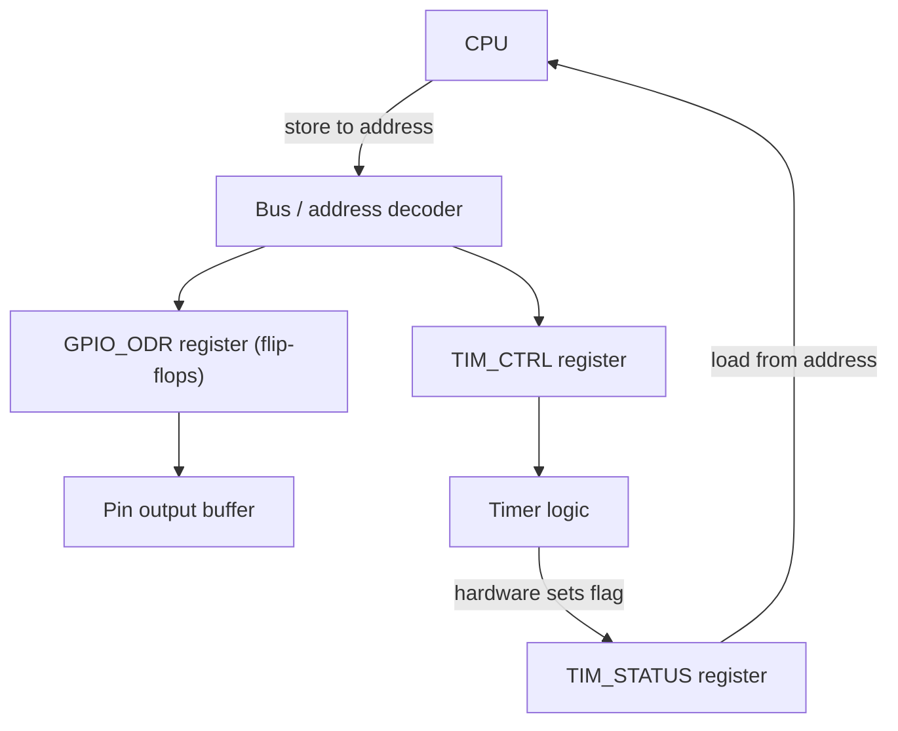

::: basics
### In plain words
A register is a small, very fast storage spot that holds a fixed number of bits, such as 8, 16 or 32. There are two kinds. Registers inside the CPU hold the values it is working on right now. Peripheral registers are how your code controls hardware such as a pin, timer, or serial port. Each one sits at a fixed address, and each bit in it often has its own meaning.

### Picture it
Picture the control panel of a machine. Each register is one row on the panel. Some bits are switches you flip to make the machine do something (control bits). Others are lamps that tell you what it is doing (status bits). Writing a 1 to a bit flips a switch. Reading a bit looks at a lamp. A few lamps have a quirk: looking at them or touching them resets them.

### Words you need
- **Bit**: one binary digit, 0 or 1.
- **Peripheral register** ([[q0823]]): a register at a fixed address that controls or reports on a hardware block.
- **Bit field**: a group of neighboring bits that together form one setting.
- **Mask**: a number with 1s at the bit positions you want to select.
- **volatile**: a C keyword that tells the compiler a value can change on its own, so it must really read or write it each time.

### The simplest example
An 8-bit register controls a port, and bit 5 drives an LED. The register currently holds 0b00000001. To turn the LED on without disturbing the other bits, read the register, set bit 5 with a mask, and write it back. The mask is 0b00100000. Combining it with OR (each result bit is 1 if it is 1 in either number) gives 0b00100001. This read, change, write sequence is called read-modify-write.

That is the whole idea. The rest of this page covers the two kinds of registers, the mask-and-shift recipe, the hazards of read-modify-write, and special bits that clear when written with a 1.
:::

::: testing
Whether you separate the **two meanings of "register"**: CPU (core) registers that hold operands inside the processor, and peripheral (special function) registers that are memory-mapped control and status bits for hardware blocks. The interviewer wants you to explain that a register is a small group of flip-flops, that peripheral registers are accessed at fixed addresses, and that writing a bit really changes hardware. Bonus: bit fields, read-modify-write, `volatile`, reserved bits and write-1-to-clear flags.
:::

::: why
Embedded firmware is, at its lowest level, reading and writing registers. Configuring a clock, toggling a pin, starting an ADC conversion, enabling an interrupt: all are register accesses. Datasheet reference manuals are mostly register descriptions, and many hardware bugs are register bugs (wrong bit, wrong order, read-modify-write race). The follow-up question in this section ([[q0830]]) is a direct test of whether you can decode one.
:::

::: concepts
- **Flip-flop / latch**: one bit of storage; a register is a group of them clocked together.
- **CPU registers**: R0-R12, stack pointer, link register, program counter, status register.
- **Memory-mapped peripheral registers**: control, status, data and configuration registers at fixed addresses ([[q0823]]).
- **Bit fields**: several bits grouped as one parameter (such as a 3-bit mode value).
- **Access types**: RW, RO, WO, and special ones like write-1-to-clear (W1C).
- **`volatile`**: tells the C compiler the value can change outside the program's control.
:::

::: answer
"A register is a small, fast piece of storage made of flip-flops that holds a fixed number of bits, like 8, 16 or 32.

There are two kinds that matter. Inside the CPU, the core registers hold operands, addresses, the program counter and the stack pointer. All arithmetic happens on them. Then there are peripheral registers, which are how firmware talks to hardware. Each peripheral, like a GPIO port, a timer or a UART, has control registers that set how it behaves, status registers that report what's happening, and data registers for the values. They're memory-mapped, so I read and write them at fixed addresses with ordinary loads and stores. For example, writing a 1 to a bit in the GPIO output data register drives a pin high, because the flip-flop output is wired to the pin driver.

Registers are divided into bit fields, so I use masks and shifts to change one field without disturbing others, a read-modify-write. In C I declare them `volatile` so the compiler doesn't optimise away accesses. Some bits are special: reserved bits should be left alone, status flags might be cleared by writing a 1 to them, and some reads have side effects like clearing a flag.

So, essentially, registers are the interface between software and hardware."
:::

::: technical
**Hardware.** A $w$-bit register is $w$ flip-flops sharing a clock/enable. A CPU register file offers fast, multi-ported access (single cycle). A peripheral register's outputs drive peripheral logic (for example, a "pin high" bit drives an output buffer) and its inputs may be loaded by hardware (a status flag set when a conversion completes).

**CPU registers (ARM Cortex-M).** R0-R12 general purpose, R13 = SP, R14 = LR, R15 = PC, plus the program status register (flags N, Z, C, V). 32 bits each.

**Peripheral registers.** Mapped from `0x4000_0000` on Cortex-M. Typical set for a timer: CTRL (enable, mode), COUNT, COMPARE, STATUS (flags), INT_ENABLE.

**Access in C.**
```c
#define GPIOA_ODR (*(volatile uint32_t *)0x40020014u)   /* example address */
GPIOA_ODR |=  (1u << 5);   /* set bit 5: read-modify-write */
GPIOA_ODR &= ~(1u << 5);   /* clear bit 5 */
uint32_t mode = (REG >> 4) & 0x7u;  /* read a 3-bit field at [6:4] */
```

**Field update rule.** To write value $v$ into field $[m:l]$: `REG = (REG & ~mask) | ((v << l) & mask)`, with $\text{mask} = (2^{m-l+1}-1) \ll l$.

**Special behaviours.** W1C flags (write 1 to clear), self-clearing bits (START), read-to-clear status, reserved bits (write the reset value or leave unchanged), write-only registers (cannot read back). Reset values are in the reference manual.
:::

::: short
"A register is a small group of flip-flops holding a few bits. There are CPU registers, which hold operands and the program counter, and peripheral registers, which are memory-mapped control, status and data locations that firmware reads and writes to control hardware, like setting a GPIO pin or starting a timer. They're split into bit fields, changed with mask-and-shift read-modify-write, and declared `volatile` in C. Registers are the interface between software and hardware."
:::

::: long
"A register is a small bank of flip-flops that stores a fixed number of bits, typically 8, 16 or 32, with fast access.

I think of two categories. First, the CPU's own registers: general-purpose ones like R0 through R12 on an ARM, plus the stack pointer, link register, program counter and a status register with the flags. Arithmetic and logic happen on these, and they're the fastest storage in the system.

Second, peripheral registers, sometimes called special function registers. Each hardware block exposes a few of them at fixed addresses. There are control registers that configure it, like a timer's prescaler and mode; status registers with flags like 'conversion done' or 'transmit empty'; and data registers like the UART's receive buffer. Since they're memory-mapped, firmware uses normal loads and stores, but the effect is physical: if I write a 1 to the right bit of the GPIO output register, the output buffer drives that pin high.

Because each register packs several settings into bit fields, I change one field with a mask and shift: clear the field's bits, then OR in the new value. That's a read-modify-write, which can be unsafe if an interrupt modifies the same register in between, so many MCUs offer set/clear registers or atomic bit-banding.

In C, I declare the pointer `volatile` so the compiler always performs the access. And I read the reference manual for oddities: reserved bits you shouldn't change, flags cleared by writing a 1, status reads that clear themselves.

So the register map in the datasheet is essentially the programmer's view of the hardware."
:::

::: terms
- **Register**: group of flip-flops storing a word.
- **SFR (special function register)**: peripheral control/status register.
- **Memory-mapped I/O**: registers addressed like memory.
- **Bit field**: contiguous bits representing one setting, written `[msb:lsb]`.
- **Mask and shift**: operations to isolate or place a field.
- **Read-modify-write (RMW)**: read register, change bits, write it back.
- **W1C**: write-1-to-clear flag bit.
- **Reserved bit**: unused bit that must be left as documented.
- **`volatile`**: C qualifier telling the compiler an object can change unexpectedly.
:::

::: exceptional
**An average answer**: "Small fast memory inside the CPU, like variables for the processor."

**An exceptional answer**:
- Distinguishes CPU registers from memory-mapped peripheral registers and explains the flip-flop to pin link.
- Shows how fields are read/written with mask and shift, with correct code.
- Mentions `volatile`, read-modify-write hazards and atomic set/clear alternatives.
- Knows access types: RO, WO, W1C, read-to-clear, reserved, reset values.
- Points to the reference manual as the source of truth and uses an example register.
- Notes endianness and register width where relevant ([[q0830]]).
:::

::: mistakes
- **Only describing CPU registers.** Embedded interviews usually mean peripheral registers too.
- **Forgetting `volatile`**, so the compiler caches reads or removes "pointless" writes (for example a delay loop that polls a flag).
- **Read-modify-write on a W1C status register**: `STATUS |= flag` writes back 1s to every flag that was set, clearing them all. Write only the bit you mean to clear.
- **Writing reserved bits** with garbage; follow the documented preserve/reset rule.
- **Shifting an `int` into the sign bit** (`1 << 31`): use `1u << 31`.
- **Assuming registers can always be read back.** Write-only registers return zero or undefined data.
- **Not enabling the peripheral clock** before touching its registers; writes are silently ignored or fault.
:::

::: deep
## Registers as hardware

A single flip-flop stores one bit and updates on a clock edge. A 32-bit register is 32 of them sharing a clock and a write-enable. That's what a "register" is physically, whether it is a CPU register, a timer's compare value or a GPIO output latch.


Figure: Software writes go through the bus decoder into a register whose output feeds hardware; hardware can also write back into status registers, which software reads. Registers are two-way mailboxes between code and logic.

The address decoder compares the high address bits to select which peripheral, and the low bits select which register inside it. A write strobe loads the data bus value into that register. Because the flip-flop's output is connected to a pin driver, the pin changes after the clock edge, usually within one or two bus-clock cycles. A GPIO write is not instantaneous: a pin may toggle a few cycles after the store instruction, and the peripheral bus may be slower than the CPU clock (for example, a 72 MHz core with a 36 MHz peripheral bus).

## Two kinds, one idea

| | CPU registers | Peripheral registers |
|---|---|---|
| Where | inside the core | in each peripheral, on the bus |
| Count | ~16 | hundreds to thousands per chip |
| Access | by instruction operands | load/store at an address |
| Speed | 1 cycle | several bus cycles |
| Purpose | operands, pointers, flags | control, status, data |
| Documented in | ISA manual | device reference manual |

## Bit fields and the mask-shift recipe

Take a 32-bit control register with a 3-bit MODE field at bits [6:4]. Reading and writing it safely:

$$\text{mask} = (2^{3}-1) \ll 4 = 0x7 \ll 4 = 0x70$$

```c
uint32_t v = REG;
v &= ~0x70u;               // clear MODE
v |= (5u << 4) & 0x70u;    // set MODE = 5 -> 0x50
REG = v;
uint32_t mode = (REG & 0x70u) >> 4;   // read it back
```

Worked through: if REG was `0xB5A3` (low byte 1010 0011), bits [6:4] are `010`. Clearing the field gives `0xB583`; OR-ing in MODE = 5 (`101`) gives `0xB5D3`. Every bit outside [6:4] is untouched, which is the whole point. The full decode of a register like this is on [[q0830]].

Two common errors to avoid are writing a field value that is wider than the field (`(v << l) & mask` protects against that) and forgetting to clear the old field before OR-ing the new value (leaving stale bits set).

## The read-modify-write hazard

`GPIOA_ODR |= (1u << 5);` compiles to load, OR, store. If an interrupt between the load and store modifies another bit in the same register, the store writes back the stale value and the ISR's change is lost. Hardware designers solve it in three ways:
1. **Set/clear registers** (BSRR on STM32, SET/CLR on LPC and many others): writing a 1 to bit n sets (or clears) only that bit; writing 0 does nothing. One store, atomic.
2. **Bit-banding / bit-set instructions** on some cores.
3. **Disable interrupts around the RMW**, at the cost of latency.

### Worked example: toggling an LED pin

Suppose a pin driver output is bit 5 of the 32-bit ODR. ODR currently reads `0x0000_0021` (bits 5 and 0 set). To clear bit 5 only: `ODR &= ~(1u<<5)`: $\sim(0x20) = 0xFFFF\_FFDF$; $0x21 \,\&\, 0xFFFFFFDF = 0x01$. Result 0x01: bit 0 preserved, bit 5 cleared. With a BSRR-type register you would write a single word `1u << (5+16)` = 0x0020_0000 to reset bit 5, with no read at all.

## Access types and side effects

- **RW**: ordinary read/write control bits.
- **RO**: status, only hardware changes it; writes ignored.
- **WO**: commands (e.g. a "start conversion" strobe); read returns 0.
- **W1C**: writing 1 clears; 0 leaves it alone. Prevents the RMW problem for flags.
- **RC (read-to-clear)**: reading the register clears flags. Dangerous in a debugger, which may read it and clear the flag for you.
- **Self-clearing**: a START bit that the hardware resets when done.
- **Reserved**: keep at the reset value or follow "write as read". Newer silicon may give it a meaning.

> [!WARNING]
> Debuggers display registers by reading them. Reading a read-to-clear status register in a debugger window can silently clear the flag and change program behaviour (a classic heisenbug, see [[q0831]]).

## Real hardware behaviour

- **Clock gating.** Peripherals are powered down by default; their registers don't respond until the clock is enabled in an RCC/PCC/clock-gate register. The first symptom is writes that "do nothing".
- **Bus delays.** After enabling a peripheral clock, wait a cycle or read back the register before the first access on some parts.
- **Write buffers.** On some cores, a store to a peripheral may be buffered; a barrier instruction ensures it's complete before the next one (important when clearing a flag just before returning from an ISR, otherwise the interrupt may re-trigger).
- **Endianness and widths.** Access size matters: some registers must be accessed as 32-bit words; byte accesses may be ignored or touch the wrong bits.

```sim
{"id":"register-decoder","preset":"ctrl"}
```
Figure: Click individual bits and watch which field they belong to and the C mask/shift code generated. Notice how changing a bit in one field leaves the rest unchanged: that is a read-modify-write.
:::

::: applications
- **GPIO**: direction, output data and input data registers set and read pin states ([[q0783]]).
- **Timers and PWM**: prescaler, auto-reload and compare registers set frequency and duty.
- **UART/SPI/I2C**: baud-rate, control, status and data registers.
- **ADC**: control register starts a conversion, data register holds the result, status flag says done.
- **Interrupt controller**: enable, pending and priority registers ([[q0796]]).
- **Sensors like IMUs**: external ICs expose an 8-bit register map over I2C/SPI (WHO_AM_I, CONFIG, DATA registers).
:::

::: assumptions
- I describe a **32-bit ARM-like MCU** with memory-mapped peripherals. Other families differ: 8051 and PIC use special function registers in banked address spaces; x86 has separate I/O ports.
- **Addresses and register names in the examples are illustrative** (the GPIO address in the code is a placeholder; take real ones from your device's reference manual).
- On **external devices** (sensors, PMICs) registers are accessed over a bus (I2C/SPI), so a "register read" is a transaction, not a load instruction.
- In **FPGA/SoC design**, "register" might mean a flip-flop in RTL; the idea is the same.
- Behaviour such as W1C or read-to-clear is **peripheral-specific**; the reference manual is authoritative.
:::

::: followups
### What's the difference between a register and RAM?
A register is a small, fixed set of flip-flops tied to a specific purpose (CPU operand, or peripheral control) and accessed by name or a fixed address. RAM is a large array of generic storage cells accessed by arbitrary address. Peripheral registers may have side effects (set pins, clear flags), whereas RAM is just storage.

### Why must register pointers be `volatile`?
The compiler assumes memory only changes when the program writes it. Registers can change by themselves (a status flag), and writes have effects beyond storage (starting a conversion). Without `volatile`, a loop `while(!(STATUS & DONE));` may be optimised to read once and loop forever, and two consecutive writes to a command register may be merged into one.

### How do you set one bit in a register without disturbing the others?
Read-modify-write with OR: `REG |= (1u << n)`. To clear: `REG &= ~(1u << n)`. For atomicity use a set/clear register if the peripheral has one, or briefly disable interrupts. For a W1C flag, write just the flag bit: `STATUS = (1u << n)`.

### Your code writes `GPIOA_MODER = 0x01;` but other pins on the port stopped working. Why?
Writing a whole register overwrote every other field with 0. The fix is a read-modify-write that touches only the field for the pin of interest: clear its 2 bits and OR in the new value. This is one of the commonest bring-up bugs.

### Harder: an ISR clears a status flag and returns, but the ISR immediately fires again. What could be going on?
Possible causes: the flag clear is delayed by a write buffer or a slower peripheral bus, so the interrupt line is still asserted when the CPU returns (fix: read back the register or use a barrier before returning); the clear was a read-modify-write that didn't actually clear a W1C bit; or the real source is a different flag that was never cleared. Check the pending bit in the interrupt controller and the peripheral status register.
:::

::: interpretations
"Registers" could be asked in the **CPU architecture** sense (general-purpose registers, register file) or the **peripheral** sense. In an embedded interview, the peripheral meaning is usually the focus (the next question [[q0830]] is about decoding a register map), but I would mention both. For the broader memory picture see [[q0823]].
:::

::: references
- Yiu, J., *The Definitive Guide to ARM Cortex-M3 and Cortex-M4 Processors*: programmer's model (core registers) and memory-mapped peripherals.
- The reference manual of any MCU you use, especially a GPIO or timer chapter: register descriptions with access types and reset values.
- Kernighan & Ritchie, *The C Programming Language*: `volatile`, bitwise operators and shifts.
- Harris & Harris, *Digital Design and Computer Architecture*: registers as flip-flops and the register file.
:::

::: rubric
- Defines a register as a group of flip-flops storing a word :: Grounds the concept in hardware.
- Distinguishes CPU registers from memory-mapped peripheral registers :: Interviews usually probe the peripheral meaning.
- Explains that writing a register changes hardware (e.g., a pin) :: The key embedded insight.
- Shows mask-and-shift field access / read-modify-write :: Required to actually use registers.
- Mentions `volatile` :: Common source of real bugs.
- Mentions access types (W1C, RO, reserved) or RMW hazards :: Marks hands-on experience.
:::

::: quiz
```json
[
 {"type":"mcq","level":"fundamental","q":"What is a peripheral (special function) register?","options":["A CPU register holding the program counter","A memory-mapped register controlling or reporting on a hardware block","A region of flash","A kind of cache"],"answer":1,"explain":"Peripheral registers sit at fixed addresses and are connected to peripheral logic, so reading and writing them configures or observes hardware."},
 {"type":"numeric","level":"fundamental","q":"A register has a field at bits [6:4]. What is the mask for that field, as a decimal number?","answer":112,"tolerance":0.001,"unit":"","explain":"The field is 3 bits wide: $(2^3-1)\\ll4 = 7\\ll4 = 0x70 = 112$."},
 {"type":"mcq","level":"intermediate","q":"Why is `while(!(STATUS & DONE));` risky without `volatile`?","options":["The loop is too slow","The compiler may read STATUS once and never re-read it, creating an infinite loop","STATUS is read-only","The & operator is not allowed on registers"],"answer":1,"explain":"Without `volatile`, the compiler assumes the value cannot change outside the program and may hoist the read out of the loop. `volatile` forces a real read each iteration."},
 {"type":"numeric","level":"intermediate","q":"ODR reads 0x21. You execute `ODR &= ~(1u << 5);`. What is ODR afterwards (decimal)?","answer":1,"tolerance":0.001,"unit":"","explain":"$1\\ll5 = 0x20$; $\\sim0x20$ clears bit 5; $0x21 \\& \\sim0x20 = 0x01 = 1$. Bit 0 is preserved."},
 {"type":"truefalse","level":"advanced","q":"On a status register with write-1-to-clear flags, `STATUS |= FLAG_A;` clears only FLAG_A.","answer":false,"explain":"The read-modify-write reads all flags, ORs in FLAG_A, then writes back 1s for every flag that was set, clearing all of them. The correct statement is `STATUS = FLAG_A;`."}
]
```
:::
