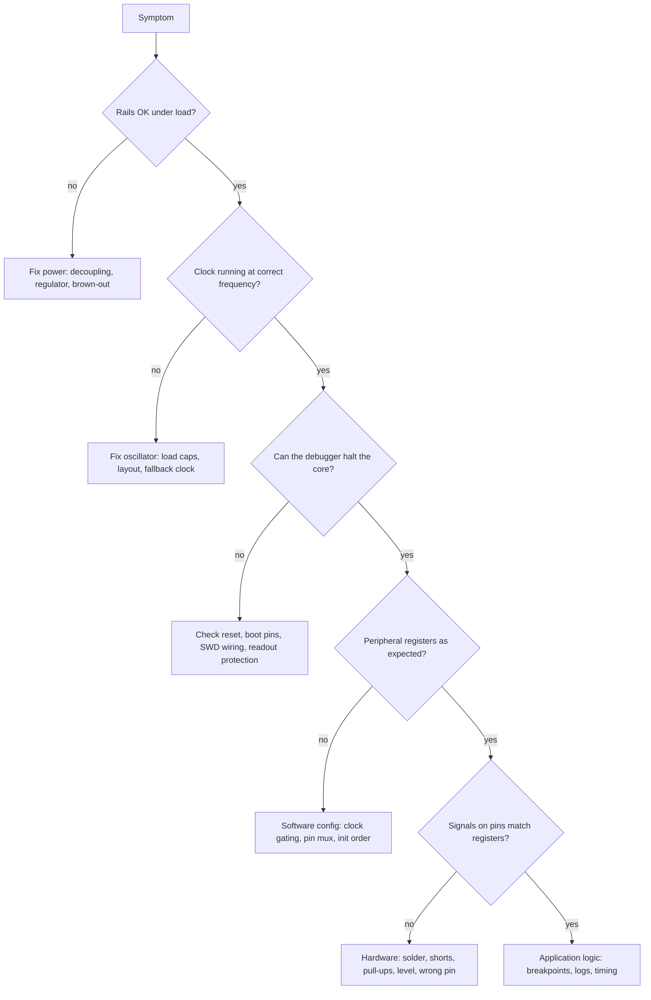

::: basics
### In plain words
When a microcontroller board misbehaves, first decide whether the fault is in the hardware or in the software, because they need different tools. Work from the bottom up. Check power, clock and reset first, then connect a debugger and look at the code. Change one thing at a time and write down what you saw.

### Picture it
Your car will not start. A sensible mechanic checks the battery and the fuel before blaming the driver's technique. Only when the basics are fine does the mechanic look at finer problems. A board is the same. If the power supply sags, no amount of code fixing will help, and you would waste hours looking in the wrong place.

### Words you need
- **Debugger** ([[q0832]]): a tool that lets you halt the running program and inspect it.
- **Breakpoint**: a marker that stops the program at a chosen line so you can look around.
- **Oscilloscope**: an instrument that shows a voltage over time, so you can see dips and noise.
- **Logic analyzer**: an instrument that records many digital signals at once and can decode a bus such as I2C or SPI.
- **Brown-out**: the supply voltage dipping low enough to reset or upset the chip.

### The simplest example
A board keeps restarting at random. You put an oscilloscope on the 3.3 V supply. Every time a motor switches on, the supply dips to about 2.4 V for a moment, which is low enough to reset the chip. That is a hardware problem, such as a missing capacitor. Reading the code line by line would never find it. If the supply is steady, you move up a layer and connect the debugger.

That is the whole idea. The rest of this page covers each layer in detail, timing bugs that vanish when you stop the CPU, and how to tell hardware faults from software ones.
:::

::: testing
Whether you have a **systematic debugging method** that spans both domains, rather than a favourite trick. The interviewer wants to hear: isolate hardware from software first (power, clock, reset, then code); use the right tool for each layer (multimeter and scope for electrical, debugger and logs for code, logic analyzer for protocols); and understand the particular challenges: timing-sensitive bugs that vanish under a debugger, limited visibility, shared resources like pins and interrupts, and the difficulty of telling a solder defect from a firmware bug.
:::

::: why
Embedded bugs live at the boundary of electronics and code, and the hardest ones are not in either alone: a marginal supply that browns out during a radio burst, a missing pull-up that only fails cold, a race between an ISR and the main loop. Engineers who can partition a problem quickly save weeks. Interviewers use this question to see if you debug by evidence or by guesswork, and whether you have real lab experience.
:::

::: concepts
- **Bring-up order**: power, clock, reset, boot, then peripherals, then application. See [[q0834]].
- **On-chip debug**: SWD/JTAG with breakpoints, watchpoints, register and memory views ([[q0832]]).
- **Instrumentation**: printf/UART logging, GPIO toggling with a scope, logic analyzer, trace.
- **Heisenbugs**: bugs altered by the act of observing (halting, printing).
- **Hardware measurement**: DMM, oscilloscope, probing technique ([[q0833]] for debugging without a probe).
- **Divide and conquer**: change one thing at a time; bisect the system.
:::

::: answer
"I start by working out whether it's a hardware problem or a software problem, because the tools are different, and I go from the bottom up.

On the hardware side I check power first: are the rails the right voltage, clean, and not sagging when the load changes? Then the clock, reset, and boot pins, with a multimeter and an oscilloscope. If those are fine, I connect a debugger over SWD or JTAG, halt the core, and see whether it's running where I expect. If I can't even connect, that tells me something too.

On the software side I use the debugger for breakpoints, watchpoints and looking at registers and the call stack. If a bug is timing-sensitive, stopping the CPU hides it, so I use non-intrusive tools: toggle a GPIO at key points and watch it on a scope or logic analyzer, log to a RAM buffer, or use trace. For serial buses I put a logic analyzer on SPI or I2C and look at the actual waveform and decode it.

The challenges differ. In hardware, the problem is that you can't see inside, noise and intermittent contacts are hard to reproduce, and measuring can disturb the circuit with probe capacitance. In software, the challenge is real-time behaviour: interrupts, race conditions, stack overflow and compiler optimisations. The key habit is changing one variable at a time and writing down what I observed, so I'm bisecting the problem instead of guessing."
:::

::: technical
**Method.** (1) Reproduce reliably. (2) Partition: power / clock / reset / boot / peripheral / application. (3) Measure, don't assume. (4) Change one thing at a time. (5) Verify the fix and understand the root cause.

**Hardware layer.**
- *Power*: each rail at the MCU pin, under load, with a scope in AC-coupled, 20 MHz bandwidth-limit mode to see ripple and droop. Brown-out thresholds typically 1.6-2.9 V depending on part.
- *Clock*: probe the crystal pins gently (a 10 pF probe load can stop a marginal oscillator); check a divided clock output (MCO) instead.
- *Reset and boot pins*: levels at power-up.
- *Signals*: scope for edges, levels, ringing, rise time; logic analyzer for protocols.
- *Assembly*: shorts, opens, wrong parts, cold joints. Inspect, continuity-test, thermal camera for hot parts.

**Software layer.**
- Debugger: breakpoints (hardware comparators, limited count, typically 4-8 on Cortex-M), watchpoints, single-step, call stack, peripheral register view.
- Fault handlers: on Cortex-M, read the fault status registers (CFSR, HFSR) and stacked PC to find the faulting instruction.
- Logging: UART printf is slow ($\approx 87\ \mu\text{s}$ per character at 115200 baud), so prefer binary logging to RAM or ITM/SWO.
- Timing: GPIO toggles measured on a scope give ns-accurate timing without halting.

**Challenges.** Hardware: no visibility inside the chip, intermittent faults, probing disturbs the circuit, analog and digital interplay. Software: concurrency (ISRs), timing, undefined behaviour, optimisation, limited memory for logs, and debugging running systems that cannot be halted (motors, power stages).
:::

::: short
"I partition the problem. First check hardware basics with a multimeter and scope: power rails, clock, reset and boot pins. Then connect a debugger over SWD or JTAG to halt, step, and inspect registers and memory. For timing-sensitive bugs I use non-intrusive tools: GPIO toggles on a scope, a logic analyzer on buses, or trace. Challenges are intermittent hardware faults, probes disturbing circuits, and real-time software bugs like interrupt races that vanish when halted."
:::

::: long
"My approach is to divide and conquer, from the bottom up, and to measure instead of assuming.

First, hardware sanity. I check each supply rail at the chip's pins, under load, with a scope rather than a multimeter, because a rail that averages 3.3 V can still have 300 mV dips that trigger a brown-out. Then the clock: is the crystal oscillating at the right frequency and amplitude? Then reset and boot pins at power-up. I'd be careful probing the crystal, since a regular probe adds around 10 pF and can stop a marginal oscillator. A lot of 'software bugs' turn out to be here.

Second, connect the debugger over SWD or JTAG. If I can attach, halt and read the program counter, I know the core is alive. I look at the peripheral registers to see whether the clock is enabled and the pins are configured as I think. If a fault occurs, I read the fault status registers and the stacked program counter to find the exact instruction.

Third, for the application, I use breakpoints and watchpoints for logic bugs. For timing bugs, halting changes the behaviour, because the rest of the system, like a motor or a radio, keeps running. There I use non-intrusive observation: a GPIO pin toggled at the start and end of an ISR, measured on a scope, a logic analyzer on the SPI or I2C bus, or a trace buffer. I avoid printf in time-critical code, since one line at 115200 baud takes about a millisecond.

The hardware challenges are intermittent faults and probe loading. The software challenges are interrupts, race conditions, stack overflows and optimiser surprises. Throughout, I keep notes and change one thing at a time."
:::

::: terms
- **SWD / JTAG**: debug interfaces to halt and inspect the CPU ([[q0832]]).
- **Breakpoint**: stops execution at an address; hardware breakpoints are a limited resource.
- **Watchpoint**: stops when a memory location is accessed.
- **Logic analyzer**: captures many digital channels and decodes protocols.
- **Trace (ETM, ITM/SWO)**: non-intrusive record of program flow or messages.
- **Heisenbug**: a bug that changes behaviour when observed.
- **Brown-out**: supply dip causing reset or malfunction.
- **Fault handler**: exception routine that runs on a bus/usage/memory fault.
:::

::: exceptional
**An average answer**: "Use the debugger and print statements."

**An exceptional answer**:
- Starts with a partitioning strategy: power, clock, reset, boot, then code.
- Matches each tool to a layer (scope, logic analyzer, debugger, trace) and says when each fails.
- Brings up non-intrusive debugging for timing bugs, and the cost of printf in microseconds.
- Mentions fault registers and reading the stacked PC after a hard fault.
- Gives concrete hardware pitfalls: rail droop, probe loading on crystals, floating pins, solder defects.
- Emphasises reproducibility, one change at a time and root-cause confirmation.
:::

::: mistakes
- **Assuming it is software.** Many "firmware bugs" are missing decoupling, a floating boot pin, or a cold joint.
- **Measuring the rail with a multimeter only.** Averages hide the droop that resets the chip.
- **Relying on printf for timing-critical bugs.** It changes the timing and can mask the bug.
- **Trusting the debugger's register view blindly.** Reading a read-to-clear register in the window changes the system ([[q0829]]).
- **Changing several things at once**, so you can't tell which one fixed it.
- **Debugging optimised code without remembering that variables may be optimised away**; use `-Og` or volatile for investigation.
- **Probing a crystal or a high-impedance node casually**, disturbing what you measure.
:::

::: deep
## Think in layers

An embedded system is a stack: power, clock/reset, silicon (CPU and peripherals), firmware, application logic, and the external world (sensors, buses, users). A symptom at the top ("the display is blank") can come from any layer below. The fastest way through is to check the lowest layers first, because they are quick to verify and everything above depends on them.


Figure: A top-down symptom is investigated bottom-up. Each diamond is a cheap test that eliminates a whole layer; stop at the first "no" and fix that layer before going further.

## Hardware-level debugging in detail

**Power.** Measure the MCU's own VDD pin, not the regulator output: the difference is the board's impedance. Example: a 3.3 V rail feeding a load that steps 10 mA to 150 mA in 1 µs through 0.2 Ω of trace and via resistance (plus inductance) sags by $\Delta V = 0.14\ \text{A} \times 0.2\ \Omega = 28$ mV from resistance alone. The inductive part depends on the edge rate: with 10 nH of loop inductance, $L\,di/dt = 10\text{ nH}\times 0.14\text{ A}/1\ \mu\text{s} = 1.4$ mV at that slew, but at a 10 ns edge it is 140 mV, far more than the resistive drop. Hence decoupling capacitors close to the pins. A BOR threshold of 2.7 V and a 3.3 V rail leaves 600 mV of margin; a radio transmit burst that sags the rail by 700 mV resets the chip every time it transmits. A multimeter shows 3.29 V throughout.

**Clock.** If the MCU runs from a crystal, check oscillation with a low-capacitance active probe (around 1 pF; a passive 10x probe adds roughly 10-15 pF) or, better, via the MCO clock-output pin. Wrong load capacitors, a shorted cap or poor layout stops it. On many parts the chip falls back to an internal RC oscillator when the crystal fails, so the system "works" but at the wrong speed (UART baud rate off, USB not working), a classic confusing symptom.

**Reset and boot pins.** A floating BOOT0 pin can put the chip into bootloader mode some of the time. Check levels at power-up with the scope in single-shot mode.

**Signals.** Use the right instrument:

| Question | Tool |
|---|---|
| Is the voltage right and stable? | scope (DC-coupled for level, AC-coupled for ripple) |
| Are the edges clean, rise time OK, overshoot? | scope with proper ground spring |
| What bytes crossed the bus? | logic analyzer with protocol decoder |
| Does a signal timing meet spec? | scope or logic analyzer with cursors |
| Is a part getting hot? | thermal camera or fingertip (carefully) |
| Is there a short or open? | DMM continuity and resistance |

**Physical defects.** Bridged pins under QFN packages, cold joints on BGAs, wrong resistor values, reversed polarity parts. Inspect, reflow, swap a known good board; the "swap test" quickly separates board defects from firmware.

## Software-level debugging in detail

**Debugger capabilities.** Halt/step/run, breakpoints, watchpoints (data breakpoints), memory and register views, call stack, and (on Cortex-M) fault status registers. Hardware breakpoint count is small (for example 4-8 comparators on Cortex-M), and code in flash cannot be patched with software breakpoints, so you can only have that many breakpoints in flash at once (some debug probes work around this by reprogramming flash pages, which is slow and wears the flash); code running from RAM can use software breakpoints.

**Reading a hard fault.** On a Cortex-M, the processor pushes R0-R3, R12, LR, PC and xPSR onto the stack on exception entry. The stacked PC identifies the faulting instruction; CFSR bits tell whether it was an invalid instruction, an unaligned access, or a bus fault on a specific address (BFAR valid). Most "random resets" turn out to be stack overflow, a null pointer, or a jump through a corrupted function pointer.

**Non-intrusive timing.** Suppose an ISR must finish within 50 µs. Set a GPIO high at ISR entry and low at exit, and view it on a scope with infinite persistence. The longest pulse is the worst-case ISR duration, measured without altering timing (a GPIO write costs a few cycles). Compare with printf: a 16-character log line at 115200 baud (10 bits/char) is $16\times10/115200 = 1.39$ ms, 28 times longer than the 50 µs deadline, so logging inside the ISR would change the behaviour.

**Concurrency bugs.** Symptoms: works for minutes then fails; changes with compiler flags; a variable shared between ISR and main loop is not `volatile`, or a multi-byte update is not atomic. Tools: reduce to the smallest reproducer, add assertions, use a watchpoint to catch who corrupts a variable, and run with the interrupt priorities changed to expose ordering assumptions.

**Optimisation.** At `-O2`, variables are kept in registers or eliminated, and code is reordered, so single-stepping looks erratic. Debug with `-Og` first, then confirm on the optimised build.

## Hardware versus software: how to tell

Run this triage:
1. **Swap the board.** Same firmware on a second board: if behaviour differs, suspect hardware.
2. **Swap the firmware.** A known-good "blinky" or a vendor example on this board: if it works, suspect your code.
3. **Look at the pins.** If the register says the pin is high and the scope says it is low, it's hardware (short, load, wrong pin); if both agree but the downstream behaviour is wrong, check the other device or the protocol.
4. **Change the environment.** Temperature (cold spray, hot air), supply voltage (±10%), clock speed: a bug that moves with those is analog or timing, not logic.

```sim
{"id":"scope-trigger"}
```
Figure: Practice triggering on a rare pulse. The longest ISR pulse or an occasional glitch on a reset line only shows up if the scope is triggered on it: use single-shot or a pulse-width trigger, as you would for the GPIO-toggle timing method above.

## Putting numbers on the cost of observing

| Method | Intrusiveness | Typical overhead |
|---|---|---|
| Halt at breakpoint | stops everything | unbounded |
| printf over UART, 115200 | blocks or buffers | ~87 µs per character |
| Write to RAM ring buffer | very low | tens of cycles per entry |
| GPIO toggle | negligible | 2-5 cycles |
| SWO/ITM trace | low | depends on SWO baud, can overflow |
| ETM instruction trace | none | needs trace port and probe |

Choose the least intrusive method that answers the question.
:::

::: applications
- **Bring-up of a new board**: power-rail checks, clock verification, first blinky, then each peripheral in turn.
- **Motor-control firmware**: debug without halting (a halted PWM can destroy a power stage); use GPIO timing and live variable watch.
- **Wireless products**: measure the supply droop during transmit bursts with a scope and current probe.
- **Intermittent field failures**: add a persistent fault log (reset cause, fault registers) and read it afterward.
- **Communication bugs**: logic analyzer on SPI/I2C/UART to see exactly what the wires carry.
- **Production test**: fixtures that use the same debug interface to flash, verify and probe the board.
:::

::: assumptions
- I assume an **ARM Cortex-M-class MCU** with an SWD/JTAG debug port; other families (AVR, PIC, 8051, RISC-V) have different interfaces but the same method.
- Hardware bring-up assumes access to a **scope, DMM and logic analyzer**; without them see [[q0833]].
- Numbers (breakpoint counts, brown-out thresholds, probe capacitance) are **typical** and part-dependent.
- Real-time systems may not allow halting, which changes the toolset.
- In **safety-critical** work, debugging happens on instrumented test builds, not production code.
- Software-only emulators/simulators help with logic, not analog or timing problems.
:::

::: followups
### Your firmware works under the debugger but fails when you run it standalone. Why?
Several causes: the debugger changes clocks or keeps low-power modes disabled, so a sleep or clock bug shows only standalone; the debugger holds the chip in reset or powers it differently; timing changes because breakpoints stop things; or uninitialised variables get different values. Also on some parts debug-mode wake-up sources differ. Check by running with the debugger attached but without breakpoints, then detached, and logging reset causes.

### How would you find a rare glitch that happens once an hour?
Make it observable and persistent. Configure a trigger (scope in pulse-width or runt trigger, or logic analyzer with a long buffer) on the symptom pin, or have the firmware detect the anomaly and save a snapshot (registers, timestamps, last events) to retained RAM or flash, then read it later. Add a hardware watchdog with reset-cause logging so you also learn if it is a reset.

### What is a hard fault and how do you debug one?
It's the Cortex-M exception for unrecoverable errors (bus fault, illegal instruction, unaligned access when not allowed). In the handler, read the stacked PC, LR and the fault status registers (CFSR, HFSR, BFAR). The PC points to the offending instruction; map it to source with the map file or disassembly. Typical culprits: null/wild pointer, stack overflow, corrupted function pointer, accessing a peripheral whose clock is off.

### How can a probe or ground clip change the measurement?
A passive probe adds roughly 10-15 pF and a long ground lead adds inductance, causing ringing and slowed edges, and it can load a crystal oscillator enough to stop it. Use a short ground spring, a 10x probe, and for high-impedance or fast nodes a low-capacitance active probe. Be aware that a bug that disappears when you probe it is a clue to a marginal timing or loading problem.

### Harder: the board resets only when the Wi-Fi radio transmits. How do you debug it?
Suspect supply droop. Scope the MCU VDD pin (not the regulator) triggered on the reset pin with the radio TX; measure the dip against the brown-out threshold. If the droop is the cause, add bulk capacitance near the radio, improve the regulator's transient response or the PCB power path, or lower TX power; confirm by temporarily powering from a bench supply with big capacitance. Check reset cause registers to confirm brown-out vs watchdog.
:::

::: interpretations
"Hardware vs software levels" could mean **where the bug lives** (electrical vs firmware) or **which debug facilities exist** (hardware debugger vs software tools). I address both: triage for where the bug is, and the tool layers for how to see it. For what a debugger itself is, see [[q0832]]; for debugging without one, [[q0833]]; for a non-booting chip, [[q0834]].
:::

::: references
- Yiu, J., *The Definitive Guide to ARM Cortex-M3 and Cortex-M4 Processors*: exception model, fault status registers, debug features (CoreSight overview).
- Horowitz & Hill, *The Art of Electronics*, 3rd ed.: troubleshooting and measurement chapters; scope probing.
- Agans, D., *Debugging: The 9 Indispensable Rules for Finding Even the Most Elusive Software and Hardware Problems*: the general method (understand the system, make it fail, quit thinking and look, divide and conquer, change one thing at a time).
- Your MCU vendor's reference manual: debug, reset and fault status registers chapters.
:::

::: rubric
- Partitions hardware vs software and checks power/clock/reset first :: The most time-efficient and expected strategy.
- Names hardware tools: DMM, scope, logic analyzer, with correct use :: Shows lab experience.
- Uses an on-chip debugger (SWD/JTAG): breakpoints, watchpoints, registers :: Core software-level tool.
- Describes non-intrusive methods (GPIO toggles, trace, RAM logs) for timing bugs :: Real-time systems cannot be halted.
- States concrete challenges for each domain :: The question explicitly asks.
- Mentions one-change-at-a-time and reproducibility :: Shows disciplined method.
- Gives an example such as brown-out on radio transmit or hard-fault decode :: Concrete evidence of experience.
:::

::: quiz
```json
[
 {"type":"mcq","level":"fundamental","q":"A board does not run. What should you check first?","options":["The application logic","Power rails, clock and reset at the MCU pins","The compiler version","The linker script"],"answer":1,"explain":"Lower layers are cheapest to verify and everything depends on them: no power, clock or reset means no code will run, regardless of how good the software is."},
 {"type":"numeric","level":"intermediate","q":"A debug printf of 16 characters is sent at 115200 baud, 8N1 (10 bits per character). How long does the transmission take, in ms?","answer":1.39,"tolerance":0.03,"unit":"ms","explain":"$16\\times10/115200 = 1.389$ ms. Inside a 50 µs ISR this would break the timing, so use a GPIO toggle or a RAM log instead."},
 {"type":"mcq","level":"intermediate","q":"Which approach is best for measuring the worst-case duration of an ISR without disturbing timing?","options":["Set a breakpoint and time it with a stopwatch","Print timestamps with printf","Toggle a GPIO at ISR entry and exit and capture it on a scope","Disable the ISR"],"answer":2,"explain":"A GPIO write takes a few cycles and the scope measures the pulse width independently. Breakpoints halt the system and printf is far too slow."},
 {"type":"truefalse","level":"intermediate","q":"If the supply rail reads a steady 3.3 V on a multimeter, it cannot be causing random resets.","answer":false,"explain":"A multimeter averages. Fast load transients can cause dips of hundreds of mV for microseconds that cross the brown-out threshold. Use a scope at the MCU pin, triggered on the reset."},
 {"type":"multi","level":"advanced","q":"Which are plausible reasons a bug appears only when the debugger is NOT attached?","options":["The debugger keeps clocks or low-power modes active that the standalone system would gate","Halting at breakpoints changes timing between the CPU and external events","The compiler removes semantic bugs at random","Uninitialised variables and reset behaviour differ"],"answer":[0,1,3],"explain":"Debug mode often prevents sleep and clock gating, breakpoints perturb timing, and reset/initial states can differ. Compilers do not randomly fix bugs, though optimisation levels can change behaviour of undefined code."}
]
```
:::
