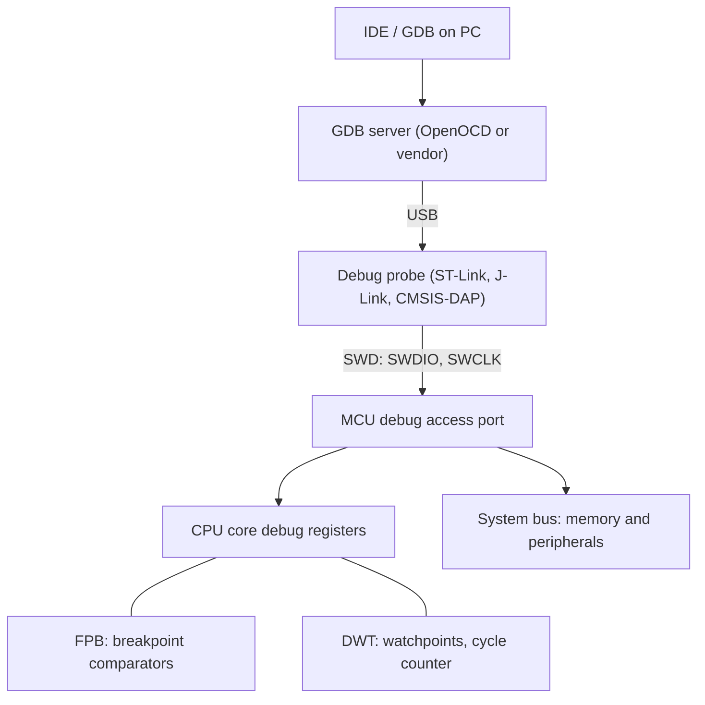

::: basics
### In plain words
A debugger lets you control and watch a program while it runs on the real chip. You can pause the processor, step through the code one line at a time, and look at variables, registers and memory. It is a chain of three parts: debugger software on your PC, a small probe that plugs in over USB, and debug hardware built into the chip.

### Picture it
Imagine a film with a pause button and a magnifying glass. You can freeze the picture, advance one frame at a time, and inspect every prop on the set. A debugger does this for a running program. The picture breaks down in one place: pausing a real machine, such as a motor driver, can leave its outputs stuck in whatever state they were in.

### Words you need
- **Breakpoint**: a marker that stops the program when it reaches a chosen line.
- **Debug probe**: the small hardware box that connects your PC to the chip's debug pins.
- **SWD / JTAG**: two kinds of debug connection. SWD uses two signal wires and JTAG uses four or five.
- **Register** ([[q0829]]): a small storage spot in the CPU or in a peripheral, which you can inspect while stopped.
- **Single-step**: running just one line or instruction and stopping again.

### The simplest example
You set a breakpoint on the line that updates a variable called `count`. You press run. The program runs at full speed until it reaches that line, and then the chip halts. Your PC shows `count = 7`. You single-step one line, and it now shows `count = 8`. Inside the chip, a hardware comparator watches the addresses of instructions being fetched. When one matches, it halts the processor. Chips have only about four to eight of these comparators.

That is the whole idea. The rest of this page shows what is inside the chain, how a breakpoint works, a worked bug hunt, and why pausing is intrusive.
:::

::: testing
Whether you understand a debugger as **both a software tool and hardware support in the chip**: a host program (IDE or GDB), a debug probe that speaks SWD or JTAG, and an on-chip debug module that can halt the core and read/write registers and memory. Strong answers list what you can do (breakpoints, single-step, watch variables, inspect registers, flash the device), explain how a breakpoint actually works, and know the limits (limited hardware breakpoints, intrusive halting).
:::

::: why
Debugging is where most embedded development time goes. Knowing what a debugger physically does explains its limits: why you only get a handful of breakpoints, why halting can break a running motor controller, and why a locked or sleeping chip refuses connections. It also leads straight into the more practical questions about debugging with and without a probe ([[q0831]], [[q0833]], [[q0834]]).
:::

::: concepts
- **Debug probe / adapter**: hardware (ST-Link, J-Link, CMSIS-DAP) bridging USB to the chip's debug pins.
- **Debug port**: SWD (2 wires) or JTAG (4-5 wires) interface on the MCU.
- **On-chip debug logic**: halt/resume the core, breakpoint and watchpoint comparators, access to memory bus.
- **Host software**: IDE or GDB with a GDB server (such as OpenOCD) that translates commands.
- **Symbols**: debug info (DWARF) mapping addresses to source lines and variables.
- **Registers and memory** ([[q0829]]): what you inspect and modify.
:::

::: answer
"A debugger is a tool that lets me control and observe a program while it runs on the target. With it I can halt the processor, step through code line by line, set breakpoints, look at and change variables, registers and memory, and see the call stack.

It's really a chain of three pieces. On my PC there's the debugger software, in an IDE or GDB, which understands my source code and symbols. It talks over USB to a debug probe, like an ST-Link or J-Link. The probe talks to the microcontroller over a two-wire SWD interface, or four-wire JTAG. And inside the chip there's dedicated debug hardware that can actually stop the core, read and write memory and registers, and compare the program counter against breakpoint addresses.

A hardware breakpoint works because a comparator watches the instruction fetch address. When it matches, the core halts and the debugger reads everything out. Chips only have a few of these comparators, typically four to eight.

Besides finding bugs, the same connection is used to program the flash. The limitation is that halting is intrusive, so for something like a motor controller or a radio you can't just pause the system. In those cases I use trace, GPIO toggles or logging along with the debugger."
:::

::: technical
**Architecture.**

Host (IDE/GDB) -> GDB server (OpenOCD, vendor server) -> USB -> debug probe -> SWD/JTAG -> MCU debug port (DAP) -> debug components in the core.

**Interfaces.**
- *JTAG* (IEEE 1149.1): TCK, TMS, TDI, TDO, optional nTRST; daisy-chain multiple devices; also used for boundary scan.
- *SWD* (ARM Serial Wire Debug): SWDIO (bidirectional) and SWCLK, plus ground and often nRESET. Same capability on Cortex-M with fewer pins.
- A tag-connect or 10-pin 1.27 mm Cortex debug header is the common board connector.

**On-chip support (Cortex-M).** Debug access port (DAP) -> core halting via the debug registers (DHCSR); **FPB** (flash patch and breakpoint) unit with typically 4-8 instruction comparators; **DWT** (data watchpoint and trace) with typically 2-4 comparators for data watchpoints and cycle counting; **ITM/SWO** for printf-style trace; optional **ETM** for full instruction trace. Counts are implementation-defined.

**Capabilities.** Run/halt/step, hardware and software breakpoints (software ones need RAM code), watchpoints, register and memory read/write, flash programming, reset control, RTOS thread awareness (with plugins).

**How speed works.** SWD clock of 1-10 MHz (probe-dependent) gives memory reads on the order of hundreds of kilobytes per second.

**Limitations.** Few hardware breakpoints; halting stops the CPU but peripherals (timers, PWM, motors) may continue unless configured to freeze in debug; entering deep-sleep modes can drop the debug connection on some parts; readout protection can disable it.
:::

::: short
"A debugger lets me control and inspect a program running on the microcontroller: halt it, step through code, set breakpoints, and read or modify variables, registers and memory. It's a chain of host software, a USB debug probe, a two-wire SWD or four-wire JTAG link, and dedicated debug hardware inside the chip with a few breakpoint comparators. The same link programs flash. Its limit is that halting is intrusive for real-time systems."
:::

::: long
"A debugger lets me see inside a running microcontroller and control it. I can stop the CPU, step one line or instruction at a time, set breakpoints, look at variables, registers and memory, view the call stack, and even change values on the fly. The same connection is also what I use to program the flash.

It's more than software, though. There are four pieces. On the PC, the debugger front-end, either an IDE or GDB, reads the compiled program's symbol information, so it can show source lines and variable names instead of raw addresses. It talks, usually through a GDB server like OpenOCD, to a debug probe over USB; an ST-Link, J-Link or CMSIS-DAP adapter. The probe drives the chip's debug pins: SWD, which is two wires, or JTAG, which is four or five and can chain several chips. And inside the MCU there's dedicated debug hardware, on ARM Cortex-M called CoreSight, that can halt the core, read and write memory through the bus, and watch for conditions.

A breakpoint is implemented by a comparator that matches the instruction fetch address. When it matches, the core enters debug state, stops, and the debugger reads the registers. Because those comparators are real hardware, there are only a handful, usually four to eight. Watchpoints work the same way on data addresses.

The limitations: halting is intrusive. If the chip is running a motor, stopping the CPU might leave the PWM outputs in a dangerous state, so you configure the peripherals to freeze or use trace, GPIO toggling, or logging instead. Also, some low-power modes or readout protection can block the debug connection. But in general, it's the single most useful tool for finding firmware bugs."
:::

::: terms
- **Debugger**: tool to control and inspect a program running on a target.
- **Debug probe**: hardware interface between PC and target debug pins.
- **SWD**: ARM serial wire debug; two-wire interface.
- **JTAG**: IEEE 1149.1 test and debug interface, 4-5 wires.
- **Breakpoint**: halt when execution reaches an address.
- **Watchpoint**: halt on a data access to an address.
- **GDB server**: program that bridges GDB commands to a probe (such as OpenOCD).
- **CoreSight**: ARM's debug and trace architecture.
- **Symbols (DWARF)**: debug info mapping machine code to source.
:::

::: exceptional
**An average answer**: "It lets you step through code and set breakpoints."

**An exceptional answer**:
- Describes the chain: IDE/GDB, GDB server, probe, SWD/JTAG, on-chip debug logic.
- Explains how a hardware breakpoint works (address comparator) and why the count is limited.
- Differentiates breakpoints, watchpoints and trace, and intrusive from non-intrusive.
- Notes that the same link flashes the chip, and mentions pins used (SWDIO, SWCLK, nRESET).
- Gives limitations: halting real-time systems, low-power modes, readout protection, optimisation.
- Mentions debug symbols and why optimised code looks odd.
:::

::: mistakes
- **Thinking the debugger is just software.** Without on-chip debug hardware and a probe, there is nothing to attach to.
- **Assuming unlimited breakpoints.** Hardware comparators are scarce.
- **Halting a power-stage controller** with the PWM outputs left active or frozen in an unsafe state.
- **Forgetting symbols/optimisation.** At `-O2` variables vanish or lines jump around; use `-Og` for debugging.
- **Confusing simulator and debugger.** A simulator runs your code on the PC; a debugger controls real hardware.
- **Leaving debug enabled in products** (security and power implications): disable or lock readout in production.
- **Mixing up JTAG and SWD pin counts**; SWD is two signals plus ground.
:::

::: deep
## What's physically inside

Think of the debugger as a remote control for the CPU. It needs three things on the chip: a way to talk (the debug port), a way to stop and poke the core (halting debug), and a way to watch the bus without CPU help (comparators and trace).


Figure: The probe talks to the on-chip debug access port, which can reach the core's debug registers and, through the bus, any memory or peripheral register. The comparators in the FPB and DWT blocks are what cause the core to halt.

**JTAG vs SWD.**

| | JTAG | SWD |
|---|---|---|
| Signals | TCK, TMS, TDI, TDO (+ nTRST) | SWCLK, SWDIO |
| Pins | 4-5 | 2 |
| Multi-device chain | yes | yes (multi-drop in v2) |
| Boundary scan | yes (IEEE 1149.1) | no |
| Typical use | FPGAs, SoCs, production test | Cortex-M debug |

Both reach the same debug logic on a Cortex-M; many chips support both and share pins with GPIO after reset, so firmware that reconfigures those pins as GPIO can lock you out. A frequent beginner mistake is to reuse the SWD pins in the application and then be unable to reconnect without holding reset.

## How a breakpoint works

A **hardware breakpoint** sets a comparator in the FPB to the address; whenever the instruction fetch address equals it, the core halts before executing the instruction. This works even for code in flash, which can't be modified quickly. A **software breakpoint** replaces the instruction at the address with a special `BKPT` instruction (the debugger saves the original, then restores it when you continue). That requires writable memory, so it works in RAM but not in flash without a slow flash erase/rewrite; hence debuggers use the limited comparators for flash code.

If your part has 6 instruction comparators, you can have 6 active breakpoints in flash at once, including the temporary one the debugger uses for "step over" and "run to cursor". That is why IDEs sometimes refuse to add a seventh breakpoint.

**Watchpoints** use the DWT: for example "halt when address 0x2000_0100 is written". This is the best way to find who corrupts a variable. Typical parts have 2-4 comparators.

### Worked example: finding a corrupted variable

A global `uint8_t mode` flips from 2 to 0 unpredictably. Set a data watchpoint on its address for writes. The debugger halts at the exact instruction that wrote it; the call stack and the stacked registers show which function did. Perhaps it's an array overrun from `buf[8]` on an 8-element buffer placed right before `mode` in RAM (the map file confirms adjacency). Without a watchpoint this could take hours; with it, a minute. The memory view alone could never show *when* the corruption happened.

## Speed of a debug link

At an SWD clock of 4 MHz, each 32-bit memory word transfer takes roughly 46 clocks of protocol overhead (request, turnaround, ack, data, parity), so about $4\times10^6/46 \approx 87{,}000$ words/s, or ~350 KB/s peak in the best case; practical figures with USB latency are often lower, tens to ~200 KB/s. Downloading a 256 KB image therefore takes a few seconds, and a "live watch" of variables updating at 10 Hz is no problem.

> [!UNCERTAIN]
> The protocol overhead per word, achievable throughput and the number of comparators depend on the probe, the chip's debug implementation and the clock. Use these numbers as orders of magnitude only.

## Intrusive vs non-intrusive

- **Intrusive:** halt, step, breakpoints. They stop the CPU. Peripherals keep running unless the vendor's "freeze in debug" bits are set (e.g. a DBGMCU register on some STM32 parts). Stop a PWM-driven half-bridge with the output stuck high and you can destroy a MOSFET.
- **Less intrusive:** live variable watch (the debug port reads memory over the bus in the background without halting, with a small bus-contention effect), semihosting is *intrusive* (halts the CPU on every I/O call).
- **Non-intrusive:** SWO/ITM trace, ETM instruction trace, GPIO toggles, logic analyzers.

## Real hardware behaviour

- **Connect under reset.** If firmware immediately puts the chip into a low-power state, reconfigures the debug pins, or hard-faults in a loop, a normal connect fails. Holding nRESET low while connecting lets the probe take control at the first instruction.
- **Low-power modes.** On deep sleep the debug clocks may stop; vendors provide a "debug in sleep" bit that keeps them on at the cost of power. Measuring sleep current with the debugger attached gives wrong (higher) numbers.
- **Readout protection.** Production devices are often locked (RDP) so the debug port can't read flash; unlocking can mass-erase the part.
- **Target voltage.** The probe needs VTref from the board to set its logic level; a missing VTref is a common "cannot connect" cause.
- **Cable length and clock.** Long, unshielded ribbon cables corrupt high-speed SWD; slow the SWD clock to around 1 MHz or use a shorter cable.

```sim
{"id":"asm-stepper"}
```
Figure: Step through a few assembly instructions and watch the registers and program counter change. This is what a debugger's single-step shows on real hardware: after each instruction the core halts and the tool reads the registers back.
:::

::: applications
- **Firmware development**: breakpoints, stepping and variable inspection in an IDE.
- **Flash programming**: the same SWD link downloads and verifies firmware, in the lab and on the production line.
- **Post-mortem analysis**: after a hard fault, read the fault registers and stacked PC.
- **Performance measurement**: the cycle counter (DWT_CYCCNT) measures code in CPU cycles.
- **RTOS debugging**: thread-aware views of tasks, stacks and queues.
- **Reverse engineering and security research** (where readout protection is absent) read memory via the debug port, which is why products lock it.
:::

::: assumptions
- I describe **ARM Cortex-M with CoreSight (SWD/JTAG)**. Other families: AVR (debugWIRE, UPDI), PIC (ICSP/ICD), MSP430 (Spy-Bi-Wire), RISC-V (JTAG with the RISC-V debug spec), 8051 (various).
- Counts of breakpoints/watchpoints are **implementation-defined** by the chip designer.
- "Debugger" can also mean **software-only** (a GDB on a Linux target using ptrace), which doesn't need on-chip hardware; here I take the MCU case.
- An **in-circuit emulator** (ICE), common in the 1990s, replaced the CPU with a more capable module; modern on-chip debug has largely replaced it.
- Speeds are probe- and cable-dependent.
:::

::: followups
### What's the difference between a hardware breakpoint and a software breakpoint?
A hardware breakpoint uses an address comparator, so it works for code in flash or ROM and doesn't modify memory, but there are only a few. A software breakpoint replaces the instruction with a breakpoint instruction, which needs writable memory (RAM) but is effectively unlimited. Debuggers pick automatically based on where the code lives.

### What are SWD and JTAG, and which would you pick?
Both are debug interfaces. SWD needs 2 pins and is the usual choice on Cortex-M when pins or board area are scarce. JTAG needs 4-5 pins but supports boundary scan and daisy-chaining mixed devices (FPGAs, SoCs). If the board has an FPGA or you need boundary-scan tests, JTAG; for a single Cortex-M, SWD.

### Why can't my debugger connect to the chip?
Check in order: target power and VTref; wiring (SWDIO/SWCLK/GND/nRESET) and cable length; whether firmware disabled the debug pins or enters a low-power state immediately (try connect-under-reset); whether readout protection is on; clock speed too high; and a wrong chip selection in the tool.

### Can the debugger change variables while the program runs?
Yes. The debug port can access memory over the bus without halting, so you can modify a variable live (such as a PID gain) while the system runs. A small risk: a multi-byte write may not be atomic with respect to the code reading it.

### Harder: you debug a motor controller and stopping at a breakpoint blew a MOSFET. What went wrong and how do you prevent it?
Halting freezes the CPU but the PWM timer kept running (or stopped with the outputs latched in the on-state), so current rose with no control loop. Prevent it: use "freeze timer in debug" so outputs go to a safe state, add a hardware fault/dead-man path (a gate-driver enable that needs a heartbeat), run at low bus voltage with a current-limited supply while debugging, and prefer live watch, trace and GPIO timing over breakpoints in the control loop.
:::

::: interpretations
"What is a debugger?" is a short definition question, but interviewers often expect more than "software to find bugs". I give the definition plus the architecture. It is also sometimes asked about the **hardware debugger** specifically (the probe), which is the premise of [[q0833]]. The broader strategy is on [[q0831]].
:::

::: references
- ARM, *CoreSight Architecture Specification* and *Cortex-M Technical Reference Manuals*: debug access port, FPB, DWT, ITM, ETM.
- ARM, *ARM Debug Interface Architecture Specification* (ADI): SWD protocol.
- IEEE Std 1149.1 (JTAG): test access port and boundary scan.
- Yiu, J., *The Definitive Guide to ARM Cortex-M3 and Cortex-M4 Processors*: debug features chapter.
:::

::: rubric
- Defines a debugger as a tool to control and inspect a running target :: Core definition.
- Lists capabilities: halt, step, breakpoints, watchpoints, inspect registers/memory :: What interviewers expect to hear.
- Describes the chain: host software, probe, SWD/JTAG, on-chip debug logic :: Shows you know it is hardware plus software.
- Explains how breakpoints work and why they are limited :: Distinguishes understanding from usage.
- Mentions flashing through the same interface :: A practical detail.
- Notes limitations: intrusiveness, low-power modes, readout protection :: Real-world awareness.
:::

::: quiz
```json
[
 {"type":"mcq","level":"fundamental","q":"Which pins does Serial Wire Debug (SWD) use for data and clock?","options":["TDI and TDO","SWDIO and SWCLK","TX and RX","SDA and SCL"],"answer":1,"explain":"SWD uses SWDIO (bidirectional data) and SWCLK (clock), plus ground and usually nRESET. TDI/TDO are JTAG, TX/RX are UART, SDA/SCL are I2C."},
 {"type":"truefalse","level":"fundamental","q":"A debug probe such as an ST-Link or J-Link is only needed for flashing, not for breakpoints.","answer":false,"explain":"The probe provides the physical link to the on-chip debug logic for everything: halting, breakpoints, memory/register access and flashing."},
 {"type":"mcq","level":"intermediate","q":"Why can you only set a handful of breakpoints in flash code on a Cortex-M?","options":["Flash is too slow","Hardware breakpoints use a limited number of address comparators and flash can't be patched with software breakpoints quickly","The debugger licence limits them","The stack is too small"],"answer":1,"explain":"Instructions in flash can't be replaced with BKPT cheaply, so the debugger uses the FPB's few comparators (typically 4-8)."},
 {"type":"mcq","level":"intermediate","q":"A global variable is being corrupted at unknown times. Which debug feature finds the culprit fastest?","options":["A breakpoint at main","A data watchpoint on the variable's address","Single-stepping from reset","Reading the map file"],"answer":1,"explain":"A watchpoint halts at the exact instruction that writes the address, revealing the function that corrupts it."},
 {"type":"numeric","level":"advanced","q":"An SWD link manages about 87,000 32-bit word transfers per second. Roughly how many seconds to read a 256 KB flash image (in the best case)?","answer":0.75,"tolerance":0.05,"unit":"s","explain":"256 KB = 65,536 words; $65536/87000 \\approx 0.75$ s. Real-world USB and probe latency usually make it several times slower."}
]
```
:::
