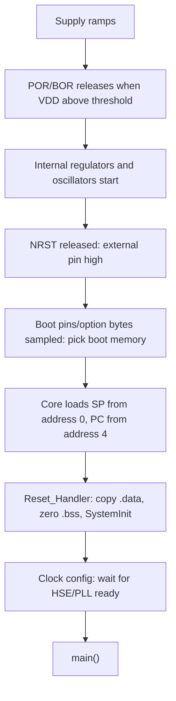

::: basics
### In plain words
A microcontroller needs four things before it can run code. It needs valid power, a steady clock, a clean release from reset, and valid code at the place it boots from. When a board will not start, you check these in order, starting with the ones that are quickest to measure. Only when all four check out do you suspect the firmware.

### Picture it
A stage play cannot start until the lights are on (power), the conductor gives the beat (clock), the curtain goes up (reset is released), and the actors have a script in hand (code). If the lights are off, no amount of rehearsing the script helps.

### Words you need
- **Reset pin**: a pin that holds the chip stopped while it is low, and lets it start when it goes high.
- **Clock**: the steady timing signal that drives the chip, often from a crystal, a small part that oscillates at a precise frequency.
- **Boot pins**: pins that choose where the chip starts, such as flash or a built-in loader.
- **Vector table** ([[q0796]]): a list at the start of flash holding the starting address of the stack (the chip's scratch memory for function calls) and the address of the first instruction.

### The simplest example
A new board does nothing. First, put a scope on the 3.3 V supply at the chip's own pin. It reads a steady 3.3 V, so power is fine. Next, look at the reset pin. It sits at 0 V, so the chip is held in reset. The cause is a reset supervisor (a chip that holds reset until the supply is high enough) with the wrong threshold, so it never lets go. No firmware change could ever fix that. If reset had been high, the next checks would be the clock, then the boot pins, then connecting the debugger.

That is the whole idea. The rest of this page gives the details for each step: power, reset, clock, boot pins, and diagnosing with a debugger.
:::

::: testing
Whether you can run a **structured bring-up checklist** in the right order. A microcontroller needs four things before it runs code: valid power, a stable clock, a clean release from reset, and valid code at the address the boot mode points to. The interviewer wants to hear that you check these in order of cheapness and dependency, with specific measurements (VDD at the pin, reset pin level, oscillator waveform, BOOT pins), and that you can separate hardware causes (decoupling, crystal, solder) from firmware causes (bad vector table, linker script, clock init hang).
:::

::: why
"It doesn't boot" is the most common message on a freshly assembled board. The people who solve it fast have a mental flowchart; the people who don't flail between recompiling and re-soldering. Because the symptoms (no activity, can't connect, resets in a loop) look the same for very different causes, the order of checks matters. This is the practical, hardware-side companion to [[q0831]] and [[q0832]].
:::

::: concepts
- **Power**: VDD/VSS/VDDA/VCAP all within spec, with decoupling; brown-out/POR thresholds.
- **Reset**: NRST level, pull-up, RC delay, supervisor chips, watchdog resets.
- **Clock**: crystal/oscillator start-up, load capacitors, internal RC fallback.
- **Boot configuration**: BOOT pins, option bytes, boot ROM vs flash.
- **Reset vector and vector table**: initial SP and PC loaded from the start of the table ([[q0823]]).
- **Debug access**: SWD connect (including under reset) to see what the core is doing.
:::

::: answer
"I'd go in the order of dependency, starting with the things that are quick to measure.

First, power. I measure the supply at the MCU's own pins, not just at the regulator, and with a scope, not only a multimeter, to see dips or ripple. I check every supply pin, including the analog supply and any internal regulator capacitor pin, and make sure the decoupling capacitors are fitted and the right value.

Second, reset. The reset pin should be released high after power-up, with its pull-up and any reset supervisor behaving. A stuck reset or an RC that's too slow gives you nothing running.

Third, the clock. If it uses a crystal, I check that it's oscillating, with a low-capacitance probe or by looking at a clock output pin. Wrong load capacitors or poor layout can stop it. Many parts fall back to an internal oscillator, which can make things run at the wrong speed rather than not at all.

Fourth, the boot pins and option bytes, which decide whether the chip boots from flash, a bootloader or RAM. A floating BOOT pin is a classic.

Then I try to connect the debugger, including connect-under-reset. If I can halt the core, I look at the program counter and see whether the code is running, stuck in an early hang, or faulting. If I can't connect, the problem is hardware: power, reset, wiring or readout protection. Finally, there's firmware: a wrong vector table, a bad linker script, or startup code that waits forever for the crystal."
:::

::: technical
**Boot sequence (Cortex-M).** After power-on reset releases: (1) the chip samples boot pins/option bytes to pick the boot memory; (2) the core loads the initial stack pointer from the first word of the vector table and the reset vector (PC) from the second word; (3) `Reset_Handler` runs: copy `.data`, zero `.bss`, set up clocks (`SystemInit`), call `main`. Failure at any stage looks like "not booting".

**Checklist, in order.**

| # | Check | How | Typical fault |
|---|---|---|---|
| 1 | VDD, VDDA, VBAT, VCAP at pins | scope, AC and DC | missing rail, shorted decoupling cap, wrong regulator, droop at start-up |
| 2 | Power sequencing and ramp | scope two rails | slow ramp, POR not released |
| 3 | NRST/RESET | scope, DC level | held low by a supervisor, a short, or a stuck watchdog |
| 4 | Clock | MCO pin or 10x low-C probe on osc out | crystal off, wrong CL, damaged crystal, no start-up margin |
| 5 | BOOT pins / option bytes | DMM and datasheet | floating BOOT0, wrong strap, wrong boot-mode option byte |
| 6 | Debug connection | SWD, connect under reset | dead chip or readout protection or SWD pins repurposed |
| 7 | Program counter / fault | debugger halt | hard fault in startup, infinite wait on clock ready |
| 8 | Firmware image | map file, vector table | linked at wrong address, empty flash, wrong device |
| 9 | Assembly | microscope, continuity, thermal | solder bridge, cold joint, wrong orientation |

**Crystal load capacitor formula.** For a crystal specified for load capacitance $C_L$ with two caps $C_1 = C_2 = C$ and stray capacitance $C_s$ (pins plus traces, typically 2-5 pF):

$$C_L = \frac{C_1 C_2}{C_1 + C_2} + C_s = \frac{C}{2} + C_s \quad\Rightarrow\quad C = 2(C_L - C_s).$$

For $C_L = 8$ pF, $C_s = 3$ pF: $C = 10$ pF.

**Brown-out.** If VDD sags below the BOR threshold during start-up (inrush from a bulk capacitor or a radio), the chip may reset in a loop.
:::

::: short
"I check in dependency order. Power at the MCU pins with a scope, including every VDD and the regulator-capacitor pin. Then reset: is NRST released high? Then the clock: is the crystal oscillating, or is it falling back to the internal oscillator? Then boot pins and option bytes. Then I attach a debugger, possibly under reset, to see where the program counter is. If it connects and runs, it's firmware: vector table, linker script or startup code hanging on the clock."
:::

::: long
"My rule is to check things in the order they are needed: power, reset, clock, boot configuration, then code.

Power first, because nothing else matters without it. I probe at the MCU's supply pins, not just at the regulator output, with an oscilloscope. I'm looking for the right voltage on every supply pin: VDD, the analog supply, the battery pin, and any pin that needs a capacitor for the internal regulator. I'm also looking for droop or a slow ramp, since a brown-out reset during start-up looks like a chip that never boots. I check that the decoupling capacitors are fitted and there are no shorts.

Second, reset. I want the NRST pin to go high shortly after power is stable. If it's held low, it might be a reset supervisor, a short, or the watchdog resetting the chip in a loop, which I'd see as a repeating reset pulse.

Third, the clock. I check the crystal is oscillating at the right frequency, but carefully, because a normal scope probe adds capacitance and can kill a marginal crystal. Better is to route the clock to an output pin, or check indirectly. Wrong load capacitors are common. The load capacitance formula is each cap equals two times the crystal's load capacitance minus the stray, so for an 8 pF crystal with 3 pF of stray I want about 10 pF. Also, firmware that waits for the crystal-ready flag will hang if the crystal never starts.

Fourth, boot pins and option bytes. A floating BOOT0 pin can send it into the bootloader.

Then I connect the debugger, with connect-under-reset if needed. If I can halt the core, I read the program counter and fault registers. If I can't connect at all, it's hardware or readout protection. If I can, I check the vector table: the first word should be a valid stack pointer in RAM and the second a valid reset address in flash, with the odd Thumb bit set."
:::

::: terms
- **POR / BOR**: power-on reset and brown-out reset circuits.
- **NRST**: active-low reset pin.
- **Reset vector**: address of the first instruction executed, stored in the vector table.
- **Vector table**: array at the start of flash: initial SP, reset handler, other handlers.
- **BOOT pins / option bytes**: configuration choosing the boot memory.
- **Load capacitance ($C_L$)**: capacitance a crystal expects to see for its rated frequency.
- **MCO**: microcontroller clock output pin.
- **Readout protection (RDP)**: lock that blocks debug/flash reads.
- **Connect under reset**: holding NRST low while the debugger attaches.
:::

::: exceptional
**An average answer**: "Check power, check the clock, check the code."

**An exceptional answer**:
- Orders the checks by dependency and cheapness, and says what to measure and where (at the pin, with a scope).
- Includes less obvious items: VCAP/VDDA pins, reset supervisor, BOOT pin strapping, option bytes, readout protection.
- Quantifies the crystal load capacitor calculation and the probe-loading hazard.
- Explains the Cortex-M boot (SP, reset vector, Thumb bit) and how to verify with the debugger.
- Separates "can't connect" (hardware) from "connects but hangs" (firmware).
- Knows the symptom patterns: reset loops, wrong baud rate from fallback clock, brown-out on inrush.
:::

::: mistakes
- **Starting with firmware changes** before confirming power and reset.
- **Checking the regulator output but not the MCU pin**, missing a broken trace or missing capacitor.
- **Using a multimeter only** on a rail with transient dips.
- **Probing the crystal with a standard probe**, stopping the oscillation and chasing a phantom.
- **Forgetting multiple supply pins** (VDDA, VREF+, VBAT, VCAP) that are required for boot on some parts.
- **Assuming a floating boot pin is "low"**; leakage and noise can pull it either way.
- **Not trying connect-under-reset** when firmware reconfigures the SWD pins or sleeps immediately.
- **Not swapping in a known-good board or chip** to separate assembly from design faults.
:::

::: deep
## What the chip needs to start

Between power-on and `main()` a lot has to go right. Understanding the chain tells you exactly where to probe.


Figure: Each box depends on the one before it, and each has a typical failure. The wait for "HSE/PLL ready" in the clock-config box is the classic hang for a dead crystal; a bad vector table breaks the "core loads SP and PC" box.

## Power: details that bite

**Measure where it counts.** A 3.3 V LDO output reading 3.30 V does not mean the MCU sees 3.30 V. Use the scope on the MCU pin with the ground spring close by, DC-coupled for level, then AC-coupled for ripple.

**Inrush and droop.** Suppose the MCU, flash and a radio start together, drawing a 150 mA step. If the LDO's output impedance plus trace resistance is 0.5 Ω, the rail drops by $0.15 \times 0.5 = 75$ mV, fine. But a large bulk capacitor (say 220 µF) charging at power-up can hold the regulator in current limit, so the rail ramps slowly or sags while it charges, and a partial short anywhere on the rail does the same permanently. If the brown-out threshold is 2.7 V and the rail dips to 2.6 V for 50 µs during the ramp, the chip resets, the load turns off, the rail recovers, and the sequence repeats: a reset loop at a few Hz. The scope on VDD triggered on the falling edge shows it immediately.

**Multiple supplies.** Many MCUs need every VDD pin and VSS pin connected, plus separate analog supply (VDDA) and sometimes reference pins. Leaving VDDA unpowered can keep the chip in reset or disable the internal regulator on some parts; always check the datasheet's "power supply scheme" figure. Likewise a **VCAP** pin (internal core regulator output) needs a specific capacitor (for example, 1-4.7 µF low-ESR is common, but follow the part's datasheet); the wrong or missing cap makes the core supply unstable.

**Decoupling.** One 100 nF ceramic per VDD pin, as close as possible, plus bulk. Check for a missing capacitor, one soldered as a short, or a 10 µF where 100 nF was specified (it won't fix high frequency).

> [!UNCERTAIN]
> Brown-out thresholds, VCAP requirements and POR behaviour are device-specific; the numbers above are examples. Use your part's datasheet.

## Reset

- Measure NRST with the scope: after power is stable it should be high. Many MCUs have an internal pull-up (30-50 kΩ typical), often with a 100 nF capacitor to ground for noise immunity, which gives an RC delay $\tau = 40\ \text{k}\Omega \times 100\ \text{nF} = 4$ ms. Meanwhile the supply must have reached its operating value.
- A reset **supervisor IC** holds reset until VDD is above its threshold (for example 2.93 V), plus a delay (tens to hundreds of ms). If its threshold is above the actual rail (a 3.0 V supervisor on a rail that settles at 2.95 V), the chip never leaves reset.
- A **repeating reset pulse** on NRST (a reset source other than the pin) means watchdog, brown-out or a hard-fault-reset loop; read the reset-cause flags in the RCC/reset status register after getting a debugger connection.

## Clock

If the firmware selects an external crystal (HSE) and waits for a ready flag, a missing or non-oscillating crystal hangs it in the startup code. Typical causes:
1. **Wrong load capacitors.** Example: $C_L = 12.5$ pF, $C_s = 4$ pF gives $C = 2(12.5 - 4) = 17$ pF, so the closest standard value is 18 pF. Fitting 100 pF caps (wrong value mixed up with decoupling caps) removes the negative resistance margin and the oscillator fails.
2. **Crystal drive level / gain margin.** Low-power oscillators have limited gain; the crystal's ESR must be within the chip's allowed range (the datasheet gives a maximum ESR for each frequency).
3. **Layout.** Long traces, ground return noise, or traces running under the crystal degrade it.
4. **Probe loading.** A standard 10x probe has about 10-15 pF, comparable to the load capacitors, shifting frequency or killing oscillation. Prefer an active probe (<1 pF), or measure the clock at an MCO pin.

**Fallback.** Some MCUs use an internal RC oscillator by default and switch to the crystal only when firmware asks; if the crystal fails, you get no clock change and baud rates are off by 1-2% or more, or USB fails, rather than a total hang. A 2% error accumulates over a 10-bit UART character to 0.2 bit, ok, but 10% error causes framing errors; USB requires about 0.25% accuracy (so it needs a crystal or a trimmed oscillator).

## Boot pins and option bytes

On STM32-like parts, BOOT0 high at reset selects the system bootloader instead of flash; floating inputs pick up leakage, so always tie such pins with a resistor. Option bytes can select boot from SRAM or another bank, enable watchdogs in hardware, or set readout protection. If a chip appears "dead" after programming, a bad option-byte write is a possible cause; many tools allow a mass erase to recover (it also erases flash).

## Debugger-based diagnosis

1. **Connect normally.** If it connects, halt and read PC. If the PC is in `Reset_Handler` or a `while(1)` in startup, look at which loop (clock ready? PLL lock?). If the PC is in the HardFault handler, read the fault registers.
2. **Connect under reset.** Hold NRST low while connecting. If this works but normal connect doesn't, firmware is disabling the debug pins or sleeping at start-up.
3. **Cannot connect at all.** Re-check VTref, ground, SWD wiring, cable length and clock speed; try a lower SWD speed; check readout protection.
4. **Check the image.** The first two words at the start of flash: initial SP (should be like 0x2000_xxxx, top of RAM) and reset vector (flash address with LSB = 1). `0xFFFF_FFFF` means blank flash. A vector table linked at the wrong base address (e.g. an application built for 0x0800_4000 after a bootloader but with the bootloader missing) also fails.

### Worked example: diagnose with measurements

A board shows no activity. Findings:
- VDD at pin: 3.29 V steady, ripple 20 mV. Good.
- NRST: 0 V (low). Bad: the chip is held in reset.
- Lift the reset supervisor's output pin (or remove the series resistor from it): NRST rises to 3.3 V through the internal pull-up and the chip runs. So the supervisor is holding reset.
- Supervisor part marking and datasheet: the variant fitted has a 4.38 V threshold (the 5 V-system version, a BOM or pick-and-place mix-up), so on a 3.29 V rail it never releases. Fix: fit the variant with a threshold below the rail but above the MCU's minimum supply (for example a 2.93 V version).

Total debug time: 10 minutes, no firmware touched. This is the point: the checks are cheap, ordered and decisive.

```sim
{"id":"power-sequencing"}
```
Figure: Explore power sequencing and reset release: notice that the reset signal is only released after all rails are above their thresholds plus a delay. If any threshold is not reached, the chip is held in reset indefinitely, which looks like a dead board.
:::

::: applications
- **New-board bring-up**: this is the standard first-article checklist before any firmware effort.
- **Production failure analysis**: units that "won't boot" are triaged by rails, reset and clock before reflow or rework.
- **Field returns**: reset-cause logging distinguishes brown-out from watchdog.
- **Bootloader and OTA design**: a bad update must not brick the device, so use a protected bootloader and dual-bank images.
- **Low-power designs**: wake-up from deep sleep fails if oscillator start-up time is longer than the firmware assumes.
- **Automotive and industrial products**: cold-crank brown-outs and supply glitches cause boot loops that must be reproduced on the bench.
:::

::: assumptions
- I assume a **Cortex-M-style MCU** with a vector table, boot pins and SWD; other families differ in details (AVR fuses, PIC configuration words, 8051 reset vector at 0x0000).
- The board is **new or modified**, not a field-proven design that suddenly stopped working; for the latter, start with what changed (supply, temperature, firmware update).
- Voltages and component values are **examples**; use the datasheet for your part.
- I assume access to a **scope and a debug probe**. Without them see [[q0833]].
- A chip with **mask-ROM or OTP** firmware would not have the flash-image issues.
- If the board uses an **external boot memory** (QSPI flash, SD card) the checklist adds that device's wiring and contents.
:::

::: followups
### The chip works at power-up on the bench supply but not on the battery. Why?
Likely a start-up supply droop: the battery's internal resistance plus inrush (or a radio/transient load) pulls VDD below the brown-out threshold, or the supply ramps too slowly for the reset supervisor. Measure at the MCU pin during start-up with the scope triggered on the falling edge. Fixes: more decoupling, a soft-start on peripherals, lower BOR threshold (if safe), or enabling the radio only after the MCU is up.

### How do you calculate crystal load capacitors?
$C = 2(C_L - C_s)$ for two equal caps, with $C_L$ from the crystal datasheet and $C_s$ the stray capacitance of the pins and layout (typically 2-5 pF). For $C_L = 8$ pF and $C_s = 3$ pF, use 10 pF. Check the oscillator's gain margin and the crystal's ESR against the MCU datasheet, and verify the frequency accuracy with a counter or by measuring a baud rate.

### What does the first word of a Cortex-M vector table mean, and what if it's wrong?
It's the initial main stack pointer, usually the top of SRAM (like 0x2000_5000). The second word is the reset vector (address of `Reset_Handler`, with the Thumb bit set so it is odd). If the SP is not in RAM or the reset address is erased flash (0xFFFF_FFFF) or an even number, the core faults at the first instruction and typically appears dead or in a hard-fault lockup.

### The debugger can't connect after you flashed new firmware. What now?
Try connect-under-reset, a lower SWD clock, and a power cycle. If firmware reconfigured the SWD pins as GPIO or enters deep sleep immediately, holding NRST during connection gets the debugger in before that code runs; then mass-erase and reflash. Also check that readout protection wasn't enabled.

### Harder: the board boots 90% of the time but occasionally hangs at power-up. How do you track it down?
This smells like a marginal condition: slow supply ramp near the POR threshold, crystal start-up margin (worse cold), or a floating pin sampled at the wrong time. Capture many power-ups on the scope (rails, NRST, a GPIO set early in firmware, crystal), compare a good and a bad capture, and vary temperature (cold spray) and supply ramp rate. Add a start-up log (reset cause, a "reached main" marker) to see how far bad boots progress.
:::

::: interpretations
"Isn't booting up" could mean the chip never runs code at all, or it runs but doesn't reach the application (stuck in a bootloader, loops in startup). I treat both with one ordered checklist, and the debugger step tells them apart. Related pages: [[q0831]] (general debugging strategy), [[q0832]] (debugger), [[q0833]] (debugging without a probe).
:::

::: references
- The datasheet and reference manual of your MCU: power supply scheme, reset and clock control, boot configuration chapters.
- Yiu, J., *The Definitive Guide to ARM Cortex-M3 and Cortex-M4 Processors*: reset sequence and vector table.
- ST, Microchip, NXP and similar vendors publish hardware development guides and crystal-oscillator application notes for their families (for example, the MCU hardware design guide in each vendor's documentation); consult your vendor's own.
- Horowitz & Hill, *The Art of Electronics*, 3rd ed.: crystal oscillators and power-supply decoupling.
:::

::: rubric
- Checks power at the MCU pins, all supply pins, with a scope :: Most boot failures are power-related and a multimeter or regulator-side check can miss them.
- Checks reset pin level and supervisors :: A chip held in reset looks dead.
- Checks the clock, noting load capacitors and probe loading :: Crystal faults are a top cause and easy to mis-measure.
- Checks boot pins and option bytes :: Floating straps send the chip to the wrong boot source.
- Uses the debugger (including under reset) to read PC/faults :: Distinguishes hardware from firmware quickly.
- Checks vector table / image and startup code :: Software-side boot dependencies.
- Follows a systematic order and uses known-good swaps :: Shows discipline instead of guesswork.
:::

::: quiz
```json
[
 {"type":"mcq","level":"fundamental","q":"Which should you verify first on a board that will not boot?","options":["Application code logic","Power at the MCU pins","The debugger's licence","The compiler optimisation level"],"answer":1,"explain":"Nothing runs without correct power. Check every supply pin at the chip, with a scope, before reset, clock and firmware."},
 {"type":"numeric","level":"intermediate","q":"A crystal needs $C_L = 8$ pF and the stray capacitance is about 3 pF. With two equal load capacitors, what value (pF) should each be?","answer":10,"tolerance":0.02,"unit":"pF","explain":"$C = 2(C_L - C_s) = 2(8-3) = 10$ pF. Each cap sees the other in series, giving $C/2 = 5$ pF, plus 3 pF stray = 8 pF."},
 {"type":"numeric","level":"intermediate","q":"A crystal has $C_L = 12.5$ pF with 4 pF stray capacitance. What load capacitor value (pF) do you need?","answer":17,"tolerance":0.02,"unit":"pF","explain":"$C = 2(12.5-4) = 17$ pF, so you would pick the nearest standard value, 18 pF."},
 {"type":"mcq","level":"intermediate","q":"On a Cortex-M, what do the first two words of the vector table hold?","options":["Reset vector then NMI vector","Initial stack pointer then reset vector","Flash size then RAM size","Boot mode then checksum"],"answer":1,"explain":"Word 0 is the initial main stack pointer; word 1 is the reset handler address (with the Thumb bit set). The core loads them at reset."},
 {"type":"truefalse","level":"advanced","q":"If the debugger connects only while NRST is held low, the hardware is faulty.","answer":false,"explain":"This pattern usually means firmware reconfigures the debug pins or enters a low-power state at start-up, so the probe can't attach once it runs. Connect-under-reset gets in first; the fault is in firmware, not hardware."}
]
```
:::
