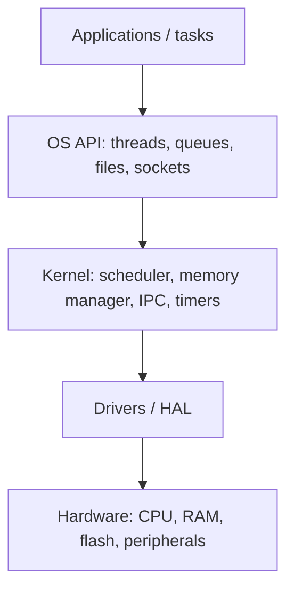

::: testing
Whether you can define an OS by its **job** (managing hardware resources and giving programs a clean interface to them) and name its main services: scheduling, memory management, device drivers/I/O, file systems, inter-process communication and protection. In an embedded interview, the hidden test is whether you can scale the idea down: an OS on a microcontroller may be just a scheduler and a few primitives, not Linux. Good answers contrast an OS with bare-metal firmware ([[q0838]]) and mention what it costs.
:::

::: why
Almost every non-trivial embedded product runs some kind of OS, from a 6 KB RTOS kernel to full Linux. Knowing what an OS actually provides lets you decide when you need one ([[q0837]]), choose between options ([[q0836]], [[q0840]]), and debug problems that appear only with one (priority inversion, stack overflow per task, tick-timer overhead). The question is deliberately short; interviewers look for a crisp definition and a sense of the trade-offs.
:::

::: concepts
- **Resource management**: CPU time, memory, peripherals shared among tasks.
- **Abstraction**: a uniform API (files, sockets, threads) hiding hardware differences.
- **Scheduler and context switch**: choosing which task runs and saving/restoring its registers.
- **Kernel vs user space** and protection (MMU/MPU) ([[q0823]] for the memory picture).
- **Synchronisation and IPC**: mutexes, semaphores, queues.
- **Drivers and file systems**: standardised access to devices and storage.
:::

::: answer
"An operating system is the software layer that manages the hardware resources and lets application code share them. It sits between the programs and the hardware.

Its main jobs are: scheduling, deciding which task or process gets the CPU and when; memory management, giving each program memory and, on bigger systems, protecting programs from each other; device and I/O management through drivers, so an application can open a file or a socket without knowing the details of the flash chip or the Ethernet controller; and tools for tasks to communicate and synchronise, like queues, semaphores and mutexes.

On a PC or phone, that means Windows, Linux, Android. On a microcontroller, it's usually a much smaller real-time operating system, like FreeRTOS or Zephyr, which might only provide the scheduler, a few synchronisation primitives and timers, in a few kilobytes of flash.

The alternative is bare-metal, where my code runs directly on the hardware with a main loop and interrupts. An OS adds overhead in memory and CPU time, but it makes it much easier to run several activities with different timing at once, and to reuse drivers and libraries."
:::

::: technical
**Definition.** An OS is system software that manages hardware resources (CPU, memory, storage, I/O devices) and provides services and an abstraction layer to application software.

**Core services.**
1. *Process/task management*: create, schedule and terminate tasks. Preemptive schedulers use a periodic timer interrupt (the tick, commonly 1 kHz in RTOSes) to switch tasks.
2. *Memory management*: allocation; on MMU systems, virtual memory and isolation; on MCUs, optionally an MPU for protection regions.
3. *Device I/O*: driver framework and standard calls.
4. *File systems and networking stacks*.
5. *Synchronisation and IPC*: mutexes, semaphores, event flags, message queues.
6. *Timekeeping, power management, security*.

**Context switch.** Save the running task's registers (on Cortex-M: R4-R11 by software; R0-R3, R12, LR, PC, xPSR pushed automatically on exception entry) to its stack, pick the next task, restore its registers. Costs on the order of a few hundred cycles on a small core (implementation-dependent).

**Overhead example.** A 1 kHz tick whose handler takes 1,200 cycles at 48 MHz uses $1200/48\times10^6 = 25\ \mu s$ per tick: 2.5% of the CPU.

**Spectrum.** Bare-metal super-loop; RTOS kernel (scheduler + primitives); embedded Linux (MMU, processes, drivers, file systems); general-purpose OS.
:::

::: short
"An operating system is the software layer that manages hardware resources and gives applications a clean interface to them. It handles scheduling of tasks, memory management, device drivers and I/O, and synchronisation between tasks. On a PC that's Windows or Linux; on a microcontroller it's typically a small RTOS like FreeRTOS with a scheduler and queues. It costs memory and CPU overhead, but makes concurrent, modular software much easier."
:::

::: long
"An operating system is the layer of software between my application and the hardware. Its basic job is to manage shared resources, the CPU, memory and peripherals, so multiple pieces of code can use them without stepping on each other, and to give applications a simple, consistent interface so they don't need to know every hardware detail.

The core services are these. A scheduler decides which task runs; it uses a timer interrupt to preempt tasks, and on a switch it saves one task's registers and restores another's. Memory management hands out memory, and on processors with an MMU it gives each process its own virtual address space for protection. Device drivers and an I/O layer let me say 'write to this file' or 'send on this socket' without bit-banging the controller. And it offers synchronisation tools, like mutexes, semaphores and message queues, for tasks to communicate safely.

The size of an OS varies hugely. Linux on an application processor has virtual memory, processes, file systems and a networking stack, needs megabytes of RAM and an MMU. On a microcontroller, an RTOS like FreeRTOS or Zephyr is essentially a scheduler plus synchronisation and timers, using a few kilobytes of flash and RAM, with tasks sharing one address space.

There's a cost: the scheduler tick eats a percent or two of CPU, each task needs its own stack, and a task can fail in new ways such as priority inversion or deadlock. If the product is simple, a bare-metal loop with interrupts is better. But when I have several activities with different timing, like a network stack, a UI and a control loop, an OS makes the code more modular and predictable."
:::

::: terms
- **Kernel**: core of the OS managing CPU, memory and devices.
- **Task / thread / process**: unit of scheduled execution; processes have separate address spaces.
- **Scheduler**: decides which task runs next.
- **Context switch**: saving one task's state and restoring another's.
- **Tick**: periodic timer interrupt driving time slicing and delays.
- **Driver / HAL**: code abstracting hardware access.
- **MMU / MPU**: hardware for virtual memory / memory protection.
- **IPC**: inter-process communication (queues, semaphores, shared memory).
- **Preemptive vs cooperative**: whether the OS can forcibly interrupt a running task.
:::

::: exceptional
**An average answer**: "Software that manages the computer, like Windows or Linux."

**An exceptional answer**:
- Defines by function: resource management plus abstraction.
- Lists scheduling, memory management, drivers/I/O, synchronisation, and explains the context switch and tick.
- Scales the concept: RTOS kernel vs embedded Linux vs desktop OS, with typical footprints.
- States trade-offs with numbers: tick overhead, per-task stack RAM, new failure modes.
- Contrasts with bare-metal and says when each is appropriate.
- Mentions MMU vs MPU and isolation.
:::

::: mistakes
- **"An OS is just a GUI."** The GUI is an application; the OS is the kernel and services.
- **Equating "OS" with Linux/Windows.** Many MCU systems use tiny RTOS kernels or none.
- **Saying an OS makes code faster.** It adds overhead; it makes concurrency manageable and may improve responsiveness.
- **Thinking an RTOS gives memory protection by default.** Most MCU RTOSes share one address space unless an MPU port is used.
- **Ignoring per-task stack memory.** Each task needs its own stack, which dominates RAM use.
- **Confusing the scheduler with the interrupt controller.** Interrupts are handled by hardware and ISRs; the scheduler runs tasks.
:::

::: deep
## What problem does an OS solve?

Imagine a small device that must read a sensor every 10 ms, update a display, talk over a network, and respond to a button. In a bare-metal super-loop these activities are interleaved by hand, and each one has to be written so it never blocks for long. Every new feature shifts the timing of the rest. An OS replaces hand-interleaving with a systematic mechanism: write each activity as its own task, and let the scheduler share the CPU.


Figure: The layering. Applications never touch the hardware directly; they call the OS, which multiplexes the resources and calls drivers. In bare-metal firmware the top three boxes collapse into one program.

## The scheduler and the context switch

Only one task runs at a time on a single core. To give the illusion of parallelism, the OS switches quickly. A **preemptive** scheduler is driven by a timer interrupt:

1. The tick interrupt fires (say every 1 ms).
2. The handler saves the running task's context on its stack (registers, PC, status).
3. The scheduler picks the highest-priority ready task (or round-robin among equals).
4. The handler restores the chosen task's context and returns from the interrupt, landing in the new task.

On a Cortex-M the hardware pushes R0-R3, R12, LR, PC, xPSR on exception entry, and the RTOS pushes R4-R11 in a software handler (PendSV is the conventional place). Roughly 16 words of register state are saved and restored, so a switch costs on the order of 100-300 cycles on a small core, depending on the RTOS and options (treat this as a rough figure).

### Worked example: tick overhead and per-task RAM

A Cortex-M0+ at 48 MHz runs an RTOS with a 1 kHz tick. Measurements show the tick handler plus scheduler takes 1,200 cycles when no switch occurs, and the context switch adds 300.
- Tick overhead: $\dfrac{1200}{48\times10^{6}} = 25\ \mu s$ per tick, which is 2.5% of CPU at 1 kHz.
- With a switch every tick: $\dfrac{1500}{48\times10^{6}} = 31.3\ \mu s$ (3.1%).
- Halve the tick rate to 500 Hz and the overhead halves, at the price of a 2 ms scheduling granularity.
- RAM: 4 tasks, each with a 512-byte stack and ~100 bytes of control block, plus an idle task and kernel structures: $4 \times 612 + 600 \approx 3.0$ KB. On a part with 8 KB of RAM that's 37%.

These numbers explain the main embedded trade-off: an OS buys structure at the expense of RAM and CPU time.

> [!UNCERTAIN]
> Cycle counts, control-block sizes and kernel footprints vary by RTOS, port and configuration. They are illustrative orders of magnitude; measure on your target.

## Memory management and protection

- **No MMU (typical MCU)**: all tasks share one physical address space. A bug in one task can overwrite another's memory. Some Cortex-M parts have an **MPU** that defines up to 8 or 16 regions with access rights, which RTOS ports can use to isolate tasks.
- **MMU (application processors)**: translates virtual to physical addresses via page tables; each process sees its own address space; the kernel runs in privileged mode. A crash kills only that process. Linux needs this.

## Device and I/O abstraction

A driver turns "write these bytes to the UART" into register writes and interrupt handling. The OS defines the interface (open/read/write/ioctl in POSIX-like systems; Zephyr has device-tree-based drivers). Benefit: application code ports across boards. Cost: extra layers and code size.

## Synchronisation: why it is hard

Once multiple tasks exist, shared data needs protection.
- **Mutex**: mutual exclusion for a shared resource; with **priority inheritance** to avoid priority inversion ([[q0840]]).
- **Semaphore**: signalling (binary) or counting resources; an ISR gives a semaphore to wake a task.
- **Queue**: copies messages between tasks safely.
- **Event flags**: wait for combinations of events.

Typical new bugs: deadlock (two tasks each hold what the other needs), priority inversion, race conditions on non-atomic updates, and stack overflow of a single task corrupting its neighbour.

## The spectrum of "OS" on embedded hardware

| Level | Example | Typical footprint | Needs | Provides |
|---|---|---|---|---|
| None (bare-metal) | super-loop + ISRs | 0 | any MCU | full control, minimal overhead |
| Scheduler-only RTOS | FreeRTOS, ThreadX | ~5-15 KB flash, 1-2 KB RAM + stacks | MCU | tasks, queues, mutexes, timers |
| Fuller RTOS | Zephyr, NuttX | tens to hundreds of KB | MCU/MPU | drivers, networking, filesystems, security |
| Embedded Linux | Yocto/Buildroot | MBs of RAM, 10s of MB storage | MMU | processes, rich ecosystem |
| Desktop/mobile OS | Windows, Android | GBs | MMU, GPU | full services |

(Footprints are approximate and configuration-dependent.)

```sim
{"id":"interrupt-lab","nesting":true}
```
Figure: The scheduler's tick is an interrupt. Watch how an ISR preempts the main loop, how priorities decide who runs, and what happens when an ISR runs too long: the same effect that makes the tick handler's duration matter for an RTOS.
:::

::: applications
- **IoT sensor node** running FreeRTOS or Zephyr with a Bluetooth/Wi-Fi stack, sensor task and low-power manager.
- **Smartphones and tablets**: Android, iOS (full OS with MMU, security, GUI).
- **Network equipment and set-top boxes**: embedded Linux.
- **Automotive ECUs**: AUTOSAR-based or OSEK-style real-time OS.
- **Industrial controllers and robots**: RTOS tasks for control loops plus a non-real-time Linux side for UI.
- **Medical devices and avionics**: certified RTOS kernels (such as those used in DO-178C or IEC 62304 contexts).
:::

::: assumptions
- I take "operating system" in the **general sense** with an embedded emphasis, since the question sits in the Embedded Systems section.
- Footprints, overheads and cycle counts are **order-of-magnitude** and depend on the target and configuration.
- A **single-core** CPU is assumed; multicore adds SMP scheduling and cache coherence.
- Some systems blur the line: a **hypervisor** or **bootloader** with services; a "library OS" or **unikernel**; or middleware like Arduino core calling itself an OS.
- Whether a kernel provides **isolation** depends on MMU/MPU support and how it is configured.
:::

::: followups
### What's the difference between a process and a thread (or task)?
A process has its own address space and resources, managed with an MMU; a thread is a unit of execution within a process, sharing its memory. On an MCU RTOS, "tasks" are essentially threads in one shared address space, with their own stacks and priorities. Crashes in a process are isolated; a runaway task on an MCU RTOS can corrupt everything.

### What does the OS do when a task calls delay(10)?
It marks the task as blocked until the tick count reaches now+10 ticks, and the scheduler immediately switches to another ready task (or the idle task, which can enter a low-power sleep). When the tick reaches the target, the task is moved to the ready list and may preempt the current task if it has higher priority. This is why blocking delays do not waste CPU, unlike a busy-wait loop.

### Why do RTOS tasks each need their own stack?
Each task has its own call chain and local variables, which live on a stack. On a context switch the stack pointer is changed to the other task's stack, and its registers are saved there. The stack must be sized for the worst-case call depth plus the context frame and interrupt nesting, typically 256-2048 bytes on an MCU, so many tasks multiply RAM use.

### What does the OS add to interrupt handling?
Nothing replaces interrupts: they are handled by hardware and ISRs. The OS provides safe ways for an ISR to wake tasks (give a semaphore, post to a queue with the "from ISR" API variant), and defers long work out of the ISR into a task. The scheduler may also run at the end of an ISR if a higher-priority task became ready.

### Harder: your RTOS device occasionally freezes with all tasks blocked. What happened?
Possibly a deadlock (circular wait on mutexes), a lost wake-up (the ISR gave a semaphore before the task waited, with no counting or event latch), or all tasks waiting for an event that a stalled task would produce. Debug by listing task states and the objects each is blocked on (RTOS-aware debugger), review lock-ordering, and use timeouts on waits with logged errors.
:::

::: interpretations
"What is an operating system?" is asked in the **embedded** section, so I answer in that context while covering the general definition. If the interviewer is probing the desktop concept (processes, virtual memory), the core services above apply directly. Siblings: [[q0836]] (examples), [[q0837]] (when needed), [[q0838]] (bare-metal), [[q0839]] (advantages) and [[q0840]] (RTOS).
:::

::: references
- Tanenbaum & Bos, *Modern Operating Systems*: chapters on processes, scheduling, memory management and I/O.
- Silberschatz, Galvin & Gagne, *Operating System Concepts*: the standard textbook treatment.
- Yiu, J., *The Definitive Guide to ARM Cortex-M3 and Cortex-M4 Processors*: exception model, PendSV and SysTick for context switching.
- The FreeRTOS and Zephyr project documentation (kernel overview and scheduling sections).
:::

::: rubric
- Defines an OS as resource manager plus abstraction layer :: The core definition.
- Lists key services: scheduling, memory, drivers/I/O, synchronisation :: Shows breadth.
- Explains the scheduler / context switch / tick mechanism :: Mechanism-level understanding.
- Scales to embedded: RTOS vs embedded Linux vs bare-metal :: The section is about embedded systems.
- States costs: memory, CPU overhead, new failure modes :: Engineering judgment, not marketing.
- Gives a concrete example (FreeRTOS, Linux) :: Grounds the answer.
:::

::: quiz
```json
[
 {"type":"mcq","level":"fundamental","q":"Which is NOT a core service of an operating system?","options":["Scheduling tasks on the CPU","Memory management","Providing a uniform interface to devices through drivers","Designing the PCB layout"],"answer":3,"explain":"An OS manages CPU, memory and I/O and offers synchronisation. PCB layout is a hardware design activity."},
 {"type":"numeric","level":"intermediate","q":"An RTOS tick handler takes 1,200 cycles on a 48 MHz core at a 1 kHz tick. What fraction of CPU time (percent) does it use?","answer":2.5,"tolerance":0.02,"unit":"%","explain":"Per tick: $1200/48\\times10^6 = 25$ µs. Tick period is 1000 µs, so $25/1000 = 2.5\\%$."},
 {"type":"mcq","level":"intermediate","q":"On a Cortex-M RTOS, what saves R0-R3, R12, LR, PC and xPSR on entry to the context-switch exception?","options":["The RTOS code, manually","The hardware, automatically","The compiler","The linker"],"answer":1,"explain":"Cortex-M hardware stacks those eight registers on exception entry; the RTOS handler (PendSV) saves R4-R11 itself."},
 {"type":"numeric","level":"intermediate","q":"Four tasks each have a 512-byte stack and a 100-byte control block, and the kernel needs 600 bytes. How many bytes of RAM in total?","answer":3048,"tolerance":0.02,"unit":"bytes","explain":"$4\\times(512+100) + 600 = 2448 + 600 = 3048$ bytes, about 3 KB."},
 {"type":"truefalse","level":"advanced","q":"Tasks in a typical Cortex-M RTOS are isolated from each other by default, like processes on Linux.","answer":false,"explain":"MCU RTOS tasks usually share one address space; isolation requires an MPU-enabled port with configured regions. Linux processes are isolated by the MMU."}
]
```
:::
