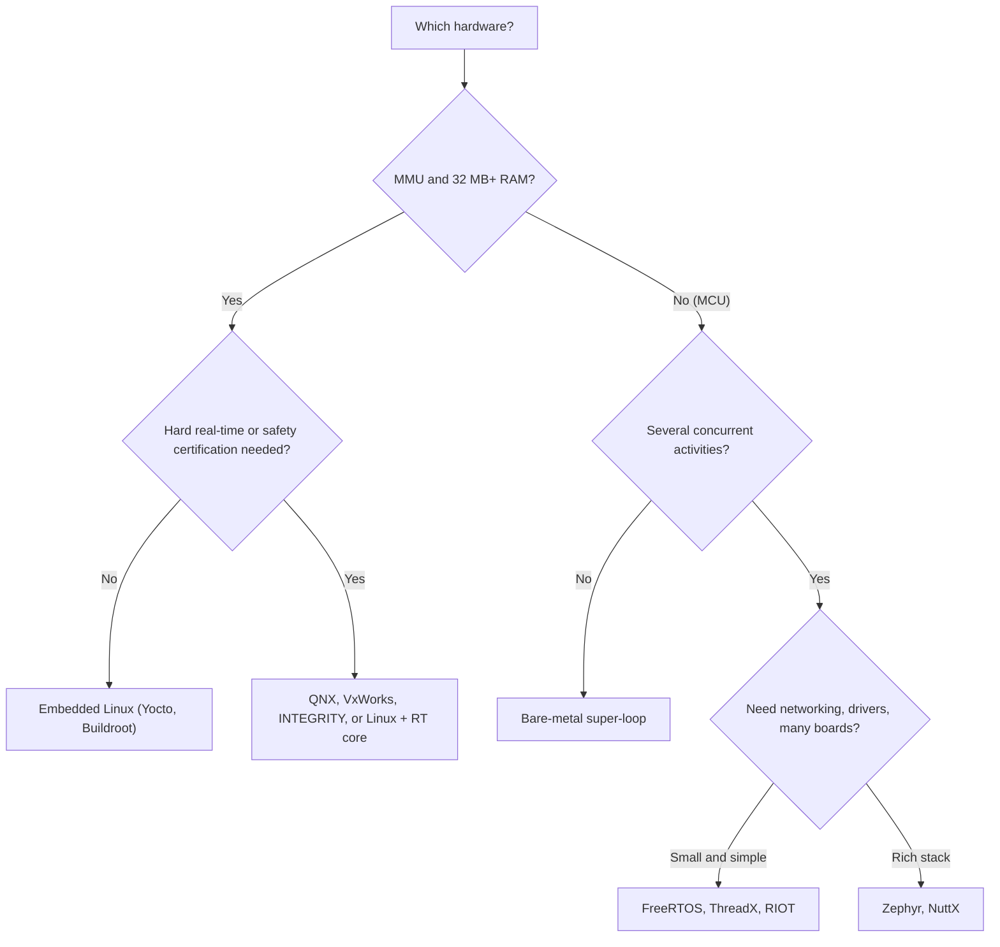

::: basics
### In plain words
Operating systems come in groups. Desktop and phone systems include Windows, macOS, Linux, Android and iOS. Embedded devices with a bigger processor often run embedded Linux. Small microcontrollers run a real-time OS (RTOS), such as FreeRTOS or Zephyr. Which one fits depends on the hardware and on how strict the timing and safety needs are.

### Picture it
Think of vehicles. A bicycle, a car and a freight truck are all vehicles, but you pick one by the load and the road. A tiny microcontroller with a few kilobytes of RAM is a bicycle job, so you want a very light OS. A device with a screen, Wi-Fi and megabytes of RAM can carry a heavy one like Linux. Using a truck for a bicycle job just wastes resources.

### Words you need
- **RTOS** ([[q0840]]): a small OS whose timing is predictable and bounded.
- **Embedded Linux**: the Linux kernel plus a minimal set of programs, customized for one device.
- **MMU**: hardware that gives each program its own private view of memory. Standard Linux needs it.
- **FreeRTOS / Zephyr**: two popular open-source RTOSes for microcontrollers.

### The simplest example
A small chip with 32 KB of RAM reads a sensor and sends the data over Bluetooth. That is a job for FreeRTOS or Zephyr, because Linux will not fit. Now take a device with a display and Wi-Fi, built on a processor with an MMU and megabytes of RAM. That suits embedded Linux, which brings drivers and networking. A product that needs safety certification, such as in a car or aircraft, may choose a commercial RTOS such as VxWorks or QNX.

That is the whole idea. The rest of this page maps the landscape, compares the microcontroller RTOSes, and works through picking an OS for four different products.
:::

::: testing
Whether you can name operating systems **across the whole range** and attach the right category and use case to each, not just recite Windows, Linux and macOS. In an embedded interview, the expected names are RTOSes (FreeRTOS, Zephyr, ThreadX, VxWorks, QNX) and embedded Linux, plus a sense of which fits which hardware (a Cortex-M0 with 16 KB RAM versus a Cortex-A with a gigabyte). A good answer also distinguishes general-purpose, real-time, and mobile OSes, and says what it would pick for a given product.
:::

::: why
Choosing an OS is an early architecture decision with long-lasting consequences: toolchains, licensing, certification, memory, boot time, ecosystem and team skills all follow from it. Interviewers ask this to see if you know the landscape and whether you can match tool to job. Naming five names is easy; explaining why FreeRTOS suits a sensor node and embedded Linux suits a router is what stands out.
:::

::: concepts
- **General-purpose OS**: Windows, Linux, macOS: fairness and throughput, MMU, rich services ([[q0835]]).
- **Mobile OS**: Android, iOS: power management and app sandboxing.
- **RTOS**: predictable scheduling for MCUs ([[q0840]]).
- **Embedded Linux**: a Linux kernel with a trimmed userland on application processors.
- **Hardware requirements**: MMU or not, RAM and flash size, CPU class.
- **Licensing and certification**: open source licences, commercial support, safety certification.
:::

::: answer
"I think of them in three groups.

General-purpose operating systems: Windows, macOS and Linux on desktops and servers. Mobile ones: Android, which is Linux-based, and iOS.

For embedded systems with an application processor, that has an MMU and megabytes of RAM, the usual choice is embedded Linux, built with something like Yocto or Buildroot, used in routers, cameras, infotainment and industrial gateways.

Then there are real-time operating systems for microcontrollers. FreeRTOS is probably the most common: tiny and free. Zephyr is a newer, larger open-source RTOS under the Linux Foundation with a lot of drivers and networking. ThreadX, now Eclipse ThreadX, is popular in products that need certification. VxWorks and QNX are commercial RTOSes used in aerospace, automotive and industrial systems; VxWorks has flown on Mars missions, for example. There's also RTEMS, µC/OS, NuttX and RIOT.

Which one I'd choose depends on hardware and requirements. For a Cortex-M with 32 KB RAM measuring a sensor and sending Bluetooth, FreeRTOS or Zephyr. For a Cortex-A device with a display and Wi-Fi, Linux. For something safety-certified, a commercial RTOS or a certified variant of one of the open ones."
:::

::: technical
**Categories and representatives.**

| Category | Examples | Typical hardware | Notes |
|---|---|---|---|
| Desktop/server | Windows, macOS, Linux | x86-64, Arm64; GBs RAM | MMU, large driver base |
| Mobile | Android (Linux kernel), iOS | Arm64 SoCs | app sandboxing, power management |
| Embedded Linux | Yocto/OpenEmbedded, Buildroot, OpenWrt | Cortex-A, MIPS, RISC-V; 32 MB+ RAM | MMU required for standard Linux; boot seconds |
| Small RTOS | FreeRTOS, Eclipse ThreadX, µC/OS, RIOT, NuttX, Mbed OS | Cortex-M, RISC-V; 8 KB+ RAM | tasks, queues, timers |
| Rich RTOS | Zephyr, RTEMS, VxWorks, QNX, INTEGRITY | MCU to MPU | drivers, networking, filesystems, safety options |

**Representative facts.**
- *FreeRTOS*: MIT-licensed kernel, widely ported; stewarded by AWS. Scheduler plus queues, semaphores, timers; add-ons for TCP/IP, MQTT.
- *Zephyr*: Linux Foundation project (Apache 2.0); device-tree and Kconfig configuration, many board ports, networking and BLE stacks.
- *Eclipse ThreadX* (formerly Azure RTOS ThreadX, originally from Express Logic): contributed to the Eclipse Foundation as open source; known for small footprint and safety certifications for earlier versions.
- *VxWorks* (Wind River) and *QNX* (BlackBerry): commercial, POSIX-flavoured, certified variants for avionics, medical and automotive. QNX is a microkernel.
- *Linux*: monolithic kernel; real-time behaviour improves with the PREEMPT_RT patch set.
- *Bare-metal*: not an OS, but a valid alternative ([[q0838]]).

**Footprint rule of thumb.** Small RTOS kernel: single-digit to low tens of KB flash and about 1 KB+ RAM plus task stacks. Embedded Linux: several MB of RAM minimum, tens of MB of storage in practice.
:::

::: short
"Three families. General-purpose: Windows, macOS, Linux; mobile: Android and iOS. Embedded Linux, built with Yocto or Buildroot, for application-class processors with an MMU. And RTOSes for microcontrollers: FreeRTOS, Zephyr, ThreadX, VxWorks, QNX, µC/OS, RTEMS. I'd pick by hardware and requirements: FreeRTOS or Zephyr on small Cortex-M parts, Linux on Cortex-A devices, a certified commercial RTOS where safety standards apply."
:::

::: long
"I group operating systems by the hardware they run on.

At the top, general-purpose operating systems for computers: Windows, macOS and Linux. On phones, Android, which uses a Linux kernel, and iOS.

In the middle are embedded systems built around an application processor, like a Cortex-A with an MMU and at least tens of megabytes of RAM. That's where embedded Linux lives. You assemble a custom, trimmed Linux image with a build system like Yocto or Buildroot. You find it in routers, IP cameras, car infotainment systems and industrial gateways. The advantages are a huge ecosystem, networking, filesystems and drivers; the costs are a few seconds of boot time, megabytes of memory, and non-hard-real-time behaviour unless you use the real-time patches.

At the bottom are the microcontrollers, which use real-time operating systems. FreeRTOS is the most widely used: a small scheduler with queues, semaphores and timers in a few kilobytes. Zephyr is a more feature-rich open-source RTOS from the Linux Foundation, with lots of board support, Bluetooth and networking. ThreadX, now Eclipse ThreadX, is known for small footprint and a history of safety certification. VxWorks and QNX are commercial, POSIX-style RTOSes common in aerospace, medical and automotive. There are others too, like RTEMS, µC/OS, NuttX and RIOT.

How I'd choose: hardware limits first, so no MMU and little RAM means an RTOS or bare-metal. Then the feature needs, like networking and file systems. Then certification and licensing, and finally the team's experience. A battery sensor node with 64 KB of RAM: FreeRTOS or Zephyr. A camera with Wi-Fi and a web UI: embedded Linux. A flight-control computer: a certified RTOS."
:::

::: terms
- **RTOS**: operating system with predictable, bounded timing ([[q0840]]).
- **Embedded Linux**: Linux kernel plus minimal userland customised for a device.
- **Yocto / Buildroot**: build systems for creating embedded Linux images.
- **Microkernel**: kernel keeping only essentials; drivers and services run as user processes (QNX).
- **POSIX**: standard API for Unix-like systems; many RTOSes offer a subset.
- **PREEMPT_RT**: Linux patch set improving real-time latency.
- **BSP**: board support package: drivers and startup code for a specific board.
- **Safety certification**: process-based evidence (for example DO-178C in avionics, ISO 26262 in automotive, IEC 62304 in medical software).
:::

::: exceptional
**An average answer**: "Windows, Linux, macOS, Android."

**An exceptional answer**:
- Lists across categories, including RTOSes and embedded Linux, with a use for each.
- Links hardware requirements (MMU, RAM, flash) to the OS choice.
- Mentions licensing and ecosystem (MIT FreeRTOS, Apache Zephyr, commercial VxWorks/QNX).
- Mentions certification and the real-time aspect of Linux vs RTOS.
- Gives a decision procedure with an example product.
- Acknowledges that bare-metal is also a valid option.
:::

::: mistakes
- **Listing only desktop OSes** when the question is in the embedded section.
- **Calling Arduino or "mbed" an OS** in the same sense as Linux. Arduino is a framework on bare-metal; Mbed OS was a real RTOS-based platform (Arm has announced it is being retired).
- **Saying Linux is an RTOS.** Standard Linux is soft real-time at best; PREEMPT_RT improves latency but needs care.
- **Claiming Android is not Linux.** Android uses the Linux kernel with a different userland.
- **Ignoring licence implications.** GPL components in a product have obligations; MIT/Apache have different ones.
- **Choosing Linux for a tiny MCU.** Standard Linux needs an MMU and MBs of RAM; there is a no-MMU variant (uClinux) but it is niche.
:::

::: deep
## A map of the landscape

Think of two axes: hardware capability (MCU to server) and timing guarantees (best-effort to hard real-time). Operating systems cluster in regions of that plane.


Figure: A first-cut decision path. Real choices also weigh licence, vendor SDK support (many chip vendors ship FreeRTOS or Zephyr by default), certification evidence and team experience.

## The microcontroller RTOSes

**FreeRTOS.** Originated by Richard Barry; now an MIT-licensed project stewarded by Amazon Web Services. The kernel is a handful of C files (tasks, queues, semaphores, mutexes, software timers, event groups), so ports to a new architecture are small. It scales from 8-bit to 64-bit CPUs. Networking, MQTT and OTA are separate libraries. Vendor SDKs (STM32Cube, ESP-IDF, NXP MCUXpresso and others) commonly bundle it, which is a big reason for its popularity. ESP-IDF is built on FreeRTOS, for instance.

**Zephyr.** A Linux Foundation project with Apache 2.0 licensing. It uses a Linux-like build and configuration approach (Kconfig and devicetree), so hardware is described in data rather than code; includes Bluetooth LE, 802.15.4/Thread, TCP/IP, USB, file systems and power management. The cost is a steeper learning curve and a bigger footprint than FreeRTOS (tens of KB flash for a basic app is realistic).

**Eclipse ThreadX.** Previously Azure RTOS ThreadX and originally Express Logic's product, since contributed to the Eclipse Foundation under an open-source licence. Known for a small deterministic kernel and, in earlier incarnations, certifications for safety standards. If a project needs certification evidence, check what exactly is available for the version you use.

**VxWorks and QNX.** Commercial RTOSes from Wind River and BlackBerry. QNX is a microkernel RTOS with POSIX APIs, widely used in automotive infotainment and some industrial and medical systems. VxWorks is used in aerospace and defence among others; the Mars Pathfinder lander of 1997 ran VxWorks, which is also the source of a famous priority-inversion bug story ([[q0840]]). Both offer safety-certified editions.

**Others.** RTEMS (open-source, used in space and research), µC/OS-II/III (long-time educational and industrial choice), NuttX (POSIX-flavoured, Apache), RIOT (IoT-focused), Mbed OS (Arm IoT OS that Arm has announced will reach end of life), plus vendor-specific kernels.

> [!UNCERTAIN]
> Project ownership, licensing and support status change over time (ThreadX and Mbed OS are examples). Verify the current status and licence of any OS before choosing it for a product.

## Embedded Linux and real-time

Embedded Linux uses the Linux kernel with a minimal userland (BusyBox, systemd or init scripts), assembled by Yocto/OpenEmbedded or Buildroot, or a distribution like OpenWrt for routers. It needs an MMU in the standard configuration and typically 32 MB RAM or more. Boot time is seconds unless carefully optimised.

Real-time: mainstream Linux schedules for throughput, so worst-case latency can reach milliseconds under load. The PREEMPT_RT patch set makes most of the kernel preemptible, and brings worst-case scheduling latencies down to tens of microseconds on suitable hardware, which is enough for many soft and some firm real-time jobs but is not certified hard real-time. A common architecture for demanding products is **asymmetric**: Linux on application cores for UI and networking, and an RTOS or bare-metal firmware on a separate real-time core (a Cortex-M or R) for control loops, communicating through shared memory/mailbox.

## Worked example: picking an OS for four products

| Product | Hardware | Requirements | Choice | Why |
|---|---|---|---|---|
| BLE temperature sensor node | Cortex-M0+, 32 KB RAM, 256 KB flash | coin-cell life, one sensor, BLE | bare-metal or Zephyr with BLE stack | tiny RAM; BLE stack often comes with an RTOS or event loop |
| Smart thermostat | Cortex-M4, 256 KB RAM | Wi-Fi, TLS, display, OTA | FreeRTOS or Zephyr | networking libraries, tasks for UI/network/control |
| Video doorbell | Cortex-A, 512 MB RAM | camera, H.264, Wi-Fi, cloud | embedded Linux | codecs, drivers, networking stack ecosystem |
| Insulin pump controller | Cortex-M, safety critical | IEC 62304 evidence | certified RTOS or carefully verified bare-metal | certification, determinism |

Check the thermostat row: a TLS stack needs on the order of 30-60 KB of RAM during a handshake, plus network buffers, so 256 KB of RAM is comfortable and 32 KB is not (typical figures, implementation dependent).

## Why the same name hides different things

"Linux" can refer to the kernel alone (what runs on the chip) or a distribution (the whole system). "Android" is the Linux kernel plus a large userland and runtime. "FreeRTOS" is only a kernel; people talk about "FreeRTOS projects" that also include a vendor HAL and middleware. In an interview, being precise about what you mean (kernel vs platform) is a small but visible sign of experience.

```sim
{"id":"cache-lab"}
```
Figure: Larger operating systems depend on hardware features like caches and an MMU to run well. Explore how cache hits and misses change average memory access time: this is part of why a Cortex-A running Linux behaves very differently from a cacheless Cortex-M running an RTOS.
:::

::: applications
- **FreeRTOS**: Wi-Fi modules (Espressif ESP32 SDK is built on it), smart home sensors, wearables.
- **Zephyr**: BLE and Thread devices, trackers, industrial sensors from many silicon vendors.
- **Embedded Linux**: routers, NAS boxes, IP cameras, set-top boxes, EV chargers' HMI.
- **QNX / VxWorks**: automotive digital clusters and infotainment, aerospace, medical imaging, industrial robots.
- **Android**: phones, tablets, and also embedded HMIs and kiosks.
- **RTEMS**: spacecraft and research instruments.
:::

::: assumptions
- I'm answering in an **embedded systems** context, so I list RTOS and embedded Linux examples alongside the desktop names.
- Licensing, ownership and support status of these projects **change over time**, so check the present state.
- Footprint and boot figures are **typical ranges**, not guarantees.
- Whether to call something an "OS" at all is debatable for tiny schedulers and for frameworks like Arduino; I treat a kernel with a scheduler as an RTOS.
- If the interviewer means "which OS have **you** used", give your actual experience, not a list.
:::

::: followups
### What's the difference between FreeRTOS and Zephyr?
FreeRTOS is a minimal kernel (tasks, queues, semaphores, timers) with other functionality added through separate libraries and vendor SDKs; it is easy to learn and tiny. Zephyr is a full platform: kernel, device-tree-driven drivers, networking, Bluetooth, power management and a build system, supporting hundreds of boards, but with a larger footprint and learning curve. I'd choose FreeRTOS when the vendor SDK already uses it and the needs are small, Zephyr when I need a rich connectivity stack and portability across boards.

### Is Linux a real-time operating system?
Not in the strict sense. Mainline Linux is designed for throughput and fairness, with worst-case latencies that can spike to milliseconds. With PREEMPT_RT (now largely merged into the mainline kernel in recent versions) latencies are bounded much tighter, tens of microseconds on good hardware, suitable for soft and some firm real-time uses. For hard deadlines and certification people use an RTOS or a dedicated real-time core.

### Why can't Linux run on a Cortex-M0?
Standard Linux relies on an MMU for virtual memory and process isolation, which Cortex-M0 lacks, and it needs megabytes of RAM and a storage device for the kernel and root filesystem. A no-MMU variant (uClinux) exists and runs on some MMU-less cores with several MB of RAM, but on a small Cortex-M with tens of KB of RAM it is not feasible.

### What is the difference between an RTOS and a bare-metal scheduler I write myself?
A hand-rolled round-robin or state-machine scheduler is cooperative and shares the CPU only at points where tasks yield. An RTOS provides preemption, priorities, blocking primitives, timeouts and a tested set of synchronisation tools, all with defined latency behaviour. For two or three simple activities a super-loop is fine; beyond that the RTOS saves debugging effort ([[q0839]]).

### Harder: your product uses Linux but must run a 20 kHz motor control loop. How do you architect it?
Don't run the 20 kHz loop on a general Linux scheduler. Put the control loop on a real-time resource: a separate Cortex-M/R core or MCU, a hardware-timer-triggered ISR on the application core with isolated CPU, or a PRU/FPGA. Linux handles UI, networking and configuration, sending setpoints via shared memory or a message interface. A 20 kHz loop has a 50 µs period; even PREEMPT_RT jitter of tens of microseconds would consume most of it.
:::

::: interpretations
"Name some operating systems" is open-ended; the section is embedded, so I list across general-purpose, mobile, embedded Linux and RTOS and attach use cases. If the interviewer wants only **RTOS examples**, see [[q0840]]. For the definition, see [[q0835]]; for when you need one, [[q0837]].
:::

::: references
- Tanenbaum & Bos, *Modern Operating Systems*: case studies of Unix/Linux and the structure of real systems.
- The FreeRTOS and Zephyr project documentation (kernel overview and getting-started guides).
- Yocto Project and Buildroot manuals (for embedded Linux build flows).
- Vendor documentation for QNX and VxWorks (feature and certification pages); check current editions.
:::

::: rubric
- Names desktop/server and mobile OSes :: The baseline expected answer.
- Names RTOSes (FreeRTOS, Zephyr, ThreadX, VxWorks, QNX) :: The section is about embedded systems.
- Mentions embedded Linux and when it is appropriate :: Common in application-class products.
- Matches OS choice to hardware (MMU, RAM, flash) :: Demonstrates engineering judgment.
- Mentions licensing, certification or ecosystem :: Real selection criteria.
- Gives an example product-to-OS mapping :: Shows you can apply knowledge.
:::

::: quiz
```json
[
 {"type":"mcq","level":"fundamental","q":"Which of these is a real-time operating system commonly used on microcontrollers?","options":["macOS","FreeRTOS","Windows 11","Ubuntu Desktop"],"answer":1,"explain":"FreeRTOS is a small RTOS kernel designed for microcontrollers. The others are general-purpose desktop operating systems."},
 {"type":"mcq","level":"fundamental","q":"Which kernel does Android use?","options":["Windows NT","Linux","QNX","FreeRTOS"],"answer":1,"explain":"Android uses a modified Linux kernel with its own userland and runtime."},
 {"type":"mcq","level":"intermediate","q":"A product has a Cortex-M4 with 128 KB of RAM, no MMU, and needs BLE plus a few concurrent tasks. Which is the most suitable choice?","options":["Standard Linux built with Yocto","An RTOS such as FreeRTOS or Zephyr","Windows IoT Enterprise","macOS"],"answer":1,"explain":"Standard Linux needs an MMU and megabytes of RAM. A small RTOS fits the memory and provides tasks and a BLE stack."},
 {"type":"multi","level":"intermediate","q":"Select all that are typical reasons to choose embedded Linux over a small RTOS.","options":["Need for a rich networking and filesystem ecosystem","Hardware is a Cortex-M0 with 16 KB of RAM","Using a Cortex-A processor with an MMU and 512 MB of RAM","Need a hard-real-time guarantee in microseconds on the same core"],"answer":[0,2],"explain":"Linux shines on MMU-equipped application processors with plentiful RAM and a need for ecosystem. It does not fit a 16 KB part, and it is not the default choice for hard microsecond guarantees."},
 {"type":"numeric","level":"advanced","q":"A control loop runs at 20 kHz. What is its period in µs?","answer":50,"tolerance":0.01,"unit":"µs","explain":"$1/20{,}000\\ \\text{Hz} = 50\\ \\mu s$. Scheduler jitter of tens of microseconds would consume much of this budget, so such loops run on a dedicated real-time core or in a timer ISR."}
]
```
:::
