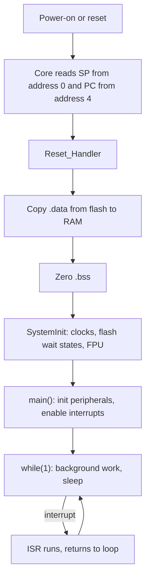

::: basics
### In plain words
Bare-metal programming means writing firmware that runs directly on the chip with no operating system. Your code is the only software there. After reset, startup code prepares memory and calls `main`. Your code then sets up the clock and peripherals by writing to their registers. It runs an endless main loop, and interrupt handlers deal with urgent events.

### Picture it
Imagine a one-person shop. You do every job yourself, serving customers one after another in a loop. A doorbell rings when someone urgent arrives, and you drop what you are doing, deal with it quickly, and go back. Nobody manages your time but you. That gives you total control and no overhead, but if you spend a long time on one customer, everyone else waits.

### Words you need
- **Super-loop**: the endless main loop that does the background work.
- **ISR** ([[q0801]]): an interrupt service routine, the short handler that deals with urgent events.
- **Startup code**: code that runs between reset and `main`, setting up memory.
- **Register** ([[q0829]]): a storage spot that controls a peripheral. Bare-metal code writes to these directly.
- **Non-blocking**: checking for something and moving on, instead of waiting for it.

### The simplest example
You want to blink an LED every 500 ms and also handle bytes arriving on a serial port. A blocking `delay(500)` would freeze the program for half a second, so incoming bytes would be missed or handled late. Instead, each time around the loop you check two things. Has 500 ms passed since the last blink? If so, toggle the LED. Has a byte arrived? If so, handle it. Neither check waits, so both jobs keep running.

That is the whole idea. The rest of this page follows the path from reset to `main`, the foreground and background model, latency, concurrency bugs, and the power advantages.
:::

::: testing
Whether you understand bare-metal as **firmware that runs directly on the hardware with no operating system**, and can describe its structure: reset vector, startup code, clock and peripheral initialisation, a main super-loop plus interrupt handlers. The interviewer also wants to know you appreciate the trade-offs: full control, minimal overhead and determinism versus doing your own scheduling, no isolation, and more work on drivers and concurrency. Mentioning state machines, ISR-to-main communication and `volatile` shows hands-on experience.
:::

::: why
Bare-metal is the default for small, low-power and cost-sensitive microcontrollers, and it is the foundation every RTOS and driver sits on. Even if you will mostly use an RTOS, knowing exactly what happens between reset and `main`, how ISRs and the main loop cooperate, and where the hidden concurrency bugs come from is what lets you debug at the lowest level. It is the natural counterpart to [[q0835]] and [[q0839]].
:::

::: concepts
- **Reset sequence and vector table** ([[q0823]]): initial SP and PC.
- **Startup code**: copy `.data`, zero `.bss`, configure clocks, call `main`.
- **Peripheral registers** ([[q0829]]): configured directly.
- **Super-loop**: `while(1)` main loop polling or processing flags.
- **Interrupts** ([[q0796]]): event-driven handlers that preempt the main loop.
- **State machines / run-to-completion**: structure for multi-step behaviour without blocking.
:::

::: answer
"Bare-metal programming means writing firmware that runs directly on the microcontroller's hardware with no operating system underneath. My code is the only software on the chip. It sets up the clocks, configures the peripherals by writing to their registers, and then controls everything itself.

The typical structure is this. On reset, the CPU loads the stack pointer and jumps to the reset handler. Startup code copies initialised data from flash to RAM, zeroes the uninitialised data, and calls `main`. In `main` I initialise the clock, GPIO, timers and so on, then enter an infinite loop. Time-critical events are handled by interrupt service routines, which set flags or put data in buffers, and the main loop reacts to them. For multi-step behaviour I use state machines rather than blocking waits.

The advantages are minimal overhead, full control over timing and power, a tiny memory footprint, and simplicity for small projects. The disadvantages: I have to manage the scheduling myself, long operations can delay everything else in the loop, I write or integrate all the drivers, and as the project grows, the code gets harder to maintain compared with an RTOS with separate tasks. For a simple sensor node or a motor controller with one tight loop, bare-metal is often the right call."
:::

::: technical
**Definition.** Bare-metal firmware executes directly on the hardware without an OS; it has direct access to all registers and memory. Libraries (HAL, CMSIS) may help but are not an OS.

**Startup flow (Cortex-M).**
1. Reset: core loads SP from vector table word 0 and PC from word 1.
2. `Reset_Handler`: copy `.data` from flash to RAM, zero `.bss`, run `SystemInit` (clocks, FPU, vector table offset), call `main`.
3. `main`: initialise peripherals, then loop.

**Typical architecture: foreground/background.** Background: the main loop (low priority). Foreground: ISRs (high priority, short). Communication via `volatile` flags and ring buffers.

```c
volatile uint8_t adc_ready;  volatile uint16_t adc_val;
void ADC_IRQHandler(void) { adc_val = ADC->DR; adc_ready = 1; }   // short
int main(void) {
    clock_init(); gpio_init(); adc_init(); __enable_irq();
    while (1) {
        if (adc_ready) { adc_ready = 0; process(adc_val); }
        // other polled work...
        __WFI();   // sleep until next interrupt
    }
}
```

**Timing.** Worst-case response to a polled event = longest path through the loop. ISR latency on Cortex-M is about 12 cycles to enter (architecture-defined for zero-wait-state memory), plus any higher-priority or critical sections.

**Trade-offs.** + Minimal footprint, deterministic, low power, full control. - Manual scheduling, no isolation, driver burden, scalability limits.
:::

::: short
"Bare-metal means firmware running directly on the hardware with no operating system. After reset, startup code initialises memory and calls main, which configures clocks and peripherals via registers and then runs a super-loop, with interrupts handling urgent events. It gives minimal overhead, full control and low power, but I must handle scheduling, drivers and concurrency myself, which gets harder as the system grows."
:::

::: long
"Bare-metal programming is writing firmware that runs straight on the microcontroller with no operating system. My code is the whole software stack.

When the chip comes out of reset, the CPU reads the initial stack pointer and the reset vector from the start of the vector table. The startup code copies the initialised globals from flash into RAM, zeroes the rest, sets up clocks and calls main. In main I enable peripheral clocks and configure the GPIO, timers, ADC and communication peripherals by writing their registers, or through a thin HAL library. Then I go into an infinite loop.

The classic structure is foreground and background. The background is the main loop, which does the non-urgent processing. The foreground is interrupt service routines, which respond to hardware events, like a timer expiry or a received byte, in microseconds. The ISRs do the minimum: grab the data, set a flag or push to a buffer, and return. The main loop sees the flag and processes it. Anything shared between the two must be volatile, and multi-byte shared variables need protection against being half-updated.

For things that take a while, like a sequence of steps over time, I write state machines, so nothing blocks the loop. Between events I put the CPU to sleep with a wait-for-interrupt instruction to save power.

The pros are tiny memory use, no scheduler overhead, very predictable timing for a single critical task, and the lowest power. The cons: the worst-case latency of the main loop is the sum of everything in it, I need to build my own concurrency, there's no memory protection, and big projects become tangled. That's the point where an RTOS pays for itself."
:::

::: terms
- **Bare-metal**: firmware running directly on hardware, no OS.
- **Super-loop / main loop**: infinite loop doing the background work.
- **ISR**: interrupt service routine; short foreground handler.
- **Startup code**: code between reset and `main` (memory init, clock setup).
- **HAL / CMSIS**: vendor hardware abstraction / core access libraries.
- **Foreground/background**: ISRs (foreground) and main loop (background).
- **State machine**: structure encoding behaviour as states and transitions without blocking.
- **WFI**: wait-for-interrupt instruction that sleeps the core.
- **Critical section**: code that disables interrupts to protect shared data.
:::

::: exceptional
**An average answer**: "Programming without an OS."

**An exceptional answer**:
- Traces reset to `main()` (vector table, `.data` copy, `.bss` zero, clock init).
- Describes the foreground/background architecture and ISR-to-main communication (volatile flags, ring buffers, atomicity).
- Uses state machines and non-blocking design; low-power sleep with WFI.
- Quantifies latency (sum of loop stages) and interrupt response.
- States when bare-metal is the right choice and when to move to an RTOS.
- Mentions HAL/CMSIS and register-level control.
:::

::: mistakes
- **"Bare-metal means no libraries."** HALs, CMSIS and standard C libraries are still used; only the OS is absent.
- **Blocking delays in the main loop** (`delay_ms(500)`) that stall everything else.
- **Doing heavy work inside ISRs**, increasing latency for other interrupts.
- **Sharing variables without `volatile`/atomicity**, giving flickering or corrupted values.
- **Forgetting to clear interrupt flags**, causing the ISR to re-enter immediately.
- **Assuming bare-metal means simple.** Complex products can be harder to write bare-metal than with an RTOS.
- **Busy-polling instead of sleeping**, wasting power.
:::

::: deep
## From reset to main()

Nothing in a bare-metal program is magic; every step is code you can read. A Cortex-M example:


Figure: Everything before `main` is startup code; after `main`, execution alternates between the background loop and interrupt handlers. There is no scheduler anywhere in this picture.

Linker script symbols (`_sidata`, `_sdata`, `_edata`, `_sbss`, `_ebss`) tell the startup code where to copy and clear. If you forget to zero `.bss`, uninitialised globals contain garbage and your program behaves differently on each power-up.

## The foreground/background model

A bare-metal program is a main loop (background) interrupted by ISRs (foreground). Design rules:

1. **Keep ISRs short.** Their duration adds directly to the latency of every lower-priority interrupt and the main loop.
2. **Hand data to the background** through a flag or a ring buffer.
3. **Never block** in the main loop. Replace `delay_ms(100)` with a timestamp check or a state machine step.
4. **Protect shared data.** On a 32-bit core, a 32-bit aligned read or write is atomic, but a 64-bit timestamp or a multi-field struct is not. Disable interrupts briefly, or use a double-read-until-stable pattern.

### Worked example: a non-blocking blinker plus UART

```c
volatile uint32_t ms_ticks;                  // incremented by SysTick ISR
void SysTick_Handler(void) { ms_ticks++; }

typedef enum { LED_OFF, LED_ON } led_state_t;
int main(void) {
    init();
    uint32_t t_led = 0;  led_state_t s = LED_OFF;
    while (1) {
        if (uart_rx_available()) handle_cmd(uart_read());
        if ((int32_t)(ms_ticks - t_led) >= 500) {   // wrap-safe compare
            t_led += 500;  s = (s == LED_OFF) ? LED_ON : LED_OFF;  led_write(s);
        }
        __WFI();
    }
}
```
Two points: the `(int32_t)(a - b)` pattern keeps working when the 32-bit tick counter wraps (after 49.7 days at 1 ms ticks: $2^{32}\ \text{ms} = 49.7$ days), and `__WFI()` sleeps until the next interrupt, which comes at least every 1 ms from SysTick.

## Latency analysis

The big structural weakness of a super-loop is that **the response time to a polled event is the length of the loop**. Take four stages:

| Stage | Worst-case time |
|---|---|
| Read sensors | 2 ms |
| Update display | 8 ms |
| Communications | 5 ms |
| Housekeeping | 0.5 ms |

Loop time $= 15.5$ ms, so a button polled in the loop can be missed or late by up to 15.5 ms. Adding a feature that takes 40 ms (flash write) makes the worst case 55.5 ms. Interrupts fix the urgent parts: a pin-change interrupt responds in about $12/48\ \text{MHz} = 0.25\ \mu s$ at a 48 MHz core (12-cycle entry latency of Cortex-M with zero-wait-state memory; real systems add wait states and any running critical section). But then the main loop's remaining work is still on a 15.5 ms cycle.

Compare with the RTOS version ([[q0839]]): the latency to start the high-priority task is a context switch (microseconds) regardless of the long jobs.

## Concurrency bugs you create yourself

1. **Lost updates:** main loop does `count++` (load, add, store) and an ISR also modifies `count`. If the ISR fires between the load and store, one update is lost. Fix: disable interrupts around the read-modify-write, use atomic instructions (LDREX/STREX on Cortex-M3+), or only let one context write each variable.
2. **Compiler optimisation:** the loop `while(!flag);` is compiled to read `flag` once if it isn't `volatile`. Declare shared variables `volatile`.
3. **Torn reads:** reading a 16-bit value on an 8-bit core takes two bus cycles; if an ISR updates it in between, you get a mix of old high byte and new low byte.
4. **Stack overflow:** ISRs and nested calls all use the same stack (or MSP for interrupts); no OS to detect overflow. Fill the stack with a pattern at start and check the high-water mark.
5. **Priority mistakes:** an ISR that takes 200 µs blocks all lower-priority interrupts for 200 µs.

## Power: the bare-metal strength

With no tick and no idle task, bare-metal firmware can sleep indefinitely and wake on a single event. Consider a sensor node that wakes once a minute: active for 5 ms at 8 mA, asleep for 59.995 s at 2 µA. Average current $= (8\ \text{mA}\times 0.005 + 0.002\ \text{mA}\times 59.995)/60 = (0.04 + 0.12)/60 = 0.00267\ \text{mA} = 2.67\ \mu A$. A CR2032 (about 220 mAh) would last $220{,}000\ \mu Ah/2.67\ \mu A \approx 82{,}500$ h, i.e. about 9 years in theory (self-discharge and temperature will cut that). An RTOS with a 1 kHz tick running through sleep would add its tick current (say 5 µA extra) and nearly triple the average; tickless idle avoids that, at the cost of more kernel complexity.

> [!UNCERTAIN]
> Battery capacity, sleep currents and wake times depend heavily on the part, temperature and discharge rate (coin cells derate at high pulse currents). Treat the lifetime as an upper-bound illustration.

## Register-level versus HAL

Bare-metal does not mean writing every register by hand. Common layers:
- **Direct registers + CMSIS device headers:** maximum control and smallest code, most error-prone.
- **Vendor HAL / LL drivers:** easier, sometimes slower and larger.
- **Arduino-style frameworks:** bare-metal under the hood (a setup/loop on one thread), convenient but hide interrupts and timers.

```sim
{"id":"interrupt-lab","nesting":false}
```
Figure: Toggle between a short and a long ISR and watch the main loop and other interrupt sources. This is the foreground/background trade-off: a long ISR delays everything, which is why bare-metal designs keep ISRs tiny and move work into the loop.
:::

::: applications
- **Battery-powered sensor nodes** that wake, measure and sleep.
- **Motor control and power conversion**: one critical timer ISR runs the control loop at 10-100 kHz, with the main loop doing communication.
- **Bootloaders** and first-stage firmware.
- **Consumer gadgets and toys** with fixed, simple behaviour.
- **Arduino-style hobby projects** (single-thread setup/loop).
- **Safety-critical, certified code** where a small, analysable program avoids OS complexity.
:::

::: assumptions
- I describe a **Cortex-M-style MCU**; the idea is the same on AVR, PIC, MSP430 and RISC-V parts, with different startup details.
- "Bare-metal" typically allows **vendor HAL libraries**; a stricter reading means writing all drivers yourself.
- Latency and power numbers are **illustrative**, using typical clock rates and currents.
- Programs that use a **cooperative scheduler** or "protothreads" are still often called bare-metal, though they implement a mini-OS.
- A **bootloader or secure monitor** may still exist beneath your code.
:::

::: followups
### How does your main loop communicate with an ISR safely?
Use `volatile` flags for simple events, and a single-producer single-consumer ring buffer for streams (ISR writes the head index, main loop writes the tail, each only modifies its own index). For multi-word data, disable interrupts around the read, or double-buffer with an atomic swap. Keep ISRs short and do the processing in the loop.

### How would you implement a 500 ms delay without blocking?
Keep a free-running millisecond tick from SysTick. Record the start time and each loop check `(int32_t)(now - start) >= 500`. The signed subtraction handles counter wraparound. Better still, put the periodic event in a state machine or a tiny software timer table so many such timers can coexist.

### What are the downsides as the project grows?
The main loop becomes a tangle of flags and state machines, the worst-case latency grows with every feature, timing interactions are implicit, and any blocking call hurts everything. There's no standard way to reuse middleware that expects threads. That's when an RTOS, which makes each activity a task with a priority, starts to pay for its overhead ([[q0837]]).

### Why do you mark variables shared with ISRs as volatile?
Without it, the compiler may keep the variable in a register and never re-read it in a loop, or reorder/skip accesses, since it assumes nothing outside the current code changes it. `volatile` forces a real memory access each time. It doesn't make multi-byte accesses atomic or enforce ordering between different variables, so it is necessary but not sufficient.

### Harder: your bare-metal firmware misses a 1 ms deadline once every few hours. How do you find it?
Suspect a rare long path: a flash write, a retry loop, or an ISR plus critical section combination. Instrument with GPIO toggles at the start and end of the loop and ISRs, and a scope or logic analyzer with a long-record or pulse-width trigger set for pulses longer than 1 ms. Log the loop's maximum duration and where it was via cycle counter timestamps in a ring buffer. Once you find the long path, split it into steps, move it to DMA, or raise the priority of the deadline-critical ISR.
:::

::: interpretations
"Bare-metal programming" in the Operating Systems section means programming a microcontroller **without an OS**; it is not about hypervisors ("bare-metal servers") or virtualisation, where "bare metal" means running directly on physical machines. The nearby pages [[q0835]], [[q0837]], [[q0839]] and [[q0840]] compare and motivate the OS alternatives.
:::

::: references
- Yiu, J., *The Definitive Guide to ARM Cortex-M3 and Cortex-M4 Processors*: reset behaviour, vector table, exceptions and low-power modes.
- Samek, M., *Practical UML Statecharts in C/C++* or Samek's writing on the foreground/background architecture and state machines for embedded systems.
- White, E., *Making Embedded Systems*: bare-metal structure, interrupts and state machines.
- Your MCU's reference manual: reset and clock control, interrupt and low-power chapters.
:::

::: rubric
- Defines bare-metal as firmware without an OS, directly on hardware :: Core definition.
- Describes reset, startup and main with a super-loop :: Shows understanding of how it actually runs.
- Explains interrupts as foreground and main loop as background :: The standard bare-metal architecture.
- Mentions shared-data issues (`volatile`, atomicity) :: A classic source of bugs.
- States pros and cons (overhead, control, power vs scheduling burden) :: Balanced judgment.
- Mentions state machines and non-blocking design :: Practical technique for concurrency without an OS.
:::

::: quiz
```json
[
 {"type":"mcq","level":"fundamental","q":"What does bare-metal programming mean?","options":["Writing code that runs on a server without virtualisation only","Writing firmware that runs directly on the hardware with no operating system","Using only assembly language","Programming without a compiler"],"answer":1,"explain":"In embedded work, bare-metal means no OS layer: your code, plus optional libraries, runs directly on the MCU."},
 {"type":"mcq","level":"fundamental","q":"What does typical startup code do before calling main()?","options":["Starts the RTOS scheduler","Copies .data from flash to RAM, zeroes .bss, and sets up clocks","Erases the flash","Loads the file system"],"answer":1,"explain":"Initialised globals must be copied from their flash image into RAM, uninitialised globals zeroed, and the system clock configured before main runs."},
 {"type":"numeric","level":"intermediate","q":"A super-loop has stages of 2 ms, 8 ms, 5 ms and 0.5 ms. What is the worst-case delay (ms) before a polled button press is handled, ignoring interrupts?","answer":15.5,"tolerance":0.01,"unit":"ms","explain":"$2+8+5+0.5 = 15.5$ ms: a press just after the polling point must wait for a whole loop."},
 {"type":"numeric","level":"intermediate","q":"A 32-bit millisecond counter wraps after how many days?","answer":49.7,"tolerance":0.01,"unit":"days","explain":"$2^{32}$ ms $= 4.295\\times10^9$ ms $= 4.295\\times10^6$ s $= 49.7$ days. Wrap-safe comparisons use signed subtraction."},
 {"type":"truefalse","level":"advanced","q":"Declaring a flag shared between an ISR and main as volatile is enough to make a 64-bit timestamp updated by the ISR safe to read in main on a 32-bit MCU.","answer":false,"explain":"volatile only forces real memory accesses. A 64-bit read takes two 32-bit loads, so an ISR can update it between them, producing a torn value. Disable interrupts around the read or use a re-read-until-stable pattern."}
]
```
:::
