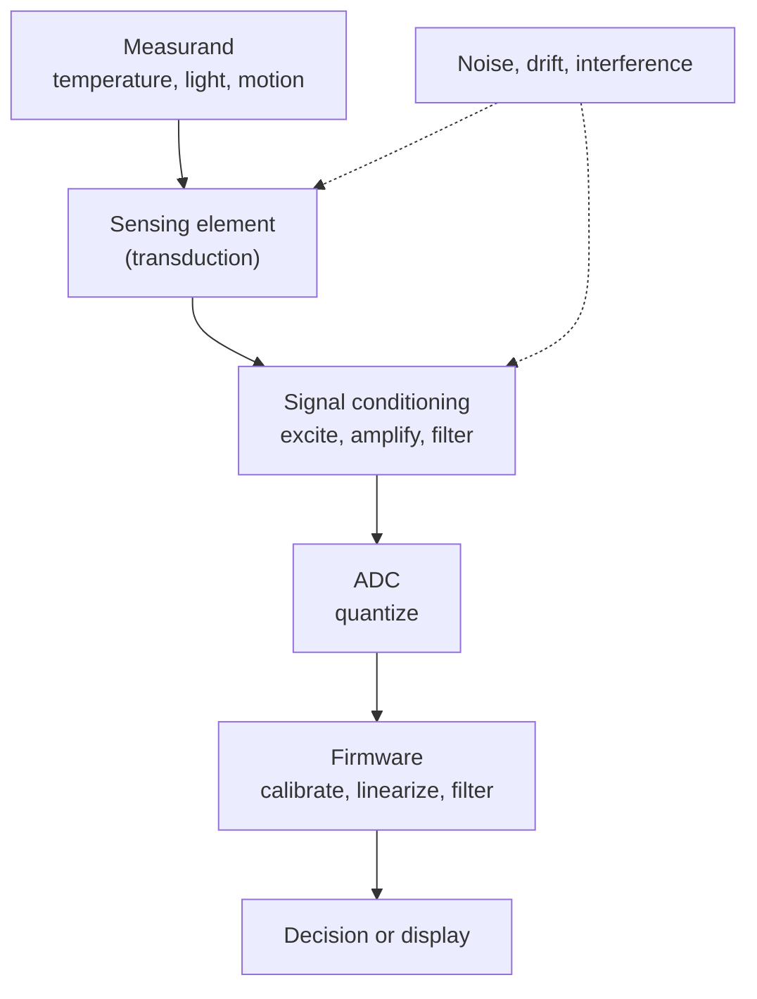

::: basics
### In plain words
A sensor is a device that converts a physical quantity, such as temperature, light, acceleration or pressure, into an electrical signal a circuit can use. Detecting something is not enough. The output has to be a voltage, current or similar signal that changes in step with the thing being measured. In practice, a sensor is the first link in a chain that ends with a number in software.

### Picture it
A sensor is a translator. Physics speaks in temperature and light, and a circuit understands only voltage. The translator listens to one and speaks the other. The sensing element does the listening. Then the rest of the chain tidies up the translation, so the software gets a clear number. A poor translator, or a noisy room, gives a garbled result.

### Words you need
- **Measurand**: the physical quantity being measured.
- **Sensing element**: the part whose property changes with the measurand, such as a thermistor whose resistance changes with temperature.
- **Sensitivity**: how much the output changes per unit change of the input, such as mV per degree.
- **Signal conditioning**: amplifying and filtering the small raw signal so it is usable.
- **ADC** ([[q0808]]): the circuit that turns a voltage into a number.

### The simplest example
A 10 kΩ thermistor falls by about 4% per degree near room temperature, so at 26 °C it is about 9.6 kΩ. Put it in a divider with a 10 kΩ resistor from 3.3 V. At 25 °C the middle point is 1.65 V, and at 26 °C it is 3.3 × 9.6 / 19.6, about 1.616 V. That is a change of about 34 mV per degree. A 12-bit ADC with 0.8 mV steps sees about 40 counts per degree, and firmware turns counts back into degrees.

That is the whole idea. The rest of this page shows the full measurement chain, a worked thermistor example, how resolution and accuracy differ, and active, passive and smart sensors.
:::

::: testing
Whether you can define a sensor precisely and then **place it in a system**. A weak answer says "a device that detects stuff". A strong one says a sensor converts a physical quantity into a signal a circuit can use, and immediately describes the chain around it: sensing element, signal conditioning, ADC, software. The interviewer is also listening for the vocabulary that shows you have used one: sensitivity, range, resolution, accuracy vs precision, noise, drift, bandwidth. They want to know you realise the sensor is never the whole story: a bad conditioning circuit ruins a good sensor.
:::

::: why
Almost every product a hardware engineer touches is a sensing problem in disguise: a battery fuel gauge measures voltage, current and temperature, a motor controller measures current and position, a phone measures light, motion, pressure and sound. Choosing a sensor, conditioning its output and trusting the number is a daily task. This is also the opening question of the Sensors section, so everything later (IMU, light, camera, LiDAR, calibration) builds on the vocabulary you set here. Getting a clean definition out in ten seconds buys you credibility for the harder questions.
:::

::: concepts
- **Physical quantity (measurand)**: the thing being measured: temperature, acceleration, light intensity, pressure, magnetic field.
- **Transduction**: converting one form of energy into another, usually into an electrical one. See [[q0844]].
- **Signal conditioning**: amplify, filter, level-shift or excite the raw output so an ADC can read it. Often a divider ([[q0008]]) or an op-amp ([[q0121]]).
- **Analog-to-digital conversion**: the conditioned voltage becomes a code the MCU can use. See [[q0808]].
- **Sensor specifications**: range, sensitivity, resolution, accuracy, precision, bandwidth, drift. See [[q0872]].
- **Active vs passive sensors**: whether the sensor needs excitation power or generates its own signal. See [[q0843]].
:::

::: answer
"A sensor is a device that converts some physical quantity, like temperature, light, acceleration or pressure, into an electrical signal that a circuit can read. The part that actually reacts to the physics is the sensing element: a thermistor's resistance changes with temperature, a photodiode makes current from photons, a MEMS accelerometer's capacitance changes when a tiny mass moves.

But a sensor on its own is rarely useful, so I think of it as a chain. The sensing element makes a small, often nonlinear, analog signal. Signal conditioning cleans that up: a voltage divider or bridge to turn resistance into voltage, an amplifier for gain, a filter to remove noise. An ADC turns it into a number, and firmware applies calibration and converts it to engineering units. Many modern sensors package all of that and just give you I2C or SPI.

When I choose one, I look at range, sensitivity, resolution, accuracy, noise, bandwidth and drift. For example a 10 kΩ NTC thermistor is very sensitive, about minus 4 percent per kelvin near room temperature, but it is nonlinear and only so accurate, whereas a thermocouple is rugged and wide range but only tens of microvolts per degree. Which one is right depends entirely on the application."
:::

::: technical
**Definition.** A sensor maps a measurand $x$ to an output signal $y$, ideally $y = S\,x + y_0$, where $S$ is the **sensitivity** (output per unit input, e.g. mV/°C) and $y_0$ is the **offset**. Real sensors add gain error, nonlinearity, noise $n$, hysteresis, and drift with temperature and time: $y = f(x) + n + \text{drift}(t, T)$.

**Signal chain.** Sensing element, then conditioning (excitation, amplification, filtering), then ADC, then firmware (calibration, linearization, filtering). The ADC's size of one step is $V_{LSB} = V_{ref}/2^N$; a 12-bit converter with a 3.3 V reference resolves 0.806 mV. If the sensor gives 10 mV/°C you get roughly 0.08 °C per code *before* noise. Resolution is limited by the *worst* stage.

**Key specs.**
- **Range / full scale**: min to max the sensor measures without saturating or damage.
- **Sensitivity**: slope of $y$ vs $x$.
- **Resolution**: smallest detectable change, set by noise and quantization.
- **Accuracy**: closeness to the true value (bias-dominated). **Precision / repeatability**: scatter between repeated readings (noise-dominated). A sensor can be precise but inaccurate; calibration fixes the first, averaging helps the second.
- **Linearity, hysteresis**: deviation from a straight line and path dependence.
- **Bandwidth / response time**: how fast the output follows the input; thermal sensors may take seconds, photodiodes nanoseconds.
- **Drift and stability**: slow change of offset or gain with temperature, ageing.

**Active vs passive.** Passive (self-generating) sensors such as thermocouples and piezoelectric elements output energy directly. Active (modulating) sensors such as thermistors, strain gauges and photoresistors need excitation, because the element changes a *property* (resistance, capacitance) rather than creating a signal.

**Analog vs digital.** Analog-output parts hand you a voltage and leave the conditioning to you. Digital-output parts include their own ADC and calibration over I2C/SPI; you trade flexibility and bandwidth for convenience.

**Worked number.** NTC 10 kΩ, $B = 3950$ K: $R(T) = R_0\exp\!\big[B(1/T - 1/T_0)\big]$ gives 33.6 kΩ at 0 °C, 10.0 kΩ at 25 °C, 3.59 kΩ at 50 °C. With 10 kΩ on top and the NTC on the bottom of a 3.3 V divider, the output is 2.54 V at 0 °C, 1.65 V at 25 °C and 0.87 V at 50 °C, a clear monotonic signal that an ADC can read directly.
:::

::: short
"A sensor converts a physical quantity, like temperature, light, motion or pressure, into an electrical signal a circuit can use. The sensing element does the physics, then signal conditioning, an ADC and firmware turn that into a calibrated number. I judge a sensor by range, sensitivity, resolution, accuracy, noise, bandwidth and drift. For example, an NTC thermistor is very sensitive but nonlinear, while a thermocouple is rugged but only gives microvolts per degree, so the application decides which one fits."
:::

::: long
"A sensor is a device that converts a physical quantity, the measurand, into an electrical signal I can process. Temperature, light, acceleration, pressure, magnetic field, they all get turned into a voltage, a current, a resistance or a digital word.

I like to think of it as a chain rather than a single part. First there is the sensing element, which is where the physics happens. A thermistor changes resistance, a photodiode makes current, a MEMS accelerometer changes capacitance when a proof mass moves. Then there is signal conditioning, because the raw output is usually tiny, nonlinear or in the wrong form. A divider or bridge turns resistance into voltage, an amplifier adds gain, a filter removes noise. Then an ADC makes a code, and firmware applies calibration and converts it into units. Plenty of modern parts integrate the whole chain and just talk over I2C or SPI.

To compare sensors I use a few numbers. Range and sensitivity say how big a signal I get. Resolution, which is limited by noise and by the ADC step, says the smallest change I can see. Accuracy says how close I am to the truth, precision says how repeatable the reading is, and those are different: a sensor can be very repeatable and still be offset. Then bandwidth, how fast it responds, and drift, how it wanders with temperature and age.

Take a thermistor against a thermocouple. The NTC changes about minus 4 percent per kelvin near room temperature, so it gives a big signal in a cheap divider, but it is nonlinear and limited in temperature range. A thermocouple gives tens of microvolts per degree, needs a good amplifier and cold-junction compensation, but handles hundreds of degrees. So I would pick based on range, accuracy and cost.

And I would always plan to calibrate, because offset and gain errors are normal."
:::

::: terms
- **Measurand**: the physical quantity being measured.
- **Sensing element**: the part whose physical property responds to the measurand.
- **Sensitivity**: change in output per unit change in input (e.g. mV/°C).
- **Resolution**: smallest change the system can distinguish, limited by noise and quantization.
- **Accuracy vs precision**: closeness to the true value vs repeatability of readings.
- **Signal conditioning**: amplification, filtering, excitation and level shifting before the ADC.
- **Drift**: slow change of offset or gain with temperature or time.
- **Bandwidth / response time**: how quickly the output tracks a changing input.
:::

::: exceptional
**An average answer**: "A sensor detects something and gives an electrical signal."

**An exceptional answer**:
- Defines it as a measurand-to-signal converter and **draws the chain**: element, conditioning, ADC, firmware.
- Uses the **specs vocabulary** correctly, and distinguishes accuracy (bias) from precision (noise), saying which one calibration and which one averaging fixes.
- Gives **one quantified example** (NTC about -4 %/K, or 10 mV/°C against an ADC step) rather than a generic list.
- Notes the **system-level limit**: resolution is set by the noisiest or coarsest stage, not by the datasheet number of the element.
- Mentions active vs passive and analog vs digital output without being asked, and ties the choice to an application.
:::

::: mistakes
- **Defining a sensor as "something that detects"**. Detection is not enough; it must produce a usable electrical signal proportional to the measurand. Say "converts".
- **Treating accuracy, precision and resolution as the same thing**. A 16-bit ADC gives fine resolution but says nothing about accuracy if the sensor has a 2 % gain error.
- **Forgetting signal conditioning and the ADC**. The datasheet sensitivity of the element is not your system sensitivity: noise, ADC step and reference error all count.
- **Ignoring temperature drift and calibration**. Most sensors have offset and gain that move with temperature; one-point factory trim is often not enough.
- **Confusing sensor and transducer** as always identical. All sensors are transducers in some sense, but not all transducers are sensors (a speaker is an actuator). See [[q0844]].
:::

::: deep
## From physics to a number

A sensor exists because physics offers many quantities that are easy to measure electrically and that *depend on* the quantity we actually care about. Resistance is easy to turn into voltage; capacitance is easy to turn into a frequency; current from a photodiode is easy to turn into voltage with an op-amp. So almost every sensor is a two-step trick: **a physical quantity changes some electrical property, and a circuit reads that property**.

| Measurand | Typical element | What changes | Readout |
|---|---|---|---|
| Temperature | NTC thermistor | resistance | divider + ADC |
| Temperature | Thermocouple | Seebeck voltage, tens of µV/K | low-noise amp, cold junction |
| Light | Photodiode | photocurrent | transimpedance amp |
| Acceleration | MEMS comb capacitor | capacitance | charge amp, digital filter |
| Strain / force | Strain gauge | resistance, ΔR/R = GF·ε | Wheatstone bridge, in-amp |
| Magnetic field | Hall element | Hall voltage | amp, ratiometric ADC |
| Pressure | Piezoresistive diaphragm | bridge imbalance | in-amp |

## The measurement chain


Figure: Every stage adds error. The sensor datasheet number is only the first box; resolution, accuracy and bandwidth of the whole system are set by the weakest stage. Noise couples in at the element and in the conditioning.

## Worked example: an NTC thermistor temperature sensor

An NTC with $R_0 = 10$ kΩ at 25 °C and $B = 3950$ K follows

$$R(T) = R_0\,\exp\!\left[B\left(\frac1T - \frac1{T_0}\right)\right],\quad T \text{ in kelvin}.$$

Its sensitivity at 25 °C is $\frac{dR}{dT} = -\frac{B}{T^2}R = -\frac{3950}{298.15^2}\cdot 10\,\text{k}\Omega \approx -444\ \Omega/\text{K}$, about **-4.4 %/K**. That is enormous compared with a platinum RTD at about +0.385 %/K, which is why thermistors are so popular for cheap, sensitive measurement.

Put the NTC in the bottom leg of a divider with a 10 kΩ resistor to a 3.3 V supply (see [[q0008]]):

$$V_{out} = 3.3\cdot\frac{R_{NTC}}{10\text{k}+R_{NTC}}.$$

```plot
{"title":"NTC divider output vs temperature (10 kΩ NTC, B = 3950 K, 10 kΩ fixed, 3.3 V)","x":{"label":"Temperature","unit":"°C","min":-10,"max":100},"y":{"label":"V_out","unit":"V","min":0,"max":3.3},
 "vars":{"b":3950,"r0":10000,"rf":10000,"vs":3.3},
 "series":[{"label":"V_out","fn":"vs*(r0*exp(b*(1/(x+273.15)-1/298.15)))/(rf+r0*exp(b*(1/(x+273.15)-1/298.15)))"}],
 "points":[{"x":25,"y":1.65,"label":"25 °C: 1.65 V"},{"x":50,"y":0.871,"label":"50 °C: 0.87 V"}]}
```
Figure: The output is steepest near the middle of the range and flattens at both ends, so resolution (°C per ADC code) is best near 25 °C and worse at the extremes. The nonlinearity is why firmware linearizes with the Steinhart-Hart or beta equation or a lookup table.

Local slope at 25 °C: $dV/dT = 3.3\cdot\frac{R_f}{(R_f+R)^2}\cdot\frac{dR}{dT} = 3.3\cdot\frac{10^4}{4\times10^8}\cdot(-444) = -36.6$ mV/K. A 12-bit ADC on 3.3 V has a 0.806 mV step, so one code is $0.806/36.6 = 0.022$ K at 25 °C. At 100 °C the slope falls to about 5.7 mV/K, so one code is roughly 0.14 K. In practice the 1/f and thermal noise of the divider, reference error and self-heating limit accuracy to far worse than the LSB.

> [!TIP]
> Self-heating: the thermistor dissipates $P = V^2/R$. At 25 °C it sees 1.65 V across 10 kΩ, so 272 µW. With a dissipation constant of a few mW/K that is roughly 0.1 K of error, which is real. Reduce excitation or pulse the divider.

## Resolution, accuracy and the ADC

Quantization error alone is ±½ LSB, with RMS $V_{LSB}/\sqrt{12}$. But total error comes from several sources added in quadrature if independent: element tolerance (a 1 % resistor or 1 % beta), reference error, amplifier offset, ADC INL/offset, and noise. A system designed with a 12-bit ADC and a 1 % thermistor is accurate to roughly ±0.5 to 1 °C, not 0.02 °C. This is why accuracy comes from calibration, not from ADC bits.

```sim
{"id":"sensor-calibration","offset":0.2,"gain":1.05,"nonlin":0.02,"noise":0.05}
```
Figure: Try setting noise high and offset to zero: readings scatter around the truth (precise vs accurate). Then set noise low and offset large: tight but wrong. Take a one-point and then two-point calibration and see which errors each removes.

## Active, passive and smart sensors

- **Passive / self-generating**: thermocouple, piezoelectric film, photovoltaic photodiode, microphone (dynamic). Output energy comes from the measurand.
- **Active / modulating**: thermistor, strain gauge, LDR, capacitive and inductive sensors. You must supply excitation, and the excitation itself (its stability, noise and heating) becomes part of the accuracy budget.
- **Smart / digital**: integrates element, conditioning, ADC, calibration constants and a digital bus (I2C, SPI). The datasheet quotes the *system* noise density, output data rate and digital filter.

## Real hardware behaviour

- **Ratiometric measurement**: when the divider and ADC share the same reference, supply noise and error cancel to first order, which is why thermistor dividers are usually tied to the ADC reference.
- **Bandwidth vs noise**: noise grows as $\sqrt{\text{bandwidth}}$, so filter to the signal bandwidth you actually need. A thermistor in air changes over seconds; low-pass at 1 Hz cuts noise relative to a 1 kHz acquisition.
- **Aliasing**: if the sensor can change faster than half your sampling rate, anti-alias first. See [[q0669]].
- **Environment**: temperature gradients, humidity, vibration and EMI all enter as error terms. A rigorous design lists them.
:::

::: applications
- **Battery packs**: NTC thermistors next to Li-ion cells feed the BMS, which stops charging outside about 0 to 45 °C.
- **Smartphones**: ambient-light, proximity, accelerometer, gyroscope, magnetometer, barometer and microphone sensors inform auto-brightness, rotation, step counting and navigation.
- **Motor drives**: shunt-resistor current sensing, Hall sensors or encoders give current, rotor position and speed to the controller.
- **Automotive**: wheel-speed sensors, MAP pressure sensors and oxygen sensors feed engine and stability control.
- **Industrial**: strain-gauge load cells in bridges, thermocouples in furnaces, flow and level sensors in process control.
:::

::: assumptions
- I assume the common electronics meaning: a device whose output is an **electrical signal**. In a broader physical sense, a mercury thermometer is also a sensor with a visual output.
- Linear behaviour $y = Sx + y_0$ is an ideal model; most real sensors are only linear over part of their range, and the thermistor example shows a strongly nonlinear one.
- Numbers like B = 3950 K and 10 kΩ are typical catalogue values for general-purpose NTCs; individual parts vary and tolerance on B is typically around 1 %.
- If the interviewer asks about a specific sensor, narrow the generic definition to its physics immediately, and list its dominant error source.
:::

::: followups
### What is the difference between a sensor and a transducer?
A transducer converts energy from one form to another, and a sensor is a transducer used specifically to *measure* something, usually giving an electrical output. A speaker or motor is a transducer (actuator) but not a sensor. In practice, people use the terms loosely. See [[q0844]].

### What is the difference between accuracy and precision, and which one does calibration fix?
Accuracy is closeness to the true value, precision is repeatability. Calibration removes systematic errors (offset and gain), so it improves accuracy. Averaging reduces random noise, so it improves precision. A cheap sensor averaged for a long time converges to its own bias, not to the truth.

### Why does a 16-bit ADC not guarantee a 16-bit-accurate sensor reading?
Because the ADC is only one stage. Reference error, amplifier offset, sensor tolerance, noise and nonlinearity usually dominate. A 1 % gain error is about 655 LSB at full scale of a 16-bit converter, so the extra bits just digitise noise and error precisely.

### How would you choose between an analog and a digital output sensor?
Analog output gives me full control over bandwidth, noise filtering and conditioning but needs a good ADC and careful layout. A digital sensor includes calibration and conversion, gives easy integration and immunity to trace noise, but fixed output data rate, latency and a firmware driver. For a battery product with little board space I would favour digital; for a high-speed control loop I might want analog.

### Scenario: your temperature reading jumps by 2 °C every time the motor starts. How do you debug it?
Look at what changes when the motor starts. Candidates are ground bounce or supply droop shifting the ADC reference or the divider supply, EMI coupling into a high-impedance thermistor node, or actual heat if the sensor is near the motor. Probe the ADC pin and reference with a scope during motor start, and check whether the error scales with current (supply/ground) or arrives as spikes (EMI). Fix with ratiometric reference, an RC filter at the pin, shorter traces and a local ground plane.
:::

::: interpretations
"What is a sensor?" is deliberately open. Give the electronics definition (physical quantity to electrical signal) and then show breadth by describing the chain and specs. If the interviewer wants a specific sensor, they will steer you; sibling questions [[q0843]] (types), [[q0844]] (transducer) and [[q0842]] (applications) cover the other angles.
:::

::: references
- Horowitz & Hill, *The Art of Electronics*, 3rd ed.: chapters on precision circuits and on sensing temperature, light and other quantities.
- Webster (ed.), *The Measurement, Instrumentation, and Sensors Handbook*: general sensor characteristics and terminology.
- Fraden, *Handbook of Modern Sensors*: sensor characteristics, transfer functions, accuracy and sensitivity.
- Manufacturer NTC thermistor datasheets (beta-value definition and the resistance-temperature equation).
:::

::: rubric
- Defines a sensor as converting a physical quantity (measurand) to an electrical signal :: The core definition; anything less specific sounds like a layperson.
- Describes the chain: element, conditioning, ADC, firmware :: Shows system thinking: the sensor alone is never the whole measurement.
- Names key specs: range, sensitivity, resolution, accuracy, noise, bandwidth, drift :: Vocabulary signals real experience with datasheets.
- Distinguishes accuracy from precision (bias vs scatter) :: A classic probe; mixing them up is a red flag.
- Gives a concrete example with numbers (thermistor, thermocouple, etc.) :: Turns an abstract definition into engineering judgement.
- Mentions active vs passive or analog vs digital output :: Shows breadth and prepares the ground for "types of sensors".
- Notes calibration and environmental effects :: Real sensors have offsets, drift and temperature dependence.
:::

::: quiz
```json
[
 {"type":"mcq","level":"fundamental","q":"Which statement best defines a sensor?","options":["A device that stores electrical energy","A device that converts a physical quantity into a usable electrical signal","A device that amplifies any signal","A device that moves a load in response to a command"],"answer":1,"explain":"A sensor maps a measurand (temperature, light, acceleration...) to an electrical signal. Amplifiers condition signals and actuators produce physical output, which is the reverse direction."},
 {"type":"truefalse","level":"fundamental","q":"A sensor with very low noise (high precision) is necessarily accurate.","answer":false,"explain":"Precision is repeatability; accuracy is closeness to the true value. A sensor with a fixed offset or gain error can be perfectly repeatable and still wrong. Calibration is needed to fix the bias."},
 {"type":"numeric","level":"intermediate","q":"A sensor outputs 10 mV/°C and is read by a 12-bit ADC with a 3.3 V reference (no gain). What temperature change corresponds to one ADC code, ignoring noise? Give °C.","answer":0.0806,"tolerance":0.02,"unit":"°C","explain":"$V_{LSB} = 3.3/4096 = 0.806$ mV. Dividing by 10 mV/°C gives 0.0806 °C per code. Real resolution will be worse because of noise and reference error."},
 {"type":"numeric","level":"intermediate","q":"A 10 kΩ NTC (B = 3950 K, 10 kΩ at 25 °C) is in the bottom leg of a divider with a 10 kΩ top resistor and 3.3 V supply. What is Vout at 50 °C? Use R(50 °C) = 3.588 kΩ.","answer":0.871,"tolerance":0.02,"unit":"V","explain":"$V_{out} = 3.3\\cdot\\frac{3.588}{10+3.588} = 0.871$ V. Output falls as temperature rises because the NTC resistance drops."},
 {"type":"mcq","level":"advanced","q":"A thermistor divider and the ADC both use the same 3.3 V rail as their reference. A 5 % supply droop occurs. What happens to the digital reading?","options":["It drops by 5 %","It rises by 5 %","It barely changes, because the measurement is ratiometric","It becomes random"],"answer":2,"explain":"The divider output and the ADC full scale both scale with the supply, so the code (a ratio) stays the same to first order. This is why ratiometric designs share the reference between sensor excitation and ADC."}
]
```
:::
