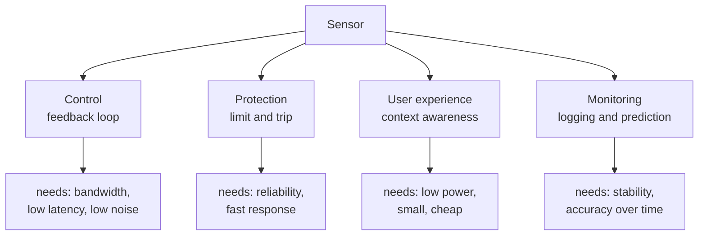

::: basics
### In plain words
A sensor turns something in the physical world, such as temperature, motion or light, into an electrical signal a circuit can read. The applications of sensors are the jobs that reading does. Most jobs fall into four groups: running a machine, protecting it, making a gadget nicer to use, and keeping watch over time.

### Picture it
Think of a home thermostat. It feels the room temperature, compares it with the number you set, and switches the heater on or off. The sensor is the eyes and the heater is the hands. Almost every application follows this pattern: measure, decide, act. Some, like a smoke alarm, stop at "decide" and just raise an alarm.

### Words you need
- **Sensor**: a part that turns a physical quantity into an electrical signal. See [[q0841]].
- **Feedback loop**: measure, decide, act, then measure again, over and over, so the system keeps correcting itself.
- **Accelerometer**: a sensor that detects how quickly something's speed is changing, and also which way gravity points.
- **Requirement**: what the job demands of the sensor, such as how accurate, how fast and how little power.

### The simplest example
A phone has an ambient light sensor. It reads how bright the room is, and the phone turns the screen brighter in sunlight and dimmer in a dark room. One reading per second is plenty, and the number need not be very exact. Now compare a car airbag. Its accelerometer must spot a crash and trigger the bag within a few tens of milliseconds, so the speed requirement is far tougher. That is the whole idea: the job sets the requirements, and the requirements set the sensor. The rest of this page sorts applications into the four groups and shows the numbers that drive each choice.
:::

::: testing
Whether you can connect sensors to **real systems and real decisions**, not just recite a list. The interviewer wants to hear that you see a sensor as one block in a control or monitoring loop: measure, decide, act. They are checking breadth (consumer, automotive, industrial, medical, power), whether you can name the specific quantity measured and the specific sensor in each, and whether you can say *why* that measurement matters (safety, efficiency, user experience, control stability). Bonus: you mention the constraints that shape the choice, such as cost, power, bandwidth and environment.
:::

::: why
Hardware engineers rarely design a sensor from scratch; they pick one for a job and integrate it. That means starting from the application: what must be measured, how fast, how accurately, in what environment, at what cost. Being able to walk from application to requirements to sensor choice is exactly what an intern project looks like, and it is how you will talk with system and firmware teammates. Applications also reveal why the same physical quantity is measured by wildly different parts in a phone, a car and a power plant.
:::

::: concepts
- **Measure-decide-act loop**: sensors close feedback loops (motor control, thermal management) or feed monitoring and safety systems. See [[q0841]].
- **Types of sensors**: temperature, motion, light, pressure, magnetic, current, chemical. See [[q0843]].
- **Motion sensing**: accelerometers and gyroscopes. See [[q0846]], [[q0847]].
- **Light sensing**: photodiodes, ambient and proximity sensors. See [[q0854]].
- **Sensor fusion**: combining sensors for a better estimate than any one gives. See [[q0845]].
- **Requirements**: range, accuracy, bandwidth, power, cost, environment (temperature, vibration, EMI).
:::

::: answer
"Sensors show up anywhere a system needs to know about the world, so I group the applications by what the system does with the measurement.

First, control: a motor driver measures current and rotor position to run a field-oriented loop, a thermostat measures temperature to switch a heater, a drone uses a gyroscope and accelerometer to stay level. Second, protection and safety: a battery management system watches cell voltage, current and temperature and disconnects the pack when something goes out of range; a car's airbag controller watches an accelerometer for a crash. Third, user experience: your phone's ambient light sensor sets screen brightness, the proximity sensor turns the screen off at your ear, and the accelerometer rotates the display and counts steps. Fourth, monitoring and diagnostics: vibration sensors on a machine predict bearing failure, environmental sensors log temperature and humidity, and medical wearables use optical sensors for heart rate.

For each one, the interesting engineering is the requirement. A thermostat needs 0.5 °C and one reading per second, an airbag accelerometer needs tens of g range and a deploy decision within a few tens of milliseconds, and a wearable needs microamps because it sleeps most of the time."
:::

::: technical
**Organising principle.** Match the application to the measurand, then to requirements:

| Application | Measurand | Typical sensor | Key requirement |
|---|---|---|---|
| Battery management | cell temperature, pack current, voltage | NTC thermistor, shunt + amp, ADC | accuracy for state-of-charge, safety limits |
| Motor control | phase current, rotor angle | shunt/Hall current sense, encoder or Hall | bandwidth (kHz), synchronous sampling |
| Smartphone | light, proximity, motion, pressure | ambient light, IR proximity, MEMS IMU, barometer | microamp power, small package |
| Automotive safety | acceleration, wheel speed | MEMS accelerometer, Hall/VR | high range (tens to hundreds of g), reliability |
| Industrial monitoring | vibration, temperature, flow | piezo/MEMS accelerometer, thermocouple | ruggedness, long-term stability |
| Medical wearable | optical absorption, ECG | photodiode + LED, biopotential amp | low noise, motion artifact rejection |

**Closed loop vs monitoring.** In a feedback loop sensor latency and noise appear directly in loop stability: delay adds phase lag, noise gets amplified by the controller. A current loop with 20 kHz PWM needs a current sample synchronised to the PWM centre; a slow temperature loop can use heavy filtering.

**Rule-of-thumb sampling.** Sample at least 2 to 10 times the signal bandwidth of interest and anti-alias before the ADC. See [[q0669]].

**Example: auto-brightness.** An ambient light sensor measures illuminance in lux (from about 1 lux in a dim room to over 100,000 lux in direct sun, a 10^5 range). Human perception is roughly logarithmic, so the firmware maps lux to backlight on a log-like curve. The sensor needs a wide dynamic range, either a log response or a gain-switching ADC.

**Example: drop protection.** A free-falling device reads about 0 g on every accelerometer axis (an accelerometer measures specific force, not gravity). A 1 m drop lasts $\sqrt{2h/g} = 0.45$ s and reaches 4.4 m/s; firmware can park a hard-drive head within that window. This is the textbook example of using a sensor for protection.
:::

::: short
"Sensors close control loops, protect systems and improve user experience. Motor drives measure current and position, battery packs measure cell temperature and current for safety, phones use light, proximity and motion sensors for brightness, screen-off and rotation, cars use accelerometers for airbags, and factories use vibration sensors for predictive maintenance. For each one the requirement differs: bandwidth for control, accuracy for state-of-charge, microamps for wearables."
:::

::: long
"I think about sensor applications in four buckets based on what the system does with the measurement.

Control: the sensor is inside a feedback loop. A brushless motor controller samples phase current in sync with the PWM and reads rotor angle from an encoder or Hall sensors; a quadcopter fuses a gyroscope and accelerometer at hundreds of hertz to hold attitude; a thermostat or a CPU's thermal management reads temperature and adjusts a heater or clock. Here latency and noise matter, because they eat phase margin.

Protection and safety: the battery management system measures every cell voltage, pack current and several temperatures and opens the contactor or stops charging if anything leaves its safe window. A car's airbag controller watches an accelerometer for a crash pulse, and an overcurrent comparator on a power stage shuts it off in microseconds.

User experience: the phone has ambient light for auto brightness, a proximity sensor so your cheek does not press buttons, an IMU for rotation and step counts, a barometer for floor detection and a magnetometer for compass. Almost all of those are tiny MEMS or CMOS parts that run on microamps.

Monitoring and diagnostics: vibration sensors on motors and pumps spot bearing wear before failure, environmental sensors log temperature and humidity in warehouses, and wearables use an LED and photodiode to measure heart rate through the skin.

What changes between those is the spec: control wants bandwidth and low latency, safety wants reliability and fast response, consumer wants low power and cost, monitoring wants stability over years. So when I pick a sensor, I start from the application and write down range, accuracy, bandwidth, power, size and environment."
:::

::: terms
- **Closed-loop control**: the measured value is fed back to adjust an actuator.
- **Predictive maintenance**: using sensor trends (vibration, temperature, current) to schedule service before failure.
- **Specific force**: what an accelerometer actually measures; gravity cancels in free fall.
- **Dynamic range**: ratio of largest to smallest measurable signal (ambient light spans about 10^5).
- **Latency**: delay from physical event to usable digital value.
- **Output data rate (ODR)**: how often a digital sensor produces samples.
- **Power budget**: sleeping current plus duty-cycled active current.
:::

::: exceptional
**An average answer** lists five applications, "phones, cars, medical, industrial, robots".

**An exceptional answer**:
- Groups applications by **what the system does** (control, protection, UX, monitoring) and ties each to a requirement.
- Names the **specific measurand and sensor** for each, with a typical number (airbag range, lux range, bandwidth).
- Notes how **latency and noise** matter more in feedback loops than in monitoring.
- Mentions **power and cost** as design drivers for consumer devices.
- Offers one **short quantified example** (free fall time, lux dynamic range, ADC step) to show hands-on thinking.
:::

::: mistakes
- **A flat list with no reasoning**. The interviewer wants why the measurement matters and what the key spec is.
- **Naming a sensor but not the measurand**. Say "an accelerometer measuring crash deceleration", not just "an accelerometer".
- **Ignoring system integration**. Real applications need conditioning, sampling, calibration and firmware.
- **Assuming one sensor solves it**. Many applications (navigation, wearables) need fusion. See [[q0845]].
- **Forgetting power**. Always-on sensors in battery devices need microamp-level standby; ignoring that is a classic miss.
:::

::: deep
## Four families of use

Every sensor application falls into one of four patterns. Knowing the pattern tells you the requirements before you choose a part.


Figure: The application pattern sets the dominant specification. Control cares about loop delay, protection about failing safe, consumer about microamps and cost, monitoring about drift.

## Control: sensors inside feedback loops

A feedback controller is only as good as its measurement. If a current sensor has delay $t_d$, at crossover frequency $f_c$ it adds phase lag $360\,f_c\,t_d$ degrees. For a motor current loop with $f_c = 2$ kHz and a 25 µs filter delay that is already 18 degrees of lost phase margin. Noise matters because the controller gain amplifies it; a gyro with high-frequency noise passed through a derivative term becomes jitter on motor commands. That is why drone flight controllers choose gyros by noise density and filter the signal in the digital domain before the D term.

The sample must also be **synchronised** with the process. In a PWM motor drive the current ripples inside each cycle; sampling at the centre of the on-time reads the average. Sample at the switching edge and you capture ringing instead.

## Protection and safety

Protection sensors decide *when to give up*. They are judged by false-trip rate and time-to-trip:

- A BMS compares each cell voltage and temperature with limits (for a Li-ion cell, charge is typically blocked below about 0 °C and above about 45 °C; exact thresholds are cell-specific and given in the cell datasheet).
- An airbag accelerometer sees a crash pulse over tens of milliseconds; the algorithm integrates the signal to decide whether the change in velocity warrants deployment.
- A hard drive's free-fall sensor looks for a near-zero-g reading on all axes. A 1 m drop lasts $\sqrt{2\cdot1/9.81} = 0.45$ s, ample time to park the head.

Safety sensors are often redundant or self-testing: MEMS accelerometers have a self-test pin that electrostatically deflects the proof mass to confirm the sensor works.

## User experience: context awareness

In consumer devices sensors give the product context. The key constraint is **always-on at microamp power**.

- **Ambient light**: illuminance spans about 1 lux (dim room) to over 100,000 lux (bright sun), a factor of 10^5 or 100 dB in amplitude terms. A single 12-bit linear ADC covers only 4096:1, so sensors use gain ranging, a log front end or wide-range integrating converters. See [[q0854]].
- **Proximity**: pulse an IR LED and measure the reflected amount; a threshold decides "near". Ambient-light rejection is done by taking an LED-off reading and subtracting.
- **Motion**: the accelerometer wakes the application processor only on a "significant motion" event, which lets the main CPU sleep.
- **Barometer**: pressure changes about 12 Pa per metre of altitude near sea level, so a barometer with 1 Pa noise resolves floors in a building (about 3 m each, roughly 36 Pa).

## Monitoring and diagnostics

For predictive maintenance, vibration spectra tell the story. A bearing defect produces periodic impacts at a characteristic frequency; an accelerometer with enough bandwidth (several kHz) and an FFT reveal it long before the machine fails. Another example: motor current signature analysis uses the motor's own current as the sensor signal.

Environmental monitoring (temperature, humidity, air quality) values long-term stability over speed. A humidity sensor drifting 1 percent RH per year is acceptable for logging but not for a calibration reference.

## Worked example: choosing sensors for a smart bicycle light

Requirements: turn on automatically at dusk, flash brighter when braking, and send a crash alert. Battery: 500 mAh, target a month of standby (30 days = 720 h).

1. **Ambient light** (dusk detection): a slow measurement, once per second. A low-power ambient sensor drawing about 2 µA average is plenty. Needs hysteresis to avoid flicker around the threshold (switch on at 50 lux, off at 100 lux).
2. **Accelerometer** (braking, crash): deceleration while braking is about 0.2 to 0.5 g; a crash is a spike over several g. A ±8 g accelerometer in low-power mode at 50 Hz draws maybe 10 µA (vendor-dependent); the sensor wakes the MCU on threshold.
3. **Power**: 500 mAh over 720 h allows an average of 0.69 mA total, so the sensors' 12 µA is negligible and the LED, not the sensors, dominates.

The point is the reasoning: requirement, bandwidth, power, threshold design.

## Experiment with it

```sim
{"id":"imu-lab","view":"drift","bias":0.02}
```
Figure: Many applications rely on motion sensors. Increase the accelerometer bias and watch the doubly-integrated position error grow with time squared; this is why a phone can tell you which way is up instantly but cannot give you indoor position from accelerometer data alone.

## Real hardware behaviour

- **Packaging and placement**: a temperature sensor near a hot regulator reads the board, not the air; an ambient light sensor behind dark glass needs a calibrated light-pipe correction factor.
- **EMI**: a high-impedance sensor input near a switching regulator picks up switching noise. Keep sensor analog traces away from inductors and the switch node.
- **Lifetime**: some sensors (MEMS gyros, electrochemical gas sensors) drift or wear. Recalibration in the field or end-of-life estimation can be part of the application.
:::

::: applications
- **EV battery packs**: cell-level voltage and temperature sensing in the BMS for thermal runaway detection and state-of-charge.
- **Smartphone sensor hub**: low-power MCU polling IMU, barometer and light sensors, waking the main processor only when needed.
- **Brushless motor drives for drones**: shunt-based phase-current sensing plus a gyro-driven flight controller.
- **Airbag systems**: MEMS accelerometers (often two, at different locations) with self-test.
- **Smartwatch heart-rate monitors**: green LED and photodiode (PPG) with accelerometer-based motion cancellation.
- **Predictive maintenance on factory motors**: vibration and temperature sensors sent over wireless to a gateway.
:::

::: assumptions
- Typical ranges quoted (lux, temperature windows, g levels) are order-of-magnitude values; specific products have their own specifications.
- I treat "applications" broadly across consumer, automotive, industrial and medical; the interviewer may only want the ones relevant to the role (e.g. power electronics, phones).
- Power numbers for the bicycle light are rough, vendor-dependent estimates to illustrate budgeting, not datasheet values.
- If the interview is for a power or motor team, lead with current, voltage and temperature sensing; if for a mobile team, lead with IMU, light and camera.
:::

::: followups
### Pick one application and walk me through the sensor requirements.
Take battery fuel gauging. Measure cell voltage (accuracy about 1 to 5 mV), current with a shunt (accuracy 0.5 to 1 percent for coulomb counting), and temperature (±1 °C). Sample voltage at 1 Hz, current faster (10 to 100 Hz) to integrate accurately, and use sleep modes for low standby. Calibrate the current-sense offset at zero current, because a 100 µV offset into a 5 mΩ shunt is a 20 mA error that accumulates.

### How does sensor latency affect a control loop?
A delay $t_d$ adds phase lag $360 f_c t_d$ degrees at crossover. A 25 µs delay at 2 kHz crossover costs 18 degrees of phase margin. So in motor and power loops I choose sensors and filters with low group delay, and sample synchronously.

### Why do phones use a sensor hub instead of waking the main CPU?
The main processor burns tens to hundreds of milliwatts when awake; an always-on MCU in the hub burns microwatts to a few milliwatts. The hub runs step counting and gesture detection from the IMU and only interrupts the CPU on events. Power per sample is what matters in a battery product.

### What if you need to monitor something in a harsh environment, like a motor at 150 °C?
Standard consumer parts are rated to about 85 °C or 125 °C. I would pick a sensor rated for the temperature (thermocouple or PT100 RTD for temperature, high-temperature grade accelerometers), use remote conditioning so electronics stay cool, and consider contactless methods like IR for temperature. Cable choice, vibration mounting and drift at temperature become the main design points.

### Scenario: your accelerometer-based fall detector fires every time the user sits down hard. What do you change?
Look at the signature: a real fall has a free-fall phase (near 0 g), then an impact spike, then stillness. Sitting has no free-fall phase and a smaller peak. So add a free-fall detection stage and a post-impact inactivity check, tune thresholds with recorded data, and optionally add a gyro to check orientation change. That is multi-feature detection rather than a single threshold.
:::

::: interpretations
"Applications of sensors" can mean consumer examples, or the broader categories of control, safety, monitoring. I cover all of them with specifics. For applications of specific sensor classes, see [[q0847]] (accelerometer/gyroscope), [[q0854]] (light) and [[q0866]] (LiDAR).
:::

::: references
- Fraden, *Handbook of Modern Sensors*: chapters on sensor applications and system integration.
- Horowitz & Hill, *The Art of Electronics*, 3rd ed.: sensing and measurement circuits.
- Webster (ed.), *The Measurement, Instrumentation, and Sensors Handbook*: application-oriented sensor chapters.
- Manufacturer MEMS accelerometer datasheets (self-test and free-fall detection features).
:::

::: rubric
- Groups applications by purpose (control, safety, UX, monitoring) :: Shows structured thinking instead of a random list.
- Names the measurand and sensor for each example :: Specificity separates engineers from name-droppers.
- States a key requirement per application (bandwidth, accuracy, power) :: Real design starts from requirements.
- Mentions latency/noise in feedback loops :: Shows control-system awareness.
- Mentions power and cost for consumer devices :: These drive most real sensor selection.
- Gives at least one number-backed example :: Demonstrates quantitative habits.
- Mentions fusion or calibration as part of the system :: Real products use more than a raw sensor reading.
:::

::: quiz
```json
[
 {"type":"mcq","level":"fundamental","q":"Which is an example of a sensor used for protection rather than control?","options":["Encoder for motor speed regulation","Thermistor on a Li-ion pack triggering charge cut-off","Gyroscope for drone attitude stabilisation","Ambient light sensor setting screen brightness"],"answer":1,"explain":"The BMS thermistor trips the pack when temperature leaves a safe window; it protects. The encoder and gyro are in control loops, and the light sensor is a user-experience feature."},
 {"type":"numeric","level":"fundamental","q":"A device is dropped from 1 m. How long (in seconds) is it in free fall, ignoring air resistance? Use g = 9.81 m/s².","answer":0.452,"tolerance":0.02,"unit":"s","explain":"$t = \\sqrt{2h/g} = \\sqrt{2/9.81} = 0.452$ s. This is the window available for a drop-protection response."},
 {"type":"numeric","level":"intermediate","q":"A motor current loop has a crossover of 2 kHz and the current sensing chain adds 25 µs of delay. How many degrees of phase lag does this add at crossover?","answer":18,"tolerance":0.02,"unit":"degrees","explain":"Phase lag = $360\\cdot f\\cdot t_d = 360\\cdot2000\\cdot25\\times10^{-6} = 18°$."},
 {"type":"truefalse","level":"intermediate","q":"A free-falling accelerometer reads about 1 g on its vertical axis, because gravity is still acting on it.","answer":false,"explain":"An accelerometer measures specific force (proper acceleration). In free fall the proof mass and housing accelerate together, so the reading is about 0 g. At rest it reads +1 g because the support force resists gravity."},
 {"type":"mcq","level":"advanced","q":"An ambient light sensor must cover roughly 1 lux to 100,000 lux. Why is a single fixed-gain 12-bit linear ADC a poor fit?","options":["12-bit ADCs cannot be used with photodiodes","4096 codes cover only about 3.6 decades, so dim light would be a few codes or bright light would saturate","Light sensors only output digital signals","Lux is not a measurable quantity"],"answer":1,"explain":"The range is 5 decades (10^5:1) but a linear 12-bit converter spans 4096:1 (about 3.6 decades). With gain set for sunlight, a dim room reads under one code. Sensors use gain ranging or logarithmic/integrating front ends."}
]
```
:::
