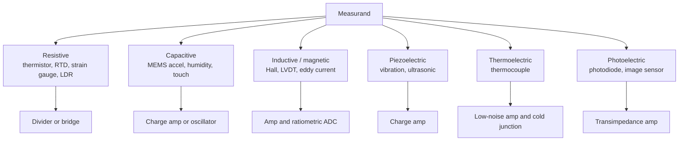

::: testing
Breadth with depth. The interviewer wants a **taxonomy** (not a random dump) and for each type: the physical principle, what it measures, a typical output and the usual conditioning circuit. They are listening for whether you know *how* a sensor works, because that is what lets you predict its weaknesses: a thermistor self-heats, a Hall sensor is disturbed by stray fields, a MEMS gyro drifts. Mentioning one or two numbers per sensor (sensitivity, range) separates people who have read datasheets from people who have read a list.
:::

::: why
Sensor choice is a core hardware decision. Picking the wrong type costs a board spin: a thermocouple needs cold-junction compensation and microvolt-level amplification, an NTC does not; a shunt resistor is cheap but not isolated, a Hall sensor is isolated but less accurate. Knowing the menu of sensor types, and the trade-off behind each, is what lets you propose a design on the spot. It is also the setup for the deeper sensor questions on IMUs ([[q0846]]), light ([[q0851]]), cameras and LiDAR ([[q0864]]).
:::

::: concepts
- **Transduction principle**: resistive, capacitive, inductive, piezoelectric, thermoelectric, photoelectric, magnetic. See [[q0844]].
- **Passive vs active sensors**: self-generating (thermocouple, piezo) vs needing excitation (thermistor, strain gauge).
- **Analog vs digital output**: a voltage/current you condition yourself vs an I2C/SPI part. See [[q0841]].
- **Bridge and divider readout**: turning small resistance changes into voltage. See [[q0008]].
- **Sensor specs**: range, sensitivity, accuracy, bandwidth, drift. See [[q0872]].
:::

::: answer
"I like to sort sensors by what they measure, and for each know the principle.

Temperature: thermistors change resistance, about minus 4 percent per kelvin for an NTC, cheap and sensitive but nonlinear. RTDs like a PT100 are platinum, very linear and accurate, 0.385 ohms per degree. Thermocouples generate about 41 microvolts per degree for a K type, wide range, but they need amplification and cold-junction compensation.

Motion and position: accelerometers and gyroscopes for acceleration and rotation rate, encoders and Hall sensors for rotor position, ultrasonic and LiDAR for distance.

Light: photodiodes, phototransistors and photoresistors for intensity, color sensors with filters, and image sensors for pictures.

Force, pressure and strain: strain gauges in a Wheatstone bridge, piezoresistive pressure sensors, piezoelectric sensors for dynamic force.

Electrical: shunt resistors or Hall effect sensors for current, dividers for voltage.

Others: magnetometers, humidity, gas, microphones.

What I would add is that each has a typical interface. Resistive ones go in a divider or bridge, small voltage ones need an amplifier, and most consumer parts are digital over I2C. And each has a typical weakness, like thermistor self-heating, gyro drift or Hall offset, which tells me how to design around it."
:::

::: technical
**Taxonomy by measurand, with principle, sensitivity and readout.**

| Measurand | Sensor | Principle | Typical figure | Readout |
|---|---|---|---|---|
| Temperature | NTC thermistor | semiconductor resistance falls with T | about -4.4 %/K near 25 °C ($B=3950$ K) | divider, ratiometric ADC |
| Temperature | RTD (PT100) | platinum resistance rises with T | 0.385 Ω/K, 100 Ω at 0 °C | 4-wire, current source |
| Temperature | Thermocouple (K) | Seebeck effect at a junction | about 41 µV/K | low-noise amp, cold-junction comp |
| Acceleration | MEMS accelerometer | proof mass, capacitance change | mg-level resolution | digital over I2C/SPI |
| Rotation rate | MEMS gyro | Coriolis force on a vibrating mass | mdps/√Hz noise | digital |
| Rotor position | Encoder, Hall | optical slots, magnetic field | counts per revolution | quadrature counter |
| Light | Photodiode | photon generates carriers | about 0.5 A/W at 850 nm | transimpedance amp |
| Strain/force | Strain gauge | $\Delta R/R = GF\cdot\varepsilon$, $GF\approx2$ | 1000 µε gives 0.2 % | Wheatstone bridge + in-amp |
| Pressure | Piezoresistive | diaphragm strain in a bridge | few mV/V full scale | in-amp |
| Current | Shunt / Hall | $V=IR$ / magnetic field | e.g. 5 mΩ: 5 mV/A | CSA / amp |
| Magnetic field | Hall, AMR, GMR | Lorentz force, magnetoresistance | µT to mT | amp |
| Sound | MEMS microphone | capacitance of a diaphragm | digital PDM or analog | built-in ADC |
| Distance | Ultrasonic, LiDAR | time of flight $d=ct/2$ | cm to m | timing circuit |

**Bridge example.** A strain gauge with $GF = 2$ under 1000 µε changes by $\Delta R/R = 0.2\%$. In a quarter bridge with excitation $V_{ex}=5$ V, the output is $V_{ex}\cdot GF\cdot\varepsilon/4 = 5\cdot2\cdot10^{-3}/4 = 2.5$ mV. That is far below an ADC's range, so an instrumentation amplifier with gain of hundreds is mandatory.

**Thermocouple example.** A K-type junction at 100 °C relative to a 25 °C reference gives about $41\ \mu\text{V/K}\times75 = 3.1$ mV (the Seebeck coefficient varies with T; this is an approximation). The measured voltage is the difference between the hot junction and the *cold junction*, so the cold-junction temperature must be measured separately (usually with a thermistor or IC sensor) and added back.

**Classification axes.** Besides measurand: passive (thermocouple, piezo, photovoltaic) vs active (needs excitation); contact vs non-contact (IR thermometer, LiDAR); analog vs digital; and absolute vs relative (encoders: incremental vs absolute).
:::

::: short
"I group sensors by measurand. Temperature: NTC thermistors, RTDs and thermocouples. Motion: accelerometers, gyros, encoders and Hall sensors. Light: photodiodes and image sensors. Force and pressure: strain gauges in bridges and piezoresistive diaphragms. Electrical: shunts and Hall sensors for current. Each has a principle, a typical readout and a typical weakness: thermistors are nonlinear and self-heat, thermocouples give microvolts, gyros drift, Hall sensors are disturbed by stray fields."
:::

::: long
"I would organise sensors by what they measure and know the physical principle behind each.

For temperature, there are three common ones. An NTC thermistor's resistance falls steeply with temperature, around minus 4 percent per kelvin, so a simple divider and ADC gives a big signal, but it is nonlinear and limited in range. A PT100 RTD is a platinum resistor, 0.385 ohms per degree, very linear and stable, read with a four-wire current source. A thermocouple uses the Seebeck effect, about 41 microvolts per degree for K type, which handles hundreds of degrees but needs a low-noise amplifier and cold-junction compensation.

For motion, MEMS accelerometers measure acceleration by the movement of a tiny proof mass sensed capacitively, and MEMS gyroscopes measure rotation rate using the Coriolis force. Rotor position comes from encoders, optical or magnetic, or from Hall sensors. For distance, ultrasonic and LiDAR use time of flight.

For light, photodiodes convert photons to current, typically read with a transimpedance amplifier; photoresistors are cheap but slow, and image sensors are arrays of photodiodes.

For force, pressure and strain, a strain gauge changes resistance by gauge factor times strain, about 0.2 percent for 1000 microstrain, so you use a Wheatstone bridge and an instrumentation amplifier, because the output is a couple of millivolts.

For current, a shunt resistor with a current-sense amplifier is cheap and accurate, while a Hall sensor gives isolation.

Then the practical layer: resistive sensors go in a divider or bridge, microvolt sensors need low-offset amplifiers, and most consumer sensors are digital over I2C or SPI. And every type has failure modes: thermistor self-heating, gyro drift, Hall offset, thermocouple cold-junction error. Knowing those is how I choose."
:::

::: terms
- **Thermistor (NTC/PTC)**: resistor whose resistance changes strongly with temperature.
- **RTD**: resistance temperature detector, usually platinum (PT100, PT1000).
- **Seebeck effect**: voltage generated across a junction of two dissimilar metals proportional to temperature difference.
- **Gauge factor (GF)**: $\Delta R/R$ per unit strain, about 2 for metal foil gauges.
- **Wheatstone bridge**: four-element bridge that converts tiny resistance changes into a differential voltage.
- **Hall effect**: voltage across a current-carrying conductor in a perpendicular magnetic field.
- **Piezoelectric**: material generating charge under mechanical stress.
- **Time of flight**: distance from the round-trip time of a pulse, $d = ct/2$.
:::

::: exceptional
**An average answer** lists "temperature, pressure, light, motion, proximity" with one use each.

**An exceptional answer**:
- Uses a **taxonomy** (by measurand, with principle) rather than a scattered list.
- Gives **sensitivity numbers** (NTC -4.4 %/K, K thermocouple about 41 µV/K, PT100 0.385 Ω/K, gauge factor 2).
- States the **readout circuit** for each: divider, bridge, TIA, in-amp, or digital interface.
- Names a **characteristic weakness** per sensor and how to mitigate it (self-heating, cold junction, drift, offset).
- Compares two sensors for one job (e.g. NTC vs RTD vs thermocouple) with a decision rule.
:::

::: mistakes
- **Listing sensor names without the measurand or principle**. "Gyroscope" tells me nothing unless you say it measures rotation rate through the Coriolis effect.
- **Confusing thermistor and thermocouple**. A thermistor is a temperature-dependent *resistor* needing excitation; a thermocouple *generates* a small voltage.
- **Assuming a thermocouple reads absolute temperature**. It reads a difference relative to the cold junction, which must be compensated.
- **Ignoring excitation and readout**. Strain gauges produce only millivolts; "connect to the ADC" is wrong without an amplifier.
- **Treating all accelerometers as measuring gravity**. They measure specific force; see [[q0846]].
:::

::: deep
## A taxonomy that explains everything

All electrical sensors work by one of a handful of mechanisms. Learn the mechanisms and you can reason about any sensor.


Figure: Mechanism decides the readout. Resistive sensors need excitation and a divider or bridge, capacitive and piezo sensors need charge amplifiers (very high impedance), photodiodes need transimpedance amps, thermocouples need tiny-signal amplification.

## Temperature: three ways, three trade-offs

**NTC thermistor** follows $R(T)=R_0\exp[B(1/T-1/T_0)]$. With $B = 3950$ K and $R_0=10$ kΩ at 25 °C:

| T (°C) | R (kΩ) |
|---|---|
| 0 | 33.6 |
| 25 | 10.0 |
| 50 | 3.59 |
| 100 | 0.70 |

The resistance changes by a factor of 48 over 0 to 100 °C. That huge, nonlinear swing is both its strength (big signal) and weakness (poor linearity, narrow useful range, interchangeability tolerance of a few percent unless trimmed). Self-heating $P=V^2/R$ biases the reading.

**RTD (PT100)** follows $R(T)\approx R_0(1+\alpha T)$ with $\alpha\approx0.00385$ per kelvin, so 100 Ω at 0 °C and about 138.5 Ω at 100 °C. The signal is small (0.385 Ω/K), so lead resistance matters: 1 Ω of total lead resistance on a 2-wire connection reads 2.6 °C high. That is why 3- or 4-wire connections are used. Excellent stability and accuracy, but costly and slow.

**Thermocouple** gives microvolts. Pros: wide range (K type up to about 1000 °C and beyond), fast and rugged, cheap. Cons: low sensitivity, nonlinear (use the NIST ITS-90 polynomials), cold-junction compensation, and a microvolt-level signal on long leads that easily picks up noise. Often an integrated thermocouple-to-digital IC handles all of that.

```plot
{"title":"Temperature sensors: normalised response","x":{"label":"Temperature","unit":"°C","min":0,"max":100},"y":{"label":"Resistance relative to 25 °C value","min":0,"max":4},
 "vars":{"b":3950},
 "series":[{"label":"NTC thermistor R/R25","fn":"exp(b*(1/(x+273.15)-1/298.15))","color":"red"},{"label":"PT100 R/R25","fn":"(1+0.00385*x)/(1+0.00385*25)","color":"blue"}]}
```
Figure: The NTC (red) bends sharply and changes by a factor of 48 over this range; the RTD (blue) is nearly a straight line but changes only about 38 %. High sensitivity vs high linearity is the fundamental trade-off.

## Motion and position

- **MEMS accelerometer**: a proof mass on springs; acceleration displaces it and changes capacitance. See [[q0846]].
- **MEMS gyroscope**: a vibrating mass whose Coriolis force reveals rotation rate. See [[q0846]].
- **Incremental encoder**: two phase-shifted channels (A and B), each slot makes a pulse; 4x decoding gives 4 counts per slot; direction from the phase. A 1000 PPR encoder gives 4000 counts per revolution, a resolution of 0.09°.
- **Hall sensors**: cheap rotor position for BLDC commutation; linear Hall sensors give analog field strength.
- **Ultrasonic**: $d = vt/2$ with $v\approx343$ m/s in air at 20 °C; a 5.83 ms echo is 1 m. Beam width and temperature dependence of the speed of sound matter.
- **LiDAR**: same time-of-flight with light; 1 ns timing resolution is 15 cm of range. See [[q0864]].

## Force, strain and pressure

A strain gauge's resistance changes by $\Delta R/R = GF\cdot\varepsilon$. At 1000 µε with $GF=2$ that is 0.2 %: a 350 Ω gauge changes by 0.7 Ω. In a Wheatstone bridge excited at 5 V, a single active arm gives $V_{ex}\cdot GF\cdot\varepsilon/4=2.5$ mV, and four active arms (full bridge) give four times more with temperature cancellation. Because the signal is millivolts riding on a 2.5 V common mode, an instrumentation amplifier (high CMRR) is the standard front end. The ratio of the bridge output to its excitation is also ratiometric, so ADC reference noise cancels.

## Light

Photodiodes produce a current proportional to light, around 0.5 A/W for silicon at 850 nm. A transimpedance amplifier turns it into a voltage. Photoresistors (LDRs) are cheaper but slow and nonlinear. See [[q0851]] and [[q0853]]. Image sensors are 2-D arrays of photodiodes.

## Electrical quantities

Voltage is measured with a divider ([[q0008]]) and an ADC. Current is measured via a shunt: a 5 mΩ shunt gives 5 mV per amp and dissipates $I^2R$ (at 20 A, 2 W). A Hall-effect current sensor gives galvanic isolation but lower accuracy and offset drift. Choosing a shunt vs Hall sensor is a standard design trade-off in motor drives.

## Choosing: a worked decision

*Task: measure motor winding temperature up to 150 °C in a compact brushless motor, board 30 cm away.*

- NTC: usable up to about 150 °C for some parts, tiny, sensitive. The long cable adds noise and lead resistance is negligible against kΩ values. Needs linearization. **Good fit.**
- PT1000: more linear and accurate; the 3.85 Ω/K signal is higher than PT100, reducing lead error. Costlier. **Good if accuracy matters.**
- Thermocouple: works, but microvolt signals over a 30 cm cable in a motor's EMI environment are hard. **Poor fit** unless the amplifier is at the motor.

```sim
{"id":"sensor-calibration","offset":0.2,"gain":1.05,"nonlin":0.02,"noise":0.05}
```
Figure: No matter the sensor type, the same error vocabulary applies. Try each term (offset, gain, nonlinearity, noise) separately and see which can be removed by calibration (offset, gain, much of nonlinearity) and which only by averaging (noise).

## Real hardware behaviour

- **Self-heating** (thermistors, RTDs): excitation power heats the element; keep dissipation to tens of µW or pulse it.
- **Cold-junction error** (thermocouples): a 1 °C error at the cold junction is a 1 °C error everywhere.
- **Hysteresis and creep** (strain, pressure): output depends on history; spec sheets give %FS.
- **Offset drift** (Hall, MEMS): temperature dependent; use chopper-stabilised parts or recalibrate.
- **Interface noise**: high-impedance sensors (piezo, thermocouple, photodiode) need short, shielded connections; digital sensors avoid the problem by digitising at the source.
:::

::: applications
- **Li-ion battery pack**: NTC thermistors on cells, shunt-based current sensing, voltage monitoring by an AFE.
- **Industrial furnace control**: K-type thermocouples read by a thermocouple-to-digital converter.
- **Load cells in a kitchen scale**: full-bridge strain gauge, in-amp and a 24-bit sigma-delta ADC.
- **BLDC motor commutation**: three Hall sensors or a magnetic encoder for rotor position.
- **Smartphone**: MEMS IMU, barometer, ambient/proximity, magnetometer and microphones.
- **Parking sensors**: ultrasonic transducers measuring time of flight.
:::

::: assumptions
- The sensitivity values (NTC about -4.4 %/K, K thermocouple about 41 µV/K, gauge factor 2, PT100 0.385 Ω/K) are typical catalogue numbers; exact values depend on the part, temperature range and standard (e.g. IEC 60751 for platinum RTDs).
- I describe sensors by measurand. A valid alternative is to classify by physical principle (resistive, capacitive...) or by output type (analog, digital, frequency). The mechanism chart above covers that.
- The decision example assumes a 150 °C motor-winding limit and a 30 cm cable; real insulation class and cable choices change the answer.
:::

::: followups
### How do you read a thermistor with a microcontroller?
Put it in a divider with a fixed resistor equal to its value at the centre of the temperature range (10 kΩ for a 10 kΩ NTC), tie the divider to the ADC reference to make it ratiometric, and convert resistance to temperature with the beta equation or Steinhart-Hart. Add an RC filter at the pin and keep excitation power low to limit self-heating.

### Why does a thermocouple need cold-junction compensation?
The thermocouple voltage depends on the *difference* between the measuring junction and the junction where it connects to your copper circuit. If that cold junction is at 25 °C, not 0 °C, the voltage corresponds to the difference. You measure the cold-junction temperature (thermistor or IC sensor), convert it to an equivalent voltage and add it before converting to temperature.

### Why use a Wheatstone bridge for a strain gauge?
Because the resistance change is tiny (0.2 % at 1000 µε). A bridge cancels the large nominal resistance so the output is only the change, which an in-amp can amplify. A full bridge also doubles or quadruples sensitivity and cancels temperature effects common to all arms.

### Shunt resistor or Hall sensor for measuring motor current?
Shunt: cheap, accurate, high bandwidth, but not isolated, dissipates $I^2R$ and needs a CSA to handle common-mode swing. Hall: isolated, no insertion loss, but lower accuracy, offset drift, limited bandwidth and sensitivity to external fields. I pick based on isolation need, power and accuracy.

### What if the sensor reading is correct on the bench but drifts in the product?
Suspect temperature (self-heating or enclosure heat from nearby parts), supply or reference changes, mechanical stress from soldering or mounting, and humidity or contamination for high-impedance nodes. Log the sensor along with board temperature and compare to a reference to separate the causes.
:::

::: interpretations
The question has two parts: *name types* and *what they are used for*. I answer both by pairing each type with a use and a readout. Questions [[q0846]] (gyro/accelerometer), [[q0851]] (light), [[q0864]] (LiDAR) and the camera section go deeper on individual types.
:::

::: references
- Fraden, *Handbook of Modern Sensors*: chapters on temperature, strain, pressure, optical and magnetic sensors.
- Horowitz & Hill, *The Art of Electronics*, 3rd ed.: sensing temperature and bridge/instrumentation-amplifier chapters.
- Webster (ed.), *The Measurement, Instrumentation, and Sensors Handbook*: sensor-type chapters.
- NIST ITS-90 thermocouple reference functions (standard tables for thermocouple voltage vs temperature).
:::

::: rubric
- Organises sensors by measurand or principle :: A structured answer signals clear thinking.
- Gives the physical principle for each sensor :: Principle explains behaviour and weaknesses.
- Quotes typical sensitivities or scale factors :: Numbers show datasheet familiarity.
- Names the readout circuit (divider, bridge, TIA, in-amp, digital) :: Sensors are useless without the interface.
- Mentions characteristic weaknesses and mitigation :: This is real design experience.
- Compares at least two options for one job :: Engineering is choosing under constraints.
- Notes active/passive or analog/digital distinctions :: Shows breadth and integration awareness.
:::

::: quiz
```json
[
 {"type":"mcq","level":"fundamental","q":"Which sensor generates its own voltage without external excitation?","options":["NTC thermistor","Strain gauge","Thermocouple","PT100 RTD"],"answer":2,"explain":"A thermocouple produces a Seebeck voltage proportional to the temperature difference between its junctions. The thermistor, strain gauge and RTD change resistance and need excitation."},
 {"type":"numeric","level":"intermediate","q":"A strain gauge (GF = 2) in a quarter bridge with 5 V excitation sees 1000 µε of strain. What is the bridge output in mV (use Vex·GF·ε/4)?","answer":2.5,"tolerance":0.02,"unit":"mV","explain":"$\\Delta R/R = GF\\cdot\\varepsilon = 2\\times10^{-3}$. Quarter-bridge output ≈ $V_{ex}\\cdot\\frac{\\Delta R/R}{4} = 5\\cdot0.002/4 = 2.5$ mV."},
 {"type":"numeric","level":"intermediate","q":"A PT100 (α = 0.00385 /K, 100 Ω at 0 °C) is read with a 2-wire connection and the leads add 1 Ω each way (2 Ω total). How many °C too high does it read? Give °C.","answer":5.2,"tolerance":0.03,"unit":"°C","explain":"Extra resistance 2 Ω divided by 0.385 Ω/K = 5.2 K error. This is why 3-wire and 4-wire connections exist."},
 {"type":"truefalse","level":"intermediate","q":"A type K thermocouple outputs a voltage related to the absolute temperature of its measuring junction, independent of the temperature where it is connected to the circuit.","answer":false,"explain":"The output depends on the difference between the measuring junction and the reference (cold) junction where the wires meet your copper circuit. You must measure the cold-junction temperature and compensate."},
 {"type":"mcq","level":"advanced","q":"You must measure the temperature of a motor winding up to 150 °C through a 30 cm cable in a noisy environment, with ±2 °C accuracy. Which is the most practical sensor?","options":["K-type thermocouple read directly by a distant ADC","NTC or PT1000 element read as a resistance divider/bridge","Photodiode","Hall sensor"],"answer":1,"explain":"A resistive element (NTC/PT1000) gives hundreds of mV to volts, so cable noise matters less than for a microvolt thermocouple signal, and its accuracy is adequate. A thermocouple would need local conditioning; photodiode and Hall sensors do not measure temperature."}
]
```
:::
