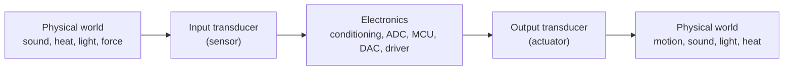

::: testing
Whether you know the **energy-conversion definition** and can separate it cleanly from "sensor" and "actuator". Many candidates use the words interchangeably. The interviewer wants: a transducer converts energy from one form to another; sensors and actuators are the two directions of transduction; and you can name examples with the energy domains involved (mechanical, thermal, electrical, optical, magnetic, chemical). Strong answers add that transducers are reciprocal in some cases (a speaker can work as a microphone), and mention efficiency or sensitivity numbers.
:::

::: why
Real products are chains of transducers: a microphone turns sound into voltage, an ADC makes bits, a DAC makes voltage again, a speaker turns voltage back into sound. Understanding energy domains helps you reason about what limits each link: sensitivity, bandwidth, impedance, noise and efficiency. It also helps in debugging (a piezo buzzer acts as a microphone and picks up your vibration) and in interviews, because "sensor vs transducer vs actuator" is an easy question to get subtly wrong.
:::

::: concepts
- **Energy domains**: electrical, mechanical, thermal, optical, magnetic, chemical. A transducer crosses between two.
- **Sensor**: a transducer (or system containing one) used to measure; the output is an electrical signal. See [[q0841]].
- **Actuator**: a transducer in the other direction, electrical energy to physical action (motor, speaker, solenoid).
- **Sensitivity / transfer function**: output per unit input, e.g. mV/Pa for a microphone.
- **Reciprocity**: some transducers (piezo, voice-coil) work in both directions.
- **Impedance**: transducers present a source or load impedance; matching to the circuit matters.
:::

::: answer
"A transducer is any device that converts energy from one form to another. A microphone converts sound pressure, which is mechanical energy, into an electrical signal. A speaker does the opposite. A thermocouple converts heat into voltage, a solar cell converts light into electricity, and a motor converts electrical energy into motion.

The way I keep the terms straight: a transducer is the broad category. A sensor is a transducer, or a system built around one, whose purpose is measurement, so the output is a signal that carries information about something. An actuator is a transducer whose purpose is to do something to the world, so electrical energy goes in and mechanical, thermal or acoustic action comes out. So microphone and thermocouple are input transducers, or sensors, and speaker and heater are output transducers, or actuators.

The practical part is that each transducer has a transfer function, like millivolts per pascal for a MEMS microphone or microvolts per degree for a thermocouple, plus an impedance and a bandwidth. Those determine the conditioning circuit. A piezo element, for example, has a very high source impedance, so I need a charge amplifier or high-impedance buffer."
:::

::: technical
**Definition.** A transducer converts one form of energy into another. Input and output domains can be any of electrical, mechanical, thermal, optical, magnetic, chemical or acoustic.

**Relation to sensor and actuator.**
- *Input transducer* (sensor): non-electrical quantity to electrical signal. The goal is information, so little energy is extracted (ideally loading the source minimally).
- *Output transducer* (actuator): electrical energy to non-electrical effect. The goal is power delivery, so efficiency matters.
- Not every transducer is a sensor or actuator in practice; a transformer converts electrical energy to magnetic and back, but is not normally called a transducer.

**Examples with domains.**

| Device | Input domain | Output domain | Type |
|---|---|---|---|
| Microphone | acoustic | electrical | sensor |
| Speaker | electrical | acoustic | actuator |
| Thermocouple | thermal | electrical | sensor |
| Solar cell / photodiode | optical | electrical | sensor / generator |
| LED | electrical | optical | actuator-like emitter |
| Piezo element | mechanical or electrical | electrical or mechanical | either, reciprocal |
| DC motor | electrical | mechanical | actuator |
| Strain gauge | mechanical | resistance change (electrical property) | sensor |

**Transfer function and sensitivity.** For a linear transducer $y=S\,x$. Example: a MEMS microphone with sensitivity -38 dBV/Pa (a common spec for analog MEMS mics, at 94 dB SPL = 1 Pa) outputs $10^{-38/20}=12.6$ mV rms at 1 Pa. Sound at 94 dB SPL is therefore about 12.6 mV rms, which needs only modest gain.

**Reciprocity.** For reciprocal transducers, the same coupling coefficient applies in both directions. A piezo disc used as a buzzer produces sound when driven; tap it and it makes a voltage. A voice-coil speaker used as a microphone gives millivolts. Energy conversion efficiency differs widely: a loudspeaker is about 1 % efficient (it is a poor acoustic radiator), a motor can be above 90 %.

**Source model.** A transducer is usually modelled as a source ($V$ or $I$) in series or parallel with an impedance: a thermocouple is a small voltage source with a few ohms; a piezo is a charge source with a capacitance of nanofarads, so its voltage into a load $R$ forms a high-pass with cutoff $f=\frac{1}{2\pi RC}$. With $C = 1$ nF and a 10 MΩ input, $f_c = 16$ Hz. Low frequencies are lost unless the input is higher impedance or a charge amplifier is used.
:::

::: short
"A transducer converts energy from one form to another, for example sound to voltage in a microphone or voltage to motion in a motor. A sensor is a transducer used to measure something, so it outputs an electrical signal carrying information. An actuator is a transducer in the other direction, electrical energy to physical action. So microphone and thermocouple are sensors, speaker and heater are actuators, and some devices like piezo elements work both ways."
:::

::: long
"A transducer is a device that converts energy from one form to another. The forms can be electrical, mechanical, thermal, optical, acoustic, magnetic or chemical. A microphone turns acoustic pressure into voltage, a thermocouple turns heat into voltage, a solar cell turns light into electrical power, and a speaker or motor goes the other way.

The cleanest way to separate terms is by direction and purpose. A sensor is a transducer, or a system built around one, whose job is measurement, so we care about the information in its output and we try not to draw much energy from the source. An actuator is a transducer whose job is to act on the world, so electrical energy goes in and motion, sound or heat comes out, and efficiency matters. So the microphone is an input transducer or sensor, the speaker is an output transducer or actuator.

Some are reciprocal: a piezo disc will buzz when I drive it and will generate a voltage when I tap it, and a speaker can work as a poor microphone.

What I care about as a circuit designer is the transfer function and the source model. A MEMS microphone might give about 12 millivolts rms at one pascal, a K-type thermocouple tens of microvolts per degree. Then the impedance: a piezo is basically a charge source with a nanofarad capacitance, so into a 10 megaohm amplifier it forms a high-pass filter at about 16 hertz, which tells me whether I need a charge amplifier.

So the way I would answer in one line: transducer is the general term for energy conversion; sensors and actuators are the two practical uses, measuring and acting."
:::

::: terms
- **Transducer**: device converting energy from one form to another.
- **Sensor**: transducer (or system) whose output is an electrical signal representing a measurand.
- **Actuator**: transducer converting electrical energy into physical action.
- **Energy domain**: electrical, mechanical, thermal, optical, acoustic, magnetic or chemical.
- **Sensitivity**: output per unit input (e.g. mV/Pa).
- **Reciprocity**: the same device converts in either direction (piezo, voice coil).
- **Piezoelectric effect**: charge generated by mechanical stress, and strain generated by applied voltage.
- **Charge amplifier**: converts a charge source into a voltage, independent of source capacitance.
:::

::: exceptional
**An average answer**: "A transducer converts one form of energy to another, like a microphone."

**An exceptional answer**:
- Gives the definition and **cleanly separates transducer, sensor and actuator** by direction and purpose.
- Names **energy domains** for several examples and notes that the same physical device can be either (reciprocity).
- Quantifies a **transfer function** (e.g. -38 dBV/Pa is about 12.6 mV rms at 94 dB SPL).
- Mentions the **source impedance** consequence (piezo high-pass corner with load) and the readout it implies.
- Notes the **efficiency** distinction: sensors aim at information and minimal loading, actuators at power conversion efficiency.
:::

::: mistakes
- **Saying transducer and sensor are strictly the same**. Every sensor contains a transducer, but a speaker or motor is a transducer that is not a sensor.
- **Saying a transducer must output electricity**. Output transducers (actuators) output motion, light, sound or heat.
- **Ignoring the loading effect**. A sensor should extract negligible energy; a voltmeter with low impedance across a piezo kills the signal.
- **Forgetting reciprocity**. Piezo buzzers pick up vibration; speaker wires pick up noise like antennas.
- **Treating the transfer function as always linear and flat**. Real transducers have bandwidth, nonlinearity and resonance.
:::

::: deep
## What "converting energy" means

Every physical effect used in electronics couples two energy domains. The table below lists the effects you will meet; knowing which effect a device uses tells you which readout it needs.

| Effect | Couples | Example devices |
|---|---|---|
| Piezoelectric | mechanical and electrical | buzzers, ultrasonic transducers, knock sensors |
| Seebeck / Peltier | thermal and electrical | thermocouples, thermoelectric coolers |
| Photoelectric | optical and electrical | photodiodes, solar cells |
| Electroluminescence | electrical to optical | LEDs, laser diodes |
| Electromagnetic induction / Lorentz force | magnetic, mechanical and electrical | microphones (dynamic), speakers, motors |
| Piezoresistive | mechanical to resistance | strain gauges, pressure sensors |
| Hall effect | magnetic to voltage | current and position sensors |
| Capacitive | mechanical to capacitance | MEMS microphones, accelerometers, touch |
| Joule heating | electrical to thermal | heaters, fuses |

## Sensor, actuator, transducer: a mental map


Figure: A mechatronic system is a chain: input transducer, electronics, output transducer. Both ends are transducers; "sensor" and "actuator" describe which end.

## Worked example 1: microphone sensitivity

Microphone sensitivity is specified at a reference of 94 dB SPL, which is 1 Pa rms (20 µPa rms is 0 dB SPL, and $20\log_{10}(1/20\times10^{-6})=94$ dB). A MEMS microphone with sensitivity -38 dBV/Pa produces

$$V=10^{-38/20}\ \text{V}=12.6\ \text{mV rms at 1 Pa}.$$

Normal conversation at 1 m is about 60 dB SPL, i.e. $10^{(60-94)/20}=0.02$ Pa, giving $12.6\times0.02=0.25$ mV rms. A 12-bit, 3.3 V ADC has a 0.8 mV step, so this signal is below one LSB without gain; a gain of 20 to 100 is typical. That calculation is why audio front ends have a preamp.

## Worked example 2: piezo as a sensor, the high-pass corner

A piezoelectric element is well modelled as a charge source in parallel with its own capacitance $C_p$. When it is connected to an amplifier with input resistance $R_{in}$, the generated charge leaks off through $R_{in}$. The result is a high-pass response with $f_c = 1/(2\pi R_{in}C_p)$. With $C_p = 1$ nF:

| $R_{in}$ | $f_c$ |
|---|---|
| 1 MΩ | 159 Hz |
| 10 MΩ | 15.9 Hz |
| 1 GΩ | 0.16 Hz |

So a piezo knock sensor into a 1 MΩ scope input would lose everything below about 160 Hz. A charge amplifier (op-amp with feedback capacitor $C_f$) converts the charge to voltage with gain $-1/C_f$ independent of cable capacitance and sets the lower corner with $R_fC_f$. This is the classic reason accelerometers for vibration monitoring (IEPE or charge-mode) have built-in electronics.

```plot
{"title":"Piezo element into a resistive load: high-pass response","x":{"label":"Frequency","unit":"Hz","min":1,"max":10000,"log":true},"y":{"label":"Gain (relative)","min":0,"max":1.1},
 "vars":{"c":"1e-9"},
 "series":[{"label":"Rin = 1 MΩ","fn":"1/sqrt(1+pow(1/(2*PI*x*1e6*c),2))","color":"red"},{"label":"Rin = 10 MΩ","fn":"1/sqrt(1+pow(1/(2*PI*x*1e7*c),2))","color":"blue"}],
 "vlines":[{"at":159,"label":"159 Hz","color":"red"},{"at":15.9,"label":"15.9 Hz","color":"blue"}]}
```
Figure: The same piezo disc looks like two different sensors depending on the load. The larger input resistance (blue) preserves low frequencies; the 1 MΩ load (red) loses everything below about 160 Hz. The corner sits where gain is 0.707.

## Worked example 3: reciprocity

Drive a piezo disc with a square wave and it flexes and makes sound (a buzzer). Connect it to a scope and tap it and you will see tens of millivolts to volts. The same electromechanical coupling coefficient $k$ governs both directions. Something similar happens with a DC motor, which is a generator when back-driven: the back-EMF constant $K_e$ (V per rad/s) and torque constant $K_t$ (N·m per A) are numerically equal in SI units. This is why a motor with its leads open can serve as a crude tachometer, and why braking generates energy. See [[q0408]].

## Sensors want information, actuators want power

An ideal sensor extracts no energy from what it measures: a thermocouple read by a high-impedance amplifier draws nanoamps. An actuator wants to convert as much electrical power as possible into useful work, so it is evaluated on efficiency: a brushless motor at 85 to 95 %, a loudspeaker around 1 %, an LED roughly 20 to 50 % depending on color and technology (vendor-dependent), an incandescent lamp under 5 % in visible light.

> [!UNCERTAIN]
> Efficiency figures for speakers and LEDs vary a lot by design and operating point. They are order-of-magnitude values to illustrate the contrast, not specifications.

## Real hardware behaviour

- **Resonance**: mechanical transducers have resonant frequencies (a piezo buzzer around 2 to 4 kHz, a ultrasonic transducer at 40 kHz). Operating at resonance gives high sensitivity and narrow bandwidth.
- **Aging and temperature**: piezoelectric ceramics lose polarisation above their Curie temperature; sensitivities drift with temperature.
- **Noise sources**: thermal noise from the source resistance, shot noise in photodiodes, amplifier noise. The *transducer's* noise often sets the system's floor.
- **Mounting**: a microphone behind a gasket, or an accelerometer on a flexible bracket, has a different transfer function than its datasheet. System-level calibration is mandatory.

```sim
{"id":"impedance-explorer"}
```
Figure: Use the impedance explorer to see how a source with capacitance behaves against frequency; a transducer's source impedance sets the corner of the filter it forms with your amplifier.
:::

::: applications
- **MEMS microphones in phones**: acoustic to analog or PDM digital, -26 to -42 dBFS sensitivity typical.
- **Ultrasonic parking sensors**: piezo transducers acting as both transmitter and receiver at about 40 kHz.
- **Load cells**: strain-gauge transducers converting force to a millivolt signal.
- **Peltier modules**: thermoelectric transducers pumping heat when driven, or generating a voltage when a temperature difference exists.
- **Haptic motors and piezo actuators in phones**: electrical-to-mechanical output transducers.
- **Solar cells**: optical-to-electrical energy converters feeding power systems.
:::

::: assumptions
- I use the common engineering definition: transducer means any energy converter. Some textbooks define it more narrowly: a transducer converts one *measurand* to another signal form, which is basically the sensor.
- In industry the terms sensor, transducer and transmitter are often used loosely; in strict instrumentation vocabulary, a "transmitter" adds conditioning and sends a standardised signal such as 4 to 20 mA.
- Sensitivity numbers for MEMS microphones are typical; each part number has its own spec. The 94 dB SPL = 1 Pa rms reference is a standard convention.
:::

::: followups
### Is a sensor always a transducer?
Yes, in the sense that it converts a physical quantity into an electrical signal, so some energy conversion or modulation happens inside. Strictly, a thermistor modulates a resistance rather than generating energy, but the system still maps a thermal quantity to an electrical one, and people call it a transducer in the broad sense.

### Give an example of a transducer that is not a sensor.
A loudspeaker, a motor, a solenoid, a heater, an LED. They convert electrical energy into sound, motion, heat or light, with the aim of doing work rather than measuring. They are actuators.

### Why does a piezo sensor need a very high input impedance?
Because it is a charge source with a small capacitance, typically nanofarads. The load resistance sets the high-pass corner $1/(2\pi R C)$. With 1 nF and 1 MΩ you lose everything under 160 Hz; use a charge amplifier or a 100 MΩ-plus input buffer for low-frequency response.

### How could you use a speaker as a microphone, and what are the drawbacks?
Connect the voice coil to a sensitive amplifier. Sound moves the cone, which moves the coil in the magnet's field and induces a voltage by Faraday's law. The result is poor sensitivity (hundreds of µV to a few mV), a non-flat frequency response and a low impedance (4 to 8 Ω) which requires a transformer or low-noise preamp. It works for rough sensing, such as detecting loud sounds.

### Scenario: your piezo knock sensor misses slow, heavy impacts but catches sharp taps. Why?
The slow impact has low-frequency content that falls below the high-pass corner formed by the sensor capacitance and the amplifier's input resistance. Increase the input resistance, add bias to a high-impedance buffer, or use a charge amplifier with a large feedback resistor so the corner moves down; also check the sensor's mounting stiffness.
:::

::: interpretations
In sensor literature, "transducer" sometimes means just the sensing element and "sensor" the complete device including conditioning. I answer with the broader energy-conversion definition and point out where the narrower usage differs. See [[q0841]] for the sensor definition and [[q0843]] for types.
:::

::: references
- Fraden, *Handbook of Modern Sensors*: definitions of sensor, transducer and actuator, and transfer functions.
- Horowitz & Hill, *The Art of Electronics*, 3rd ed.: charge amplifiers and piezoelectric transducers.
- Webster (ed.), *The Measurement, Instrumentation, and Sensors Handbook*: transducer fundamentals.
- Manufacturer MEMS microphone datasheets (definition of sensitivity at 94 dB SPL, 1 kHz).
:::

::: rubric
- Defines transducer as an energy converter between domains :: This is the core definition; without it the rest is vague.
- Distinguishes sensor (input) from actuator (output) :: The classic interview trap is conflating the terms.
- Gives examples with named energy domains :: Shows you understand conversion, not just names.
- Mentions reciprocity (piezo, speaker/microphone, motor/generator) :: Demonstrates deeper physical insight.
- Quotes a transfer function or sensitivity with units :: Real engineers talk in mV/Pa, µV/K.
- Notes source impedance and the readout it implies :: Links the transducer to circuit design.
:::

::: quiz
```json
[
 {"type":"mcq","level":"fundamental","q":"Which of the following is an output transducer (actuator) rather than a sensor?","options":["Thermocouple","Microphone","Loudspeaker","Strain gauge"],"answer":2,"explain":"A loudspeaker converts electrical energy to sound. Thermocouple, microphone and strain gauge convert physical quantities into electrical signals."},
 {"type":"truefalse","level":"fundamental","q":"Every transducer is a sensor.","answer":false,"explain":"Sensors are transducers used for measurement, but actuators like motors, speakers and heaters are transducers that convert electrical energy to physical action and are not sensors."},
 {"type":"numeric","level":"intermediate","q":"A MEMS microphone has a sensitivity of -38 dBV/Pa. What rms voltage, in mV, does it produce at 94 dB SPL (1 Pa)?","answer":12.6,"tolerance":0.02,"unit":"mV","explain":"$V = 10^{-38/20} = 0.0126$ V = 12.6 mV rms."},
 {"type":"numeric","level":"intermediate","q":"A piezo disc (1 nF) is connected to an amplifier with 10 MΩ input resistance. What is the high-pass corner frequency in Hz?","answer":15.9,"tolerance":0.02,"unit":"Hz","explain":"$f_c = 1/(2\\pi RC) = 1/(2\\pi\\cdot10^7\\cdot10^{-9}) = 15.9$ Hz."},
 {"type":"mcq","level":"advanced","q":"A DC motor's leads are open and the shaft is spun by hand. What do you measure across the leads?","options":["Nothing; motors cannot generate voltage","A voltage proportional to speed (back-EMF), because the motor is reciprocal","A voltage proportional to torque only","A constant 0.7 V"],"answer":1,"explain":"The same electromagnetic coupling that produces torque from current produces a back-EMF $K_e\\omega$ from rotation. In SI units $K_e$ equals $K_t$, so an open-circuit motor acts as a tachogenerator."}
]
```
:::
