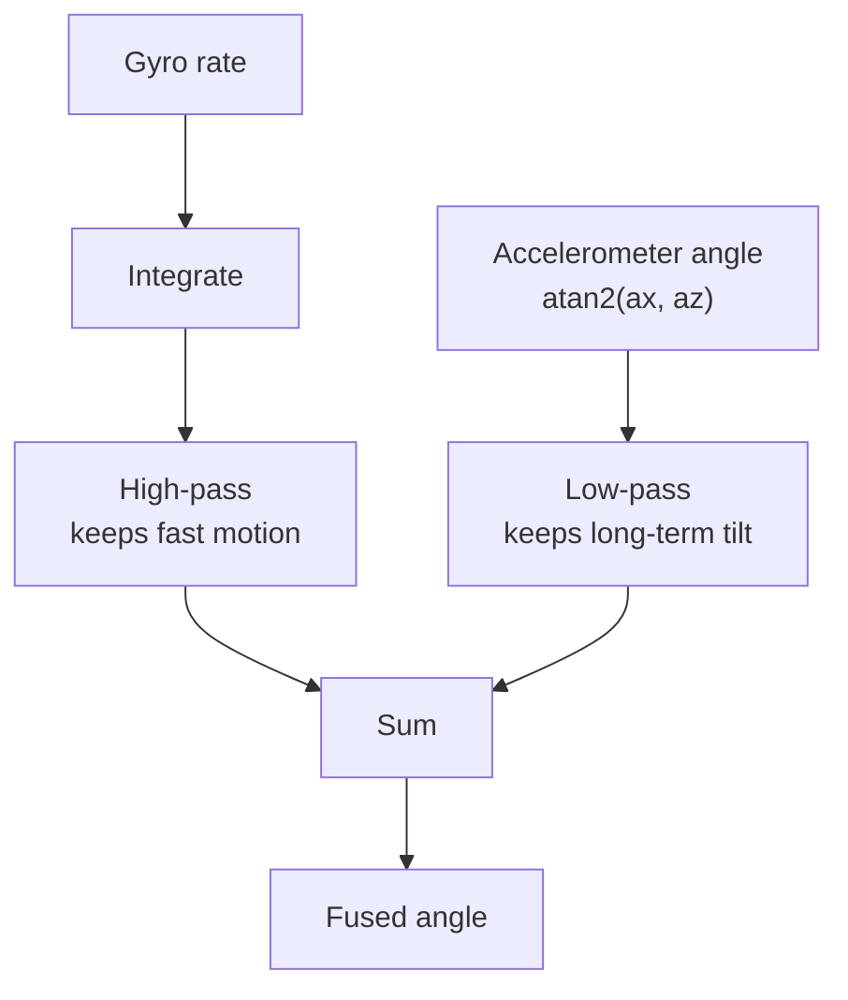

::: basics
### In plain words
Sensor fusion means combining readings from several sensors to get one estimate that is better than any single sensor could give. It works because different sensors are bad in different ways. Where one is weak, another is strong, so blending them cancels the weak spots.

### Picture it
Picture walking through a dark room. Counting your steps tells you how far you moved, and it is smooth, but small mistakes pile up the longer you walk. Now and then you touch a wall, which tells you exactly where you are, but only at that moment. You trust your step count between touches and correct it at each wall. Sensor fusion does the same, many times a second. One difference: a real filter blends the two all the time instead of only at walls.

### Words you need
- **Gyroscope**: a sensor that measures how fast something is rotating. Adding up its readings over time gives the angle.
- **Accelerometer**: a sensor that measures acceleration, including the pull of gravity, so it can tell which way is down. See [[q0846]].
- **Drift**: a small steady error that grows as you keep adding readings together.
- **Noise**: random jitter on a reading.
- **Complementary filter**: a simple blend that trusts the fast sensor for quick changes and the steady sensor for the long run. See [[q0848]].

### The simplest example
Hold a board perfectly still. The gyroscope should read 0 degrees per second but reads 0.5. Adding that up gives 30 degrees of false tilt after one minute. The accelerometer reads the true tilt of 0 degrees, but jitters from sample to sample. Now, 100 times a second, keep 98 percent of the gyro-updated angle and pull 2 percent toward the accelerometer angle. The false tilt then settles near 0.25 degrees instead of growing. That is the whole idea. The rest of this page shows how to choose the blend, a more careful method that weights sensors by their noise, and the timing problems of real hardware.
:::

::: testing
Whether you understand **why** combining sensors beats any single sensor, and can describe at least one real algorithm at the right level. The interviewer is looking for the core idea (complementary error characteristics, redundancy, weighting by uncertainty), one concrete method (complementary filter, Kalman filter, weighted average), and a concrete example (gyro plus accelerometer, GPS plus IMU, camera plus IMU). Strong candidates mention covariance or variance as the weighting, sampling-rate differences, time synchronisation and calibration, because those are the practical headaches.
:::

::: why
No single sensor is good at everything. Gyros are smooth but drift, accelerometers are noisy but anchored to gravity, GPS is absolute but slow and drops out indoors, cameras give rich information at low rate. Almost every robot, phone, drone, car and wearable relies on fusion to get orientation, position or state it could not get from one part. As a hardware engineer you will specify sensor noise, bias and timing, which directly sets fusion quality, so you need to understand what the fusion software needs from you.
:::

::: concepts
- **Complementary errors**: one sensor is good where the other is bad (high-frequency vs low-frequency accuracy). See [[q0848]].
- **Variance / noise as a weight**: trust the less noisy sensor more, in proportion to $1/\sigma^2$.
- **Filtering**: complementary filter (high-pass one source, low-pass the other); first-order filters and time constants. See [[q0129]].
- **Kalman filter**: optimal recursive estimator for a linear system with Gaussian noise: predict with a model, correct with a measurement.
- **Integration drift**: why integrating a rate or acceleration drifts. See [[q0849]].
- **Sampling and synchronisation**: sensors run at different rates and with different latencies. See [[q0669]].
:::

::: answer
"Sensor fusion means combining data from several sensors to get an estimate that is better than any single one could give: more accurate, less noisy, more reliable, or with information none of them has alone.

The key idea is that sensors have complementary weaknesses. The classic example is a gyroscope and an accelerometer measuring tilt. The gyro gives a clean, fast angular rate, and if I integrate it I get angle, but tiny bias errors accumulate, so it drifts. The accelerometer sees gravity, so it gives an absolute tilt reference with no drift, but it is noisy and gets corrupted whenever the device actually accelerates. So I trust the gyro in the short term and the accelerometer in the long term. The simplest way is a complementary filter: angle equals alpha times the previous angle plus gyro rate times dt, plus one minus alpha times the accelerometer angle, with alpha around 0.98.

When I want to do it more rigorously, a Kalman filter treats each sensor as a measurement with a known noise variance and weights them optimally, and it can even estimate the gyro bias online. Other examples are GPS plus IMU for navigation, where GPS fixes the slow drift of the IMU and the IMU bridges GPS dropouts, or camera plus IMU for visual-inertial odometry.

The practical details are time-stamping, calibration and handling different sample rates."
:::

::: technical
**Principle.** Given measurements $z_1=x+n_1$ and $z_2=x+n_2$ of the same quantity with independent noise variances $\sigma_1^2,\sigma_2^2$, the minimum-variance unbiased combination is the inverse-variance weighted mean:

$$\hat x=\frac{z_1/\sigma_1^2+z_2/\sigma_2^2}{1/\sigma_1^2+1/\sigma_2^2},\qquad \sigma^2=\frac{1}{1/\sigma_1^2+1/\sigma_2^2}.$$

Example: $\sigma_1=2$, $\sigma_2=1$ gives $\sigma^2=0.8$, $\sigma=0.89$, better than both, with weights 0.2 and 0.8. Fusion never does worse than the best input (if errors are independent and the variances are correct).

**Complementary filter (tilt).** With gyro rate $\omega$, accelerometer-derived angle $\theta_a=\operatorname{atan2}(a_x,a_z)$ and sample period $\Delta t$:

$$\hat\theta_k=\alpha\,(\hat\theta_{k-1}+\omega_k\Delta t)+(1-\alpha)\,\theta_{a,k}.$$

This is a high-pass on the gyro angle and a low-pass on the accelerometer angle with time constant $\tau=\alpha\Delta t/(1-\alpha)$. For $\alpha=0.98$ and $\Delta t=10$ ms: $\tau=0.49$ s. A constant gyro bias $b$ produces a steady-state error $b\tau$: for $b=0.5$°/s that is 0.245°, instead of an unbounded 30° after a minute with pure integration.

**Kalman filter (outline).**
- *Predict*: $\hat x_{k|k-1}=F\hat x_{k-1}$, $P_{k|k-1}=FPF^T+Q$.
- *Update*: $K=P H^T(HPH^T+R)^{-1}$, $\hat x=\hat x_{k|k-1}+K(z-H\hat x_{k|k-1})$, $P=(I-KH)P$.
$Q$ (process noise) captures model uncertainty (gyro random walk); $R$ (measurement noise) captures sensor noise. The Kalman gain $K$ is the optimal weight. In the tilt problem the state includes angle *and* gyro bias, so the bias is estimated online.

**Architectures.** *Competitive* (redundant sensors of the same quantity, for reliability and noise), *complementary* (different sensors for different frequency bands or axes), *cooperative* (sensors together reveal something neither measures alone, e.g. stereo cameras for depth).

**Practical issues.** Time synchronisation (a 10 ms timestamp error at 100°/s rotation is 1° error), different sample rates (IMU 200 to 1000 Hz, camera 30 Hz, GPS 1 to 10 Hz), calibration (axis misalignment, scale factor), outliers and sensor disturbances (magnetometer near motors), and observability: yaw cannot be corrected by an accelerometer because gravity is symmetric about the vertical.
:::

::: short
"Sensor fusion combines several sensors to get an estimate better than any one alone. They have complementary weaknesses: a gyro is smooth but drifts, an accelerometer is absolute for tilt but noisy. A complementary filter trusts the gyro in the short term and the accelerometer in the long term, and a Kalman filter does the same optimally by weighting each sensor by its noise variance. Other examples are GPS plus IMU and camera plus IMU."
:::

::: long
"Sensor fusion is combining measurements from multiple sensors to produce an estimate that is more accurate, more robust or richer than any single sensor can provide.

The motivation is that real sensors all have a weakness. Take tilt. A gyro measures rotation rate with low noise, and integrating gives angle, but any tiny bias integrates into an unbounded drift. A bias of half a degree per second is 30 degrees after a minute. An accelerometer measures the direction of gravity, so it gives an absolute angle that does not drift, but it is noisy and whenever the device accelerates, it mistakes that for tilt. The weaknesses are complementary, one is good at high frequency and one at low frequency.

The simplest fusion is a complementary filter: take alpha times the previous angle plus gyro rate times dt, plus one minus alpha times the accelerometer angle. With alpha 0.98 at 100 hertz the time constant is about half a second, so below about a third of a hertz you follow the accelerometer and above it you follow the gyro. A gyro bias then causes only a small steady error, bias times tau, instead of unbounded drift.

The general version is the Kalman filter. It predicts with a model, like integrating the gyro, then corrects with each measurement, weighting by the relative uncertainty. If two sensors have standard deviations 2 and 1, the fused standard deviation is 0.89, better than either. A good implementation also estimates the gyro bias as part of the state.

The same idea scales up: GPS plus IMU for navigation, where GPS bounds the IMU drift and the IMU bridges outages, and camera plus IMU for visual-inertial odometry.

The practical pain points are timestamps, different sample rates and calibration, and knowing what is observable: an accelerometer cannot fix yaw, so you add a magnetometer."
:::

::: terms
- **Sensor fusion**: combining data from multiple sensors to improve an estimate.
- **Complementary filter**: blends a high-passed fast sensor with a low-passed absolute sensor.
- **Kalman filter**: recursive optimal estimator using a model and noise covariances.
- **Process noise ($Q$) / measurement noise ($R$)**: uncertainty of the model vs the sensor.
- **Kalman gain**: weight applied to the measurement innovation.
- **Bias (zero-rate offset)**: constant offset in a sensor output that integrates to drift.
- **Observability**: whether the sensor set contains enough information to determine a state (yaw from accel alone is not observable).
- **Visual-inertial odometry (VIO)**: fusion of camera and IMU for motion estimation.
:::

::: exceptional
**An average answer**: "Sensor fusion means combining data from multiple sensors, like an accelerometer and gyro, to get better data."

**An exceptional answer**:
- States the principle: combine **complementary errors**, and the optimal weighting is **inverse variance**.
- Gives the **complementary filter equation** with $\alpha$ and the time constant, and the bias-error result $b\tau$.
- Names the **Kalman filter** and what it adds (optimal gain, online bias estimation), with a one-line predict/update description.
- Mentions **observability** (yaw from accel), **timestamps and rates**, and calibration as the real-world issues.
- Gives **three domains** (IMU, GPS+IMU, camera+IMU) and explains what each sensor contributes.
:::

::: mistakes
- **Saying fusion just averages sensors**. A plain average ignores that one may be much better; use weights from variances or frequency bands.
- **Using the accelerometer angle directly during motion**. Linear acceleration adds to gravity and corrupts tilt; the filter must reject it.
- **Assuming fusion fixes a bad sensor**. Fusion can reduce noise and bound drift, but a badly calibrated or misaligned sensor produces biased output.
- **Ignoring timestamps**. A 10 ms mismatch between gyro and camera at 100°/s is 1°. Hardware time sync matters.
- **Thinking an accelerometer can correct yaw**. Rotation about the gravity vector does not change the accelerometer output; you need a magnetometer, GPS heading or vision. See [[q0848]].
:::

::: deep
## Why one sensor is not enough

Every sensor has an error spectrum. Plot noise against frequency and different sensors win in different bands:

- **Gyro**: low white noise (so excellent at high frequency), but the integral of its bias is a ramp, so it is poor at low frequency.
- **Accelerometer tilt**: unbiased on average (gravity is absolute), but noisy and disturbed by motion at high frequency, so it is good at low frequency only.

Fusion exploits that split. The complementary filter literally cuts the two at a crossover frequency $f_c=1/(2\pi\tau)$.


Figure: The complementary filter is one high-pass and one low-pass that sum to 1. The gyro owns the high frequencies, the accelerometer owns the low ones; tau sets where the hand-over happens.

## Derivation: complementary filter as a first-order system

Write the fused angle in the Laplace domain:

$$\hat\Theta(s)=\frac{\tau s}{\tau s+1}\cdot\frac{\Omega(s)}{s}+\frac{1}{\tau s+1}\,\Theta_a(s)=\frac{\tau}{\tau s+1}\Omega(s)+\frac{1}{\tau s+1}\Theta_a(s).$$

The two transfer functions add to $1$: $\frac{\tau s}{\tau s+1}+\frac{1}{\tau s+1}=1$. So if both inputs measure the true angle $\theta$ with no error, the output is exactly $\theta$ at all frequencies (no distortion). Errors enter differently: the accelerometer noise sees a low-pass (high-frequency noise removed), and gyro bias $b$ (a constant rate) sees $\frac{\tau}{\tau s+1}\cdot\frac{b}{s}$, whose steady state is $b\tau$.

In discrete form with $\alpha=\tau/(\tau+\Delta t)$ (equivalently $\tau=\alpha\Delta t/(1-\alpha)$), this is the loop equation shown above.

| $\alpha$ | $\Delta t$ | $\tau$ | crossover $f_c$ | error for 0.5°/s bias |
|---|---|---|---|---|
| 0.90 | 10 ms | 0.09 s | 1.77 Hz | 0.045° |
| 0.98 | 10 ms | 0.49 s | 0.32 Hz | 0.245° |
| 0.995 | 10 ms | 1.99 s | 0.08 Hz | 0.995° |

There is a direct trade-off: a longer $\tau$ filters accelerometer noise and motion disturbance more strongly, but lets more gyro bias through. That is the tuning problem you see in every drone flight controller.

```sim
{"id":"imu-lab","view":"fusion","alpha":0.98}
```
Figure: Slide alpha towards 1 and watch the fused angle follow the gyro more, losing the accelerometer's correction (drift returns); slide it towards 0 and the output becomes noisy like the accelerometer. A value near 0.98 is a good compromise at 100 Hz.

## Optimal weighting by variance

For two independent measurements of the same scalar, minimise $E[(\hat x-x)^2]$ for $\hat x=w z_1+(1-w)z_2$. Setting the derivative of $w^2\sigma_1^2+(1-w)^2\sigma_2^2$ to zero gives $w=\sigma_2^2/(\sigma_1^2+\sigma_2^2)$, i.e. weights proportional to $1/\sigma^2$, and the fused variance $\sigma^2=\sigma_1^2\sigma_2^2/(\sigma_1^2+\sigma_2^2)$.

```plot
{"title":"Fused standard deviation vs. second sensor's noise (first sensor σ1 = 2)","x":{"label":"σ2 (second sensor)","min":0.1,"max":6},"y":{"label":"Fused σ","min":0,"max":2.2},
 "vars":{"s1":2},
 "series":[{"label":"fused σ","fn":"sqrt(s1*s1*x*x/(s1*s1+x*x))","color":"accent"},{"label":"σ2 alone","fn":"x","dashed":true,"color":"muted"}],
 "hlines":[{"at":2,"label":"σ1 = 2","color":"red"}],
 "points":[{"x":1,"y":0.894,"label":"σ2 = 1: fused 0.89"}]}
```
Figure: The fused uncertainty is always below both inputs. When the second sensor is much worse (large σ2), the fused value hugs σ1; when it is better, it hugs σ2. Adding a similar sensor (σ2 = 2) gives a √2 improvement, to 1.41.

## Kalman filter in the tilt problem

State $x=[\theta,\ b]^T$ (angle and gyro bias). Model: $\theta_k=\theta_{k-1}+(\omega_k-b_{k-1})\Delta t$, $b_k=b_{k-1}$ plus small random walk. Measurement: $z=\theta_a$ with variance $R$. Predict integrates the corrected gyro; update corrects with the accelerometer angle. Because the bias appears in the model, the filter can *learn* it: whenever the accelerometer says the angle is persistently higher than the prediction, the innovation is attributed partly to bias. A constant $b$ is thereby removed (error to zero) instead of $b\tau$ in the complementary filter. The cost is compute, tuning of $Q$ and $R$ and a model of the system.

> [!TIP]
> In interviews, say what $Q$ and $R$ physically mean: $R$ is how noisy the measurement is (accelerometer noise density times bandwidth), $Q$ is how much the model drifts between samples (gyro random walk and bias instability). Large $R/Q$ means trust the model; small means trust the measurement.

## Beyond tilt: GPS plus IMU and camera plus IMU

- **GPS + IMU**: GPS gives absolute position at 1 to 10 Hz with metre-level error; the IMU runs at hundreds of hertz and bridges between fixes and through tunnels, but its position error grows like $t^2$ with accelerometer bias (see [[q0849]]). A Kalman filter (often extended or error-state) corrects the IMU's position, velocity and bias estimates each time a GPS fix arrives.
- **Camera + IMU (VIO)**: the camera gives drift-limited pose relative to visual landmarks at 30 Hz but blurs and fails in the dark and when textureless; the IMU gives high-rate motion and absolute gravity direction but drifts. The IMU makes scale observable for a monocular camera.
- **Magnetometer for yaw**: adds heading, but is disturbed by nearby motors and steel. A fusion filter checks magnetic field magnitude against the expected value and rejects bad readings.
- **Wheel odometry + IMU + LiDAR** on robots: each covers failures of the others (wheel slip, LiDAR in featureless corridors).

## Hardware responsibilities

Fusion quality is limited by hardware choices that a hardware engineer controls:

1. **Time synchronisation**: use data-ready interrupts and hardware timestamps; a 10 ms error at 100°/s rotation gives 1° of error. The same applies when the camera exposure and IMU sample are not aligned.
2. **Noise and bandwidth**: pick IMUs with the noise density you need and an on-chip digital low-pass filter; put the filter cutoff below the Nyquist frequency of the sample rate to avoid aliasing. See [[q0669]].
3. **Mechanical mounting**: vibration from motors can alias or saturate the accelerometer; soft-mount or filter. Axis misalignment of a few degrees becomes a cross-axis error.
4. **Calibration**: temperature-dependent bias and scale factor; factory or field calibration. See [[q0871]].
5. **Power and rates**: choose the lowest output data rate that satisfies the filter, since high rates cost power and processing.

## Failure behaviour

A fusion filter can fail confidently: if the accelerometer reports a sustained 1 g component due to centripetal acceleration in a turn, a naive tilt filter will lean into the turn. Mitigations are rejecting measurements when $|a|$ differs from 1 g by more than a threshold, increasing $R$ adaptively, or using other sensors (GPS velocity) to model the acceleration. Good designs also monitor innovation (measurement minus prediction) statistics to detect faults.
:::

::: applications
- **Phone orientation**: gyro + accelerometer + magnetometer fused into a rotation quaternion for screen rotation, compass and AR.
- **Drone flight controllers**: IMU fusion for attitude at hundreds of hertz, plus barometer and GPS for altitude and position.
- **Automotive**: GPS + IMU + wheel speed for navigation through tunnels (dead reckoning).
- **Robot vacuums and AMRs**: wheel odometry, IMU and LiDAR for simultaneous localisation and mapping.
- **Wearables**: PPG heart rate with accelerometer-based motion artifact cancellation.
- **VR/AR headsets**: camera + IMU fusion at low latency for head tracking.
:::

::: assumptions
- Noise is assumed independent between sensors with known variances; correlated errors (e.g. both sensors affected by the same vibration or temperature) reduce the benefit of fusion.
- The complementary filter assumes small angles and a single axis for simplicity; full 3-D orientation uses quaternions or rotation matrices (e.g. Mahony or Madgwick filters, or an error-state Kalman filter).
- A Kalman filter is optimal only for linear systems with Gaussian noise; nonlinear problems use the extended or unscented Kalman filter or particle filters.
- The time constants and numbers (alpha 0.98 at 100 Hz) are typical starting points, not universal; they depend on sensor noise and application dynamics.
:::

::: followups
### Why not just use the accelerometer for tilt, since it does not drift?
It does not drift, but it measures specific force, so any linear acceleration appears as tilt error, and it is noisier. A 0.5 m/s² lateral acceleration reads as $\arcsin(0.5/9.81)=2.9°$ of apparent tilt. During motion, the accelerometer angle is wrong in exactly the situations (a turning drone) where you most need the attitude.

### How do you choose alpha for a complementary filter?
Pick the crossover frequency $f_c$ below which you trust the accelerometer, then $\tau=1/(2\pi f_c)$ and $\alpha=\tau/(\tau+\Delta t)$. Make $\tau$ longer than the duration of typical disturbances (an acceleration burst) and shorter than the time over which the gyro bias accumulates meaningful error, i.e. bias times tau must be below your tolerance. For a 0.5°/s bias and a 0.25° tolerance, $\tau\le0.5$ s.

### What does a Kalman filter give you over a complementary filter?
Optimal weighting using the actual noise statistics, online estimation of states like the gyro bias (zero steady-state error), time-varying gain (it trusts the model more as uncertainty shrinks), and a natural framework for asynchronous sensors and multiple states. The cost is more compute, tuning of $Q$/$R$ and a need for a good model.

### How do you handle sensors with different sample rates?
Run the prediction at the fastest rate (the IMU), and perform an update whenever a slower measurement (GPS, camera) arrives, using its timestamp. The prediction must be rolled back or interpolated to the measurement time, since latency (camera exposure and processing) can be tens of milliseconds. Hardware triggers or timestamp capture help.

### What if the accelerometer says the device is tilted 10° but the gyro says it has not rotated for a minute?
Check whether the device is truly stationary and the gyro biased, or is under sustained acceleration (centripetal in a turn, on a vibrating base). Compare $|a|$ with 1 g: if it differs, the accelerometer is seeing more than gravity and should be down-weighted. If $|a|\approx1$ g and gyro is calibrated, trust the accelerometer. A good filter makes that decision from the innovation statistics rather than blindly.
:::

::: interpretations
"Sensor fusion" is general; the most common interview context is IMU fusion (gyro + accelerometer, then magnetometer). I answer generally and then use IMU as the worked example. For the specific gyro/accelerometer pairing see [[q0848]]; for integration drift see [[q0849]]; for the IMU package and its trade-offs see [[q0850]]; for sensors beyond IMU (light plus others) see [[q0855]].
:::

::: references
- Kalman, R. E., "A New Approach to Linear Filtering and Prediction Problems" (1960): the original Kalman filter paper.
- Groves, *Principles of GNSS, Inertial, and Multisensor Integrated Navigation Systems*: INS/GNSS integration and Kalman filtering.
- Mahony, Hamel, Pflimlin, "Nonlinear Complementary Filters on the Special Orthogonal Group", IEEE Trans. Automatic Control (2008).
- Thrun, Burgard, Fox, *Probabilistic Robotics*: Kalman filters and sensor models.
:::

::: rubric
- Defines fusion as combining sensors to get a better estimate than any one :: The core definition and motivation.
- Explains complementary error characteristics (gyro drift vs accelerometer noise) :: The reason fusion works.
- Gives the complementary filter equation and the role of alpha/tau :: A concrete algorithm shows real understanding.
- Mentions Kalman filtering and variance-based weighting :: The general, optimal framework.
- Gives another example (GPS+IMU, camera+IMU) :: Shows breadth beyond tilt.
- Mentions timing, calibration, sample-rate mismatch :: These are the practical headaches hardware engineers influence.
- Notes observability or failure cases (yaw, sustained acceleration) :: Shows maturity: fusion is not magic.
:::

::: quiz
```json
[
 {"type":"mcq","level":"fundamental","q":"Why are a gyroscope and an accelerometer a good pair for estimating tilt?","options":["Both drift in the same direction so errors cancel","The gyro is accurate short-term but drifts; the accelerometer is noisy short-term but has no long-term drift","The accelerometer measures rotation rate directly","The gyro measures gravity"],"answer":1,"explain":"Their errors are complementary: the gyro's integral drifts over time, while the accelerometer gives an absolute gravity reference but is noisy and corrupted by motion. Fusion uses each where it is strong."},
 {"type":"numeric","level":"intermediate","q":"Complementary filter with alpha = 0.98 and sample period 10 ms. What is the time constant tau in seconds?","answer":0.49,"tolerance":0.02,"unit":"s","explain":"$\\tau=\\alpha\\Delta t/(1-\\alpha)=0.98\\times0.01/0.02=0.49$ s."},
 {"type":"numeric","level":"intermediate","q":"Two independent sensors measure the same quantity with standard deviations 2 and 1. What is the standard deviation of the optimal (inverse-variance) fused estimate?","answer":0.894,"tolerance":0.02,"unit":"","explain":"Variance = 1/(1/4 + 1/1) = 0.8, so σ = √0.8 = 0.894, which is below both inputs."},
 {"type":"numeric","level":"intermediate","q":"A gyro has a constant bias of 0.5 °/s. Using the complementary filter above (tau = 0.49 s), what is the steady-state angle error in degrees?","answer":0.245,"tolerance":0.02,"unit":"°","explain":"Steady-state error = bias × tau = 0.5 × 0.49 = 0.245°. Pure integration would instead grow 0.5° every second."},
 {"type":"truefalse","level":"advanced","q":"With only a gyroscope and an accelerometer, the filter can fully correct drift in yaw (rotation about the vertical axis).","answer":false,"explain":"Gravity is parallel to the yaw axis, so rotating about it does not change the accelerometer reading. Yaw is unobservable without another reference such as a magnetometer, GPS heading or a camera."}
]
```
:::
