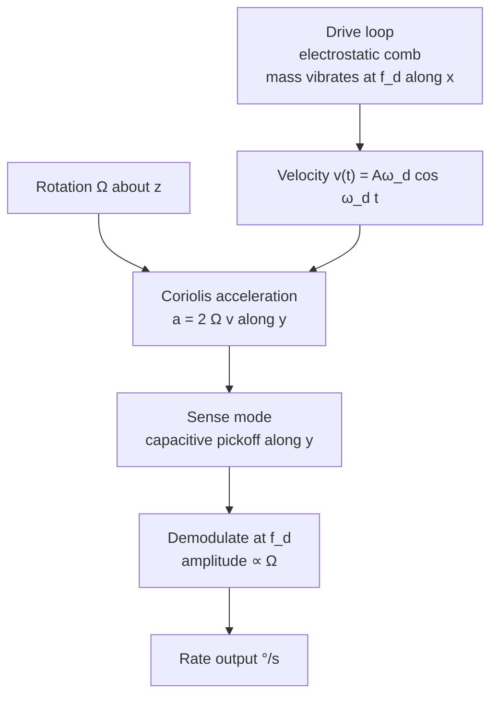

::: testing
Whether you know **what each sensor physically measures** and roughly how a MEMS version works. The two classic traps: saying an accelerometer measures "acceleration" without noting it reads +1 g at rest and 0 g in free fall (specific force), and saying a gyroscope measures "orientation" when it measures angular *rate*. The interviewer also wants the MEMS mechanism (a proof mass on springs with capacitive readout for the accelerometer; a vibrating mass and Coriolis force for the gyro), the output units and a feel for the numbers.
:::

::: why
IMUs are in every phone, drone, car, game controller and wearable, and a hardware engineer is expected to read their datasheets: range, sensitivity, noise density, bias, bandwidth, output data rate. If you cannot explain what the raw numbers mean (a z-axis reading of 16384 LSB at rest, what a gyro reads when still) you cannot debug orientation bugs or choose a part. This question is the foundation for the rest of the Gyroscope/Accelerometer section ([[q0847]] to [[q0850]]).
:::

::: concepts
- **Specific force**: what an accelerometer measures: $\vec f=\vec a-\vec g$. At rest it reads $+1$ g upward; in free fall, zero. See [[q0849]].
- **Angular rate**: what a gyroscope measures, in °/s or rad/s about each axis; angle requires integration.
- **Spring-mass-damper**: the mechanical model behind a MEMS accelerometer; displacement $x=ma/k$.
- **Capacitive sensing**: displacement changes capacitance $C=\varepsilon A/d$. See [[q0022]].
- **Coriolis effect**: a mass moving with velocity $v$ in a frame rotating at $\Omega$ feels a Coriolis force $-2m\,\Omega\times v$ (magnitude $2m\Omega v$ for perpendicular vectors).
- **Axes, range and sensitivity**: full-scale range (±2 g to ±16 g, ±250 to ±2000 °/s), LSB per unit, noise density.
:::

::: answer
"An accelerometer measures acceleration along an axis, more precisely specific force. Inside a MEMS accelerometer there is a tiny proof mass held by springs. When the package accelerates, the mass lags behind and shifts a little, and that changes the capacitance between the mass and fixed electrodes, which a circuit turns into a number. A nice consequence is that at rest on a table it reads 1 g upward on the vertical axis, because the table is pushing the case up, and in free fall it reads zero. That is why it can find which way is down.

A gyroscope measures angular velocity, how fast something is rotating about an axis, in degrees per second. A MEMS gyro keeps a small mass vibrating. When you rotate the chip, the Coriolis force pushes the mass sideways in a direction perpendicular to its vibration, and that small sideways motion, again sensed capacitively, is proportional to the rotation rate.

So the accelerometer tells me which way gravity points and how I am being pushed, the gyro tells me how fast I am turning. If I want an angle from the gyro I have to integrate its output, and that is where drift comes from, which is why the two are usually combined."
:::

::: technical
**Accelerometer.** Model the proof mass $m$ on a spring $k$ with damping $c$:

$$m\ddot x+c\dot x+kx=-m\,a_{case}\quad\Rightarrow\quad \frac{X(s)}{A(s)}=\frac{-1}{s^2+\frac{\omega_0}{Q}s+\omega_0^2},\ \ \omega_0=\sqrt{k/m}.$$

Well below resonance, $x=a/\omega_0^2$. With $f_0=5$ kHz, $\omega_0=31{,}416$ rad/s and 1 g gives $x=9.81/9.87\times10^8=9.9$ nm. A differential capacitor with gap $d=2$ µm changes by $\Delta C/C\approx x/d=0.5\%$ per g. The ASIC (charge amplifier, ADC) resolves tiny fractions of that. Trade-off: a stiffer spring (higher $f_0$) gives more bandwidth but less displacement per g, hence less sensitivity.

**Specific force.** The sensor reads $f=a-g$ (with $g$ pointing down): at rest $f=+1$ g along the up axis, free fall $f=0$. With the device at rest and tilted, the gravity components on the axes give tilt: $\theta=\operatorname{atan2}(a_x,a_z)$ (valid only when linear acceleration is small).

**Gyroscope (Coriolis vibratory).** Drive the mass along $x$ at velocity $v(t)=A\omega_d\cos\omega_dt$. A rotation $\Omega$ about $z$ produces a Coriolis acceleration $a_c=2\Omega v$ along $y$. Example: $A=10$ µm, $f_d=20$ kHz gives peak $v=1.26$ m/s; at $\Omega=100$°/s (1.745 rad/s), $a_c=2\times1.745\times1.257=4.4$ m/s² (0.45 g) at the drive frequency. The sense channel demodulates at $\omega_d$ (synchronous detection) to get $\Omega$.

**Outputs and units.** Digital IMUs output signed integers. A ±2 g accelerometer at 16 bits: LSB = 4 g/65536 = 0.061 mg; at rest the vertical axis reads $1/0.000061=16384$ LSB. A ±250 °/s gyro at 16 bits gives 131 LSB per °/s.

**Key specs.** Range, sensitivity (LSB/g, LSB per °/s), zero-g offset / zero-rate output (bias), noise density (µg/√Hz, °/s/√Hz), bandwidth, output data rate, cross-axis sensitivity, temperature coefficient, and for gyros g-sensitivity and bias instability.
:::

::: short
"An accelerometer measures specific force: a tiny MEMS proof mass on springs shifts when the case accelerates and the capacitance change is read out. At rest it reads 1 g up and in free fall zero, which lets it find the gravity direction. A gyroscope measures angular rate: a vibrating mass feels a Coriolis force when the chip rotates, and the sideways motion is proportional to the rate. To get an angle from a gyro you integrate, which drifts."
:::

::: long
"An accelerometer measures acceleration along an axis, or more exactly specific force. In a MEMS device there is a micro-machined proof mass suspended on springs between fixed electrodes. If the package accelerates, the mass lags behind, moves a few nanometres, and the capacitance to the electrodes changes. A little ASIC converts that into a digital number. The deflection is the acceleration divided by the square of the resonant frequency, so with a 5 kilohertz resonance, one g moves the mass by about 10 nanometres.

An important detail is that it measures specific force, not the acceleration relative to the ground. At rest on a table the vertical axis reads plus one g, because the table pushes the case up. In free fall it reads zero. That means I can use it to find the gravity direction and therefore tilt, as long as the device is not accelerating much.

A gyroscope measures angular velocity. The MEMS version drives a mass to vibrate at some frequency, for instance 20 kilohertz. If the chip rotates, the Coriolis force, two times omega cross velocity, pushes the mass sideways, perpendicular to the vibration, and that tiny motion is sensed capacitively and demodulated at the drive frequency. The output is rate in degrees per second, not angle, so to get an angle I integrate, and any bias integrates into drift.

For both I look at range, sensitivity, noise density, bias and its temperature dependence, bandwidth and data rate. Typical choices are plus or minus 2 to 16 g and plus or minus 250 to 2000 degrees per second. And in practice I rarely use one alone, because the accelerometer is noisy but drift-free and the gyro is smooth but drifts."
:::

::: terms
- **Specific force**: non-gravitational force per unit mass; what an accelerometer measures.
- **Proof mass**: the small suspended mass whose motion is sensed.
- **MEMS**: micro-electro-mechanical systems, micromachined silicon structures.
- **Coriolis force**: $-2m\,\Omega\times v$, force on a moving mass in a rotating frame.
- **Angular rate (angular velocity)**: rotation speed, °/s or rad/s.
- **Zero-g offset / zero-rate output (bias)**: output when the true input is zero.
- **Noise density**: noise per root hertz (µg/√Hz, °/s/√Hz).
- **LSB / sensitivity**: digital counts per g or per °/s.
:::

::: exceptional
**An average answer**: "Accelerometer measures acceleration, gyroscope measures rotation."

**An exceptional answer**:
- Says the accelerometer reads **specific force** (+1 g at rest, 0 g in free fall) and why.
- Explains the **MEMS mechanism** for both: proof mass and capacitance; vibrating mass and Coriolis.
- Gives **one numerical estimate** (nm of displacement per g, or Coriolis acceleration for a given rate).
- States the gyro outputs **rate, not angle**, and the consequence (integration, drift).
- Lists the **datasheet parameters** that matter (range, noise density, bias, ODR) and the range-vs-resolution trade-off.
:::

::: mistakes
- **Saying a gyro measures orientation**. It measures angular rate; orientation is its integral, with drift.
- **Saying an accelerometer reads zero when stationary**. It reads 1 g (the reaction to gravity); it reads zero in free fall.
- **Using an accelerometer's tilt while the device moves**. Linear acceleration is added to gravity. See [[q0848]].
- **Forgetting bias and temperature**. Zero-g offset (tens of mg) and zero-rate offset (about a °/s for consumer parts, vendor-dependent) must be calibrated.
- **Confusing range with resolution**. A ±16 g range has coarser LSBs than ±2 g; pick the smallest range that does not clip.
:::

::: deep
## The accelerometer as a spring-mass system

The cleanest way to understand a MEMS accelerometer is the physics model: a mass on a spring inside a case. Accelerate the case and the mass, which wants to keep its velocity, appears to move backwards relative to the case, compressing the spring. In steady state the spring force balances the inertial force: $kx=ma$, so

$$x=\frac{m}{k}a=\frac{a}{\omega_0^2}.$$

```svg
<svg viewBox="0 0 560 190" role="img" aria-label="Spring-mass accelerometer model">
  <rect x="30" y="40" width="500" height="100" rx="6" fill="none" stroke="var(--d-ink)" stroke-width="2"/>
  <text x="40" y="30" font-family="Inter, sans-serif" font-size="13" fill="var(--d-muted)">case (accelerates with a)</text>
  <path d="M30 90 L60 90 L70 70 L90 110 L110 70 L130 110 L150 70 L170 110 L180 90 L200 90" fill="none" stroke="var(--d-ink)" stroke-width="2"/>
  <rect x="200" y="65" width="90" height="50" fill="var(--d-box)" stroke="var(--d-accent)" stroke-width="2"/>
  <text x="245" y="95" text-anchor="middle" font-family="Inter, sans-serif" font-size="14" fill="var(--d-ink)">mass m</text>
  <line x1="290" y1="75" x2="330" y2="75" stroke="var(--d-ink)" stroke-width="2"/>
  <line x1="290" y1="105" x2="330" y2="105" stroke="var(--d-ink)" stroke-width="2"/>
  <text x="380" y="62" font-family="Inter, sans-serif" font-size="13" fill="var(--d-ink)">fixed electrodes</text>
  <line x1="330" y1="60" x2="330" y2="120" stroke="var(--d-blue)" stroke-width="3"/>
  <line x1="350" y1="60" x2="350" y2="120" stroke="var(--d-blue)" stroke-width="3" stroke-dasharray="1 0"/>
  <text x="368" y="95" font-family="Inter, sans-serif" font-size="12" fill="var(--d-blue)">C1 / C2 plates</text>
  <line x1="470" y1="165" x2="400" y2="165" stroke="var(--d-red)" stroke-width="2"/>
  <polygon points="400,165 410,160 410,170" fill="var(--d-red)"/>
  <text x="435" y="182" text-anchor="middle" font-family="Inter, sans-serif" font-size="13" fill="var(--d-red)">a</text>
  <line x1="245" y1="125" x2="275" y2="125" stroke="var(--d-green)" stroke-width="2"/>
  <polygon points="275,125 267,121 267,129" fill="var(--d-green)"/>
  <text x="260" y="150" text-anchor="middle" font-family="Inter, sans-serif" font-size="12" fill="var(--d-green)">x</text>
</svg>
```
Figure: The proof mass is held by a spring; when the case accelerates the mass shifts by x = a/ω0², changing the gaps (and so the capacitances) to the fixed electrodes. Real devices use many interdigitated comb fingers to get usable capacitance in a few hundred micrometres.

**Why resonance matters.** The transfer function is flat (gain $1/\omega_0^2$) up to roughly $f_0/3$ and peaks at $f_0$ with gain $Q$. MEMS accelerometers are deliberately damped (squeeze-film air damping) to $Q\approx0.5$ to 1 so that the response is flat and the sensor does not ring.

```plot
{"title":"MEMS accelerometer mechanical response (f0 = 5 kHz)","x":{"label":"Frequency","unit":"Hz","min":10,"max":20000,"log":true},"y":{"label":"Displacement per g","unit":"nm","min":0,"max":55},
 "vars":{"f0":5000,"g":9.81},
 "series":[{"label":"Q = 0.5","fn":"g/pow(2*pi*f0,2)*1e9/sqrt(pow(1-pow(x/f0,2),2)+pow(x/f0/0.5,2))","color":"blue"},{"label":"Q = 5 (underdamped)","fn":"g/pow(2*pi*f0,2)*1e9/sqrt(pow(1-pow(x/f0,2),2)+pow(x/f0/5,2))","color":"red"}],
 "vlines":[{"at":5000,"label":"f0","color":"muted"}]}
```
Figure: Below f0 the displacement is flat at about 9.9 nm per g; this is the sensitivity. An underdamped sensor (red) rings and amplifies vibration near f0, an overdamped one (blue) stays well behaved. Stiffer spring means higher f0 but smaller displacement.

## Readout and resolution

Differential capacitive readout: two capacitors $C_1=\varepsilon A/(d-x)$ and $C_2=\varepsilon A/(d+x)$ form a half bridge. With the mass centered, $C_1=C_2=C_0$; displaced, $(C_1-C_2)/(C_1+C_2)=x/d$. Taking $d=2$ µm, 1 g yields $x/d=9.9\text{ nm}/2\ \mu\text{m}=0.5\%$. If a 1 mg signal is to be detected, the ASIC must resolve 5 ppm of a ratio. That is a few attofarads to femtofarads in a picofarad-scale capacitor, which is why sensing is done with low-noise charge amplifiers and chopper stabilisation.

Tilt sensitivity near level: $\theta\approx a_x/g$, so 1 mg of noise corresponds to $10^{-3}$ rad = 0.057° of tilt noise. A 16-bit ±2 g device has 0.061 mg per LSB, a quantisation limit of 0.0035°; noise usually dominates before that.

## Gyroscope: vibrating mass plus Coriolis


Figure: The drive mode creates a known velocity. Rotation couples it into the perpendicular sense mode; synchronous demodulation at the drive frequency rejects noise and gives a signal proportional to angular rate.

With $A=10$ µm and $f_d=20$ kHz: $v_{pk}=A\cdot2\pi f_d=1.257$ m/s. At $\Omega=100$°/s $=1.745$ rad/s, $a_c=2\Omega v=4.39$ m/s² $=0.447$ g. The corresponding sense displacement, if the sense mode is at resonance with gain $Q$ (matched or near-matched modes), is amplified by $Q$. Real gyros sit at 1 to 100 µm-scale amplitude and microscale displacements in the sense axis (sub-nanometre per °/s), so low-noise electronics are critical.

Even at zero rotation, imperfections couple some drive motion into the sense axis (the "quadrature error"), which is 90° out of phase and can be hundreds of °/s equivalent. Phase-sensitive demodulation rejects it, and the part's trim cancels the residue. The remaining mismatch is a major source of the zero-rate offset.

## Specs from a typical datasheet

| Parameter | Accelerometer | Gyroscope |
|---|---|---|
| Typical range | ±2 / 4 / 8 / 16 g | ±125 to ±2000 °/s |
| Sensitivity (16 bit) | 16384 LSB/g at ±2 g | 131 LSB per °/s at ±250 °/s |
| Zero offset | tens of mg (vendor) | about ±1 to ±10 °/s (vendor) |
| Noise density | about 100 to 300 µg/√Hz for consumer parts | about 0.005 to 0.02 °/s/√Hz for consumer parts |
| Bandwidth | up to a few kHz | up to a few hundred Hz |

> [!UNCERTAIN]
> The offset and noise numbers are indicative ranges for consumer MEMS parts; they differ widely between vendors and product tiers. Always use the actual datasheet.

## Worked example: reading raw data

An accelerometer in ±2 g mode lying flat reads $(a_x,a_y,a_z)=(300,-150,16100)$ LSB. Convert: $a_z=16100/16384=0.983$ g, $a_x=0.0183$ g, $a_y=-0.0092$ g. Magnitude $=\sqrt{0.983^2+0.0183^2+0.0092^2}=0.983$ g. Tilt about y: $\theta=\arctan(0.0183/0.983)=1.07°$. The magnitude is 1.7 % low: an indication of gain error of the sensor or offset errors, which a calibration (e.g. six-position tumble test) would fix. See [[q0871]].

```sim
{"id":"imu-lab","view":"drift","bias":0.02}
```
Figure: The drift view shows what happens when you integrate sensor output: even a small accelerometer bias grows as t² in position, and a gyro bias grows linearly in angle. Raise the bias and see how fast the error escapes.

## Real hardware behaviour

- **Placement**: mount close to the centre of rotation if you want pure acceleration; offset from the axis adds centripetal ($\Omega^2 r$) and tangential ($\dot\Omega r$) terms. At 10 rad/s and 5 cm offset the centripetal term is 5 m/s² (0.5 g).
- **Vibration rectification**: high-frequency vibration beyond the bandwidth can alias or rectify into a DC offset in the accelerometer. Soft-mount or use an anti-alias digital filter.
- **Temperature**: offset drifts with temperature (a fraction of a mg/°C for accelerometers, a fraction of °/s per °C for gyros); calibrate across temperature for good performance.
- **Gyro g-sensitivity**: acceleration slightly affects the gyro output, which is a nuisance in vibrating environments.
- **Startup**: gyros take tens to hundreds of ms to start the drive oscillation; plan boot sequences.
:::

::: applications
- **Phone auto-rotate and step counting**: accelerometer for gravity direction and gait.
- **Camera optical image stabilization**: gyro rate drives the lens or sensor shift. See [[q0857]].
- **Drone flight control**: 6-axis IMU at hundreds of Hz for attitude stabilisation.
- **Automotive airbags and electronic stability control**: high-g accelerometers and yaw-rate gyros.
- **Hard-drive free-fall protection**: detect zero-g and park the head.
- **Game controllers and VR headsets**: orientation tracking from fused IMU data.
:::

::: assumptions
- I describe MEMS devices, which dominate electronics today. Other gyros exist (fibre-optic, ring-laser, spinning-mass) with far lower drift but higher cost and size. Other accelerometers include piezoelectric (for vibration, AC-coupled only) and piezoresistive.
- Numbers (5 kHz resonance, 2 µm gap, 10 µm drive amplitude) are illustrative, not from a specific part; real designs use different geometries and many comb fingers.
- The ideal-model statement "reads 1 g at rest" assumes the device is at the Earth's surface with gravity of 9.81 m/s²; local gravity varies by about 0.5 % between equator and poles.
- Tilt from atan2 is valid only when the device is not accelerating, which [[q0848]] and [[q0845]] address with fusion.
:::

::: followups
### Why does an accelerometer read 1 g when it is sitting still?
Because it measures specific force: the support force per unit mass that keeps it from falling. The table pushes up on the case with $mg$; the proof mass inside lags and the springs deflect as if the case were accelerating upward at 1 g. In free fall there is no support force, so the reading is zero.

### How does a MEMS gyroscope measure rotation rate without a spinning wheel?
It uses the Coriolis effect: a vibrating mass moving with velocity $v$ in a frame rotating at $\Omega$ experiences an acceleration $2\Omega v$ perpendicular to its motion. The sense electrodes measure that small perpendicular motion, which after demodulation is proportional to $\Omega$.

### How would you get tilt from a 3-axis accelerometer?
At rest the vector $(a_x,a_y,a_z)$ is gravity. Roll $=\operatorname{atan2}(a_y,a_z)$, pitch $=\operatorname{atan2}(-a_x,\sqrt{a_y^2+a_z^2})$. It cannot give yaw, because rotating about the gravity vector does not change the reading.

### How do you choose the range and output data rate?
Choose the smallest range that covers the largest expected signal with margin, because LSB size scales with range. Choose ODR at least twice, preferably 5 to 10 times, the highest frequency of interest, with the on-chip digital low-pass set accordingly. Higher ODR costs more power and noise bandwidth: noise scales with $\sqrt{BW}$.

### What if your accelerometer's z-axis reads 0.97 g when level instead of 1 g?
That is a combination of gain error and offset. Measure both +1 g and -1 g (flip the board) and use the two-point calibration: offset $=(r_+ + r_-)/2$, scale $=(r_+ - r_-)/2$. Check temperature dependence and whether the PCB mounting stresses the package, which shifts offset.
:::

::: interpretations
The wording "gyroscope/accelerometer" asks about both together. I cover each separately and then note how they differ and combine; [[q0848]] compares them directly and [[q0850]] covers the IMU package. Applications are expanded in [[q0847]].
:::

::: references
- Kempe, V., *Inertial MEMS: Principles and Practice*: accelerometer and gyroscope operation.
- Analog Devices, MEMS accelerometer and gyroscope technology overviews and datasheet parameter definitions (manufacturer technical articles).
- Yazdi, Ayazi, Najafi, "Micromachined Inertial Sensors", Proceedings of the IEEE (1998).
- Titterton & Weston, *Strapdown Inertial Navigation Technology*: sensor models and error terms.
:::

::: rubric
- Accelerometer measures specific force (1 g at rest, 0 in free fall) :: Shows you understand what the sensor really reports.
- Describes MEMS accelerometer: proof mass, springs, capacitance change :: The expected mechanism.
- Gyroscope measures angular rate, not angle :: The classic confusion to avoid.
- Describes Coriolis-based vibrating gyro :: Shows depth beyond definitions.
- Gives a number (displacement per g, Coriolis acceleration, LSB/g) :: Quantitative thinking.
- Mentions key specs: range, noise, bias, bandwidth :: Needed to select and use a part.
- Notes the need to integrate gyro and its drift :: Sets up the fusion discussion.
:::

::: quiz
```json
[
 {"type":"mcq","level":"fundamental","q":"A stationary 3-axis accelerometer lying flat on a table reads approximately:","options":["0 g on all axes","1 g on the vertical axis, 0 g on the others","-1 g on the vertical axis only if the table is moving","9.81 g on the vertical axis"],"answer":1,"explain":"The table pushes up with $mg$, which the accelerometer reports as +1 g (specific force). Only in free fall would it read zero."},
 {"type":"truefalse","level":"fundamental","q":"A gyroscope outputs the device's orientation angle directly.","answer":false,"explain":"A gyroscope outputs angular rate (°/s). Orientation is the integral of rate and drifts if the rate has bias."},
 {"type":"numeric","level":"intermediate","q":"A MEMS accelerometer has f0 = 5 kHz. What is the proof-mass displacement in nm per g (use g = 9.81 m/s²)?","answer":9.94,"tolerance":0.03,"unit":"nm","explain":"$x=g/\\omega_0^2=9.81/(2\\pi\\cdot5000)^2=9.94\\times10^{-9}$ m = 9.94 nm."},
 {"type":"numeric","level":"intermediate","q":"A 16-bit accelerometer is set to ±2 g (4 g span). How many LSB does it output for 1 g?","answer":16384,"tolerance":0.01,"unit":"LSB","explain":"Full span of 4 g over 65536 codes gives 16384 LSB per g."},
 {"type":"numeric","level":"advanced","q":"A vibratory gyro drives its mass at 20 kHz with 10 µm amplitude. The chip rotates at 100 °/s. What is the peak Coriolis acceleration in m/s²?","answer":4.39,"tolerance":0.03,"unit":"m/s²","explain":"Peak velocity $=2\\pi\\cdot20000\\cdot10^{-5}=1.257$ m/s. $\\Omega=100°/s=1.745$ rad/s. $a=2\\Omega v=2\\cdot1.745\\cdot1.257=4.39$ m/s²."}
]
```
:::
