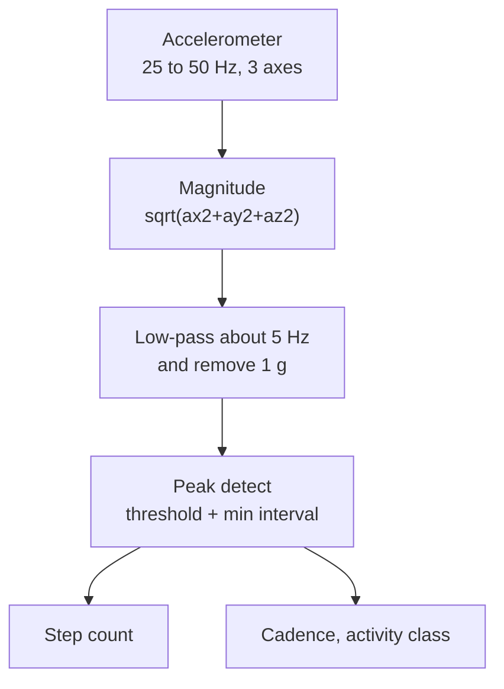

::: basics
### In plain words
Accelerometers and gyroscopes let a device know how it is tilted, bumped, dropped, shaken or turned. The accelerometer reports gravity's direction and any pushes. The gyroscope reports how fast the device is turning. Phones, drones, cars and wearables use these two signals for rotating the screen, counting steps, stabilizing a camera, deploying airbags and more.

### Picture it
Your inner ear does the same two jobs. One part senses which way gravity pulls and when your head is pushed, like an accelerometer. Another part senses when your head is turning, like a gyroscope. Your brain uses both to keep you balanced. A device has no brain, so its software must turn the raw numbers into decisions: a screen flip, a step, an alarm. The ear picture does not show that the device must pick its sensor settings for each job.

### Words you need
- **Accelerometer and gyroscope**: sensors for pushes and gravity, and for rotation speed. See [[q0846]].
- **Tilt**: the angle of a device relative to gravity.
- **Free fall**: falling with nothing holding you up, so an accelerometer reads about 0 g on every axis.
- **Threshold**: a trip level. The software acts only when the signal crosses it.
- **Image stabilization**: canceling camera shake, using the gyroscope's measurement of the shake.

### The simplest example
A phone in your pocket counts steps. Standing still, its accelerometer reads about 1 g in total, from gravity. Each footstep adds a small bump above that. When the signal crosses a threshold, the software counts one step. It ignores any bump less than about 0.25 seconds after the last one, since people do not step faster than that. Walking at 2 steps per second, 10 seconds gives 20 counted peaks, so 20 steps. That is the whole idea. The rest of this page shows how each application picks its range, speed and power, and the numbers behind airbags, drones and stabilized cameras.
:::

::: testing
Whether you can map the two measurements (specific force, angular rate) to **real products** and explain the signal processing behind each one, not just list gadgets. The interviewer wants to see you reason: "what quantity do I need, which sensor gives it, what range and bandwidth, and what goes wrong". Good answers split into categories (orientation, motion/gesture, impact/safety, stabilisation, navigation, condition monitoring) and give one number-backed example, such as the accelerometer range of an airbag sensor or the pixel shift caused by hand shake.
:::

::: why
IMU sensors ship in almost every phone, wearable, drone and car. Knowing why a drone needs a gyro at 1 kHz while a step counter runs an accelerometer at 25 Hz tells the interviewer you can size a sensor for a job, and that you understand bandwidth, range and power trade-offs. It also connects to the question you will often get next: fusion and drift ([[q0848]], [[q0849]]).
:::

::: concepts
- **What each sensor gives**: accelerometer = specific force (gravity direction, shocks, vibration); gyro = angular rate. See [[q0846]].
- **Tilt sensing**: gravity components on the axes give pitch and roll when static.
- **Event detection**: thresholds and pattern matching on the acceleration signal (free fall, tap, step, crash).
- **Stabilisation**: use the measured rotation to counteract it (OIS, drones, gimbals).
- **Dead reckoning**: integrate IMU data to get relative motion between absolute fixes. See [[q0849]].
- **Range, bandwidth, ODR and power**: the four numbers that must match the application.
:::

::: answer
"I split applications by what the system needs to know.

First, orientation: accelerometer plus gyro, often with a magnetometer, give a phone its screen rotation, a compass heading, VR head tracking and a drone's attitude. Second, motion recognition: step counters look for periodic peaks of a couple of hertz in the accelerometer, sleep trackers and gesture or tap detection use patterns in the signal. Third, shock and safety: an airbag controller watches an accelerometer with a range of tens or hundreds of g for the crash pulse, and a laptop or hard drive uses the zero-g signature of free fall to park its head. Fourth, stabilisation: in a phone camera, the gyro measures hand shake, and the lens or sensor is shifted to cancel it, or in electronic stabilisation the frames are shifted in software. A drone or a gimbal runs a control loop on the gyro at hundreds to thousands of hertz. Fifth, navigation: in a car, an IMU bridges GPS outages in tunnels. Sixth, industrial monitoring: vibration spectra from accelerometers reveal bearing wear.

And each one has different requirements. A step counter needs microamps and about 25 to 50 hertz, a drone gyro needs low noise and kilohertz bandwidth, an airbag needs a wide range and guaranteed response time."
:::

::: technical
**Orientation.** Static tilt from gravity: roll $=\operatorname{atan2}(a_y,a_z)$, pitch $=\operatorname{atan2}(-a_x,\sqrt{a_y^2+a_z^2})$. Fuse with a gyro for dynamic conditions ([[q0845]]); add a magnetometer for heading.

**Step counting.** Walking is periodic at about 1.5 to 2.5 Hz, and the vertical acceleration magnitude has a peak per step. Sample at 25 to 50 Hz, low-pass at about 5 Hz, take the magnitude $\sqrt{a_x^2+a_y^2+a_z^2}$ (orientation independent), subtract 1 g, and count peaks above a threshold with a minimum interval (about 250 to 300 ms). Typical walking peaks are on the order of 0.2 to 0.5 g above gravity; running more (vendor/individual-dependent).

**Shock and crash.** Airbag deployment depends on velocity change over the crash pulse: $\Delta v=\int a\,dt$. A 30 mph (13.4 m/s) frontal impact stopping in 100 ms has average deceleration $13.4/0.1=134$ m/s² $\approx13.7$ g, with peaks higher. Crash sensors use ranges of tens to hundreds of g, with bandwidth of several hundred Hz to a few kHz, and are redundant and self-testing.

**Free fall.** All three axes read about 0 g. A 1 m drop lasts 0.45 s, final speed 4.4 m/s. Detect when $|a|<0.3$ g for more than about 50 ms (a typical threshold choice), then protect the device.

**Image stabilisation.** A camera with focal length $f=5$ mm and 1 µm pixels: a 0.1° rotation shifts the image by $f\tan(0.1°)=8.7$ µm, almost 9 pixels. Hand shake is mainly 1 to 10 Hz with angles of tenths of a degree, so the gyro needs low noise and about 1 kHz sampling and the actuator needs a loop bandwidth of tens of Hz. See [[q0857]].

**Vehicle dynamics.** In a steady turn the yaw rate $\dot\psi=a_y/v$: at 0.5 g lateral acceleration and 20 m/s, $\dot\psi=4.9/20=0.245$ rad/s $=14°/s$. Stability control compares the gyro yaw rate and lateral acceleration against steering-based expectations to detect skids.

**Vibration monitoring.** Bearing defect frequencies are in the hundreds of Hz to kHz, so use an accelerometer with bandwidth of several kHz, sampled at 10 kHz or more, and an FFT.
:::

::: short
"Accelerometers and gyros give a system its sense of motion and orientation. Phones use them for screen rotation, step counting and image stabilisation, drones for attitude control at kilohertz rates, cars for airbag deployment and stability control, laptops and drives for free-fall protection, and factories for vibration-based predictive maintenance. The applications differ in range, bandwidth and power: an airbag needs tens of g, a step counter microamps, a drone gyro low noise."
:::

::: long
"I like to group the applications by what the system does with the motion data.

Orientation: a phone needs to know which way is down to rotate the screen, so it reads gravity from the accelerometer. For anything dynamic, like VR headset tracking or a drone's attitude, you fuse the gyro with the accelerometer, and add a magnetometer for heading.

Activity recognition: a step counter takes the acceleration magnitude, filters it to a few hertz, and counts peaks; sleep, gesture and tap detection work on patterns of the same signal. These run on a low-power sensor hub, sampling at 25 to 50 hertz, so the main CPU can sleep.

Shock and safety: an airbag controller looks for a crash pulse, in the range of tens of g, and integrates it to find the velocity change, to decide if it should fire. Hard drives and laptops detect free fall, when all three axes read near zero g, and park the head in the roughly 0.45 seconds of a one-metre drop.

Stabilisation: hand shake is a few tenths of a degree at 1 to 10 hertz. With a 5 millimetre focal length that is almost 9 micrometres at the image, nearly 9 pixels. So a gyro measures the rotation and the lens or sensor is shifted to cancel it, or in electronic stabilisation, the frames are cropped and shifted in software. Drones and gimbals run their control loops on gyro data at hundreds of hertz to kilohertz.

Navigation and vehicles: an IMU bridges GPS gaps in tunnels, and stability control compares yaw rate to what steering should produce.

Condition monitoring: vibration spectra reveal bearing faults.

Across all of them, the design question is range, bandwidth, noise and power, and how to deal with drift, which is why most of these use fusion."
:::

::: terms
- **Tilt / inclination**: angle of a device relative to gravity.
- **Dead reckoning**: estimating position by integrating motion from a known start.
- **OIS / EIS**: optical vs electronic image stabilisation.
- **Free-fall detection**: all axes near 0 g.
- **Crash pulse**: the acceleration waveform of a collision; $\Delta v$ is its integral.
- **Activity recognition**: classifying walking, running, etc. from motion data.
- **Sensor hub**: low-power processor handling sensors while the main CPU sleeps.
- **Yaw rate**: rotation rate about the vertical axis.
:::

::: exceptional
**An average answer**: "Phones for screen rotation, drones, cars for airbags, games."

**An exceptional answer**:
- Organises by **function** (orientation, activity, shock, stabilisation, navigation, monitoring).
- Links each to the **specific sensor and its spec** (range, bandwidth, ODR, power).
- Includes **one derivation or number** (pixel shift from hand shake, crash $\Delta v$, yaw rate in a turn).
- Notes the **drift and fusion** issue, and the use of a sensor hub for power.
- Mentions failure modes (false steps from arm swing, false crash triggers, drone vibration aliasing).
:::

::: mistakes
- **Using only accelerometer tilt in motion**. Linear acceleration corrupts it; fuse with a gyro. See [[q0848]].
- **Believing a phone can navigate indoors by double-integrating its accelerometer**. Drift grows as $t^2$. See [[q0849]].
- **Wrong range**. A ±2 g part clips at a crash or a hard impact; ±16 g has coarser resolution for step counting. Match the range to the signal.
- **Forgetting bandwidth/aliasing**. Vibration above half the sample rate folds into the band; use the sensor's digital filter.
- **Ignoring power**. Always-on sensing at 1 kHz in a wearable drains the battery; sensors support low-power modes and motion-wake interrupts.
:::

::: deep
## Sensor to application: a checklist

Any IMU application can be analysed with the same four questions: **what is the signal, how big is it, how fast does it change, and what is the budget?**

| Application | Signal | Range | Bandwidth / ODR | Key trouble |
|---|---|---|---|---|
| Screen rotation | gravity direction | ±2 g | 5 to 50 Hz | false triggers while moving |
| Step counting | periodic acceleration at 2 Hz | ±2 to ±4 g | 25 to 50 Hz | arm swing, vehicle vibration |
| Free fall | magnitude near 0 g | ±2 to ±16 g | 50 to 200 Hz | tossed vs dropped |
| Airbag | crash pulse | ±50 to ±250 g (typical) | up to a few kHz | reliability, redundancy |
| Drone attitude | rotation rate and tilt | ±500 to ±2000 °/s, ±8 g | gyro 1 to 8 kHz, accel 1 kHz | motor vibration noise |
| OIS | hand shake rate | ±125 to ±250 °/s | 1 to 4 kHz | low noise density |
| Vibration monitoring | spectrum | ±5 to ±50 g | 5 to 20 kHz | mounting resonance |

> [!UNCERTAIN]
> Range and bandwidth figures in the table are typical design choices, not standards; automotive crash sensors in particular are specified per vehicle program and manufacturer.

## Step counting step by step


Figure: The magnitude removes the dependence on how the phone is held, the low-pass removes noise and impacts, and the minimum interval (about 250 ms) rejects double counts. Thresholds are adapted to the user's recent signal strength.

A walking cadence of 2 steps/s means one step per 0.5 s. Sampling at 50 Hz gives 25 samples per step, plenty to find a peak. The magnitude trick is valid because gravity contributes a constant 1 g, so $|a|\approx1\,g+$ motion. A plot of an idealised walking magnitude:

```plot
{"title":"Idealised walking acceleration magnitude (illustrative, not measured data)","x":{"label":"Time","unit":"s","min":0,"max":3},"y":{"label":"|a| in g","min":0.4,"max":1.8},
 "series":[{"label":"|a| (raw)","fn":"1+0.35*sin(2*pi*2*x)+0.15*sin(2*pi*4*x+1)+0.05*sin(2*pi*13*x)","color":"blue"},{"label":"after 5 Hz low-pass (approx)","fn":"1+0.35*sin(2*pi*2*x-0.3)*0.98","color":"red"}],
 "hlines":[{"at":1,"label":"1 g","color":"muted"},{"at":1.25,"label":"detection threshold","color":"orange"}]}
```
Figure: Each step shows up as a peak about 0.3 to 0.4 g above 1 g. Higher harmonics and impact spikes ride on it; the low-pass leaves a clean peak per step so a threshold plus minimum spacing counts reliably.

## Stabilisation: why it needs a gyro, not an accelerometer

Hand shake is rotation. A gyro gives rate directly; its integral over one frame time is the angle through which the image moved. With focal length $f$ and rotation $\theta$, the image shift is $\Delta x=f\tan\theta$.

| $\theta$ | shift at $f=5$ mm | pixels at 1 µm pitch |
|---|---|---|
| 0.01° | 0.87 µm | 0.9 |
| 0.1° | 8.7 µm | 8.7 |
| 0.5° | 43.6 µm | 43.6 |

During a 1/30 s exposure, a hand rotating at 5°/s moves by 0.17°, about 15 pixels of blur. That is why OIS aims at holding the image within a pixel or so over the exposure: it needs gyro noise of a fraction of 0.01°/s/√Hz-scale density (vendor-dependent) and a loop with 1 kHz-class sampling. See [[q0857]].

Drones and gimbals use the same idea but as a control loop: the controller reads the gyro at 1 to 8 kHz, computes motor corrections via PID and applies them. Gyro noise appears directly in motor commands, so the digital low-pass filter must be balanced against delay (each 100 µs of delay costs phase margin at the loop crossover).

## Crash and shock

An airbag algorithm integrates the signal over a sliding window and compares the velocity change to a threshold that depends on the vehicle. A 13.4 m/s frontal change in 100 ms corresponds to roughly 13.7 g average. A hammer blow on the door might peak above 50 g for under a millisecond but yields only a small velocity change, which is why the algorithm integrates rather than thresholding the peak. Two sensors (a central unit and a satellite at the front of the car) plus a safing sensor guard against a false deployment.

## Free-fall and tap detection

A device reading $|a|<0.3$ g for more than about 50 ms is falling. A tap, by contrast, is a short high-frequency spike (a few ms) on one axis. These are implemented in the sensor's hardware as threshold/duration registers, with an interrupt line so the processor can sleep. Low-power sensors can sit in a motion-wake mode drawing a few µA until the interrupt fires.

## Vehicle and robot navigation

Dead reckoning uses the gyro for heading change and the accelerometer or wheel odometer for distance. The drift story: a gyro bias of 0.1°/s produces a 6° heading error after one minute, which at 15 m/s gives a lateral error of about 47 m after the 900 m travelled in that minute. The heading error grows linearly from 0 to 6°, so the lateral error is $\approx v\,b\,t^2/2 = 15\cdot0.00175\cdot60^2/2\approx47$ m; it would be $900\sin6°\approx94$ m only if the full 6° error had been present from the start. That is why dead reckoning is only used for tens of seconds between absolute fixes, and why fusion with GPS, wheel speed or LiDAR is needed.

```sim
{"id":"imu-lab","view":"fusion","alpha":0.98}
```
Figure: Use the fusion view as a drone-attitude model. With alpha = 0.98 the estimate follows the gyro in fast manoeuvres and slowly corrects toward the accelerometer tilt; reduce alpha to see accelerometer noise leak through and increase it to see drift return.

## Real hardware behaviour

- **Motor vibration** on drones is the dominant noise source for the gyro; solutions are soft-mounting the flight controller, notch filters at motor frequencies and an anti-aliasing digital filter in the IMU.
- **Mounting stiffness**: a flexible PCB or loosely clamped sensor adds resonances that corrupt vibration monitoring.
- **Temperature**: warm-up from a nearby processor changes the bias; some flight controllers wait for thermal steady-state before calibrating the gyro.
- **Interrupt-driven design**: using the sensor's FIFO and data-ready interrupt, the MCU reads blocks of samples and sleeps in between; polling at high rates wastes power.
:::

::: applications
- **Smartphones**: screen rotation, step counts, shake/tap gestures, camera stabilisation, dead-reckoning aids for navigation.
- **Quadcopter flight controllers**: 6-axis IMU at kHz rates, attitude PID, vibration filtering.
- **Automotive**: airbag crash sensors, electronic stability control with yaw-rate gyros, GPS dead-reckoning in tunnels.
- **Camera modules**: gyro-driven OIS (voice-coil lens shift) and EIS cropping.
- **Laptops and HDDs**: free-fall detection to park the head.
- **Predictive maintenance**: wireless vibration nodes on motors, pumps and fans.
:::

::: assumptions
- I treat accelerometer and gyro applications together because the question says "its applications" for the pair above ([[q0846]]). Where a use needs only one sensor I say which.
- Walking-amplitude, range and bandwidth numbers are typical engineering choices rather than universal standards; real algorithms adapt thresholds per user and device placement.
- The OIS pixel numbers assume a 5 mm effective focal length and 1 µm pixels, representative of a small smartphone module but not a specific product.
- Airbag figures are for illustration of the integration principle; real deployment algorithms are proprietary and vehicle specific.
:::

::: followups
### How does a phone count steps with an accelerometer?
It computes the acceleration magnitude (orientation independent), low-passes it at about 5 Hz, subtracts 1 g and detects peaks above an adaptive threshold with a minimum spacing of roughly 250 ms. Then it validates a run of consistent steps to avoid counting random shakes. This runs on a low-power sensor hub at 25 to 50 Hz.

### Why use a gyroscope rather than an accelerometer for image stabilisation?
Hand shake is a rotation of the camera. The gyro measures rotation rate directly, independent of gravity and of linear motion. An accelerometer would see mostly translation and gravity components, which are poor proxies for rotation. At typical subject distances, camera rotation dominates the blur.

### Why does an airbag algorithm integrate acceleration instead of just using a peak threshold?
A peak can be huge but brief (a door slam or hammer strike) and carries little momentum change. The occupant's danger depends on the vehicle's velocity change, $\int a\,dt$. Integrating over a window together with a safing sensor avoids false deployments while still reacting within tens of milliseconds.

### What range and ODR would you choose for a step counter vs a drone?
Step counter: ±2 g or ±4 g, 25 to 50 Hz, low-power mode (a few µA), with motion-wake interrupts. Drone: gyro ±1000 to ±2000 °/s at 4 to 8 kHz ODR with low noise density, accelerometer ±8 to ±16 g at about 1 kHz, hard-mounted or soft-mounted with notch filtering. The drone needs bandwidth and low latency; the step counter needs power.

### Scenario: your drone wobbles at high throttle but is fine at low throttle. What do you check?
Motor vibration is probably saturating or aliasing the IMU. Look at the raw gyro data spectrum for peaks at motor rotation frequency and harmonics; check the IMU's digital low-pass and ODR, add soft mounting, balance the propellers, and use notch filtering. If the accelerometer clips at ±8 g, move to ±16 g.
:::

::: interpretations
"What are its applications?" follows [[q0846]] and refers to both the gyroscope and the accelerometer. I answer for both and say where one sensor alone suffices (free fall, step counting for the accelerometer; OIS, yaw rate for the gyro). For the IMU packaged together see [[q0850]].
:::

::: references
- Titterton & Weston, *Strapdown Inertial Navigation Technology*: inertial sensor applications and navigation error growth.
- Kempe, V., *Inertial MEMS: Principles and Practice*: consumer, automotive and industrial MEMS inertial applications.
- Manufacturer MEMS accelerometer and IMU datasheets and application notes on free-fall, tap and activity detection (e.g. embedded motion features).
- Bosch Mobility, *Automotive Handbook*: crash-sensing and vehicle stability control chapters (general topics).
:::

::: rubric
- Groups applications by function (orientation, activity, shock, stabilisation, navigation, monitoring) :: Structure shows understanding rather than recall.
- Connects each application to the right sensor (accelerometer or gyro or both) :: The core skill: signal to sensor mapping.
- Mentions range/bandwidth/power requirements :: Selection depends on them.
- Gives a quantitative example :: Signals engineering habits.
- Notes drift and why fusion or fixes are needed :: Honest about limits of inertial sensing.
- Mentions at least one failure mode or noise source :: Shows practical experience.
:::

::: quiz
```json
[
 {"type":"mcq","level":"fundamental","q":"A laptop detects it is being dropped by looking for:","options":["All three accelerometer axes reading about 0 g","The z-axis reading 2 g","The gyroscope reading 0 °/s","A sudden change in magnetometer output"],"answer":0,"explain":"In free fall there is no support force, so the accelerometer measures specific force of about zero on all axes."},
 {"type":"numeric","level":"intermediate","q":"A camera has 5 mm focal length and 1 µm pixels. The phone rotates by 0.1° during an exposure. About how many pixels does the image move?","answer":8.7,"tolerance":0.03,"unit":"pixels","explain":"Shift $=f\\tan\\theta=5\\text{ mm}\\cdot\\tan(0.1°)=8.7$ µm, which is 8.7 pixels at 1 µm pitch."},
 {"type":"numeric","level":"intermediate","q":"A car stops from 13.4 m/s in 100 ms with constant deceleration. What is the average deceleration in g (g = 9.81)?","answer":13.7,"tolerance":0.03,"unit":"g","explain":"$a=\\Delta v/\\Delta t=13.4/0.1=134$ m/s², which is $134/9.81=13.7$ g."},
 {"type":"mcq","level":"intermediate","q":"Why does a step counter use the acceleration magnitude rather than a single axis?","options":["The magnitude is less noisy because it averages three sensors","It is independent of how the phone is oriented in the pocket","It removes gravity completely","Single axes cannot be sampled at 50 Hz"],"answer":1,"explain":"$|a|=\\sqrt{a_x^2+a_y^2+a_z^2}$ does not change with rotation of the device, so the step peaks look the same however the phone is held. Gravity is still present (as 1 g) and is subtracted or high-passed."},
 {"type":"numeric","level":"advanced","q":"A vehicle has a gyro bias of 0.1 °/s that is not compensated. After 60 s of dead reckoning, what heading error in degrees has accumulated?","answer":6,"tolerance":0.02,"unit":"°","explain":"Heading error = bias × time = 0.1 × 60 = 6°. Because the heading error grows linearly, at 15 m/s the lateral position error after 900 m is about $v b t^2/2\\approx47$ m (94 m only if the full 6° had been present from the start)."}
]
```
:::
