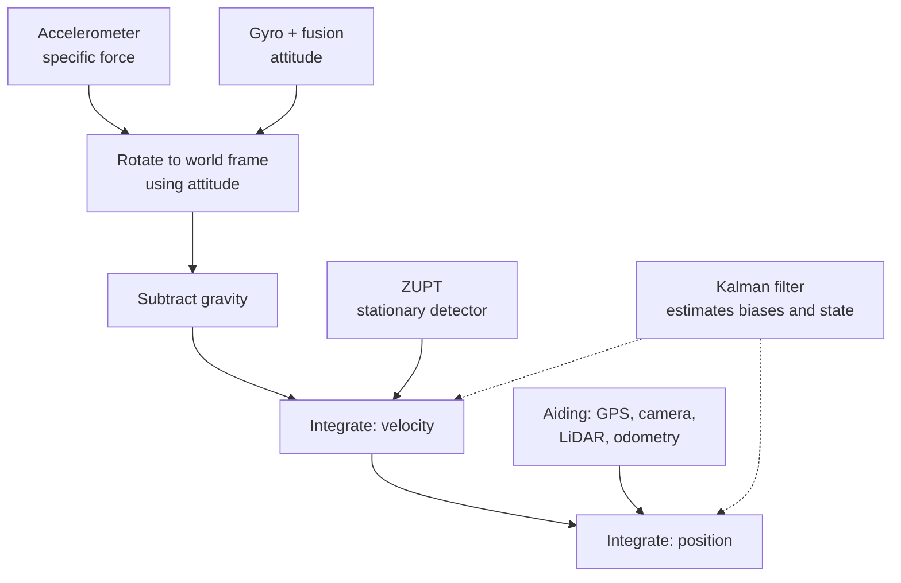

::: basics
### In plain words
Velocity is how fast you are going, and position is where you are. If you know acceleration over time, you can add it up to get velocity, and add velocity up to get position. It works on paper, but small errors in the readings grow very fast, so in practice it only holds for a few seconds.

### Picture it
Picture a jar that gets one stray coin every second, by mistake. Its count grows steadily: 1, 2, 3, 4. Every second you also add that jar's count to a second jar, which then holds 1, 3, 6, 10. The first jar is the velocity error and the second is the position error. A tiny mistake, added up twice, grows faster and faster.

### Words you need
- **Integrate**: add up a quantity over time. Acceleration integrates to velocity, and velocity integrates to position.
- **Bias**: a small constant error in a sensor's output, even when the true input is zero.
- **Drift**: an error that keeps growing as time passes.
- **Gravity**: an accelerometer feels it too, so it must be subtracted out or it looks like real motion.
- **Dead reckoning**: finding position by adding up motion from a known starting point.

### The simplest example
Lay the device perfectly still, but say its accelerometer has a bias of 0.02 m/s². After 10 seconds, the false velocity is 0.02 × 10 = 0.2 m/s. The false position is half of 0.02 times 10 squared, which is 1 m. Wait 20 seconds and it is 4 m: double the time, four times the error. If we forgot gravity, the false acceleration would be 9.81 m/s², about 490 m of fake travel in 10 seconds. The rest of this page shows how to remove gravity correctly, how big the errors are for different sensor grades, and the tricks that keep them in check.
:::

::: testing
Whether you know that velocity is the integral of acceleration and position the integral of velocity, **and** can explain why this fails badly in practice. The interviewer wants: the integration equations (and a discrete version), the need to remove gravity using orientation, the $t^2$ position drift from bias, noise integration, and the mitigations (zero-velocity updates, fusion with GPS or other sensors, calibration, better sensors). A candidate who says "just integrate twice" and stops has missed the point; one who quantifies the drift (1 mg bias gives 18 m after a minute) shows real understanding.
:::

::: why
"Can I get position from an IMU?" is the first idea every new engineer has, and the reason indoor navigation, pedestrian tracking and dead reckoning are hard problems. It matters when you decide whether you need GPS, wheel encoders, LiDAR or a camera in addition, and when you specify an IMU: the grade of the sensor sets how many seconds of unaided navigation you get. The same math applies to any sensor integrated over time (current for charge, rate for angle).
:::

::: concepts
- **Kinematics**: $v=\int a\,dt$, $x=\int v\,dt$. See [[q0846]].
- **Specific force vs acceleration**: the accelerometer reads $a-g$; gravity must be removed using orientation. See [[q0848]].
- **Coordinate frames**: sensor (body) frame vs world frame; rotate with a gyro-derived attitude.
- **Bias and drift**: constant bias $b$ gives $v=bt$ and $x=\tfrac12bt^2$.
- **Noise integration**: white noise integrates to a random walk growing as $\sqrt t$ (velocity) and $t^{3/2}$ (position).
- **Aiding / zero-velocity updates**: external information that bounds drift. See [[q0845]].
:::

::: answer
"In principle you integrate the acceleration once to get velocity and again to get position. In practice you cannot do that for long, and the reasons are what matter.

First, an accelerometer measures specific force, so gravity is in the signal. To remove it I need to know the orientation of the sensor, which means rotating the readings into a world frame using a gyro-based attitude estimate and then subtracting 1 g on the vertical axis. Any error in the attitude leaks gravity into the horizontal axes: a 0.1 degree tilt error is 0.017 metres per second squared, which doubly integrated is about 31 metres after a minute.

Second, any bias gets integrated twice. A bias b gives velocity b times t and position one half b t squared, so even a 1 milli-g bias, which is a good consumer part, is 0.5 metres after 10 seconds and 18 metres after a minute. Noise integrates too, but as a random walk, which is usually smaller than the bias term.

So with a consumer IMU position is only usable for a second or a few seconds. To make it useful, I apply corrections: reset velocity to zero when I know the device is stationary, which is called a zero-velocity update, calibrate bias, and fuse with GPS, a camera, wheel odometry or LiDAR, which give absolute or drift-free position."
:::

::: technical
**Ideal equations.** In the world frame with gravity vector $\vec g=[0,0,-g]$:

$$\vec a_{world}=R\,\vec f_{body}+\vec g,\quad \vec v(t)=\vec v_0+\int_0^t\vec a_{world}\,d\tau,\quad \vec x(t)=\vec x_0+\int_0^t\vec v\,d\tau.$$

$R$ is the rotation matrix from body to world from the attitude estimator. $\vec f$ is the accelerometer reading (specific force), so $R\vec f=\vec a-\vec g$, and adding $\vec g$ recovers $\vec a$.

**Discrete form** at period $\Delta t$ (trapezoid):
$v_k=v_{k-1}+\tfrac{\Delta t}{2}(a_k+a_{k-1})$, $x_k=x_{k-1}+\tfrac{\Delta t}{2}(v_k+v_{k-1})$. The sample rate must be well above the signal bandwidth; aliasing and a too-coarse step cause errors.

**Error growth.**
- Bias $b$: $\delta v=bt$, $\delta x=\tfrac12bt^2$. For $b=1$ mg $=9.8\times10^{-3}$ m/s²: 0.49 m at 10 s, 17.7 m at 60 s.
- Attitude error $\delta\theta$ leaks gravity: $\delta a\approx g\sin\delta\theta$. For 0.1°: 0.0171 m/s², $\delta x(60\text{ s})=30.8$ m. For 1°: 0.171 m/s² and 8.6 m after 10 s.
- White noise with density $N$ (m/s²/√Hz): velocity random walk $\sigma_v=N\sqrt t$, position $\sigma_x=N\,t^{3/2}/\sqrt3$. With 150 µg/√Hz $=1.47\times10^{-3}$ m/s²/√Hz: $\sigma_v(60\text{ s})=11$ mm/s and $\sigma_x=0.39$ m. So bias and tilt error dominate, not noise.
- Navigation-grade accelerometers (about 1 µg bias, after calibration): 17.7 mm after 60 s and 64 m after one hour.

**Mitigations.** (1) Calibrate bias and scale factor (stationary and multi-position tests). (2) Zero-velocity update (ZUPT) when stationary: set $v=0$ and update bias; widely used in foot-mounted pedestrian navigation where each step has a stance phase. (3) Fuse with absolute position: GPS, wheel odometry, visual odometry, LiDAR, UWB or Wi-Fi; Kalman filter estimates position, velocity, attitude and biases together. (4) High-pass the velocity for vibration-only tasks (displacement from vibration needs frequency-domain integration with a high-pass to avoid drift).
:::

::: short
"You integrate acceleration once for velocity and again for position, after removing gravity using the orientation. But bias integrates twice: a bias b gives position error b t squared over two, so 1 milli-g is about 18 metres after a minute. Tilt error leaks gravity into the horizontal axes, and 0.1 degrees is about 31 metres per minute. So with a consumer IMU it only works for seconds, unless you reset velocity with zero-velocity updates or fuse with GPS, vision or odometry."
:::

::: long
"In principle it is simple: velocity is the integral of acceleration, position is the integral of velocity. In code that is a running sum, ideally with the trapezoid rule at a sample rate well above the motion bandwidth.

But two things make it fail quickly. First, the accelerometer does not measure acceleration, it measures specific force, which includes gravity. To get true acceleration I rotate the reading into the world frame using the attitude from the gyro-based filter, then subtract 1 g from the vertical axis. Any attitude error leaks gravity into the horizontal axes: g times the sine of the error. A tenth of a degree is 0.017 metres per second squared.

Second, integrating twice amplifies any constant error enormously. A constant bias b gives velocity b times t and position b t squared over two. For a bias of one milli-g, which is already a decent calibrated consumer part, that is half a metre after 10 seconds and 18 metres after a minute. The 0.1 degree tilt error gives 31 metres after a minute. Sensor noise also integrates, as a random walk, but at about 150 micro-g per root hertz it adds only a few centimetres to decimetres, so bias and attitude dominate.

So for a consumer IMU, pure inertial position is good for a second or two. To get anything longer I bound the drift. If I know the device is stationary, like a foot between steps, I reset velocity to zero, a zero-velocity update. I calibrate the bias. And I fuse with something that has absolute position, GPS outdoors, a camera or LiDAR indoors, wheel odometry on a vehicle, with a Kalman filter that also estimates biases.

Better sensors help: navigation-grade bias of one micro-g gives only about 64 metres in an hour, but those cost orders of magnitude more."
:::

::: terms
- **Dead reckoning**: estimating position by integrating motion from a known start.
- **Specific force**: accelerometer output, $a-g$.
- **Gravity compensation**: subtracting $g$ in the world frame after rotating the reading.
- **Bias (offset)**: constant error in the output.
- **Velocity random walk (VRW)**: white acceleration noise integrated into velocity, $N\sqrt t$.
- **Zero-velocity update (ZUPT)**: correcting velocity to zero when the system is known to be stationary.
- **Trapezoidal integration**: second-order accurate numerical integration rule.
- **Aiding sensor**: GPS, odometry, camera, etc., that supplies drift-free information.
:::

::: exceptional
**An average answer**: "Integrate acceleration to get velocity and integrate velocity to get position."

**An exceptional answer**:
- Writes the **equations** and the **gravity-removal** step with the rotation matrix.
- Explains the **$t^2$ drift** and gives **numbers** (1 mg gives 0.49 m at 10 s, 17.7 m at 60 s; 0.1° tilt gives 31 m at 60 s).
- Separates **bias/tilt** from **noise** and shows which dominates.
- Names **ZUPT, calibration and aiding** (GPS, camera, odometry) with a Kalman filter.
- Notes sensor grade (consumer vs navigation) and how long each can free-run, and discretisation/aliasing details.
:::

::: mistakes
- **Forgetting gravity**. Integrating raw readings gives a constant 9.81 m/s² on one axis: 490 m of fake position after 10 s.
- **Subtracting 1 g without the orientation**. Gravity is along the *world* vertical, not the sensor's z axis.
- **Assuming noise is the problem**. Bias and attitude errors dominate with MEMS parts. Averaging does not remove bias.
- **Using rectangular integration at a low sample rate**. Aliasing and truncation add error; use trapezoid and an adequate ODR.
- **Thinking filtering fixes drift**. A low-pass filter smooths noise but a constant bias passes straight through.
:::

::: deep
## From kinematics to a sum in code

Position, velocity and acceleration are linked by calculus. Given samples $a_k$ at period $\Delta t$:

```
v = 0; x = 0
for each sample a_k (world frame, gravity removed):
    v_new = v + 0.5 * dt * (a_k + a_prev)
    x    += 0.5 * dt * (v_new + v)
    v     = v_new
```

For constant $a$ the trapezoid rule is exact in $v$ and in $x$, because $x=\tfrac12at^2$ is a quadratic in time and the trapezoid of a linear velocity is exact. Simple Euler integration underestimates position by $\tfrac12a\Delta t\,t$, which at $\Delta t=10$ ms, $a=1$ m/s², $t=10$ s is 5 cm.

## Step 1: remove gravity correctly

The accelerometer reads $\vec f=\vec a-\vec g$ in body axes. To find $\vec a$ in world coordinates you need the rotation $R$ from body to world, which comes from the fusion filter ([[q0845]], [[q0848]]). Then $\vec a_{world}=R\vec f+\vec g$ where $\vec g=(0,0,-9.81)$. If $R$ is wrong by angle $\delta\theta$, the vertical component of $R\vec f\approx g$ rotates and leaks $g\sin\delta\theta$ into the horizontal axes.

| Attitude error | Leaked horizontal acceleration | Position error after 10 s | after 60 s |
|---|---|---|---|
| 0.1° | 0.0171 m/s² | 0.86 m | 30.8 m |
| 0.5° | 0.0856 m/s² | 4.3 m | 154 m |
| 1° | 0.171 m/s² | 8.6 m | 308 m |

Note that the yaw error does not leak gravity; but roll and pitch errors do. Also note that the attitude estimate during motion relies on the gyro, so its own drift (and accelerometer corrections that are corrupted by motion) feeds straight into position error.

## Step 2: quantify the drift

A constant acceleration error $b$ gives $\delta v=bt$ and $\delta x=\tfrac12bt^2$:

```plot
{"title":"Position error from a constant accelerometer bias (double integration)","x":{"label":"Time","unit":"s","min":0,"max":60},"y":{"label":"Position error","unit":"m","min":0.001,"max":1000,"log":true},
 "series":[{"label":"10 mg (poor MEMS)","fn":"0.5*9.81*0.01*x*x","color":"red"},{"label":"1 mg (good consumer)","fn":"0.5*9.81*0.001*x*x","color":"orange"},{"label":"0.1° tilt error (0.0171 m/s²)","fn":"0.5*9.81*sin(0.1*pi/180)*x*x","color":"purple"},{"label":"100 µg (industrial)","fn":"0.5*9.81*1e-4*x*x","color":"blue"},{"label":"1 µg (navigation grade)","fn":"0.5*9.81*1e-6*x*x","color":"green"}],
 "hlines":[{"at":1,"label":"1 m","color":"muted"}]}
```
Figure: Log scale, so power-law growth appears as gentle curves. Every consumer-grade error crosses the 1 m line within about 5 to 15 s. Only navigation-grade accuracy (1 µg, green) stays below a few centimetres over a minute. Doubling the time quadruples the error.

Time to reach a 1 m position error: $t=\sqrt{2\cdot1/b}$. For 10 mg: 4.5 s. For 1 mg: 14.3 s. For 100 µg: 45 s. For 1 µg: 451 s (7.5 minutes).

## Step 3: noise also integrates, but it is smaller

For white noise of density $N$, velocity is a random walk with $\sigma_v(t)=N\sqrt t$ and position with $\sigma_x(t)=N\,t^{3/2}/\sqrt3$. Take 150 µg/√Hz $=1.47\times10^{-3}$ m/s²/√Hz:

| $t$ | $\sigma_v$ | $\sigma_x$ |
|---|---|---|
| 1 s | 1.5 mm/s | 0.85 mm |
| 10 s | 4.7 mm/s | 27 mm |
| 60 s | 11.4 mm/s | 0.39 m |

Compare with bias (17.7 m at 60 s for 1 mg): noise is a smaller problem than bias. Bias instability (the slow wander of bias) is the actual long-term limit: if a "stable" 1 mg bias wanders by 0.1 mg, there remains an error you cannot calibrate out.

## Step 4: reduce the error


Figure: The real pipeline has more than two integrators. Attitude is needed to remove gravity; external aids reset velocity and position; a Kalman filter estimates the biases so they are removed continuously.

**Zero-velocity update.** When the device is known to be still (a foot planted, a car stopped), the true velocity is zero. Detect it from a low gyro magnitude and accelerometer magnitude close to 1 g with low variance. Then set $v=0$ and feed the residual velocity to the Kalman filter as a measurement; this simultaneously helps estimate bias and attitude. Foot-mounted pedestrian navigation uses ZUPT every step (about 0.5 s) so the error is bounded to a fraction of the distance travelled rather than growing as $t^2$.

> [!UNCERTAIN]
> Published ZUPT-aided foot-mounted systems report errors on the order of one percent or a few percent of distance travelled with good sensors; the exact figure depends on sensor grade, gait and algorithm, so I quote it only as an order of magnitude.

**Constraints.** A car or train is constrained to move along a path with near-zero lateral and vertical velocity ("non-holonomic constraint"), which gives extra measurements.

**Calibration.** Six-position tumble tests (each axis up and down) give bias and scale factor per axis: $b=(r_{+}+r_{-})/2$, $S=(r_{+}-r_{-})/(2g)$. Temperature calibration reduces the bias change with temperature. See [[q0871]].

## What about vibration, where only displacement is wanted?

For vibration at frequency $f$, displacement amplitude $X=A/(2\pi f)^2$. A 50 Hz vibration with 1 mm amplitude is $a=(2\pi\cdot50)^2\cdot10^{-3}=98.7$ m/s² (10 g). The integration is done in the frequency domain, dividing the FFT bins by $-(2\pi f)^2$ with a high-pass below about 5 Hz (to avoid the divergence of the DC and low-frequency bins). That works because vibration has zero mean, and you do not care about the absolute position, only the oscillation.

## Experiment

```sim
{"id":"imu-lab","view":"drift","bias":0.02}
```
Figure: Set bias to 0.02 m/s² (2 mg): position error is 1 m at 10 s and 36 m at 60 s. Halve the bias and the error halves; double the time and it quadruples. Note how noise alone barely shows next to a modest bias.

## Real hardware behaviour

- **Bias repeatability**: turn-on-to-turn-on bias changes for MEMS accelerometers can be several mg; you must recalibrate at start, with the device still.
- **Temperature**: bias drifts with temperature (hundreds of µg/°C is typical for consumer parts; vendor-dependent), and board self-heating during start-up looks like drift.
- **Sampling**: use the sensor's hardware FIFO and timestamps; irregular software sampling (jitter) adds integration error.
- **Vibration rectification**: vibration beyond the digital filter bandwidth can alias to DC, which appears as a bias that changes with the environment.
:::

::: applications
- **Pedestrian dead reckoning**: ZUPT-aided foot-mounted IMUs for indoor and GPS-denied navigation (firefighters, soldiers).
- **Vehicle navigation**: GPS/INS in tunnels, with wheel speed and non-holonomic constraints.
- **Phone step detection and indoor positioning aids**: step length and heading from the IMU, corrected by Wi-Fi/BLE or maps.
- **Drones and VIO**: visual-inertial odometry fuses IMU with camera to cure the drift.
- **Aircraft inertial navigation**: navigation-grade (fibre or ring-laser gyro, precision accelerometers) with periodic GPS updates.
- **Sports and rehab tracking**: relative motion over short windows, with resets at known poses.
:::

::: assumptions
- Constant bias and small attitude error models are simplified; real errors include scale factor, misalignment, bias instability and temperature effects.
- The numbers use $g=9.81$ m/s² and single-axis horizontal error; real systems have 3-D error coupling (including Earth's rotation and Coriolis for long-duration navigation, which can be ignored for seconds to minutes with MEMS).
- Noise densities (150 µg/√Hz) and bias figures (1 mg, 10 mg, 100 µg, 1 µg) are representative grades, not specific products.
- If asked for "velocity only", the same analysis applies with $\delta v=bt$: 1 mg gives 0.59 m/s error after 60 s.
:::

::: followups
### Why does the position error grow as t squared?
A constant acceleration error $b$ integrates to a velocity error that grows linearly ($bt$). That velocity error integrates to a position error that grows quadratically ($\tfrac12bt^2$). Each integration adds one power of time. A gyro bias, by contrast, integrates once to give angle error linear in time.

### How do you compensate for gravity?
Estimate the orientation, rotate the accelerometer vector into the world frame and subtract $g$ from the vertical axis: $\vec a=R\vec f+\vec g$. The orientation comes from fusing gyro, accelerometer and optionally magnetometer data. Any attitude error leaks gravity as $g\sin\delta\theta$ into the horizontal axes, so small attitude errors dominate the drift.

### What is a zero-velocity update and when can you use it?
When the device is known to be stationary, for example a shoe during the stance phase, the velocity is exactly zero. Detect it with thresholds on gyro and accelerometer magnitude, then correct velocity (and by a Kalman filter, bias and attitude) to zero. Applied each step it bounds error growth, so pedestrian tracking works for minutes with only a few percent of the distance as error.

### How would you get distance from a car's IMU if GPS is lost for 30 seconds?
Use the IMU only to bridge the gap, with a Kalman filter that was already estimating the biases while GPS was available. Add wheel speed (very accurate for distance) and the constraint that the car does not slide sideways, then integrate attitude and speed. With a 1 mg residual bias the lateral error after 30 s is about 4.4 m; wheel odometry plus constraints cuts that by a large factor.

### What if you need position accuracy of 1 cm over 10 seconds from an inertial sensor alone?
You need $\tfrac12bt^2\le0.01$ m, so $b\le0.01\cdot2/100=2\times10^{-4}$ m/s² $=20$ µg, plus an attitude error under about 0.001°. That is navigation-grade accelerometer and gyro territory (and expensive). In practice, I'd use an external reference such as optical tracking or LiDAR and keep the IMU for high-rate interpolation.
:::

::: interpretations
The question says "position/velocity", so I cover both and show that the same analysis applies; velocity error grows linearly and position quadratically. A subtlety is whether the questioner means only the accelerometer data; if the gyro is available, gravity compensation requires it, which I mention. See [[q0850]] for IMU trade-offs and [[q0845]] for fusion.
:::

::: references
- Titterton & Weston, *Strapdown Inertial Navigation Technology*: inertial navigation equations and error propagation.
- Groves, *Principles of GNSS, Inertial, and Multisensor Integrated Navigation Systems*: INS error models, ZUPT and aiding.
- Foxlin, "Pedestrian Tracking with Shoe-Mounted Inertial Sensors", IEEE Computer Graphics and Applications (2005).
- Woodman, "An Introduction to Inertial Navigation", University of Cambridge Computer Laboratory Technical Report UCAM-CL-TR-696 (2007).
:::

::: rubric
- States $v=\int a\,dt$, $x=\int v\,dt$ and a discrete version :: The mechanical answer to the question as asked.
- Explains gravity compensation requires orientation :: A key practical step that candidates skip.
- Shows bias gives $\tfrac12bt^2$ with numbers :: Quantifies why it fails.
- Distinguishes bias/tilt error from noise integration :: Shows error modelling.
- Gives mitigations: calibration, ZUPT, aiding, Kalman :: Shows you know how real systems cope.
- Mentions sensor grade and how long each can free-run :: Connects spec to application.
- Notes vibration displacement as a special case :: Shows breadth of understanding of integration.
:::

::: quiz
```json
[
 {"type":"mcq","level":"fundamental","q":"Why can't you just integrate raw accelerometer readings twice to get position?","options":["Accelerometers output only velocity","The reading contains gravity and bias, and double integration makes errors grow rapidly","Accelerometers cannot be sampled fast enough","Position can only be measured with a gyro"],"answer":1,"explain":"The sensor measures specific force (gravity included), and any bias or gravity leakage integrates into a $t^2$ position error."},
 {"type":"numeric","level":"fundamental","q":"An accelerometer has a constant bias of 0.02 m/s². What position error accumulates after 10 s of double integration?","answer":1,"tolerance":0.02,"unit":"m","explain":"$\\delta x=\\tfrac12bt^2=0.5\\cdot0.02\\cdot100=1$ m."},
 {"type":"numeric","level":"intermediate","q":"A 1 mg accelerometer bias (use g = 9.81 m/s²) double-integrates for 60 s. What position error results?","answer":17.7,"tolerance":0.03,"unit":"m","explain":"$b=9.81\\times10^{-3}$ m/s². $\\delta x=\\tfrac12\\cdot9.81\\times10^{-3}\\cdot3600=17.66$ m."},
 {"type":"numeric","level":"intermediate","q":"The attitude estimate is off by 0.1°. How large is the horizontal acceleration error from leaked gravity, in m/s² (g = 9.81)?","answer":0.0171,"tolerance":0.03,"unit":"m/s²","explain":"$g\\sin(0.1°)=9.81\\times1.745\\times10^{-3}=0.0171$ m/s²."},
 {"type":"mcq","level":"advanced","q":"Which technique most directly bounds velocity drift for a foot-mounted IMU during walking?","options":["Using a higher sampling rate","Applying zero-velocity updates during each stance phase","Low-pass filtering the accelerometer","Switching to a larger-range accelerometer"],"answer":1,"explain":"The foot is momentarily stationary every step, so velocity is known to be zero; resetting it (and estimating bias in a Kalman filter) bounds the error growth. Filtering cannot remove a constant bias."}
]
```
:::
