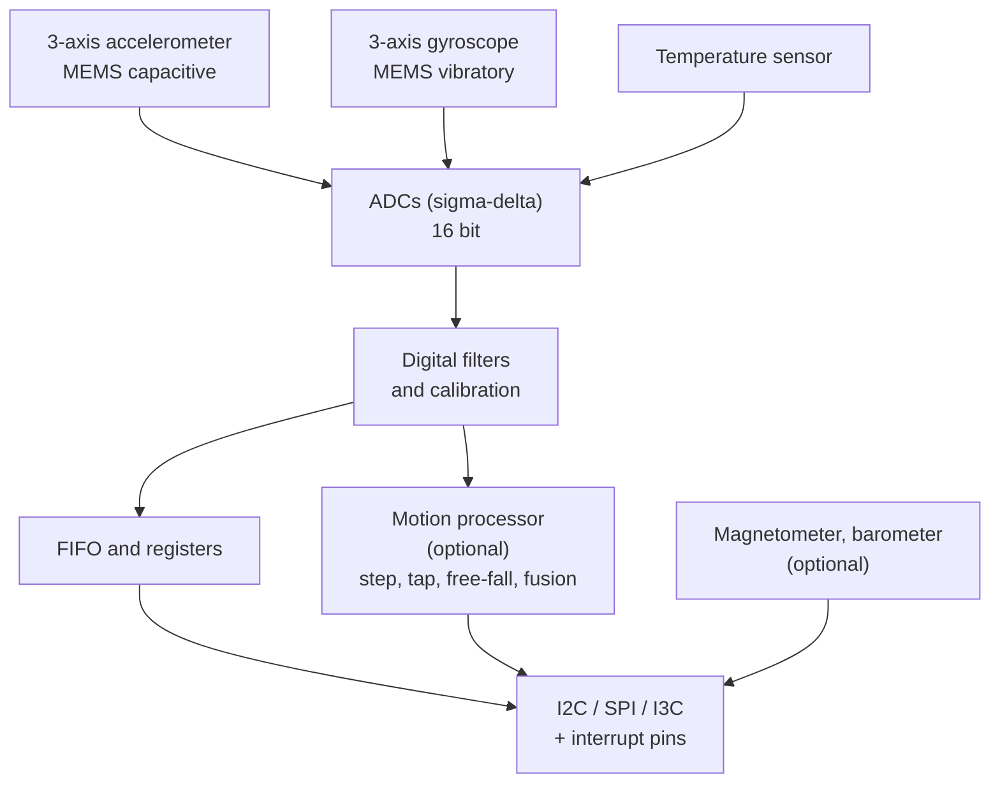

::: testing
Whether you can define an IMU and then **evaluate one like an engineer**. The definition is quick (accelerometer plus gyro, often magnetometer, in one package). The real test is the trade-offs: noise vs bandwidth vs power, range vs resolution, bias stability vs cost, sample rate vs bus bandwidth, integrated sensor fusion vs raw data, mechanical mounting and calibration. Naming Allan variance, angle random walk and bias instability marks a candidate who has read gyro datasheets seriously.
:::

::: why
Choosing an IMU is a classic hardware task: the datasheet lists dozens of numbers, grades span four orders of magnitude in cost, and the wrong pick shows up months later as a drone that drifts or a wearable that kills its battery. Understanding what each parameter means for the *application* is how you avoid over-specifying (paying for a tactical-grade part in a toy) or under-specifying (no attitude hold after 30 seconds). It also connects the physics ([[q0846]]) and the system view of fusion ([[q0845]]) and drift ([[q0849]]).
:::

::: concepts
- **Axes and degrees of freedom**: 3-axis accelerometer + 3-axis gyro = 6-DoF; plus magnetometer = 9-DoF; plus barometer = 10-DoF. See [[q0846]].
- **Noise density and bandwidth**: noise grows as $\sqrt{BW}$; angle random walk. See [[q0848]].
- **Bias, bias instability, temperature drift**: set long-term drift. See [[q0849]].
- **Range, resolution, ODR**: the digital interface and filter settings.
- **Buses**: I2C vs SPI throughput. See [[q0738]].
- **Calibration**: scale factor, misalignment, temperature. See [[q0871]].
- **Fusion**: on-chip vs host-side. See [[q0845]].
:::

::: answer
"An inertial measurement unit is a package that combines motion sensors so you can track how something moves and how it is oriented. The usual minimum is a three-axis accelerometer and a three-axis gyroscope, which is a six-axis IMU. Many add a three-axis magnetometer for heading, making nine axes, sometimes a barometer, and increasingly a small processor that does fusion or gesture detection on-chip.

The trade-offs are what matter when choosing one. First, noise versus bandwidth versus power: a lower noise density and higher output rate give better tracking but cost milliamps, which matters in a wearable. Second, drift: gyro bias instability and temperature drift decide how long you can free-run, and that spans from tens of degrees per hour for consumer MEMS to a thousandth of a degree per hour for navigation-grade fibre-optic gyros, at a price difference of 10,000 times or more. Third, range versus resolution: a bigger full-scale range clips less but gives coarser steps. Fourth, interface and data rate: a six-axis sample at 1 kilohertz over I2C eats a third of the bus, so I might use SPI. Fifth, mechanical and magnetic environment: vibration, mounting stress, temperature, and for the magnetometer, nearby currents and steel.

So the question I ask is: how long must the IMU free-run between corrections, how fast does the motion change, and what is the power and cost budget?"
:::

::: technical
**Definition.** An IMU is a sensor module with a tri-axial accelerometer and tri-axial gyroscope (6-DoF), optionally a magnetometer (9-DoF), and sometimes a barometer (10-DoF), aligned on common axes and sampled together. An AHRS adds on-board attitude fusion; an INS adds position and velocity navigation.

**Key specifications.**

| Parameter | Meaning | Why it matters |
|---|---|---|
| Range (g, °/s) | full-scale input | clipping vs LSB size |
| Noise density (µg/√Hz, °/s/√Hz) | white noise floor | tilt jitter, ARW |
| Bias instability (°/h, µg) | slow bias wander at best averaging time | free-run time |
| Zero-g / zero-rate offset | initial bias | calibration need |
| Temperature coefficient | bias and scale change per °C | warm-up, drift |
| Scale factor error, cross-axis | gain and misalignment | accuracy in manoeuvres |
| Bandwidth, ODR, filter | frequency response and sample rate | latency, aliasing |
| Current | active and low-power modes | battery life |
| g-sensitivity (gyro), vibration rectification | acceleration/vibration effects | drones, vehicles |
| Interface | I2C/SPI/I3C, FIFO, interrupts | CPU load, sync |

**Allan variance.** The Allan deviation $\sigma_A(\tau)$ plot separates noise sources: slope $-\tfrac12$ is angle random walk (ARW), flat bottom is bias instability $B$ ($\sigma_{min}\approx0.664B$), slope $+\tfrac12$ is rate random walk. The model $\sigma_A^2=\frac{N^2}{\tau}+(0.664B)^2+\frac{K^2\tau}{3}$ explains the curve.

**Grades (indicative).**

| Class | Gyro bias instability | ARW | Typical use | Cost order |
|---|---|---|---|---|
| Consumer MEMS | tens to hundreds of °/h | 0.1 to 1 °/√h | phones, wearables | USD 0.5 to 5 |
| Industrial MEMS | about 1 to 10 °/h | 0.05 to 0.2 °/√h | drones, robots, vehicles | USD 10 to 300 |
| Tactical (MEMS/FOG) | about 0.1 to 10 °/h | 0.01 to 0.1 °/√h | guided systems | USD 1k to 20k |
| Navigation (RLG/FOG) | below 0.01 °/h | below 0.003 °/√h | aircraft, ships | USD 50k+ |

> [!UNCERTAIN]
> Grade boundaries and prices overlap and vary by source and by year; treat them as order-of-magnitude, not specifications.

**Bus example.** A 6-axis, 16-bit sample is 12 bytes. At 400 kHz I2C each byte takes 9 clocks (22.5 µs), so a burst read of 12 bytes with address overhead takes about 360 µs, i.e. 36 % of the bus at 1 kHz. SPI at 10 MHz needs about 10 µs. Use the FIFO and a data-ready interrupt to batch reads.
:::

::: short
"An IMU packages a three-axis accelerometer and gyroscope, often plus a magnetometer and barometer, to measure motion and orientation. The trade-offs: noise versus bandwidth versus power, bias stability which sets how long you can free-run, range versus resolution, bus bandwidth for the output rate, and the vibration, temperature and magnetic environment. Consumer MEMS gyros drift tens of degrees per hour or more, navigation-grade ones thousands of times less, at orders of magnitude more cost."
:::

::: long
"An IMU is a module that combines inertial sensors: a three-axis accelerometer and a three-axis gyroscope make a six-axis IMU, adding a three-axis magnetometer makes nine axes, and some include a barometer or an on-chip processor for fusion and gesture features. They are aligned on common axes and sampled together, which is important for fusion.

For trade-offs, I would walk through the datasheet. Noise density and bandwidth: noise scales with the square root of bandwidth, so for a gyro at 0.01 degrees per second per root hertz and 50 hertz bandwidth you get 0.07 degrees per second rms. A lower noise density is better but often costs more current. Bias and drift: the gyro bias instability, read off an Allan deviation plot, sets how long you can free-run. A consumer MEMS part might be tens of degrees per hour or worse, an industrial part single digits, a navigation-grade fibre-optic gyro below 0.01. That is a factor of thousands in drift and tens of thousands in price. Range versus resolution: for a 16-bit part, plus or minus 2000 degrees per second gives 0.06 degrees per second per count, plus or minus 250 gives 0.008, so I choose the smallest range that does not clip. Bandwidth and rate: higher rates reduce latency but use power and bus time. A six-axis 16-bit sample is 12 bytes, which at 1 kilohertz is about a third of a 400 kilohertz I2C bus, so for fast rates I go to SPI and use the FIFO and a data-ready interrupt. Environment: vibration can saturate or alias; temperature shifts bias; mounting stress shifts offset; and the magnetometer is disturbed by nearby currents and steel.

Then there is fusion and calibration. Some IMUs offer an on-chip motion processor, which saves host power but gives less control. Either way I would plan on calibrating bias, scale and alignment, over temperature if accuracy matters.

So I choose by asking how long the IMU must free-run, how dynamic the motion is, and the power and cost budget."
:::

::: terms
- **IMU**: inertial measurement unit: accelerometer + gyro (+ magnetometer, barometer).
- **6-DoF / 9-DoF**: number of measured degrees of freedom (axes).
- **ARW (angle random walk)**: gyro white-noise integrated into angle, in °/√h.
- **Bias instability**: minimum of the Allan deviation, sets long-term drift in °/h.
- **Allan variance**: statistical tool separating noise types by averaging time.
- **ODR / FIFO**: output data rate; on-chip buffer of samples.
- **Scale factor / cross-axis error**: gain error and axis misalignment.
- **AHRS / INS**: attitude and heading reference system / inertial navigation system.
:::

::: exceptional
**An average answer**: "An IMU has an accelerometer and gyroscope; trade-offs are cost, size and accuracy."

**An exceptional answer**:
- Defines 6/9/10-DoF and mentions **common axes and synchronised sampling**.
- Quantifies **noise density to rms**, gives **resolution per LSB** vs range, and the **bus load** of a given ODR.
- Explains **Allan deviation**: ARW, bias instability and what they imply for free-run time.
- Gives **grade classes** with rough drift and cost, flagged as indicative.
- Covers **system-level factors**: vibration, mounting, temperature, magnetometer disturbance, calibration, on-chip vs host fusion, and frames the choice as an application question.
:::

::: mistakes
- **Choosing by accelerometer or gyro range alone**. Noise density, bias instability and temperature drift are what determine performance.
- **Maxing the ODR and bandwidth**. More bandwidth means more noise (√BW) and more power; match to the signal.
- **Ignoring bus bandwidth and CPU load**. Polling a 1 kHz six-axis IMU over I2C in software wastes time; use FIFO and interrupts.
- **Placing the magnetometer next to power traces or motors**. Currents create fields that shift heading by tens of degrees.
- **Expecting a consumer IMU to be a position sensor**. See [[q0849]]; drift is quadratic.
:::

::: deep
## What is inside


Figure: A modern IMU is a small system: two MEMS sensors, ADCs, digital filtering, calibration constants, buffering and sometimes a processor, all behind a serial bus and interrupt lines. Features like free-fall detection run on-chip so the host can sleep.

## Noise, bandwidth and resolution

White noise density $N$ turns into rms noise $\sigma=N\sqrt{BW}$. For $N=0.01$ °/s/√Hz and a 50 Hz bandwidth, $\sigma=0.071$ °/s; raising the bandwidth to 400 Hz gives 0.2 °/s. For the accelerometer at 150 µg/√Hz and 50 Hz, $\sigma=1.06$ mg, tilt noise $0.061°$.

Resolution is a function of range for a fixed 16-bit word:

| Gyro range | LSB size | LSB per °/s | Accelerometer range | LSB size |
|---|---|---|---|---|
| ±125 °/s | 3.8 m°/s | 262 | ±2 g | 61 µg |
| ±250 °/s | 7.6 m°/s | 131 | ±4 g | 122 µg |
| ±1000 °/s | 30.5 m°/s | 32.8 | ±8 g | 244 µg |
| ±2000 °/s | 61 m°/s | 16.4 | ±16 g | 488 µg |

Quantisation is usually below the noise (61 m°/s LSB vs 70 m°/s rms noise at 50 Hz is comparable, though), so range matters mostly for clipping vs. dynamic range. In dynamic applications (drone flips, sports) a ±250 °/s gyro clips and the filter loses track; in slow, precise applications a ±2000 °/s range throws away resolution.

## Drift: the Allan deviation

Gyro error sources have distinct signatures vs averaging time $\tau$. Plot $\sigma_A(\tau)$ on log-log axes:

```plot
{"title":"Allan deviation of an illustrative consumer MEMS gyro (N = 0.01 °/s/√Hz, B = 10 °/h)","x":{"label":"Averaging time τ","unit":"s","min":0.1,"max":10000,"log":true},"y":{"label":"Allan deviation (°/h)","min":1,"max":200,"log":true},
 "vars":{"n":0.01,"b":"10/3600","k":1e-4},
 "series":[{"label":"total","fn":"3600*sqrt(n*n/x+pow(0.6648*b,2)+k*k*x/3)","color":"accent"},{"label":"ARW term (slope -1/2)","fn":"3600*n/sqrt(x)","dashed":true,"color":"blue"},{"label":"bias instability floor","fn":"3600*0.6648*b+0*x","dashed":true,"color":"green"},{"label":"rate random walk (slope +1/2)","fn":"3600*k*sqrt(x/3)","dashed":true,"color":"red"}]}
```
Figure: The Allan deviation falls with averaging time while white noise (blue, slope -1/2) dominates, reaches a flat floor at the bias instability (green, about 6.7 °/h for B = 10 °/h), then climbs when rate random walk (red, slope +1/2) takes over. The bottom (here about 8 °/h near 100 to 300 s) is the best-case drift you can hope to average down to: the 'best' time to recalibrate.

How to read it: for averaging times near the minimum, the gyro bias can be estimated to about the bias instability; beyond that point you cannot calibrate more accurately because the bias itself wanders. ARW of 0.01 °/√s equals 0.6 °/√h: after 1 hour of perfect-bias integration the angle uncertainty from noise alone would be 0.6°.

## Choosing the grade

The free-run requirement determines the grade. Suppose the allowed heading error is 1° over 60 s:

- Needed bias after calibration: $b<1°/60\,\text{s}=0.0167$ °/s $=60$ °/h. A consumer part, after startup calibration, can do this.
- Over 10 minutes with the same 1° budget: $b<6$ °/h; industrial MEMS or better needed.
- Over 1 hour: $b<1$ °/h; tactical grade.
- Over 10 hours (an aircraft or ship): $b<0.1$ °/h, and Earth's rotation (15.04 °/h) must be modelled; navigation grade.

> [!TIP]
> In an interview, tie the grade to a free-run time using the simple arithmetic $\text{drift}=b\cdot t$, as above. It shows you know why the spec matters.

## Interface and system trade-offs

**Bus bandwidth.** A 6-axis, 16-bit sample is 12 bytes. With I2C at 400 kHz, each byte costs 9 clock cycles (22.5 µs); a burst read with address bytes takes about 360 µs. At 1 kHz that is 36 % of the bus time. At 8 kHz gyro rates (typical for drone flight controllers) I2C cannot keep up; SPI at 10 MHz needs about 10 µs per sample. FIFO plus data-ready interrupts let the MCU read blocks without per-sample latency jitter. See [[q0738]].

**Synchronisation.** For fusion with camera, GPS or other sensors, use hardware timestamp (a sync pin or timestamp-capable FIFO). A 5 ms timing error at 200 °/s rotation is 1°.

**Power.** Typical IMUs draw a few hundred µA to a few mA in full-performance mode (vendor dependent), and a few µA to tens of µA in low-power or motion-wake modes. At 3.3 V and 3 mA that is 10 mW, which matters in a watch (a 300 mAh battery at 3.7 V is about 1.1 Wh, so a continuously running 10 mW IMU takes about 110 hours of runtime on its own). So wearables use motion-wake and on-chip step counting.

**Fusion on-chip vs on-host.** Hardware fusion saves host cycles and power and gives low latency but is a black box with fixed tuning; host-side fusion (Mahony, Madgwick, EKF) is flexible, can use the application's own aiding sensors and is debuggable.

## Environment and mounting

- **Vibration**: vibration near or above the digital filter corner aliases to DC and corrupts both accelerometer and gyro (g-sensitivity). Remedies: soft mounts, lower ODR with an internal low-pass, notch filters at motor frequency.
- **Mounting stress**: reflow, PCB flex and screws shift offset; avoid mounting near board edges, screws or connectors, and recalibrate after assembly.
- **Temperature**: bias moves with temperature, and board self-heating causes warm-up drift. Place the IMU away from regulators and processors; use the on-chip temperature sensor for compensation.
- **Magnetometer**: needs hard-iron and soft-iron calibration, and distance from currents (a wire carrying 1 A produces about 2 µT at 10 cm, compared with a horizontal Earth field of 15 to 30 µT in many places). A disturbance of 5 µT on a 20 µT horizontal field is up to 14° of heading error.
- **Placement**: near the centre of mass to minimise lever-arm effects ($\Omega^2r$ centripetal terms).

## Experiment

```sim
{"id":"imu-lab","view":"drift","bias":0.02}
```
Figure: Increase the bias and see how rapidly position and angle drift grow; this is what the grade of the IMU buys you. Then switch to the fusion view and note that fusion fixes tilt but cannot give position.

## Worked example: specifying an IMU for a handheld gimbal

Requirements: keep a camera level within 0.5°, motion up to 300 °/s, control loop at 1 kHz, battery powered, cost under USD 5.

1. **Range**: peak 300 °/s: choose ±500 or ±1000 °/s (not ±250). LSB for ±1000 °/s: 30.5 m°/s.
2. **Noise**: 0.5° tilt budget; an accelerometer noise of 150 µg/√Hz at a 50 Hz bandwidth gives 0.061°, so fine. Gyro noise at 0.01 °/s/√Hz and 200 Hz: 0.14 °/s rms; with a 1 kHz loop this averages in the control filter.
3. **Drift**: complementary filter with $\tau=1$ s and a calibrated bias of 0.1 °/s gives a steady error 0.1° — within budget; consumer grade works.
4. **Bus**: 1 kHz 6-axis over SPI at 10 MHz: 10 µs per read; or I2C at 1 MHz with FIFO.
5. **Power**: 3 mA at 3.3 V is 10 mW against a gimbal motor drawing watts: negligible.

The result: a consumer 6-axis MEMS IMU; money is better spent on mounting, calibration and a good filter than on a higher-grade sensor.

## Real hardware behaviour

- **Calibration**: tumble tests give scale and bias; thermal chamber tests give temperature curves. Cheap IMUs often ship with factory trim for offset only.
- **Startup**: gyros need tens of ms to reach stable drive amplitude; ignore the first samples, then average a stationary period for bias.
- **Aging and reflow**: offsets shift after reflow; re-trim after the final assembly step.
- **Self-test**: IMUs include self-test registers (electrostatic actuation) to check functionality on the production line.
:::

::: applications
- **Smartphones and wearables**: low-power consumer 6/9-axis IMUs with on-chip step and gesture engines.
- **Drone flight controllers**: low-noise 6-axis IMUs at up to 8 kHz gyro rates over SPI, usually vibration-isolated.
- **Automotive**: industrial MEMS IMUs in ADAS and GPS/INS dead reckoning modules.
- **Robotics (AMR, humanoids)**: IMU plus encoders plus LiDAR/vision for state estimation.
- **VR/AR headsets**: high-rate IMUs fused with cameras for low-latency head tracking.
- **Aviation and marine**: navigation-grade FOG/RLG-based INS for long-duration unaided navigation.
:::

::: assumptions
- Grade boundaries, ARW and bias instability numbers are indicative; vendors' definitions, test conditions and temperature ranges vary. Always read the datasheet's measurement conditions.
- The Allan model $\sigma^2=N^2/\tau+(0.664B)^2+K^2\tau/3$ is the standard simplified form; real curves also include quantisation and correlated noise.
- The magnetic disturbance example uses the field of a long straight wire, $\mu_0I/(2\pi r)$, at 10 cm and 1 A.
- Power numbers are typical ranges; many IMUs support much lower modes with reduced performance.
:::

::: followups
### What is the difference between a 6-axis, 9-axis and 10-axis IMU?
Six-axis: 3-axis accelerometer and 3-axis gyroscope. Nine-axis adds a 3-axis magnetometer for absolute heading. Ten-axis adds a barometer for altitude. More axes give more observability (yaw reference, altitude) but add disturbances (magnetic interference) and power.

### How would you read bias instability off a datasheet or measurement?
Record several hours of gyro data while stationary at a stable temperature, compute the Allan deviation, and read the flat minimum; bias instability is that minimum divided by about 0.664. ARW comes from the −½ slope region: $N$ is the Allan deviation at $\tau=1$ s.

### Why might a higher ODR make your attitude estimate worse?
Because noise bandwidth grows. If the digital filter bandwidth follows ODR, rms noise rises as $\sqrt{BW}$, and a loop that does not need the extra bandwidth just integrates more noise. It also stresses the bus. Use the lowest ODR and bandwidth that satisfy the dynamics, with a margin for aliasing.

### What would make you choose an IMU with an on-chip fusion engine?
Tight power budgets (always-on orientation or gesture detection), simple host processors, and applications that accept a fixed algorithm, like phone rotation or step counting. I'd choose raw data and host-side fusion when I need control over tuning, multi-sensor aiding, or traceability.

### Scenario: your drone's attitude estimate gets noisy only when motors spin up. What do you try?
Look at the raw gyro and accelerometer spectra at different throttle levels: a motor-frequency peak means vibration. Check whether it aliases (the peak moves with throttle in a way inconsistent with the motor frequency). Fix with soft mounting or foam, balanced props, a notch filter at the motor frequency, raising the IMU's internal filter, and ensuring the accelerometer range does not clip.
:::

::: interpretations
"Tradeoffs" could mean choosing between sensor classes (consumer vs navigation grade) or between design choices in one part (bandwidth vs noise). I cover both. For the general accelerometer/gyro comparison see [[q0848]]; for integration drift [[q0849]]; for calibration and validation methods [[q0871]].
:::

::: references
- IEEE Std 647, *IEEE Standard Specification Format Guide and Test Procedure for Single-Axis Laser Gyros* and IEEE Std 952 for fibre-optic gyros: definitions of ARW and bias instability (also used in MEMS datasheets).
- Woodman, "An Introduction to Inertial Navigation", University of Cambridge Technical Report UCAM-CL-TR-696 (2007): error sources and Allan variance.
- Groves, *Principles of GNSS, Inertial, and Multisensor Integrated Navigation Systems*: IMU grades and error models.
- Manufacturer MEMS IMU datasheets (parameter definitions: noise density, zero-rate offset, bias instability).
:::

::: rubric
- Defines IMU: accel + gyro (+ mag, baro), common axes :: The basic definition and DoF counts.
- Discusses noise density vs bandwidth and quantifies rms :: Core datasheet reasoning.
- Explains bias instability / ARW and links to free-run time :: What differentiates grades.
- Mentions range vs resolution :: Standard selection trade-off.
- Considers interface and ODR (I2C vs SPI, FIFO, interrupts) :: Hardware integration awareness.
- Notes power and on-chip vs host fusion :: System-level thinking.
- Notes environment: vibration, mounting, temperature, magnetic :: Real-world failure sources.
:::

::: quiz
```json
[
 {"type":"mcq","level":"fundamental","q":"A 9-axis IMU typically consists of:","options":["Three accelerometers, three gyroscopes, three barometers","3-axis accelerometer, 3-axis gyroscope and 3-axis magnetometer","Nine accelerometers","Three gyroscopes, three magnetometers and three thermometers"],"answer":1,"explain":"6-DoF is accelerometer plus gyro; the magnetometer adds three more axes for heading."},
 {"type":"numeric","level":"intermediate","q":"A gyro has noise density 0.01 °/s/√Hz and is read with a 50 Hz bandwidth. What is the rms noise in °/s?","answer":0.0707,"tolerance":0.02,"unit":"°/s","explain":"$\\sigma=N\\sqrt{BW}=0.01\\cdot\\sqrt{50}=0.0707$ °/s."},
 {"type":"numeric","level":"intermediate","q":"A 6-axis 16-bit IMU sample (12 bytes) is read by burst over I2C at 400 kHz (9 clocks per byte, ignore address overhead). How long does the data transfer take in µs?","answer":270,"tolerance":0.02,"unit":"µs","explain":"12 bytes × 9 clocks = 108 clocks; at 400 kHz each clock is 2.5 µs, so 270 µs. With address overhead it is closer to 360 µs, a third of the bus at 1 kHz."},
 {"type":"numeric","level":"intermediate","q":"You need heading error below 1° over 10 minutes. What maximum residual gyro bias is acceptable, in °/h?","answer":6,"tolerance":0.02,"unit":"°/h","explain":"Drift = b·t, so b = 1° / (10/60 h) = 6 °/h."},
 {"type":"mcq","level":"advanced","q":"On an Allan deviation plot of a gyro, which feature gives the bias instability?","options":["The slope of -1/2 region at short τ","The flat minimum of the curve","The +1/2 slope region at long τ","The value at τ = 0.01 s"],"answer":1,"explain":"The flat floor (minimum) corresponds to bias instability, with $\\sigma_{min}\\approx0.664B$. The −½ slope region gives angle random walk, and the +½ slope region gives rate random walk."}
]
```
:::
