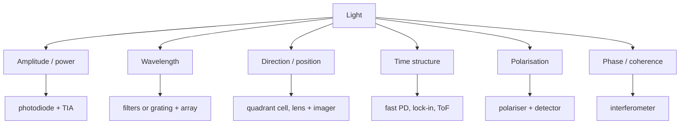

::: testing
Whether you can break "light" into its **measurable properties** and pair each with a **detection method**, instead of repeating "photodiode" for everything. The properties are intensity, wavelength (colour), direction or position, timing and modulation, polarisation, and phase or coherence. For each, the interviewer wants the physical trick (filters for colour, a quadrant cell for position, a polariser for polarisation, lock-in for modulated light, time of flight for distance) and one number. It also checks whether you know the limits: what silicon cannot see, how ambient light interferes, and why you modulate.
:::

::: why
Real optical systems rarely measure just "brightness". A proximity sensor needs modulated intensity with ambient rejection, a colour sensor needs spectral information, a laser alignment system needs beam position, a LiDAR needs timing, a 3D-glasses or glare-reduction system needs polarisation. Choosing the property to measure, and designing the detector around it, is the core of optical sensor design. It also shows up in debugging: if your light sensor works indoors and fails outdoors, you have probably ignored the spectrum or ambient light.
:::

::: concepts
- **Intensity (power)**: how much light arrives. See [[q0851]].
- **Wavelength / spectrum**: colour, photon energy $E=hc/\lambda$; silicon sees about 0.4 to 1.1 µm.
- **Direction and position**: where the light comes from or where a beam lands.
- **Time and modulation**: pulses, frequency, flicker, time of flight. See [[q0865]].
- **Polarisation**: orientation of the electric field; Malus's law.
- **Phase / coherence**: interferometry; usually beyond basic sensor interviews, but worth naming.
- **Noise and ambient rejection**: modulation and synchronous detection.
:::

::: answer
"I think of light as having a handful of measurable properties, and for each there is a different detection trick.

Intensity, how much light, is the simplest: a photodiode with a transimpedance amplifier gives a voltage proportional to optical power. Wavelength or colour is detected either with filters, like the red, green and blue filters on a colour sensor or an image sensor's Bayer pattern, or with a grating or prism and an array of detectors in a spectrometer. Direction or position of a beam is found with a quadrant photodiode: four cells, and the difference between halves divided by the sum tells me how far off-centre the spot is. Timing and modulation, such as a pulsed LED or a remote control, I handle with a fast photodiode and filters, and for ambient light rejection I modulate the source at a known frequency and use synchronous demodulation. Time of flight, for distance, uses the delay between emitted and received pulses, about 6.7 nanoseconds of round trip per metre of range. Polarisation I detect by putting a polariser in front of the detector and rotating it: the signal follows Malus's law, cosine squared of the angle.

Practically, what I check is that the detector's spectral response covers the wavelength of interest, and whether ambient light will swamp my signal."
:::

::: technical
**Property to detector map.**

| Property | How detected | Governing relation | Example |
|---|---|---|---|
| Intensity | photodiode + TIA, image sensor | $I_{ph}=\mathcal R P$ | light meter |
| Wavelength | filters (RGB), grating/prism + array, dichroic | $d\sin\theta=m\lambda$ | colour sensor, spectrometer |
| Position / direction | quadrant cell, position-sensitive detector, lens + image sensor, multiple photodiodes | $\dfrac{(A+C)-(B+D)}{A+B+C+D}$ | laser alignment, sun sensor |
| Timing / modulation | fast photodiode, synchronous demodulation | bandwidth $\gg$ pulse rate | IR remote, optical comms |
| Distance | time of flight, phase shift, triangulation | $d=ct/2$ | LiDAR, proximity |
| Polarisation | rotating polariser or polarising filter array | $I=I_0\cos^2\theta$ | glare reduction, stress analysis |
| Phase / coherence | interferometer | fringes $\Delta\phi=2\pi\Delta L/\lambda$ | precision metrology |

**Spectral limits.** Photon energy $E=1.24/\lambda[\mu m]$ eV. Silicon: 0.4 to 1.1 µm (peak near 0.9 µm). InGaAs: about 0.9 to 1.7 µm. Germanium: up to about 1.8 µm. Beyond that, thermal detectors (thermopile, pyroelectric, microbolometer).

**Grating.** For a 600 lines/mm grating ($d=1.67$ µm), first-order diffraction angles: 400 nm gives 13.9°, 500 nm gives 17.5°, 700 nm gives 24.8°. A linear detector array reads out the spectrum.

**Quadrant cell.** For a Gaussian spot with 1/e² radius $w$ shifted by $x$ the normalised difference is $\operatorname{erf}(\sqrt2x/w)$; for small $x$ it is linear with slope $1.6/w$. With $w=1$ mm, a 0.1 mm shift gives 16 % output.

**Polarisation.** Malus: $I=I_0\cos^2\theta$. At 30°: 75 %; 45°: 50 %; 90°: 0. Surprise: insert a 45° polariser between two crossed ones and 12.5 % of the original (if unpolarised: 0.5 × 0.5 × 0.5) is transmitted.

**Modulation.** Modulate the source at $f_m$ and demodulate synchronously: detection bandwidth drops from the full noise bandwidth (e.g. 10 kHz) to 1 Hz, improving amplitude SNR by $\sqrt{10^4/1}=100$ (40 dB) for white noise, and DC ambient light and 100/120 Hz lighting flicker are rejected if $f_m$ is chosen away from them.
:::

::: short
"Light has several measurable properties and each has its own detector. Intensity uses a photodiode and transimpedance amplifier. Wavelength uses filters, as in colour sensors, or a grating and detector array in a spectrometer. Position uses a quadrant photodiode with difference over sum. Timing and distance use fast detectors and time of flight. Polarisation uses a rotating polariser and Malus's law. To reject ambient light I modulate the source and detect synchronously, and I always check the detector's spectral response."
:::

::: long
"I split light into properties: how much, what colour, where, when, and which polarisation. For each there is a detection method.

How much: that is intensity or optical power. A photodiode makes a current proportional to power, about half an amp per watt in the near infrared, and a transimpedance amplifier turns that into voltage.

What colour: the wavelength or spectrum. For coarse colour I put filters over photodiodes, for example red, green and blue, like a colour sensor or the Bayer pattern on a camera. For a spectrum I use a diffraction grating or prism and a linear detector array. With a 600 lines per millimetre grating, 500 nanometres leaves the first order at about 17 degrees and 700 at about 25.

Where: for the position of a spot, a quadrant photodiode has four cells, and the differences between halves divided by the total give the offset, linear for small displacement. For direction to a source, several photodiodes with different orientations, or a lens and image sensor.

When: for timing and modulation, I need a detector with enough bandwidth, and for distance I use the time of flight, d equals c t over two, which is 6.7 nanoseconds of round trip per metre. Because ambient light and 100 hertz flicker are much bigger than my signal, I modulate my own source and use synchronous detection, which shrinks the noise bandwidth, and by a factor of 10 thousand in bandwidth you get a factor of 100 in amplitude noise.

Polarisation: put a rotating polariser in front, and the signal follows cosine squared of the angle, Malus's law.

And always check the spectral response: silicon cannot see beyond about 1.1 micrometres, so for 1550 nanometre fibre I use InGaAs."
:::

::: terms
- **Wavelength / photon energy**: $E=hc/\lambda$.
- **Spectral response**: responsivity vs wavelength of a detector.
- **Bayer filter**: mosaic of red, green and blue filters over an image sensor.
- **Diffraction grating**: periodic structure sending each wavelength to a different angle.
- **Quadrant photodiode**: four-cell detector giving the position of a beam.
- **Malus's law**: $I=I_0\cos^2\theta$ through a polariser.
- **Lock-in / synchronous detection**: demodulating at the source's modulation frequency to reject noise.
- **Time of flight**: distance from the round-trip travel time of a light pulse.
:::

::: exceptional
**An average answer**: "Intensity and colour; use a photodiode and a colour sensor."

**An exceptional answer**:
- Lists **six properties** (intensity, wavelength, position/direction, time/modulation, polarisation, phase) and maps each to a detector.
- Gives the **governing relation and one number** for several (grating angles, quadrant slope, Malus, $d=ct/2$).
- Explains **ambient rejection by modulation**, with the √bandwidth SNR gain.
- Notes the **spectral limits** of the detector (Si 1.1 µm, InGaAs for 1550 nm) and the cheap fix of optical filters.
- Mentions **practical issues**: flicker at 100/120 Hz, saturation, crosstalk between channels, angle dependence of filters.
:::

::: mistakes
- **Using one broadband photodiode for colour**. It has no wavelength information; add filters or a spectrometer.
- **Forgetting the IR response of silicon**. Without an IR-cut filter, a "visible" sensor reads sunlight, tungsten and IR LEDs too.
- **Assuming linearity at any intensity**. A photodiode is linear only until the amplifier saturates; image sensors saturate at full well.
- **Ignoring flicker and ambient light**. Indoor LED lighting flickers at 100 to 120 Hz or more; an unmodulated optical sensor reads it as noise.
- **Treating polarisation as intensity**. A polariser changes the signal with angle; a detector with unknown polarisation of reflected light may drift as the object rotates.
:::

::: deep
## Six properties, one framework

Light is an electromagnetic wave with an amplitude, a frequency, a direction, a polarisation and a phase. Every sensor measures one or more of them, and the way to organise the design is to ask: *which of these carries the information I need?*


Figure: Pick the property first, then the detector. Most real sensors combine two: a proximity sensor uses amplitude *and* modulation, a colour sensor uses amplitude *and* wavelength, a LiDAR uses time *and* direction.

## 1. Amplitude: power on the detector

The detector gives $I_{ph}=\mathcal R\,P$. The only subtle part is the optical path: lens collection area, field of view (cosine law for off-axis light), filters and windows. For a flat photodiode of area $A$, the received power from a small Lambertian emitter at distance $r$ falls as $1/r^2$ and as $\cos\theta$ off-axis. With an IR LED of 20 mW/sr radiant intensity at 10 cm onto a 5 mm² diode: irradiance $=20\text{ mW/sr}/(0.1\text{ m})^2=2$ W/m², so the power is $2\times5\times10^{-6}=10$ µW, and at $\mathcal R=0.5$ A/W the current is 5 µA.

## 2. Wavelength: colour and spectra

**Filters.** Three photodiodes with red, green and blue filters give three numbers $R,G,B$; ratios identify colour and correlated colour temperature (a warmer lamp has more red relative to blue). Dielectric (interference) filters shift with angle of incidence, so a wide-field sensor needs diffusers.

**Grating spectrometer.** The grating equation $d\sin\theta=m\lambda$, with $d=1/(600\text{ mm}^{-1})=1.667$ µm, gives first-order angles:

| $\lambda$ | $\theta$ |
|---|---|
| 400 nm | 13.9° |
| 500 nm | 17.5° |
| 600 nm | 21.1° |
| 700 nm | 24.8° |

Spectral resolution depends on slit width and detector pixel pitch. A linear CMOS array behind the grating reads the whole spectrum in one exposure. Pulse oximeters use two wavelengths (about 660 nm red and 940 nm infrared) rather than a full spectrum: oxygenated and deoxygenated haemoglobin absorb them differently.

## 3. Position and direction

A quadrant photodiode has cells A, B, C, D around a centre. For a spot with centroid offset in $x$, the normalised signal is

$$S_x=\frac{(A+D)-(B+C)}{A+B+C+D}$$

(with A, D on one side). Dividing by the sum makes it independent of the total power, so laser power fluctuations do not appear as position error. For a Gaussian beam of radius $w$ the response is $\operatorname{erf}(\sqrt2x/w)$: linear within about ±0.3$w$ and saturating (±1) beyond about $w$. Used in atomic-force microscopes, laser levels and alignment.

```plot
{"title":"Quadrant-cell response to a shifted Gaussian spot (w = 1 mm)","x":{"label":"Spot offset x","unit":"m","min":-0.002,"max":0.002},"y":{"label":"(Right − Left)/(Right + Left)","min":-1.1,"max":1.1},
 "vars":{"w":0.001},
 "series":[{"label":"erf response","fn":"tanh(1.128*sqrt(2)*x/w)","color":"accent"},{"label":"linear approximation (slope 1.6/w)","fn":"clamp(1.596*x/w,-1,1)","dashed":true,"color":"muted"}]}
```
Figure: The quadrant cell is linear near the centre and saturates when the spot moves off. The normalisation by the total makes the output independent of laser power. (The solid curve is a tanh approximation of the error function, within a few percent.)

For direction to a distant source (sun sensors), a lens maps angle to position on the detector, or masks with apertures generate different photocurrents depending on angle.

## 4. Time structure and modulation

**Pulses**: an IR remote sends bursts at 38 kHz carrier; the receiver has a band-pass at 38 kHz and a demodulator, rejecting sunlight and lamps.

**Flicker**: mains-powered lights flicker at 100 or 120 Hz (twice mains) and PWM-dimmed LEDs at hundreds of Hz to kHz. For brightness, integrate over an integer number of flicker periods (e.g. 10 ms or 8.3 ms multiples); to detect flicker, sample faster than twice the flicker frequency.

**Synchronous detection.** To measure a small source in strong ambient light: modulate the source with a square wave at $f_m$ (say 1 kHz), AC-couple the detector, multiply by the same reference and low-pass. The result is proportional to the source amplitude and rejects everything not at $f_m$. If the signal-plus-noise bandwidth is 10 kHz and the demodulated bandwidth 1 Hz, white noise drops by $\sqrt{10^4}=100$.

A simpler alternative is **LED on / LED off subtraction**: sample with the LED on, then off, subtract. It cancels DC and slowly varying ambient but not fast flicker.

**Time of flight.** $d=ct/2$: 6.67 ns of round trip per metre of range; with 1 ns timing resolution, 15 cm. See [[q0865]].

## 5. Polarisation

Linear polarisers transmit $I=I_0\cos^2\theta$ of linearly polarised light. Applications: glare suppression on road and water surfaces (reflected light is partly polarised), LCD displays, polarimetric imaging (some image sensors have a micro-polariser array at 0°, 45°, 90°, 135° per pixel), stress birefringence analysis and optical isolation. For unpolarised light a polariser passes 50 %. Three-polariser puzzle: crossed polarisers (0° and 90°) pass nothing, but inserting a 45° one between them transmits $0.5\cdot\cos^2 45°\cdot\cos^245°=12.5\%$.

```plot
{"title":"Malus's law: transmission through an analyser","x":{"label":"Angle between polariser and light polarisation","unit":"°","min":0,"max":180},"y":{"label":"I / I0","min":0,"max":1.05},
 "series":[{"label":"cos²θ","fn":"pow(cos(x*pi/180),2)","color":"accent"}],
 "points":[{"x":30,"y":0.75,"label":"30°: 75 %"},{"x":45,"y":0.5,"label":"45°: 50 %"},{"x":90,"y":0,"label":"90°: extinction"}]}
```
Figure: Rotating the analyser sweeps the output from full transmission to zero. Real polarisers have a finite extinction ratio (typically 100:1 to 10,000:1 or better, depending on type), so the minimum is not exactly zero.

## 6. Phase and coherence

Interference converts a path-length difference $\Delta L$ into intensity: $I=I_0(1+\cos(2\pi\Delta L/\lambda))/2$. Detecting a fringe shift of $1/100$ of a period at 633 nm resolves $\Delta L=6.3$ nm. Used in precision displacement sensors, fibre-optic gyros (Sagnac effect) and optical coherence tomography. In an intern interview this is usually just worth naming.

## Worked example: a robust proximity sensor

Requirement: detect a hand at 5 cm in sunlight (up to about 100 klux of ambient).
1. Property: **amplitude of reflected, modulated light**. Source: 940 nm IR LED (sunlight has less photopic weight but plenty of IR, so an optical band-pass filter helps).
2. LED pulsed at, say, 20 kHz, 50 % duty, peak current 100 mA. Receiver: photodiode, TIA with band-pass, synchronous demodulator.
3. Ambient: the sun gives about 1.8 mA of DC on a 5 mm² diode (see [[q0851]]); the AC-coupled path does not saturate if the TIA is designed for that DC (or a DC servo loop removes it).
4. Threshold with hysteresis in firmware; measure LED-off baseline each cycle.

```sim
{"id":"photodiode-lab","lux":500,"rf":1000000}
```
Figure: Increase lux and R_f in the lab to see the TIA clip in bright conditions. That clipping is what an ambient-light-rejecting proximity sensor must design around, using AC coupling or a DC cancellation loop.

## Real hardware behaviour

- **Spectral mismatch**: datasheet responsivity is at a specific wavelength; under a different source the effective responsivity differs (e.g. 0.3 vs 0.55 A/W).
- **Angular response**: filters, lenses and packages make the sensitivity vary with angle (often approximately cosine within ±60°).
- **Crosstalk**: in proximity sensors, light leaking inside the package from the LED to the photodiode forms an offset; barrier and cover design matter.
- **Temperature**: photodiode dark current and LED output both vary with temperature; LED wavelength shifts about 0.2 to 0.3 nm/K (typical IR LED behaviour, device-dependent).
:::

::: applications
- **Colour sensors and display calibration**: RGB (or XYZ-filtered) photodiodes measuring screen colour temperature.
- **Spectrometers**: grating plus array for chemical analysis and agriculture.
- **Laser alignment and AFMs**: quadrant photodiodes for sub-micrometre beam position.
- **IR remote receivers and optical data links**: modulated light detection.
- **LiDAR and proximity sensors**: time of flight and modulated reflectance.
- **Polarimetric cameras and glare filters**: polariser arrays and filters.
:::

::: assumptions
- I treat the common electronics-level properties; for lab optics, other properties (coherence length, orbital angular momentum, spectral line shape) are beyond scope.
- The grating numbers assume normal incidence and the first order; real spectrometers use a fixed geometry with blaze angles.
- Quadrant-cell response assumes a Gaussian spot and identical cells with no gap; real devices have a dead gap that degrades linearity near the centre.
- The proximity LED example's currents and duty cycles are illustrative; eye-safety and component limits apply in real design.
:::

::: followups
### How would you build a simple colour sensor?
Use three photodiodes with red, green and blue filters (or an integrated sensor with filtered diodes), read each with its own TIA or integrating converter, and calibrate with known references. Add an IR-cut filter, since the filters leak IR and silicon is sensitive to it, and use a diffuser so the readings do not depend on source angle.

### Why divide the quadrant-cell difference by the sum?
The difference alone scales with total power, so a brighter laser looks like a larger displacement. The ratio $(A+D-B-C)/(A+B+C+D)$ is independent of total intensity, leaving only position information (for a given beam profile).

### How does lock-in detection improve the SNR?
It narrows the detection bandwidth from, say, 10 kHz to 1 Hz around the modulation frequency. White noise power scales with bandwidth, so noise amplitude falls by $\sqrt{10{,}000}=100$. Signals at other frequencies (ambient DC, 100/120 Hz flicker) are rejected. The remaining limit is 1/f noise and the source's own noise.

### How would you detect the polarisation state of light?
Measure intensity through a polariser at several orientations (0°, 45°, 90°, 135°) and fit Malus's law; those four measurements give the linear Stokes parameters. Image sensors with per-pixel micro-polarisers do this in one shot.

### Scenario: your IR proximity sensor works indoors but false-triggers or saturates outdoors. What do you do?
Sunlight carries a huge DC IR background that saturates the TIA and adds shot noise. Fixes: optical band-pass filter around 940 nm, AC-coupled or DC-cancelled TIA, modulation with synchronous detection, LED on/off subtraction, lower $R_f$ or gain ranging, and higher LED pulse current with shorter duty cycle to improve signal over ambient shot noise.
:::

::: interpretations
The question has two parts: *what properties* and *how detected*. A subtle reading is "how can those properties be detected" as "what circuits", which I include (TIA, synchronous detection, quadrant cell normalisation). Related pages: [[q0851]] (what measuring light means), [[q0853]] (photoresistor vs photodiode), [[q0854]] (applications) and [[q0855]] (combining with other sensors).
:::

::: references
- Horowitz & Hill, *The Art of Electronics*, 3rd ed.: photodetectors, lock-in detection and noise.
- Saleh & Teich, *Fundamentals of Photonics*: photon detectors, polarisation and gratings.
- Hecht, *Optics*: diffraction gratings, polarisation and Malus's law.
- Graeme, *Photodiode Amplifiers: Op Amp Solutions*.
:::

::: rubric
- Identifies multiple properties (intensity, wavelength, position, time, polarisation) :: Breadth beyond "brightness".
- Pairs each property with a detection method :: The heart of the question.
- Provides at least one relation or number per method :: Quantitative backing.
- Explains ambient rejection (modulation, lock-in, on/off subtraction) :: Practical design insight.
- Mentions detector spectral response and limits :: Avoids the classic "silicon sees IR" mistake.
- Notes noise, saturation and dynamic range issues :: Real-world limits.
:::

::: quiz
```json
[
 {"type":"mcq","level":"fundamental","q":"Which approach gives a sensor information about the colour of light?","options":["A single bare photodiode","Several photodiodes with different colour filters","A bigger photodiode","A lower-resistance feedback resistor"],"answer":1,"explain":"Colour requires wavelength-dependent response, obtained with filters (RGB) or a grating and detector array. A bare photodiode only gives total power weighted by its response."},
 {"type":"numeric","level":"fundamental","q":"Linearly polarised light passes through a polariser rotated 30° from its polarisation direction. What fraction of the power is transmitted?","answer":0.75,"tolerance":0.02,"unit":"","explain":"Malus's law: $\\cos^230°=0.75$."},
 {"type":"numeric","level":"intermediate","q":"A grating has 600 lines/mm. At what first-order diffraction angle (in degrees) does 500 nm light leave at normal incidence?","answer":17.5,"tolerance":0.02,"unit":"°","explain":"$d=1/600$ mm $=1.667$ µm. $\\sin\\theta=\\lambda/d=0.5/1.667=0.3$, so $\\theta=17.46°$."},
 {"type":"numeric","level":"intermediate","q":"Synchronous detection narrows the noise bandwidth from 10 kHz to 1 Hz. By what factor does the white-noise amplitude fall?","answer":100,"tolerance":0.02,"unit":"×","explain":"Noise amplitude scales with $\\sqrt{BW}$: $\\sqrt{10^4/1}=100$."},
 {"type":"mcq","level":"advanced","q":"Why is the quadrant photodiode's position signal normalised by the sum of the four cells?","options":["To make the output larger","To remove dependence on total optical power, such as laser intensity fluctuations","To convert wavelength to position","To increase bandwidth"],"answer":1,"explain":"The raw difference scales with total power; dividing by the sum leaves only the relative distribution, i.e. position."}
]
```
:::
