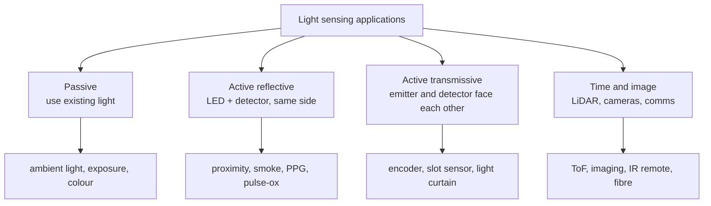

::: testing
Whether you can connect light sensing to **real products and explain what is actually being measured and how**. A list of products is not enough: for each application the interviewer wants the measured property (intensity, wavelength pair, modulation, position, time of flight), the sensor architecture (ambient sensor, LED plus photodiode, array) and one design issue (ambient light rejection, dynamic range, motion artefacts, eye safety). Strong answers group applications by the principle: passive ambient sensing, active reflective or transmissive sensing, spectral sensing, imaging and ranging, and optical communications.
:::

::: why
Light sensors are among the cheapest and most flexible sensors, appearing in phones, wearables, appliances, cars, smoke alarms, industrial automation and instruments. An intern may be asked to debug a proximity sensor that false-triggers in sunlight or a heart-rate sensor that reads garbage during running. Knowing the standard architectures, and what limits each, lets you reason about those problems from first principles. It also sets up [[q0855]] (combining light with other sensors).
:::

::: concepts
- **Ambient light sensing**: eye-weighted illuminance in lux. See [[q0851]].
- **Active reflective sensing**: your own LED plus a detector, measuring reflected or scattered light (proximity, smoke).
- **Transmissive / interruption sensing**: beam blocked or modulated (encoders, light curtains).
- **Spectral and ratiometric sensing**: two or more wavelengths (pulse oximetry, colour). See [[q0852]].
- **Time-of-flight**: ranging. See [[q0865]].
- **Imaging**: arrays of detectors. See [[q0856]].
- **Ambient rejection**: modulation and LED-off subtraction. See [[q0852]].
:::

::: answer
"I like to group applications by how the light is used.

Passive: measure the light that is already there. Ambient light sensors set screen and keyboard brightness, so phones and laptops save power and look right, and they drive automatic headlights and street lights. A camera light meter sets exposure. Colour sensors adjust a display's white point to the room.

Active reflective: add my own LED and look at the light that comes back. A proximity sensor in a phone pulses an infrared LED and measures how much reflects from your face, to turn off the screen. A smoke detector looks for an LED beam scattered by smoke. Heart-rate and pulse-oximetry sensors shine red and infrared LEDs through the skin and measure how the absorption changes with each heartbeat; the ratio of the two wavelengths gives blood oxygen.

Transmissive: optical encoders, slot sensors and light curtains detect a beam being interrupted, so I get position, speed or presence.

Ranging and imaging: LiDAR and time-of-flight sensors measure the delay of a pulse, and cameras are arrays of photodiodes.

Communications: IR remotes, fibre receivers and optocouplers detect modulated light.

The recurring design problem is ambient light and dynamic range: sunlight can be a million times brighter than my signal, so I modulate the source, AC-couple, and subtract the LED-off reading."
:::

::: technical
**Architectures and key numbers.**

| Application | Measured | Sensor | Key relation or issue |
|---|---|---|---|
| Auto-brightness | illuminance | filtered photodiode(s), ADC | 1 to 100,000 lux; log mapping |
| Camera exposure | scene luminance | photodiode or image sensor | $EV=\log_2(E/2.5)$ for incident light (lux); 500 lux gives EV 7.6 |
| Proximity | reflected IR | LED + photodiode | inverse-square, ambient rejection |
| Smoke detector | scattered light | LED + photodiode at an angle | nA signals, dust and temperature drift |
| Pulse oximeter / PPG | absorption at 2 wavelengths | red (about 660 nm) and IR (about 940 nm) LEDs + photodiode | $R=\frac{AC_r/DC_r}{AC_{ir}/DC_{ir}}$ |
| Optical encoder | beam interrupted by slots | LED + photodiode (quadrature) | counts per rev; 4 edges per slot |
| Light curtain / presence | beam blocked | emitter/receiver pairs | response time, alignment |
| Colour measurement | RGB or XYZ | filtered photodiodes | calibration, IR cut |
| Optical receiver | modulated light | PIN/APD + TIA | bandwidth about 0.7 × bit rate |
| LiDAR / ToF | pulse delay | APD/SPAD | $d=ct/2$ |
| Plant lighting (PAR) | photon flux 400–700 nm | quantum sensor | µmol/m²/s |

**Pulse oximetry.** Oxygenated and deoxygenated haemoglobin have different absorption at 660 nm and 940 nm. With each heartbeat arterial blood volume pulses, producing a small AC component on a large DC one. The ratio of ratios $R=\frac{AC_{660}/DC_{660}}{AC_{940}/DC_{940}}$ maps to SpO₂ with an empirical, device-calibrated curve; a commonly quoted rough approximation is $\text{SpO}_2\approx110-25R$ (percent). $R=0.5$ gives 97.5 %, $R=1.0$ gives 85 %. The AC/DC ratio (perfusion index) is typically around 0.2 to 5 % (varies by site and person), so a 1 µA DC photocurrent carries only 10 to 50 nA of pulse signal.

**Exposure value.** $EV=\log_2(E/2.5)$ with $E$ in lux (incident-light metering with the common calibration constant 250). 500 lux gives $\log_2200=7.6$; 100,000 lux gives 15.3. Each EV step is a factor of 2, so office to bright sun is about 7.7 stops.

**Optical receiver.** For NRZ data at bit rate $B$, a receiver bandwidth of about $0.7B$ is typical. At 10 Gb/s, about 7 GHz; at 1 Mb/s, 700 kHz.

**Encoder.** A slotted disc with $N$ slots per revolution read by two offset photodiodes gives quadrature signals; 4× decoding gives $4N$ counts per revolution. For $N=1000$: 4000 counts, 0.09° per count. At 6000 rpm (100 rev/s) the slot frequency is 100 kHz and the edge rate is 400 kHz.
:::

::: short
"Light measurement is used passively and actively. Passive: ambient light sensors for screen brightness, camera exposure meters and colour sensors. Active: a proximity sensor pulses an IR LED and measures reflection, a smoke detector measures scattered light, and a pulse oximeter uses red and IR LEDs through the skin and the ratio of the pulsatile components to get oxygen saturation. Transmissive: encoders and light curtains. Also ranging and communications. The recurring problems are ambient light and dynamic range, solved by modulation and subtraction."
:::

::: long
"I group the applications by how light is used.

Passive sensing means measuring existing light. An ambient light sensor in a phone reports lux and the display brightness follows, because perceived brightness is roughly logarithmic and the range is huge, from a dim room to direct sun, about five decades. Cameras use a light meter, or the image sensor itself, to choose exposure. Colour sensors adjust white point.

Active reflective sensing adds a source. A proximity sensor pulses an infrared LED and measures the reflected light with a photodiode to turn the screen off against your ear. A smoke detector has an LED and a photodiode at an angle, and smoke particles scatter light into the detector. A pulse oximeter shines red and infrared LEDs through a finger. Haemoglobin absorbs the two differently depending on oxygenation, and each heartbeat modulates the signal by a percent or so, so I compute the ratio of AC over DC at red divided by AC over DC at infrared, and map it with a calibration curve to oxygen saturation. A rough approximation is 110 minus 25 times that ratio.

Transmissive sensing detects interruption. An optical encoder uses a slotted disc and two photodiodes to give quadrature signals, so a 1000 slot disc gives 4000 counts a rev. Light curtains and slot sensors detect objects.

Then ranging, with time of flight, and imaging, and communications, like IR remotes and fibre receivers, where bandwidth is about 0.7 of the bit rate.

The common design challenges: ambient light, which can be a million times my signal, so I modulate the source, AC-couple the detector and subtract an LED-off reading; dynamic range, solved by gain ranging; and, in wearables, motion artefacts."
:::

::: terms
- **Ambient light sensor (ALS)**: sensor reporting eye-weighted illuminance.
- **Proximity sensor**: LED plus photodiode detecting nearby objects by reflection.
- **PPG (photoplethysmography)**: optical measurement of blood volume changes.
- **Perfusion index**: AC/DC ratio of the pulsatile signal.
- **Ratio of ratios**: $R$ used to compute SpO₂.
- **Optical encoder**: disc with slots and photodiodes giving position pulses.
- **Light curtain**: array of beams detecting intrusion.
- **Exposure value (EV)**: log₂ scale of exposure; each step doubles light.
:::

::: exceptional
**An average answer**: "Phones use it for brightness and proximity; cameras; smoke detectors."

**An exceptional answer**:
- Organises by **sensing principle** (passive, reflective, transmissive, spectral, ranging, communication).
- For pulse oximetry or proximity, explains **what is measured and the equation** ($R$ ratio, AC/DC, LED-off subtraction).
- Gives **numbers**: lux range, EV, counts per revolution, AC/DC percentage, bandwidth rule.
- Names the **characteristic problem** for each (ambient light, motion artefact, dust drift, saturation) and its fix.
- Points to **fusion with other sensors** (accelerometer for PPG motion cancellation).
:::

::: mistakes
- **Listing products with no mechanism**. Say how the light signal becomes the answer.
- **Ignoring ambient light**. Sunlight is orders of magnitude brighter than a small LED's reflection; unmodulated systems saturate.
- **Treating SpO₂ as a simple absorption measurement**. It is a ratio of pulsatile components at two wavelengths, so it is independent of total tissue absorption.
- **Using one wavelength for pulse oximetry**. You cannot separate oxygenated from deoxygenated blood with a single wavelength.
- **Forgetting eye and skin safety** with high-power IR or laser sources.
:::

::: deep
## Four ways to use light


Figure: The architecture follows the use of light. Active methods give control over the signal (you choose the wavelength and modulation) and so can reject ambient light; passive methods rely on the scene.

## Passive: ambient light and exposure

Human vision spans roughly 10 decades of luminance, and perception is roughly logarithmic, so displays map lux to backlight on a log-like curve with hysteresis. A sensor IC must span at least 5 decades (1 to 100,000 lux), via switchable gain or integration time (see [[q0851]]). For a camera, EV makes the log scale explicit:

$$EV=\log_2\frac{E}{2.5}\ \ (E\text{ in lux, incident-light meter, ISO 100 convention}).$$

| Scene | Lux | EV |
|---|---|---|
| Dim room | 50 | 4.3 |
| Office | 500 | 7.6 |
| Overcast day | 5,000 | 11.0 |
| Bright sun | 100,000 | 15.3 |

Across 11 stops, an exposure system adjusts shutter time, aperture and gain, which is what an ALS-driven phone camera does before the shutter is pressed. See [[q0856]].

## Active reflective: proximity, smoke, optical heart-rate

**Proximity.** An IR LED (typically 850 or 940 nm) is pulsed and the photodiode measures reflection. Signal falls roughly as $1/d^2$ (for a diffuse target, detected power $\propto\rho A/d^2$), so doubling the distance cuts the signal to a quarter; the sensor thresholds the measurement. Ambient rejection uses timing:

```timing
{"signals":[{"name":"LED drive","wave":"01100110"},{"name":"Sample: LED on","wave":"00100010","color":"accent"},{"name":"Sample: LED off","wave":"00010001","color":"orange"}],"hscale":1.4}
```
Figure: Each measurement takes one reading while the LED is on (blue) and one just after it turns off (orange); firmware subtracts them. The difference removes the slowly varying ambient (sunlight, lamps) term and leaves the LED-reflected signal. The two samples should be close together in time to see the same ambient.

**Smoke detector (photoelectric type).** The LED and photodiode are mounted so that the direct beam does not reach the detector; smoke particles scatter a fraction into it. Typical signals are nanoamps over a baseline from stray reflections, so firmware tracks the clean-air baseline to compensate dust and ageing and raises an alarm at a threshold above it.

**Pulse oximetry and PPG.** Light passes through (or reflects from) tissue. The detected intensity has a large DC component (tissue, bone, venous blood) and a small AC component of 0.2 to 5 % (the perfusion index) that pulses with arterial blood volume. Oxyhaemoglobin (HbO₂) absorbs less red (660 nm) than deoxyhaemoglobin (Hb) but absorbs more IR (940 nm). The ratio

$$R=\frac{AC_{660}/DC_{660}}{AC_{940}/DC_{940}}$$

is independent of the light path, source intensity and tissue thickness to first order (each AC/DC ratio is like a normalised absorbance change), and increases when blood is more deoxygenated.

```plot
{"title":"SpO₂ estimated from ratio-of-ratios R (rough linear approximation 110 − 25R)","x":{"label":"R = (AC/DC at 660) / (AC/DC at 940)","min":0.4,"max":1.4},"y":{"label":"SpO₂ (%)","min":70,"max":100},
 "series":[{"label":"110 − 25 R (illustrative; real devices use empirical calibration)","fn":"min(100,110-25*x)","color":"accent"}],
 "points":[{"x":0.5,"y":97.5,"label":"R = 0.5: 97.5 %"},{"x":1,"y":85,"label":"R = 1.0: 85 %"}]}
```
Figure: A lower R means better oxygenation. Real oximeters calibrate the curve against blood-gas measurements from volunteers, because tissue scattering makes the ideal Beer-Lambert relation inexact. The linear approximation is a common textbook rule of thumb, not a device specification.

> [!UNCERTAIN]
> The 110 − 25R rule is a rough illustrative approximation seen in tutorials; every product uses its own empirical calibration, and accuracy claims and regulatory requirements (e.g. clinical-grade accuracy) depend on dedicated testing.

The signal chain must resolve a 1 % AC component on a DC level: with 1 µA DC and 1 % perfusion, that is 10 nA of AC, and to resolve a 0.1 % change of the AC part (10 pA), we need a well-designed TIA plus a 16 to 18-bit ADC or DC-cancelling front end. Motion artefacts from finger or wrist movement can be larger than the pulse, which is why wearables use an accelerometer for cancellation (see [[q0855]]).

## Transmissive: encoders, slots, curtains

A slotted disc with $N$ slots interrupts a beam as it rotates. Two photodiodes offset by a quarter slot give signals A and B in quadrature; counting all four edges gives $4N$ counts per revolution. For $N=1000$: 4000 counts per revolution, 0.09° resolution. At 6000 rpm (100 rev/s) the A signal is 100 kHz and the edge rate 400 kHz; the photodiode and comparator bandwidth must be well beyond 100 kHz, and the MCU's counter must keep up. See [[q0405]].

Light curtains use a row of emitter/receiver pairs; the response time is the pulse scan time of the array, and they use modulated light so that ambient light or a neighbouring curtain does not cause false trips.

## Time of flight and communication

A pulsed laser and a fast detector measure range by $d=ct/2$; 1 ns resolution is 15 cm (see [[q0865]]). In fibre or IR links, bandwidth must be about $0.7\times$ the bit rate; a 1 Mb/s IR link needs a 700 kHz TIA, a 10 Gb/s link about 7 GHz. At 38 kHz carrier IR remotes use a band-pass tuned receiver which rejects sunlight and lamps, and the bit pattern is carried by bursts of the carrier.

## Spectral and photon-counting measurements

A PAR (photosynthetically active radiation) sensor counts photons between 400 and 700 nm because photosynthesis depends on photons rather than energy: full sun is around 2000 µmol/m²/s. A lux meter is the wrong tool for plants because its eye weighting under-counts red and blue photons. This is a useful example of choosing the weighting function for the application.

```sim
{"id":"photodiode-lab","lux":500,"rf":1000000}
```
Figure: Use the photodiode lab as a model of any of these receivers. Notice how R_f sets the trade-off between sensitivity (volts per lux) and bandwidth, which is exactly the trade-off between a slow PPG front end and a fast optical receiver.

## Real hardware behaviour

- **Cover glass and ink windows** attenuate and spectrally filter the light; phones calibrate each unit against the window transmission, sometimes with a sacrificial dark-ink hole for IR.
- **Crosstalk in proximity modules**: light leaks from the LED to the photodiode inside the package and from the cover glass reflection. This offset is measured at calibration and subtracted; changes (dirt, smudge) show up as drift.
- **Skin tone and contact pressure** change DC and AC levels in PPG, so the LED current is adjusted automatically.
- **LED temperature drift**: IR LED wavelength shifts and efficiency drops with temperature, calling for periodic recalibration.
:::

::: applications
- **Smartphones**: ALS and colour sensor for display adaptation, IR proximity to blank the screen, PPG on wearables.
- **Smoke and fire alarms**: photoelectric chamber with LED and photodiode.
- **Wrist-worn heart-rate monitors and fingertip pulse oximeters**: green or red/IR LEDs and photodiodes.
- **Industrial automation**: light curtains, optical encoders, photo-eye presence sensors.
- **Cameras and displays**: exposure metering, white-balance sensors, display colour calibration.
- **Fibre-optic and IR communications**: PIN diode and TIA receivers, IR remotes.
:::

::: assumptions
- Numbers for perfusion index, bandwidth rules and exposure values are typical engineering figures; real devices differ, and regulatory medical devices have specific validated accuracy.
- The EV formula uses the common incident-light convention (calibration constant 250); reflected-light meters use a different constant (about 12.5 for luminance in cd/m²).
- The SpO₂ approximation is for illustration only (see the callout).
- I focus on electronic light sensing, omitting applications such as spectroscopy labs and astronomy, which use the same principles with cooled detectors.
:::

::: followups
### How does a pulse oximeter work?
It shines red (about 660 nm) and infrared (about 940 nm) light through tissue and measures the transmitted or reflected light. With each heartbeat, arterial blood volume changes, giving a small AC component on a large DC. Oxy- and deoxyhaemoglobin absorb the two wavelengths differently, so the ratio of the normalised AC amplitudes, $R$, depends on oxygen saturation. A calibrated curve maps $R$ to SpO₂.

### How does a proximity sensor ignore sunlight?
It modulates (pulses) the LED, AC-couples or demodulates at that frequency and subtracts an LED-off sample, so only the component that changes with the LED remains. It also uses an optical band-pass around the LED wavelength and gain ranging so the front end does not saturate on the DC ambient.

### How would you measure the speed of a motor with an optical sensor?
Mount a slotted disc and an interrupter (LED plus photodiode) and count pulses per second, speed = counts per second ÷ slots per revolution × 60 for rpm; with two sensors in quadrature you also get direction and 4× resolution. For low speeds, measure the period between edges instead of counting. See [[q0405]].

### What changes if you need to detect very faint light?
Increase gain and reduce bandwidth: a high-value $R_f$ (100 MΩ) and a low-pass; use photovoltaic mode for lowest dark current; cool the detector; shield and guard the node; or switch to an avalanche photodiode, a PMT or a SPAD with photon counting. Modulate and use a lock-in to reject background.

### Scenario: your wrist heart-rate monitor reads fine at rest but the numbers jump while running. What do you do?
Motion artefacts: the cadence of arms (about 2 to 3 Hz) overlaps the heart-rate band (1 to 3 Hz) and moves the sensor relative to the skin, changing DC and AC. Use the accelerometer to estimate the motion component and remove it adaptively (adaptive filter or spectral subtraction), improve contact and shielding of ambient light, raise the LED current or sampling rate, and use multiple wavelengths (green is more robust on the wrist). See [[q0855]].
:::

::: interpretations
"Applications of light measurement" is broad; I grouped them by principle rather than by industry so the answer scales to any follow-up. Specific devices and trade-offs are in [[q0851]] (what is light measurement), [[q0852]] (properties) and [[q0853]] (photoresistor vs photodiode).
:::

::: references
- Webster (ed.), *Design of Pulse Oximeters*: principles of pulse oximetry and the ratio-of-ratios method.
- Horowitz & Hill, *The Art of Electronics*, 3rd ed.: photodiode circuits, lock-in detection, optical encoders.
- Fraden, *Handbook of Modern Sensors*: optical sensors, smoke detectors and encoders.
- Saleh & Teich, *Fundamentals of Photonics*: detectors and optical receivers.
:::

::: rubric
- Classifies applications by how light is used (passive, reflective, transmissive, ranging/imaging, communication) :: A clean taxonomy beats a list.
- Explains what is measured in at least two applications (e.g. proximity and pulse oximetry) :: Mechanism over product names.
- Gives the pulse-ox ratio-of-ratios idea with AC/DC :: A classic interview deep dive.
- Mentions ambient light rejection (modulation, LED off subtraction) :: The central practical problem.
- Gives numbers (lux range, EV, counts per rev, perfusion index) :: Quantitative credibility.
- Notes motion artefacts or dynamic range and remedies :: Shows real-world awareness.
:::

::: quiz
```json
[
 {"type":"mcq","level":"fundamental","q":"A phone's proximity sensor works by:","options":["Measuring the Earth's magnetic field","Pulsing an IR LED and measuring the reflected light with a photodiode","Measuring sound reflections","Counting visible light photons from the screen"],"answer":1,"explain":"Proximity modules emit short IR pulses and detect how much light reflects back from nearby objects; the amount rises as the object gets closer."},
 {"type":"numeric","level":"fundamental","q":"An optical encoder has 1000 slots per revolution and is read with 4× quadrature decoding. How many counts per revolution?","answer":4000,"tolerance":0.01,"unit":"counts","explain":"Counts per revolution = 4 × 1000 = 4000, a resolution of 0.09° per count."},
 {"type":"numeric","level":"intermediate","q":"At 500 lux of incident light, what is the exposure value using EV = log2(E/2.5)?","answer":7.64,"tolerance":0.02,"unit":"EV","explain":"$EV=\\log_2(500/2.5)=\\log_2200=7.64$."},
 {"type":"numeric","level":"intermediate","q":"A pulse oximeter measures AC/DC = 0.02 at 660 nm and 0.04 at 940 nm. What is the ratio of ratios R?","answer":0.5,"tolerance":0.02,"unit":"","explain":"$R=\\frac{0.02}{0.04}=0.5$. With the rough approximation 110 − 25R, that is about 97.5 % SpO₂."},
 {"type":"mcq","level":"advanced","q":"Why does a proximity sensor take both an LED-on and an LED-off reading?","options":["To double the sampling rate","To subtract slowly varying ambient light from the reflected-LED signal","To calibrate the ADC reference","To reduce LED heating"],"answer":1,"explain":"The LED-off reading contains only ambient light; subtracting it from the LED-on reading leaves the reflected LED component, rejecting sunlight and lamp background."}
]
```
:::
