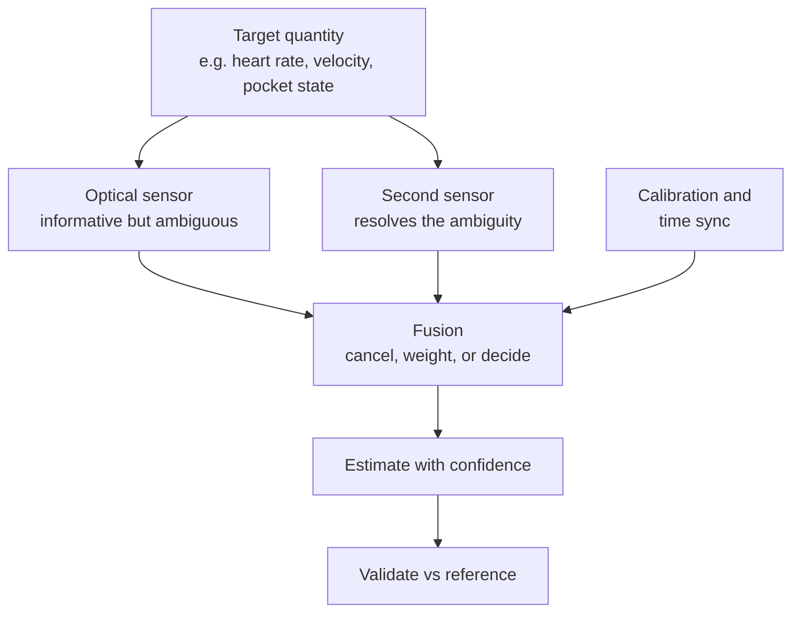

::: testing
Whether you can **design a multi-sensor solution** rather than recite single-sensor facts. The question is open ended: "determine stuff" means you choose a target quantity (state of the user, velocity, orientation, depth, health signal), decide which sensors carry complementary information, and explain the fusion mechanism and its failure modes. The best answers state the target, the roles of each sensor, the algorithm (adaptive cancellation, ratiometric combination, Kalman or complementary filter, calibration against a reference) and a number. Mentioning time synchronisation and calibration between sensors shows system-level maturity.
:::

::: why
Light alone is ambiguous: a dark reading could mean a pocket, a night room or a covered sensor; a changing PPG signal could be a heartbeat or an arm swing; an image could be blurred by motion. Adding another sensor resolves the ambiguity. Almost every phone, wearable, drone and robot uses these pairings: ambient light plus proximity plus accelerometer, PPG plus accelerometer, camera plus IMU, LiDAR plus IMU, optical flow plus rangefinder plus gyro. As a hardware engineer you decide which sensors sit where, how they are synchronised, and what noise each must have. This is design-level thinking, tying together [[q0845]] (fusion) and [[q0854]] (light applications).
:::

::: concepts
- **Complementary information**: sensors that fail differently (light is ambiguous, motion resolves it). See [[q0845]].
- **Adaptive noise cancellation**: use a reference (accelerometer) correlated with the interference to subtract it from the optical signal.
- **Ratiometric measurement**: ratios of optical signals cancel common-mode factors. See [[q0854]].
- **Camera and IMU fusion (visual-inertial)**: high-rate inertial data with low-rate visual corrections. See [[q0849]].
- **Time synchronisation and extrinsic calibration**: timestamps and the geometry between sensors.
- **Context detection**: combining ALS, proximity, motion and orientation to infer situation.
:::

::: answer
"I'd start from the quantity I want, then ask what each sensor can and cannot tell me.

First example: a wrist heart-rate sensor. The optical signal, photoplethysmography, has the pulse but also motion artefacts that overlap in frequency when you run. An accelerometer on the same board measures the motion but not the pulse. I use the accelerometer as a noise reference in an adaptive filter, or in spectral subtraction, to remove the motion component from the optical signal and recover the heart rate.

Second: a phone deciding whether it is in your pocket. Ambient light says dark, proximity says something is close, the accelerometer says the orientation is upright and moving as you walk. Any one of them is ambiguous; together they are decisive, so the screen stays off.

Third: a drone holding position indoors. An optical-flow camera measures how fast the floor texture moves in the image, which is velocity divided by height plus rotation. A rangefinder gives the height and a gyro gives the rotation to subtract, so velocity equals flow minus gyro rate, times height. With 2 metres height and 0.5 radians per second of flow, with 0.1 from rotation, that is 0.8 metres per second.

Fourth: cameras and LiDAR with an IMU: the IMU bridges the gap between frames, removes motion distortion from a spinning LiDAR sweep, and the optical sensors correct the IMU drift.

The common requirements: synchronised timestamps, a calibrated geometry between sensors, and a fusion algorithm that knows each sensor's noise."
:::

::: technical
**General principle.** Choose sensors whose errors are independent or complementary. Fuse with a weighting based on uncertainty (Kalman/complementary filter, [[q0845]]) or use one sensor as a *reference* for another's interference (adaptive cancellation).

**1. PPG + accelerometer (motion artefact removal).** Model $x_{ppg}=s_{pulse}+n_{motion}$, with $n_{motion}\approx H*a$ correlated with accelerometer signal $a$. An adaptive filter (LMS) estimates $\hat n=w^Ta$ with $w_{k+1}=w_k+\mu\,e_k a_k$, $e_k=x_{ppg,k}-\hat n_k$, whose error $e$ approximates the pulse. Heart rate lies in 0.7 to 3.5 Hz (40 to 210 bpm) and running cadence in 2 to 3.5 Hz, overlapping; so frequency-domain tracking also uses the accelerometer spectrum to exclude cadence peaks.

**2. ALS + proximity + accelerometer (context).** Pocket detection: $\text{lux}\approx0$, proximity near, motion periodic (walking about 2 Hz), orientation vertical or flat. Combined in a small decision tree, with hysteresis; accelerometer-based "significant motion" wakes the sensors. Tilt-compensation of the ALS: a cosine correction when the sensor faces away from the light.

**3. Optical flow + rangefinder + gyro (velocity).** For a downward camera with focal length $f_{px}$, the image motion rate has a translational part $v/h$ (rad/s, with $h$ the height above the ground) and a rotational part $\omega$ from body rotation: $\dot\theta_{flow}=v/h+\omega$ (sign convention dependent). Therefore

$$v=h\,(\dot\theta_{flow}-\omega_{gyro}).$$

Example: $h=2$ m, flow $0.5$ rad/s, gyro $0.1$ rad/s gives $v=0.8$ m/s; ignoring the gyro would give 1.0 m/s, a 25 % error. In pixels: at $f_{px}=500$ and 30 fps, 0.5 rad/s is $500\cdot0.5/30=8.3$ px/frame; the gyro part is 1.7 px/frame.

**4. LiDAR + IMU (de-skew).** A spinning LiDAR collects a sweep in 100 ms (10 Hz); a platform moving at 10 m/s travels 1 m during the sweep, so points are smeared. The IMU (or odometry) provides the pose at each point's timestamp, and points are transformed to a common frame. See [[q0864]].

**5. Camera + IMU (VIO).** The IMU propagates the pose at 200 to 1000 Hz and provides gravity and metric scale; the camera (30 Hz) provides drift-free corrections relative to landmarks. A time-sync error $\Delta t$ at rotation rate $\Omega$ gives an angular error $\Omega\Delta t$: 5 ms at 100°/s is 0.5°, about 8 px at 1000 px across 60° field of view.

**6. Ratiometric / temperature-compensated optics.** A reference photodiode monitoring the LED corrects for LED output drift (about -0.5 to -1 %/°C for many IR LEDs, device dependent); a thermistor compensates the photodiode dark current. Output $=I_{signal}/I_{reference}$ cancels common-mode drift.
:::

::: short
"I pick the quantity I want and let each sensor cover the others' blind spots. A wrist PPG uses an accelerometer as a noise reference to remove motion artefacts. A phone combines ambient light, proximity and motion to know it is in a pocket. A drone gets velocity from optical flow plus a rangefinder for height plus a gyro to subtract rotation: v equals height times flow minus gyro rate. LiDAR and cameras use an IMU to bridge frames and remove motion distortion, and optics correct the IMU's drift."
:::

::: long
"My approach is to start from the thing I want to determine and ask what each sensor can and cannot say, then pick the pairing that resolves the ambiguity.

Take heart rate at the wrist. The optical sensor, photoplethysmography, sees the pulse, but it also sees motion: when you run, the arm swing at two to three hertz sits right in the heart-rate band. An accelerometer on the same board cannot see the pulse, but sees the motion. So I use the accelerometer as a reference for an adaptive filter, an LMS filter that learns how motion appears in the optical signal and subtracts it, or I track spectral peaks and exclude the cadence peaks.

Take a phone. Ambient light reading near zero could be a dark room; proximity near could be a hand; accelerometer shows orientation and walking cadence. Together, they say pocket, keep the screen off, ignore touches.

Take a drone holding position indoors. Optical flow gives angular rate of the ground texture, which is translational velocity divided by height plus the rotation of the drone. So I need a rangefinder for height and a gyro for rotation: v equals h times flow minus gyro. With 2 metres, 0.5 radians per second flow, and 0.1 of gyro rate, I get 0.8 metres per second. Skip the gyro and I would be 25 percent off, which makes the drone wobble when it tilts.

Take cameras and LiDAR. A spinning LiDAR takes 100 milliseconds per sweep, so at 10 metres per second the vehicle moves a metre during the scan; the IMU provides the pose at each point timestamp to de-skew. And in visual-inertial odometry, the IMU runs at hundreds of hertz and gives scale and gravity, while the camera corrects drift.

The practical issues: timestamps, since 5 milliseconds of error at 100 degrees per second is half a degree; the extrinsic calibration between sensors; and knowing each sensor's noise for the filter weights."
:::

::: terms
- **Photoplethysmography (PPG)**: optical measurement of blood volume changes.
- **Adaptive filter (LMS)**: filter whose coefficients adapt to minimise error against a reference.
- **Optical flow**: apparent motion of image texture, in pixels/frame or rad/s.
- **Visual-inertial odometry (VIO)**: fusion of camera and IMU for pose estimation.
- **De-skewing**: correcting a LiDAR sweep for platform motion during the scan.
- **Extrinsic calibration**: the relative position and orientation between sensors.
- **Time synchronisation**: aligning sensor timestamps to a common clock.
- **Ratiometric measurement**: using a ratio to cancel common drift.
:::

::: exceptional
**An average answer**: "Combine a light sensor with an accelerometer to know if the phone is moving."

**An exceptional answer**:
- States the **target quantity** first and explains why light alone is ambiguous.
- Gives **three or four pairings** with the specific mechanism (adaptive cancellation, optical flow equation, de-skew, VIO).
- Includes at least one **derivation with numbers** ($v=h(\dot\theta-\omega)$, 8 px sync error, 1 m LiDAR skew).
- Discusses **time sync, extrinsic calibration, noise models** and failure modes (flow over featureless floor, sunlight on ToF, reflective surfaces).
- Proposes **validation** against a reference (pulse oximeter, motion capture, GPS).
:::

::: mistakes
- **Fusing without synchronisation**. Unsynchronised timestamps convert rotation into error: 5 ms at 100 °/s is 0.5°.
- **Forgetting to subtract rotation from optical flow**. A tilting drone looks like a moving drone.
- **Assuming the accelerometer cleans the PPG automatically**. Without the correct filter and reference geometry it can inject noise; validate against ground truth.
- **Treating a single sensor's threshold as context**. "Dark" is not "in a pocket"; combine with proximity and motion and use hysteresis.
- **Ignoring failure modes of the optical sensor**: sunlight saturates ToF, featureless floors give no flow, glass and mirrors fool LiDAR.
:::

::: deep
## A design recipe for multi-sensor systems

1. **Define the target** and required accuracy, rate and latency.
2. **List what each candidate sensor senses and where it fails** (blind spots, ambiguity, noise, drift).
3. **Choose complementary pairs**: independent errors or one acting as a reference.
4. **Choose the fusion mechanism**: decision logic, adaptive filter, complementary or Kalman filter, calibration regression.
5. **Fix the hardware details**: placement, timestamp, bandwidth, power.
6. **Validate against ground truth** and check failure behaviour.


Figure: The recipe is the same for every pairing: an informative-but-ambiguous optical sensor, a second sensor that fills the gap, and a fusion step that depends on calibration and timing.

## Example 1: PPG heart rate with an accelerometer

The photodiode signal is $x(t)=s(t)+n(t)$, where $s$ is the pulsatile blood-volume signal (AC/DC about 0.2 to 5 %) and $n$ the motion artefact, which can be larger than $s$ by a factor of 10 or more during running (illustrative). Accelerometer $a(t)$ correlates with $n$ but not with $s$. An LMS adaptive filter with $L$ taps:

$$\hat n_k=\sum_{i=0}^{L-1}w_i\,a_{k-i},\quad e_k=x_k-\hat n_k,\quad w_i\leftarrow w_i+\mu\,e_k\,a_{k-i}.$$

At convergence $e\approx s$. The step size $\mu$ trades convergence speed against steady-state noise ($\mu<2/(L\,\sigma_a^2)$ for stability). Heart rate is then the dominant spectral peak of $e$, tracked through time.

Why it works: running cadence is about 2.5 to 3 Hz (150 to 180 steps/min), arm swing half that; the PPG motion artefact has components at the arm-swing frequency and harmonics, which fall in the 1 to 3.5 Hz heart-rate band. A pure band-pass cannot separate them, but knowing the accelerometer spectrum lets you recognise and discard those peaks.

Hardware choices: place the accelerometer rigidly on the same PCB, sample both at the same rate and with a common timestamp (25 to 100 Hz is typical), and match anti-alias filters so the interference has the same phase relationship in both channels. A green LED is more robust to motion than red/IR on the wrist because tissue absorption is stronger, limiting penetration to the capillary layer (design guidance commonly used in wrist wearables).

> [!UNCERTAIN]
> Quantitative claims about green vs red PPG robustness, perfusion indices and artefact amplitudes depend on the placement, skin tone and product; treat them as typical engineering guidance rather than specifications.

## Example 2: optical flow, rangefinder and gyro

A downward-facing camera sees the ground texture move. If the vehicle moves at speed $v$ at height $h$, the ground point's bearing changes at $v/h$ (rad/s). If the vehicle also rotates at $\omega$, the whole image shifts by $\omega$ rad/s regardless of height. The measured flow is

$$\dot\theta_{flow}=\frac{v}{h}+\omega\quad\Rightarrow\quad v=h(\dot\theta_{flow}-\omega).$$

```plot
{"title":"Optical-flow image motion for v = 1 m/s vs height (f = 500 px, 30 fps)","x":{"label":"Height above ground","unit":"m","min":0.5,"max":10},"y":{"label":"Flow (pixels per frame)","min":0,"max":35},
 "vars":{"f":500,"fps":30,"v":1},
 "series":[{"label":"translation only: f·(v/h)/fps","fn":"f*(v/x)/fps","color":"accent"},{"label":"rotation of 0.1 rad/s (height independent)","fn":"f*0.1/fps+0*x","color":"red","dashed":true}],
 "points":[{"x":2,"y":8.33,"label":"h = 2 m: 8.3 px/frame"}]}
```
Figure: Translational flow drops as 1/h, while the rotational term is independent of height. At 2 m, a 0.1 rad/s tilt adds 1.7 px/frame to the 8.3 px/frame of translation; at 10 m the rotation is as large as the translation itself. This is why you must subtract the gyro, and why a rangefinder (or barometer plus model) is required for metric velocity.

Failure modes: featureless floors (no texture), low light (the camera needs enough illumination, so many flow modules include an LED), repeating patterns, and range outside the rangefinder's limit. Fusion filters check the flow quality metric and fall back to the IMU or other sensors.

## Example 3: phone context from ALS, proximity and IMU

A typical pocket detector uses a short decision rule with hysteresis, running on a sensor hub:

| ALS | Proximity | Motion (accelerometer) | Inferred |
|---|---|---|---|
| bright | far | any | in hand or on a table |
| dark | near | walking cadence | in pocket or bag |
| dark | far | still | night, on a table |
| bright | near | still | covered by a hand in a lit room |

Each sensor alone has ambiguity ("dark" appears in several rows). Together there are only a few consistent rows. The accelerometer wakes the system on motion so the ALS and proximity sensors can run at low rate (for power, a few µA each).

## Example 4: LiDAR plus IMU, and camera plus IMU

**LiDAR de-skew.** At 10 Hz scan rate a platform at 10 m/s moves 1 m per scan; at 1 m/s, 10 cm. Each point carries its timestamp; the IMU/odometry pose is interpolated and each point is transformed into the scan-start frame. Without it, flat walls look curved and loops fail to close.

**Visual-inertial odometry.** IMU gives pose at 200 to 1000 Hz, metric scale and the gravity direction; the camera at 30 Hz gives drift-free position relative to landmarks. Camera blur, lighting changes and motion limit the visual part. For the filter to work, time offset between camera exposure and IMU must be known: 5 ms at 100 °/s gives 0.5°, about 8 px across a 1000 px-wide, 60° image, ruinous for a feature tracker; modern systems estimate the offset online or use hardware triggering.

```sim
{"id":"imu-lab","view":"fusion","alpha":0.98}
```
Figure: This is the simplest form of the complementary idea behind VIO and LiDAR-inertial systems: a fast, drifting source (gyro) corrected by a slow, absolute source (gravity direction here, landmarks or scans in the real system). Move alpha and see the trade between smoothness and drift.

## Example 5: ratiometric optical measurements

An optical sensor's signal depends on source power, which drifts with temperature and age. Adding a reference photodiode, or measuring a second wavelength not absorbed by the target, creates a ratio independent of the common factor. Pulse oximetry's ratio of ratios ([[q0854]]) and absorption spectroscopy (sample channel over reference channel) do this. A thermistor next to the photodiode allows compensation of dark current that roughly doubles every 8 to 10 °C.

## Validation and calibration

- **Ground truth**: chest-strap ECG or a clinical oximeter for PPG; motion capture or RTK-GPS for velocity and pose; lux meter for ALS.
- **Extrinsic calibration**: measure the sensor-to-sensor transform with a calibration target or optimisation.
- **Time sync**: a hardware sync pin or common clock; check with a rotating target and compute the lag from cross-correlation.
- **Failure testing**: sunlight, featureless floors, cold, vibration, partial occlusion, sensor loss. Design the fallback.

## Real hardware behaviour

- **Placement**: PPG sensor and accelerometer must share the same rigid mounting; an accelerometer on another board sees different motion.
- **Shared clocks**: use one MCU timer to timestamp all sensors via data-ready interrupts.
- **Power**: duty-cycle the expensive optical sensor and use the accelerometer (a few µA) as a wake-up trigger.
- **EMI/optical crosstalk**: LED drive currents in the 10 to 100 mA range can couple into nearby high-impedance accelerometer and photodiode traces; separate the ground return of the LED driver.
:::

::: applications
- **Smartwatches and fitness bands**: PPG plus accelerometer for heart rate during exercise, and sleep tracking.
- **Phones**: ALS plus proximity plus IMU for pocket detection, auto-brightness, display on/off and always-on context.
- **Drones with optical-flow modules**: flow camera plus rangefinder plus IMU for indoor hover.
- **Autonomous vehicles and robots**: LiDAR plus IMU plus camera plus wheel odometry for localisation.
- **AR/VR headsets**: cameras plus IMUs for inside-out head tracking.
- **Agriculture and greenhouses**: light (PAR), temperature and soil moisture sensors combined for irrigation and lighting control.
:::

::: assumptions
- "Light measurement" is read broadly: ambient sensors, PPG photodiodes, cameras and LiDAR. The principles are the same.
- Numerical examples (2 m height, 0.5 rad/s flow, 500 px focal length, 10 Hz LiDAR) are illustrative design numbers, not from a specific product.
- The LMS stability bound is a rule of thumb for stationary inputs; real implementations normalise the step size (NLMS) and bound the filter length.
- The sign convention of the rotation term in the flow equation depends on the camera and axis definitions; in implementation, derive it from the chosen frames.
:::

::: followups
### Why does a PPG sensor need an accelerometer?
Motion changes the optical path and skin contact, producing artefacts at frequencies (arm swing, cadence) that overlap with heart rate. A band-pass cannot separate them. The accelerometer measures the motion, so an adaptive filter or spectral-tracking algorithm can subtract or ignore the corresponding component in the optical signal.

### How do you get velocity from optical flow?
Flow equals $v/h+\omega$ (rad/s). So $v=h(\text{flow}-\omega)$ with $h$ from a rangefinder and $\omega$ from the gyro. Without the gyro, tilting looks like motion; without $h$, velocity is only known up to scale.

### Why does a spinning LiDAR need an IMU?
Because a scan takes tens of milliseconds and the platform moves during it, points are collected from different poses. The IMU (or wheel odometry) gives the motion between timestamps so each point can be transformed into a consistent frame. Without it, a scan at 10 m/s is smeared by a metre.

### What would you check to confirm two sensors are synchronised?
Rotate the rig (or excite a step) and compare the signals: cross-correlate gyro rate with camera-derived angular rate, or an LED blink seen by the light sensor and the camera. The peak of the cross-correlation gives the time offset, which should be below a millisecond-scale threshold set by $\Omega\Delta t$ tolerance. Better: use a hardware sync line.

### Scenario: your phone turns the display off while you are using it in bright sunlight with a glove. What is wrong and how do you fix it?
Likely a proximity false positive: sunlight's IR or a glove reflecting strongly changes the baseline; or ALS saturation. Fixes: use the LED-off subtraction and AC-coupled detection, raise the proximity threshold with hysteresis and baseline tracking, use ALS and accelerometer consistency (the screen on and being touched should override), and calibrate the cover glass crosstalk.
:::

::: interpretations
"How can light measurement be used in conjunction with other sensors to determine stuff?" is intentionally open. I interpret it as a design question: choose targets, pair sensors and explain the fusion. The vague "stuff" is handled by giving examples across health, context, navigation and mapping. For the generic fusion theory see [[q0845]]; for the light measurement fundamentals [[q0851]] and [[q0852]].
:::

::: references
- Groves, *Principles of GNSS, Inertial, and Multisensor Integrated Navigation Systems*: multisensor integration principles.
- Haykin, *Adaptive Filter Theory*: LMS adaptive noise cancellation.
- Forster, Carlone, Dellaert, Scaramuzza, "On-Manifold Preintegration for Real-Time Visual-Inertial Odometry", IEEE Trans. Robotics (2017).
- Webster (ed.), *Design of Pulse Oximeters*: the optical principles behind PPG.
:::

::: rubric
- Starts from the target quantity and identifies the optical sensor's ambiguity :: Shows design thinking rather than a list.
- Gives at least two concrete sensor pairings with mechanisms :: Specificity.
- Includes an equation or algorithm (LMS, $v=h(\dot\theta-\omega)$, de-skew) :: Technical depth.
- Provides numbers (px/frame, skew distance, sync error) :: Quantitative reasoning.
- Mentions time sync and extrinsic calibration :: The real engineering difficulty of multi-sensor systems.
- Notes failure modes and a validation plan :: Maturity and safety awareness.
:::

::: quiz
```json
[
 {"type":"mcq","level":"fundamental","q":"Why is an accelerometer useful alongside a wrist PPG sensor?","options":["It measures blood oxygen directly","It provides a motion reference to remove motion artefacts from the optical signal","It provides power to the LED","It increases the photodiode's responsivity"],"answer":1,"explain":"The accelerometer senses the motion that corrupts the PPG but not the pulse itself, so it serves as a noise reference for cancellation."},
 {"type":"numeric","level":"intermediate","q":"Optical flow measures 0.5 rad/s, the gyro measures 0.1 rad/s of rotation (same sense), and the height is 2 m. What is the translational velocity in m/s using v = h(flow − gyro)?","answer":0.8,"tolerance":0.02,"unit":"m/s","explain":"$v=2\\times(0.5-0.1)=0.8$ m/s."},
 {"type":"numeric","level":"intermediate","q":"A LiDAR completes a sweep in 100 ms while the vehicle moves at 10 m/s. By how many metres is the point cloud smeared if uncorrected?","answer":1,"tolerance":0.02,"unit":"m","explain":"Distance = 10 m/s × 0.1 s = 1 m."},
 {"type":"numeric","level":"intermediate","q":"The camera and IMU timestamps differ by 5 ms while the device rotates at 100 °/s. What angular error results, in degrees?","answer":0.5,"tolerance":0.02,"unit":"°","explain":"Error = rate × time offset = 100 × 0.005 = 0.5°."},
 {"type":"mcq","level":"advanced","q":"A downward optical-flow sensor at 10 m height reports flow that seems to change when the drone tilts without moving. What is the best correction?","options":["Increase the camera frame rate","Subtract the gyro rate from the flow before multiplying by height","Ignore the flow when tilted","Use a smaller lens"],"answer":1,"explain":"Rotation adds a height-independent term to the flow. Subtracting the gyro rate removes it, leaving $v/h$; multiply by the rangefinder height to get velocity."}
]
```
:::
