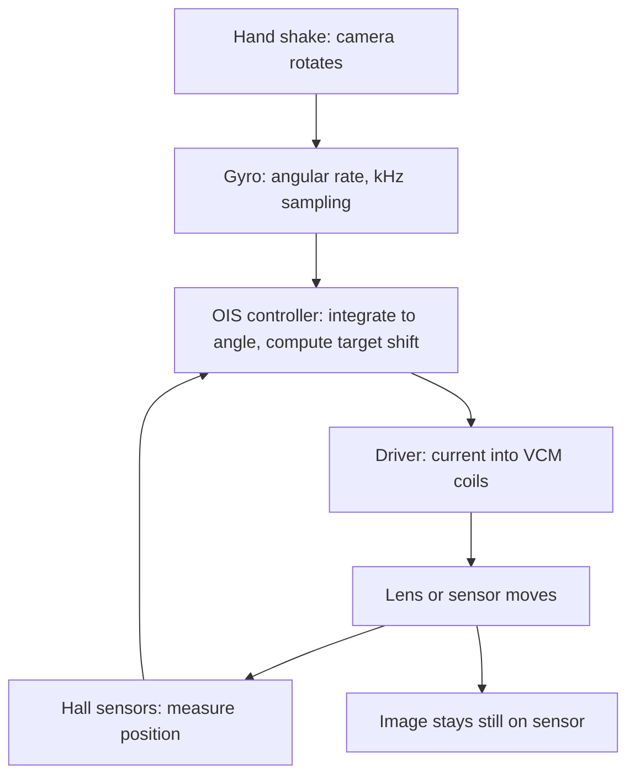

::: basics
### In plain words
When your hand shakes, the camera rotates a little, and the picture smears. Optical image stabilization, OIS, uses a gyroscope to sense the shake and physically moves the lens or sensor the opposite way while the shutter is open. Electronic image stabilization, EIS, works in software: it crops each frame and slides the crop window to cancel the motion. OIS keeps each frame sharp. EIS only smooths the video afterward.

### Picture it
Carry a cup of coffee on a bumpy bus. You can move your hand against each bump to keep the cup level, which is OIS. Or you can let the cup shake, then slide a small frame over a larger photo of it, so the picture looks steady, which is EIS. The frame fix cannot unsmear a blur, because the blur is already in each photo. It also needs spare margin at the edges, so the result is cropped.

### Words you need
- **Gyroscope**: a sensor that measures how fast the camera is rotating. See [[q0846]].
- **Motion blur**: smearing caused by the image moving across the sensor during the exposure.
- **Focal length**: the distance from the lens to the sensor when focused far away. A longer one magnifies shake more.
- **Stop**: one doubling of exposure time.

### The simplest example
A phone camera has a 5.6 mm focal length. The hand rotates at 2 degrees per second during a 1/15 s exposure. The camera turns by 2/15 of a degree, and the image on the sensor smears by about 13 µm, roughly 13 pixels of 1 µm. Say OIS cancels 90 percent of that shake. The same blur now allows an exposure 10 times longer, about 3.3 stops. EIS could not do this, because it only shifts finished frames. That is the whole idea. The rest of this page covers the OIS control loop, the EIS crop and timing, and when to choose each.
:::

::: testing
Whether you understand that stabilization is a **sensing plus actuation plus control** problem, and that OIS and EIS solve different halves of the blur problem. The interviewer wants the key distinction: OIS physically moves the lens or sensor during the exposure so each frame is sharp, while EIS shifts and crops frames afterwards, so it cannot fix blur *within* an exposure. Strong answers bring up the gyroscope, the closed loop with position feedback, the crop and latency trade-offs of EIS, and where each is used (stills and low light versus video).
:::

::: why
Every handheld camera has to deal with hand shake, and the way you do it drives hardware cost, power, thickness, magnet placement and software complexity. If you work on phones, drones, action cameras or AR headsets, you will deal with gyros, voice-coil actuators, Hall sensors and timestamp synchronization between IMU and image sensor. It is also an excellent example of a feedback control system with a clear performance metric ("how many stops of stabilization"), which is why interviewers like it.
:::

::: concepts
- **Hand shake as angular motion**: small camera rotations (roughly 1 to 15 Hz) move the image by $\Delta x = f\,\theta$ on the sensor. See [[q0846]] for the gyroscope.
- **Motion blur**: if the image moves during the exposure, each point is smeared over $f\,\omega\,T_{exp}$ pixels. Longer exposure or longer focal length makes it worse ([[q0856]]).
- **Gyroscope and sensor fusion**: the angular rate is integrated to get angle; drift limits how long you can integrate ([[q0845]], [[q0850]]).
- **Closed-loop actuator control**: OIS drives a voice-coil motor (VCM) or similar and measures position with Hall or TMR sensors.
- **Rolling shutter**: rows exposed at different times mean the image is distorted under motion; EIS has to correct per row ([[q0856]]).
- **Field of view and crop**: EIS needs spare pixels around the output frame to shift into.
:::

::: answer
"Both try to cancel hand shake, but at different points. Optical image stabilization uses a gyro to measure how the phone is rotating, and then physically moves the lens, or sometimes the sensor, in the opposite direction so the image stays put on the sensor. Because it works during the exposure, each frame is actually sharp. That's why it helps in low light and for long handheld exposures.

Electronic image stabilization is purely in software. It reads the gyro, and sometimes uses the image itself, to estimate how the camera moved from frame to frame, then crops into the frame and shifts the crop window to cancel the motion. There are no moving parts, so it's cheap, but it can't remove blur inside one exposure, and it costs you some field of view because you need spare pixels around the edges.

So OIS is mainly for photos and low light, EIS is mainly for video, and the best systems use both: OIS handles the high-frequency shake in each exposure and EIS smooths the path between frames and corrects rolling-shutter wobble. The costs are different too. OIS adds a few tens of milliamps, a magnet and actuator, and thickness. EIS costs processing power, latency and a crop."
:::

::: technical
**Blur from rotation.** A camera rotation by angle $\theta$ moves the image by $\Delta x \approx f\theta$ (for small angles). During an exposure $T$ with angular rate $\omega$, blur length is $b = f\,\omega\,T$. For $f = 5.6$ mm, $\omega = 2^\circ/\text{s}$ (0.0349 rad/s) and $T = 1/15$ s: $b = 13$ µm, about 13 pixels at 1.0 µm pitch. The exposure time that keeps blur below 1 pixel is $T = p/(f\omega)$ = 5.1 ms (about 1/200 s). With 10x (20 dB) suppression from OIS, that stretches to about 51 ms (1/20 s), which is 3.3 stops.

**OIS loop.** A gyro (typically sampled at a few kHz) gives $\omega$. The OIS controller integrates it to an angle, converts to a target lens shift $x^* = f\tan\theta \approx f\theta$, and drives the actuator (usually a voice-coil magnet-and-coil, closed-loop with Hall sensors measuring the actual position). A 1° correction needs about 98 µm of travel for $f = 5.6$ mm, so strokes of roughly ±100 µm (or ±1° of correction) are typical (varies by module). Lens-shift OIS moves the lens elements; module-tilt OIS tilts the whole camera module; sensor-shift OIS (also IBIS in mirrorless cameras) moves the sensor and can correct roll as well.

**EIS pipeline.** Gyro samples (and optionally optical flow) are timestamped against the frame's exposure time. Per frame (or per row for rolling-shutter), a homography or warp is computed to cancel the high-frequency motion, while keeping the intentional pan smooth (a low-pass of the camera path). Output frame is a crop of the full frame: a 1080p output taken from an input 1.2x wider leaves about 17 percent of the width as margin (8 percent per side). One degree equals about 48 px for a 70° horizontal FOV, 3840-wide stream (computed from $f_{px} = 1920/\tan35^\circ$). So 5 percent margins per side (192 px) give about ±4° of correctable shake.

**Limits.** EIS cannot undo blur *within* an exposure. It also needs timestamps accurate to well under 1 ms between gyro and sensor rows, or it will add jitter. OIS has bandwidth limits (actuator resonance, typically tens of Hz) and limited stroke. Combined systems use OIS to remove high-frequency shake and EIS to take out the remainder.
:::

::: short
"OIS physically moves the lens or sensor, driven by a gyro in a closed loop with position feedback, so the image stays still on the sensor during the exposure. That removes blur in each frame, which helps photos and low light. EIS is software: it uses gyro and image data to shift and crop frames after capture, so it has no moving parts, but it can't fix blur within an exposure and it costs field of view. OIS is mostly for stills, EIS for video, and high-end phones use both together."
:::

::: long
"Start with the problem. When your hand shakes, the camera rotates by a fraction of a degree, and the image moves on the sensor by focal length times that angle. With a 5.6 mm phone lens, a shake of one degree per second over a 1/15 second exposure smears the image across maybe six or seven pixels. So you get blur inside the exposure, and you get jitter from frame to frame in video.

Optical image stabilization attacks the first one. A gyroscope measures the rotation rate a few thousand times a second. A controller integrates that into an angle, converts it to a lens or sensor shift, and drives a voice-coil actuator in the opposite direction. Hall sensors measure the real position, so it's a proper closed loop. Because the image is held still during the exposure, each frame is sharp. You typically get about two to four stops longer handheld exposures. The costs are extra thickness, a magnet that can disturb the compass, tens of milliamps of drive current, and limited stroke, around plus or minus a degree.

Electronic image stabilization works afterwards. It uses gyro data, and sometimes image tracking, to estimate how the camera moved, smooths that path, and shifts a crop window to cancel the jitter. It can also correct rolling-shutter skew row by row. There's no hardware, but it crops the field of view and cannot fix blur inside a frame. It also needs very good timing between gyro and image sensor.

In practice, OIS is what you want for photos and low light, EIS is what you want for video and for very small modules, and flagship phones combine them: OIS removes fast shake in each frame, EIS handles the slower motion and the leftover."
:::

::: terms
- **OIS**: optical image stabilization, a moving lens, module or sensor that counteracts camera rotation during exposure.
- **EIS**: electronic image stabilization, frame cropping and warping in software to cancel motion.
- **IBIS**: in-body image stabilization, sensor-shift stabilization in a camera body, up to 5 axes.
- **VCM**: voice-coil motor, the magnet-and-coil actuator used for autofocus and OIS.
- **Hall sensor**: measures the magnet's field to report lens position in the OIS feedback loop.
- **Stops of stabilization**: how many factors of 2 longer you can expose for equal sharpness.
- **Crop factor / margin**: spare field of view that EIS uses to shift the window.
- **Rolling-shutter skew**: image distortion because rows are exposed at slightly different times.
- **Gyro-to-frame sync**: aligning IMU timestamps to the sensor's exposure window.
:::

::: exceptional
An average answer says OIS is mechanical and EIS is digital. An exceptional answer:

- Frames it as measuring (gyro), computing (controller) and actuating (VCM or crop).
- Explains the blur equation $b = f\omega T$ and converts a stop gain into an exposure time.
- Knows that OIS acts **during** exposure and EIS can only act **between** frames (so it cannot reduce motion blur inside a frame).
- Mentions EIS's crop, rolling-shutter correction and timestamp synchronization.
- Names trade-offs: power, magnet interference, thickness, cost, latency.
- Describes hybrid use and mentions sensor-shift as a third variant.
:::

::: mistakes
- **"EIS gives the same sharpness as OIS."** It does not. Motion blur during one exposure is already baked into the frame; EIS can only reposition it.
- **"OIS is for video only."** OIS helps most with stills in low light, where exposures are longest.
- **"EIS has no downside."** It crops the field of view, adds latency and processing power, and can warp content (wobbly edges) when the motion model is wrong.
- **"The gyro gives angle directly."** It gives angular rate; you integrate it, and bias drift ($0.1^\circ/\text{s}$ bias becomes 1° in 10 s) limits long integrations. See [[q0850]].
- **"OIS corrects translation."** Lens-shift OIS corrects rotation well, but close-up shots (macro) are dominated by translation, which a gyro cannot sense.
:::

::: deep
## Why stabilization matters: the numbers

Treat hand shake as a small rotation. For small angles, the image displacement on the sensor is $\Delta x = f\tan\theta \approx f\theta$. Blur during an exposure is the integral of this displacement:

$$b = f\,\omega\,T_{exp}$$

where $\omega$ is the angular rate in rad/s. For a phone main camera $f = 5.6$ mm. Take an illustrative handheld rate of $2^\circ$/s (0.035 rad/s) during the exposure (real shake spectra have 5 to 10 Hz content with peak rates a few degrees per second; see the assumptions).

```plot
{"title":"Blur length vs exposure time (f = 5.6 mm; default ω = 2°/s, 1.0 µm pixels)","x":{"label":"Exposure time","unit":"s","min":0.001,"max":0.5,"log":true},"y":{"label":"Blur","unit":"px","min":0.1,"max":1000,"log":true},"vars":{"f":0.0056,"om":"omd*pi/180","p":"pum*1e-6","sup":"pow(10,-ois/20)"},"series":[{"label":"No stabilization","fn":"f*om*x/p"},{"label":"With OIS suppression","fn":"sup*f*om*x/p","color":"green"}],"hlines":[{"at":1,"label":"1 px blur limit","color":"muted"}],"vlines":[{"at":"p/(f*om)","label":"no OIS","color":"red"},{"at":"p/(f*om*sup)","label":"with OIS","color":"green"}],"params":[{"name":"omd","label":"Shake rate ω","min":0.5,"max":20,"value":2,"unit":"°/s","log":true},{"name":"ois","label":"OIS suppression","min":0,"max":40,"value":20,"unit":"dB","step":1},{"name":"pum","label":"Pixel size","min":0.5,"max":2,"value":1,"unit":"µm","step":0.05}],"readouts":[{"label":"1-pixel exposure limit, no OIS","expr":"p/(f*om)","unit":"s"},{"label":"1-pixel limit with OIS","expr":"p/(f*om*sup)","unit":"s"},{"label":"Gain from OIS","expr":"log(1/sup)/log(2)","unit":"stops"}]}
```
Figure: Blur grows linearly with exposure. At the defaults, without stabilization you stay under 1 pixel only up to about 5 ms (1/200 s). With 20 dB of OIS suppression the limit moves to about 51 ms (1/20 s), a factor of 10, which is $\log_2 10 = 3.3$ stops. Drag the OIS suppression to 30 dB: the stabilized 1-pixel limit moves to about 0.16 s, five stops beyond the unstabilized 5 ms. Raise the shake rate to 8°/s and the unstabilized limit collapses to about 1.3 ms.

The "stops of stabilization" rating is just $\log_2(\text{suppression ratio})$, so a claimed 3-stop OIS means roughly 8x less blur (18 dB) at the shake frequencies it was measured at. Standards-based test methods exist for this (for example CIPA has a measurement standard for camera-shake correction), but I would not quote clause numbers.

## OIS: the closed-loop mechanism


Figure: The gyro is the *disturbance* sensor (feed-forward from the motion) and the Hall sensors close the position loop around the actuator. The loop needs to be fast and stable enough that the lens follows the target at 10 to 20 Hz.

**Control details.**
- The controller high-pass filters the integrated gyro angle, otherwise bias drift and intentional panning would push the lens to its stroke limit. When the stroke saturates, the lens re-centers.
- The actuator is a spring-mass system: a mass of tens of milligrams on springs with a resonance at tens to a few hundred Hz. The Hall feedback damps the resonance and gives bandwidth for tracking shake up to about 20 Hz (varies by design).
- Position resolution matters: a 1 µm lens position error at $f = 5.6$ mm is only $0.01^\circ$ of image error, but at 0.7 µm pixels it is already 1.4 pixels of image shift, so the Hall resolution and noise have to be at the sub-micron level.
- A key practical problem is **gravity and orientation**: the lens (tens of mg) sags, and the open-loop spring and magnet forces change with orientation, so a closed loop with Hall feedback is used.

**Mechanical variants.**

| Type | What moves | Strengths | Weaknesses |
|---|---|---|---|
| Lens-shift OIS | one lens group | small, common in phones | limited stroke, corrects only pitch and yaw |
| Module-tilt OIS | entire camera module | corrects tilt without lens aberrations | larger, more complex |
| Sensor-shift (IBIS) | image sensor | works with any lens; can add roll axis (5-axis) | needs flex cable, heavier moving part |

**Side effects.** The magnets in the VCM can disturb a nearby magnetometer (compass) and other cameras' OIS magnets, so phones place cameras carefully and calibrate. The OIS motor can draw tens of milliamps while active (vendor-dependent), and shaking or dropping can damage the springs. OIS "ringing" when switched on must be avoided with a smooth turn-on.

## EIS: crop, smooth and warp

EIS maps each output pixel to a source location in the larger captured frame via a per-frame (or per-row) homography built from the rotation estimate $R(t)$:

$$\mathbf{x}_{out} = K\,R_{stab}\,R(t)^{-1}\,K^{-1}\,\mathbf{x}_{in}$$

where $K$ is the camera intrinsic matrix and $R_{stab}$ is the smoothed (virtual) camera orientation. The camera path is smoothed with a low-pass filter. If the smoothing window includes the future (a few frames of look-ahead), the path can be much smoother at the cost of latency, so offline processing can be much better than real-time live stabilization.

**How much margin?** With a 70° horizontal FOV on a 3840-pixel-wide stream, $f_{px} = 1920/\tan 35^\circ = 2742$ px, and 1° of rotation moves the image by $f_{px}\tan 1^\circ = 47.9$ px. Reserving 5 percent margin each side (192 of 3840 pixels) gives about ±4°. For a 1080p output cropped from the full 4K frame, the crop is already built in, which is why many phones stabilize 1080p more strongly than 4K. For strong "horizon lock" modes in action cameras, the crop is larger.

**Rolling-shutter correction.** If rows are read out over 15 ms and the camera pans at 100°/s, the first and last row are 1.5° apart, about 72 px at the numbers above. EIS has to rotate each row individually with its own gyro timestamp. This needs sub-millisecond timing: 1 ms of timestamp error at 100°/s is 0.1°, about 4.8 px.

```timing
{"signals":[{"name":"Gyro DRDY (kHz)","wave":"p.............."},{"name":"FSYNC (frame start)","wave":"0.1.0..........","color":"accent"},{"name":"Row exposure","wave":"0..=.=.=.=.=...","data":["row 0","row 1","row 2","row 3","row N"]}],
 "marks":[{"t":2,"label":"t_0"}],"hscale":1.0}
```
Figure: Gyro samples (top) arrive much faster than frames, and each row is exposed at a slightly later time. EIS needs the gyro samples interpolated at the exposure time of each row, so a hardware frame-sync (FSYNC) or shared timestamp clock between the IMU and image sensor is essential.

**Optical flow versus gyro.** Pure gyro EIS cannot see translation or moving subjects; vision-based EIS tracks features between frames, which also handles translation but can be fooled by moving objects, low texture or low light. Modern systems fuse both: the gyro supplies a high-rate, low-latency estimate, and the image corrects drift and handles translation.

## Experiment with it

```sim
{"id":"imu-lab","view":"fusion","alpha":0.98}
```
Figure: The gyro is accurate over short times but drifts, while the accelerometer is noisy but stable. A complementary filter ($\alpha$ near 1 trusts the gyro) fuses them, which is exactly how an OIS or EIS pipeline keeps a long-term angle estimate. Try lowering $\alpha$ and watch the noise from the accelerometer come through.

## Choosing between them

| Factor | OIS | EIS |
|---|---|---|
| Fixes blur within one exposure | Yes | No |
| Works in low light stills | Yes (main benefit) | Little |
| Hardware | VCM, Hall sensors, driver, magnet | none beyond a gyro |
| Field of view | unchanged | cropped |
| Power | tens of mA while active | extra processing power |
| Rolling-shutter correction | no | yes (per-row) |
| Large rotations | limited by stroke (about ±1°) | limited by margin (a few degrees) |

> [!INTERVIEW]
> If asked "which would you pick for a cheap action camera?", answer with the constraint: it is mostly used for video, space and cost are tight, wide-angle lenses (small $f$) make blur less severe, and users tolerate cropping, so I would pick EIS with a good IMU and tight gyro-to-frame synchronization.
:::

::: applications
- **Phone main and telephoto cameras**: OIS (lens-shift or sensor-shift) is common because telephoto focal lengths magnify shake, and night-mode stacking benefits from sharp frames ([[q0858]]).
- **Mirrorless and DSLR cameras**: in-body sensor-shift (IBIS) with 5-axis correction and lens-based OIS used together.
- **Action cameras and drones**: EIS, often with horizon leveling, because the small module has no room for an actuator.
- **Smartphone video modes**: hybrid OIS plus EIS for walking video, with a crop in "super steady" modes.
- **Security and body-worn cameras**: EIS to remove walking shake.
- **AR/VR passthrough and robotic vision**: low-latency gyro-based warping (similar math to EIS) so the displayed image is aligned with head motion.
:::

::: assumptions
- Hand shake is modeled as **small-angle rotation** of a rigid camera and a distant subject. Close-up (macro) photography is translation-dominated; neither a gyro-driven OIS nor gyro-only EIS handles that well.
- Shake amplitudes and spectra are illustrative: real handheld shake has most energy at roughly 1 to 15 Hz and varies by person and posture. Stabilization ratings are measured with specific shake profiles, so a vendor's "stops" figure does not transfer to every scenario.
- OIS stroke, bandwidth and current are typical orders of magnitude and vary by module design.
- I assumed phone-class sensors with a rolling shutter. A global-shutter sensor removes the rolling-shutter-correction part of EIS.
- A valid alternative answer lists a third class: mechanical gimbals, which stabilize the whole camera with motors and are used on drones and handheld rigs.
:::

::: followups
### If OIS exists, why do phones need EIS at all?
OIS has limited stroke (about ±1°) and bandwidth (tens of Hz), and it corrects only pitch and yaw. For walking video, the rotations and slow drift exceed that, and rolling-shutter skew and roll need a software warp. So OIS removes fast shake within each exposure and EIS cleans up the path across frames.

### Why does a telephoto camera benefit more from OIS than the wide camera?
Blur is $f\omega T$, so a 5x telephoto with $f = 28$ mm suffers 5x the blur of a 5.6 mm main camera for the same shake and exposure. It would need a 5x shorter exposure, or about 2.3 stops more stabilization, for equal sharpness. That is why long lenses almost always have OIS.

### How would you test how many stops of stabilization a module gives?
Mount it on a shaker or motion platform that replays a recorded handheld shake profile, photograph a high-contrast chart at several shutter speeds with OIS on and off, and find the exposure time at which sharpness (for example MTF50) drops by a fixed fraction. The ratio of those exposure times is the gain; $\log_2$ of it is the stops. Repeat across shake frequencies (e.g. 2, 5, 10, 15 Hz) because the gain is not flat. See [[q0861]].

### Why can EIS cause a "wobbly" or "jelly" look?
If the gyro-to-frame timing is off, or the model does not include rolling shutter, the per-row correction is wrong and straight lines flex. A 1 ms timestamp error during a 100°/s pan is about 5 px. Low-pass smoothing that is too aggressive also causes the frame to lag then snap when the camera moves intentionally.

### Scenario: your OIS module works on the bench but makes photos worse when the phone is on a tripod. What do you suspect?
On a tripod there is no shake, but the OIS loop can still move the lens: gyro noise and bias integrated into the target position, or a loop oscillating (limit cycling) near its resonance, creates blur. The fix is to detect the stationary condition and lock the lens at center, high-pass the gyro or set deadbands, and to check the Hall sensor noise and loop gain margin.
:::

::: interpretations
The question's wording mixes the acronym order ("difference (EIS)"), but it asks for four things: what OIS is, what EIS is, how they differ, and the application of each. I also mention in-body sensor-shift (IBIS) and gimbals, since interviewers sometimes ask for them as a third option.
:::

::: references
- Szeliski, *Computer Vision: Algorithms and Applications*: image warping and homographies, motion estimation and video stabilization topics.
- Hecht, *Optics*: image displacement, blur and the geometry of the lens.
- Åström and Murray, *Feedback Systems*: closed-loop position control, feedforward and disturbance rejection (the OIS loop structure).
- CIPA (Camera and Imaging Products Association) camera-shake-correction performance measurement guideline, as the industry's reference for rating "stops". Exact document numbering is not quoted here.
:::

::: rubric
- Defines OIS as a physical lens, module or sensor motion driven by a gyro :: This is the core definition; without it the comparison has no basis.
- Defines EIS as software crop-and-shift using gyro and/or image data :: Completes the pair.
- States the key difference: OIS acts during exposure so it removes blur, EIS acts between frames and cannot :: This is the heart of the question.
- Explains blur from rotation $b = f\omega T$ or the idea of stops of stabilization :: Shows quantitative grasp of the problem being solved.
- Mentions closed-loop control with Hall sensors and gyro sensing :: Shows hardware and control understanding.
- Mentions EIS costs: cropped FOV, latency, timing synchronization, rolling-shutter correction :: Shows you know the trade-offs.
- Gives applications: stills and low light for OIS, video and small modules for EIS, hybrid in flagships :: Answers the final part of the question.
:::

::: quiz
```json
[
 {"type":"mcq","level":"fundamental","q":"Which statement best describes the difference between OIS and EIS?","options":["OIS uses software to crop frames, EIS moves the lens","OIS moves optics during the exposure; EIS shifts and crops frames afterwards","Both only work in video mode","EIS needs a gyroscope but OIS does not"],"answer":1,"explain":"OIS is a mechanical correction during the exposure, so it removes blur within each frame. EIS is a post-capture crop-and-warp, so it cannot reduce blur inside one exposure. Both normally use a gyro."},
 {"type":"truefalse","level":"fundamental","q":"EIS reduces the field of view because it needs spare pixels around the output frame.","answer":true,"explain":"The stabilized window moves around inside a larger captured frame, so the output is a crop. The bigger the shake it must absorb, the larger the crop."},
 {"type":"numeric","level":"intermediate","q":"A camera with f = 5.6 mm rotates at 3°/s during a 1/30 s exposure. How long is the blur on the sensor in µm?","answer":9.77,"tolerance":0.03,"unit":"µm","explain":"$b = f\\omega T = 5.6\\text{ mm}\\times(3\\cdot\\pi/180\\text{ rad/s})\\times(1/30\\text{ s}) = 5.6\\times0.05236/30 = 0.00977$ mm = 9.8 µm."},
 {"type":"numeric","level":"intermediate","q":"An OIS system reduces blur by a factor of 8. How many stops of stabilization is that?","answer":3,"tolerance":0.02,"unit":"stops","explain":"Stops $=\\log_2(8) = 3$. You can expose 8 times longer for the same blur."},
 {"type":"multi","level":"intermediate","q":"Select all the disadvantages of lens-shift OIS compared with EIS.","options":["Extra actuator, magnet and driver power","Extra module thickness and cost","Crops the field of view","Magnet can disturb a nearby compass"],"answer":[0,1,3],"explain":"OIS adds hardware, cost, thickness and power, and its magnets can interfere with a magnetometer. Cropping the field of view is an EIS cost, not an OIS cost."},
 {"type":"mcq","level":"advanced","q":"A phone pans at 100°/s with a 15 ms rolling-shutter readout. Roughly how much angular skew exists between the first and last row, and what corrects it?","options":["0.15°, OIS","1.5°, per-row EIS warp using gyro timestamps","15°, a mechanical gimbal","No skew, since rolling shutter has no effect"],"answer":1,"explain":"Skew = 100°/s × 0.015 s = 1.5° between first and last rows (about 72 px for a 70° FOV on a 3840-wide stream). OIS cannot correct it because it moves the whole image together; a per-row EIS warp with accurate timestamps can."}
]
```
:::
