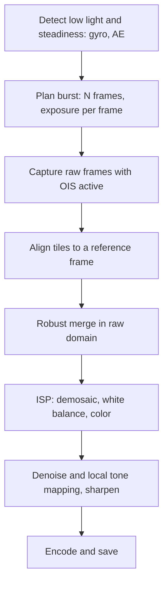

::: testing
Whether you understand that night mode is **a signal-to-noise problem solved by collecting more photons over time**, and whether you can explain the trade-offs. The interviewer wants burst capture, alignment, merging (the $\sqrt{N}$ SNR gain), motion handling, and tone mapping. Strong candidates quantify the gain, explain why a burst of short frames is not quite as good as one long exposure (read noise, but much better against motion), and mention the hardware that makes it work: OIS, gyro, ISP and neural-engine compute, and the thermal limits.
:::

::: why
Low light is where small phone sensors lose to big cameras, and night mode is how phone makers close the gap with computation rather than glass. For a hardware engineer this question touches exposure control, sensor read noise, OIS, memory bandwidth for burst capture, and the compute budget of the ISP. It also shows the modern pattern of "computational photography": the hardware gives you lots of noisy but cheap frames and algorithms combine them. See [[q0859]] for noise-reduction techniques in general.
:::

::: concepts
- **Photon shot noise**: with $S$ electrons, noise is $\sqrt{S}$, so SNR $=\sqrt{S}$ at best. More light is the only fix ([[q0856]]).
- **Read noise**: each frame readout adds a fixed noise of a few electrons rms, which matters most at very low signal.
- **Averaging independent frames**: noise adds in quadrature while signal adds linearly, so SNR grows as $\sqrt{N}$ ([[q0859]]).
- **Motion blur and shake**: longer exposures blur; OIS and gyro help ([[q0857]]).
- **Image alignment and robust merge**: frames must be registered and moving objects handled.
- **Tone mapping**: after merging, the dark scene is brightened while protecting highlights and noise ([[q0862]]).
:::

::: answer
"Night mode is really a signal-to-noise trick. In the dark, a tiny phone pixel only gets a handful of photons, so the picture is noisy because of photon shot noise, and no amount of clever amplification fixes that. The only way to increase the signal-to-noise ratio is to collect more light.

You can't just use one long exposure, because handheld shake and a moving subject would blur it. So the phone takes a burst of frames, maybe 6 to 15, each exposed for a fraction of a second. It uses the gyro to decide how long each frame can be, based on how steady you're holding it. Then it aligns all those frames, because your hand moved a bit, and merges them, throwing out areas where something moved to avoid ghosting. Averaging N frames improves SNR by the square root of N, so nine frames is 3 times better, which is almost 10 dB.

After merging, the software brightens the image with local tone mapping, runs a denoiser, often a neural network, and fixes the white balance, because night scenes have mixed lighting. OIS helps by letting each frame be longer. The trade-offs are that you need to hold still for a few seconds, moving subjects can be soft, and it costs power and compute."
:::

::: technical
**Noise model.** For a pixel with $S$ collected electrons per frame and read noise $\sigma_r$, single-frame SNR is $S/\sqrt{S+\sigma_r^2}$. Merging $N$ aligned frames in the raw (linear) domain gives signal $NS$ and noise variance $N(S+\sigma_r^2)$:

$$\text{SNR}_{stack} = \frac{NS}{\sqrt{N(S+\sigma_r^2)}} = \sqrt{N}\,\frac{S}{\sqrt{S+\sigma_r^2}}$$

So SNR grows as $\sqrt N$: 9 frames give 3x (9.5 dB); 15 frames give 3.9x (11.8 dB).

**Versus one long exposure.** A single exposure with the same total time collects $NS$ electrons but only one read: SNR $= NS/\sqrt{NS+\sigma_r^2}$. With $S = 5$ e⁻, $\sigma_r = 3$ e⁻ and $N = 9$: stack 4.0 (12.1 dB), long exposure 6.1 (15.7 dB). The burst loses about 3.6 dB to repeated read noise, but is robust to motion. When $S \gg \sigma_r^2$ the two are almost the same (at $S = 100$: 29.2 dB vs 29.5 dB).

**Exposure planning.** Total capture time is typically 1 to a few seconds handheld, longer on a tripod (the phone detects it from the gyro). The per-frame exposure is chosen from the measured shake and scene motion; if the phone is on a tripod it may use 1 s frames; if hand-held, 1/10 to 1/3 s. Gains are kept moderate; frames are stored in raw (10 to 14 bit) to merge in the linear domain.

**Alignment and merge.** Frames are aligned in tiles (for example 16 by 16 pixels) with a coarse-to-fine search, one frame is chosen as the reference (usually the sharpest), and others are merged per tile with weights that fall when the difference from the reference exceeds what noise would explain (robust merge). This is the approach published as HDR+ by Hasinoff et al. (SIGGRAPH Asia 2016).

**After merge.** The merged raw goes through the ISP like any other raw ([[q0862]]): lens shading, white balance, demosaic, then strong denoising and a local tone map that lifts shadows by several stops while holding highlights. AWB is harder in the dark because the light is usually mixed, so many phones use learned white-balance models.
:::

::: short
"Night mode fights photon shot noise by collecting more light than one handheld exposure could. The phone takes a burst of short frames, picks the exposure length from the gyro so it stays sharp, aligns the frames, and merges them while rejecting moving regions. Averaging N frames improves SNR by the square root of N. Then it tone-maps to brighten, denoises, and fixes white balance. OIS and fast compute make it practical."
:::

::: long
"The core problem is that in the dark, a phone pixel only collects a few electrons, and photon arrival is random, so noise is the square root of the signal. SNR is limited by the number of photons you collect. A 1 micron pixel in a 5 lux scene at 1/30 second collects around five electrons, so the SNR is about two. You can't amplify your way out of that.

The fix is to collect for longer. But holding a phone for three seconds blurs everything, so night mode splits it into a burst: six to fifteen frames, each short enough to be sharp. How short depends on the gyro, because the phone measures how steady you are. If it's on a tripod, it uses longer frames.

Then the software aligns the frames, because your hand drifted between them, and merges them. The merge is robust: where a frame disagrees with the reference by more than noise can explain, like a person walking, it's down-weighted so you don't get ghosts. Averaging N frames improves SNR by root N, so nine frames gives 3 times, almost 10 dB. It's slightly worse than one long exposure because every frame pays read noise, but it's much more robust to motion.

After merging, the raw image goes through the ISP: demosaic, white balance, strong denoising, and a local tone map that brightens the shadows and keeps highlights from clipping. Many phones use a neural network for denoise and white balance. OIS helps by allowing longer individual frames.

The costs are time, a few seconds of holding still, memory bandwidth to buffer raw frames, compute and heat, and moving subjects can look soft."
:::

::: terms
- **Shot noise**: random fluctuation of photon arrival, $\sqrt{S}$ electrons rms.
- **Read noise**: noise added each time the pixel array is read, in electrons rms.
- **Burst / multi-frame capture**: taking several frames in quick succession for merging.
- **Alignment (registration)**: estimating the motion between frames so they overlap.
- **Robust merge**: weighted averaging that rejects regions that disagree (movement).
- **Ghosting**: ghost images of moving objects caused by incorrect merging.
- **Tone mapping**: remapping luminance to display range, lifting shadows and holding highlights.
- **Pixel binning**: combining neighboring pixels to raise signal per output pixel.
- **Zero-shutter-lag buffer**: a ring buffer of recent frames the phone can merge with later ones.
:::

::: exceptional
An average answer says "it takes multiple photos and combines them." An exceptional answer:

- States the limit is shot noise, and shows $\text{SNR}\propto\sqrt{N}$ with a number (9 frames is about 9.5 dB).
- Explains **why a burst** instead of one long exposure: motion blur from hand shake and subject motion, versus the cost of repeated read noise.
- Mentions gyro-based exposure planning, OIS and tripod detection.
- Describes alignment, robust merging and ghost rejection.
- Mentions raw-domain merging, tone mapping, learned denoise and white balance.
- Names the hardware limits: memory bandwidth, thermal, battery, capture time.
:::

::: mistakes
- **"Night mode just boosts ISO or brightness."** Gain without light amplifies noise equally; there is no SNR gain. The merge is what adds signal.
- **"It's a long exposure."** It's a burst of shorter ones, because handheld motion would blur a long exposure.
- **"N frames gives N times better quality."** Independent noise improves as $\sqrt{N}$, so 4x the frames gives 2x the SNR (6 dB), with diminishing returns.
- **Forgetting alignment.** Without sub-pixel alignment the average blurs the image. Hand motion between frames is many pixels.
- **Ignoring read noise.** When the signal is just a few electrons per frame, read noise dominates and a burst has a cost compared with one long exposure.
- **Merging after JPEG.** Merging should happen in the linear raw domain; after gamma and sharpening, averaging is not noise-optimal.
:::

::: deep
## The physics: why dark scenes are noisy

In the dark, each pixel counts only a few photons. Photon arrivals are Poisson distributed, so for mean count $S$ the standard deviation is $\sqrt{S}$. An illustrative calculation (see the order-of-magnitude assumptions in [[q0856]]): a scene at 5 lux, reflectance 0.18, f/1.8 lens, 1.0 µm pixel, QE 0.6, and 1/30 s exposure collects about 5 electrons. The SNR is about $5/\sqrt{5+9} = 1.3$, which is basically noise. Raising ISO multiplies signal and noise by the same factor and cannot help.

Three levers exist for more photons: bigger pixels or sensor (hardware), a faster lens (hardware), or longer total exposure (time). Phones cannot change the first two much, so night mode changes the third.

## Burst merge: the equations

For $N$ frames with $S$ signal electrons each and read noise $\sigma_r$, summing gives signal $NS$ and variance $N(S+\sigma_r^2)$, as derived in the technical section. The next plot compares stacking to one long exposure for several light levels.

```plot
{"title":"SNR gain from stacking N frames (read noise 3 e⁻/frame)","x":{"label":"Number of frames N","unit":"","min":1,"max":16},"y":{"label":"SNR","unit":"dB","min":-6,"max":30},
 "vars":{"rn":3},
 "series":[{"label":"S = 2 e⁻/frame, stacked","fn":"20*log10(x*2/sqrt(x*(2+rn*rn)))"},{"label":"S = 5 e⁻/frame, stacked","fn":"20*log10(x*5/sqrt(x*(5+rn*rn)))","color":"green"},{"label":"S = 5 e⁻/frame, one long exposure","fn":"20*log10(x*5/sqrt(x*5+rn*rn))","dashed":true,"color":"green"},{"label":"S = 20 e⁻/frame, stacked","fn":"20*log10(x*20/sqrt(x*(20+rn*rn)))","color":"orange"}],
 "points":[{"x":9,"y":12.1,"label":"9 frames: 12.1 dB"}]}
```
Figure: Stacking gains about 3 dB every time N doubles. The dashed curve is one long exposure with the same total time: it's higher at the lowest light because it pays read noise once, but it cannot be used handheld. Notice that at higher signal (orange) stacking costs almost nothing compared with a long exposure.

Quantitatively for $S = 5$ e⁻: 1 frame 2.5 dB, 4 frames 8.5 dB, 9 frames 12.1 dB, 15 frames 14.3 dB (stack); the equivalent long exposures give 11.4, 15.7 and 18.3 dB for 4, 9 and 15. The 3 to 4 dB gap is the cost of reading the sensor 9 or 15 times.

> [!TIP]
> If the interviewer asks why the burst is worse than a long exposure, say "read noise is paid on every frame". If they ask why use it anyway, say "motion". Sensors with very low read noise (below 1 e⁻) shrink the gap.

## The pipeline from button to image


Figure: The sequence for a night capture. The exposure plan depends on gyro readings, and the merge happens in the linear raw domain before the rest of the ISP chain.

**1. Planning.** The camera sees a dim scene from auto exposure and checks the gyro. If the phone is steady (or on a tripod) it picks fewer, longer frames; if shaky, many shorter frames. A typical total time budget is 1 to 6 seconds in the viewfinder UI (varies by phone and mode), and the on-screen timer you see is the burst length.

**2. Capture.** OIS ([[q0857]]) is active during the burst and allows each frame to be around 2 to 4 stops longer. Frames arrive over MIPI into DRAM as raw Bayer frames. A 12 MP raw frame at 10 bits is about 15 MB, so 15 frames are 225 MB, which is one reason these modes need fast memory and why the phone may need several hundred milliseconds to process.

**3. Align.** One frame is the reference. Others are broken into tiles, and a coarse-to-fine pyramid search finds the motion of each tile, to sub-pixel accuracy. Moves from hand shake are mostly a few pixels. Accurate gyro data gives the initial guess.

**4. Merge.** For each tile, the weight of an alternate frame depends on its difference from the reference relative to the expected noise (which depends on signal level). If the difference is larger than noise explains (a moving car, hair, waving hand) the weight falls, and the reference frame supplies that region. Some pipelines merge in the frequency domain, which suppresses noise but keeps edges.

**5. Finish.** After the merge, the noise is lower by about $\sqrt{N}$, but still visible when shadows get brightened by 4 to 6 stops. The ISP applies tone mapping and a learned denoiser. White balance needs care: night scenes mix sodium, LED, and moonlight; many systems use a neural network trained on labeled night images for AWB.

## What the hardware has to provide

| Block | Why it matters for night mode |
|---|---|
| Sensor with low read noise, large pixels or binning | raises per-frame SNR; binning 2x2 gives 4x the signal per output pixel |
| Fast lens (f/1.4 to f/1.8) | 1 stop faster doubles the light |
| OIS and gyro | longer sharp frames, planning |
| DRAM bandwidth and capacity | buffering many raw frames |
| ISP and NPU | merge, denoise, tone-map in about 1 s |
| Thermal and power budget | burst processing is a heavy load for the SoC |

**Binning example.** With $S = 5$ e⁻ per pixel and $\sigma_r = 3$ e⁻, summing four pixels in the charge domain gives signal 20 and noise $\sqrt{20 + 9}$, SNR 3.7 (11.4 dB), whereas digital summing of four reads gives noise $\sqrt{20 + 36}$, SNR 2.7 (8.6 dB). Charge-domain binning is better because read noise is paid once. That is why 50 MP sensors bin to 12.5 MP in the dark.

## Limits and failure modes

- **Moving subjects** cannot be sharp across a 3 s capture; the merge freezes only the reference frame's version, so a person may look slightly soft or have ghost edges.
- **Very low light** (below about 0.1 lux): frames are so short on signal that alignment itself becomes noisy, so alignment uses gyro data and downsampled, filtered frames.
- **Bright light sources** in the dark scene (street lamps) need a short-exposure frame or HDR bracketing to avoid clipping; many pipelines mix long and short frames.
- **Over-processing** creates "plastic" textures from denoising and hallucinated detail from neural networks.

## Experiment with it

```sim
{"id":"sensor-calibration","offset":0,"gain":1,"nonlin":0,"noise":0.3}
```
Figure: This sim shows noise on repeated measurements. Increase the noise then use the averaging control and watch the scatter shrink as the square root of the number of averaged samples. Night mode does the same with image frames.
:::

::: applications
- **Smartphone night modes**: handheld low-light photos merged from 6 to 15 raw frames.
- **Astrophotography modes**: tripod-detected captures of 1 to 4 minutes total made from stacked 10 to 20 s frames, as on some phones.
- **Video low-light enhancement**: temporal denoising across consecutive frames with motion compensation, within the real-time budget.
- **Security and automotive cameras**: temporal and spatial noise reduction at night under limited frame time.
- **Scientific imaging**: frame stacking in astronomy, which is the same noise-averaging theory with cooled sensors.
:::

::: assumptions
- Independent per-frame noise: shot and read noise are uncorrelated between frames, so variance adds. Fixed-pattern noise is **not** reduced by averaging (it repeats every frame) and must be calibrated out.
- Perfect alignment and no scene change. Real merges lose some benefit from misalignment and rejected regions.
- Merging in the linear raw domain. Merging after gamma changes the noise statistics.
- Numbers (5 e⁻ per frame, 3 e⁻ read noise) are illustrative; real phone sensors have read noise from below 1 to a few electrons depending on gain and design, and photon counts depend on spectrum.
- Specific vendor pipelines (frame counts, exposures, learned models) differ and are proprietary; the HDR+ burst pipeline is the published reference.
:::

::: followups
### Why not just use one long 3 second exposure?
Hand shake and subject motion would blur it ($b = f\omega T$ gives hundreds of pixels at 3 s: about 590 µm, or 590 px at 1 µm pitch, for a steady 2°/s, see [[q0857]]). A burst of 1/3 s frames can be aligned to sub-pixel accuracy, and moving regions can be rejected. A single long exposure has slightly better SNR (one read instead of nine), but only useful on a tripod, which is why phones switch to longer frames when they detect a stable mount.

### How many frames do you need to double the SNR?
SNR grows as $\sqrt{N}$, so four frames double it (6 dB). To get another 6 dB you need 16 frames, then 64. That diminishing return, together with motion and heat, is why phones stop at 10 to 15 frames and use a denoising network for the rest.

### Does merging reduce fixed-pattern noise or hot pixels?
No. Fixed-pattern noise is the same in every frame, so it stays after averaging. It's removed with calibration (dark-frame subtraction, defect pixel maps, gain correction) in the ISP. This is a good reason to do calibration of black level and defective pixels before merging.

### How would you decide the per-frame exposure time?
Use the gyro to estimate the rotation rate during the preview, then pick the longest time $T$ such that blur $f\omega T$ stays under about 1 pixel after OIS suppression, and also bound it by scene motion from frame differencing and by the sensor's maximum exposure. With $f = 5.6$ mm, $\omega = 2^\circ$/s and 10x OIS, $T \approx 51$ ms; on a tripod ($\omega\approx0$) you can use 0.5 to 1 s frames.

### Scenario: night mode shots are noisy but clean in the center and have colored blotches in the corners. What do you check?
Lens shading gain increases toward the corners, amplifying noise and color casts (since each color channel has different shading). Check that the lens shading map is correct for the current color temperature, that denoising strength is spatially adaptive to the shading gain (corner gains can reach 2 to 3x), and that the white balance is not locked to a wrong illuminant. Also check that the burst was not merged with misalignment at the edges.
:::

::: interpretations
"How does night mode work?" can be answered as a pure algorithms story, but as a hardware question, the interviewer likely wants the signal chain: shot noise, burst, OIS, merging and the supporting hardware. I answer at that level and treat vendor specifics as proprietary. See [[q0863]] for the timeline of a normal capture, of which night mode is an extended version.
:::

::: references
- Hasinoff et al., "Burst photography for high dynamic range and low-light imaging on mobile cameras," ACM SIGGRAPH Asia 2016 (the HDR+ pipeline).
- Janesick, *Photon Transfer*: shot noise, read noise and SNR for image sensors.
- Gonzalez and Woods, *Digital Image Processing*: image averaging, noise reduction and registration.
- Nakamura (ed.), *Image Sensors and Signal Processing for Digital Still Cameras*: noise sources, binning and processing.
:::

::: rubric
- Identifies photon shot noise (low photon count) as the root problem :: The solution only makes sense if you know what limits SNR.
- Explains burst capture of multiple short frames rather than one long exposure :: This is the defining design decision of night mode.
- States that averaging N frames improves SNR by $\sqrt{N}$, with a number :: Shows quantitative understanding.
- Describes alignment and robust merging with motion/ghost rejection :: Merging only works if frames are registered and moving areas handled.
- Mentions gyro/OIS for exposure planning and sharper frames :: Ties the algorithm to the hardware.
- Mentions tone mapping, denoising and white balance after the merge :: A merged raw is still dark and noisy.
- Mentions trade-offs: capture time, motion, compute, memory bandwidth, read noise cost :: Shows engineering judgment.
:::

::: quiz
```json
[
 {"type":"mcq","level":"fundamental","q":"Why does night mode capture several short frames rather than just raising ISO?","options":["Higher ISO collects more photons","Averaging frames increases the total photons collected and improves SNR; ISO only amplifies signal and noise","ISO cannot be changed on phones","Short frames have no noise"],"answer":1,"explain":"ISO gain amplifies both signal and noise, so SNR does not improve. Merging N frames adds the signal linearly and noise in quadrature, giving a $\\sqrt{N}$ SNR gain."},
 {"type":"numeric","level":"fundamental","q":"By what factor does SNR improve when 16 independent frames are averaged (shot-noise limited)?","answer":4,"tolerance":0.01,"unit":"x","explain":"SNR scales as $\\sqrt{N} = \\sqrt{16} = 4$ (12 dB)."},
 {"type":"numeric","level":"intermediate","q":"Each frame collects S = 5 e⁻ with 3 e⁻ read noise. What is the SNR in dB after stacking 9 frames in the raw domain?","answer":12.1,"tolerance":0.03,"unit":"dB","explain":"SNR $= 9\\cdot5/\\sqrt{9(5+9)} = 45/11.22 = 4.01$, and $20\\log_{10}(4.01) = 12.1$ dB."},
 {"type":"mcq","level":"intermediate","q":"Same total light: why is one 9x-longer exposure slightly better in SNR than a 9-frame stack at very low signal?","options":["It has less shot noise","It reads the sensor once, so read noise is paid once instead of nine times","Stacking adds quantization error only","Stacking cannot average noise"],"answer":1,"explain":"Shot noise is the same for the same total photons. The stack has nine reads, each adding $\\sigma_r^2$, so total variance is larger; for S = 5 e⁻ and 3 e⁻ read noise the gap is about 3.6 dB."},
 {"type":"truefalse","level":"advanced","q":"Averaging many frames also removes fixed-pattern noise such as hot pixels.","answer":false,"explain":"Fixed-pattern noise repeats identically in every frame, so averaging does not reduce it. It must be removed by calibration such as dark-frame subtraction or a defect pixel map."},
 {"type":"numeric","level":"advanced","q":"With charge-domain 2x2 binning, four pixels with S = 5 e⁻ each and 3 e⁻ read noise are summed before readout. What is the SNR (linear)?","answer":3.71,"tolerance":0.03,"unit":"","explain":"Signal 20 e⁻, noise $\\sqrt{20+9} = 5.39$, SNR $= 20/5.39 = 3.71$. (Digital summing of four reads would give $20/\\sqrt{20+36} = 2.67$.)"}
]
```
:::
