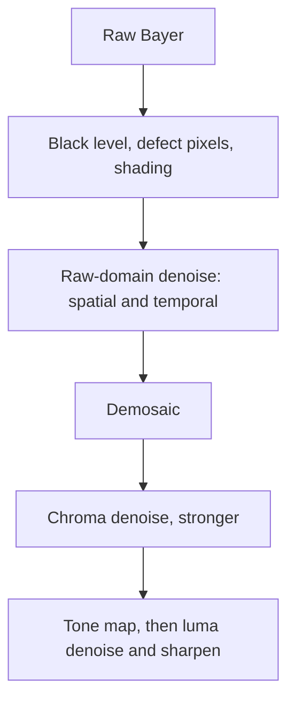

::: basics
### In plain words
Image noise is the random grain in a photo. It has different sources, and each needs a different fix. You can collect more light, make the electronics quieter, calibrate away patterns that repeat every frame, or smooth the picture in software. Software smoothing is the last resort, because it can wipe out real detail.

### Picture it
Imagine talking to a friend at a loud party. You can get closer or speak up, which is like collecting more light. You can step away from the speakers, which is like quieter electronics. A steady hum from a fridge is the same every second, so you can learn it and mentally subtract it, like calibration. Last, your brain guesses muffled words, like software denoising, and sometimes guesses wrong. The party picture is loose about the hum: only noise that repeats exactly can be subtracted.

### Words you need
- **Shot noise**: random variation in how many photons land on a pixel. Only more light reduces it.
- **Read noise**: electronic noise added each time the sensor is read out.
- **Dark current**: unwanted electrons made by heat, even with no light.
- **Fixed-pattern noise**: pixel-to-pixel differences that are identical in every frame, such as a hot pixel.
- **Binning**: combining neighboring pixels into one bigger pixel to gain signal.

### The simplest example
Say each frame has random noise of 8 counts, and one hot pixel reads 10 counts too high in every frame. Average 4 frames. The random noise drops to 4, because it shrinks by the square root of the number of frames. The hot pixel still reads 10 too high, since it is the same every time. To fix that, take pictures with the lens capped, average them into a dark frame, and subtract it from your photos. That is the whole idea: match each fix to its noise source. The rest of this page shows how to tell the sources apart, and what each fix costs in light, time or detail.
:::

::: testing
Whether you can **classify noise by source** and match each technique to the source it attacks. The interviewer wants more than "use a filter": collect more photons (aperture, exposure, pixel size, binning, stacking), reduce electronic noise (CDS, lower read noise, cooling, clean power), calibrate fixed patterns (dark frame, flat field, defect maps), and denoise in processing (spatial, temporal, learned) with the cost of each. Strong candidates also say which noise cannot be removed by averaging, and what denoising costs in detail.
:::

::: why
Noise sets the usable low-light limit of every camera and also affects compression, machine-vision accuracy and feature detection. A hardware engineer picking a sensor, designing the power supply for a camera module, or tuning an ISP needs to know which noise term dominates in which regime, because the fix is different in each. It's also a good test of whether you can reason from a noise model rather than guess.
:::

::: concepts
- **Photon shot noise**: $\sqrt{S}$ electrons, fundamental, only fixed by collecting more light ([[q0856]], [[q0858]]).
- **Read noise**: constant electronic noise per readout, reduced by sensor design, CDS and lower analog gain stages.
- **Dark current and its shot noise**: thermally generated electrons that roughly double every 6 to 8 °C (vendor-dependent).
- **Fixed-pattern noise (FPN) and PRNU**: pixel-to-pixel offset and gain variations that are the same each frame, so averaging does not remove them.
- **Quantization noise**: $\text{LSB}/\sqrt{12}$ from the ADC ([[q0808]]).
- **Spatial and temporal filtering**: trade noise for blur or ghosting ([[q0862]]).
:::

::: answer
"I split it into three buckets: get more signal, make the electronics quieter, and clean up in processing.

For more signal, noise in a camera is mostly photon shot noise, so you want more photons: a wider aperture, a longer exposure, bigger pixels or pixel binning, or combine many frames, which is what night mode does. Averaging N frames gives a square-root-of-N improvement.

For quieter electronics, you want a low-read-noise sensor with correlated double sampling, a clean analog supply, a good layout so digital noise doesn't couple in, and keep the sensor cool because dark current doubles every few degrees. Using the sensor's native low-gain mode, or its dual-conversion-gain mode, avoids amplifying noise.

Then there's calibration: fixed-pattern noise doesn't average away, so you subtract a dark frame, map out hot pixels and correct pixel-to-pixel gain with a flat field.

Finally, in the ISP, denoising: spatial filters like bilateral or non-local-means, temporal filtering across frames for video, and increasingly neural networks. The trade-off is always detail: every filter that removes noise risks smoothing real texture, so you denoise chroma harder than luma and you do it before sharpening and on raw data when possible."
:::

::: technical
**Noise model.** In electrons, total temporal noise variance per pixel is $\sigma^2 = S + \sigma_r^2 + I_dT + \sigma_q^2$ (shot, read, dark shot, quantization), plus fixed pattern terms $\sigma_{FPN}^2 + (\text{PRNU}\cdot S)^2$. Photon transfer analysis plots $\sigma$ against mean on log-log axes: slope 0 at low signal (read noise), slope 1/2 (shot noise), and slope 1 at high signal (PRNU, typically about 0.5 to 2 percent of signal for CMOS sensors; varies).

**Attack the signal.** SNR $\propto\sqrt{S}$. Doubling the aperture area, exposure time or pixel area doubles $S$ and gives +3 dB. Averaging $N$ independent frames gives $+10\log_{10}N$ dB. Charge-domain binning of 4 pixels raises signal 4x while paying read noise once.

**Attack read noise.** Correlated double sampling removes reset noise ($\sqrt{kTC}$ tens of e⁻) and low-frequency 1/f noise. Higher conversion gain (smaller floating-diffusion capacitance) lowers input-referred read noise. Dual conversion gain (DCG) pixels switch capacitance: high gain in the dark for about 1 to 2 e⁻ read noise, low gain in bright scenes for full-well capacity. Analog gain before the ADC reduces the effect of ADC noise on the input referred signal. Power supply noise couples into row/column noise, so low-noise LDOs for analog and good decoupling matter.

**Attack dark current.** Dark current roughly doubles per 6 to 8 °C, so 20 °C hotter gives about 8x more dark electrons. Cooling (astronomy) or short exposures help; for phones, thermal design and limiting exposure time matter.

**Calibrate fixed patterns.** Subtract a master dark frame (mean of $M$ dark frames: residual noise factor $\sqrt{1+1/M}$, so $M \geq 16$ gives only 3 percent extra noise; subtracting a single dark adds $\sqrt2$ to random noise). Apply a flat-field gain map for PRNU and lens shading, and a defect pixel map.

**Process.** Spatial: Gaussian ($\sigma = 1$ px gives 3.5x or 11 dB noise reduction in white noise but blurs), bilateral (edge-preserving), non-local means, BM3D, wavelet shrinkage. Temporal: motion-compensated averaging. Learned denoisers trained on paired noisy/clean raw data. Apply to raw Bayer before demosaicing, because demosaicing makes noise spatially correlated and harder to remove.
:::

::: short
"I group it into three: more signal, quieter electronics, and cleanup. For signal, shot noise dominates so use more photons: wider aperture, longer exposure, bigger pixels or binning, and frame stacking, which gives root N. For electronics: low-read-noise sensor with correlated double sampling, clean analog supply, low gain, cooling. For fixed patterns, calibrate with dark frames, flat fields and a defect map. Then denoise in the ISP with spatial, temporal or learned filters, accepting a detail trade-off."
:::

::: long
"The way I'd answer is to first split noise by source, because each source has a different fix.

Photon shot noise is fundamental: it's the square root of the number of photons collected. The only fix is more signal. Open the aperture, expose longer, use a sensor with bigger pixels, bin pixels, which sums charge and pays read noise once, or stack frames, which gives a root-N improvement. That's what night mode does.

Read noise is the electronics: the source follower, the column amplifier, the ADC. Good sensors use correlated double sampling to cancel reset noise and 1/f noise, and dual conversion gain to get one or two electrons of read noise in the dark. From the board side, I'd care about a clean analog supply with good decoupling, because supply ripple shows up as row or column banding, and about keeping digital clocks and MIPI lanes away from analog.

Dark current is thermal. It doubles every six to eight degrees, so heat from the SoC hurts long exposures. Cooling or shorter exposures help.

Fixed-pattern noise is the same every frame, so averaging won't help. You calibrate it: master dark frame subtraction, flat-field correction for pixel gain and lens shading, and a defect pixel map.

Finally, in the ISP, denoise: spatial filters like bilateral or non-local means, temporal filters for video, now often neural networks. Denoise on raw before demosaic and treat chroma more aggressively than luma. The price is lost texture, so I'd tune it by looking at the noise-versus-detail trade-off, not just maximum noise reduction."
:::

::: terms
- **Shot noise**: $\sqrt{S}$ randomness of photon arrivals.
- **Read noise**: electronic noise per frame readout, in electrons rms.
- **Dark current**: thermally generated charge that accumulates with time and temperature.
- **FPN / PRNU**: fixed-pattern noise (offset) and photo-response non-uniformity (gain), same in every frame.
- **Correlated double sampling (CDS)**: subtracting reset level from signal level to cancel reset noise and low-frequency noise.
- **Binning**: combining neighboring pixels (ideally in the charge domain) to boost signal per output pixel.
- **Dual conversion gain (DCG)**: pixel that switches between high and low gain for low-light noise and high dynamic range.
- **Dark frame**: an exposure taken with no light, used to subtract dark current and FPN.
- **Flat field**: an image of a uniform light source, used to correct pixel gain and shading.
- **Bilateral / non-local means**: edge-preserving spatial denoisers.
:::

::: exceptional
An average answer lists "denoise filters and a bigger sensor." An exceptional answer:

- Splits noise by source (shot, read, dark, fixed pattern, quantization) and maps each to a fix.
- Points out which noise cannot be averaged away (fixed pattern) and which cannot be fixed electronically (shot noise, only by collecting more light).
- Uses numbers: root-N stacking, doubling of dark current per 6 to 8 °C, master-dark noise penalty, filter noise-reduction factor.
- Brings in the hardware side: CDS, DCG, analog supply and layout, thermal design.
- Says to denoise **early** (raw domain, before demosaic and sharpening) and discusses the noise vs detail trade-off, for example stronger chroma denoise than luma.
:::

::: mistakes
- **Treating "noise" as one thing.** Shot noise, read noise and FPN need different treatments; averaging does nothing for FPN.
- **Raising ISO to reduce noise.** ISO doesn't improve shot-noise SNR. It can reduce the impact of downstream noise (ADC), but not the photon noise.
- **Subtracting a single dark frame.** It adds the dark frame's random noise, increasing noise by $\sqrt{2}$. Use an averaged master dark.
- **Over-smoothing.** A strong spatial filter removes noise but also texture, giving "plastic" skin and watercolor effects. Sharpening then amplifies leftover noise.
- **Denoising after demosaic and compression.** Demosaic correlates noise between neighboring pixels; JPEG blocks make it much harder.
- **Ignoring the board.** Supply ripple and ground noise show up as row/column banding that no software denoiser handles well.
:::

::: deep
## A noise budget from first principles

Start with a pixel that collects $S$ electrons. Its variance in electrons squared is:

$$\sigma_{tot}^2 = \underbrace{S}_{\text{shot}} + \underbrace{\sigma_r^2}_{\text{read}} + \underbrace{I_d T}_{\text{dark shot}} + \underbrace{\frac{\Delta^2}{12}}_{\text{quantization}} + \underbrace{(\text{PRNU}\cdot S)^2}_{\text{gain FPN}}$$

where $\Delta$ is the ADC LSB expressed in electrons. A 10-bit ADC over a 6000 e⁻ full well has $\Delta = 5.9$ e⁻, giving quantization noise of 1.7 e⁻ rms, comparable to read noise, which is why sensors use 12 bits or more, or put enough analog gain ahead of the ADC.

The **photon transfer curve (PTC)** plots measured $\sigma$ vs mean on log-log axes and shows the regimes directly. With conversion gain $K = 0.25$ DN/e⁻, read noise 3 e⁻ and PRNU of 1 percent:

```plot
{"title":"Photon transfer curve: noise vs mean signal","x":{"label":"Mean signal","unit":"DN","min":1,"max":1000,"log":true},"y":{"label":"Noise σ","unit":"DN","min":0.3,"max":30,"log":true},
 "vars":{"k":0.25,"rn":3,"prnu":0.01},
 "series":[{"label":"Total noise","fn":"sqrt(k*x + (k*rn)^2 + (prnu*x)^2)"},{"label":"Read noise floor","fn":"k*rn+0*x","dashed":true,"color":"muted"},{"label":"Shot noise only","fn":"sqrt(k*x)","dashed":true,"color":"green"},{"label":"PRNU only","fn":"prnu*x","dashed":true,"color":"red"}]}
```
Figure: At low signal the read-noise floor (gray) dominates; in the middle, shot noise rises with slope 1/2 (green); at high signal PRNU (red, slope 1) takes over. A fix that targets the wrong regime does nothing: bigger aperture helps the middle region, CDS and DCG lower the floor, flat-fielding lowers the red line, and stacking cannot touch the red line at all.

The crossover from read-noise-limited to shot-noise-limited happens when $S = \sigma_r^2$, i.e. at 9 electrons here. A phone in low light is often near or below that point, which is why read noise and binning matter so much in the dark.

## Attack 1: more signal

| Technique | Signal gain | SNR gain (shot-limited) | Cost |
|---|---|---|---|
| Wider aperture (f/2.8 to f/1.8) | $(2.8/1.8)^2 = 2.4\times$ | 1.55x (+3.8 dB) | lens size, depth of field |
| Longer exposure (1/60 to 1/15 s) | 4x | 2x (+6 dB) | motion blur |
| Larger pixel pitch (1.0 to 1.4 µm) | 1.96x | 1.4x (+2.9 dB) | resolution or sensor size |
| 2x2 charge binning | 4x | 2x (+6 dB) | resolution drops 4x |
| N-frame stacking | N x total | $\sqrt{N}$ | time, motion, compute |

In the shot-noise limit SNR $=\sqrt{S}$, so 4x the light gives 2x the SNR, which is 6 dB in the amplitude convention ($20\log_{10}2$) used throughout this page.

## Attack 2: quieter electronics

**CDS.** After reset, the floating diffusion holds a random voltage with rms $\sqrt{kT/C}$. For $C = 1.5$ fF at 300 K: $\sqrt{4.14\times10^{-21}/1.5\times10^{-15}} = 1.66$ mV, which at a conversion gain of 107 µV/e⁻ is about 15 e⁻ rms. Sampling reset and signal and subtracting cancels it, since the same random charge appears in both. CDS also cancels slowly varying offsets and suppresses 1/f noise.

**Conversion gain.** Read noise referred to the input is $\sigma_r = v_n/\text{CG}$, where $v_n$ is the voltage noise of the readout chain. Halving $C_{FD}$ doubles CG and halves $\sigma_r$ in electrons, at the expense of full-well capacity. DCG pixels switch between a small-capacitance, high-gain mode (for the dark parts) and a large-capacitance mode (for bright parts). Typical read-noise numbers quoted for modern CMOS sensors range from below 1 e⁻ for some special sensors to a few e⁻ for phones (varies by vendor and gain setting).

**Analog gain and ADC noise.** Quantization noise and ADC noise are fixed in LSBs. Analog gain $G$ ahead of the ADC divides their input-referred contribution by $G$. This is why higher ISO can show lower input-referred read noise in electrons, even though it doesn't help shot noise. Each sensor has a gain beyond which there's no improvement.

**Supply and layout.** A 1 mV ripple on an analog rail with 60 dB PSRR becomes 1 µV at the pixel output, which at 107 µV/e⁻ is 0.01 e⁻, harmless, but a switching-regulator ripple at a frequency that beats with the row time shows up as horizontal bands. Rows are read sequentially, so a supply disturbance that is periodic in time becomes periodic in the vertical direction. Practical rules: LDO or filtered supply for analog rails, a solid ground plane with analog and digital return currents kept in separate regions (rather than ad-hoc split planes), keep the MIPI D-PHY traces and switching inductors away from the sensor's analog supply pins, and add local decoupling at each supply pin. Compare [[q0860]] for how light level changes which noise dominates.

## Attack 3: dark current

Dark current electrons accumulate as $N_d = I_d T$ and their *mean* can be subtracted but their shot noise $\sqrt{N_d}$ stays. Dark current roughly doubles every 6 to 8 °C (at 6.5 °C per doubling, +10 °C is 2.9x, +30 °C is 24.5x). A phone sensor going from 25 °C to 55 °C while recording can see dark current rise by more than 20x, which is why hot phones show noisier, hotter-pixel images in long exposures. That value changes between process and design, so I treat it as a rule of thumb.

> [!UNCERTAIN]
> The doubling temperature for dark current depends on the sensor technology and the dark-current mechanism (diffusion vs generation). Values from about 5 to 9 °C per doubling are quoted; the point is exponential growth with temperature.

## Attack 4: calibrate the fixed patterns

1. **Dark frame:** average $M$ frames with the lens capped at the same exposure and temperature. Subtract it. The leftover random noise is $\sqrt{1 + 1/M}$ times the original ($M=16$: 3 percent).
2. **Flat field:** average frames of a uniform light source, divide to correct each pixel's gain and the lens shading.
3. **Defect map:** hot, stuck and dead pixels are stored (factory test) and replaced by neighbors' interpolation.

## Attack 5: denoise in processing


Figure: Noise is easiest to model, and remove, in the raw linear domain where its variance follows $\sigma^2 = aS + b$. After demosaic and gamma, the noise is correlated and signal-dependent in complicated ways.

**Spatial filters.** A Gaussian of standard deviation $\sigma$ has effective averaging area $4\pi\sigma^2$ pixels, so white noise std is reduced by about $\sqrt{4\pi}\sigma$: 2.4x for $\sigma=0.7$, 3.5x for $\sigma=1$, 5.3x for $\sigma=1.5$ (computed with an 11x11 kernel). But a Gaussian blurs edges identically. **Bilateral** filters weight by both distance and intensity difference, preserving edges. **Non-local means** and **BM3D** average similar *patches* from anywhere in the image, preserving texture better. **Wavelet shrinkage** thresholds small coefficients.

**Temporal filters.** If the scene is static, averaging across frames is much better than spatial filtering because there is no blur. In video, motion compensation first, then an IIR or FIR average with weights reduced where motion is detected. Overdoing it causes ghosting, trailing and "dirty window" artifacts.

**Learned denoisers.** Networks trained on pairs of noisy and clean raw frames with the right noise model can beat classical methods at the same blur. Risks include hallucinated texture and sensitivity to sensors they weren't trained on.

**Chroma versus luma.** The eye is less sensitive to color noise, so ISPs smooth chroma strongly (2 to 4 pixels) and luma lightly, then sharpen afterwards by a controlled amount so noise doesn't get boosted.

## Experiment with it

```sim
{"id":"sensor-calibration","offset":0.2,"gain":1.05,"nonlin":0.0,"noise":0.15}
```
Figure: Pay attention to how the error is made of a *systematic* part (offset and gain, which calibration removes and averaging does not) and a *random* part (noise, which averaging reduces by root N). Camera noise has the same split: fixed pattern is calibrated, temporal noise is averaged.
:::

::: applications
- **Phone night mode and HDR**: multi-frame raw stacking with robust merge ([[q0858]]).
- **Astrophotography**: cooled sensors, master dark/flat/bias calibration and stacking of hundreds of frames.
- **Machine vision and inspection**: flat-field and defect correction on the camera, because FPN would otherwise appear as false defects.
- **Automotive cameras**: DCG or split-pixel sensors with hardware temporal noise reduction at 30 to 60 fps.
- **Medical and microscopy imaging**: low-read-noise (sCMOS) sensors with correlated double sampling and binning.
- **Video conferencing and webcams**: temporal denoise to keep bitrates low in dim rooms.
:::

::: assumptions
- Noise is described by the standard **Poisson-Gaussian** model: Poisson shot noise plus Gaussian read noise. Real sensors have additional row noise, random telegraph noise (RTN) and non-Gaussian tails.
- Quoted figures such as 1 percent PRNU, 3 e⁻ read noise, a dark-current doubling temperature of 6.5 °C and 107 µV/e⁻ conversion gain are illustrative; they vary by sensor and settings.
- Spatial filter numbers assume **white** noise; noise after demosaicing is correlated, so measured reduction is smaller.
- For CCD or scientific cameras, cooling is the main dark-current approach; for phones, it isn't practical.
- If the interviewer is thinking of audio or analog circuits, replace "photon shot noise" with thermal and shot noise of the sensor circuit, but the same approach of splitting by source applies ([[q0873]]).
:::

::: followups
### Why can't you remove photon shot noise with a better sensor or circuit?
It comes from the physics of light itself: photons arrive randomly (Poisson), so even a perfect sensor sees $\sqrt{S}$ rms fluctuations. The only options are to collect more photons or to use prior knowledge about the scene (denoising, which trades noise for assumptions).

### When does binning beat just averaging pixels digitally?
When read noise matters. Charge-domain binning sums the electrons before readout, paying read noise once. Digital binning sums after readout and adds the read noise of each pixel in quadrature. For $S = 5$ e⁻ per pixel, 3 e⁻ read noise: charge binning SNR 3.7 vs digital 2.7. At high signal both are the same.

### You see horizontal bands that drift across the image. What do you check first?
Row-synchronous noise from supply ripple or ground bounce, especially a switching regulator at a frequency close to the line rate. Check with a scope on the analog rails during readout, look for the ripple frequency, and compare to the row time. The fix is a filtered or LDO supply, better decoupling, moving the switcher frequency or spread spectrum, or a layout change. A denoiser would only mask it.

### Is denoising before or after demosaic better, and why?
Before, in the raw domain. The noise there is independent per pixel with a known signal-dependent variance, so filters can be tuned precisely. After demosaicing, interpolation correlates noise between neighbors and between color channels, so it looks like blotchy low-frequency chroma noise that is much harder to remove.

### Scenario: a prototype camera is noisy at 45 °C but fine at 25 °C in 1 s exposures. How do you separate dark current from other effects?
Take dark frames (lens capped) at both temperatures and compare mean and variance. If the mean level and variance grow with temperature and exposure time, it's dark current: at 6.5 °C per doubling, +20 °C is about 8x. If it only appears with bright scenes, it's PRNU or processing. Then check thermal design: sensor-to-SoC thermal coupling, and whether the module can be shielded from the heat source.
:::

::: interpretations
"Image noise" in a hardware interview usually means sensor and ISP noise. If the interviewer means *compression artifacts* or *video noise*, the principles of source classification and temporal filtering still apply. See [[q0860]] for how light level changes which noise dominates, and [[q0873]] for the general method of characterizing measurement error.
:::

::: references
- Janesick, *Photon Transfer*: the photon transfer curve and the classification of noise sources.
- EMVA Standard 1288: a measurement standard for sensor noise, linearity and dynamic range.
- Buades, Coll and Morel, "A non-local algorithm for image denoising" (CVPR 2005), and Dabov et al., "Image denoising by sparse 3-D transform-domain collaborative filtering" (BM3D, IEEE Trans. Image Processing 2007).
- Gonzalez and Woods, *Digital Image Processing*: spatial filtering and noise models.
:::

::: rubric
- Splits noise by source (shot, read, dark, fixed pattern, quantization) :: Each source has a different fix, so classification comes first.
- Says shot noise needs more photons: aperture, exposure, pixel size, binning, stacking :: It's the dominant noise in most conditions.
- Mentions $\sqrt{N}$ for frame averaging :: Quantifies the benefit of stacking.
- Mentions read-noise reduction: CDS, conversion gain/DCG, clean supply and layout :: Hardware-level fixes an engineer controls.
- Mentions dark current and temperature dependence (and cooling or thermal design) :: Real-world effect in hot devices.
- Mentions calibration of fixed-pattern noise (dark frame, flat field, defect map) and that averaging doesn't remove it :: A classic point that separates strong answers.
- Describes ISP denoising (spatial, temporal, learned) and the noise vs detail trade-off :: Shows awareness that every software fix has a cost.
:::

::: quiz
```json
[
 {"type":"mcq","level":"fundamental","q":"Which noise source is NOT reduced by averaging many frames?","options":["Photon shot noise","Read noise","Fixed-pattern noise","Dark-current shot noise"],"answer":2,"explain":"Shot, read and dark-shot noise are random from frame to frame, so they average down as $\\sqrt N$. Fixed-pattern noise is identical in every frame, so it needs calibration (dark/flat/defect map)."},
 {"type":"truefalse","level":"fundamental","q":"A single dark frame subtraction cleans the random noise of the dark current without adding any noise.","answer":false,"explain":"The single dark frame has its own random noise, which adds in quadrature: total random noise rises by $\\sqrt2$. Use the average of many dark frames (master dark)."},
 {"type":"numeric","level":"intermediate","q":"Dark current is 5 e⁻/s at 25 °C and doubles every 6.5 °C. What is it at 51 °C (e⁻/s)?","answer":80,"tolerance":0.02,"unit":"e⁻/s","explain":"ΔT = 26 °C gives 26/6.5 = 4 doublings, so 16x, and 5 × 16 = 80 e⁻/s."},
 {"type":"numeric","level":"intermediate","q":"A master dark is built from M = 4 dark frames and subtracted from the image. By what factor does the random noise (relative to the image's own) increase?","answer":1.118,"tolerance":0.02,"unit":"x","explain":"Residual random noise factor is $\\sqrt{1+1/M} = \\sqrt{1.25} = 1.118$."},
 {"type":"mcq","level":"intermediate","q":"At very low signal where read noise dominates, which fix is most effective?","options":["Sharpening","Charge-domain binning","Gamma correction","Increasing JPEG quality"],"answer":1,"explain":"Binning in the charge domain raises the signal per output pixel while paying read noise once. Sharpening and gamma don't improve SNR, and JPEG quality is after the sensor."},
 {"type":"numeric","level":"advanced","q":"A 10-bit ADC spans a 6000 e⁻ full well. What is the quantization noise in electrons rms ($\\text{LSB}/\\sqrt{12}$)?","answer":1.69,"tolerance":0.03,"unit":"e⁻","explain":"LSB = 6000/1024 = 5.86 e⁻. Divide by $\\sqrt{12}=3.46$ to get 1.69 e⁻ rms, comparable to the read noise of a good sensor, which is why 12-bit ADCs or analog gain are used."}
]
```
:::
