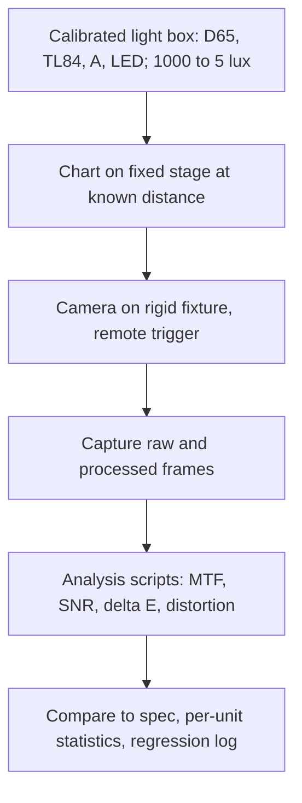

::: testing
Whether you can turn a vague idea like "good picture" into **measurable quantities with test setups**. The interviewer wants a structured list (resolution, noise, dynamic range, color, tone, geometry, shading, artifacts, speed and autofocus), the test chart or method for each, and an understanding of what hardware parameter drives each metric. Strong candidates separate sensor-level metrics (QE, read noise, full well) from system-level metrics (MTF, color error, SNR at a defined illuminance), mention controlled lighting, and know that subjective tests still matter.
:::

::: why
When you choose between two sensors or two lenses, or decide whether a new module meets spec, you need numbers, not impressions. The same framework is used in module qualification, supplier comparisons and regression testing of ISP tuning. It also connects to the general approach of validating a sensor ([[q0871]], [[q0872]]) and characterizing measurement error ([[q0873]]).
:::

::: concepts
- **Modulation transfer function (MTF)**: how much contrast the system keeps at each spatial frequency; the standard measure of sharpness ([[q0856]]).
- **SNR and noise**: temporal noise vs signal at defined illuminance and exposure ([[q0859]]).
- **Dynamic range**: the span from the noise floor to saturation, in stops or dB.
- **Color accuracy ($\Delta E$)**: distance between measured and reference colors in a perceptual color space.
- **Tone response (OECF)**: the mapping from scene luminance to output code value.
- **Optical geometry**: distortion, vignetting, chromatic aberration, flare ([[q0860]]).
- **Controlled test conditions**: calibrated light sources, charts and fixed distance, so results are repeatable ([[q0871]]).
:::

::: answer
"I'd split camera quality into measurable categories and use a chart and test condition for each.

Sharpness: I'd shoot a slanted-edge chart, compute the MTF, and report MTF50 in cycles per pixel or line pairs per picture height. Noise: shoot a uniform grey patch at several light levels and compute SNR, separating temporal and fixed-pattern noise. Dynamic range: use a transmissive step chart or multiple exposures to find the range between saturation and an SNR threshold like 1 or 10. Color: shoot a 24-patch color checker under standard illuminants, convert to Lab, and report average and worst-case delta E. Tone curve: a grey step chart gives the OECF.

Then geometry: a grid for distortion, a flat field for vignetting and color shading, and a high-contrast scene with a light source for flare. Also temporal things: autofocus speed and accuracy, shutter lag, rolling-shutter skew, and flicker handling.

Everything is done in a lightbox with calibrated illuminants at several light levels, such as 1000, 100, 20 and 5 lux, with the camera fixed at a set distance so tests are repeatable. And finally since the ISP changes the result, I'd test both raw, to characterize the sensor and optics, and processed output, to characterize what the user sees, and complement it with real-scene comparisons because some artifacts like over-sharpening or texture loss only show in real photos."
:::

::: technical
**Resolution / sharpness.** Slanted-edge (ISO 12233 style): image a edge tilted a few degrees, build the edge spread function (ESF) from the oversampled pixel values, differentiate to the line spread function (LSF), and FFT to get MTF. Report MTF50 (frequency at 50 percent contrast) or MTF at Nyquist. For ideal diffraction plus a 1.0 µm square pixel at f/1.8 and 550 nm, MTF50 is about 324 lp/mm (0.32 cycles/pixel) before lens aberrations. Don't forget that sharpening in the ISP can raise MTF above 1 (overshoot), so measure raw and processed.

**Noise / SNR.** Take $\ge 10$ frames of a uniform patch. Temporal noise = std over frames per pixel (averaged); FPN = std across pixels of the mean image. SNR $= \mu/\sigma$. For 6000 e⁻ full-well and 2.5 e⁻ read noise, SNR at 18 percent grey (1080 e⁻) is 32.8, or 30.3 dB.

**Dynamic range.** DR $= S_{sat}/S_{min}$, where $S_{min}$ is the signal at which SNR equals a threshold. At SNR = 1: $S = 3.05$ e⁻, so DR = 10.9 stops; at SNR = 10 (a "usable" criterion), $S = 106$ e⁻, DR = 5.8 stops. Always state the criterion.

**Color.** Photograph a ColorChecker (24 patches) under D65, TL84, A (2856 K). Convert output to CIELAB and compute $\Delta E_{00}$ (or the simple $\Delta E_{ab}^* = \sqrt{\Delta L^2+\Delta a^2+\Delta b^2}$). A $\Delta E_{ab}$ near 1 is roughly a just-noticeable difference (depends on viewing conditions), and average values below about 3 to 5 are typically considered good (convention varies).

**Geometry.** Distortion $=(r_{img}-r_{ideal})/r_{ideal}$ at the corner, from a grid chart. Natural vignetting $\propto\cos^4\theta$: at 35° off-axis the illumination falls to 45 percent, 1.15 stops. Color shading from a uniform field under D65. Lateral chromatic aberration from edge color fringing at the field corners.

**System.** Autofocus time to lock and focus accuracy over distances and light levels; shutter lag; start-up latency; rolling-shutter skew from a rotating or moving target; power at each mode.
:::

::: short
"I'd measure it category by category with calibrated charts and lighting: sharpness via slanted-edge MTF50, noise via SNR on flat patches at several lux, dynamic range with a step chart and a stated SNR threshold, color via ColorChecker delta E under standard illuminants, tone via OECF, and geometry for distortion, vignetting and flare. Plus speed: autofocus, shutter lag and rolling shutter. I'd test raw to isolate sensor and optics, and processed output to see what the user gets."
:::

::: long
"I'd organize it by what the user would notice and what I can measure.

First sharpness. I shoot a slanted-edge chart and compute the MTF from the edge spread function. I report MTF50 in cycles per pixel, and I look at the whole field because corners are always worse. The physical limits are the lens and diffraction, which for 1 micron pixels at f/1.8 means about 0.3 cycles per pixel at MTF50, and the pixel aperture. I check both raw and processed, since the ISP sharpening raises the numbers and can cause halos.

Second, noise and dynamic range. I take a flat patch at several illuminance levels, like 1000, 100, 20 and 5 lux, and compute temporal noise and SNR, separating fixed-pattern noise. For dynamic range I find the saturation level and the signal where SNR drops to a stated threshold, one for the engineering limit and ten for a usable limit, and report the stops. I'd call out the threshold because numbers without it are meaningless.

Third, color and tone: a 24-patch chart under D65, TL84 and tungsten light, converted to Lab, with average and maximum delta E, and a grey ramp for the tone curve.

Fourth, geometry and artifacts: distortion from a grid, vignetting and color shading from a flat field, chromatic aberration at the edges, flare with a bright source in frame, flicker handling under 50 and 60 Hz light.

Last, system behavior: autofocus speed and accuracy, shutter lag, rolling-shutter skew, and power.

All of it in a controlled lightbox with calibrated illuminants and a fixed distance, plus real-scene side-by-sides, because the numbers don't capture over-processing like plastic skin."
:::

::: terms
- **MTF / MTF50**: modulation transfer function and the spatial frequency where contrast falls to 50 percent.
- **SFR (spatial frequency response)**: MTF measured from a slanted edge.
- **Cycles per pixel / lp/mm**: units for spatial frequency; Nyquist is 0.5 cycles/pixel.
- **SNR (temporal)**: mean divided by temporal standard deviation.
- **Dynamic range**: ratio of saturation to the signal at a stated SNR threshold, in stops or dB.
- **OECF**: opto-electronic conversion function, the mapping from scene luminance to digital output.
- **$\Delta E$**: color difference in CIELAB; $\Delta E_{00}$ is the refined formula.
- **PRNU / DSNU**: photo-response and dark-signal non-uniformity.
- **Vignetting / shading**: fall-off of brightness or color toward the corners.
- **ColorChecker**: 24-patch reference chart for color evaluation.
:::

::: exceptional
An average answer says "resolution, noise, color, dynamic range" and stops. An exceptional answer:

- Gives each metric a **measurement method and a unit**, such as slanted-edge MTF50 in cycles/pixel, SNR in dB at a given lux, and $\Delta E_{00}$ on a 24-patch chart.
- States **thresholds** (SNR of 1 or 10 for dynamic range) and **test conditions** (illuminant, lux, distance, exposure).
- Distinguishes **sensor-level** characterization (QE, read noise, full well, PRNU, EMVA 1288 style) from **system/ISP-level** (what the user sees).
- Knows that ISP processing (sharpening, denoising) affects the metrics and can game them, so one measures raw and processed and also does perceptual tests.
- Mentions repeatability: calibrated lights, fixtures, multiple units, and statistics ([[q0873]]).
:::

::: mistakes
- **"More megapixels means more resolution."** Resolution is limited by the lens, diffraction and processing; MTF measures real resolving power. At 2.4 µm Airy diameter (f/1.8), 0.7 µm pixels add pixels but little detail.
- **Quoting dynamic range without a criterion.** 11 stops at SNR = 1 and 6 stops at SNR = 10 describe the same sensor.
- **Measuring only processed JPEG.** Sharpening and denoising can inflate MTF and hide noise; check raw too.
- **Testing only at one light level or illuminant.** Noise, color and focus behave very differently at 5 lux versus 500 lux, and under LED versus daylight.
- **Center-only sharpness.** Corners are worse because of aberrations and vignetting; report the field map.
- **Ignoring unit-to-unit variation.** One golden sample hides lens tilt, focus and color shading variation seen in production.
:::

::: deep
## Think like a test engineer: what can the user see?

A photo is judged on sharpness, noise, tone, color, exposure/dynamic range, artifacts, and for video/real use also on speed and robustness. Each can be tied to a hardware cause, a chart and a metric. The best way to organize the answer is a table and then to derive the maths behind the one or two metrics the interviewer is likely to go deep on: MTF, SNR and dynamic range.

| Attribute | Typical hardware cause | Test target / method | Metric |
|---|---|---|---|
| Sharpness | lens MTF, diffraction, pixel size, focus, ISP sharpen | slanted edge, Siemens star, dead-leaves chart | MTF50, MTF at Nyquist, field map |
| Noise | shot, read, dark, FPN | flat grey patches, several lux | SNR (dB), noise in DN or e⁻, FPN |
| Dynamic range | full well, read noise, HDR | step chart, light box with exposures | stops at a stated SNR threshold |
| Tone | ISP tone curve | grey ramp / OECF chart | OECF curve, mid-grey value |
| Color | CFA response, illuminant, CCM | ColorChecker under D65/TL84/A | mean and max $\Delta E_{00}$, white-balance error |
| Geometry | lens design | grid | distortion %, corner-to-center |
| Shading | cos⁴ law, lens CRA mismatch | flat field | vignetting stops, color shading |
| Flare, ghosts | coatings, cover glass | bright-source scene | flare ratio, qualitative |
| Temporal / speed | AF actuator, readout | timing rig, moving targets | AF time, shutter lag, skew |

## MTF from first principles

An optical system's MTF is the contrast it retains at each spatial frequency $\nu$ (in cycles/mm on the sensor). The total system MTF multiplies the contributions of each stage:

$$\text{MTF}_{sys}(\nu) = \text{MTF}_{lens}\cdot\text{MTF}_{diffraction}\cdot\text{MTF}_{pixel}\cdot\text{MTF}_{motion}\cdot\text{MTF}_{ISP}$$

Two terms are known in closed form. **Diffraction** for a circular aperture at wavelength $\lambda$ and f-number $N$, with cutoff $\nu_c = 1/(\lambda N)$:

$$\text{MTF}_{diff}(\nu) = \frac{2}{\pi}\left[\cos^{-1}\frac{\nu}{\nu_c} - \frac{\nu}{\nu_c}\sqrt{1-\Big(\frac{\nu}{\nu_c}\Big)^2}\right]$$

and the **pixel aperture** for a square pixel of pitch $p$: $\text{MTF}_{pix}(\nu) = |\sin(\pi\nu p)/(\pi\nu p)|$.

```plot
{"title":"Diffraction and pixel MTF limits: f/1.8, 550 nm, 1.0 µm pixel","x":{"label":"Spatial frequency","unit":"lp/mm","min":0,"max":700},"y":{"label":"MTF","unit":"","min":0,"max":1.05},
 "vars":{"nc":1010.1,"p":0.001},
 "series":[{"label":"Diffraction only","fn":"ite(x<nc, 2/pi*(atan2(sqrt(max(1-(x/nc)^2,0)),x/nc) - (x/nc)*sqrt(max(1-(x/nc)^2,0))), 0)","color":"orange"},
  {"label":"Pixel aperture only","fn":"abs(sin(pi*x*p+1e-9)/(pi*x*p+1e-9))","color":"green"},
  {"label":"Product (ideal lens)","color":"purple","fn":"ite(x<nc, 2/pi*(atan2(sqrt(max(1-(x/nc)^2,0)),x/nc) - (x/nc)*sqrt(max(1-(x/nc)^2,0))), 0)*abs(sin(pi*x*p+1e-9)/(pi*x*p+1e-9))"}],
 "hlines":[{"at":0.5,"label":"MTF50","color":"muted"}],
 "vlines":[{"at":500,"label":"Nyquist, 500 lp/mm","color":"red"}],
 "points":[{"x":324,"y":0.5,"label":"324 lp/mm"}]}
```
Figure: Even a perfect lens loses half its contrast by 324 lp/mm (0.32 cycles/pixel) with 1.0 µm pixels at f/1.8. Diffraction alone has MTF50 at 408 lp/mm and the pixel aperture alone at 603 lp/mm, but they multiply. At Nyquist (500 lp/mm) the product is only 25 percent, and real lens aberrations make it worse. Stopping down to f/2.8 moves the product's MTF50 down to 235 lp/mm.

**Measuring MTF with a slanted edge.** Tilting the edge by about 5° means each row samples the edge at a different sub-pixel phase, so projecting rows onto the edge normal gives an oversampled ESF (up to 4x), beating the pixel-sampling limit. Differentiate ESF to LSF, window, and FFT: $\text{MTF}(\nu) = |\mathcal{F}\{\text{LSF}\}|$. Use raw data linearized by the OECF, otherwise the gamma and local contrast of the ISP changes the result. Measure at multiple field positions and in both sagittal and tangential directions.

> [!TIP]
> If asked "what MTF50 would you expect from a 12 MP phone camera?", don't quote a vendor number. Say the physical limit (here about 0.3 cycles/pixel for an ideal lens at f/1.8), then say real lenses reach perhaps half to two-thirds of that at the corners, and ISP sharpening changes processed values. Offer to measure it.

## SNR and dynamic range, with numbers

For a shot- plus read-noise-limited pixel, SNR $= S/\sqrt{S+\sigma_r^2}$ in electrons ([[q0856]]). With $S_{sat} = 6000$ e⁻ and $\sigma_r = 2.5$ e⁻:

| Quantity | Value |
|---|---|
| SNR at 18% grey (1080 e⁻) | 32.8 (30.3 dB) |
| Signal at SNR = 1 | 3.05 e⁻ |
| DR (SNR = 1 criterion) | 6000/3.05 = 1967, 10.9 stops, 65.9 dB |
| Signal at SNR = 10 | 105.9 e⁻ |
| DR (SNR = 10 criterion) | 56.7, 5.8 stops |

The "engineering" dynamic range uses the SNR = 1 threshold (sometimes simply read noise as the floor, giving 11.2 stops). The "usable" range for photographic image quality uses SNR 10 or more. Both are legitimate, but you must say which one you report. To measure it, vary the exposure on a fixed scene to get a signal sweep, compute mean and temporal noise at each level, convert to electrons using the photon-transfer slope, and find where the curve crosses each threshold. This is how the EMVA 1288 sensor standard measures it, extended to sensor-level quantities (QE, system gain, saturation capacity, dark current, DSNU, PRNU, linearity).

## Color accuracy

Convert each of the 24 patches' output (after known ISP settings) to CIELAB and compute $\Delta E$ against the reference values. As an example, a patch with reference Lab = (50, 10, 10) measured as (52, 12, 8) has $\Delta E_{ab} = \sqrt{2^2 + 2^2 + 2^2} = 3.46$. Report the mean and the 90th percentile or maximum because a good mean can hide a bad skin tone or neutral patch. Evaluate separately with and without white-balance error, since a wrong illuminant estimate raises all patches together. [[q0860]] explains why LED spectra stress this test.

## Geometry and shading

- **Distortion** follows $r_d = r(1 + k_1 r^2 + \dots)$. Report TV-distortion or corner distortion in percent. Ultra-wide phone cameras have large distortion that is corrected digitally, which costs edge sharpness.
- **Vignetting.** Natural fall-off is $\cos^4\theta$; at 35° it is 0.45 (1.15 stops). Lens shading correction multiplies by the inverse gain, which also amplifies corner noise by up to $1/\sqrt{0.45}$, about 1.5x in amplitude (shot-noise-limited).
- **Chief ray angle (CRA)** mismatch between lens and microlens causes color shading, because corner pixels see rays at oblique angles.

## Speed and robustness

Autofocus time-to-lock (ms) across distance and illuminance, focus hit-rate over a number of trials, shutter lag from button to capture, start-up time, video frame-rate stability, rolling-shutter skew from a rotating target, and power in preview, record and capture. These are measured with timing rigs and moving targets, and statistics over many trials ([[q0873]]).

## Test setup


Figure: A repeatable chain: calibrated light, fixed geometry, raw plus processed capture, and scripted analysis, so the same measurement can be repeated on every unit and on every firmware change.

Set the lux with a calibrated lux meter at the chart, warm up the lights (LED and fluorescent output drifts), avoid stray light, and keep the camera at constant temperature, because noise changes with it ([[q0859]]). Test several units from different lots to see variation.

## Beyond numbers

Metrics don't catch over-sharpening halos, texture loss from denoising, "watercolor" effects, skin-tone preference or HDR tone-mapping artifacts. Teams therefore combine objective charts with a perceptual scoring of real scenes (portrait, backlit, low light, motion), blind side-by-sides against a reference device, and field tests. Be honest that a single "score" hides trade-offs.
:::

::: applications
- **Phone module qualification**: per-unit tests of MTF at the center and corners, focus calibration and color shading on the production line.
- **ISP tuning**: iterating noise-reduction and sharpening to hit target MTF/SNR trade-offs per light level.
- **Supplier comparison**: using sensor-level (EMVA 1288 style) data to choose between two sensors.
- **Automotive camera validation**: MTF, low-light SNR, HDR and LED-flicker behavior for ADAS.
- **Machine vision**: verifying a camera meets a measurement-accuracy spec before deploying on a line.
- **Regression testing**: automated chart captures after every firmware or tuning change.
:::

::: assumptions
- I assume a **consumer or machine-vision digital camera** and quote slanted-edge MTF, chart-based color tests and EMVA-1288-style sensor tests. Named standards (such as ISO 12233 for resolution) are mentioned as the common basis, but exact test details and clause numbers differ by version, so I haven't quoted them.
- The MTF numbers assume an **ideal diffraction-limited lens**, a square 100 percent fill-factor pixel, 550 nm light and no ISP sharpening; actual lenses and processing change the result.
- The SNR and DR examples assume Poisson-plus-Gaussian noise with 6000 e⁻ full well and 2.5 e⁻ read noise, which are illustrative.
- A $\Delta E$ of about 1 as a "just noticeable difference" is an approximate rule; perceptibility depends on viewing conditions and the color region.
- For video, add temporal consistency, stabilization quality ([[q0857]]) and exposure/white-balance convergence behavior.
:::

::: followups
### Why measure MTF with a slanted edge rather than a vertical edge?
A perfectly vertical edge samples every row at the same sub-pixel phase, so you only get pixel-rate sampling and aliasing corrupts the result. A slightly tilted edge (about 5°) gives different phase in each row, so projecting along the edge builds an oversampled edge profile, which allows an accurate MTF up to and slightly beyond Nyquist.

### Two sensors both claim 12 stops of dynamic range. What would you ask?
At what SNR threshold, for what exposure and gain, and measured how? One may use SNR = 1 at base ISO, the other SNR = 10 with HDR merged from several exposures; those are not comparable. Ask for the full SNR-vs-signal curve or the measured read noise and full-well capacity so I can compute it with my own criterion.

### How would ISP sharpening affect your MTF measurement and what do you do about it?
Sharpening boosts mid-frequency contrast and can push MTF above 1 with halos, and it also boosts noise. Measure raw (linearized) to characterize optics and sensor, and processed to characterize the product, and report the overshoot or use a sharpening-insensitive metric like acutance with noise included. Check also the visual halo.

### Delta E average is 2.8 and looks great, but customers complain about skin tones. Why?
The mean hides the worst patches. Skin tones occupy a small region of color space and viewers are very sensitive there. Check the individual patches (dark skin, light skin) and report maximum or 90th percentile, add real-skin or skin-tone evaluation, and check how white balance and the tone curve treat them (preference-tuned colors also deliberately depart from "accuracy").

### Scenario: production units show corner sharpness varying a lot between units, while the center is consistent. What do you suspect and test?
Lens tilt or decenter relative to the sensor (assembly), or a focus and tilt error from the active-alignment step. Measure MTF50 at four corners for each unit, compute the corner-to-corner asymmetry, and correlate with assembly data. If the asymmetry is systematic along one axis, suspect tilt; if random, adhesive shrinkage or lens element decenter. The fix is active alignment, tighter tolerances, or a limit on corner imbalance in end-of-line test.
:::

::: interpretations
"Camera quality" can mean the sensor, the lens, the whole module, or the final photo. I treat it as the **whole module plus ISP** and show how to separate contributions: raw for optics and sensor, processed for the user's experience. If the interviewer means only the sensor, the sensor-level EMVA 1288 quantities (QE, read noise, full well, PRNU, dark current, linearity) are the focus.
:::

::: references
- EMVA Standard 1288: standard for measurement and presentation of image-sensor and camera specifications.
- ISO 12233: resolution and spatial frequency response of electronic still-picture cameras (slanted-edge method); consult the current edition for details.
- Burns, "Slanted-edge MTF for digital camera and scanner analysis" (IS&T PICS conference, 2000), for the slanted-edge method.
- Janesick, *Photon Transfer*: noise and dynamic range measurement.
- Hunt, *The Reproduction of Colour*: color difference, CIELAB.
:::

::: rubric
- Splits quality into measurable attributes (sharpness, noise, dynamic range, color, tone, geometry, speed) :: A structured taxonomy shows engineering thinking instead of vague opinion.
- Names a chart/method and metric for each (slanted-edge MTF50, SNR, step chart, ColorChecker $\Delta E$) :: A test without a method isn't a test.
- States thresholds and conditions (SNR threshold for dynamic range, illuminants, lux levels, distance) :: Numbers are meaningless without conditions.
- Distinguishes raw/sensor-level from processed/system-level and warns about ISP effects :: The ISP can inflate or hide metrics.
- Explains MTF or SNR physically, with a number :: Demonstrates that you understand what the metric means.
- Mentions controlled lighting and fixture, repeatability and unit-to-unit statistics :: Good measurement needs controlled conditions ([[q0873]]).
- Acknowledges perceptual tests and real scenes :: Some artifacts are not captured by charts.
:::

::: quiz
```json
[
 {"type":"mcq","level":"fundamental","q":"What does MTF50 represent?","options":["The spatial frequency where contrast falls to 50 percent","50 percent of the pixel count","The SNR at 50 percent illuminance","The f-number at which diffraction begins"],"answer":0,"explain":"MTF50 is the spatial frequency at which the system retains half the original contrast; it is a standard single-number measure of sharpness."},
 {"type":"mcq","level":"fundamental","q":"Why must you state the SNR threshold when quoting dynamic range?","options":["Because dynamic range is defined only for SNR = 1","Because different thresholds give different stops for the same sensor","Because stops are not logarithmic","Because it only matters for CCD sensors"],"answer":1,"explain":"With the same sensor, SNR = 1 gives about 10.9 stops and SNR = 10 only about 5.8 stops (6000 e⁻ full well, 2.5 e⁻ read noise). Without the criterion the number is ambiguous."},
 {"type":"numeric","level":"intermediate","q":"A pixel has 6000 e⁻ full well. At 18% grey (1080 e⁻) with 2.5 e⁻ read noise, what is the SNR in dB?","answer":30.3,"tolerance":0.02,"unit":"dB","explain":"SNR $=1080/\\sqrt{1080+6.25}=32.77$, so $20\\log_{10}32.77 = 30.3$ dB."},
 {"type":"numeric","level":"intermediate","q":"A color patch has reference Lab (60, 5, 20) and measured Lab (63, 1, 20). What is $\\Delta E_{ab}^*$?","answer":5,"tolerance":0.02,"unit":"","explain":"$\\Delta L=3$, $\\Delta a=-4$, $\\Delta b=0$, so $\\sqrt{9+16+0}=5$."},
 {"type":"numeric","level":"advanced","q":"A lens with natural vignetting follows cos⁴θ. How many stops darker is the corner at 35° off-axis than the center?","answer":1.15,"tolerance":0.03,"unit":"stops","explain":"$\\cos 35° = 0.819$, $\\cos^4 = 0.450$, and $-\\log_2 0.450 = 1.15$ stops."},
 {"type":"truefalse","level":"advanced","q":"Measuring MTF only on the processed JPEG is sufficient to characterize the lens and sensor.","answer":false,"explain":"ISP sharpening and denoising change the MTF and can push it above 1 with halos, hiding the true optical and sensor performance. Measure linearized raw for the hardware and processed output for the user experience."}
]
```
:::
