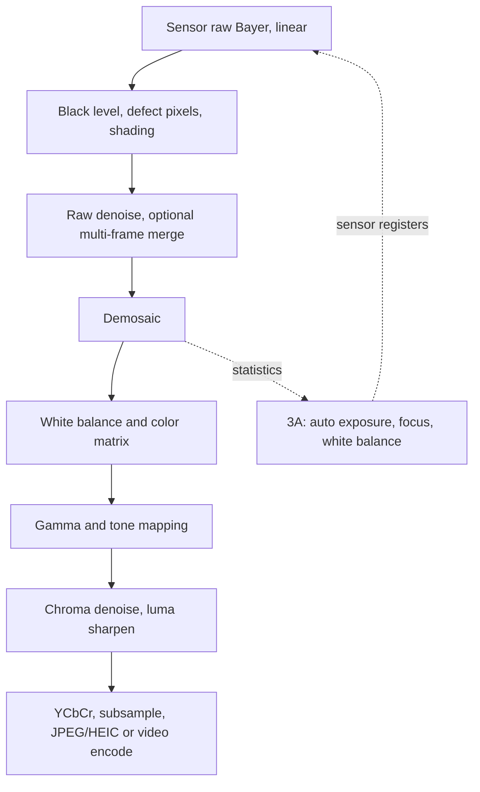

::: testing
Whether you can list the ISP stages **in the right order and say why they're in that order**. The interviewer wants raw-domain corrections first (black level, defects, shading), then demosaic, white balance, color matrix, gamma and tone mapping, denoise and sharpen, color-space conversion and compression. Strong candidates give a reason for every ordering (linearity, noise model), do a small worked example with numbers, and mention hardware realities: line buffers, streaming throughput, 3A statistics and memory bandwidth.
:::

::: why
The ISP is where a raw mosaic of numbers becomes a photograph, and it is a huge part of why one phone camera looks better than another with the same sensor. As a hardware engineer you may build or verify this block, budget its bandwidth and latency, or debug a color or noise bug and have to work out which stage broke. The ordering logic here also appears in video pipelines, machine vision and any sensor-processing chain ([[q0856]], [[q0863]]).
:::

::: concepts
- **Raw Bayer data**: one color sample per pixel, linear in light, 10 to 14 bits ([[q0856]]).
- **Linearity**: light adds linearly, so operations like white balance and color correction must happen before the non-linear gamma/tone curve.
- **Demosaicing**: interpolating the two missing colors at each pixel.
- **Color science**: white balance, color correction matrix, color spaces (sRGB, YCbCr).
- **Noise model**: the denoiser needs signal-dependent noise, which is simplest in the linear raw domain ([[q0859]]).
- **Streaming hardware**: ISPs process pixels as they arrive with a few line buffers, rather than whole frames.
- **3A feedback**: statistics computed in the pipeline drive auto exposure, focus and white balance ([[q0863]]).
:::

::: answer
"I think of it as a pipeline that starts with raw Bayer data and works toward a display-ready picture, in an order that's dictated by the math.

First the raw-domain cleanup, while the data is still linear: subtract the black level, correct the dead and hot pixels, and fix the lens shading, since corners are darker. Optionally a first noise reduction pass, because noise is easiest to model here.

Next demosaicing: each pixel only has one of red, green or blue, so we interpolate the other two from neighbors, using edge-aware methods to avoid zipper artifacts.

Then color: white balance applies per-channel gains so grey looks grey under the scene's light, and a 3 by 3 color correction matrix maps the sensor's RGB to a standard color space like sRGB.

Only then do we go non-linear: gamma and tone mapping compress the dynamic range into the display range, so shadows and highlights both look right. After that comes the polish: denoise chroma, sharpen luma, maybe local contrast, then convert to YCbCr, subsample the chroma and compress to JPEG or HEIC.

Running alongside is the statistics engine feeding auto exposure, autofocus and white balance, which close the loop back to the sensor. In hardware it's a streaming pipeline with a few line buffers rather than a full frame store."
:::

::: technical
**Stage order and reasons.**

1. **Black level subtraction**: sensors have an offset (for example 64 DN on a 10-bit sensor). Subtract it first, so zero light gives zero. Raw 400 becomes (400-64)/(1023-64) = 0.350.
2. **Defective pixel correction**: replace outliers by neighbors. Must come before demosaic or the defect spreads.
3. **Lens shading correction**: multiply by a per-pixel/per-channel gain map (corners up to about 2x).
4. **Raw denoise (optional)**: variance model $\sigma^2 = aS + b$.
5. **Demosaic**: bilinear or edge-directed; the green value at a red pixel is the average of four green neighbors (bilinear) or weighted along the lower-gradient direction.
6. **White balance**: gains $g_R, g_B$ (with $g_G=1$) so a neutral patch has $R=G=B$.
7. **Color correction matrix (CCM)**: $[R',G',B']^T = M[R,G,B]^T$, with each row summing to 1 to keep neutrals neutral.
8. **Gamma / tone mapping**: sRGB encoding $V = 12.92L$ for $L\le0.0031308$, else $1.055L^{1/2.4}-0.055$. Linear 0.18 (mid-grey) maps to 0.461 (code 118 of 255).
9. **Chroma denoise, luma sharpen, local tone mapping**.
10. **RGB to YCbCr**, chroma subsampling (4:2:0 halves the data), 8x8 DCT, quantization, entropy coding.

**Worked example.** A grey card under tungsten gives linear raw (after black level) $(0.12, 0.30, 0.15)$. Gains: $g_R = 0.30/0.12 = 2.5$, $g_B = 0.30/0.15 = 2.0$. An orange pixel raw $(0.10, 0.10, 0.02)$ becomes $(0.25, 0.10, 0.04)$. With $M = \begin{bmatrix}1.6&-0.4&-0.2\\-0.3&1.5&-0.2\\0&-0.5&1.5\end{bmatrix}$ (rows sum to 1), the result is $(0.352, 0.067, 0.010)$, which sRGB-encodes to $(160, 73, 25)$, a saturated orange.

**Hardware.** 12 MP at 30 fps is 360 Mpixel/s (about 430 Mpixel/s with blanking). A 5x5 demosaic needs 4 line buffers: with 4000 pixels at 2 bytes, 32 kB. Multi-frame pipelines (HDR, night) also need DRAM bandwidth for raw frames.
:::

::: short
"The ISP takes linear raw Bayer data through, in order: black level, defective pixel and lens shading correction, optional raw denoise, demosaic, white balance, a 3 by 3 color matrix, then non-linear gamma and tone mapping, followed by chroma denoise, luma sharpening, conversion to YCbCr and JPEG compression. The order follows the math: linear operations first, non-linear after. Statistics from the pipeline drive auto exposure, focus and white balance."
:::

::: long
"The ISP is a chain whose order comes from the math, so I'll walk it in that order.

It starts with the raw Bayer data, which is linear in light. In the raw domain I fix the sensor: subtract the black level, patch dead and hot pixels from their neighbors, and apply lens shading correction, a gain map that brightens the corners. Noise is easiest to model here, because variance is a simple function of signal, so many pipelines do a first denoise pass.

Then demosaicing. Each pixel only measured one color, so I interpolate the other two. Bilinear is cheap but gives zipper and false-color artifacts at edges, so real ISPs use edge-directed methods.

Next is color. White balance multiplies the red and blue channels so neutral surfaces come out neutral. Under tungsten, the red gain might be 2.5 and the blue 2. Then a 3 by 3 color correction matrix maps the camera's color response onto a standard space like sRGB, with each row summing to one so greys stay grey.

Only after that do I go non-linear, because white balance and the matrix are only correct on linear light. Gamma encoding compresses the range, with 18 percent grey going to about 46 percent, and tone mapping adds contrast, local or global, and handles HDR.

Then the finishing: chroma denoise, luma sharpening, convert to YCbCr, subsample chroma 4:2:0, and compress with JPEG or HEIC.

In hardware, it's streaming. Pixels flow through with a few line buffers rather than a full frame store, at hundreds of megapixels per second. Alongside, a statistics block computes histograms, focus values and white-balance stats for 3A, which feed back to the sensor every frame."
:::

::: terms
- **ISP**: image signal processor, the hardware (or firmware plus hardware) that turns raw sensor data into a final image.
- **Black level**: the digital offset at zero light, subtracted first.
- **Demosaicing**: interpolating full RGB at each pixel from the Bayer mosaic.
- **White balance gains**: per-channel multipliers that neutralize the illuminant.
- **CCM**: color correction matrix mapping camera RGB to a standard space.
- **Gamma / OETF**: the non-linear curve for encoding linear light into display codes.
- **Tone mapping**: shaping the brightness curve (global or local) to fit the dynamic range of a display.
- **YCbCr, chroma subsampling**: luma/chroma representation with chroma at lower resolution (4:2:0, 4:2:2).
- **3A statistics**: histograms and focus/white-balance measures used for auto exposure, focus and white balance.
- **Line buffer**: on-chip memory that holds a few image rows for neighborhood operations.
:::

::: exceptional
An average answer lists stage names. An exceptional answer:

- Gives the order and **the reason for each ordering decision** (linear before non-linear, defects before demosaic, WB and CCM before gamma).
- Shows a **worked pixel** through the chain or at least one number (black level, gains, 18 percent grey to sRGB 118).
- Describes demosaic artifacts and edge-aware methods, and why denoise works best in the raw domain.
- Distinguishes luma and chroma processing (chroma denoise stronger, sharpen luma, subsample chroma).
- Brings in hardware: streaming with line buffers, pixel rate, DRAM bandwidth, and the 3A feedback loop.
- Points to where multi-frame HDR and night mode ([[q0858]]) plug in: raw domain, before demosaic.
:::

::: mistakes
- **Applying gamma before white balance or the color matrix.** Those are only valid on linear light; doing them after gamma gives wrong colors, especially for saturated and dark pixels.
- **Demosaicing before defect-pixel correction.** A hot pixel spreads into its neighbors and cannot be removed afterwards.
- **Sharpening before denoising.** It amplifies noise; denoise first, sharpen after, with a limited amount.
- **Thinking of the CCM as just "color saturation".** It corrects the mismatch between the sensor's spectral sensitivities and the target color space; its coefficients are calibrated for each illuminant.
- **Forgetting that the pipeline is a feedback loop.** 3A statistics change the sensor settings for the next frame; otherwise exposure and color would never adapt.
- **Treating the pipeline as software that runs on whole frames.** Hardware ISPs stream pixels with small buffers; algorithms must fit that.
:::

::: deep
## The pipeline at a glance


Figure: Everything left of gamma works on linear light. The dashed loop shows 3A statistics from the pipeline setting exposure, gain and lens position for the next frame.

## Raw domain: fix the sensor

**Black level.** CMOS sensors add a pedestal so that negative noise isn't clipped at zero. For a 10-bit sensor with a pedestal of 64, digital number 400 normalizes as $(400-64)/(1023-64)=0.350$. Optical black (shielded) pixels at the sensor's edge measure the pedestal each frame, so it tracks temperature and gain.

**Defect pixels.** Hot, dead and stuck pixels come from a factory map plus dynamic detection (a pixel far outside the range of its same-color neighbors). Replace with the median or an edge-aware interpolation from neighbors.

**Lens shading.** The optical gain falls to 45 percent at 35° off-axis ($\cos^4$) and can be worse with microlens/CRA effects, and color varies across the field. The ISP stores a low-resolution gain grid per color channel (and per color temperature) and interpolates. Remember it multiplies noise too: a 2.2x gain in the corner means 2.2x noise amplitude relative to the signal at that gain for read-noise-limited signals ([[q0861]]).

**Raw denoise.** Here noise is independent between pixels with $\sigma^2 = aS + b$, so filter strength can adapt precisely. After demosaic and gamma, the noise is correlated and no longer simple.

## Demosaicing

```svg
<svg viewBox="0 0 560 250" xmlns="http://www.w3.org/2000/svg" font-family="Inter, sans-serif" font-size="13">
  <g stroke="var(--d-ink)" stroke-width="1">
    <rect x="20" y="30" width="40" height="40" fill="var(--d-red)" opacity="0.6"/>
    <rect x="60" y="30" width="40" height="40" fill="var(--d-green)" opacity="0.6"/>
    <rect x="100" y="30" width="40" height="40" fill="var(--d-red)" opacity="0.6"/>
    <rect x="140" y="30" width="40" height="40" fill="var(--d-green)" opacity="0.6"/>
    <rect x="20" y="70" width="40" height="40" fill="var(--d-green)" opacity="0.6"/>
    <rect x="60" y="70" width="40" height="40" fill="var(--d-blue)" opacity="0.6"/>
    <rect x="100" y="70" width="40" height="40" fill="var(--d-green)" opacity="0.6"/>
    <rect x="140" y="70" width="40" height="40" fill="var(--d-blue)" opacity="0.6"/>
    <rect x="20" y="110" width="40" height="40" fill="var(--d-red)" opacity="0.6"/>
    <rect x="60" y="110" width="40" height="40" fill="var(--d-green)" opacity="0.6"/>
    <rect x="100" y="110" width="40" height="40" fill="var(--d-red)" opacity="0.6"/>
    <rect x="140" y="110" width="40" height="40" fill="var(--d-green)" opacity="0.6"/>
    <rect x="20" y="150" width="40" height="40" fill="var(--d-green)" opacity="0.6"/>
    <rect x="60" y="150" width="40" height="40" fill="var(--d-blue)" opacity="0.6"/>
    <rect x="100" y="150" width="40" height="40" fill="var(--d-green)" opacity="0.6"/>
    <rect x="140" y="150" width="40" height="40" fill="var(--d-blue)" opacity="0.6"/>
  </g>
  <rect x="100" y="110" width="40" height="40" fill="none" stroke="var(--d-ink)" stroke-width="3"/>
  <g fill="var(--d-ink)" text-anchor="middle" font-size="12">
    <text x="40" y="55">R</text><text x="80" y="55">G</text><text x="120" y="55">R</text><text x="160" y="55">G</text>
    <text x="40" y="95">G</text><text x="80" y="95">B</text><text x="120" y="95">G</text><text x="160" y="95">B</text>
    <text x="40" y="135">R</text><text x="80" y="135">G</text><text x="120" y="135">R</text><text x="160" y="135">G</text>
    <text x="40" y="175">G</text><text x="80" y="175">B</text><text x="120" y="175">G</text><text x="160" y="175">B</text>
    <text x="100" y="215">RGGB Bayer mosaic</text>
  </g>
  <g fill="var(--d-ink)">
    <text x="215" y="60" font-weight="600">Missing values at the circled red pixel</text>
    <text x="215" y="85">Green = mean of the 4 side neighbours</text>
    <text x="215" y="108">Blue = mean of the 4 diagonal neighbours</text>
    <text x="215" y="140" font-weight="600">Edge-directed refinement</text>
    <text x="215" y="163">Compare horizontal and vertical green gradients</text>
    <text x="215" y="186">Interpolate along the smaller one</text>
  </g>
</svg>
```
Figure: In an RGGB mosaic, a red pixel has four green neighbours (up, down, left, right) and four blue neighbours on the diagonals. Plain averaging blurs across edges and gives zipper and false-color artifacts. Edge-directed methods interpolate along an edge, not across it.

The green channel carries most luminance information and is sampled twice as densely, so good demosaic reconstructs green first, then interpolates red and blue as *differences* from green (color-difference interpolation), exploiting the strong correlation between channels. Typical artifacts: zipper edges, moiré and false colors near the Nyquist limit of fine patterns; many sensors use a weak optical low-pass filter (or the lens' own MTF, see [[q0861]]) to suppress aliasing, at the cost of a bit of sharpness.

## Color: white balance and the matrix

**White balance.** The illuminant tints everything. Take a grey card whose linear raw values (after black level) are $(0.12, 0.30, 0.15)$ under tungsten. Gains $g_R = 2.5$, $g_B = 2$ make it $(0.30, 0.30, 0.30)$. Auto white balance (AWB) estimates the gains from image statistics: grey-world, white-patch or learned methods, with a prior of plausible color temperatures ([[q0860]]).

A subtle point: the gain multiplies signal and noise equally, so SNR in the red and blue channels is unchanged but their absolute noise is raised by 2.5x and 2x, which is why tungsten shots show red and blue colored noise.

**Color correction matrix.** Sensor spectral responses are not the same as the standard observer, so a 3x3 matrix maps camera RGB to sRGB (linear). The rows sum to 1 so neutrals are preserved, and the off-diagonal terms are negative (they subtract overlap between filters). As above, for the orange pixel:

$$\begin{bmatrix}0.352\\0.067\\0.010\end{bmatrix} = \begin{bmatrix}1.6&-0.4&-0.2\\-0.3&1.5&-0.2\\0&-0.5&1.5\end{bmatrix}\begin{bmatrix}0.25\\0.10\\0.04\end{bmatrix}$$

The price of negative off-diagonals is noise amplification: the matrix's row norm (here $\sqrt{1.6^2+0.4^2+0.2^2}=1.66$) multiplies uncorrelated noise, so a stronger correction means more color noise. That's why camera designers trade color accuracy for noise at high ISO.

## Going non-linear: gamma and tone mapping

Displays and the human eye are not linear. sRGB encodes linear light $L$ as

$$V = \begin{cases}12.92\,L & L\le 0.0031308\\ 1.055\,L^{1/2.4}-0.055 & \text{otherwise}\end{cases}$$

```plot
{"title":"sRGB encoding of linear light","x":{"label":"Linear light L","unit":"","min":0,"max":1},"y":{"label":"Encoded V","unit":"","min":0,"max":1.02},
 "series":[{"label":"sRGB OETF","fn":"ite(x<=0.0031308,12.92*x,1.055*pow(x,1/2.4)-0.055)"},{"label":"Linear (no encoding)","fn":"x","dashed":true,"color":"muted"}],
 "points":[{"x":0.18,"y":0.4614,"label":"18% grey → 0.461 (code 118)"}]}
```
Figure: The curve devotes far more code values to shadows than a linear encoding would. 18 percent grey sits at 46 percent of the code range. It also raises dark noise: near black the slope is 12.92, so a dark noise of 0.001 linear becomes 0.013 in code (13x), which is why dark regions look grainy after encoding.

Tone mapping goes further: an S-curve for contrast, and **local** tone mapping that compresses the dynamic range of high-contrast scenes (shadows lifted, highlights held), as used for HDR and night shots ([[q0858]]). Doing it locally risks halos at strong edges, so bilateral or guided filters are used for the base layer.

## Finishing: denoise, sharpen, convert, compress

- **Chroma denoise** is aggressive (the eye is less sensitive to color detail), while **luma denoise** is gentle to keep texture.
- **Sharpening**: unsharp mask $I_{out} = I + k(I - G_\sigma * I)$, with a threshold or noise-adaptive gain to avoid amplifying noise, and halo limiting.
- **Color space conversion**: RGB to YCbCr (BT.601 coefficients $Y = 0.299R+0.587G+0.114B$). An sRGB pixel $(200,100,50)$ gives $Y=124$, $Cb=86$, $Cr=182$.
- **Chroma subsampling**: 4:2:0 keeps all luma and one chroma pair per 2x2 block, so 12 bits per pixel instead of 24: half the data.
- **Compression**: JPEG uses 8x8 DCT, quantization and entropy coding; typical 10:1 to 20:1 for photos. Video uses H.264/HEVC with motion estimation, often in a separate encoder block.

## ISP hardware reality

- **Streaming:** pixels arrive row by row at the sensor's rate; each stage uses line buffers. A 5x5 demosaic needs 4 lines: $4\times4000\times2$ bytes = 32 kB. Whole-frame operations (multi-frame merge, local tone mapping base layer, stabilization) need DRAM access.
- **Throughput:** 12 MP at 30 fps is 360 Mpixel/s; with blanking about 430 Mpixel/s. A 4K60 video path is about 500 Mpixel/s, hence a multi-pixel-per-clock architecture at a few hundred MHz.
- **Bit width:** internal precision of 12 to 16 bits per channel to avoid banding after tone mapping.
- **Latency:** a streaming ISP adds a few lines to a frame of latency; a frame-based computational pipeline adds tens to hundreds of ms ([[q0863]]).
- **3A:** statistics blocks accumulate histograms, per-zone averages, and focus measures (gradient energy) on the fly, so firmware can read them at the end of each frame and write new exposure, gain and lens settings in time for the next frame.

## Experiment with it

```sim
{"id":"adc-lab","view":"quantize","bits":10,"vref":3.3,"vin":1.234}
```
Figure: Change the bit depth and watch the quantization step. This is the first stage in the chain: a 10-bit raw value has 1024 levels, and after black-level subtraction and tone mapping, dark regions have only a few levels to work with. That's why ISPs use 12 to 16 bits internally.
:::

::: applications
- **Smartphone SoC ISPs**: multi-camera, 4K and 8K video, HDR and night-mode pipelines with an NPU for learned denoise and AWB.
- **Automotive ISPs**: HDR merging of multi-exposure data, tone mapping for human display and a separate low-latency path for perception.
- **DSLR and mirrorless**: raw capture (unprocessed) with the in-camera ISP for JPEG; raw processors such as those in photo editors reproduce the same stages.
- **Machine vision cameras**: minimal ISP (often just black level, defect and flat-field) because algorithms need linear data.
- **Webcams and security cameras**: ISPs integrated with H.264/H.265 encoders and IR cut filter switching.
- **FPGA-based vision pipelines**: custom streaming pipelines for low-latency robotic or industrial systems.
:::

::: assumptions
- I describe a **Bayer-pattern** camera with a hardware or firmware ISP; quad-Bayer, RGB-IR or RGBW sensors insert extra stages (remosaic, IR separation) but keep the same logic.
- Stage orders vary between vendors (for example denoise may appear several times, or after the matrix) but the **linear-before-non-linear** rule is universal.
- The CCM, white-balance gains and numbers are illustrative, not from a real calibration.
- A "pipeline" for a machine-vision or robotics system often skips tone mapping, sharpening and compression, because algorithms want linear data.
- Neural ISPs replace many classical stages with a network trained end-to-end (for example raw to RGB); the physical stages (black level, defects, shading) still precede them.
:::

::: followups
### Why must white balance and the color matrix come before gamma?
They are linear operations that assume pixel values are proportional to light. After gamma, a multiplication by a gain no longer corresponds to a multiplication of light, so colors shift with brightness and saturation is wrong. Also, gain after the gamma curve would apply a different effective illuminant correction to shadows and highlights.

### Why demosaic before white balance? Or is it the other way around?
Both orders exist. Doing WB first (on the mosaic) equalizes channels so the demosaic's edge detectors, which compare neighboring pixels of different colors, are not fooled by a color cast: a strong tint makes a flat grey area look like it has an edge in the Bayer pattern. Many pipelines apply WB gains on the raw mosaic, then demosaic, then the CCM. What matters is that both occur in linear space.

### How would you decide how many line buffers an ISP stage needs?
It follows from the kernel size: a $k\times k$ neighborhood needs $k-1$ lines of storage, each of width × bytes per pixel. For a 5x5 demosaic on 4000-pixel lines at 2 bytes, 4 lines is 32 kB; adding a 7x7 denoiser needs 6 lines (48 kB). Those on-chip SRAM costs drive ISP area and are why wide sensors are processed in tiles or with DRAM line stores.

### Why does the ISP denoise chroma more than luma?
Human vision resolves luminance detail much better than color detail, so smoothing chroma barely changes perceived sharpness but removes color blotches, which are very visible. Luma denoising removes texture, so it's kept light. It is the same reason JPEG subsamples chroma.

### Scenario: only the corners of your photos show a magenta tint under tungsten light. What stage do you suspect and how do you confirm?
Lens shading correction: the shading gain maps (per channel, per color temperature) are wrong for this illuminant, especially if the module uses an IR filter whose spectral response varies with angle, so red and blue shading differ from green. Confirm by photographing a flat field under that light, plot the channel ratios R/G and B/G across the frame, and check against the stored gain tables; fix by calibrating shading tables at more color temperatures and interpolating based on the AWB estimate.
:::

::: interpretations
"Camera processing pipeline" may mean the ISP (raw to image) as I answered, or the whole signal chain including the sensor and optics ([[q0856]]), or a vision pipeline that continues with detection and tracking. I cover the ISP in detail and link to the surrounding chain; what happens at button press is in [[q0863]].
:::

::: references
- Ramanath et al., "Color image processing pipeline," IEEE Signal Processing Magazine (2005): an overview of the stages of a digital camera pipeline.
- Nakamura (ed.), *Image Sensors and Signal Processing for Digital Still Cameras*: demosaicing, white balance, color correction, noise reduction.
- IEC 61966-2-1 (sRGB): defines the sRGB color space and transfer function.
- Malvar, He and Cutler, "High-quality linear interpolation for demosaicing of Bayer-patterned color images" (ICASSP 2004).
:::

::: rubric
- Starts with raw linear Bayer and corrects the sensor first (black level, defects, shading) :: Raw-domain corrections must precede everything else.
- Describes demosaicing and its artifacts :: Each pixel only measured one color; reconstruction is a core stage.
- Places white balance and CCM before gamma and explains linearity :: This ordering is the key insight.
- Explains gamma/tone mapping and its effect on noise and dynamic range :: Shows you understand the non-linear stage.
- Mentions denoise and sharpen (luma vs chroma) and ordering :: Sharpening before denoising amplifies noise.
- Mentions YCbCr conversion, chroma subsampling and compression :: Completes the path to a stored file.
- Mentions hardware streaming, line buffers, pixel rate and 3A statistics loop :: Shows hardware-level thinking.
:::

::: quiz
```json
[
 {"type":"mcq","level":"fundamental","q":"Why is white balance applied before gamma correction?","options":["Gamma needs colored data","White balance is only valid on data that is linear in light","Gamma removes the black level","It makes JPEG smaller"],"answer":1,"explain":"WB gains assume pixel values are proportional to light. After the non-linear gamma curve a multiplication no longer corresponds to scaling the illuminant, so colors shift with brightness."},
 {"type":"mcq","level":"fundamental","q":"In an RGGB Bayer mosaic, how many of every four pixels are green?","options":["1","2","3","4"],"answer":1,"explain":"Two of four are green (twice as many as red or blue) because the eye gets most of its luminance detail from green."},
 {"type":"numeric","level":"intermediate","q":"A 10-bit sensor has a black level of 64 DN. What is the normalized linear value for raw code 543?","answer":0.5,"tolerance":0.02,"unit":"","explain":"$(543-64)/(1023-64) = 479/959 = 0.4995 \\approx 0.5$."},
 {"type":"numeric","level":"intermediate","q":"Under a tungsten light a grey card reads linear $(R,G,B) = (0.10, 0.28, 0.14)$. What red gain $g_R$ (with green gain 1) neutralizes it?","answer":2.8,"tolerance":0.02,"unit":"","explain":"The gain makes R equal G: $g_R = 0.28/0.10 = 2.8$ (and $g_B = 0.28/0.14 = 2$)."},
 {"type":"numeric","level":"intermediate","q":"What 8-bit sRGB code (0-255) corresponds to linear mid-grey 0.18? (Use $V=1.055L^{1/2.4}-0.055$.)","answer":118,"tolerance":0.02,"unit":"","explain":"$V = 1.055\\times0.18^{0.4167}-0.055 = 0.4614$, times 255 is 117.6, so about 118."},
 {"type":"truefalse","level":"advanced","q":"A 5x5 demosaic kernel on 4000-pixel-wide rows at 2 bytes per pixel needs about 32 kB of line-buffer memory.","answer":true,"explain":"A 5x5 window needs 4 stored lines: $4\\times4000\\times2 = 32{,}000$ bytes (the fifth line is the one currently arriving)."}
]
```
:::
